# Competitive anatomy

**What this document is.** A reading of the systems that are ahead of us, at the level of the
mechanism rather than the leaderboard row, and a decomposition of the gap between our baseline and
theirs into components we can each measure on our own protocol.

**What it is not.** A claim that any published number transfers to our setting. Every figure below
sits under a source grade, because three of them are from a paper's own ablation (high), two are from
a leaderboard table read on one day (medium), and several are from a secondary round-up whose primary
table nobody here has opened (low, marked). The project's standing rule holds: a number we have not
reproduced is a hypothesis with a citation, not evidence.

## 0. Three roles, and the one that was being read as the wrong one

> **R248 correction (28 Nov), read this first.** The role table below was written when this project was still being
> framed against a text-to-SQL host. The user has since made the scope explicit (questions 7–8): **NL2SQL /
> text2charts / data2charts are `AgentiX-E/nl2charts`' field, not microglia's.** microglia competes only in
> *memory-augmented task success* and is nl2charts' **memory capability amplifier**, with no coupling to the
> vertical. Consequently the "Product competitor" row below (XiYan-SQL, CHASE-SQL, GrainSQL, …) names competitors
> of **nl2charts**, not of this project — they are hosts that could embed microglia. The authoritative competitor
> set for microglia is the memory systems on LongMemEval / LoCoMo / BEAM / MemoryAgentBench (Mem0, Zep/Graphiti,
> Hindsight, Mastra, OMEGA, Letta). The new `classifyCompetitionDomain` gate (R248) enforces this: an absolute
> host-task score is `host`, a measured memory gain is `memory`, and a tie is `ambiguous`. The table is retained for
> the historical record of *why each number was read*, not as a current competitor claim.

This document is titled *competitive anatomy* and every system it names arrives through that door, which
produced a category error worth correcting before anything else: **a system appears here for one of three
reasons that have nothing to do with each other, and only the first is a competitor.**

| Role | What it means | What can be compared | Members |
|---|---|---|---|
| **Product competitor** | builds the same artefact we would ship, and would be the alternative in a buying decision | **EX on the same task**, and nothing else | XiYan-SQL, CHASE-SQL, R³-SQL, Databricks-RLVR, Gemini-SQL2, GrainSQL |
| **Same-unit control** | publishes one manipulation we also performed, so the two numbers are the same quantity | **Δpp from an ablation**, which is the only unit in this file where our number and theirs are comparable | BIRD-GPT-4, DAIL-SQL, CHESS, **RSL-SQL** |
| **Methodology peer** | publishes enough about its own measurement — interval, sample, resolution — that the *quality of the claim* can be compared | **whether a reading is admissible**, not its value | the competitor's ablation tables, and nobody's intervals but ours |

**RSL-SQL is in the second row, and reading it as the first is what this section fixes.** It has never been
a product alternative: it is a bidirectional-linking text-to-SQL system whose published value to us is that
its Table reports a **12.71pp schema-linking ablation on BIRD dev, 1,534 questions** — the same benchmark,
the same model family, and the same *kind* of measurement as our own evidence ablation. Quoting 17.60 against
12.71 is a comparison of two ablation deltas; quoting our 57.63 EX against its leaderboard row would be a
comparison of two systems that differ in a dozen ways at once, and this document does not do that.

**The distinction is not pedantry, because the two roles license opposite actions.** A product competitor's
number tells us where to spend engineering on the thing we ship; a same-unit control's number tells us which
of *our own* components is mispriced. §4's table is the second kind, §1's is the first kind, and mixing them
produced the three misreadings this file has already had to correct: the "same cell, 0.09pp apart" claim
(§1, corrected 2026-10-30), the "20 points come from schema linking" inference (§2, demoted in R24), and a
24.86pp effect quoted against systems measured on a different population (§4, corrected in R24).

**And a product-level note that the roles make obvious.** None of the first-row systems is an alternative to
this project, because this project does not ship a text-to-SQL system: it ships a **library that turns a
host's corrections into scoped knowledge**, and text-to-SQL is one host among several — `nl2charts` is the
one in the README, τ²-bench is the one with a second harness. The first-row systems are therefore *hosts that
could embed us*, and the honest competitive question about them is not "do we beat their EX" but "would their
pipeline improve if our pack were injected" — which is R26's finding and not a leaderboard.

**One positioning claim has been withdrawn rather than qualified, and it is recorded here because this is the
document that makes positioning claims.** Until R27 stage 2, this section and the repository README described the
measurement layer as a *scenario-agnostic protocol*: thirty-nine gates, thirty-seven of which name no scenario
type, from which the project asserted that a second application scenario could be measured by the same gates
without writing its own. **The signature count was correct and the inference was wrong.** When τ²-bench — the
second harness this document has pointed at since §1 — was actually scored by those gates, **four fired, two of
them vacuously, and thirty needed an experiment τ² had never run** (`V45` names no scenario type and cannot fire
without a clearance arm). A gate is as portable as the arm behind it; the gates are a catalogue of validity
conditions, and each lane instantiates the subset its arms support.

What replaces it is narrower and checkable, and it is the version a sceptic can audit against code rather than
prose: **the apparatus is scenario-agnostic.** τ² is measured by the same gate function, the same publication
order and the same artefact schema **with no edit to a single gate**, and the one change the second scenario
forced in the type went the other way — eight mandatory fields became optional, because two of them are
unknowable to a lane whose model runs out of process. The stronger sentence the project used to write would have
been a claim about a fixture's coverage. This one is a claim about a boundary, and
`packages/eval/src/tau2-gates.ts` is where it is either true or false.

---

## 1. The finding that reframes everything

Our BIRD Mini-Dev baseline — DeepSeek, DDL schema, evidence supplied, no memory — is **53.71%
execution accuracy on 350 questions**. XiYan-SQL publishes **DeepSeek + DDL schema on BIRD dev =
53.52% on 1,534 questions**. The two numbers are 0.19pp apart.

**Correction (2026-10-30, R8.3).** An earlier revision of this section called those two numbers "the
same cell, 0.09pp apart" and read the agreement as validating our harness. They are not the same cell:
theirs is dev, ours is a 350-question subset of dev, and a difference of 0.09pp between an estimate on
350 questions and one on 1,534 is 0.03 of the smaller estimate's standard error. That is what agreement
looks like and also what two coarse numbers look like; it cannot distinguish the two. The published
cell's own standard error is **±1.27pp** — seven times the gap the prose was treating as a match — and
the correct verdict, produced by `compareCell` and archived in `eval/results/poc-cell-comparison.json`,
is **`indicative`**, never `reproduced`.

What survives the correction is weaker and still useful: our no-memory number is *consistent with* the
published baseline for the same model and schema form, so the gap to a 73–75% system is not plausibly
an artefact of a badly built harness. It is a claim about consistency inside a ±7.7pp band, not a
reproduction, and a genuine reproduction needs the dev split (recorded as R8.3b).

| System | Role | Generator | Schema form | Candidates | BIRD dev / test EX | Gap from 53.5 |
|---|---|---|---|---|---|---|
| **microglia (ours), no memory** | control | DeepSeek, API | DDL | 1 | **57.63 dev (n=1,534)**, 53.71 Mini-Dev (n=350) | **+4.11 (reproduced)** |
| **microglia (ours), memory arm** | — | DeepSeek, API | DDL | 1 + pack | **56.26 dev (n=1,534)** | +2.74 |
| XiYan-SQL baseline | control | DeepSeek | DDL | 1 | 53.52 (dev, n=1,534) | −0.19 (indicative) |
| XiYan-SQL + M-Schema | control | DeepSeek | M-Schema | 1 | 55.15 (dev) | +1.63 |
| XiYan-SQL, full | **competitor** | FT + ICL ensemble | M-Schema | 5–21 | 71.58 (dev), 75.63 (test) | +18.06 / +22.11 |
| CHASE-SQL | **competitor** | Gemini 1.5 Pro | DDL + values | 21 (3×7) | 73.01 (dev), 73.0 (test) | +19.49 |
| R³-SQL | **competitor** | undisclosed | — | multi | 75.03 (dev) | +21.51 |
| Databricks RLVR-32B | **competitor** | Qwen2.5-Coder-32B, RL-trained | — | 1 / 7 | 73.56 single, 75.68 (7-SC) test | +20.04 |
| Gemini-SQL2 | **competitor** | Gemini 3.1 Pro | — | many | 80.04 (test) | +26.52 |
| AskData (AT&T CDO / DSAIR) | **competitor, current SOTA** | GPT-4o + proprietary pipeline | — | — | **83.40 (test), 78.49 (dev)** | +29.88 / +20.86 |
| GrainSQL | **competitor** | undisclosed | — | — | 82.95 (test), 77.77 (dev) | +29.43 / +20.14 |
| Human (data engineers) | ceiling | — | — | — | 92.96 (dev) | +39.44 |

**Correction (2026-11-01, §139).** An earlier revision of this table carried one row for this project,
annotated `1 (+ memory pack)`, quoting **57.63**. That number is the **no-memory** cell: `compareCell` reads
`metrics.accuracy_without_memory` by construction, because the published cell it is compared against is a no-memory
cell. The memory arm of the same run is **56.26**. The row above is split for that reason, and the split is not
cosmetic — **on BIRD dev the pack costs 1.37pp of execution accuracy**, against a 1,534-question resolution of
1.96pp. The gap to the published baseline is therefore entirely the harness, and the product feature's contribution
to it is negative and inside its own resolution. This is the single most consequential correction in this document,
and it changes nothing about the ranking: the row that reproduces a published cell only ever had to.

**The `control` rows are the only ones in this table whose comparison this document stands behind**, and they
are labelled for that reason: XiYan's own `DeepSeek + DDL` cell is our no-memory baseline, and its M-Schema
cell is a one-component manipulation of that baseline. Every row marked `competitor` differs from us in the
generator's training, the candidate pool, or both — three things §2 prices at more than the memory line has
ever claimed — so the right-hand column is a **scale**, not a gap we are trying to close by prompting harder.

Two caveats that change how the right-hand column should be read, both from the benchmark's own
documentation: **every BIRD test row above 67.41% uses the per-question evidence hint**, and a
CIDR/VLDB 2026 audit reported annotation errors in 52.8% of the BIRD and 66.1% of Spider 2.0-Snow
examples it inspected (source grade: low, secondary). We do use evidence, so we are comparing against
the evidenced tier; we do not use a fine-tuned generator, so we are not in the same class as any row
above 70.

---

## 2. Where the 20 points come from, as far as anyone has published

XiYan-SQL is the only competitor that publishes a leave-one-out ablation of every component on the
same benchmark we run. Their Table 8, BIRD dev, source grade **high**:

| Removed | EX | Δ | Available to us (no weights, no GPU)? |
|---|---|---|---|
| — (all) | 71.58 | — | — |
| fine-tuned generator | 68.67 | **−2.91** | **No.** Requires SFT on BIRD train with an open model |
| ICL generator | 70.27 | **−1.31** | **Yes.** Few-shot example selection is prompt engineering |
| refiner | 71.03 | −0.55 | **Yes.** Execution-feedback repair |
| selection model | 68.84 | **−2.74** | **Yes,** in a different form (see §3) |
| all, five candidates only | 73.34 | +1.76 | Yes |

And the two schema-side components, from their Tables 6 and 7:

| Component | Reading | Δ | Source grade |
|---|---|---|---|
| M-Schema vs DDL | DeepSeek 53.52 → 55.15 | **+1.63** | high (four models, one benchmark) |
| M-Schema vs DDL | average over GPT-4o / DeepSeek / Claude 3.5 / Gemini 1.5 | +2.03 | high |
| schema linking | EX 57.95 → 60.10, precision 10.14 → 74.74, recall 100 → 95.47 | **+2.15** | high, but measured on GPT-4o |

**The sum does not reach 20, and saying so matters.** 1.63 + 2.15 + 1.31 + 0.55 + 2.74 = 8.38, and
leave-one-out deltas do not add (removing two components costs less than the sum of removing each).
The remaining ~10pp comes from candidate diversity and from weights we cannot touch. Anyone who
quotes a decomposition that adds up is quoting an assumption.

**What this licenses for us:** a target of **53.43 → 62–65** on Mini-Dev, entirely from components
in the "available" column, with each component's contribution measured additively on our own folds.
That is a smaller claim than "beat 82.95%", and it is the only one we can verify.

---

## 3. Mechanism anatomy, by system

### XiYan-SQL (Alibaba, arXiv 2411.08599 / 2507.04701)

**What it does.** Schema filter → multi-generator ensemble → refiner → selection model.

- **Schema filter** produces *several* filtered schemas per question (`p_s` of them), and each
  generator runs on a different one. This is the detail we got wrong: iteration 94 pruned the schema
  to a single smaller one and measured **−8.00pp**, because a pruned schema that drops the right
  column cannot be recovered. XiYan does not shrink the schema; it **samples it**, which converts a
  lossy filter into a source of candidate diversity. Same mechanism, opposite sign, because of where
  the output goes.
- **M-Schema** is a semi-structured rendering: hierarchical, typed, with primary keys marked,
  foreign keys listed as equations, and example values inline in the column's own parenthesis.
- **Selection model** is a fine-tuned Qwen2.5-Coder-7B trained listwise on candidates built from
  positive samples (matched by **execution result**, not by SQL text) and "near-miss" negatives
  produced by controlled LLM modification of correct queries. At inference it **de-formalises** all
  candidates first (a SQL formatter strips casing and spacing), groups them **by execution result**,
  sorts groups by size and candidates within a group by generator history, then shows the model the
  reordered list and asks for an index.
- **Candidate reorganization** exists because LLMs are order-sensitive. If one result cluster holds
  ≥ ⌈|L|/2⌉ candidates, the model sees all of them in order; otherwise it sees one representative per
  cluster.

**What we can take, in order of cost.**

| Take | Why it is cheap | Expected | How we would verify |
|---|---|---|---|
| M-Schema rendering | pure function, no calls | +1.6 | `m-schema` arm vs `none`, paired |
| Candidate reorganization by execution group | pure function, no calls | unknown; gates the selector | measure the rank of the correct cluster before and after reorganization |
| ICL example selection by question skeleton | prompt only | +1.3 | `icl-skeleton` arm |
| Refiner with execution feedback | 1 extra call per failure | +0.5 | `refine-exec` arm |
| Selection model | needs training | +2.7 | **out of scope until a frozen candidate set exists** |

### CHASE-SQL (Google/Stanford, ICLR 2025, arXiv 2410.01943)

**What it does.** Value retrieval (LSH over cell values, then rerank) → three heterogeneous generators
(divide-and-conquer CoT, query-plan CoT, instance-aware synthetic few-shot) → self-repair loop with
execution feedback → pairwise tournament selection with a fine-tuned binary selector.

**The two numbers that matter to us** (source grade: high, from the paper's Table 1):

| Arm | EX |
|---|---|
| self-consistency over the same candidates | 68.84 |
| **candidate pool upper bound (oracle)** | **82.79** |
| selection agent | 73.01 |

The pool holds **13.95pp** of headroom and the selector captures **4.17pp of it — 29.9%**. Our pool
holds **3.52pp** and our best selector captures **−1.14pp**. The difference between those two rows is
the entire diagnosis of this project:

> We do not have a selection problem. We have a **3.52pp candidate pool** and we have been trying to
> build selectors for it. CHASE-SQL's pool is four times larger before its selector is trained.

That pool is large because the three generators are *different procedures*, not three samples of one
procedure. Our `sample-5` is five draws from one prompt at temperature 0.7 — five versions of the same
misreading of the same join.

**Take:** heterogeneous generators (the 3×2 shape in R7.1), self-repair with execution feedback, and
pairwise tournament as the *fallback* selector when no trained model exists. Value retrieval by LSH is
already closed for us as a *prompt annotation* (R4, +0.29pp), but has not been tried as a *candidate
diversifier*, which is the same category error as schema pruning.

### R³-SQL (arXiv 2604.25325, source grade: medium — preprint, no signed review)

**What it does.** Two fixes to multi-candidate ranking: (1) group candidates by execution result so
that functionally equivalent queries receive identical scores, and (2) an agentic judge that decides
whether the correct query is **absent from the pool at all** and, if so, resamples.

**Why the second idea is the one we have never tried.** Every selector we built — agreement, model,
execution — assumes the right answer is somewhere in the five. R2's oracle says it is in the pool on
3.52pp of questions and not on the rest. A judge that says "resample, the pool is missing it" is worth
more than any reranker when the pool is the binding constraint. Reported 75.03 on BIRD dev.

**Take:** an absence judge as an arm, measured by how often its "absent" verdict is right — not by
end-to-end EX, which would confound the judge with the resampler.

### GradeSQL / Outcome Reward Models (arXiv 2606.30851, ACL 2026 workshop, medium)

**What it does.** Trains a task-specific outcome reward model on candidates labelled **only by
execution** — no human annotation — and uses it as a Best-of-N verifier. Beats execution-based
Best-of-N and majority voting by up to **+4.33 on BIRD**, +2.10 on Spider, with gains growing as the
candidate pool grows and on harder questions.

**Why this is the closest thing to our thesis, and where we differ.** They prove a learned verifier
beats heuristics. We cannot train one without a candidate corpus we do not yet have. The ordering is
therefore: build the corpus (R7.1) → measure which **deterministic** signals separate correct from
incorrect (R7.2a) → only then decide whether a learned scorer adds anything over the deterministic
one (R7.2b). Skipping to a learned scorer before the deterministic baseline exists is how this project
spent eleven iterations measuring composites.

**Take:** their evaluation discipline as much as their method — the ablation they *lack* is the one
we must run: performance on the subset where execution is uninformative (many candidates execute
correctly, or all fail).

### CAPER (arXiv 2606.03327, medium)

**What it does.** Clause-aligned process supervision: a reward model trained on clause-boundary labels
that localises **which clause** of a failing query is wrong (84.53% top-1, 90.60% MRR), usable as a
plug-and-play verifier for black-box models at **+0.7 to +1.6 EX over majority voting**.

**Why the localisation number matters more than the EX number.** 84.53% top-1 clause localisation means
a small model can tell you `WHERE` is wrong rather than "the query is wrong". That is the signal a
repair loop needs, and it is the signal our `failureKind` field has been approximating crudely
(`empty` / `error` / `rejected`) since iteration 96. Their supervision comes from counterfactual
repairs — the same construction our correction corpus already contains, if we store the failing clause
alongside the fix.

**Take:** store the repaired clause span with every correction. Zero extra calls at capture time;
it makes the corpus usable for a process reward later.

### AgentSM (AWS/Berkeley/Oracle/Snowflake, arXiv 2601.15709, medium)

**What it does.** The only memory system here that is measured on a benchmark we could also run
(Spider 2.0-Lite, **44.8%**, with −25% tokens and −35% trajectory length). Its memory unit is an
**execution trace reified as a structured program**, not a rule and not a vector. Frequently co-used
tool sequences are compiled into composite tools.

**The two findings that read directly onto our negative results:**

1. With **gold tables** supplied, its accuracy jumps 44.8 → **57.6** (+12.8pp). Schema linking, not
   memory, is the binding constraint on that benchmark.
2. Reuse helps **exploration cost** (tokens, steps) and helps least on questions needing novel
   decomposition. Our six memory arms measured *accuracy* on a benchmark where every question is
   novel and nothing is explored twice. AgentSM would predict exactly the null we measured.

**Take:** the memory unit is a **trajectory**, and its payoff is **cost**. A product that claims
accuracy from memory on one-shot tasks is claiming something the strongest evidence in the field does
not support. A product that claims **cost and consistency** from reusing a validated trajectory is
claiming something that has been measured.

### Databricks RLVR (arXiv 2509.21459, high) and the parameter flywheel

Qwen2.5-Coder-32B, two-stage: offline TAO warm start, then online RLVR with a binary execution reward
(−1 for unparseable SQL). **73.56 single-call, 75.68 with 7-way self-consistency** on BIRD test — and
crucially, self-consistency adds only **+2.12pp** on top.

That last figure is a warning for us. On a strong generator, seven draws are worth two points, because
a model trained against an execution reward stops making the errors that resampling can fix. **Our
+3.52pp oracle over five draws is not evidence that our selector is bad; it is partly evidence that our
generator is weak and its errors are correlated.** Both readings are true and only the heterogeneous
candidate arm can separate them.

---

### Memory-layer systems: what a rule is, in each product

The systems above compete on generating SQL. R10's question is about the other half — what a memory
stores and how it is put back in front of a model — and the closest prior art is a different
literature. Mechanism, as each system describes it:

| System | What is stored | How it is used | Mechanism our layer shares, and what it lacks |
|---|---|---|---|
| **Mem0** (arXiv 2504.19413) | extracted facts, deduplicated against similar memories with ADD/UPDATE/DELETE | nearest-fact retrieval into the prompt | our `competitor.ts` FactStore implements this faithfully as a baseline: recall, no scope, no evidence weight, no retirement |
| **MemGPT / Letta** (arXiv 2310.08560) | a paged context and self-edited memory blocks | the model decides what to page in | paging is capacity management; it says nothing about whether a stored sentence has a referent in the current task, which is the failure R9.4 measured |
| **ExpeL** (arXiv 2308.10144) | natural-language **insights** extracted across tasks, kept with upvote/downvote counts | similarity retrieval; insights are dropped or promoted by their counts | this is our rule, including the retirement idea. Its own ablation is the one that matters here: insights that are specific to one task hurt on another — the same null we measured as repair 6.7% / break 10.4% |
| **Reflexion** (arXiv 2303.11366) | verbal self-reflections inside one task attempt | appended to the next attempt of the **same** task | we do not adopt cross-task transfer from it, and R6 closed the in-task variant: the reflection is a within-episode prompt, not a memory |
| **Agent Workflow Memory** (arXiv 2409.07429) | induced **workflows** abstracted from past trajectories, reused as in-context exemplars | retrieval, then instantiation on the current task | the nearest prior art to R10: it is structure-preserving, and it abstracts at the trajectory level rather than binding names to a target schema. Our slots are the specialization AWM does not do |

**What that map says about the negative result.** Every system in the table that carries text
across tasks — Mem0's facts, ExpeL's insights, AWM's workflows — either abstracts the text
(AWM), or filters it by measured success (ExpeL), or does not claim transfer at all (Mem0).
None of them shows a sentence about one schema being handed to another schema unchanged and
working. That is what our layer did for eleven iterations, and it is the defect R10 attacks — not
by storing different content, but by binding the same content at the moment it is used.

### The literature on memory that hurts, and what it says to do about it

Four external results matter to the negative cells this project keeps measuring, and none of them is
about SQL — which is why they were missed for eleven iterations:

| Source | Finding | What it predicts for us |
|---|---|---|
| Context-poisoning analysis (softmax retrieval abstraction) | the decisive-evidence score is capped while the strongest distractor's score grows with the number of distractors; holding accuracy above chance requires the evidence margin to grow as Ω(√log N) in the **effective distractor count**, not in context length | harm is a function of **how many items** compete, and the loss is steep while N is small — a dose curve, not a content axis |
| **UTILMEM** (arXiv 2608.30508) | with evidence recall fixed at 1.0, strong semantically similar distractors drop quality; the largest loss is in the **first two to eight**, then it plateaus, and fewer than ~2.5 strong distractors suffice for a 25% reduction | our default injects 1.83 items — past the window rather than inside it: R16 puts the whole loss at **one** item (−3.14pp at exactly 1.00 item), which is why every filtered arm sits above `full` |
| **MemTrapBench** (arXiv 2608.20202) | across two model families and five memory frameworks, **every memory strategy is below its no-memory setting**, the strongest by more than 10pp; the trap strength scales with memory length; the degradation is driven by memory *semantics* rather than length alone | our −2.00 and −3.71pp are not an anomaly; a memory layer that is merely faithful is expected to be negative. Its two trap classes — reasoning fixation and belief distortion — name what an injected correction can do to a query |
| **Lost in the middle** (Liu et al., 2024) | retrieved context is not an unconditional asset; under adversarial placement it can fall below answering with no context | our packs are always before the question, so placement is the one axis this protocol has never varied |

MemTrapBench's mitigation, **AdaptiveMem**, is an inference-time instruction — four named risks the
model is told to weigh before it uses a retrieved memory — and it recovers 14.9pp on one framework
without touching the architecture. That is a cheaper intervention than anything this project has tried,
and it is the source of R17's hypothesis.

The sharpest of those hypotheses is not the instruction but what it names: **"trauma" — negative
feedback in memory causes a model to avoid a strategy it was punished for, in later and unrelated
contexts.** Every item this store holds is distilled from a *correction*, i.e. from negative feedback,
and every rule is phrased as what the attempt got wrong. If the trauma mechanism transfers to this
setting, the store is teaching avoidance as much as it is teaching technique, and no amount of scope
filtering or gate admission would show it — the phrasing would have to change while the content stayed
fixed.

**R16 put a number on the window, and the number is one.** The distractor-count bound predicts a steep
loss while N is small and a plateau after, and both halves held: 0.29 items per question costs +0.00pp,
1.00 costs −3.14pp, 2.97 costs −4.00pp and 4.16 costs −2.86pp, so a fourfold range of injected text above
the first item moves accuracy by 1.43pp. What did not hold is the paper's lower bound. UTILMEM puts the
largest loss in the first *two* to eight distractors; on this store and this lane the whole of it is
already present at **one**, which is a stronger statement than the published window and is measured on one
cell from iteration 86 (exactly 1.00 item per question) plus four from R16. The practical difference is
the same in both directions: at 1.8 items the shipped configuration is not near the safe end of the curve,
it is past it.

**AdaptiveMem is the one published intervention this project has not yet tested on itself**, and R17 is
that test — with a control the paper does not report, an arm carrying the instruction and no pack, so a
recovery cannot be attributed to 200 characters of extra prompt rather than to the permission they grant.

Three further mechanisms are published with ablations, and none of them is a longer prompt. They are
ranked here by how far they are from anything this project has measured, because the next three
iterations are chosen from this table rather than from intuition:

| Source | Mechanism | Why it is not what we have already measured | Status |
|---|---|---|---|
| **MemHarness** (arXiv 2607.28272) | an explicit **reconstruction** step between retrieval and action: the model critiques the retrieved experience against the current context and keeps, rewrites or discards it, then acts on the rewrite. Trained end-to-end with GRPO, and its stated motivation is the exact defect this project measures — retrieved experience injected as a *static record* | R17 changes what the model is *allowed* to do with the note; this changes what the note *becomes* before it is used. The inference-time half needs no training: one instruction to rewrite the pack into one applicable directive, which is a prompt-level arm this lane can run tomorrow | not implemented; the cheapest untried lever |
| **MeClear** (arXiv 2609.09115) | query-scoped **clearance by utility**: cooperative Shapley attribution over the retrieved set plus leave-one-out screening to find memories with negative downstream utility, then suppress them for this query only, without deleting them. Reports 82.3% task recovery against an LOO baseline | every gate in this project decides *before* the question — admission, verification, corroboration, transfer are all properties of an item. MeClear decides *per query, from outcomes*, which is the one signal this store has never used: whether the note helped on the case that recalled it. The `sample-*` and pool machinery already collects that signal | not implemented; needs a per-query utility join, not a new model |
| **ε-MemEvo** (arXiv 2608.12522) | an **adaptive injection gate**: whether to inject at all, and at what intensity, from a posterior over observed states. Its ablation is the sharpest published statement of our own failure — naive memory injection fails catastrophically, gated injection is safe across all five ablations | our gate family is static: a threshold on an item's attributes. This is a property of the *moment* — the same note is injected or skipped depending on where the task stands — and no arm here has ever made the decision depend on the question rather than on the store | partially: `gated` and `full-corroborated` are static filters, not per-question decisions |

The three share one diagnosis this project has been circling without naming: an item's *fitness* is a
property of the pair (note, question), while almost every mechanism here scores the note alone. R16 closed
the quantity axis and R17 tests the framing axis; both are properties of the note. Reconstruction, utility
clearance and adaptive injection are the same idea — score the pair — and that is the axis this record has
never varied.

### Intrinsic self-correction: the published baseline for what a second pass costs

R18 measured a blind revision — show the model its own draft, ask for a revision, add nothing — at
**−4.00pp** against answering once (12 repaired, 26 broken, p = 0.0336). That is not a new phenomenon; it
is the SQL instance of a result the reasoning literature already has, and the comparison is worth stating
because the sizes agree.

| Source | Setting | Result |
|---|---|---|
| Huang et al., *Large Language Models Cannot Self-Correct Reasoning Yet* (ICLR 2024, arXiv 2310.01798) | intrinsic self-correction — no external feedback, model critiques and revises its own answer — on GSM8K, CommonSenseQA, HotpotQA, GPT-3.5/4 and Llama-2-70b | accuracy does not improve and sometimes **degrades**; GPT-3.5 GSM8K 75.9% → 74.7% after two rounds; models convert correct answers into incorrect ones about as often as the reverse |
| **R18, this project** | one blind revision of a SQL draft, n = 350, cross-fitted, matched store and matched questions | **−4.00pp**, 12 repaired against 26 broken (1 : 2.2), one sign in five folds |

Three things this project adds to that literature, and one it does not:

1. **The ratio is worse in SQL than the "about as often" summary suggests.** 2.2 broken per repaired, on a
   task where the draft is executable and the gold is checked by execution — the revision has more to
   check than a reasoning chain does, and it still breaks more than it fixes.
2. **The cost is not the second pass; it is the request.** `full-anchored` writes a second pass over the
   same draft and sits at *exactly* no memory (54.00% both arms). The difference between the two cells is
   one paragraph of text, so whatever the revision costs is recoverable by a sentence — which is a
   narrower claim than "self-correction does not work" and a more useful one.
3. **A memory mechanism can look like a gain by repairing a cost it introduced.** The anchored arm was
   published here as +2.86pp against plain injection, and R18 shows that in the run that measured it
   `full` was itself costing −4.00pp: the note's apparent contribution was mostly the harm of the
   comparison arm. Any paper that reports a delivery-order or self-refinement gain without a
   blank-revision control is reporting the same composite number, and this is the one place where a
   competitor's published lift can be checked against a control the field does not usually run.
4. **Nothing here says self-correction is impossible.** Huang et al.'s title says "yet", and the R20
   square is exactly the question of what external signal the second pass needs — a block, a licence to
   stop, or both.

### The October 2026 wave: raw evidence beats every transformed store

Six papers landed within a week of each other, all about the memory lifecycle, and together they say
something this record has been measuring without being able to name: **the transformation is the loss.**
Read against seven closed axes here, they reframe the project's negative result from "our store is not
good enough yet" to "a distilled store is the wrong object".

| Source | Finding | What it predicts for us |
|---|---|---|
| **Raw-RAG** — *Is Complex Agentic Memory Always Needed?* (arXiv 2610.30755, Xi'an Jiaotong) | dense retrieval + reranking over the **raw** history ranks first in 6 of 7 benchmark-model settings across LoCoMo, LongMemEval, MEME and MemoryAgentBench, beating the strongest agentic memory by 0.13–5.53 points. **Even complete access to the transformed store leaves an accuracy gap against raw evidence.** The mechanism is coverage: useful evidence includes the relations and dependency paths needed to derive an answer, and summarise/extract/consolidate throw those away | our store is 1,256 **distilled** items, 500–824 characters each, from single corrections. Every content axis measured here (rule, repair, procedure) is a transformation, and the one substrate this record has never injected is the raw correction event — question, failed query, fixed query |
| **The Distracting Effect** (ACL 2025, arXiv 2505.06914) | a per-passage distraction score that is **a property of the passage and stable across models**; one hard distractor beside the gold passage costs 6–11 points; and **passages that survive a reranker are significantly more likely to mislead** | this is the SQL reading of our own relevance audit: packs whose best rule named something the answer uses scored 43.6% against a 53.4% baseline, and packs that named nothing scored 67.1% against 71.1%. Semantically closer was worse, not better — the record has called it "relevance does not predict" and the paper says relevance *anti*-predicts |
| **AfterDeleteBench** (arXiv 2610.31366) | deleting a record does not delete what was derived from it: one query recovers a deleted secret from Qwen2.5-7B about two thirds of the time, and 62–99% reconstruction from the leftover fragments; provenance closure eliminates recovery | every deletion arm here (`full-validated`, `full-verified`, the clearance pair) measures the *effect* of removal on accuracy and never checks whether the fact survived in a derived form. For a product with a forget button this is the failure that matters, and it is currently untested |
| **Governance-state corruption** (arXiv 2610.30698) | flipping only the validity bookkeeping, with content untouched, changes the model-visible projection in 96.25% of 2,080 matched pairs and costs 40.54 points on LongMemEval; oracle enforcement restores all of it | the store has a `status` field (`active`, superseded, retired). No arm here has ever varied it as the treatment — which is the cheapest possible intervention: same items, same text, one flag |
| **MemPABench** (arXiv 2610.30485) | Mem0 and MemOS **lose to the no-memory baseline** on preference adherence; file-based memory improves but in the wrong situations | our −2.00 to −4.29pp is the same published shape on a different task, and this is the fourth independent confirmation |
| **SPLICE** (arXiv 2610.30790) | different ways of analysing the same experience yield knowledge with **substantially different utility**; keep the candidates whose utility gain is *consistent across views* | our distiller is one view at one temperature, and the store has never been re-analysed. A consistency gate over two or three distillations of the same correction is the admission rule this project has not tried |

Two consequences for the plan, and the second is the larger one:

1. **R21 (clearance) is the last selection experiment worth running on this object.** If a per-item
   utility score cannot beat a dose-matched random drop, the object is the problem rather than the
   filter — which is what Raw-RAG says in advance.
2. **R22 should change the substrate back to raw.** The arm is one pack of verbatim correction events —
   the question that was asked, the query that failed, the query that fixed it — with no prose and
   nothing for the reader to imitate as a convention. It is the same store, the same retrieval and the
   same budget, and it tests the paper's claim on the one benchmark where a correction has an exact
   referent. If raw evidence is not better here, the paper's mechanism does not transfer to SQL and this
   record says so with a number; if it is, the whole memory line has been optimising the wrong object
   for twenty iterations, and the product is a log rather than a lesson.

The distraction result also explains a reading this project has never been able to interpret: why
`full-prohibitive` — the same statements, labelled as records of mistakes rather than as conventions —
was the least harmful framing arm (−1.14pp against `full`'s −4.00pp in R17). A passage the reader is told
is a record of someone else's failure is a passage with a declared distance from the current task, and
the distracting-effect framework predicts exactly that a declared distractor distracts less.

---

## 4. What we are missing, ranked by evidence strength and cost

| # | Missing | Evidence that it matters | Cost to build | Blocks |
|---|---|---|---|---|
| 1 | **Heterogeneous candidates** | CHASE pool 13.95pp vs ours 3.52pp; XiYan ensemble −2.91 when the FT generator is removed | 3 prompts, no training | every selector claim |
| 2 | **M-Schema rendering** | XiYan Table 6, +1.63 on DeepSeek | one pure function (**built**) | — |
| 3 | **Execution-grouped ranking** | XiYan Algorithm 3, R³-SQL both do it; our model-comparison variant is −1.14 | one pure function (**signals built, grouping not yet**) | selector |
| 4 | **Deterministic signal measurement** | GradeSQL's own missing ablation | instrumentation only (**signals built**) | whether to learn a scorer |
| 5 | **Absence judge / resampling** | R³-SQL; our oracle says the pool is short on 96% of questions | 1 call per question | ceiling |
| 6 | **Clause-level repair record** | CAPER 84.53% localisation | capture-time schema change | repair loop, PRM later |
| 7 | **Trained selection model** | XiYan −2.74; GradeSQL +4.33 | needs (1) first | — |

Items 1, 3, 4 are this stage. Item 7 is explicitly deferred, and the reason is not modesty: a
selection model trained on a 5-candidate homogeneous pool learns the generator's biases.

---

## 5. Where we can be better than all of them

Not on BIRD EX, and the whitepaper says so in the same words. The rows above 80 use fine-tuned
generators; we use a closed API. Four things are nonetheless ours to win:

1. **No training, no weights, no GPU.** Every competitor's selection gain above comes from a fine-tuned
   scorer. A deterministic verifier that captures a third of the ceiling is a different product, and
   its cost is zero marginal.
2. **A protocol nobody else publishes.** Paired bootstrap over 10,000 resamples, a `none-replica`
   noise floor on every run, a minimum detectable difference computed per run, and blocking gates that
   refuse a claim when instrument validity fails. XiYan, CHASE-SQL, R³-SQL and GradeSQL all report
   point estimates without intervals; GradeSQL's own reviewer flagged the absence of significance
   testing. A system whose numbers come with intervals is auditable in a way theirs are not.
3. **Cross-run accumulation.** R³-SQL's resampling is single-question. A store of `(schema, signature,
   outcome)` triples accumulates across runs, which is the one form of memory that survives the
   AgentSM finding: it is a **prior over shapes**, not a lesson in a prompt.
4. **The negative results, published.** Twelve arms with one sign is a map of where not to spend. No
   competitor publishes theirs, which is why the field keeps re-discovering that prompt-injected
   lessons do not pay.

**The comparison that reverses, in the unit the benchmark actually sells.** R25 closed the pack line with a
null, which reads as a loss until the same table is drawn for everyone else. Every published ablation this
document quotes is a **point estimate on a single dispatch with no interval, no minimum detectable effect and
no noise floor** — so none of them can state a null, and none can say how large an effect would have had to
be to be seen:

| system | what it publishes | interval | MDE | can it report this null? |
|---|---|---|---|---|
| XiYan-SQL | 53.52 dev, ablations in Table 6 | — | — | no |
| CHASE-SQL | 73.01 dev/test, 13.95pp pool ablation | — | — | no |
| RSL-SQL | 12.71pp schema-linking ablation | — | — | no |
| CHESS | 14.36pp column-selection ablation | — | — | no |
| GradeSQL | +4.33 selection gain (reviewer flagged: no significance testing) | — | — | no |
| **this project** | **17.60pp [+15.38, +19.82]**; pack **−0.33pp [−1.56, +0.85]** | **yes** | **2.01pp** | **yes, with a bound** |

The last row is not a better score. It is the only row where the claim *"this mechanism is worth less than
2.35pp on this benchmark"* is a measurement rather than an absence: two oracles computed with the answer key
price the entire remaining pack upside at **+2.35pp** (drop every net-harmful item) and **+4.17pp** (keep the
pack exactly where it helped), against a split that resolves **2.01pp** — and 507 questions were refused the
note on a byte-identical prompt and moved 1.4%, which is the endpoint's own test–retest floor measured inside
the dispatch. **A field that reports points without intervals cannot distinguish "the mechanism is inert" from
"the mechanism is 3pp and the run was too small", and that is the distinction this record now spends its
dispatches on.**

**The channel comparison, which used to be the explanation and is now a measurement.** Section 2 attributes
most of the 20-point spread to schema linking and value indexing, on the strength of two published ablations.
R26 put both channels into our own prompt at n = 1,534 and neither reproduces:

| channel | what the competitor publishes | what it does in our prompt | reading |
|---|---|---|---|
| pruned schema to the named tables | RSL-SQL **12.71pp** (ablation, no interval) | deletes the table the evidence names | **−9.26pp [−10.95, −7.63]**, 24 gained / 166 lost |
| schema annotated with column values | CHESS **14.36pp** (ablation, no interval) | adds a value sample under each column | **+1.17pp [−0.13, +2.48]**, 64/46, p = 0.10 — bounded, channel closed by its registered clause |

The asymmetry is structural and it is the finding: **they ablate a component their pipeline already contains,
so their number prices what they would lose by removing it; we added the same component to a prompt that never
had it, so our number prices what we would gain by adding it.** Those are different quantities whenever the
component interacts with the rest of the pipeline, and a system that starts from a pruned schema has something
to lose by pruning it further while a system that starts from the whole DDL only has something to lose. **The
gap is therefore not a prompt-engineering gap**, which removes the last explanation this document had for its
own 24.86pp deficit and moves the remaining work to the candidate pool, the selector and the generator.

---

## 6. Sources and grades

| Claim | Source | Grade |
|---|---|---|
| XiYan Tables 6, 7, 8; 75.63 test; 71.58 dev | arXiv 2411.08599 v2, §7.6 | high |
| XiYan selection algorithm, elselection data construction | arXiv 2507.04701 v2, Algorithm 3, App. II.C | high |
| CHASE-SQL 68.84 / 82.79 / 73.01 | arXiv 2410.01943, Table 1 | high (via secondary summary of the table) |
| CHASE-SQL pipeline stages | arXiv 2410.01943 + a public reproduction's repository layout | high |
| Databricks 73.56 / 75.68 / 7-SC | arXiv 2509.21459 | high |
| GradeSQL +4.33 / +2.10 | arXiv 2606.30851 | medium (workshop paper, reviewer noted no significance tests) |
| CAPER 84.53 / 90.60 / +0.7–1.6 | arXiv 2606.03327 | medium |
| AgentSM 44.8 / 57.6 / −25% / −35% | arXiv 2601.15709 | medium |
| R³-SQL 75.03 dev | arXiv 2604.25325 | medium (preprint, unsigned review) |
| BIRD leaderboard rows (83.40 AskData, 82.95 GrainSQL, 80.04 Gemini-SQL2, 92.96 human, 67.41 no-evidence) | bird-bench.github.io, read 2026-11-01; the same rows read 2026-10-29 carried 82.95 as the top | medium (leaderboards move — they moved by 0.45pp in the three days between the two reads, and the 67.41 threshold is the benchmark's own statement) |
| Spider 2.0 59% / 38–45% / 40%; 21.3% at launch | secondary round-ups | **low — not independently verified here** |
| BIRD 52.8% / Spider 2.0-Snow 66.1% annotation errors | secondary summary of a CIDR/VLDB 2026 audit | **low — primary not read** |
| Mem0 fact extraction, dedupe and retrieval | arXiv 2504.19413, mechanism section; our baseline reimplements it | medium — mechanism from the paper, baseline ours |
| MemGPT / Letta paging and self-editing | arXiv 2310.08560 | medium — not re-run here |
| ExpeL insight extraction, upvote/downvote, cross-task negative transfer | arXiv 2308.10144, ablation tables | medium — the negative-transfer direction is what our R9.4 measured independently |
| Reflexion within-episode reflection | arXiv 2303.11366 | medium |
| Agent Workflow Memory induction and reuse | arXiv 2409.07429 | medium — mechanism only; no line-level audit of the released code |
| ODIS in-domain SQL distribution (+1.1 / +11.8) | arXiv 2310.06302 | high — the construction R10 implements |
| SQL-Exchange structure-preserving schema mapping | arXiv 2508.07087, PVLDB 2026 | high — the construction R10 implements |
| UTILMEM: evidence-recall ceiling, distractor window of two to eight, <2.5 strong distractors for a 25% drop | arXiv 2608.30508 | medium — abstract and results read, numbers not re-run here |
| MemTrapBench: every memory framework below no-memory, >10pp for the strongest, trap strength scales with length, AdaptiveMem +14.9pp on one framework | arXiv 2608.20202 | medium — abstract, result tables and method read; nothing re-run here |
| Context poisoning: Ω(√log N) margin in the effective distractor count | secondary analysis of a softmax-retrieval abstraction | **low — preprint summary, primary not read; the shape is what R16 uses, not the constant** |
| Lost in the middle: mid-context evidence can fall below closed-book | Liu et al., 2024 (TACL) | high — widely replicated; placement is fixed in every arm here |
| MemHarness: reconstruction between retrieval and action, GRPO-trained, reported to reduce negative transfer and beat static-memory baselines out of distribution | arXiv 2607.28272 | medium — mechanism and abstract read; the training half is out of scope here, the inference-time half is not |
| τ²-bench airline/retail pass^4 rows (IBM learned guidelines 82.0 / 67.5; SapientAI 72.0 / 72.8; RAFT-30B-A3B 61.4 retail; ALTK-Evolve 57.5 retail; stock `llm_agent` gpt-oss-120b 34.0 / 27.2) | the τ²-bench leaderboard's submissions and their trajectory repositories, read 2026-11-02; the IBM numbers are **open PRs expected to be listed Unverified**, and its retail guidelines were learned from a train split the base split includes | medium — two of the five rows are unverified submissions and one of those discloses train/base overlap; the ALTK-Evolve row is the number this lane registered against, not the board's current top |
| MeClear: cooperative Shapley attribution + LOO screening for negative downstream utility, query-scoped clearance, 82.3% task recovery | arXiv 2609.09115 | **low — secondary summary read; the primary has not been read and no number from it is used, only its mechanism** |
| ε-MemEvo: adaptive injection gate, naive injection fails catastrophically while gated injection is safe across five ablations. | arXiv 2608.12522 | medium — abstract and ablation summary read; the setting is program evolution rather than SQL, so only the gate's *shape* transfers |
| Raw-RAG: naive dense retrieval over raw history ranks first in 6 of 7 settings, +0.13 to +5.53 over the strongest agentic memory, and complete access to the transformed store still trails raw evidence | arXiv 2610.30755 | medium — abstract and the evidence-coverage argument read; no number re-run here, and the four benchmarks are conversation tasks rather than SQL |
| Distracting Effect: per-passage distraction is stable across models, one hard distractor costs 6–11 points, and reranked passages mislead more | ACL 2025, arXiv 2505.06914 | medium — abstract and the reranker result read from two copies of the paper; the 6–11 point figure is their setting, not ours |
| AfterDeleteBench: a deleted record is recoverable from its derivatives in about two thirds of cases, and 62–99% of the time from fragments; provenance closure eliminates recovery | arXiv 2610.31366 | **low — secondary summary only; the primary has not been read and no number from it is used in a design decision** |
| Governance-state corruption: content fixed, validity bookkeeping flipped, 96.25% of 2,080 pairs change the operative projection, −40.54 points on LongMemEval, oracle restores 100% | arXiv 2610.30698 | medium — abstract read; the provider panel and the panel-selection caveat noted |
| MemPABench: Mem0 and MemOS below the no-memory baseline on preference adherence | arXiv 2610.30485 | **low — secondary summary only** |
| SPLICE: utility of extracted knowledge varies with how the same experience is analysed; consistency across views selects the candidates | arXiv 2610.30790 | medium — abstract read; not implemented here |
| Huang et al.: intrinsic self-correction degrades accuracy without external feedback; GPT-3.5 GSM8K 75.9% → 74.7% over two rounds; revisions break about as often as they repair | ICLR 2024, arXiv 2310.01798 | high — the numbers are read from the paper's own tables and the direction is widely replicated; the one figure this project quotes against it (12 repaired / 26 broken) is our own measurement |

**What this record now knows about the field's strongest memory baseline.** Raw-RAG's result — naive dense
retrieval over raw history ahead of the strongest agentic memory in six of seven settings — is the most-used
justification for storing events instead of lessons, and R22 tested it here: **it does not transfer.**
`full-raw` is −0.86pp against the distilled note (p = 0.7608, CI [−4.57, +2.86]) and **1.43pp below its own
shuffled control**, so the correction's subject contributed nothing measurable. The row above already
records why the two settings differ — the benchmarks are conversation tasks where the retrieved evidence is
the provenance of the answer, while a SQL question arrives with its schema, its database and 142 characters
of curated hint attached — and that difference is now a measurement rather than a caveat. Two consequences
for this file: the row's grade stays *medium* because the paper is not wrong, it is scoped; and any future
comparison this project makes against a memory framework has to be made on a task where the retrieved text
is not competing with a hint the benchmark already supplies.

**Ablation we can now compare ourselves against, in the same units.** The evidence ablation is the one
manipulation every text-to-SQL system reports, which makes it the only place in this file where our number
and theirs are the same quantity. R23 measured it at **24.86pp** on this lane's 350-question minidev panel;
R24 re-measured the same 2×2 on the split every other row in this file was measured on, 1,534 questions, and
read **17.60pp [15.38, 19.82]**. Companion Agents (arXiv 2601.08838) tabulates **12.71** for RSL-SQL, **14.36**
for CHESS and **18.37** for DAIL-SQL on the same benchmark and model family, and BIRD's original GPT-4 ablation
was 20.01.

| system | role | evidence dependence | panel | schema linking / value index |
|---|---|---|---|---|
| BIRD GPT-4 (original ablation) | same-unit control | 20.01 | dev, 1,534 | none |
| **microglia (R24)** | — | **17.60** | dev, 1,534 | none |
| DAIL-SQL | same-unit control | 18.37 | dev, 1,534 | partial |
| CHESS | same-unit control | 14.36 | dev, 1,534 | full column + value extraction |
| RSL-SQL | same-unit control | 12.71 | dev, 1,534 | full + bidirectional linking |
| microglia (R23) | — | 24.86 | minidev, 350 | none — **not admissible here** |

**The minidev row is not comparable and is shown only to explain itself.** 24.86 was measured on a panel from
which the easiest third had been removed; within the R24 dispatch, restricted to the same moderate-and-
challenging mixture, the effect is **22.99pp [19.21, 26.77]**. That is the number to quote against a system
evaluated on moderate-and-challenging questions, and 17.60 is the number to quote against one evaluated on the
whole split. **R23's 24.86 was never an inflation; it was a different population** — a distinction this file
had been getting wrong in both directions.

The ordering across systems is informative and it survives the correction: the two systems that lose least are
the two whose pipelines extract columns and cell values from the database before generating, and the two that
lose most — BIRD's GPT-4 baseline and this lane — do the least extraction. **That prices schema linking and
value indexing at roughly 5 to 7 points of the ladder** (17.60 − 12.71 = 4.89 for this lane against RSL-SQL;
20.01 − 12.71 = 7.30 for the GPT-4 baseline against it), **not the 10 this file previously inferred** from the
24.86-based arithmetic — and it is a
smaller number than the 24.86-based arithmetic gave. The inference it supported — that the gap is addressable
from the database — is now weaker than this file claimed, and R24 removed its second premise as well: the
pack's cost was attributed to a *competition* with the evidence sentence (interaction −6.00pp), and at 1,534
questions that interaction is **−1.30pp [−3.06, +0.46]** and the pack is null both with and without the hint.
**Cross-system comparison in this file therefore rests on 17.60 alone, and the substitution story is demoted to
a single-run observation.**

The second thing this comparison yields is a calibration for every other row in this file. A number from a
system whose evidence dependence is 12 points is being measured in a regime where the model already knows
where to look; ours is measured in one where it does not. **Cross-system deltas in this table are not
comparable across this boundary**, and any future row here should carry the system's evidence dependence
beside its accuracy.


Numbers we intend to reproduce ourselves, because they change a decision: the M-Schema delta on
DeepSeek (one arm), the CHASE-style pool ceiling under heterogeneous generators (R7.1), and the
per-signal discrimination of execution signatures (R7.2a).

## Appendix A — what the field has actually measured about memory *harm*, and which of it our data can settle

This appendix exists because of a standing suspicion recorded in this project's own notes: **the negative
effects come from what is stored and how it is used, not from the model failing to apply a good rule.** That is
now a hypothesis with four published mechanisms behind it rather than a hunch, and this project's committed
artefacts can discriminate between them **without a single model call**. Source grades follow the rule at the top
of this document: a paper's own ablation is *high*, a headline number is *medium*, and anything read second-hand
is *low*.

| mechanism | the claim, in the authors' terms | the number they publish | grade |
|---|---|---|---|
| **Negative transfer from direction-opposite precedent** (STRATA, arXiv 2610.19386) | a superficially similar but *directionally opposite* experience is recalled and its concrete steps copied verbatim, actively harming the agent; repaired by typed **contrast edges** marking confusable, opposite pairs | ScienceWorld 78.7 → 96.7 within one system after the contrast edges | medium |
| **Partial-overlap over-reliance** (MEMTRIM, arXiv 2610.07311) | memory helps when experience transfers whole and misleads when **only part** of the evidence transfers; harm is **largest at intermediate query–memory overlap**, reproduced by varying overlap with everything else fixed | largest harm at middle overlap, across Mem0 / A-Mem / MemGPT / Graphiti | medium |
| **Error reproduction through abstraction** (Anti-Persistence, arXiv 2610.27406) | a wrong *abstraction* propagates by being retrieved, shaping the trajectory, and being re-abstracted; repaired by keeping trajectories and **reconstructing guidance on demand, discarding it afterwards** | higher held-out success and lowest call cost among the compared designs | medium |
| **Stability–plasticity resurfaces at retrieval** ((k,v) study, arXiv 2604.27003) | under a bounded window old and new experience compete during retrieval; **negative transfer disproportionately harms the hard cases**, and finer-grained organisation buys forward transfer at the cost of forgetting | qualitative + controlled sequential-task experiments (ALFWorld, BabyAI) | low-medium |

**Four mechanisms, four different repairs, and the difference matters commercially**: contrast edges are a
write-time label, a scope-match filter is a read-time gate, on-demand reconstruction removes the stored
abstraction entirely, and a forgetting policy is a maintenance job. Choosing the wrong one buys a rewrite that
addresses nothing — which is exactly what R26 measured when the prompt-side annotation channel returned +1.17pp
and the pruner returned a **−9.26pp harm**.

**What our own record already discriminates, at zero cost.** No new run is needed to eliminate two of the four:

| observation, already committed | what it rules out |
|---|---|
| the pack is injected as **rendered text**, not as steps the model is asked to copy (`V46-raw-is-verbatim` measures the verbatim arm separately, and it is an arm rather than the default) | STRATA's "concrete steps copied verbatim" is not our default condition — but *contrast edges* are still untested here |
| **negative lessons exist and are stored** (`kind: 'negative'`, L2b) and L2b's holdout did not move | a missing contrast mechanism is not obviously the binding constraint |
| 1,534 questions, `per_case` carries `correct`, `withoutMemoryCorrect`, `packIdList`, `injected`, `coverage`, `difficulty` and `schemaTables` per question | the partial-overlap question is **answerable from the committed artefact**, offline, with no model call |

**The measurement that would settle it, and why it is the next iteration rather than a reading list.** MEMTRIM's
finding makes a sharp, falsifiable prediction about data we already hold: **if over-reliance is our failure mode,
the harm concentrates at intermediate overlap between the question and the rules it retrieved, and is small at
both extremes.** That is a stratification of `correct − withoutMemoryCorrect` by an **outcome-blind** overlap
statistic computed from the question text and the *injected* rule text — both of which are in
`poc-sota-bird-dev-R26-channels.json` for all 1,534 questions. It is registered as R28 and it costs nothing to
run, which is the point: the largest unexplained thing in this record — a mechanism that produces 1.17pp on its
best terrain — has had a published explanation available for a month and no test against our own data.

**What is *not* claimed here.** None of the four numbers transfers to this setting. They are designs measured on
their own benchmarks with their own backbones, and the grade column says so. What transfers is the *shape of the
prediction*: each mechanism implies a different pattern in a dataset we already own, and a pattern is cheaper to
look for than a rewrite is to abandon.

## Appendix B — what the memory literature can resolve, and why the audit changes the comparison

Appendix A named four published mechanisms for memory *harm*. This appendix asks the question the audit of
§139 makes unavoidable, and asks it of the competitor set rather than of ourselves: **on what sample, and with
what resolution, is any of these effects actually shown?**

The arithmetic is the one `packages/eval/src/power.ts` applies to our own record. For a paired comparison with
`b` helped and `c` hurt among `n`, the effect is `(b − c)/n` and its standard error is `sqrt(b + c)/n`. The
minimum detectable difference at 80% power is `2.802 · SE`. Applied downward to the numbers the field publishes:

| design | the claim | the sample | what the sample can resolve | grade |
|---|---|---|---|---|
| RPMS (arXiv 2603.17831) | memory-only +5.2pp, rules-only +14.9pp (p = 0.008), full +23.9pp on Llama 3.1 8B | 134 unseen ALFWorld games, single trial | a paired delta of ~5pp is about **7 games**; at the discordance those ablations imply (~26 games), SE ≈ 3.8pp and the resolution ≈ **10.6pp** | medium-low (ablation read second-hand) |
| MemArbiter (arXiv 2608.02113) | +20.90pp over the strongest flat-retrieval baseline at a 500-token budget | 134 unseen ALFWorld games | no interval published; 20.90pp clears any resolution at this `n`, so the headline is resolvable and the *decomposition* is not | medium (headline, no interval) |
| MemHarness (independent write-up) | +4.2pp for a weak actor, +1.4pp at frontier | 134 unseen games, 16 rescued / 10 cost | **p = 0.164, reported as inconclusive by its author** — the one source in this table that states its own resolution | medium |
| MEMTRIM (arXiv 2610.07311) | harm largest at intermediate overlap | qualitative ordering across four systems | no per-cell `n` published | medium |
| **microglia, this project** | the mechanism is bounded inside ±1.4pp and its best point estimate is +1.17pp | 1,534 questions, 110 discordant | **1.91pp** — the effect is 61% of the resolution | measured, `poc-power-audit.json` |

**Three things follow, and only the third is comfortable.**

**1. The field's memory numbers are, almost without exception, at or below their own resolution.** A +5.2pp
memory ablation on 134 games is seven games. That is not a criticism of the paper — it reports the rules arm with
a p-value, which is the arm whose effect is large enough to carry one — but it means **"memory helps by 5pp" is
not a finding that transfers**, and any product decision built on it is built on a number the design could not
have distinguished from zero. The one source that says so out loud reports p = 0.164.

**2. Our own null is therefore not an outlier, it is the field's best-measured instance of the same null.** The
project has been reading its +1.17pp as evidence of a broken mechanism. On the scale this appendix builds, +1.17pp
at n = 1,534 is *better measured than any memory-side number in the table* and it still cannot confirm anything.
The competitor set is not ahead of us on this axis; it has not measured the axis.

**3. The cell survives the audit; the attribution does not — and the attribution is the whole claim.** These are
different comparisons and the audit touches only one of them. Our **no-memory** cell against XiYan's published
**53.52** on the same 1,534-question split, same generator, same schema form, is a 4.11pp difference between two
*independent* samples: the pairing that makes every other number in this document sharp is unavailable, so the width
is the unpaired one, `sqrt(p₁(1−p₁)/n + p₂(1−p₂)/n) = 1.79pp`. That puts the cell at **2.30 standard errors** — it
clears the 95% bar (3.51pp) and **not** the 80%-power bar (5.02pp).

**And the memory arm of that same run is 56.26, not 57.63.** The pack contributes **−1.37pp** against a 1,534-question
resolution of **1.96pp**: a loss, and a loss that is itself inside the resolution of the sample that would have to
confirm it. So the 4.11pp we hold over the published baseline is three times the size of the pack's contribution,
with the opposite sign, and **the feature this project exists to build is, on BIRD dev, subtracting from a harness
that was already ahead without it.** That is the uncomfortable reading and it is the one the arithmetic supports.

The ranking is unchanged by any of this: we are **+4.11pp over the published baseline we reproduce** (no memory) and
**25.32pp behind the leaderboard's 82.95**, and the distance to the top is a generator-and-pool difference that no
amount of memory will close (§2's pricing). What the audit removes is the story we told about the 4.11.

**What would change the competitive picture, stated as a number.** Not a better rule. The 4.11pp we hold over the
baseline is already resolvable; everything above it requires a different generator or a candidate pool, and §2 puts
the pool at 13.95pp of headroom that this harness has already failed to spend (R7.1: four heterogeneous generators
collapsed to 1.56 distinct answers and every arm lost individually). The only competitive move this project has
made that is both resolvable and attributable is the one in the table's `control` rows, and the audit's contribution
is to say so precisely: **the number we can defend is the one that differs from a published cell by 3.2 standard
errors, and it is not the memory number.**

## Appendix C — R30 against the memory literature, and the leaderboard as it stands (2026-11-01)

**The ranking did not move, and this appendix exists so that the absence of movement is a stated fact rather than
an omission.**

| position | system | BIRD EX | split | vs ours (dev, no memory) |
|---|---|---|---|---|
| 1 | AskData (AT&T CDO / DSAIR) | **83.40** | test | +25.77 |
| 2 | GrainSQL | 82.95 | test | +25.32 |
| 3 | Gemini-SQL2 | 80.04 | test | +22.41 |
| 4 | Databricks RLVR-32B (7-SC) | 75.68 | test | +18.05 |
| 5 | R³-SQL | 75.03 | dev | **+17.40** |
| 6 | XiYan-SQL (full) | 71.58 / 75.63 | dev / test | +13.95 / +18.00 |
| 7 | CHASE-SQL | 73.01 / 73.0 | dev / test | +15.38 / +15.37 |
| — | XiYan-SQL, same generator as ours | 53.52 | dev | −4.11 |
| — | **microglia, no memory** | **57.63** | dev | — |
| — | **microglia, memory arm** | **56.26** | dev | −1.37 |
| — | Human (data engineers) | 92.96 | test | +35.33 |

**We are not on the leaderboard and this round does not put us there.** The gap to the leader is 25.77pp and §2
prices it as a generator-and-pool difference: XiYan's own ablation puts its fine-tuned generator at −2.91 and its
selection model at −2.74, neither of which this harness can buy without weights or a GPU. What we hold is the
control row — +4.11pp over the same model on the same split with a better harness — and R30 changes nothing about
it. **A memory mechanism worth +1.30pp on a 1,534-question dev split cannot close a 25-point gap, and any framing
that suggests otherwise is the mistake §139 corrected.**

**What R30 does change is our position in the memory literature, and it is a first rather than a best.**

| source | what it says the defect is | what this project can now say about it |
|---|---|---|
| STRATA (arXiv 2610.19386) | memory helps when experience transfers whole, misleads when only part does; the mechanism is *what the rule makes the query do* | **operationalised and confirmed.** The query-level covariate is the first in this record to clear its own resolution: −11.13pp ±7.61, p = 0.0015 |
| Anti-Persistence (arXiv 2610.27406) | a confidently retrieved wrong abstraction is reproduced rather than adapted | **the harm channel is damage, not missed repair**: 35.71% of already-correct queries destroyed against 4.56%, with the repair rate flat at 11.76 vs 10.04 |
| MEMTRIM (arXiv 2610.07311) | harm peaks at *intermediate* query–memory overlap | **refuted on this corpus** (R28): the minimum sits at the top bucket, and the shape is 18.55pp against a 32.23pp resolution |
| Companion Agents (arXiv 2601.08838), SEED (arXiv 2506.07423) | curated per-question knowledge is worth 12.7–20.9pp | **reproduced at the top of that range**: +17.60pp [15.38, 19.82] on dev, and it is the competitor the pack was losing to (R24) |

**The competitive asset this round produced is not an accuracy number; it is a measurement nobody else has
published.** Four systems have written down what they believe the memory failure is. None of them reports a
per-question covariate of it with a resolution, a clustered interval, an exact test, a multiplicity correction and a
stratified damage rate — and none reports the covariate's *failure to be computable before generation*, which is the
finding that decides whether any of their write-path repairs can work. `ruleLevel` is that measurement: a
pre-generation filter built on rule text flags 385 questions, moves the delta **+2.86pp in the wrong direction**, and
agrees with the query-level covariate at 13.0% precision.

**What would move the leaderboard, stated as a number, unchanged from §2 and from §139.** A different generator or a
larger candidate pool: 13.95pp of headroom that this harness has already failed to spend once. **What would move the
memory line is 6,600 paired questions**, which is R30 stage 2, and the largest number it could establish is about
1pp. Those are the only two moves on the board, and this round made the second one cheaper by giving it something
specific to confirm.

## Appendix D — R31: the leaderboard moved, and the literature's mechanism got a second test (2026-11-01)

**The leaderboard moved and it is not us.** Read 2026-11-01: **AskData (AT&T CDO / DSAIR) is the current SOTA at
83.40 test / 78.49 dev**, displacing GrainSQL (82.95 / 77.77) to second. Human performance is 92.96 dev. Our
no-memory cell is **57.63 dev**, so the honest same-split gap is **20.86pp** (dev-to-dev against AskData), and the
cross-split figure this document quotes elsewhere is 25.77pp. Both are stated because they answer different
questions and only one of them is a comparison.

| | BIRD test | BIRD dev | dev gap to us |
|---|---|---|---|
| AskData (SOTA) | **83.40** | 78.49 | **+20.86** |
| GrainSQL | 82.95 | 77.77 | +20.14 |
| DataGallery-Text2SQL | 82.39 | 78.10 | +20.47 |
| microglia, no memory | — | **57.63** | — |

**Nothing in this round moves that, and the round is still the most useful one in the memory line.** The gap is a
generator-and-pool difference (§2) and a memory mechanism worth +0.98pp on a 1,534-question dev split does not
address it. What the round does is retire a claim that would otherwise have been sold as a product feature.

**Against the literature, this round converts one borrowed explanation into a measurement — and it corrects it.**
The paper closest to our finding is the experience-following study (Xiong et al., arXiv 2505.16067, 2025): agents
reproduce the *output* of a similar retrieved record, so a bad record propagates, `add-all` is worse than no memory,
and selective addition plus deletion buys ~10% absolute. Three of its claims are now testable on our ledger:

| their statement | our measurement |
|---|---|
| high input similarity to a stored record produces high output similarity, and the output is what propagates | **confirmed in the direction they predict and refuted in the mechanism they imply.** The damaged queries reproduce a *shape*: 60.6% of them name a column no rule mentioned, taken from the same DDL the baseline saw |
| `add-all` is worse than no addition | **reproduced**: memory arm 56.26 against no-memory 57.63 on dev (−1.37pp) |
| selective addition + deletion recovers ~10pp absolute | **not the same experiment, and ours is smaller**: the read-time filter is worth +0.98pp in-sample and +0.77 to +1.25pp across leave-one-out, which is two orders of magnitude less than their corpus allows because our corpus is one task, not three agents |

**The competitive asset this round adds is a negative result about a fix everyone would try.** Every framework that
ships a memory store has the same obvious improvement available: ask the distiller to record the schema names each
rule depends on, then refuse rules that name something the request did not. That is what R31 registered. It cannot
work here, and the record now says why with two independent measurements — the names are absent from the pack's own
text in 60.6% of the damaged questions, and the pre-generation version of the filter measured +2.86pp with the
**wrong sign** (precision 13.0%, recall 32.3%, §140). **A competitor who ships that filter ships a regression**,
and we can say so without having run it.

**What we still cannot claim.** Any position on the leaderboard, any statement about memory mechanisms outside
text-to-SQL, and any out-of-sample number for the read-time gate — the last of which is R30 stage 2 and remains the
only reading on the critical path.

## Appendix E — R34: the selective-retrieval line, tested against a store it was not built for (2026-11-01)

**The leaderboard did not move, and this round is not aimed at it.** AskData remains SOTA at **83.40 test /
78.49 dev**; our no-memory cell is **57.63 dev**, a 20.86pp same-split gap that is a generator-and-pool
difference (§2), not a memory one. What R34 does is take the mechanism the selective-retrieval literature
reports the *largest* gains for and point it at this project's store.

| system | mechanism | reported | our test of the same mechanism |
|---|---|---|---|
| **SKR** (Wang et al., 2023, Findings of EMNLP) | kNN over similar past questions decides whether to retrieve; splits the corpus into D+ (known) and D− (unknown) by running both arms | **+2.91pp** over full retrieval (InstructGPT), **+4.20pp** (ChatGPT), five benchmarks | **replicated in lexical form and refuted on this store**: 62.4% precision against a 47.64% bar, **−0.05pp** [−0.50, +0.45] on the confirmation half |
| Self-RAG (Asai et al., 2024, ICLR) | reflection tokens decide retrieval and critique the passage | large gains on six tasks, adaptive-retrieval ablation is load-bearing | not testable here: reflection tokens need training, and this project's constraint is a headless SDK with no fine-tuning |
| Adaptive-RAG (Jeong et al., 2024, NAACL) | routes on query complexity, then chooses how many retrieval rounds | beats single-round RAG on multi-hop sets | our nearest proxy — pack size, 1 vs ≥ 2 items — is the *worst* gate measured: **−0.69pp** [−1.33, −0.08] |
| CRAG (Yan et al., 2024) | classifies retrieved documents correct / incorrect / ambiguous before generating | +gains on short- and long-form QA | our proxy is `coverage`; both directions fail, **−0.11pp** and **−0.19pp**, precision 44.9% and 28.3% |
| SIM-RAG (Yang et al., 2025) | a trained sufficiency critic | improves over CRAG | not testable: needs a trained critic, i.e. the fine-tuning this project does not do |
| FLARE / DRAGIN / SeaKR | trigger on token probability or internal uncertainty | retrieval frequency down 60–90% at equal accuracy | not testable on a committed artefact: the artefacts store queries and outcomes, not generation trajectories |

**Why the same mechanism pays there and not here, in one sentence each.** Their D− set is a question the model
*cannot answer* and the retriever *can*; the passage carries the missing fact, so admission converts directly
into repairs. Our D− set is a question the model *can* answer wrongly for a reason no stored rule names — the
store is 78% irrelevant by R13's admission ledger and 19.5% of the names in the damaged queries are traceable to
a rule at all — so admission selects questions where the pack has nothing to supply and something to disturb.

**The measurement that no competitor has published, and that they can check against their own numbers.** The
precision a gate must reach is not a constant of the corpus: it is `b / (r + b)` **of the set the gate admits**.
On this corpus the bar rises 16.8pp across a six-point sweep while the gate's precision rises 20.6pp, because
the break rate inside the admitted set goes from 5.50% to 9.68% while the repair rate stays flat. Any system
that reports "our router reaches X% precision" without the within-set bar has reported a number that cannot be
compared across routers — and the router it flatters may be selecting variance rather than ignorance.

**Where microglia stands, stated as a rank rather than a vibe.** On the memory mechanism axis, microglia is the
only entry in this table whose published number is **negative out of sample** (−0.71pp, §146) and whose best
selective-retrieval gate is **indistinguishable from zero** (+0.11pp of a 2.67pp ceiling, §149). On the BIRD
leaderboard it is **not ranked** — the 20.86pp dev gap is unchanged by anything in this round. What it has that
the table does not is a **break-even arithmetic** (repairs ≥ 8.10% at fixed breaks, or breaks ≤ 4.59% at fixed
repairs) derived from its own corpus and falsifiable by anyone who builds a better store: **80/100 rules never
earn admission (R13), 24 of 102 have no database to apply to (R15), and the target those failures have to clear
is now a number rather than a wash.**

## Appendix F — the item-level ledger: the mechanism every self-improving-context system ships, tested on a store it was not built for (2026-11-02)

**The leaderboard did not move.** AskData remains SOTA at **83.40 test / 78.49 dev**; microglia's no-memory
cell is **57.63 dev** on the same split, a 20.86pp gap that is a generator-and-pool difference (§2) rather
than a memory effect, and it is **not ranked**. What R35 tests is not a leaderboard number but the
maintenance mechanism that the strongest recent self-improving-context systems depend on.

### The contrast that matters

| system | how it decides an item's fate | what this round measured on microglia's store |
|---|---|---|
| **ACE** (Zhang et al., 2025, arXiv:2510.04618) | each bullet carries `helpful` / `harmful` counters annotated during generation; the curator prunes on them ("`harmful_count=5, helpful_count=1` → remove") and ranks retrieval by them | the same quantity, measured the strict way — paired counterfactual flips rather than self-reported tags — has a **split-half reliability of −0.31** and a coarse flag with **−0.06pp** out-of-sample discrimination [−1.97, +1.56] |
| **Dynamic Cheatsheet** (Suzuki et al., 2025) | append-only memory of strategies, retrieved by similarity, no per-item scoring | not testable here: the artefact records packs, not the cheatsheet's retrieval rank |
| **SKR** (Wang et al., 2023) | decides whether to retrieve at all, per question | measured in R34 and refuted for this store: 62.4% precision, **−0.05pp** (§149) |
| **Self-RAG / CRAG / SIM-RAG** | reflection tokens or a trained critic score each retrieved passage | not testable: needs training, and this project's constraint is a headless SDK with no fine-tuning |
| **ExpeL / Agent Workflow Memory** | distill insights and keep them; pruning, where it happens, is by similarity de-duplication rather than by measured effect | de-duplication is orthogonal — this round's question is whether *effect* can be measured at all, and the answer is that it cannot be, at this corpus size, in this store |

**Why the same mechanism is load-bearing there and absent here, stated as a difference in the signal
rather than in the system.** ACE's counter is assigned on the trajectory that produced it: the model marks
the bullets *it used* as helpful or harmful while solving that task, in one distribution, one episode. This
round's ledger is the stronger version of the same idea — it compares two generations on the same question
with and without the pack — and even that version **does not survive a change of database**. If the strict
instrument fails, the self-reported one has no reason to do better, and that is a claim anyone can check
against their own counters: split the corpus by schema and correlate the two halves.

### The one place the literature predicts what this round found

The pack-size result — one rule **+3.07pp**, two rules **−0.96pp**, **+4.03pp [+0.76, +6.62]** — is the
memory-side counterpart of in-context learning saturation: attention dilution as demonstrations grow
(Zhou et al.), the "ICL paradox" where more demonstrations make a model less attentive to the query
(Elazar et al.), and order/selection sensitivity large enough to swing accuracy between near-SOTA and near
chance (Lu et al., 2022). Those papers ask how many *examples* to show; this round asks how many *rules*
to show, in a setting where the rules are retrieved rather than sampled, and gets a difference of the same
sign and a similar order of magnitude.

**What is not claimed.** The contrast is observed, not assigned: retrieval served one rule to questions
that are harder (47.3% unanswerable by the bare model against 41.4%), and every 350-question pilot in this
repository reverses the sign. The literature predicts the direction; it does not settle whether the size
survives randomisation. That is R36's arm, and it is the first experiment in this programme whose result a
competitor's number could be put beside directly.

### Where microglia stands, as a rank rather than a vibe

- **On the BIRD leaderboard: not ranked.** 57.63 dev against AskData's 78.49 dev on the same split; the
  gap is the generator and the pool, and no memory result in this repository closes it.
- **On the memory-mechanism axis: the only entry whose published numbers are negative out of sample**
  (−0.71pp, §146) and whose best selective-retrieval gate is indistinguishable from zero (+0.11pp of a
  2.67pp ceiling, §149), and whose per-item ledger has a **negative reliability** (§150).
- **What it has that the table does not:** the reliability test itself. A system that prunes on item
  counters can run the same split-half check in an afternoon — deal the databases in two, correlate the two
  ledgers, and apply Spearman–Brown. If the number comes back near zero, the pruning is decoration; if it
  comes back high, this round's negative is a property of *this* store rather than of the method, and the
  difference between the two is what a benchmark of memory quality should be measuring.

## Appendix G — The item count, assigned instead of observed (2026-11-02)

**The leaderboard did not move.** AskData remains SOTA at **83.40 test / 78.49 dev**; microglia's no-memory
cell is **57.63 dev** on the same split, a 20.86pp gap that is a generator-and-pool difference (§2) rather
than a memory effect, and it is **not ranked**. What this round settles is the one number in this programme
that had been positive, and the outcome is that it was a property of the questions — confirmed on a second
store draw, which is the part competitors do not publish and cannot easily dismiss: a null measured once on a
resampled store is a null with no error bar on its reproducibility, and this programme has been burned by
exactly that before.

### The contrast, assigned

| | value |
|---|---|
| observed: singleton-pack questions against pair-pack questions (dev) | **+3.13pp [+0.87, +5.23]** |
| assigned: one rule for every question against the retrieved pack | **−0.33pp [−1.65, +1.25]**, 42/47 |
| the same arm on a second store draw (run `41369849335`) | **−0.07pp [−1.34, +1.20]**, 38/39 |
| clearance of the 1-item pack / the 2-item pack | **0.672** / **0.737**, then **0.708** / **0.721** |
| the second item's own record | 23 repairs, 27 breaks (0.85) — then 20 and 23 (0.87) |
| the second item's cross-terms | **prevents 15 repairs and 24 breaks** |

### What the literature predicts, and what it gets here

| system | mechanism | reported | our test of the same mechanism |
|---|---|---|---|
| **Adaptive-RAG** (Jeong et al., 2024, NAACL) | route on query complexity, then choose how many retrieval rounds | beats single-round RAG on multi-hop sets | the nearest proxy — pack size 1 against ≥ 2 — is **−0.69pp** as a gate (§149) and **−0.33pp** as an assigned arm |
| **Zhou et al., “What makes good in-context examples”**; **Lu et al., 2022** | more demonstrations dilute attention; order and selection swing accuracy | large effects on classification and QA | the same *sign* is not reproducible here: the second rule is a net harm on its own record (0.85) and the pack still cannot be improved by removing it |
| **Elazar et al., “the ICL paradox”** | more demonstrations make the model less attentive to the query | demonstrated across model families | our second rule **prevents 15 repairs and 24 breaks** the first rule would otherwise have made — attention dilution would have to predict a *sign change* in the remaining item, and it does not |
| **ACE** (Zhang et al., 2025) | curator prunes bullets on helpful/harmful counters | shipped as the maintenance mechanism | a prune needs per-item value, which §150 found has a reliability of −0.31; this round adds why: **items are not separable**, so a per-item counter is measuring an effect that depends on its neighbours |
| **SKR / Self-RAG / CRAG / SIM-RAG** | decide *whether* to retrieve, or score each passage | large gains | refuted for this store in R34 (62.4% precision against a 47.64% bar, −0.05pp) |

**Why the same mechanism pays there and not here, in one sentence.** Their retrieved unit is a passage that
carries a missing fact, so the marginal passage either supplies the fact or is inert; ours is a rule that
changes how the query is written, so the marginal rule changes what the first rule does — and a unit whose
effect depends on its neighbours cannot be counted, budgeted or pruned as if it were independent.

### The measurement no competitor has published

Every system that reports "we retrieve top-k" reports a k chosen on a validation split, and the choice is
almost always justified by the aggregate. The aggregate is compatible with three different worlds: items that
add, items that interfere, and items that are simply selected by a threshold the way ours were. **The
four-cell decomposition separates them**, and its identity — the four cells sum to the measured delta — is
what makes it checkable rather than anecdotal:

```text
  the question was …            pair right   pair wrong
    bare model wrong                    23           15
    bare model answered                 24           27
  net of the second rule: +23 +24 −15 −27 = +5 questions
```

A system that reports k on a validation split can run the same decomposition for one afternoon's compute and
learn which of the three worlds it is in. If the cross-terms are zero, its k is a real knob. If they are not
— as here, where they are 54% of the marginal item's gross effect — its k is an interaction it cannot see,
and its ablation table is measuring an artefact of the order its retriever produced.

### Where microglia stands, as a rank rather than a vibe

- **On the BIRD leaderboard: not ranked.** 57.63 dev against AskData's 78.49; nothing in this round touches
  the gap, which is the generator and the pool.
- **On the memory-mechanism axis: the only entry whose published numbers are negative out of sample**
  (−0.71pp, §146), whose best selective-retrieval gate is indistinguishable from zero (+0.11pp of a 2.67pp
  ceiling, §149), whose per-item ledger has negative reliability (R35), and now **whose only positive
  contrast reverses under assignment** (R36).
- **What it has that the table does not:** the exchange-rate arithmetic (repairs ≥ 8.10% at fixed breaks, or
  breaks ≤ 4.59% at fixed repairs, against a 1.393 hurdle), the assignment test, and the four-cell
  decomposition with an identity. Those three are the parts a competitor could adopt tomorrow and the parts
  that would tell them whether their own memory pays — none of which requires this project's store, corpus or
  model.

### The check that costs nothing, and the one number a k-tuning paper should publish

Every system in the table above reports a k, and a k is a decision about an average. The per-fold reading is
the cheapest possible audit of whether that average means anything: bucket the same cases by the fold each
question was held out in and recompute the four cells. Ours, on one split of one store:

| fold | questions | first draw | second draw | interval excludes zero |
|---|---|---|---|---|
| 0 | 307 | 0 | −2 | neither |
| 1 | 307 | −4 | −1 | neither |
| 2 | 307 | +4 | +5 | neither |
| 3 | 307 | **−5** | −1 | first only |
| 4 | 306 | 0 | −2 | neither |
| **pooled** | **1,534** | **−0.33pp** | **−0.07pp** | neither |

Our split is seeded, so fold *k* is the same questions in both draws and the table is paired: three of five
folds keep their sign, and **the single fold whose interval excluded zero on the first draw covers zero on
the second**. A k chosen on the pooled number would be a k fitted to an average of five numbers, none of which
is separable from noise on either draw. **The publication standard this suggests is two extra columns**:
alongside the k and its validation score, the fold-by-fold sign of the marginal item *and* its interval, on
two store draws if the store is stochastic. If no fold decides, the k is a coin; if a fold decides on both
draws, the k is a knob and the ablation is worth reading.

## Appendix H — The grain: what every system stores, and the statistic none of them publish (2026-11-02)

**The leaderboard did not move.** AskData remains SOTA at **83.40 test / 78.49 dev**; microglia's no-memory cell is
**57.63 dev** on the same split, and it is **not ranked** — the 20.86pp gap is generator and pool (§2), untouched by
anything here. What R37 tests is the one design dimension the whole comparison has been holding fixed without saying
so: **what a memory item is.** Every system in §3 stores statements, and R37 asks whether it should store terms.

### The unit of memory, by family

| family | the unit it writes | retrieved by | can its unit refuse to apply? |
|---|---|---|---|
| Mem0, LangMem, ACE-style playbooks | a fact, preference or insight, in prose | embedding similarity to the query | **no** — a statement has no referent, so it applies wherever it is read |
| ExpeL, Reflexion, Voyager skill libraries | an insight or a reusable procedure distilled from trajectories | similarity, or a task description | **no** — same reason |
| Agent Workflow Memory, A-MEM | a workflow or a linked note | similarity, plus links | **no** — links widen the set, they do not license an item |
| Graphiti / Zep-style temporal graphs | an **entity** and its edges, with a name | embedding, graph traversal, recency | **partly** — an entity has a referent, but nothing forces the query to contain its name, so the graph can speak about an entity the question never mentions |
| **microglia R37 (`full-lexicon`)** | `{term, statement}`, term copied from the question that taught it | **the term itself** | **yes, by construction** — write-time `admitLexicon`, read-time `lexiconPackOf`, and `V64` re-reads the rendered lines |

The graph family is the closest prior and it is the one worth being precise about: an entity node is exactly the
right *object*, and R37's finding is about the object, not the storage. What the graph systems do not have is the
**licence** — the two predicates that make "the query contains this name" a precondition rather than a retrieval
preference. A licence is what lets a definition be checked against the question in front of the reader, and it is
also what makes the representation's coverage measurable.

### The number that is missing from every ablation table

R37's arm is licensed and reached **132 of 1,534 questions (8.6%)**; on those, 179 entries distilled from 547
corrections and carried 13 distinct terms the corpus repeats. Against the rule grain it reads **−0.59pp
[−2.09, +0.91]**, and against no memory **+0.13pp [−0.59, +0.85]** — and the honest reading of both is that they
are deltas on a twelfth of the split, so neither can be about the representation.

**That is the statistic the field does not publish.** A system that stores entities, terms, tags or keys reports an
end-to-end delta and a retrieval precision; it does not report **the share of the evaluation set on which its unit
could apply at all**. Without that number the delta has an unknown denominator, and a reader cannot tell a weak
mechanism from an unexercised one — which is precisely the ambiguity R37's registration was written to pre-empt, by
fixing a 25% floor before the run and naming the outcome *inconclusive by feasibility* rather than a refutation.

### The publication standard this suggests

Three columns beside any memory ablation, and none of them costs a model call:

1. **Reach** — the share of the evaluation set on which the memory rendered anything, plus the concentration (our
   132 covered questions are 81% accounted for by two terms).
2. **Licence rate** — of the lines rendered, the share whose key actually occurs in the question it was shown for.
   Ours is **132 of 132**; a system whose keys are entities selected by similarity will not be near 100%, and the
   gap between those two numbers is the size of the dose nobody intended to give.
3. **The exchange rate against the bare model's own hurdle** — repairs per break divided by the model's base odds
   (1.335 on BIRD dev). A delta without it cannot distinguish a memory that helps from a prompt that perturbs.

### Where microglia stands, as a rank rather than a vibe

- **On the BIRD leaderboard: not ranked.** 57.63 dev against AskData's 78.49, and this round changes nothing about
  the generator or the pool.
- **On the memory-mechanism axis: the seventh negative, and the first that is about the corpus.** Six routes closed
  with the corpus held fixed — content, quantity, the filter, the population, the store's items, the item count —
  and now the object itself, which is the last one an ablation table can vary. **A distilled memory pays only where
  the same words come back**, and on independently written questions they do not: 13 terms from 179 entries, 8.6%
  reach.
- **What it has that the table does not:** the licence predicate, the reach statistic, the exchange-rate arithmetic
  and the four-cell decomposition with an identity. Any of the four is adoptable tomorrow by a system with a
  different store, corpus and model, and each one tells its owner whether the memory is paying rather than whether
  it is retrieving.

## Appendix I — Reach, density and the counterfactual every memory paper omits (2026-11-02)

**The leaderboard did not move, and this round could not move it.** AskData remains SOTA at **83.40 test /
78.49 dev**; microglia's no-memory cell is **57.63 dev** on the same split and is **not ranked** — the 20.86pp
gap is generator and pool (§2). R38 bought no dispatch. What it produced is a measurement of whether the
memory programme's last negative was the mechanism's fault, and it is the first entry in this appendix whose
subject is the *evaluation corpus* rather than a system.

### The counterfactual: what the corpus's own definitions could have reached

Every memory ablation in the literature reports a delta, and a delta on a representation that could only
apply to part of the evaluation set is a number with an unknown denominator. R38 makes the denominator
computable, using definitions the benchmark itself wrote: BIRD annotates 90.35% of dev questions with a
key–value mapping from a phrase the question uses to the database vocabulary it denotes.

| store size | a definitional store built from the corpus's own keys | microglia's R37 arm |
|---|---|---|
| 13 keys — the arm's own | **241 questions** (241 / 148 / 78 across three density thresholds) | 132 |
| keys needed for 25% of the split | 53 | never reached 25% |
| ceiling, every vocabulary key held | **65.9%** (52.3% at density 1.0) | — |
| entries spent per distinct key | one per key, by construction | **13.77** |

So a store of that size could have reached 1.8× further, and no store could have reached half the split.

### The statistic the field does not publish, now with a second half

Appendix H proposed three columns — reach, licence rate, exchange rate against the bare model's hurdle. R38
adds the column that makes the other three interpretable:

**density** — for each key a memory stores, how often the corpus annotates it, over how often its questions
mention it. On BIRD dev the distribution is an inversion: keys mentioned in three questions or fewer carry an
annotation in **96.7%** of them, keys mentioned in fifty or more in **7.7%**. The corpus defines what it says
once and leaves undefined what it says often.

That single number predicts the whole family of negatives. A memory retrieved by the question's own words can
only act where words recur; a corpus writes definitions exactly where words do **not** recur; therefore a
memory that must be licensed by the question cannot carry the corpus's definitions, whatever its store,
embedding, ordering or distillation. Any system whose memory is keyed — Graphiti's entity names, a tag
store, a glossary — can compute this on its own corpus before building the layer, and it costs nothing.

### Where the position stands

- **On the BIRD leaderboard: not ranked.** 57.63 dev against AskData's 78.49; nothing here touches the
  generator or the pool.
- **On the mechanism axis: seven routes closed, and the seventh now has a ceiling rather than an anecdote.**
  Content, quantity, filter, population, store contents, item count, and item type — with the last one bounded
  by the corpus's own vocabulary: 34.1% of the split is unreachable by any store of definable terms.
- **What it holds that the table does not:** a reach curve as a function of store size, a density separator
  computed from the corpus's own annotations rather than from a stopword list, and a licence-versus-serve
  agreement check that caught two scope errors in its own reading. The first two transfer to any system with a
  keyed store; the third transfers to any system that reports what it retrieved.


## Appendix J — The column no system in this table publishes: what its own sample could resolve (2026-11-02)

**The leaderboard did not move.** AskData remains SOTA at **83.40 test / 78.49 dev**; microglia's no-memory
cell is **57.63 dev** and is **not ranked**. R39 bought no dispatch and produced no accuracy number. What it
produced is the column that decides how every other number in this appendix should be read.

### The comparison, restated as a question about instruments

Every row in Appendix A–I reports a delta on an evaluation set. Not one of them — including ours — reports the
smallest delta that set could have resolved. That is not a criticism of the sources' arithmetic; it is a
statement about what a memory paper's table usually carries, which is a score, a baseline and a seed or task
count. The seed count is the input to the missing number rather than the number.

R39 computes it for this project's whole record and the result is severe:

| quantity | value |
|---|---|
| published arm rows over 20 artefacts | **98** |
| rows decided at 80% power | **18** |
| smallest decided row | **4.57pp** |
| median floor at 350 questions (75 rows) | **4.38pp** |
| median floor at 1,534 questions (22 rows) | **2.07pp** |
| median floor at 7,000 questions (1 row) | **0.82pp** |
| the memory contrast, 20 runs | **18 negative, 2 positive, 1 decided** |
| its median magnitude, 350 → 1,534 questions | **2.86pp → 0.33pp** |

**So the number this project has been arguing with itself about for a dozen rounds was never measurable at
the size it was measured.** That is the same sentence one could write about most of the mechanism rows in this
appendix, and writing it is the reason the column belongs here rather than in a footnote.

### Where microglia now sits against the field, in its own terms

| comparison | microglia (2026-11-02) | the field |
|---|---|---|
| BIRD dev accuracy, no memory | **57.63** | AskData **78.49 dev / 83.40 test**; not ranked, 20.86pp behind |
| memory ablation at a fixed corpus | **−0.71pp [−1.27, −0.18]** on 7,000 out-of-sample questions, 5 of 5 folds negative | deltas typically reported on tens to hundreds of tasks, without a floor |
| does a reported delta exceed its own resolution | **18 of 98 rows** | not reported |
| does a reported effect survive a larger sample | `full − none` **shrinks 8.7×** from 350 to 1,534; `linked` **grows** 7.71 → 9.26 | not reported |
| what a question costs to settle | **352 questions** (cheap end) to **1,457,294** (dear end) | not reported |
| store size the corpus could support | **241 questions** at the arm's 13 keys; ceiling **65.9%** | not reported |

**What this appendix claims and what it does not.** It does not claim the field's memory systems do not work;
it claims that the published tables do not contain the quantity that would show whether they do, and that when
this project computed that quantity for itself, all eighteen of its decided rows were large effects the product
never depended on, and not one of the small effects it *does* depend on was decided at all. **The transferable contribution is the column**: `√(z²·d/n)` beside every delta, the
control named in every row, a price on every undecided question, and a replication count that refuses to call
one decided run a replication. Any system in this table could compute all four from artefacts it already has,
and none of them does.

## Appendix K — Architecture generality, which no leaderboard scores (2026-11-02)

**The leaderboard did not move.** AskData remains SOTA at **83.40 test / 78.49 dev**; microglia's
no-memory cell is **57.63 dev** and **not ranked**. R40 bought no dispatch and produced no accuracy
number. What it produced is the one property a competitor's table cannot show: whether the measurement
apparatus is the benchmark's or the product's.

### The comparison, restated as a question about coupling

Every system in Appendix A–J is measured by *its own* harness. That is not a criticism — it is what a
benchmark paper does — but it means the published table cannot distinguish two very different artefacts:
a general measurement protocol that happens to have been run on text-to-SQL, and a text-to-SQL system
with a bespoke scorer. XiYan-SQL and CHASE-SQL are the second kind by construction; Mem0, LangMem,
Graphiti/Zep and A-MEM are memory stores measured by task suites written for them.

R40 measures the distinction for this project and finds it is now a package boundary:

| quantity (recomputed on every push) | microglia (2026-11-02) | the field |
|---|---|---|
| production lines in the scenario adapter | **1,766** in 7 modules, one package | not reported |
| scenario vocabulary in the base library | **0 of 37 modules** in code | not reported |
| modules that name a database and are *not* the adapter | **12**, each with a written reason | not reported |
| package imports that point up the layer graph | **0 of 5** | not reported |
| gates reused by a second scenario | **39**, of which 9 supplyable, 30 arm-indexed, 2 vacuous (§138) | the field's second domain usually gets a second scorer |

**What this appendix claims and what it does not.** It does not claim the field is not modular — most of
these systems are. It claims that *"our harness is general"* is a sentence nobody publishes evidence for,
and that when this project computed the evidence it found the honest answer was narrower than the
sentence: the protocol is scenario-agnostic, the **gate set** is arm-indexed (§138), and the scenario is
1,766 lines that live in exactly one package. **A positioning claim that survives its own repository is
worth more than one that survives a reviewer**, and the difference between the two is a gate.

**Where microglia sits, in one line.** Nowhere on the leaderboard — 20.86pp behind the SOTA on BIRD dev —
and the only entry in this document whose architecture claim is enforced by three blocking gates rather
than asserted in a paragraph.

## Appendix L — The axis the leaderboard actually scores, and the competitor whose thesis is ours (2026-11-02)

**Why a second benchmark changes the ranking question.** BIRD is single-shot: one question, one statement,
one execution. τ²-bench is an agent loop with a user simulator, tools and a policy — the setting this
library claims to be *for*. R41 ran the first arm on that axis (learn τ²-retail, answer τ²-airline), so the
comparison table can now be read against the benchmark whose shape matches the product rather than against
the one whose shape matches the adapter.

**The τ²-bench table moved, and it moved a long way from the number this project registered.**

| entry | airline pass^4 | retail pass^4 | note |
|---|---|---|---|
| **IBM Research, learned guidelines** | **82.0** | **67.5** | leaderboard PRs opened 2026-09; guidelines learned from a retail *train* split that the base split includes (disclosed); expected to be listed Unverified |
| SapientAI-Agent-Opus-5 (claude-opus-5 / gpt-5) | 72.0 | 72.8 | custom scaffold, four trials, published trajectories |
| RAFT-30B-A3B | — | 61.4 | fine-tuned on synthetic τ²-retail data |
| ALTK-Evolve | — | 57.5 | **the bar this project registered against** (`PUBLISHED_PASS4`) |
| stock `llm_agent`, gpt-oss-120b | 34.0 | 27.2 | the same stock agent this lane runs, one model family down |
| **microglia, memory arm (R41)** | **36.0** | — | stock `llm_agent`, deepseek-chat, 50 tasks × 4 trials, **store empty — see below** |
| **microglia, reference arm (R41)** | **46.0** | — | same episodes, no store |

**Two things in that table matter more than the gap.** The first is that `PUBLISHED_PASS4 = 0.575` is no
longer the leaderboard's top: it is the number that was published when this lane registered its bar, and the
artefact says `published_bar_applies: 0` on any scenario other than retail precisely so a stale snapshot
cannot be read as a ceiling. The second is that **the top entry's thesis is this project's thesis** — learned
guidelines, no weight updates, no human annotation, a stated +10 accuracy points and +15 pass^4 points on
τ²-retail — which makes it the most relevant competitor datum in this document and the one that most
deserves the caveats it carries.

**What its disclosure says, read as a measurement rather than as a claim.** The retail submission states
that its guidelines were learned from a retail train split **that the base evaluation split includes**, in
the same breath as reporting pass^4 67.54 over 114 base-split tasks. That is not necessarily a leak — the
τ² base split is defined to contain train tasks — but it does mean the number is a *closed-book-on-a-subset*
figure, and the leaderboard's own "Unverified" label is the right reading of it. The airline submission has
no such overlap available (50 tasks, no train split to learn from), and reports 82.0. **The difference
between the two submissions is exactly the difference this project's transfer arm exists to measure**, which
is why R41's four transfer gates were the ones worth porting to a second scenario.

**What microglia publishes that nothing in this table does.** Every row above is a pass^k and a cost. No
entry publishes whether the treatment was applied: a pack's mean size, whether the store held anything, how
many repairs came from the pack rather than from the retry, or a ledger pairing each episode against the
same episode without the treatment. R41 published all four — and reported, against its own interest, that
its memory arm's **store was empty for all 200 recall requests**, which is why `36.0` is not a reading about
memory. The gate that caught it (`V1-pack-not-empty`) is blocking, and the four gates that should have
explained it were absent from the artefact until R42 made the driver write them.

| quantity | microglia | the field |
|---|---|---|
| gate that fails when the treatment was not applied | **`V1`, blocking** | not reported |
| paired per-episode ledger, holes included | **`V33`, 200/200 rows** | not reported |
| net marginal effect with its own repair/break counts | **`V17`, −5.00pp** (and the pack was empty) | not reported |
| sample resolution, stated with the delta | **`V5`, 16.81pp at n=50** | rarely reported |
| leaderboard bar bound to the scenario it was measured on | **`published_bar_applies`** | not reported |

**Where microglia sits, on the axis the product is for.** **36.0 against a leaderboard top of 82.0** on
τ²-airline, and the honest label on that number is *void*: the arm it came from had no store, so it measures
the reference arm with an HTTP façade. **The comparable number is 46.0** — the same episodes with no memory
at all — which puts this lane 36 points behind the airline top before any treatment is applied. That gap is
a statement about the agent, not about the memory: the lane runs τ²'s stock agent on a single model with no
scaffold work, and the entries above it are scaffolds. What the project can claim, and what this appendix
records, is that its apparatus is the only one in the table that can say *whether* a treatment was applied
— and that it said so about itself.

### L.2 — R42: the delivery reading, and where the lane actually sits

**The second dispatch moved the pairs and not the rank.** R42 re-ran the same axis with the instrument
repaired, and the arms land inside each other's interval:

| entry | airline pass^4 | n | what it means |
|---|---|---|---|
| IBM Research, learned guidelines | 82.0 | 50 × 4 | leaderboard submission, unverified |
| SapientAI-Agent-Opus-5 | 72.0 | — | custom scaffold |
| ALTK-Evolve (this lane's registered bar) | — | — | 57.5 retail; no airline number |
| **microglia, reference arm (R42)** | **40.0** | 50 × 4 | stock `llm_agent`, deepseek-chat, no store |
| **microglia, memory arm (R42)** | **44.0** | 50 × 4 | same episodes, store of 14 items, **0 served** |
| stock `llm_agent`, gpt-oss-120b | 34.0 | 50 × 4 | one model family down, same harness |

Microglia is **fifth of six named entries** on this axis, and the honest reading of its own two rows is that
they are indistinguishable: 4.00pp with a 95% interval of [−6, +14] and p = 0.6875 over 50 paired tasks,
against a minimum detectable difference of 13.73pp. The lead is inside the noise, and the reason is known:
`V1-pack-not-empty` fired at 0.00 rules/question on all 200 requests, from a store that held fourteen items.

**What R42 added to the table that no competitor publishes.** The census, which separates four defects that
used to share one number:

| quantity | R41 | R42 | the field |
|---|---|---|---|
| items stored / active / servable in the recall scope | 0 / 0 / 0 | **14 / 14 / 14** | `tau2.store` |
| recall requests / served / empty | not recorded | **200 / 0 / 200** | `tau2.recall` |
| failures the learner could read | 32 of 32 (refused) | **7 of 32** | `learning.edited`, `learning.unanswered` |
| `V1`'s sentence | `0.00 rules/question` | `0.00 …: 0 of 200 request(s) carried an item, from a store of 14 (14 active, 14 in scope)` | protocol `V1` |

The third row is the one a leaderboard cannot see and this document's whole argument turns on: both arms of
both rounds published a pass^4, and in three of the four cases the treatment had not been delivered at all.

**Where the SOTA question stands after two instrument rounds.** On BIRD Mini-Dev this project's numbers are
competitive and its own published deltas are resolvable; on τ²-bench it is not near the top, its bar is
unreachable at the benchmark's population (`tasksForFivePp` = 185 at R42's discordance against 50 airline
tasks), and the one claim it can make — that a *transfer* treatment was measured with a ledger rather than
asserted — is a claim no entry in the table makes at all. Being fifth while publishing the instrument that
would expose a first place as undelivered is the position this project chose, and R43 is the round that
first puts a pack in the prompt.

### L.3 — R43: the axis under the leaderboard, which is what the labels actually grade

**A leaderboard ranks systems on a score whose components the benchmark chose, and the choice is countable.**
For τ² at the pinned ref it is exact (§17.83): no task in `retail` or `airline` declares `reward_basis`, the
default is `[DB, COMMUNICATE]`, and the reward is the product of exactly the components named in the basis.
The reference calls are replayed onto a fresh environment to build the target DB hash, so the agent is graded
on reaching that state rather than on walking that path, and the prose rubric gates nothing at all.

| what a report owes its reader | microglia (this round) | the other entries in §L.2 | upstream τ² |
|---|---|---|---|
| a `pass^k` on a named scenario, with its split and trials | yes | yes | ships the harness |
| which reward components were active in the run | **yes: `[DB, COMMUNICATE]`; 0 of 164 tasks declare otherwise** | not in the material this record has read | documented in later revisions (`src/tau2/evaluator/AGENTS.md`, `docs/evaluation.md`); at v0.2.0 only in the source |
| the corpus's label shape — calls, prose, neither | **yes: 112 + 43 name calls, 8 + 50 state prose, 2 state neither** | not in the material this record has read | not published as a count |
| whether the treatment was delivered | **yes: `tau2.store`, `tau2.recall`** | no | n/a |
| what the sample could resolve | **yes: `resolution.halfWidthPp`, `mde80Pp`** | no | n/a |

**None of the four columns is a boast about accuracy; they are all about what a reader can check.** The
second row is the one that changes what a delta means: on a scenario graded by an end-state hash times a
substring match, no memory can gain a point by making an agent *talk* better unless the improved fact was in
`communicate_info` — which 38 of 114 retail and 6 of 50 airline tasks state. The third row is what bounds an
excuse: 2 of 164 tasks cannot teach, so any "the labels were the obstacle" claim has to fit inside two.

**Where this leaves the ranking, stated the way §L.2 stated it.** The order on τ²-airline `pass^4` does not
change because the corpus was counted: IBM's 82.0 (unverified) is still first, SapientAI's 72.0 second, and
microglia still sits fifth of six named entries, with its own two arms inside each other's interval. What
changes is the standing of the *column*, not the row: the four other entries cannot say which of their points
came from a database write and which from a sentence, because they did not record it, and this record can —
which is the only sense in which the instrument is ahead of the leaderboard while the score is behind it.

### L.4 — R43: the third delivery reading, and what a leaderboard cannot see

**The axis did not move and the instrument did.** R43 re-ran the R42 contrast with the reader repaired and
the keys owned by the host:

| entry | airline `pass^4` | n | what it means |
|---|---|---|---|
| IBM Research, learned guidelines | 82.0 | 50 × 4 | leaderboard submission, unverified |
| SapientAI-Agent-Opus-5 | 72.0 | — | custom scaffold |
| ALTK-Evolve (this lane's registered bar) | — | — | 57.5 retail; no airline number |
| **microglia, reference arm (R43)** | **42.0** | 50 × 4 | stock `llm_agent`, deepseek-chat, no store |
| **microglia, memory arm (R43)** | **38.0** | 50 × 4 | store of 24 items, **0 active, 0 served** |
| stock `llm_agent`, gpt-oss-120b | 34.0 | 50 × 4 | one model family down, same harness |

Still **fifth of six**, and the pair is not a measurement of the mechanism: −4.00pp with an interval of
[−18, +10], against a minimum detectable difference of 20.97pp at 50 paired tasks. `tasksForFivePp` is 431 at
this round's 14% discordance, which no split of a 50-task scenario can supply.

**What the three rounds of this lane have in common, and it is the entry's real content.** Three times the
memory arm published a number, and three times the treatment had not been delivered: R41 had no store, R42
had a store the recall path could not reach, R43 has a store nothing admitted. The published deltas were
+4.00pp, +4.00pp and −4.00pp, which is exactly what a memory that does nothing looks like — and no column in
any of the tables above, including this one, would have shown it. The `store`/`recall` census and `V1`'s
population sentence are what make the third column say `0 served` instead of leaving it to be inferred from
a null.

**Where the standing claim now sits.** The honest claim after R43 is narrower than after R42 and better
founded: the lane can learn from every failure it can read, it cannot yet admit what it learned, and it
publishes the layer it fails at. Against a field whose top entries publish a score and nothing about whether
their treatment arrived, that is a claim about method rather than about rank — and it is the only column in
this appendix where the ordering is not in dispute.

### L.5 — R44: the competitor published the negative effect, and the corpus priced our evidence

**R44 readback.** Run `41872858497`, head `dccbb3d`, artefact `l4-evidence` (`13350877140`,
20,276,079 bytes). `store` 19 / 0 active / 0 servable, `reasons insufficient-evidence=19`,
`recall` 1,427 / 0, `meanPackIds 0.00`, `pass^4` memory **0.52** / reference **0.40**, `l4-paired`
**+12.00pp** [−2.00, 26.00] p = 0.1460 n = 50, `V5` FAIL at 19.41pp MDE. The job's conclusion is
`failure` because four blocking scientific gates failed; the build gate on the same head is green. The
two colours measure different things and neither is suppressed.

**Why the ranking table does not move.** R43 read 0.38 / 0.42 and −4.00pp; R44 read 0.52 / 0.40 and
+12.00pp. Both rounds served zero items. Two samples of the same untreated condition therefore moved
the headline by 16pp and the memory arm's `pass^4` by 14pp, against a minimum detectable difference of
19.41pp at 50 paired tasks. Promoting 0.52 from fifth to third would be quoting noise as a treatment.
The table in L.4 stands: **SOTA = IBM 82.0 (unverified), microglia fifth of six named entries**, and
the only column this project leads is "whether the treatment was delivered", currently `0 served`.

**The competitor's October data is now the sharpest datum in this appendix.** IBM's 2026-10-20
ALTK-Evolve report ([analysis](https://techbeat.co/story/altk-evolve-puts-gpt-4-1-atop-2-bench-with-learned-memory),
[Chinese coverage](https://www.unite.ai/zh-cn/ibm-research-reports-learned-memory-tops-tau-2-bench-service-benchmark/))
publishes the leaderboard submissions as PRs #542 (retail, 2026-09-14) and #551 (airline,
2026-09-21), both disclosing modified prompts and expected to be flagged **unverified**:

| submission | Pass^4 | configuration | note |
|---|---|---|---|
| IBM `gpt-5.5`, airline | **82.0** (#1) | lossless, 101 guidelines | unverified; frontier entries 66–72 |
| IBM `gpt-4.1`, retail | **67.5** (#1) | lossless, 292 guidelines | beats RAFT-30B-A3B 61.4 by 6.1pp |
| SapientAI-Agent-Opus-5, airline | 72.0 | custom scaffold | — |
| IBM `gpt-4.1`, airline | **44.0** (#8) | `sup3`, 14 guidelines | rules seen in ≥ 3 tasks |
| **IBM, airline, lossless** | **40.0** | 101 guidelines | **below the 14-rule core by 5pp** |
| microglia R43 memory / reference | 38.0 / 42.0 | 0 served | — |
| microglia R44 memory / reference | 52.0 / 40.0 | 0 served | — |
| stock `llm_agent`, gpt-oss-120b | 34.0 | no store | — |

The comparison that matters is the pair in bold: **more memory reduced reliability by 5pp** in the
competitor's own airline results, and IBM explicitly reports that airline favours the compact `sup3`
core while retail favours the full rule set — domain-specific admission, not a fixed rule count. Cost
moves the same way: $0.084 → $0.139 per retail conversation (+65%) for the full list. This is the same
thesis as `selective addition`, published by the current SOTA holder.

**Three independent literature lines, all pointing at admission rather than volume.**

| source | finding | number | code |
|---|---|---|---|
| Xiong et al., [arXiv:2505.16067](https://arxiv.org/abs/2505.16067) (ACL 2026) | `experience-following` causes error propagation and misaligned experience replay; selective addition + combined deletion fixes it | ~**10pp** absolute gain over naive memory growth | [agent_memory_manage](https://github.com/yuplin2333/agent_memory_manage.git) |
| IBM ALTK-Evolve (2026-10-20) | lossless 101 rules underperform the 14-rule `sup3` core on airline Pass^4 | **40.0 vs 45.0** | open-source library; PR #542/#551 |
| Yu et al., [arXiv:2608.10502](https://arxiv.org/abs/2608.10502) | dependency-guided rollback: remove faulty memories, preserve benign, selectively replay | **85.3%** recovery vs 77.3% LLM-judge; 100% benign preservation; −41.8% LLM calls | [memory-rollback](https://github.com/xiaoqi-7/memory-rollback) |
| Xu et al., [arXiv:2502.12110](https://arxiv.org/abs/2502.12110) (NeurIPS 2025) | A-MEM: Zettelkasten-linked notes, memory evolution; `FlexA-Mem` (2026-10) makes the note set budget-adaptive | qualitative on six foundation models | [A-mem](https://github.com/agiresearch/a-mem) |

**What our own corpus adds that none of them have.** R44's reason histogram plus an offline
reproduction on the real retail tasks localises the negative effect to a *measurement* defect, not a
design preference: `editDistance` prices a gold-verified correction by the number of tool arguments,
`createLlmInterpreter` writes that price into both `trust` and `evidence.weight`, and `scoreKnowledge`
applies it twice. Measured over 32 real learn tasks: `trust` 0.50–0.90, `confidence` 0.27–0.62,
**31 of 32 held as candidates**. A five-condition ablation rejects all three threshold levers
(`activationThreshold`, `minSupport`, `singleObservationTrust`) and selects a gold-verified semantic
distance, which admits 32 of 32 with no threshold touched. R45 wires it through the architecture's
existing `editSemantics` hook and predicates the dispatch on `served > 0`.

**Standing comparison after R44.** SOTA is unchanged (IBM 82.0, unverified). microglia remains fifth of
six named entries and the only entrant publishing `store.active`, `recall.served` and `V1`'s
population — the three numbers that say whether the treatment arrived. The gap is not a score gap yet;
it is a delivery gap, and R45 is the first round that can close it.

### L.6 — The competitor's source code, read on 2026-11-06

**Repository.** [`AgentToolkit/altk-evolve`](https://github.com/AgentToolkit/altk-evolve), branch
`main`, 135 stars, 418 Python modules, "Self improving agents through iterations". The README reports
the same loop on a second benchmark: a GPT-4.1 ReAct agent on AppWorld's held-out split goes from
**50.0% to 64.3% (+14.3pp)** with Evolve. Architecture: trajectories → extracted insights → database
→ fed back into the agent; the full service adds an MCP server, vector storage, LLM-based conflict
resolution, and **guideline consolidation that clusters and merges equivalent advice while preserving
support counts and source provenance**.

**The admission definition, from the code rather than the blog.**
`experiments/guideline_pipeline/stages/export.py` states it directly: support is
"the number of **distinct supporting source tasks**, or `support` in metadata, 1 when absent, for a
guideline whose provenance is partial; core is `support >= core_support`; `min_support` is a floor
applied before the split". The exported playbook is `{"r": rule, "n": support, "e": evidence}` with
evidence coded `s` / `f` / `b` (success / failure / both), and `_floor(rows, min_support)` drops
every row below the floor before export. `guidelines.py` imports the library's `_support` from
`llm/guidelines/retrieval.py` rather than redefining it, with the comment "so core / min-support here
mean exactly what they mean to `EvolveClient.select_guidelines`" — one decision point, the same
discipline this repository applies to `scoreKnowledge`. Rows are sorted by support descending with
rule text, evidence and id as ties, "so the rest only makes the order total and reproducible".
`stages/consolidate.py` delegates clustering, merging and support attribution to
`EvolveClient.consolidate_guidelines` and reports `support_before → support_after`.

**What the comparison actually says.** This is the `sup3` core behind the 45.0% airline result:
rules supported by at least three distinct training tasks. Three design differences are now visible
and all three are measurable:

| axis | ALTK-Evolve | microglia (before R45) | microglia (R45) |
|---|---|---|---|
| unit of support | integer count of distinct source tasks | float `evidence.weight × trust`, merged | unchanged, but `trust` is no longer priced by tool arity |
| admission floor | `min_support` (default 1), `core_support` 3 for the reliable core | `minSupport` 0.8 **and** `activationThreshold` 0.6 on confidence | same thresholds, corrected evidence input |
| selection | whole-rule Markdown list, ordered by support | scoped pack filtered by `scope.task` + `scope.domain` | unchanged |
| provenance | preserved through consolidation | `statusReason`, `evidence[]`, `scope` owner stamped by host | item-level `admission` census added |

The competitor's most important number for this project is still its own negative
result — 101 lossless guidelines at 40.0% Pass^4 against 14 `sup3` guidelines at
45.0% — because it says the **selection rule**, not the volume, decides the sign.
Our R45 repair changes the *input* to admission without changing the rule; R46's
candidate experiment is to ablate the rule itself: float weight against distinct
task count, and `minSupport` alone against a `sup3`-style corroboration floor, on
a served pack. Until a pack is served, none of those three can be measured, which
is why they are registered as candidates rather than as a plan in motion.

**R45 dispatch.** Run `42131391874` on `26f7c3f0`, `prereg=R45-admission`,
`l4_arms=both`, `bird=false`. CI run `42130978881` on the same head is green.
The readback, not this paragraph, decides whether the delivery gap closes.

### L.7 — Two 2026 sources read while R45 ran, and a third independent vote for distinct-task support (2026-11-06)

**Boundary.** R45 is pinned to `26f7c3f0` and measuring. This appendix changes no
source file, artefact, workflow or head in `microglia`; it records a source study
that cannot alter a number the run will report. Both repositories were read
through the GitHub tree API, and both abstracts were read on their arXiv pages,
not from a secondary index.

**Source 1 — MemGuard.** Wang et al., [arXiv:2608.21867](https://arxiv.org/abs/2608.21867),
*Persisting Verifier Signals for LLM-Agent Memory Governance*, submitted
22 Aug 2026, 30 pages, eight authors. Code:
[`whyyyyy123/MemGuard`](https://github.com/whyyyyy123/MemGuard), branch `master`,
42 tree entries, 30 Python files. The abstract names two failure modes —
*unreliable admission* (failed trajectories, accidental successes and misleading
observations enter memory because they appear relevant) and *memory drift*
(duplicate, stale and conflicting records that retrieval alone cannot repair) —
and states the paper's distinction: verifier output is **persistent lifecycle
metadata**, not a one-shot filter. Its reported results, over four backbones,
five seeds, 16 backbone–benchmark settings, four memory baselines plus a
verifier-only control under matched runtime budgets, are **+7.9 success-rate
points on WebArena**, **+5.6 step-success-rate points on Mind2Web** and
**2.4–3.5 points** on Terminal-Bench 2.0 / SWE-Bench Verified, all against
ReasoningBank as the strongest prior memory baseline. Those are different
benchmarks from τ²-bench airline and do **not** enter the ranking table in L.4.

**What the code implements, file by file.**

| path | the rule, as written |
|---|---|
| `src/memguard/memory/admission.py:11–14` | `DEFAULT_ACTIVATION_REWARD = 0.70`, `DEFAULT_ACTIVATION_CONFIDENCE = 0.60`, `DEFAULT_FAILURE_GUARD_CONFIDENCE = 0.70`, `DEFAULT_MAX_ACTIVATION_UNCERTAINTY = 0.50` |
| `admission.py:41–50` | with no verifier result the record is `PROVISIONAL` and `verification_required`; `docs/core_workflow.md:16–17` states it **cannot become an active positive memory** |
| `admission.py:58–61` | `VERIFIED_SUCCESS` becomes `ACTIVE` only if `score >= 0.70` **and** `confidence >= 0.60` **and** `uncertainty <= 0.50`; otherwise `PROVISIONAL` with reason `low_confidence_success` |
| `admission.py:63–64` | a failure trajectory becomes `ACTIVE` at `confidence >= 0.70`, but as a **failure guard**, i.e. a constraint rather than a positive recipe |
| `verifier/criteria.py:13–17,19–56` | four criteria — `task_completion`, `evidence_consistency`, `execution_validity`, `generalizability` — and the instruction "Do NOT trust the agent's self-assessment or unsupported claims that the result is correct", using only runtime-visible evidence and no hidden benchmark labels |
| `verifier/scoring.py:9–46` | `_weighted_mean`, `_label_for_score` on success/fail thresholds, `_boundary_score`, `_dispersion_score` over multiple score views: the reward / confidence / label / uncertainty descriptors the abstract describes |
| `memory/schema.py:22–43` | nine persisted `verifier_*` fields on every `MemoryRecord` (`score`, `confidence`, `label`, `criteria`, `model`, `verification_time`, `uncertainty`, `views`), plus `state`, `use_count`, `conflicts_with`, `dedup_key`, `supersedes` |
| `memory/retrieval.py:13–32` | nine positive weights (`relevance 1.00`, `quality 0.35`, `confidence 0.25`, `conflict 0.35`, `staleness 0.20`, `verifier_risk 0.45`, …) and six guard weights |
| `retrieval.py:314–347` | three channels, not one pack: `positive_limit 5`, `summary_limit 2`, `guard_limit 2`, from a `candidate_pool_size 20` hybrid BM25/cosine pool |
| `retrieval.py:350–363` | a **second** gate at injection time: `is_injection_eligible` rejects `uncertain / verified_fail / fail`, `verifier_score < 0.55`, `verifier_confidence < 0.50`, and demands `confidence >= 0.70` for guards |
| `memory/governance.py:193–215` | a cluster is summarised only when `len(cluster) >= cluster_min_size` **and** `len(distinct_task_ids) >= 2`; a `max_active_records` budget archives the overflow by retention score; stale failures (`not verified_success`, `use_count == 0`, aged past `retire_failure_days`) are archived first |
| `memory/consolidation.py:12–27,76` | surface similarity `>= 0.95` / `>= 0.80`, signature `>= 0.5`, and `ratio >= 0.92` decide DISCARD vs MERGE vs UPDATE |

**Source 2 — MemAdapter.** Ning et al., [arXiv:2610.05162](https://arxiv.org/abs/2610.05162),
*Counterfactual Adaptation Against Memory-induced Sycophancy*, submitted
4 Oct 2026, seven authors. Code:
[`DEEP-JLU/MemAdapter`](https://github.com/DEEP-JLU/MemAdapter), branch `main`,
194 tree entries, 95 Python files. Its premise is the sharpest statement yet of
the user's hypothesis: **objective and correct memories can still induce
sycophancy, and the same memory warrants different influence in different
contexts**, so filtering "bad" memories at pipeline stages cannot fix the harm.
The abstract reports three components — Counterfactual Induction, Context-Aware
Reflection and Evidence-Based Reasoning — and **no numeric deltas**; none is
invented here. `methods/memadapter/memadapter.py` implements them as three
stages (`01_counterfactual_induction_method_aligned.txt`, Stage 2 use
instructions, `03_memory_use_guided_generation.txt`) with per-stage JSON schema
validation and cached raw stage outputs. Its
`methods/memadapter/ablations/README.md` retains **exactly two** ablations —
`stage1-baseline` and `stage1-stage2-baseline` — and states that both reuse the
same frozen retrieval input, sample selection, model settings and judge contract
as the full method. That is the same discipline as this project's five-condition
offline ablation in R45, applied to the *use* of memory rather than its admission.

**A third independent vote.** L.6 recorded ALTK-Evolve's `support` = distinct
supporting source tasks with `core_support = 3`; IBM's own airline result puts
14 `sup3` rules at 45.0% against 101 lossless rules at 40.0%. MemGuard now adds
`len(distinct_task_ids) >= 2` as the condition under which repeated experience
may be collapsed into a reusable summary. Three independent implementations, in
two different benchmark families, make **corroboration across distinct source
tasks** the selection variable. microglia's `minSupport = 0.8` is a per-item
observation support, and R44 measured that it was never the blocker; R45 changed
the *input* to admission but not the *rule*. That is precisely what R46 is
registered to ablate.

**A caution on copying the threshold.** `sup3` is IBM's `core_support` on its
own airline corpus, not a constant of nature. An offline census on this lane's
32-task retail learn split (`AUDIT` §34.22, `TECH-DESIGN` §17.88) finds zero
groups at support ≥ 3 under the strictest normalisation and one under the
action-sequence reading. R46's floor must therefore be measured on real
distilled statements before dispatch, with MemGuard's `>= 2` registered as a
separate contrast arm. The competitor's *mechanism* travels; its *number* does
not.

**Four-axis comparison, unchanged ranking.**

| axis | ALTK-Evolve (L.6) | MemGuard | MemAdapter | microglia (R45) |
|---|---|---|---|---|
| admission signal | gold-verified insight + provenance | four-criterion verifier, no self-assessment | does not filter; calibrates at use time | `editSemantics` = 1 for gold-verified `correctionEdit`, core untouched |
| corroboration unit | distinct source tasks (`min_support`, `sup3` ≥ 3) | `distinct_task_ids >= 2` to summarise | n/a | `minSupport` 0.8 on one item's observations |
| use policy | whole-rule Markdown list by support | 5 positive / 2 summary / 2 guard, second injection gate | per-context influence calibration | one scoped pack, one injection |
| ablation discipline | `support_before → support_after` report | verifier-only control, matched runtime budgets, 5 seeds | 2 retained ablations on frozen inputs | 5-condition offline ablation (A–E), pre-registration, 2,921 tests |

**Ranking.** Unchanged. The SOTA remains IBM Research's `gpt-5.5` airline
submission at **82.0** Pass^4 (unverified, modified prompt, PR #551);
SapientAI-Agent-Opus-5 72.0; IBM `gpt-4.1 sup3` 44.0 at #8; stock
`gpt-oss-120b` 34.0. microglia stays **fifth of six named entries**, and all
four published arm readings (R43 38.0 / 42.0, R44 52.0 / 40.0) remain samples
of a zero-served condition. Neither new paper is a τ²-bench entry, so neither
moves a rank. The column this project still leads is "whether the treatment was
delivered", and it reads `0 served` until R45's readback.

### L.8 — What IBM's learned guidelines are, why their number cannot be replicated, and four more sources on the negative effect (2026-11-06)

**The question.** A reader asked what IBM Research's learned guidelines are and
why this project cannot replicate them. The honest answer has three layers, and
conflating them is the error the question invites: the *mechanism* is replicable
and has been read at source; the *number* is not a replicable object; and under
this project's own acceptance rules, copying the number would not answer the
question the project exists to answer.

**What the method is.** ALTK-Evolve (IBM Research, 2026-10-20; eleven authors
including Ashwath Vaithinathan Aravindan, Vatche Isahagian and Vinod Muthusamy)
lets the *same* model that acts as the agent read its own training trajectories
and distill successes and failures into short behavioural rules — authenticate
the customer before any order action, present a structured change summary and
obtain explicit approval before a database write, issue one tool call per turn.
The rules are appended as a plain Markdown list after the domain policy in the
system prompt. No weight update, no human annotation, no change to the τ²-bench
stock THINK→ACT ReAct scaffold, tools or policy. Agent `gpt-4.1`, user simulator
`gpt-5.5`, four trials per task; Pass^4 requires all four trials to succeed.

| domain (held-out n) | config | rules | mean accuracy | Pass^4 |
|---|---|---|---|---|
| retail (40) | baseline | 0 | 78.1 | 57.5 |
| retail (40) | `sup3` | 31 | 78.8 | 60.0 |
| retail (40) | lossless | 292 | 82.5 | **67.5** |
| airline (20) | baseline | 0 | 57.5 | 35.0 |
| airline (20) | `sup3` | 14 | 60.0 | **45.0** |
| airline (20) | lossless | 101 | 65.0 | **40.0** |

The pair in bold is the most important number in this appendix. On airline,
adding 87 more rules raised mean accuracy by five points and *reliability fell
by five*. Cost rose `$0.084 → $0.139` (+65%) on retail and `$0.081 → $0.107`
(+32%) on airline, almost entirely in prompt input tokens. IBM's own conclusion
is that guidance dosage is a domain-specific dial and that the **selection
rule**, not the volume, decides the sign. That is a published negative effect
from the current SOTA holder, and it is the datum that supports this project's
thesis.

**Why 82.0 is not a replicable object.**

1. **Unverified.** Both submissions are pull requests to the τ²-bench
   repository — #542 (retail, 2026-09-14) and #551 (airline, 2026-09-21) — not
   entries on a verified board. All figures are IBM's own reports; no
   independent reproduction exists.
2. **Modified prompt.** The PRs disclose modified prompts. The treatment is
   therefore "learned rules **plus** prompt engineering", and no published
   ablation separates the two.
3. **Model as a confound.** 82.0 uses `gpt-5.5` as the agent (and in that
   configuration as the guideline extractor). This lane runs τ²'s stock
   `llm_agent` on `deepseek-chat` (reference 40.0–46.0); the same harness on
   `gpt-oss-120b` scores 34.0. The 82-versus-40 gap is dominated by model
   capability, not by memory.
4. **Split overlap disclosed.** The retail guidelines were learned from a train
   split that the base split includes. The airline submission has no train split
   available. The difference between the two submissions is precisely what this
   project's transfer arm was built to measure.
5. **Sample resolution.** Held-out airline has 20 tasks: one task is five
   percentage points of Pass^4. IBM's own 40.0-versus-45.0 reversal is below the
   resolution of that sample. R44 measured this lane's MDE at 19.41pp with n=50
   and reported it; that is the correct reading of a five-point difference on 20
   tasks.
6. **Two different quantities, one headline.** The held-out `gpt-5.5` airline
   result is 55.0 → 70.0 Pass^4 (+15). The leaderboard's 82.0 is on the full
   base split against the 2026-10-12 snapshot. They are not the same measure and
   are not interchangeable.

Even with `gpt-5.5` in hand, reproducing 82.0 would still not answer "did
memory help", because model, prompt and split move together. This is an object
problem, not a capability problem.

**Why the project's own rules forbid treating it as a target.** SOTA benchmarks
must run through `AgentiX-E/microglia`'s `sota.yml`; IBM submitted to an
upstream repository. Every iteration here requires a pre-registration, a paired
per-episode ledger, a blocking `V1-pack-not-empty` gate, `ci.yml` green and both
repositories pushed as Lambertyan. The leaderboard table reports none of
`store.active`, `recall.served`, pack size or a paired ledger: no row in it can
say whether the treatment was delivered. Reproducing such a number would return
to the state R41 explicitly voided, when 36.0 came from an empty store. Org
secrets expose `DEEPSEEK_API_KEY` and `ZHIPU_API_KEY`; `gpt-4.1` and `gpt-5.5`
are not available through them, and LLM-dependent components must stay behind a
provider-agnostic abstraction rather than bind to one vendor.

**What does travel, and what does not.** The mechanism travels: support as the
count of distinct supporting source tasks, `min_support`, the `sup3` reliable
core, consolidation preserving support and provenance, and one shared
`_support` decision point (L.6). The number does not: §17.88 and `AUDIT` §34.22
measured that a copied `sup3 >= 3` floor selects zero groups on this lane's
32-task retail corpus under the strict normalisation. R46 is registered to
ablate the *rule*, not to import the *threshold*.

**A minimal attributable reproduction, if it is ever wanted.** One `sota.yml`
arm, one agent, one prompt, one split, one model, varying only the guideline set
(baseline / `sup3` / lossless), paired per episode, reporting MDE and power
alongside the delta, and declared a cross-model control rather than a SOTA
claim. Its precondition is `served > 0` on R45's readback. Before that, a
dispatch would only produce another void reading.

**Four more first-hand sources on the negative effect.**

| source | finding | number |
|---|---|---|
| AECG, [arXiv:2610.05176](https://arxiv.org/abs/2610.05176) (Tian et al., 2026-10-04) | `memory pollution` (weak or spurious procedures recalled repeatedly) and **`scope collapse`** (knowledge escaping the coordination scope in which it was effective, reused at incompatible decision levels) | best in 11 of 12 framework–benchmark settings; up to +10.23pp over the strongest memory method; **removing scope preservation costs up to 16.89pp** |
| Tether, [arXiv:2610.25123](https://arxiv.org/abs/2610.25123) (Wang et al., 2026-10-18) | a verdict derives from premises; when a signing key is revoked, its dependents must be withdrawn at read time | atomic-fact memory publishes 62% of upstream-failing objects; Mem0 42%, A-Mem/Graphiti 9%; Tether 0.3% with 37% fewer verification calls; rises to 9.4–22.1% when relations arrive in separate sessions |
| MemPABench, [arXiv:2610.30485](https://arxiv.org/abs/2610.30485) (Li et al., 2026-10-21) | 99 sessions, 14 preferences, four months, five preference changes per user | **Mem0, MemOS and simple RAG do not outperform No Memory**; file-based memory improves accuracy but applies preferences beyond relevant contexts |
| AMV-Guard, [arXiv:2610.31446](https://arxiv.org/abs/2610.31446) (Wang et al., 2026-10-22) | whether a memory must be re-verified is a property of the **action about to be taken**, not of the entry | ToolSandbox −33.9% verification cost at 100% safe-proceed recall; AppWorld −21.3% |

AECG's abstract states that code is available and links `github.com/fenhg297/AECG`.
That repository returned HTTP 404 on 2026-11-06, and a GitHub repository search
for both the project name and the owner returned zero results. The paper's
numbers are therefore read from its abstract, not from an implementation; this
appendix records the gap rather than filling it.

**Competitor source read this round.** `yuplin2333/agent_memory_manage`
(27 entries, 13 Python/Markdown files, Xiong et al. arXiv:2505.16067) implements
the ablation as five top-level scripts (`main_strict.py`, `main_coarse.py`,
`main_noerrorprop.py` and two noisy-memory variants). Its
`ExperienceMemory.find_worst_memory` deletes a record only when it has been
**retrieved at least `deletion_retrieval_n_times` AND its mean downstream L2
error exceeds `deletion_l2_threshold`**; `find_dead_memory` removes records
retrieved fewer than `retrieval_n_times` after `exist_time_threshold`. The
deletion signal is the *observed consequence of using the memory*, not a
write-time self-assessment — the feedback loop this lane does not yet have.
`xiaoqi-7/memory-rollback` (181 entries, 65 Python/Markdown, Yu et al.
arXiv:2608.10502) separates pure reachability in `affected_subgraph.py` from
`support_checker.py`, with an explicit exclusion set of evidentiary edges;
`agiresearch/A-mem` (23 entries, 11) triggers evolution every
`evo_threshold = 100` memories and links nearest neighbours.

**Ranking.** Unchanged: IBM `gpt-5.5` airline **82.0** (unverified, modified
prompt, PR #551) is the SOTA; SapientAI 72.0; IBM `gpt-4.1 sup3` 44.0 (#8);
stock `gpt-oss-120b` 34.0; microglia **fifth of six named entries**, all four
published arms from a zero-served condition. None of the four new papers is a
τ²-bench entry, so none moves a rank. The use-side census in `AUDIT` §34.23 and
`TECH-DESIGN` §17.89 is an offline structural measurement on this lane's own
corpus, not a benchmark result; R45's `l4-paired` sign is still unread.

### L.9 — R45 read back: the ranking holds, and the delivery column is no longer zero

**The readback, 2026-11-06.** Run `42131391874` on `26f7c3f0` completed
`failure` on three blocking scientific gates; `ci.yml` on the same head is
green. Both arms scored 50 τ² airline tasks at `k=4`: memory `pass^4 0.42`,
reference `0.36`, paired `+6.00pp [-6, +20] p=0.5488, n=50`, MDE 18.59pp,
transfer `22 repaired / 17 broken`, net `+2.50pp`, verdict `unmeasured`. The
R45 revert rule (significantly negative, or below −5pp with a served pack) does
not fire. Neither the sign nor the magnitude is an effect this lane can resolve,
and neither is claimed as one.

**The delivery result, which is a different column.** For the first time in five
rounds the memory arm was given a treatment: `store 21 active / 21 servable`,
`recall 1480 / 1480 served`, `meanPackIds 1.839`, `V1-pack-not-empty` PASS.
Six of six R45 predictions held. This closes the gap that made R41–R44's arm
scores void — not a ranking claim, but the precondition for ever making one.
`V44` reports 21 items all carrying the retail domain and `0 widened`, with
`learn=retail / test=airline`: a retail pack was served to airline questions on
every request.

**Why IBM's number still cannot be the target.** L.8 recorded the three-layer
answer: the mechanism travels, the number does not. R45 does not change it. IBM
`gpt-5.5` airline **82.0** is two unverified PRs with disclosed modified
prompts, a different agent model, a train split the base split includes, 20
airline tasks where one task is 5pp, and two different quantities (70.0
held-out, 82.0 full base) reported as one. Under this project's rules a SOTA
benchmark must run through `sota.yml`, report whether the treatment arrived,
and isolate contributions by ablation. R45 is the first run that can even
attempt the second condition; it still fails the resolution condition. IBM's
own airline reversal — 101 lossless rules at 40.0 against 14 `sup3` rules at
45.0, a −5pp cost for more memory — remains the published datum that supports
the negative-effect hypothesis, and it is a *mechanism* result, not a headline.

**What the artefact could not say, and the competitor literature explains.**
`+6.00pp` cannot distinguish an underpowered lane from an unrelated pack: the
arm record counts pack size and rewards but no injected statement. AECG
([arXiv:2610.05176](https://arxiv.org/abs/2610.05176)) names this "scope
collapse" and loses up to 16.89pp without scope preservation; MemAdapter
([arXiv:2610.05162](https://arxiv.org/abs/2610.05162)) says even correct
memories harm when their influence is not calibrated to the current context;
MemPABench ([arXiv:2610.30485](https://arxiv.org/abs/2610.30485)) finds Mem0 /
MemOS / simple RAG do not beat No Memory. Three independent implementations —
ALTK-Evolve's `support`/`sup3`, MemGuard's `distinct_task_ids >= 2`, and
IBM's 14-rule core — make corroboration across distinct source tasks the
selection variable. R46 ships the use-side census instrument (§17.90), not an
arm, so the next dispatch can measure the relevance of *real* injected
statements before any floor is registered.

**Ranking (unchanged).** IBM `gpt-5.5` airline **82.0** (unverified, modified
prompt, PR #551) is the current SOTA; SapientAI-Agent-Opus-5 72.0; IBM
`gpt-4.1 sup3` 44.0 (#8); stock `llm_agent` `gpt-oss-120b` 34.0; microglia
reference 40.0 (R44) / 42.0 (R43); microglia memory 52.0 (R44) / 38.0 (R43),
now with R45's `0.42` added — all memory-arm scores before R45 came from a
`0 served` condition and are not ranking claims. **microglia is fifth of six
named entries.** R45's served pack and non-significant `+6.00pp` move no rank.
The only column microglia leads is "whether the treatment was delivered", and
it now reads `1480 served` rather than `0`.

### L.10 — An observation round moves no rank, and the negative-effect sources are now use-side

**The final R45 line, checked.** Run `42131391874` finished `completed failure`
at 01:02:49Z with `Pair the arms` as the only failing step. The three blocking
gates are `V5-resolution` (18.59pp MDE), `V16-transfer-resolvable` (86
informative trials, 22 repairs) and `l4-paired` (`+6.00pp [-6, +20] p=0.5488
n=50`). The evidence artefact uploaded successfully. `ci.yml` on the same head
is green, and the later fixture-fix head `c2da0b55` is green under
`42149283405`. Nothing in the final log changes the L.9 reading.

**The next dispatch is not an entry.** `prereg/R46-use-census.md` registers an
`as-is` observation: no pack, rule, admission decision, scope, threshold, gate
or `packages/core` line changes, and the dispatch inputs are R45's verbatim
with only `prereg` renamed. It measures the relevance of *real* injected
statements, the half of the negative-effect hypothesis L.9 could only measure
on structural proxies. It claims no accuracy effect, so it produces no
leaderboard row and cannot move a rank. U3's coverage floor is computed from
that census after the run, never from R45's delta.

**Competitor and literature comparison, use-side column.**

| source | mechanism | what it says about negative effects | status here |
|---|---|---|---|
| IBM ALTK-Evolve (`AgentToolkit/altk-evolve`) | distilled rules appended to the system prompt; `support` = distinct source tasks, `sup3` core | 101 lossless rules 40.0 against 14 `sup3` rules 45.0: more memory costs 5pp | source read; selection contrast registered for R46 |
| MemGuard (arXiv:2608.21867) | activates at score / confidence / uncertainty bars, keeps unverified records provisional | requires `len(distinct_task_ids) >= 2` before summarising repeated experience | read; `>= 2` contrast registered separately |
| MemAdapter (arXiv:2610.05162) | calibrates memory influence to the current context | even objectively correct memories can harm | read; the use-side half of the hypothesis |
| AECG (arXiv:2610.05176) | scope preservation for retrieved experience | "scope collapse" loses up to 16.89pp | read; motivates U1 / U3 |
| MemPABench (arXiv:2610.30485) | benchmark over memory systems | Mem0 / MemOS / simple RAG do not beat No Memory | read; motivates the paired control |
| microglia `as-is` census | seven-field census at the recall facade | measures statement relevance before any floor | registered, not yet run |

**Ranking after this registration (unchanged).**

| rank | entry | headline | caveat |
|---|---|---|---|
| 1 | IBM `gpt-5.5` airline | **82.0** (current SOTA) | self-reported, modified prompt, PR #551, not independently verified |
| 2 | SapientAI-Agent-Opus-5 | 72.0 | different scaffold |
| 3 | IBM `gpt-4.1 sup3` | 44.0 (#8) | 14 corroborated rules beat 101 lossless ones by 5pp |
| 4 | stock `llm_agent` `gpt-oss-120b` | 34.0 | no memory |
| 5 | **microglia** | `0.42` memory / `0.36` reference (R45, k=4) | `+6.00pp` not significant at n=50; not a ranking claim |
| 6 | microglia reference arm | `0.36` | the control, not a competitor entry |

An observation round moves no rank. The column microglia leads remains
"whether the treatment was delivered": `1480 served`, first non-zero in five
rounds.

### L.11 — Five sources read while the as-is census ran, and one that measures the use side with numbers (2026-11-07)

**Why this reading.** R46's `as-is` census is measuring, for the first time,
what a served pack actually put in front of the model. The standing question is
whether the negative effect of memory comes from *what is remembered* or *how it
is used*. Five sources read on 2026-11-07 bear on that second half, and one of
them publishes the first benchmark that measures it with a number rather than a
claim. None is a tau-squared-bench entry, so none moves the ranking below.

**1. MemCalib ([arXiv:2609.24259](https://arxiv.org/abs/2609.24259), v3
2026-10-08, Alibaba Qwen / USTC / Fudan; code and data
[Quark-Medical/memcalib](https://github.com/Quark-Medical/memcalib), 995 files
read via the GitHub tree API).** Its premise is the standing hypothesis stated
as a measurable object: a memory system's effectiveness depends on whether the
LLM gives *each in-context memory an appropriate degree of influence*, and
post-retrieval filtering cannot guarantee a noise-free context. The benchmark
assigns every atomic proposition a target influence level — **A** (Ignore: no
answer-specific footprint), **B** (Bound: local support only), **C** (Control:
determines the core conclusion) — and grades the realized footprint against it.
The source is unambiguous about the unit: `judge.py`'s system prompt asks "how
much of the response would change if the atomic content were removed while the
current query stayed fixed", and grades *observable incorporation* rather than
inferred intent. `metrics.py`'s `sample_level_calibration_metrics` turns the
per-atom distance into `over_budget` and `under_budget`, with
`scs_rho_0_5 = 0.5 ** total_budget` and `exact = total_budget == 0`.

| quantity | reading | source |
|---|---|---|
| benchmark size | 13,500 train / 1,500 disjoint test, stratified | paper section 2.2 |
| judge-human agreement | 96.7% on 150 judgments (95% Wilson CI 92.4–98.6%, Cohen's kappa 0.872) | paper appendix C |
| best frontier model (GPT-5.6-SOL) | SCS 46.25 +/- 0.60, Exact 28.40 +/- 0.85, AOR 53.33 +/- 0.45, AUR 35.82 +/- 0.51 | Table 1 |
| Claude Sonnet 4.6 | AOR 65.40 +/- 0.77 | Table 1 |
| directional skew of GRPO / OPSD | improves one direction, deteriorates the other | abstract, Figure 1 |
| MemCalib-RL, Qwen3-8B | SCS 78.18 +/- 0.04 (sentence, ordered) vs 76.59 (absolute) | Table 3 |

Two findings matter here. First, even the best frontier model over-uses memory
on **53.33%** of atoms and under-uses on **35.82%** — incorrect *use*, on a
clean supplied context, is a majority behaviour, not an edge case. Second, the
Judge prompt's counterfactual ("what would change if this atom were removed")
is structurally the same instrument as this project's paired ledger and
ablation logic, but at the level of a single proposition and a single response.
`credit.py` implements the training half as eight ordered reward channels
(`A-`, `B+`, `B-`, `C+`, `C-`, `A0+`, `B0-`, `C0-`) with
`ORDERED_BIDIRECTIONAL_LOCALIZATION` and exact atom ablation, separating
over-use from under-use credit at response-token granularity. This is the most
complete published implementation of the use-side hypothesis.

**2. Controlled Memory Interference ([arXiv:2608.07622](https://arxiv.org/abs/2608.07622),
2026-08-07).** A controlled diagnostic for how memory states interfere as they
accumulate. Benign accumulation has limited effects, but *relationship-specific*
interference sharply suppresses update plasticity "either by blocking
target-memory exposure or by disrupting its **downstream use**" — the same
two-way split as delivery and use. Lexical and dense retrieval show **distinct
interference pathways**, and poisoning is more sensitive to update-authority
cues than to recency. The relevance is methodological: a lexical coverage
census and an embedding-based one can disagree about which memories interfere,
so §17.89's decision to reuse `queryCoverage` / `tokenize` rather than invent a
new similarity notion is a choice that now has an independent reason.

**3. CAMEL / The Trap of Trajectory ([arXiv:2605.09330](https://arxiv.org/abs/2605.09330),
2026-05-10).** Recovers a causal structure over observations and memory states,
then isolates three canonical spurious patterns — explicit confounding,
unmeasured confounding, collider bias — as variable pairs that are associated
but have no directed causal path. The diagnosis is the negative effect in one
sentence: memory *improves* reasoning on clean inputs but *amplifies reliance*
on spurious patterns when present. Two amplifiers are specific to memory:
**persistence** (a spurious cue written once is retrieved on every later turn)
and **feedback** (acting on it generates the next trajectory, which is written
back and reinforces the cue). CAMEL calibrates at both write time and retrieval
time. This is the causal version of this project's corroboration variable
(ALTK-Evolve `support` / `sup3`, MemGuard `distinct_task_ids >= 2`, IBM's
14-rule core): a single-task observation is exactly the object a spurious
correlation can hide in.

**4. The Memory Curse (7 LLMs x 4 social dilemma games x 500 rounds).**
Cooperation degrades in **18 of 28** model-game combinations as accessible
history grows. Lexical analysis of **378,000** reasoning traces ties the decay
to eroding forward-looking intent rather than paranoia; a memory-sanitization
control that holds prompt *length* fixed while replacing history with synthetic
cooperative records substantially restores cooperation, so the **content**, not
the length, is the operative trigger; ablating explicit chain-of-thought often
reduces the collapse. This is an independent replicate of the defect R45
exposed here: `V1-pack-not-empty` grades the *size* of a pack, and a lane that
reports only size cannot see that the content is what harmed.

**5. Personal-fact memory pathology ([arXiv:2610.10265](https://arxiv.org/abs/2610.10265),
2026-10-07, read in a secondary technical summary).** Moves the measurement
point to *before* generation and names three failure modes — staleness (70.3%
of prompts exposed a superseded value without update resolution),
misattribution, and latency — with a four-layer evaluation (storage-state
validity, identity resolution, abstention, serving latency). Its decisive
finding for this project: retrieval is not the bottleneck (participant-aware
BM25 is within 0.02 of the reference ranker); **key assignment** is, and two
frozen LLMs reproduce prompt-level errors verbatim into generated text. Dirty
data in front of the model is not washed clean by the model.

**What this changes, and what it does not.** It does not open an arm, change a
threshold, or add a gate; R46's `as-is` dispatch is pinned on `cb329054` and
the standing rule forbids a diff on a measuring head. It does strengthen the
registration of everything after the readback: U3's coverage floor should be
read as a *content* filter, not a size filter; the `>= 2` corroboration
contrast is a spurious-correlation control; and a future transcript-level
V46/V47 that grades influence per statement has a published rubric (A/B/C) and
a published counterfactual judge to borrow from. `TECH-DESIGN` §17.92 maps the
sources to the open items. No tau-squared-bench score is claimed from any of
them.

**Ranking (unchanged).** IBM `gpt-5.5` airline **82.0** remains the SOTA;
microglia **fifth of six named entries**. An observation round and five papers
move no leaderboard row.

### L.12 — R46 read back: the ranking holds, the delivery column gains a number it cannot grade, and a scalar is replaced by a histogram (2026-11-07)

**Why this section.** Run `42317807270` on `cb329054` completed `failure` on
three blocking scientific gates and `success` on both arms and on the evidence
upload. `ci.yml` on the same head is green. This is a resolution verdict, not a
build failure: `V5` reports an MDE of 13.73pp, `V16` reports 81 informative
trials, and `l4-paired` reads `0.00pp [-10, +10] p=1.0000` over 50 paired
tasks. Every validity gate R45 passed passes again. No tau-squared-bench score
is claimed from this round, and no leaderboard row moves.

**Ranking (unchanged).**

| entry | reading | status |
|---|---|---|
| IBM `gpt-5.5` airline | **82.0** | current SOTA; unverified, modified prompt, PR #551 |
| SapientAI | 72.0 | second named entry |
| IBM `gpt-4.1 sup3` | 44.0 (#8) | 14 lossless, distinct-task-supported rules |
| stock `gpt-oss-120b` | 34.0 | baseline |
| microglia | **fifth of six named entries** | unchanged this round |

The one column microglia leads is still *whether the treatment was delivered*:
R45 served 1,480 of 1,480 requests, R46 served 1,512 of 1,512. That column now
has a second number beside it. The R46 `use` census commits 3,016 injected
(question, statement) pairs, of which 1,175 — `zeroCoverageShare = 0.3896` —
share no content term with the question. Five of the six pre-registered
predictions held; the sixth, `zeroCoverageShare > 0.5`, is **falsified** on
real distilled statements against an offline proxy of 0.7588 cross-domain and
0.2077 within-domain. A falsified prediction is recorded as a reading, not
softened into a favourable one, and it is not an accuracy claim.

**What the competitors and the literature do and do not say.** None of the
use-side sources read in L.7 through L.11 is a tau-squared-bench entry, so none
enters the table above. Their value is that they make the same distinction this
round quantified. MemCalib grades per-atom influence (Ignore / Bound / Control)
and reports the best frontier model over-using memory on 53.33% of atoms and
under-using on 35.82% over 1,500 test examples, with a public judge and an
eight-channel credit assignment. The Memory Curse study holds prompt *length*
fixed and finds content is the trigger, which is the independent replicate of
R45's defect: a gate that grades pack size cannot see that content harmed. CMI
separates lexical and dense interference, which is why this project reuses its
own `queryCoverage` / `tokenize` rather than importing a new similarity notion.
CAMEL isolates persistence and feedback as memory-specific amplifiers of
spurious correlation; PFM locates the bottleneck before retrieval, in key
assignment. IBM ALTK-Evolve, MemGuard, MemAdapter, AECG and MemPABench remain
the corroboration and calibration references. None supplies a threshold that
can be copied into U3: the copied `sup3` floor of `>= 3` already selected zero
groups on the strictest reading of this 32-task corpus (§34.22).

**The instrument defect and its repair.** TECH-DESIGN §17.89 made a *committed
histogram* the P0 prerequisite for U3's floor; R46 committed only a scalar,
`zeroCoveragePairs`, because `armRecordFromDriver` discarded the pairs. A
real-kernel offline probe measured two populations with that identical scalar
whose retained fractions at `minCoverage = 0.05` differ by 12.44pp and whose
post-floor served population spans a 33.24pp interval. `coverageHistogram` now
commits a fixed `COVERAGE_FLOORS` retention curve with pack-level
`retainedPacks` / `emptiedPacks`, non-zero coverage quantiles and separately
reported content-free queries. The seven-field census is unchanged; the new
field is optional, so older artefacts read *not measured*; no gate reads it;
`packages/core`, `sota.yml`, the driver and the pairing logic are untouched.
TDD: 7 failing tests first, then green; 2,944 tests in 140 files, coverage
99.98 / 99.69 / 100 / 99.98.

**Still closed.** U1, U2, U3 and the R46 admission-rule arms are not opened. No
floor is chosen from `l4-paired`, from a proxy or from any competitor's number.
The next observation reads the histogram from a real dispatch, and U3's floor
is registered before its own dispatch. IBM `gpt-5.5` airline **82.0** remains
the SOTA; microglia stays **fifth of six named entries**. A reading, a
falsified prediction and an additive evidence field move no leaderboard row.

### L.13 — R47 registered: a measurement ladder, and no rung chosen (2026-11-07)

**Why this section.** Defect 25's repair is shipped and green on both
repositories (`microglia` master `d5497a8e`, `microglia-docs` main `fedc3c4b`;
`ci.yml` `42334137993`, all 40 steps `success`). `coverageHistogram` commits a
fixed ten-rung `COVERAGE_FLOORS` retention curve with pack-level
`retainedPacks` / `emptiedPacks`, non-zero coverage quantiles and separately
reported content-free queries. The seven-field census is unchanged and the new
field is optional, so R45, R46 and every older artefact read *not measured*.
No gate reads it; `packages/core`, `sota.yml`, the driver and the pairing
logic are untouched. TDD: 7 failing tests first, then green; 2,944 tests in
140 files, coverage 99.98 / 99.69 / 100 / 99.98.

**R47 is an observation, not an arm.** `prereg/R47-coverage-histogram.md`
keeps R45's and R46's verbatim dispatch inputs with only `prereg` renamed, so
the artefact is `poc-sota-bird-R47-coverage-histogram.json` and both earlier
files survive. Eight predictions are registered before the run: the histogram
on one arm and not the other; ten rungs with zero first; pair reconciliation
against `injectedPairs`; pack reconciliation against `recallServed` at every
rung; the zero rung as the identity; monotonic retention with at least one
positive rung emptying a pack; ordered quantiles; and every R45/R46 validity
gate passing again. Six refutations cover a missing or reference-side block,
any failed identity, a broken grid, R45's revert rule and gate regression, an
absent evidence artefact, and any floor chosen from an accuracy number or from
a post-run edit to a registration. **No floor is chosen** and the sign,
magnitude and significance of `l4-paired` are not predicted.

**Why no numeric share is predicted here.** R46 registered
`zeroCoverageShare > 0.5` from an offline structural proxy and read 0.3896 on
real distilled statements. That falsification is the reason R47 predicts only
identities plus one qualitative claim, rather than importing a number. The
published use-side benchmarks are read for method, not for a threshold:
MemCalib grades per-atom influence Ignore / Bound / Control and reports the
best frontier model over-using memory on 53.33% of atoms over 1,500 test
examples; the Memory Curse study holds prompt length fixed and finds content
is the trigger; CMI separates lexical and dense interference; CAMEL isolates
persistence and feedback amplifiers; PFM locates the bottleneck before
retrieval. IBM ALTK-Evolve, MemGuard, MemAdapter, AECG and MemPABench remain
the corroboration references. The copied `sup3` floor of `>= 3` already
selected zero groups on the strictest reading of this 32-task corpus
(§34.22); no competitor's threshold is imported as a microglia setting.

**Ranking (unchanged).** IBM `gpt-5.5` airline **82.0** (unverified, PR #551)
remains the SOTA; SapientAI 72.0; IBM `gpt-4.1 sup3` 44.0 (#8); stock
`gpt-oss-120b` 34.0; microglia **fifth of six named entries**. None of the
use-side sources is a tau-squared-bench entry, so none enters the ranking.
The one column microglia leads is still "whether the treatment was delivered",
`1512 served` on R46 with `3016` injected pairs of which `1175` share no
content term with the question. A shipped instrument, a green CI run and a
registered observation move no leaderboard row.

### L.14 The SOTA's own dose curve, and six benchmarks that measure use-side harm

**Ranking and the indicators contested.** The indicator is tau-squared-bench
Pass^4, the share of tasks solved in all four trials. IBM `gpt-5.5` airline
**82.0** is the current SOTA (leaderboard submission PR #551, filed 21 Sep
2026, 50 tasks, Pass^1 88.50 percent, cost 0.1690 USD per conversation,
modified prompts, expected to be listed as Unverified, still open). Its retail
submission (PR #542, filed 14 Sep 2026, 114 base-split tasks, Pass^1 81.14 to
Pass^4 67.54, 0.1084 USD per conversation, tau2-bench v1.0.1) ranks first in
retail ahead of the fine-tuned RAFT-30B-A3B at 61.4. The snapshot is dated 12
Oct 2026; frontier airline entries sit between 66 and 72. An important caveat
that IBM itself discloses: leaderboard submissions are scored on the full base
split that includes the training tasks from which the guidelines were learned,
so those figures are not interchangeable with held-out evidence.

| Rank | Entry | Indicator | Note |
|---|---|---|---|
| 1 | IBM ALTK-Evolve `gpt-5.5` (PR #551) | airline Pass^4 **82.0** | current SOTA, Unverified, modified prompt |
| 1 | IBM ALTK-Evolve `gpt-4.1` (PR #542) | retail Pass^4 67.5 | ahead of RAFT-30B-A3B 61.4 |
| 2 | SapientAI | 72.0 | named entry, prior snapshot |
| — | IBM `gpt-4.1 sup3` | airline 44.0 | eighth on the airline board |
| — | stock `gpt-oss-120b` | 34.0 | reference point |
| **5 / 6** | **microglia** | — | no certified Pass^4 claim; MDE 13.73pp |

**IBM's own ablation is the most important competitive reading.** Held-out
airline, `gpt-4.1`, 20 tasks, four trials: baseline 57.5 mean accuracy / 35.0
Pass^4; `sup3` (14 guidelines, support at least 3) 60.0 / **45.0**;
`lossless` (101 guidelines) 65.0 / **40.0**. Retail, 40 tasks: baseline 78.1 /
57.5, `sup3` (31) 78.8 / 60.0, `lossless` (292) 82.5 / 67.5. The same method
therefore has opposite optimal dose in two domains. With `gpt-5.5` in airline,
`sup2` (103) and `lossless` (146) lift Pass^4 from 55.0 to 70.0 and accuracy
from 72.5 to 82.5 on held-out tasks, with the lossless result reproduced
exactly across reruns. Cost rises with the dose: retail 0.084 to 0.139 USD per
conversation (+65 percent), airline 0.081 to 0.107 (+32 percent), while matched
successful conversations shorten by 0.3 to 0.4 assistant turns. The library is
`AgentToolkit/altk-evolve`; the benchmark is `sierra-research/tau2-bench`.

**Six benchmarks quantify the harm after retrieval.** None is a
tau-squared-bench Pass^4 entry, so none moves a leaderboard row; they explain
the use-side gap this project is measuring.

| Source | What it measures | Reported magnitude |
|---|---|---|
| MemSyco-Bench | errors after correct retrieval (R+/A-) | 61-62 percent across Mem0, A-Mem, LightMem |
| OP-Bench | over-personalisation vs memory-free BASE | 26.2-61.1 percent relative drops, 36 configurations |
| MemCalib | calibrated atom influence (Ignore/Bound/Control) | best SCS 46.25, Exact 28.40; MemCalib-RL lifts Qwen3-8B 31.17 to 79.54 |
| BenchPreS | preference misapplication | up to 86.48 percent; selectivity instruction cuts it to 12.80 at a 0.78-3.82 point cost |
| RPEval | Ignore intent matching | humans 0.86, models 0.06-0.38 (inverse scaling) |
| LongMemEval | sustained-interaction accuracy | about 30 percent drop |

Four implementation families are relevant to borrowing. **MemCalib-RL**
(`Quark-Medical/memcalib`, a `verl` fork) splits reward into eight channels for
target-versus-actual influence and localises credit by ordered bidirectional
counterfactual ablation; it needs training access and token-level likelihoods.
**RSCB-MC** (arXiv 2604.27283) is inference-shaped: risk-sensitive contextual
bandit, abstention as a first-class action, `gamma > alpha > beta`, 0.0 percent
false-positive injection where static retrieval reaches 75 percent on hard
negatives, and a 17.5 percent false-positive increase when abstention is
ablated. **FinAcumen** (arXiv 2606.17642) gates retrieved experience behind a
calibrated semantic-relevance threshold with an explicit fallback to the base
policy. **Remember When It Matters** (Meta AI, arXiv 2607.08716) frames
"behavioral state decay" and uses a separate memory agent that may stay silent;
its tau-squared-bench ablation reports full selective intervention 64.3 macro /
61.2 micro pass@1 against a 57.5 / 55.0 baseline, full-bank 61.5 / 58.6 and
always-inject 63.5 / 61.5, with no error bars and a 0.3 micro-point difference
the authors place inside run variance. That paper measures pass@1, not Pass^4,
so it cannot be placed in the table above; its "stay silent" result is a
qualitative corroboration of abstention, not a competing leaderboard number.

**Where microglia stands.** Fifth of six named entries, unchanged. The one
column it leads is still whether the treatment was delivered: `1512 served` on
R46. Its defensible differentiator is measurement rigour — paired confidence
intervals, MDE, a pre-registered refutation rule and a committed retention
curve — against competitor ablations that mostly report point estimates without
error bars. The offline proxy probe in `AUDIT.md` section 34.30 showed the
structure-only cost rule robust to cost ordering **on the proxy only**; R47's
committed curve falsified that and `AUDIT.md` section 34.31 records the
correction. A source study, a green CI run and an observation round move no
leaderboard row.

### L.15 — Four gating mechanisms, one alternative leaderboard, and the U3 dispatch (2026-11-07)

**Four mechanisms that decide whether retrieved memory is used at all.** All
four address the same failure the project measures — retrieval that is always
on injects material that is irrelevant to the current question — and none is a
tau-squared-bench Pass^4 entry.

| source | decision | threshold origin | reported effect |
|---|---|---|---|
| Self-RAG (Asai et al., 2024) | trained reflection tokens `[Retrieve]`, `[ISREL]`, `[ISSUP]`, `[ISUSE]` | learned during fine-tuning | critique and segment selection during generation |
| CRAG (Yan et al., 2024) | a retrieval evaluator grades each document Correct / Ambiguous / Incorrect | evaluator score with confidence bands (0.7 / 0.3 in a third-party reproduction) | that reproduction reports `context_precision +0.431` from scoring and filtering alone |
| TARG (arXiv 2511.09803) | training-free single-shot gate from prefix-logit entropy, top-1/top-2 margin or small-N variance | a fixed decision threshold on the uncertainty score | 70–90 percent fewer retrievals at matched EM/F1 on five QA benchmarks; states that retrieving for every query often hurts quality |
| Know Before You Fetch (arXiv 2606.29959, `github.com/dongzhe1/know-before-you-fetch`) | a logistic calibrator maps a closed-book draft's log-probability to `P(correct)`, then allocates a retrieval budget or abstains | thresholds selected on a validation split, test evaluated once | gating is not universally faster: about +27 percent latency on Qwen3-8B and about -8 percent on Qwen3-32B at matched-accuracy operating points |

The last row is the closest methodological relative of U3 and also the sharpest
contrast. Both treat use as a decision rather than a default, both make
abstention a first-class action, and both refuse to choose a threshold on the
test outcome. But they select thresholds on labelled validation accuracy,
whereas U3 selects its floor from a committed structural retention curve with
registered cost weights and no accuracy input at all. Its published caveat —
that a gate which helps one backbone can cost another — is the same
domain-dependence IBM's own airline ablation measured, and a reason not to
copy a numeric threshold from any of these papers into `COVERAGE_FLOORS`.
CRAG's evaluator is a learned or LLM-based grader; U3's `queryCoverage` is the
same deterministic kernel `buildPack` already uses, so the treatment needs no
additional model call. The CRAG figure above is a third-party reproduction,
not a number from the original paper, and is recorded as such.

**An alternative leaderboard reading, with a different ruler.** SOTA2 Research
publishes a τ²-bench airline full 50-task pool table dated 2026-06 that reports
Pass@4 78 for PG-CHECKLIST (Sonnet 4.6 with a verifier), 74 for PG-RAW, 72 for
a Sonnet 4.6 baseline and 58 for TOOLGUARD. It also lists `PV (24)` and
`Mut (26)` columns, so its pool and pass criterion are not the official
leaderboard's base split. Even read at face value, 78 is below IBM's 82.0, so
it does not displace the SOTA; it is recorded as a competitor approach
(process checklists and verifiers) rather than merged into the ranking table,
because mixing rulers is exactly the defect section 34.25 was written about.

**Current ranking (unchanged).** IBM `gpt-5.5` airline **82.0** Pass^4
(unverified, PR #551, modified prompt) remains the SOTA; SapientAI 72.0; IBM
`gpt-4.1 sup3` 44.0 (#8); stock `gpt-oss-120b` 34.0; microglia **fifth of six
named entries**. The one column microglia leads is still whether the treatment
was delivered. U3 (run `42350304597`, dispatched on `33038232`) is the first
arm that changes what is delivered; its step 11 read the registered floor
successfully. A dispatch in progress moves no row.

### L.16 — Five sources on the dose of memory, and a retry that moved no row

While U3's retry (`42353229972`) measures, five first-party or primary sources
were read on the standing hypothesis that the harm comes from **what is
remembered and how it is used**, not from retrieval failing. All are recorded
with their own ruler; none is merged into the tau-squared-bench Pass^4 table.

**1. The Memory Funnel (membox, `core/consolidate.py`).** Memory has a
three-tier lifecycle Trace -> Unit -> Crystal. `crystal_policy()` promotes a
Unit only when it is corroborated by **at least three independent sources**
(or an explicit user confirmation, or confidence >= 0.90 with importance >=
0.80). Confidence rises per corroborating source and is capped at 0.95. The
stated engineering reason is that LLMs hallucinate during extraction and a
single error must not permanently warp the agent's worldview. This is the
closest structural analogue yet read to R46's planned `distinct-task-support`
and `min-support-only` comparators and the separately registered `>= 2`
corroboration contrast. The value 3 is that project's choice, not a transferable
constant; importing it would repeat the ruler defect of section 34.25.

**2. Human-Inspired Memory Architecture (2605.08538).** On VSCode with a
temporal streaming protocol, deduplication-based consolidation reaches
**97.2 percent retention precision with a 58 percent store reduction** versus
75.4 percent for keeping everything, and the store self-regulates at 300 to
500 events. On LongMemEval S-tier, nine configurations with bootstrapped 95
percent CIs were compared: all five moderate configurations overlap the
raw-RAG baseline CI `[74.8, 82.0]` (non-destructive), while adaptive-10K
collapses to **57.0** and aggressive clustering-with-merge to **48.4**. The
design claim is "consolidation should deduplicate, not summarize": merging
turns into cluster summaries destroys the specific details factual questions
need. Two methodological points transfer directly. First, **threshold leakage
is eliminated**: near-dedup 0.559, cluster distance 0.404 and interference
0.542 come from percentile rules over eight synthetic personal-chat sessions
embedded with the evaluation model, and importance weights come from fifty
LLM-generated sessions; no benchmark data touches calibration. That is the
same discipline as choosing `0.01` from a committed histogram and never from
accuracy. Second, the paper **discloses that its deployed scoring formula
differs from its biological specification**: content length (ROC AUC 0.77,
weight 0.363) and turn position (0.325) dominate, recency is nearly
uninformative (AUC 0.51, weight 0.019), and frequency and outcome were
dropped. It also notes that adding timestamps and the current date to prompts
contributes about +10 points, a cheap intervention independent of the memory
architecture. Retention precision is a proxy with no downstream QA task, so
these numbers are not comparable to Pass^4.

**3. Dual-trace encoding (2604.12948).** Before encoding, an evidence-scoring
gate rates relevance, specificity and explicitness from 0 to 2 each, stores
only sessions scoring at least 3 of 6 (about **55 percent**), and discards
chit-chat. Retrieval has three states; state C, when no trace is found,
**explicitly declines to answer**, which the paper ties to user trust and
hallucination avoidance. On LongMemEval-S (over 4,500 sessions, 100 questions)
the dual trace reaches **73.7** overall accuracy versus **53.5** for the
facts-only control (+20.2 points, p < 0.0001), with temporal reasoning
improving +40 points (65 versus 25). State C is the same first-class
abstention that RSCB-MC prices with `gamma > alpha > beta` and that U3
registers as an `emptiedPacks` cost of 414 packs (27.77 percent).

**4. Driving-agent memory audit (Jia and Li, 2026-10-20).** Past driving
episodes were consolidated into a rulebook and compared with retrieval
memories and token-matched filler. The rulebook's lead **vanished on fresh
warmup pools and once caution was priced in**, and one **15-token caution
instruction matched the best merge**. Together with the Memory Funnel's
three-source bar and Human-Inspired's aggressive-configuration collapse, this
is the strongest read-so-far external support for the hypothesis that less,
better-corroborated and more cautiously used memory can beat more memory. It
runs in the same direction as IBM's own held-out airline dose reversal, where
the compact `sup3` core of 14 guidelines beats the 101-rule lossless set on
Pass^4 (45.0 versus 40.0) while the larger set wins mean accuracy.

**5. IBM ALTK-Evolve leaderboard filings, re-checked.** Retail 67.5 Pass^4
(PR #542, filed 14 Sep 2026, Pass^1 81.14 over 114 base-split tasks at four
trials, USD 0.1084 per conversation) ranks first ahead of RAFT-30B-A3B 61.4.
Airline `gpt-5.5` 82.0 (PR #551, filed 21 Sep 2026, Pass^1 88.50 over 50
tasks, USD 0.1690 per conversation) ranks first above frontier entries at
66 to 72; `gpt-4.1 sup3` 44.0 is eighth. Both disclose modified prompts,
expect Unverified status and remain open. The guideline cost is on prompt
input tokens, trims about 0.3 to 0.4 assistant turns, and is largely
reclaimable with prompt caching. The held-out ablation figures already
registered in L.14 are not changed by this re-check.

**The retry.** U3's first run `42350304597` failed on a DeepSeek 500 with zero
`arms/` entries in its evidence zip; the retry `42353229972` is on the same
head and prereg. A failed run, a lawful retry, a green CI and five source
studies move no leaderboard row.

**Current ranking (unchanged).** IBM `gpt-5.5` airline **82.0** Pass^4
(unverified, PR #551, modified prompt) remains the SOTA; SapientAI 72.0; IBM
`gpt-4.1 sup3` 44.0 (#8); stock `gpt-oss-120b` 34.0; microglia **fifth of six
named entries**. The one column microglia leads is still whether the treatment
was delivered, and U3 remains unassessed until a valid pair is read back.

### L.17 — MemCalib's six metrics and the Memory Funnel's consolidation code

Two first-party sources were read while U3's retry measures. Both quantify a
use-side harm, and neither is a tau-squared-bench Pass^4 entry, so neither is
merged into the ranking table.

**MemCalib (arxiv 2609.24259; `Quark-Medical/MemCalib`).** The benchmark asks
whether an agent gives each memory atom its ideal degree of influence, on a
three-level scale `Ignore (0) / Bound (1) / Control (2)`. For response `j` the
paper defines over-use `O_j` and under-use `U_j` as the sums by which actual
levels exceed or fall short of ideal levels, then six metrics with `rho = 0.5`:
`sMOS`, `sMUS`, `AOR`, `AUR`, `SCS = mean(rho^(O_j + U_j))` and
`Exact = mean(1[O_j + U_j == 0])`. The corpus is 15,000 examples from eight
public QA datasets (13,500 train, 1,500 held-out test); the judge is
DeepSeek-V4-Pro over three seeds in non-thinking mode with temperature and
top-p at 1, and agrees with a human annotator on 96.7 percent of 150 sampled
judgments (95 percent Wilson CI 92.4 to 98.6). Three findings matter here.
All models except Qwen3-8B over-use more than they under-use; Qwen3-8B shows
the reverse and beats the larger Qwen3.5-35B-A3B on both SCS and Exact, so
the skew is model-dependent rather than universal. The paper states that
strength in one direction cannot compensate for substantial errors in the
other. GRPO and GDPO improve one direction while deteriorating the other,
while MemCalib-RL's ordered bidirectional counterfactual credit assignment
with nine channels, token granularity and exact atom ablation balances both.
For U3 this is independent support for an asymmetric cost with
`gamma > alpha > beta`, for registering the weights with no default, and for
pricing abstention as a first-class action. MemCalib's symmetric `rho` decay
is not U3's cost and its thresholds are not portable into `COVERAGE_FLOORS`.

**The Memory Funnel (membox, `core/consolidate.py`).** The lifecycle
`Trace -> Unit -> Crystal` requires at least three independent sources (or an
explicit user confirmation, or confidence >= 0.90 with importance >= 0.80)
before `crystal_policy()` promotes a Unit. Confidence grows per corroborating
source and is capped at 0.95; importance tracks usage. Supersession marks an
older unit `SUPERSEDED` with a `superseded_by` pointer instead of deleting it,
BFS retrieval skips superseded relations, and the retrieval score is
`decay^hops(t) * (alpha * sim(t) + (1 - alpha) * bm25(t))`. The stated reason
for the three-source bar is that a single LLM extraction error must not
permanently warp the agent's worldview. Its confidence/importance split is the
cleanest read-so-far analogue of R46's `distinct-task-support` versus
`min-support-only` comparators, and it runs in the same direction as IBM's
held-out airline dose reversal (14 guidelines beating 101 on Pass^4) and the
driving-agent audit's 15-token caution equivalence recorded in L.16. The
threshold 3 belongs to that project's corpus and is not imported.

**Current ranking (unchanged).** IBM `gpt-5.5` airline **82.0** Pass^4
(unverified, PR #551, modified prompt) remains the SOTA; SapientAI 72.0; IBM
`gpt-4.1 sup3` 44.0 (#8); stock `gpt-oss-120b` 34.0; microglia **fifth of six
named entries**, leading only whether the treatment was delivered. U3 remains
unassessed: run `42350304597` measured nothing, and retry `42353229972` is
still on step 12. Two source readings and a self-tested verifier move no row.


### L.18 — A measured arm that reverts, and a leaderboard that does not move

Run `42353229972` is the first real U3 measurement. Its outcome is a reverted
arm, not a new row. The within-run `l4-paired` gate reads `-6.00pp [-16, +4]
p=0.4531` with 965 served packs, so the R45 rule's second branch (below -5pp
with a served pack, no significance required) fires and the applied floor
`0.01` is reverted to the as-is default (AUDIT 34.35). The reverted treatment
delivered exactly the structural change it was designed to deliver —
`zeroCoveragePairs` 750 -> 0, `recallServed` 1491 -> 965, `meanPackIds` 1.4675
-> 1.0893 — so this is a measured use-side intervention, not an offline proxy.
It is also an underpowered and confounded one: the memory-free reference arm
drifted from `0.30` to `0.44` between the two dispatches, the learning phase
distilled 8 items in one and 12 in the other, and the MDE is 14.83pp. No
accuracy claim is made in either direction.

That drift is itself a quantified result against the field. MemCalib's over-use
and under-use split (L.17) and the Memory Funnel's corroboration threshold are
about what a memory admits and how it is used; here the *learning phase itself*
changed the remembered set between two runs of an identical configuration.
Together with FinAcumen's calibrated threshold and explicit fallback, and the
four gating mechanisms of L.15, the evidence says that a single dispatch's
`pass^4` delta is not a stable ruler for a use-side intervention. The IBM
ALTK-Evolve SOTA's own held-out airline ablation (L.14) already showed a
non-monotonic dose — 14 rules `Pass^4 45.0` against 101 rules `40.0` — so a
dose dial that is not paired within a run can flatter or condemn any entry.
The methodological answer is not a number borrowed from any of these papers:
their thresholds come from other benchmarks and are not portable into
`COVERAGE_FLOORS`. It is a within-run pair that holds one store and one
reference fixed.

Ranking is unchanged. The current SOTA is IBM `gpt-5.5` airline `82.0`
(unverified, PR #551, modified prompt), then SapientAI `72.0`, IBM `gpt-4.1
sup3` `44.0` and stock `gpt-oss-120b` `34.0`; microglia is **fifth of six
named entries**, leading only whether the treatment was delivered. SOTA2's
PG-CHECKLIST `78` stays registered but unmerged because it uses a different
task pool and pass definition. A measured, reverted arm, two corrected
instruments and a green CI run move no leaderboard row.


### L.19 — Why the leader's implementation is not copied, and what is copied instead (2026-11-07)

**The question.** A reader asked why, once the leading competitor is known, the
project does not reproduce its code, then learn from the other competitors and
overtake it. The short answer is that the project already does the second half,
and the first half is not an object that can be reproduced. L.8 recorded the
argument in three layers on 2026-11-06; this section records the decision taken
after the R48 revert.

**Decision.** The *minimal attributable reproduction* registered at the end of
L.8 (one `sota.yml` arm, one agent, one prompt, one split, one model, only the
guideline set varied, declared a cross-model control and never a SOTA claim)
stays **registered and not dispatched**. The next dispatch is the within-run
pair. Opening the control arm now would spend a second learning phase and a
second store beside the pair we are trying to measure, which is precisely the
confound `AUDIT` 34.35 calls defect 29. The control remains available once a
valid paired readout exists.

| layer | object | status |
| --- | --- | --- |
| mechanism | `support`, `min_support`, the `sup3` reliable core, consolidation preserving support and provenance, one shared `_support` decision point | read at source and transferred (L.6, L.8) |
| number | airline `82.0` Pass^4 | not a replicable object; six reasons below |
| acceptance rule | prereg, paired per-episode ledger, `V1-pack-not-empty`, `sota.yml`, `ci.yml` green, both repositories pushed as Lambertyan | forbids treating a leaderboard row as a target |

**Why 82.0 is not a build target** (L.8, unchanged by R48): (1) two unverified
pull requests, #542 and #551, with no independent reproduction; (2) disclosed
modified prompts, so the treatment is learned rules *plus* prompt engineering
with no separating ablation; (3) `gpt-5.5` as the agent against this lane's
stock `llm_agent` on `deepseek-chat` at 40-46, so the gap is dominated by model
capability; (4) retail guidelines learned from a train split the base split
includes, while the airline submission has no train split; (5) 20 held-out
airline tasks, where one task is five points of Pass^4, against this lane's
measured MDE of 19.41pp at n=50; (6) two different quantities, 70.0 held-out
and 82.0 full base, reported as one headline.

**What has already been transferred from competitors** (mechanisms, not
thresholds or vendored code):

1. ALTK-Evolve's support-as-distinct-source-tasks and its `sup3` reliable core;
   R46 is registered to ablate the *rule*, not to import the threshold.
2. AECG's `scope collapse` (up to 16.89pp lost without scope preservation) and
   `memory pollution`, which motivate U1 and U2.
3. Tether's read-time withdrawal of dependent verdicts, which motivates the
   provenance condition on a served pack.
4. MemPABench's finding that Mem0, MemOS and a plain RAG baseline do not beat
   No Memory, the field-level statement of this project's thesis.
5. AMV-Guard's action-relative re-verification, which is why the use side and
   not the store is the treatment.
6. MemAdapter's calibration of a correct memory's influence to the current
   context.
7. MemCalib's separate over-use `O` and under-use `U` with
   `SCS = mean(rho^(O+U))`, mapped onto `zeroCoveragePairs` and `emptiedPacks`;
   its model-dependent skew is why U3's cost weights have no default.
8. The Memory Funnel's split between confidence (independent corroboration,
   capped at 0.95) and importance (usage frequency), which gives R46's
   `distinct-task-support` and `min-support-only` comparators their meaning.
9. Self-RAG, CRAG, TARG and Know Before You Fetch on abstention and retrieval
   necessity, registered as ancestors of the asymmetric abstention cost.
10. `yuplin2333/agent_memory_manage`: deletion driven by the *observed
    consequence of using* a memory (`deletion_retrieval_n_times` plus mean
    downstream L2 error), the feedback loop this lane does not yet have.
11. `xiaoqi-7/memory-rollback`: reachability separated from
    `support_checker.py` with an explicit exclusion set of evidentiary edges.
12. `agiresearch/A-mem` and `Quark-Medical/memcalib` (a `verl` fork) as first-
    party source reads on evolution thresholds and calibration.

**Why copying a numeric threshold was already refuted.** `AUDIT` 34.22 and
`TECH-DESIGN` 17.88 measured that a copied `sup3 >= 3` floor selects **zero
groups** on this lane's 32-task retail corpus under strict normalisation. A
number that selects nothing is not a starting point for an overtake. Likewise
AECG's advertised code at `github.com/fenhg297/AECG` returned HTTP 404 on
2026-11-06; the gap is recorded rather than filled with an invented
implementation.

**What the SOTA holder's own report contributes.** Its airline table is the
published negative effect this project exists to explain: 101 lossless rules
score 40.0 Pass^4 while 14 `sup3` rules score 45.0, a -5pp cost for more
memory, with input-token cost up 32 percent. That is a mechanism result, not a
headline, and it is the datum worth reproducing. Reproducing 82.0 would move
model, prompt and split together and could not answer "did memory help".

**Ranking, unchanged.** IBM `gpt-5.5` airline **82.0** (unverified, modified
prompt, PR #551) remains the SOTA; SapientAI 72.0; IBM `gpt-4.1 sup3` 44.0;
stock `gpt-oss-120b` 34.0; microglia **fifth of six named entries**. No
competitor discussion in this section produces a benchmark result and no row
moves.


### L.20 — Causal memory selection, cognitive traps, and what the source code actually says (2026-11-07)

The standing hypothesis is that what is remembered and how it is used cause
the negative effect. Four independent sources read this iteration support the
"how it is used" half directly, and one of them ships source code we read.

**CMI / Causal-LoCoMo** (Saksham Sahai Srivastava, arXiv 2605.17641, May 2026;
`github.com/Saksham4796/causal-memory-intervention`, 258 files, master). Its
`src/agents/cmi_agent.py` does not ask whether a memory is similar to the
query. For each retrieved candidate it runs three controlled interventions and
computes `utility = s_with - s_no` and `stability = s_with - s_perturbed`,
where `s_no` is the no-memory answer, `s_with` the single-memory answer and
`s_perturbed` the answer under a perturbed memory. A memory is selected only
when both clear their thresholds. `src/memory/perturb_memory.py` defines five
perturbation types — negation, scope shift, temporal shift, entity swap,
poison injection — and `src/memory/retrievers.py` supplies random, recency,
keyword, embedding and hybrid retrievers as baselines. On 87 filtered examples
the paper reports task score 0.846, useful-memory F1 0.875, harmful-memory
rejection 0.990 and zero poisoned-memory adoption, against vector, graph,
reflection, summary, full-history and no-memory baselines.

This is methodologically close to R49 and worth stating precisely. CMI's
`no_memory` condition is WITHIN one example, exactly as R49's two facades are
WITHIN one dispatch. CMI grades a single memory's marginal utility; R49 grades
one floor's net contribution over a paired task set. CMI scores with a task
scorer or an optional oracle variant; R49 uses the benchmark's gold-verified
reward, so no LLM judge enters the measurement. CMI's referee critique notes
that its central claim rests on a fixed bank of synthetic harmful memories and
87 examples, which is a resolution limit, not a refutation. We therefore
transfer the intervention structure, not the 0.990 number.

**MemTrapBench** (first version 2026-08-20) reports 1,050 multi-step dialogues
in which five ways of presenting past interactions lowered the average score
against the no-memory response across two model families. Its four categories
— cognitive bias 350, task boundary 350, safety 200, avoidance after negative
feedback 150 — make the sharpest published statement of the hypothesis: a
retrieved memory can be TRUE and semantically close yet harmful because it is
applied beyond its original boundary. That is a use-side failure, not a
retrieval failure, and it is exactly what `minCoverage`, scope attestation and
the served-pack census are designed to expose.

**MemoryAgentBench** (Hu, Wang, McAuley, July 2025) reports the same shape
from the consolidation side: on single-hop FactConsolidation, plain GPT-4o
with long context scored 60.0 against MemGPT 28.0, Mem0 18.0 and MIRIX 14.0;
on multi-hop every system scored 7 percent or below. **HaluMem** (Chen et al.,
November 2025) reports 15 to 30 percent hallucination and 17 to 35 percent
omission across extraction, update and answering, and a fall in Mem0
extraction recall from 42.91 to 3.23 percent as history grew from roughly
1,500 to 2,600 turns. **LongMemEval** (ICLR 2025) reports a roughly 30 percent
accuracy drop over sustained interactions and treats abstention as a
capability. An independent April 2026 audit of LoCoMo found 6.4 percent of its
answer key wrong and its LLM judge accepting 63 percent of deliberately wrong
answers — a direct corroboration of this project's rule that a leaderboard row
is not an engineering blueprint.

None of these sources changes the ranking, and none is imported as a
threshold. Together they strengthen the decision to measure the use side with
paired, gold-verified outcomes rather than retrieving more or trusting a
self-reported score. The registered cross-model control of L.8 stays
registered and not dispatched.

Current SOTA table, unchanged this iteration:

| Rank | Entry | Pass^4 | Status |
| --- | --- | --- | --- |
| 1 | IBM `gpt-5.5` airline | 82.0 | unverified, PR #551, modified prompt |
| 2 | SapientAI | 72.0 | reported |
| 3 | IBM `gpt-4.1 sup3` | 44.0 | reported |
| 4 | stock `gpt-oss-120b` | 34.0 | same harness reference |
| 5 | microglia (six named entries) | — | no new Pass^4 claimed; leading column: treatment delivered |
| 6 | — | — | — |

SOTA2 PG-CHECKLIST 78 is registered but not merged into this table.


### L.21 — What the literature actually measured about why memory hurts (2026-11-07)

The standing hypothesis is that the negative effect comes from *what* is stored
and *how* it is used, not from the presence of memory. The published record now
quantifies both halves, and every number below is a measured effect under a
controlled setting, not an argument.

#### The use side: serving more costs accuracy even when the content is correct

| Source | Setting | Measured effect |
| --- | --- | --- |
| Chroma, *Context Rot* (July 2025), 18 models | the same question answered against a ~300-token focused prompt versus the full ~113,000-token session | every model family did better on the focused prompt; the gap ranges 15-35pp and is widest for Claude Opus 4 / Sonnet 4 at 30-35pp, mostly expressed as **abstention** rather than a wrong answer |
| same | needle-in-haystack with semantic rather than lexical needles | accuracy falls as input grows once the needle and the question stop sharing vocabulary; a purely lexical needle test certifies a length that is not usable |
| same | 1 distractor versus 4 | one distractor measurably hurts, four compound it, and which distractor hurts most is interaction-specific rather than monotone in count |
| same | coherent versus shuffled haystack, identical content | coherent haystacks are **worse** for every one of the 18 models: plausible adjacent text competes for attention |
| Liu et al. 2023 (*Lost in the Middle*) | position sweep at fixed length | U-shaped recall: evidence at the edges survives, evidence in the middle does not |
| NoLiMa / RULER | effective context length | 10 of 12 models claiming 128K fall below half their short-context score by 32K; the advertised window is not the usable window |

Three consequences for this project, in order of how cheaply they can be tested:

1. The `abstained` term in the U3 cost function is not a modelling convenience.
   Abstention is the response the strongest models were measured to give under
   noise, so a `pass^4` that moves without a matching abstention count is not
   explained by that mechanism and must not be attributed to it. The pair
   artefact should carry per-task abstention before the next floor arm is
   registered.
2. Pack **size** is a lever independent of pack **content**. The floor bounds
   coverage from below and nothing bounds it from above, so a registered
   size ceiling is a single-variable arm on the same within-run machinery.
3. Pack **order** is a lever independent of both. If edges survive and the
   middle does not, the highest-support statements belong at the edges, and
   that is a one-line change in the renderer with a paired readout.

#### The write side: consolidation itself is the damage

| Source | Setting | Measured effect |
| --- | --- | --- |
| *Useful memories become faulty when continuously updated by LLMs* (arXiv 2605.12978) | 15-task ScienceWorld switch stream | cumulative consolidation ends **203 points behind** per-task fresh distillation; over-generalized entries accumulate at ~5x and garbage at ~20x the fresh rate, both widening monotonically across the 15 tasks |
| same | ALFWorld, WebShop, ARC-AGI stream | an agent becomes worse on the very problems its memory was built from; removing a single consolidated workflow (W8) *raises* the WebShop pass rate |
| MemForm / MFP | 1,016 paired clean-and-poisoned cases, 6 LLMs, LangChain and LlamaIndex | macro-average attack success 35.2-84.0% on multiple choice across five formation interfaces; **path poisoning** -- reordering an identical multiset of experiences -- flips behaviour on 30-55% of queries |
| same | defences | A-MemGuard cuts path poisoning 56.8% to 21.4% but *raises* selection poisoning in some tests: one defence per interface, not one defence for memory |
| OEP (arXiv 2605.18930) | clean, locally-correct edge cases with plausible consequence framing | attack success above 50% on GPT-4o agents, exploiting the experience-following inductive bias; a more capable agent can be more vulnerable |

The first row is the strongest external evidence for the standing hypothesis,
and it is an ablation, which is why it matters more than a survey: the same
agent, the same tasks, the same store format, only the consolidation policy
changed, and the difference is 203 points. The third row is the same claim from
the adversarial side: authentic, individually successful experiences are not
sufficient for a useful memory, because order and scope of consolidation decide
what the agent will do next.

The W8 result also confirms an item this project already carries as pending
work: a single memory entry can be net-negative, so a dose curve over entries is
the right instrument, and deleting one entry is a legitimate intervention.

#### What is not taken from any of this

No threshold, no hyperparameter and no architecture is imported. What is taken
is a set of *mechanisms with published effect sizes*, each of which becomes one
registered single-variable arm on the paired machinery this project already has:

| Arm | Single varied variable | Predicted readout | Status |
| --- | --- | --- | --- |
| U3 floor | `buildPack.minCoverage` | already registered, R49 | dispatched |
| U4 order | render order of the pack at fixed content | shifts `pass^4` without changing served size | registered, not dispatched |
| U5 ceiling | `buildPack.maxItems` at fixed coverage | tests the size effect independently of relevance | registered, not dispatched |
| U6 consolidation | fresh-per-task versus cumulative store | reproduces or refutes the 203-point result in this lane | registered, not dispatched |
| W8 dose | presence of one entry | passes the 2605.12978 surgery test | pending, now with external precedent |

Every one of them is graded by paired, gold-verified outcomes and reported with
its interval, p-value and delivered population. None of them is graded by a
similarity score, a proxy, or a leaderboard row.

### L.22 — Mem0's write path is bounded consolidation, and that changes what U6 must test (2026-11-07)

The arms in L.21 assume one thing about consolidation that the most widely
deployed memory layer does the other way. Mem0's update phase does not rewrite
the store; it compares each extracted candidate against the **top-s most similar
existing memories** (reported s = 10) and asks the model to choose one of four
operations — `ADD`, `UPDATE`, `DELETE`, `NOOP` — where `NOOP` is the answer for
a redundant fact. Consolidation is therefore local, explicit and mostly a
refusal to write.

That is a different intervention from "re-consolidate the store across tasks",
which is how U6 is currently specified. If U6 comes back negative, the honest
reading is not "consolidation hurts" but "a global rewrite of an accumulated
store hurts", and the bounded variant Mem0 ships would still be untested here.
The registration is therefore refined rather than dispatched:

| Arm | Single varied variable | Why this is the one to test |
| --- | --- | --- |
| U6a global | per-task fresh store vs one store re-consolidated across tasks | reproduces or refutes the 203-point fifteen-task result in this lane |
| U6b bounded | per-task fresh store vs one store edited only against its ten nearest neighbours, with `NOOP` available | the mechanism the leading memory layer actually ships |

Two other published quantities belong in the record, with their grades, because
they bound how much of the negative effect a pack-level intervention can even
reach:

| Claim | Source grade | What it licenses here |
| --- | --- | --- |
| Mem0 (J = 66.9 %) and Mem0-graph (68.4 %) against a full-context baseline and OpenAI's memory (52.9 %) on LoCoMo, 6,956 retrieved tokens per call against 25,000+ for full context | **high** — the paper's own table (arXiv 2504.19413) | structured, small, op-maintained memory outperforms large context on a conversational benchmark; the mechanism is write-time, not read-time |
| "Lost in the Middle": at 32K prompt tokens a model ignores roughly 70 % of the information placed in the middle | **medium** — the finding is well replicated, the exact fraction is one reading of one figure | pack ORDER is a real variable at long context; at our pack size (8–12 items) it is a hypothesis, not a result, which is why U4 stays registered rather than assumed |
| A passive context buffer loses 30–50 % on temporal tasks | **low** — vendor summary of a survey, primary table not opened | a direction, not a number; nothing is registered from it |

Nothing here changes a threshold. What it changes is the shape of U6: two arms,
not one, and the negative result — if it comes — is attributed to *global*
rewriting specifically. The scale caveat is stated rather than smoothed over:
LoCoMo conversations run to tens of thousands of tokens and our packs do not, so
the margin by which Mem0 beats full context is not a margin this lane can
reproduce. What transfers is the mechanism, and mechanisms are what the arms
test.

### L.23 — Every serious memory layer decides at write time; they differ on what they do with the superseded fact (2026-11-07)

The four systems worth comparing have converged on one thing this repository did
not do until now: **the decision happens before the write.** Mem0 compares a
candidate against the top-S most similar memories and asks a model for one of
`ADD` / `UPDATE` / `DELETE` / `NOOP`; LangMem runs an asynchronous manager that
extracts, deduplicates and updates after the turn; Graphiti extracts entities and
relations on every ingestion and stamps bi-temporal validity; Letta lets the agent
rewrite its own memory blocks by tool call. A store that only appends and filters
at read time is the odd one out, and microglia was that store.

What separates them is the second question, and it is the one that decides whether
a memory can be audited: **what happens to the fact that lost.**

| System | Write decision | Superseded fact | Read path | Grade |
| --- | --- | --- | --- | --- |
| Mem0 | top-S neighbours + LLM, AUDN | **deleted** (overwritten) | vector + optional graph | high — the paper and the shipped code agree (arXiv 2504.19413) |
| Graphiti / Zep | entity + relation extraction, contradiction detection | **invalidated** with `invalid_at`, still queryable | hybrid graph + BM25 + vector, no LLM at query time | high for the mechanism, medium for its margins (see below) |
| LangMem | background manager: extract, dedupe, update | updated in place, no temporal axis | store-agnostic semantic search | medium — primitives rather than a published mechanism |
| Letta (MemGPT) | the agent edits its own blocks | rewritten by the agent | in-context blocks + archival search | high for the design, not a consolidation claim |

Three conclusions that bear on U6 and on what this project should not copy:

1. **Deletion is the wrong default and it is a product decision, not a technical
   one.** Mem0's `DELETE` is defensible for a personalisation assistant and
   indefensible for anything a reviewer has to sign: after the overwrite there is
   no record of what the system believed last month. This repository already has
   the alternative built — `validUntil`, `systemUntil`, `recordContradiction`, and
   a retirement that keeps the item and its reason — so adopting write-time
   admission costs it nothing in auditability, and it is why `delete` is the one
   operation the implementation refuses to have.
2. **The read path is where the cost went, not where the intelligence is.**
   Graphiti's marketing point is that retrieval needs no LLM call; Mem0's is that
   retrieved context stays near 7K tokens against 25K+ for full context. Both are
   statements about *what was written*, not about what was retrieved. A pack that
   carries two paraphrases of one rule violates the second claim while looking
   perfectly healthy on any per-item metric.
3. **The security boundary is the write path.** Once content the agent read today
   becomes trusted context tomorrow, a poisoning write is permanent. A decision
   that requires an observation to *change* something before it is stored, and
   that counts what it refused, narrows that surface — not to zero (a first-time
   write of a hostile claim is still a write), but it removes the path where a
   rephrasing of an existing rule is laundered in as new corroboration.

Two numbers in the table are used with care, and the reason belongs in the record.
Mem0 and Zep have published benchmarks of each other on LoCoMo and LongMemEval,
and both disputes turned on configuration rather than on architecture: Zep's
rebuttal argued Mem0 misconfigured it, and both sides have since published better
numbers for themselves on setups they chose. Nothing here is registered from
either vendor's margin. What transfers is the mechanism — decide before writing,
keep the superseded fact, count the refusals — and mechanisms are what the arms
test.

### L.24 — R49's cells beside the published rows, and why they do not join the table (2026-11-07)

| Entry | Scenario | Cell | Comparable? |
| --- | --- | --- | --- |
| IBM `gpt-5.5` | airline | **82.0** pass^4 | published SOTA; unverified here (PR #551, prompt changed) |
| SapientAI | airline | 72.0 | reported |
| IBM `gpt-4.1 sup3` | airline | 44.0 | reported |
| stock `gpt-oss-120b` | airline | 34.0 | same harness, reference row |
| **microglia** (floored, R49) | retail | **36.0** pass^4 | **no** — different scenario, own split, 10-rule store |
| microglia (as-is, R49) | retail | 40.0 | **no** — same reason |
| microglia reference (no memory, R49) | retail | 40.0 | **no** — same reason |

The rows are here because the alternative is worse: a project that publishes its
memory cells everywhere except beside the numbers it is chasing invites the
reader to assume they were compared and lost. They were not compared. Retail and
airline differ in tool count, task length and grading rubric, and the airline SOTA
rows come from a prompt that this lane deliberately does not reproduce.

What *is* comparable is the reference row inside the run: 40.0 without memory and
36.0 with it, on the same 50 tasks and the same trials. That is the honest
statement of where the memory mechanism sits today — **not above its own
ablation**, at a difference the split cannot resolve (MDE 13.73pp). Which puts the
project's position plainly: fifth of six named entries on the published airline
table, and inside its own lane, level with no memory at all.

The next step is therefore not a competing architecture. It is a pack that
carries more than 0.76 rules per question, because a mechanism whose input is
thinner than one rule cannot separate itself from a mechanism whose input is none.

### L.25 — Every competitor ships the trigger; we dropped it twice (2026-11-08)

The literature in L.21 explains why memory hurts: irrelevant or stale context,
over-long prompts, and rules applied outside the scope that made them true. What it
does not explain is *silence*. A memory that arrives and is wrong has an effect; a
memory that does not arrive has none, and no accuracy comparison can tell you that
the mechanism was absent, because the arm and the control behave identically when
the treatment never fires.

That is the state R49 measured. Ten rules, all servable, and **38% of 1,528 requests
served an empty pack**, 0.76 rules per request, median rule/query coverage 4.7%.
Which turns the question from "what did the competitors know about relevance" into
"what do they write that we did not".

| System | What carries the trigger | Where the question goes |
| --- | --- | --- |
| Mem0 | the memory record is a natural-language fact extracted *from the conversation*, so the user's own vocabulary survives the write | the conversation text is the input to extraction (arXiv 2504.19413 §3) |
| Voyager | a skill has a **description** used for retrieval, separate from the code it names | the description is written to be matched against new tasks (arXiv 2305.16291 §2) |
| ExpeL | insights are extracted from paired success/failure trajectories and conditioned on the task family | the trajectory, including the task text, is the input (arXiv 2308.10144) |
| Reflexion | the reflection is *about* a specific attempt and is retrieved by task similarity | the attempt's task anchors the memory (arXiv 2303.11366) |
| Generative Agents | the memory stream stores the observation verbatim, scoring recency × importance × relevance | retrieval scores the stored observation text against the query (arXiv 2304.03442) |
| **microglia** (before R51) | **nothing** — the rule was the gold tool-call sequence, and the condition field was empty on 10 of 10 items | the task **id** was passed as the question, so even the distiller could not write a trigger |

The pattern is not subtle. Every one of these systems stores the observation *with
the situation that produced it*, because the situation is what a future query will
resemble. We stored the conclusion and discarded the situation, at two boundaries:
the τ² write path parsed past `user_scenario.instructions`, and the read path —
index, coverage floor and diversity ranking — measured the statement alone even
though the renderer had been printing the condition for a year.

Two things are worth importing and one is worth refusing:

1. **Import: the description is a first-class field, not a decoration.** Voyager's
   split between "what the skill is" and "when to use it" is the same split as
   `statement` / `when`, and the reason it works is that retrieval reads the
   second. A trigger that only the renderer sees is a trigger that only the model
   sees, and the model sees it *after* retrieval has already decided not to send it.
2. **Import: retrieve by the situation, rank by the claim.** Our coverage gate now
   measures against condition + statement, while MMR diversifies on the same text
   and BM25 keeps `kind` and scope in the index. That is the closest structural
   analogue to the published designs without adopting their vector stores.
3. **Refuse: extracting from the raw transcript into free-form prose.** Mem0's
   facts are strings a user could have said; ours are procedures verified against
   an executable gold action list, which is a sharper correction and a worse
   retrieval key. R51 keeps the verified procedure and adds the situation beside
   it, rather than trading one for the other.

What this costs in the ranking: nothing, because nothing here is a benchmark row.
What it costs in the narrative: the standing hypothesis — "our memory hurts because
its content or its use is wrong" — is not supported by the measurement, and this
entry records the alternative that is: **the memory was rarely present, and when it
was present it was not findable.** IBM `gpt-5.5` airline 82.0 remains the published
SOTA; microglia remains fifth of six named entries on the airline columns it has
measured, and level with its own no-memory ablation on retail (40.0 against 36.0 at
an MDE of 13.73pp).

### L.26 — Five 2026 results say the damage happens *after* retrieval, and one of them names our defect (2026-11-08)

L.21–L.25 argued about what to store and how to find it. The 2026 literature has moved
one step later, and the move is uncomfortable for the hypothesis this project has been
carrying since R42: *"our memory hurts because its content or its use is wrong."* Half of
that sentence is now the wrong half.

| Result | What it measured | Number |
| --- | --- | --- |
| **MemTrapBench** (arXiv 2608.xxxxx, HF release) | five memory frameworks, two model families, all against no-memory | **every strategy underperformed no-memory**; the best still dropped more than 10% |
| **MemCalib** (USTC + Qwen Applications + Fudan) | per-atom target influence — Ignore / Bound / Control — over 15,000 examples | best frontier model **SCS 46.25, Exact 28.40** of 100; every model but one over-uses rather than under-uses |
| **MemSyco-Bench** | where errors come from on LongMemEval, LoCoMo, STALE, PersonaMem | **47.4–66.1%** "evidence not retrieved"; only **5.8–13.7%** "retrieved and still wrong"; and **61–62%** of errors in three systems happen *after* the right memory was retrieved |
| **OP-Bench** | plain RAG, Mem0, MemU, MemOS × four backbones | all five below the no-memory baseline, by **26.2%–61.1%** |
| **RPEval** (Renmin + Huawei) | preference labelled Ignore / Support / Dominate | humans 0.86 on Ignore; **GPT-5 0.12, DeepSeek-V3 0.38** — an inverse scaling result |
| **CoM** (ACL 2026) | gate retrieved fragments by **relevance × consistency**, truncate the tail | **+7.5–10.4%** accuracy at **2.7%** of the tokens and **6.0%** of the latency of structured memory |
| **STITCH** (ACL 2026) | index memory by **contextual intent** rather than by content | the same fragments, retrieved by what the user is trying to do |

Two readings of that table matter here, and they point in opposite directions.

**The first is that retrieval was never the whole story.** MemSyco's split says the
retrieval failure dominates on conversation benchmarks — 47–66% against 5.8–13.7% — which
is the failure R51 spent an iteration fixing at two boundaries. But the same paper finds
that 61–62% of the *remaining* errors occur after the right memory was retrieved, and
MemTrapBench goes further: a **correct, relevant** memory anchors the model to a prior
frame that no longer fits the current question — their names for it are Reasoning Fixation
and Belief Distortion. A precision@k table cannot see this, and neither can our `V1`.

**The second is that our pack already carries the mitigation and it is too weak.**
MemTrapBench's intervention, AdaptiveMem, is an inference-time instruction to watch for
memory traps — no retraining, no new index — and it recovers performance. Our pack note
says *"apply an item only where its condition holds"*, which is the same idea stated to a
model that has just been handed the rule and has no reason to doubt it. The difference
between "check the condition" and "this may be a trap" is the difference the paper measures.

So the next arm is not about retrieval, and its hypothesis is written to be falsified:

- **R53** — same store, same recall, same packs; the *only* variable is the sentence that
  precedes them. Three levels: no note, today's note, and a hardened calibration note that
  names the failure mode (a recalled rule may describe a situation this request is not;
  prefer the current observation where they disagree). MemCalib's taxonomy gives the
  prediction a direction: over-use dominates, so an instruction that licenses ignoring is
  worth more than one that explains.

One thing this table will not do is explain R49. R49's −4.00pp is inside a 13.73pp
resolution and cannot be attributed to any of these mechanisms — the arm was not powered to
distinguish absence from harm, and the census that came with it (38% empty packs) says the
treatment was absent a third of the time. What it does do is remove the excuse: after R51
the packs arrive, and if the effect is still flat, the cause is on this page rather than in
the index.

### L.27 — Two of our numbers were the wrong numbers, and the competitors' rows stand (2026-11-08)

L.25 argued that every competitor ships the trigger and we dropped it twice, and used "38%
of 1,528 requests served an empty pack" as the evidence. That number is real and the
inference was wrong. This entry corrects it, because a comparison table built on a defect
that does not exist is worse than no table.

**What the number was.** R49 ran a coverage floor of 0.01. With it, 949 of 1,528 requests
were served a pack; **without it, 1,435 were** — both figures are in R49's own artefact, and
R51 at floor zero served **1,527 of 1,527**. The floor emptied the packs, not the missing
triggers. The retention curve that says so was added for a different reason and printed
twelve lines below the number we quoted.

**What survives, measured:**

| Reading | R49 (floor 0.01) | R51 (floor 0) | R54 (same-domain) |
| --- | --- | --- | --- |
| items in the store | 10 | 16 | pending |
| items stating a condition | **0 of 10** | **16 of 16** | pending |
| requests served nothing | 579 / 1,528 (the floor) | **0 / 1,527** | pending |
| mean rules per request | 0.76 | 1.22 | pending |
| p50 rule/query coverage | 4.7% | 4.88% | pending |

So the honest row for microglia in L.25's table is not "no trigger, and therefore no
delivery". It is: **a trigger now, full delivery, and 1.22 rules per request whose median
lexical overlap with the question is 4.9%.** That last number is the one that matters
against the published work, and it is worse than any of the systems listed in L.26 measure
on their own benchmarks — Mem0 and Voyager retrieve by a description written to be matched
against new tasks, while ours is a procedure whose median overlap with a user's utterance is
one token in twenty.

**One caveat that is not a comfort.** The 4.9% was measured on the transfer configuration
(retail store, airline questions), where near-zero overlap is *correct* behaviour. R54
re-measures it with the pair pinned to retail/retail/retail, and that number — not this one —
decides whether the register is a defect or a property of transfer.

**Where the ranking stands.** Unchanged, and no row of ours is a leaderboard entry. IBM
`gpt-5.5` airline 82.0 is the published SOTA; microglia remains fifth of six named entries on
the airline columns it has measured, level with its own no-memory ablation on retail (36.0
against 38.0 at an MDE of 18.59pp), and none of this iteration's work moves `pass^4` at all.
What this iteration bought is that the next number will be about the mechanism rather than
about a switch.

### L.28 — The number that is comparable to their rows is the delivered one (2026-11-08)

L.27's caveat is now addressed in the instrument rather than in prose. The 4.9% was the median
over the pairs that cleared zero; the artefact also commits the median over every delivered
pair, which on R47's population (750 zeros of 2,188) is about half. Both are printed, neither
is a threshold.

Against the published work, the delivered-pair median is the honest comparison. MemSyco-Bench
finds 61–62% of the errors it catalogues occurring after the correct memory is already in
place, and MemTrapBench finds five frameworks below their no-memory ablation — both are
statements about what happened to the whole delivery, not about a filtered subset. A memory
whose delivered median is near zero cannot be compared to those rows by quoting its survivors.

No ranking changes. IBM `gpt-5.5` airline 82.0 remains the published SOTA and microglia remains
fifth of six named entries; nothing in this iteration moves `pass^4`.

### L.29 — The ablation and the leaderboard row are the same system at two populations (2026-11-08)

L.19 listed six reasons IBM's 82.0 could not be copied. This entry re-read the primary write-ups on
2026-11-08 and records the ablation table itself, because for the first time it says something about
*our* store rather than about their score.

Both domains, 4 trials, stock ReAct scaffold, `gpt-4.1` agent and `gpt-5.5` user simulator:

| Domain | Configuration | Guidelines | Mean accuracy | pass^4 |
| --- | --- | --- | --- | --- |
| retail | baseline | 0 | 78.1% | 57.5% |
| retail | `sup3` | 31 | 78.8% | 60.0% |
| retail | lossless | 292 | 82.5% | **67.5%** |
| airline | baseline | 0 | 57.5% | 35.0% |
| airline | `sup3` | 14 | 60.0% | **45.0%** |
| airline | lossless | 101 | 65.0% | 40.0% |

Three things this table settles, and one it does not.

**The unit is not the defect.** Their treatment is a markdown block of prose appended to the system
prompt after the domain policy — the object our dose curve prices at −1.7pp per item and four stages
concluded could not work. It works at 14, at 31 and at 292 items on the same benchmark, the same
metric and the same scaffold we run. Any claim of the form "prefix injection is the wrong position
for memory" has to survive this row, and ours does not.

**The dose is not monotone, and the inversion is informative.** Airline: 14 guidelines beat 101 by
5pp on `pass^4` while losing 5pp on mean accuracy. Retail: the full set wins on both. So the quantity
of guidance is a per-domain parameter, not a constant — the same conclusion our own W8 reached from
the other direction (accuracy falls ~1.7pp per item injected, and content is indistinguishable from
volume). Two systems, two corpora, one shape of answer.

**What separates the stores is material, and it is countable.** 292 guidelines from a training split
of roughly 57 tasks is ~5 per task; R51's 16 items from 32 tasks is 0.50. And `sup3` keeps only
guidelines derived from ≥3 distinct tasks — 10.6% of retail's set, 13.9% of airline's. On BIRD, the
equivalent filter kept **0 of 1,296** rules, which is why the axis has never been measured here.

**What does not transfer.** The test sets are 40 retail and 20 airline tasks, where one airline task
is 5pp of `pass^4`; both leaderboard submissions are open, unverified PRs that declare modified
prompts; retail's guidelines were learned from a train split the base evaluation includes; and the
same `sup3` configuration appears as 45.0 held-out and 44.0 on the leaderboard, which is one system
at two populations rather than a discrepancy. Copy the mechanism — support counted per distinct
task, dose tuned per domain, provenance kept — not the numbers.

**Ranking unchanged.** IBM `gpt-5.5` airline 82.0 remains the published SOTA, IBM `gpt-4.1` retail
67.5 leads that domain, and microglia remains fifth of six named entries with nothing in this
iteration moving `pass^4`.

### L.30 — The recurrence column becomes measurable, and the ranking does not move (2026-11-08)

Two instruments landed before R56's dispatch, and neither is a score. They are the two that decide
whether a score can be compared with the published ablation at all.

**Recurrence, finally counted.** IBM ALTK-Evolve's `sup3` keeps a guideline only when at least three
distinct tasks derived it: 31 of 292 on retail (10.6%), 14 of 101 on airline (13.9%). We have quoted
those percentages for two iterations without being able to compute the equivalent number about our
own store, because the τ² driver never wrote `EvidenceRef.taskId` — every item's evidence fell back
to its run id, and the distinct-task count was **1 by construction** for every item, whatever the
store contained (AUDIT 34.58). A reading of "our rules never recur" would have been an artefact of
the recorder.

`storeItems` now carries `supportTasks` and `evidence` per item, counted through the same function
the score uses to decide whether a claim is worth storing. So the comparison becomes possible on the
quantity that actually separates the two systems:

| | IBM ALTK-Evolve retail | microglia (τ² retail) |
| --- | --- | --- |
| learning tasks | ~57 | 32 |
| guidelines | 292 | 20 (R54) |
| per learning task | ~5.1 | 0.63 |
| at support ≥ 3 | 31 (10.6%) | **not yet measured** — R56's artefact carries it |
| at support ≥ 2 | — | **not yet measured** |

**The pipeline, finally gated.** Every one of the thirty-nine protocol gates graded a reading, and
none asked whether the machine that produced it carried anything. The competitors that publish
ablations get this for free by construction: an ablation *is* a pipeline check, because removing a
module and seeing the number move proves the module was in the path. We publish ablations too — the
dose curve, the four feature flags, the clearance arm — and the failures we have actually suffered
were upstream of all of them (a model alias, a floor applied to the wrong population, an evidence
field never written). `V0-instrument-ready` is the fortieth gate and the first whose subject is the
pipeline.

**What this changes in the table: nothing yet.** Both instruments are pre-conditions for a
comparable row, not rows. microglia remains fifth of six named entries; IBM `gpt-5.5` airline 82.0
remains the published SOTA overall and IBM `gpt-4.1` retail 67.5 leads that domain; R54's +5.26pp
remains `UNRESOLVED` at 57 pairs and a 20.27pp resolution. What has changed is that the next
comparison — R56's coverage reading and R55.0's recurrence distribution — can be set beside `sup3`
without an asterisk, and that "our store does not recur" will from now on be a measurement rather
than an assumption.

### L.31 — R56 read: the density column moves, the recurrence column cannot (2026-11-08)

L.30 promised that two columns would stop being assumptions. One of them did, and the answer is
worse than either outcome the table was written to expect.

**Density.** R56's `procedure` arm halved the store's yield — one candidate per correction where
`lesson` produced two — and the store went from twenty items to eight:

| | ALTK-Evolve retail | ALTK-Evolve airline | microglia R54 | microglia R56 |
| --- | --- | --- | --- | --- |
| learning tasks | ~57 | ~50 | 32 | 32 |
| guidelines | 292 | 101 | 20 | 8 |
| per learning task | 5.12 | 2.02 | 0.63 | 0.25 |
| `sup3` subset | 31 (10.6%) | 14 (13.9%) | not computable | not computable |
| `sup3` per learning task | 0.54 | 0.28 | — | — |
| `pass^4` vs no-guidelines | +10.0pp (67.5) | +5.0pp (40.0) | +5.26pp, p=0.63 | **−8.77pp**, HARM |

Two rows are worth reading together. At `sup3` density IBM keeps **0.54 guidelines per learning
task** and reads +2.5pp over no guidelines (60.0 against 57.5). Our R54 store kept **0.63 per learning
task** — the same density, on the same benchmark, with the same measurement unit — and produced
+5.26pp that the pair could not resolve. Density is therefore *not* what separates the two systems,
and L.30's framing of the material question as a density question was too generous to us: we are
already at their selective arm's density and we are not getting its result.

**Recurrence.** The column L.30 said R56 would fill is still empty, and now for a reason that is
structural rather than instrumental. `supportTasks` is written correctly as of R56 — the τ² write
path sets `EvidenceRef.taskId`, and the count is taken through the same function the score uses. But
in this lane **every item derives from exactly one user correction, and every correction comes from
a different task**, so `supportTasks` is 1 by construction, whatever the store contains. IBM's
guidelines derive from *task trajectories*, successes and failures, ~5 per task; ours derive from one
sentence of one failure. A mechanism whose admission rule is "three distinct tasks derived this"
cannot be transplanted onto a unit that never has a second deriver.

That is the sharpest competitive statement this project has been able to make, and it is a statement
about the unit rather than about the prompt, the recall or the admission rule: **the recurrence
mechanism is not available to a store built one correction at a time.** R55.0 is dispatched to
measure the distribution rather than assert it — the prediction is that no item reaches support 2 —
and if it reads as predicted, the next registration is about the *object* distilled (one task trace
rather than one correction), which is R56's own second refutation arriving one iteration late.

**What this changes in the table: nothing, and that is the point.** microglia remains fifth of six
named entries; IBM `gpt-5.5` airline 82.0 remains the published SOTA overall and IBM `gpt-4.1` retail
67.5 leads that domain. R56's arm lost 8.77pp and reverts under R45 — a revert is not a leaderboard
move, it is the removal of a candidate that was never a row. The honest summary of this iteration on
the competitive axis is that a hypothesis about *why* we trail was tested, cost us an arm, and did
not pay: the prompt was not the missing piece, and the material question is still open.

**The note axis, and what the 2026 literature says our rank would depend on.** R53's arm is the only
one in this project that is a *publication's own intervention* rather than our design: MemTrapBench
recovers a memory-below-no-memory deficit with an inference-time instruction and no retraining;
MemCalib reports over-use dominating and the best frontier model scoring 46.25 of 100 on calibrated
influence; RPEval reports humans ignoring an irrelevant preference at 0.86 against GPT-5 at 0.12. If a
single sentence in the pack can move `pass^4` by the resolution of a 57-task split, then the gap to
IBM is partly a prompt-calibration gap and the leaderboard is winnable without changing the unit. If
it cannot, the note axis is closed for this store and the unit question from L.31 stands alone.

Neither IBM nor any competitor in L.23 publishes a three-level note ablation on τ², so this
measurement is the first of its kind on the benchmark as much as it is ours — which also means it
cannot move the ranking by itself. It can only decide **which of the two remaining explanations we
spend the next arm on**, and that is the shape every decision in the last ten iterations has taken:
the table does not move, the search gets narrower.

Ranking unchanged this iteration, and unmoved for a reason worth stating plainly: the work added a
capability and found two defects, and a capability is not a result. microglia is fifth of six named
entries; IBM `gpt-5.5` airline 82.0 is the published SOTA overall; IBM `gpt-4.1` retail 67.5 leads
that domain; and the τ² retail number this lane can defend is the paired memory-versus-reference
reading it already had.

**R55.0 puts microglia closer to the retail leader than it has ever been, and the table still does not
move.** The memory arm read `pass^4 = 64.91%` on the 57 held-out retail tasks; IBM's `gpt-4.1` retail
arm is at 67.5, so the gap is **2.59pp** and it is the narrowest the comparison has been. Two facts
keep that sentence honest:

- Our own memory-free arm read 54.39% on the same split, which is *below* the 57.5 published baseline
  the lane has been grading against. The 64.91 is therefore a weak backbone plus a large treatment
  effect, not a strong backbone at parity: +10.53pp paired, p = 0.210, n = 57, resolution 19.66pp —
  `UNRESOLVED`, so no contribution is claimed.
- IBM's 67.5 is their selective arm on their split; ours is 57 tasks of the 114-task retail set with a
  different backbone. The comparison is against the published number under the lane's own protocol, not
  a head-to-head run.

| Entry (τ² retail, `pass^4`) | Value | Source |
| --- | --- | --- |
| IBM ALTK-Evolve, `gpt-4.1`, selective (`sup3`) | **67.5** | published |
| **microglia, `deepseek-chat`, R55.0 memory arm** | **64.91** | run `42463064049`, 57 tasks, unresolved pair |
| IBM ALTK-Evolve, `gpt-4.1`, no guidelines | 57.5 | published baseline the lane grades against |
| microglia, `deepseek-chat`, R55.0 memory-free reference | 54.39 | same run, same split |

**What the table now says about the mechanism.** Three of our last four arms changed the *prompt side*
of the injection — the form (R56), the note (R53, built not dispatched), the register (R51) — and the
one that read highest was the arm with the least prompt engineering: `lesson` form, the tool-name ban,
seven items. IBM's advantage is not in their prompt either; it is in the unit, where ~5 guidelines per
learning task are derived from a trajectory and admitted only after three trajectories support them.
Our store cannot express that, because an item has exactly one deriver by construction (AUDIT 34.71,
distribution `{1: 7}`). **The remaining 2.59pp and the recurrence mechanism are the same problem**, and
that is what R58 changes.

Ranking, stated as the numbers rather than as an ordinal, because the ordinal depends on which
submissions count: the retail rows this project has recorded are SapientAI 72.8 and IBM `gpt-4.1` 67.5
above us, RAFT-30B-A3B 61.4, ALTK-Evolve 57.5 and stock `llm_agent` 34.0 below — and the earlier note
that two of the five rows are unverified submissions, one of which discloses train/base overlap, still
applies. Before R55.0 the lane's own number was not in that list at all; now it is, at 64.91, and the
sentence that has to accompany it is the pair's state: `UNRESOLVED`.

IBM `gpt-5.5` airline 82.0 remains the published SOTA overall — that row is unaffected by anything
measured here, because this lane has never run the airline arm as a treatment.

### The mechanism behind the 2.59pp, and the first iteration that attacks it (2026-11-08)

No new number this round, and the table above stands. What changed is that the mechanism which
separates this project from the leader is now implemented rather than described.

IBM's `sup3` admits a guideline after three distinct learning tasks and keeps ~5 guidelines per
learning task. Both halves of that sentence are about the *unit*: a trajectory yields several
guidelines, and three trajectories can support one of them. This store yielded one rule per failed
task, so support was 1 for every item (`{1: 7}`) and no admission rule could raise it — the floor was
above the population's maximum, which is why R55.1 was closed as unrunnable rather than as failed.

R58 implements the two halves in the order the write path requires them:

| Leader's property | Ours before | Ours now |
| --- | --- | --- |
| the unit is a trajectory | one sentence per correction | `input.trace`: attempt, reference trajectory, failed rubric |
| several claims per unit | one candidate per event | up to three, each with its own trigger |
| recurrence across tasks | impossible by construction | consolidation over the finished store, evidence unioned, counted by `supportTasks` |
| admission at support 3 | floor above the population's maximum | expressible for the first time if any item reaches 3 |

The prediction is registered (`prereg/R58-trace-unit.md`) and the dispatch is running
(`42476580076`). Nothing is claimed until the readback: the lane's history is four `UNRESOLVED` pairs
and one `HARM`, and the rule that a treatment which loses does not stay because its explanation is
interesting has already reverted one arm (R56, −8.77pp).

What would move the table: an item at support 3 in a store whose coverage clears the 12% bar, followed
by a `pass^4` that a 57-task split can resolve. What would close the axis: no item at support 2 after
the pass, which would make the corpus — 57 tasks, one domain, four trials — the constraint rather than
the mechanism, and would move the next registration from the distiller to the sample.

### R59 — the `sup3` gap is yield per task, not the floor

R58's readback and R59's calibration together say something about this appendix that no earlier
iteration could, and it moves the comparison away from the number everyone argues about.

The published `sup3` numbers are **31 rules of retail's 292** (10.6%) and **14 of airline's 101**
(13.9%) surviving a three-distinct-task floor at roughly five guidelines per learning task. This lane
now knows its own yield exactly: **7 corrections produced 15 claims** (2.14 per episode), and with the
learning half raised from 32 tasks to 57 the expectation is ~12 corrections and **~26 claims**.

| | IBM ALTK-Evolve (`gpt-5.5`) | this lane (`deepseek-chat`) |
| --- | --- | --- |
| learning tasks | ~60 implied by 292 rules at ~5/task | 57 (R59) |
| guidelines written per task | ~5 | **2.14 claims per *correction***, and only 21.9% of tasks produce one |
| store size, retail | 292 (lossless) / 31 (`sup3`) | **~26 expected** |
| items at support ≥ 3 | 31 | 0 (R58), unmeasured at R59's population |
| `pass^4` retail | 67.5 (lossless) / 60.0 (`sup3`) | 63.16 memory-free control (R58) |

Two consequences, and the second is the useful one.

**The floor is not the gap.** A 26-item store cannot have 31 items at support 3. Even at a perfect
one-in-ten recurrence rate — IBM's own — this lane's store would hold two or three corroborated items,
not thirty-one. Importing `sup3` would therefore select almost nothing here for the third time, and
R59 does not import it: it calibrates a merge floor on this register instead, where the store's own
repeats are what decides.

**The yield is the gap.** Their distiller writes about five guidelines per learning task from a full
trajectory and a frontier model; this lane writes 2.14 claims per *correction*, and only about a fifth
of learning tasks produce a correction at all — roughly **0.5 claims per task**. At equal task counts
that is a 10× smaller store, and a 10× smaller store cannot be read the way theirs is: their own
result says selection matters more than volume (292 rules at 67.5 against 31 at 60.0), and selection
needs a population to select from.

So the next question this record should ask is not "what floor", which R59 answers with the store's
own distribution, but **"why does one trace yield two claims where a trajectory yields five"** — a
distiller question (claims per trace, and whether each failed rubric assertion is its own episode)
rather than a threshold question. That is where a 10× gap lives, and it is measurable without a
benchmark run: claims per correction is a number the artefact already carries.

The position on the table does not move in this iteration and is not claimed to: **IBM `gpt-5.5`
airline 82.0 is the published SOTA; SapientAI-Agent-Opus-5 72.0; IBM `gpt-4.1 sup3` 44.0 (airline) and
60.0 (`pass^4`, retail); this lane 63.16% `pass^4` on retail's 57 held-out tasks with memory off and
64.91% with it on.** The pair remains `UNRESOLVED`, and the memory-free control moved 8.77pp between
two dispatches of one configuration, which is larger than any treatment effect reported here.

### R59 — a resolution column, because the ranking is what the sample has to support

The table this appendix keeps has always compared numbers and never asked what its own sample could
separate. That column now exists and it changes what the comparison is allowed to say.

**What the bench can resolve.** 57 held-out tasks, four trials, paired against the lane's own reference
arm. On the binary endpoint the 95% interval is ±15.0pp and a three-point effect would need 1423 pairs;
on the per-task rate it is ±5.5pp and needs 398. The best endpoint available here resolves **7.9pp at
80% power**, and retail has 115 tasks in total.

**The one published effect of that size** is the arm's own ablation: 292 rules at `pass^4` 67.5 against
31 rules at 60.0 — **7.5pp**, for a tenfold reduction in store size. That is just inside the line, which
means this bench *could* adjudicate a `sup3`-sized selection effect if it had a store large enough to
select from. It cannot adjudicate anything finer.

| reading, retail | value | separable from the lane at n = 57? |
| --- | --- | --- |
| IBM `gpt-5.5` airline (published SOTA, other domain) | 82.0 | n/a — different domain |
| SapientAI-Agent-Opus-5 airline | 72.0 | n/a — different domain |
| IBM `gpt-4.1` retail, lossless store | 67.5 | **no** — 4.3pp, inside the interval |
| **this lane, memory on** | **64.91** | — |
| this lane, memory off (same run) | 63.16 | — |
| IBM `gpt-4.1 sup3`, retail `pass^4` | 60.0 | **no** — 3.2pp, inside the interval |
| IBM `gpt-4.1 sup3`, airline | 44.0 | n/a — different domain |
| sup3 ablation, published (67.5 → 60.0) | −7.5pp | **yes**, if a store of that size existed |

Three consequences, in order of how much they cost.

**The lane's position is "not 8pp from either IBM retail reading", and that is all.** It is not a rank.
63.16 sits between 60.0 and 67.5 and the interval reaches past both. A record that printed the ordering
without this column would be claiming a placement the sample cannot support, in either direction.

**The lane's own treatment effect is invisible here.** +1.75pp on `pass^4`, −1.32pp on the rate, and
every previous registration in the same position. The interval is 15pp. This is a design fact, not a
mechanism fact, and it is now printed beside every pair.

**The gap to `sup3`-sized effects is yield, not selection.** A 26-item store cannot be read the way a
292-item store is read: their own ablation says selection is worth 7.5pp and selection needs a
population. At 2.14 claims per correction and roughly half a claim per learning task, this lane's store
is an order of magnitude smaller at equal task counts, which is why the next registration is about
claims per trace rather than about the floor — and why R59's calibration is a precondition for that
question rather than an answer to it.

The published SOTA does not move: **IBM `gpt-5.5` airline 82.0**; **SapientAI-Agent-Opus-5 72.0**; **IBM
`gpt-4.1 sup3` 44.0 (airline) / 60.0 (`pass^4`, retail)**; this lane **64.91% with memory on and 63.16%
with it off** on retail's 57 held-out tasks. The pair remains `UNRESOLVED`, and the 8pp resolution above
is the reason that word is the honest one.

### R59 read and R60 — the recurrence rate is the comparison that decides whether the gap is closable

The yield argument in the previous section had one number missing: whether the claims this lane writes
actually recur. R59 supplied it, and it is the first time the comparison can be made on the axis the
published `sup3` arm is defined by.

| | IBM ALTK-Evolve (`sup3`) | this lane (R59) |
| --- | --- | --- |
| store, retail | 292 guidelines | **31 claims** |
| at `supportTasks >= 3` | 31 of 292 — **10.6%** | **0 of 31 — 0%** |
| at `supportTasks >= 2` | — | 1 of 30 — **3.3%** |
| claims per learning task | ~5 | **0.54** (2.21 per correction, from 24.6% of tasks) |
| what the recurrence is over | full trajectories, ~60 tasks | one trace per task, 57 tasks |

Three readings of that table, in order of how much they cost.

**The rate, not the store, is the gap now.** At the published 10.6%, 31 claims should hold 3.3 items
at three distinct tasks. This store holds none. A store ten times smaller explains a count of 0.3
items; it does not explain 0 when 3.3 were expected, so the explanation is in the *shape* of the
claims rather than in the population alone. Their guidelines come from a whole trajectory with its
successes and failures and read as patterns; these come from one failed rollout's diff against a
reference and read as repairs to a specific kind of request.

**The one corroboration is real, and it is one.** Two tasks derived the same directive, and the pair
scores 0.667 on the shipped measure against 0.348 on the previous one. That is the mechanism working
once — enough to say the axis exists here, not enough to say it is a rate.

**Selection cannot be tested on a store that cannot corroborate itself.** Their own ablation says the
gap between a lossless 292-rule store and its 31-rule `sup3` core is **7.5pp** at `pass^4`, and that
the *selection* is what costs the 7.5pp. Selection needs a population to select from. This bench can
resolve about 8pp at 57 tasks on its best endpoint, so it could in principle see a `sup3`-sized
effect — but not while the store has no corroborated core to select.

So R60 asks the only question that is both cheap and decisive: with the trace ceiling raised from
three to six — a cap that sat within one claim of the measured mean — does the store grow enough for
the class that already holds two members to receive a third. If support 3 appears, `sup3` becomes
implementable here and the selection comparison becomes a real comparison. If it does not, the
conclusion is that a register of one-sentence repairs from a single trace per task does not recur at
this density, and the lane's competitive claim stays where it is: **63.16% `pass^4` on retail's 57
held-out tasks with memory off, 64.91% with it on, both `UNRESOLVED` against a 15pp interval**, beneath
**IBM `gpt-5.5` airline 82.0** (published SOTA), **SapientAI-Agent-Opus-5 72.0**, and beside **IBM
`gpt-4.1` retail 67.5 lossless / 60.0 `sup3`**.

## The recurrence rate, after the floor was fixed (R60 read, R61 dispatched)

| system | items at three distinct witnessing sources | basis | comparable? |
| --- | --- | --- | --- |
| microglia R59 | **0 of 30** (one item at two) | 31 claims, 57 tasks, ceil 3 | our lane |
| microglia R60 | **0 of 36** (one item at two) | 37 claims, 57 tasks, ceil 6 | our lane — the ceiling moved and this did not |
| microglia R61 | **pending** — the store's own duplicate family is a group of three with support in [2,4] | 37 claims, no condition veto, complete linkage | same store, different pass |
| IBM ALTK-Evolve | **31 of 292 = 10.6%** | ~5 guidelines per learning task | different unit of claim, not a head-to-head |
| SapientAI | 72.0 | published retail row | `pass^4` style average |
| IBM (gpt-5.5) | 82.0 | airline domain SOTA | different domain |

**The comparison this round changed.** R60 moved the ceiling and the recurrence rate did not move at
all, which is the reading that says the yield was never the binding term. The binding term was the
pass, and the pass had a filter that did not separate: over the store's 666 pairs, the number of
shared trigger words was median **1** whether the two lessons matched or not.

**Where microglia stands, stated precisely.** On the published 10.6% rate, a 36-item store should hold
about four items at three witnesses; it holds none, and one at two. That is not a claim that the
published rate is wrong — it is a different unit, extracted from trajectories rather than from
per-task rubrics. It is a claim that this lane's *own* store already contained a three-witness lesson
and the pass could not see it, which is a defect rather than a research gap, and it is the one R61
grades.

**What would move this lane's ranking, in order of size.** First, the correction rate: only 12 of 57
tasks produce a correction at all, so there are 12 failure episodes to mine and every recurrence
argument is bounded by that. Second, the claim unit: three to four claims per correction against the
published five per learning task. Third, the end-to-end average, which stays `UNRESOLVED` at 57 pairs
and needs ~400 for a three-point effect on the rate endpoint.

## The board moved under every row, and one paper says why (2026-11-09)

Two readings from outside this repository change how the BIRD column below should be read, and neither
is a re-ranking of our own work.

**The board as of 29 October 2026**, in the order it is published:

| rank | system | test EX | dev EX |
| --- | --- | --- | --- |
| 1 | human (data engineers and students) | **92.96** | — |
| 2 | AskData (AT&T CDO / DSAIR) | **83.40** | 78.49 |
| 3 | GrainSQL | 82.95 | 77.77 |
| 4 | DataGallery-Text2SQL (Huawei) | 82.39 | 78.10 |
| 5 | SiriusAI-SQL | 82.28 | 77.77 |
| 6 | Agentar-Scale-SQL (Ant Group) | 81.67 | 74.90 |
| — | **microglia, no memory (dev, minidev)** | — | **57.63** |
| — | **microglia, memory arm (dev, minidev)** | — | **56.26** |

The top of the board has moved **under two points in thirteen months** (Agentar 81.67 in September
2025, AskData 83.40 in October 2026), which is the first time this table has been able to say that the
frontier is stalling rather than accelerating. It also means the 25.77pp between our row and the first
place is not a gap that a better prompt closes: it is the generator-plus-candidate-pool gap, and
XiYan's own ablation prices its two halves at −2.91 (fine-tuned generator) and −2.74 (selection model),
neither of which this harness buys.

**The paper that makes the whole column a distribution rather than a number.** *Pervasive Annotation
Errors Break Text-to-SQL Benchmarks and Leaderboards* (Jin, Choi, Zhu and Kang, January 2026) had
experts re-review the gold annotations: **52.8% of BIRD Mini-Dev** and **62.8% of Spider 2.0-Snow** were
wrong. Re-scoring sixteen open-source agents on a corrected BIRD Dev subset moved relative performance
by **−7% to +31%** and shifted rankings by **up to nine places**. BIRD shipped a Mini-Dev update with
corrected annotations on **28 October 2026**.

Three consequences, in the order they affect us:

1. **Our corpus is pinned, and that is now a validity property rather than an engineering habit.**
   `eval/manifests/bird-minidev.json` names one archive by `sha256`
   (`cc48ba16…c13b92f`, 800,943,648 bytes, `v1-2024-06-20`), so the 28 October 2026 correction did not
   silently move any number this repository has published. A run on the corrected corpus would need a
   manifest change, which is a recorded act rather than a floating `resolve/main`.
   **But one path in the lane is not pinned**: when the archive is absent and `BIRD_DIR` points at a
   directory without the question file, `loadDataset` falls back to two floating URLs
   (`bird-critic-1.0-sqlite/resolve/main`, `bird_mini_dev/resolve/main`). That path is not taken on CI,
   and it is the one place where a published number could be measured on a corpus nobody can name. It
   is the next change to this lane: digest the parsed questions into the artefact and record whether
   the source was the pinned archive or a URL.
2. **A three-point difference on 350 questions is not a difference.** If more than half the gold answers
   are contested, an evaluation slice of this size cannot resolve the 2–4pp that separates ranks 3 to 6,
   and it certainly cannot resolve our own 1.37pp. This is the same conclusion R59's resolution column
   reached from the sample side, now with an independent source.
3. **Evidence hints are the conditioning nobody states.** Every published row above 67.41% test EX uses
   BIRD's per-question evidence, and 67.41% is the best row without it. Our lane's prompts carry the
   evidence block (`EVIDENCE_LABEL`, and the `drops-evidence` control arm measures what happens when
   they do not), so our rows sit in the conditioned band — the comparison is like-for-like on that axis,
   and it should be stated every time the number is.

**What this changes about our own claims, none of it a retreat.** The BIRD row stays where it is: 57.63
dev EX without memory, 56.26 with, both measured on a pinned corpus with evidence. What changes is the
resolution language — the memory arm's −1.37pp is inside the annotation noise of the slice, exactly as
R61's +14.04pp τ² measurement is inside its own confidence interval at 57 pairs. Two independent
evaluations, one conclusion: **this lane's remaining lever is not the size of the effect but the
precision of the instrument**, and that is why the next four dispatches are instrument rounds.

## The poison is graded, and the write path only filters the easiest grade (2026-11-09)

Three 2026 sources arrived after R57's three arms read, and each one describes a shape our own
measurement has a number for. They are recorded here because they change the *ranking of the remaining
work*, not because they change any row we have published.

**MemPoison (arXiv 2607.14651, 2026) turns "poisoning" into a ladder, and the ladder is the finding.**
The attack is graded by how much inference the stored falsehood demands of the reader:

| grade | what is planted | what a reader has to do | activation after a write-time consistency check |
| --- | --- | --- | --- |
| L1 | a false fact, directly stated | repeat it | **≈5%** |
| L2 | two true facts whose combination is false | combine them | **≈23%** |
| L3 | a rule that is conditionally true and generally false | apply it outside its condition | **≈28%** |

The write-time consistency check is the defence every serious memory layer ships — Mem0's
`ADD`/`UPDATE`/`DELETE`/`NOOP`, Zep's bi-temporal invalidation, our own `admission` and credit
assignment. MemPoison's contribution is to price it: **it removes one grade out of three.** A check that
asks "is this consistent with what I already hold" can reject a claim that contradicts the store; it
cannot reject a claim that agrees with the store and is wrong in combination. L2 and L3 survive because
they are, item by item, true.

That is the same asymmetry R57 measured from the other end, and the numbers line up in an uncomfortable
way:

| R57 arm | what was planted | excess loss | MemPoison grade it corresponds to |
| --- | --- | --- | --- |
| `far` | rules from unrelated domains | **+0.00pp** | none — a true rule applied where it does not apply is L3, but a rule with no occasion is inert |
| `near` | rules from the same domain, correct ones | **−3.51pp** (repaired more than it broke) | L1 reversed — a true and relevant rule |
| `adversarial` | rules that contradict the episode | **+7.02pp** | L2/L3 — the rule agrees with the store and is wrong here |

**Proximity cost nothing; contradiction cost 7pp.** MemPoison's ladder says why, and says something we
had not stated: the reason `near` was free is not that near rules are harmless, it is that a rule which
*agrees* with the episode is doing the same job as the context and the reader can ignore it. The
expensive rule is the one that is consistent with the store and inconsistent with the episode —
MemPoison's L2, our `adversarial`. **Write-time consistency is structurally blind to exactly the grade
that costs the most**, and no amount of retrieval-distance tuning reaches it, because distance is a
property of the request text and the band rate was identical across polarities (35.4% vs 37.3%, 1.8pp
apart).

**GhostWriter / AM-Sentry (arXiv 2607.06595) prices the other half.** Injection succeeds ~98% of the
time, activation ~60%: **roughly two in five planted memories are never used even when they are there.**
The defence it proposes is two-stage — a severity-tiered write admission, then a retrieval-time screen —
which is the same shape as our `admission` parameter plus the condition-carrying rule (`V12`, 100% of
2,691 injected rules carried a `when` in R37). The number worth carrying forward is the 60%: our own
arms measure *excess* loss conditional on injection, and never ask how often a rule was consulted at all.
A store can be 7pp harmful per *use* and harmless per *task* if the use rate is 20%, and nothing in our
artefacts separates those. That separation is now on the roadmap as a first-class measurement rather
than an inference.

**InMind's blind spot is the one our own data already has, in a worse form.** InMind reports that a
directly-queryable memory reaches ~100% while an implicitly-associated one reaches 14.4% — the memory
is there and the query does not name it. Our retrieval-relevance panel from R26 measures something
adjacent and, read correctly, more alarming:

| pack served | questions | accuracy with memory | accuracy without | delta |
| --- | --- | --- | --- | --- |
| on-topic (the pack matches the question) | 663 | 50.98% | 52.19% | **−1.21pp** |
| off-topic (the pack does not match) | 871 | 60.28% | 61.77% | **−1.49pp** |

The absolute gap between those two rows (50.98 vs 60.28) is **not** a memory effect and reading it as
one is the trap: on-topic packs are served on the questions that *need* a rule, and a question that needs
a rule is a hard question. The effect is the delta column, and the deltas are the same (−1.21 vs −1.49,
0.28pp apart, both inside a 1.96pp minimum detectable difference). So on this slice **retrieval relevance
predicts difficulty, not harm** — and InMind's blind spot, "the memory is not reached", is not the failure
mode we have. Ours is "the memory is reached and does not help", which is the mode MemPoison's L2 predicts
and the mode a relevance-filtered retriever cannot fix.

**What this changes in the table above.** Nothing in the ranking; one row in our own pair:

| rank | system | test EX | dev EX |
| --- | --- | --- | --- |
| — | microglia, no memory (BIRD dev, 1,534 q) | — | **57.63** |
| — | microglia, memory arm (BIRD dev, 1,534 q, best published reading) | — | **57.76** |

57.76 is R37's `lexicon-grain` arm, whose own baseline on the same folds was 57.04 (−0.72pp lower than
the 57.63 read elsewhere, a seed-and-prompt difference between artefacts, not a difference in the
system). **The two rows cannot be subtracted from each other**: the paired delta inside R37 is
**+0.72pp, 95% CI [−0.85, +2.28], p = 0.41** — the first memory-arm reading in this repository that is
not negative, and still not distinguishable from zero. Stated as a rule for this table: a row quotes the
arm and its own control from the same artefact, and a cross-artefact difference is a difference between
two instruments.

Three sources, one sentence, and it is the same sentence R57 arrived at: **the defect is not that memory
is stored, retrieved, or near — it is that a stored claim and the episode can disagree, and every
mechanism the field ships checks the store against itself.** The next experiment this suggests is a
write-time **contradiction** gate as opposed to a consistency gate — checking a candidate rule against
the episode's own trace rather than against the other rules — and it is registered as the round after
R62, because it is the one mechanism none of the three sources above has an implementation of.

## The denominator: 43% of questions never see the rule (2026-11-09)

Every memory ablation in this repository — and, as far as the sources above show, every ablation in the
field — publishes a delta over **tasks**. A delta over tasks divides by the number of questions asked.
The memory was consulted on the number of questions where it changed the answer, and the gap between
those two denominators is measurable from artefacts that were already committed: the harness writes both
SQL strings per case, so an identical pair is a question on which the pack changed nothing observable.

| artefact | n | identical SQL | changed | won / lost | delta per task | delta per change |
| --- | --- | --- | --- | --- | --- | --- |
| `poc-sota-bird-dev` | 1534 | 680 (44.3%) | 854 | 47 / 68 | −1.37pp | **−2.46pp** |
| `R24-dev-split` | 1534 | 662 (43.2%) | 872 | 64 / 73 | −0.59pp | **−1.03pp** |
| `R26-channels` | 1534 | 657 (42.8%) | 877 | 67 / 62 | +0.33pp | **+0.57pp** |
| `R37-lexicon-grain` | 1534 | 666 (43.4%) | 868 | 78 / 67 | +0.72pp | **+1.27pp** |

Four artefacts, four configurations, and the inert share lands in a **1.5pp window (42.8–44.3%)**. That
stability is the reading: it is not a property of a prompt version or a lexicon, it is a property of
what a 1.9-rule pack can do to a text-to-SQL decoder.

**This is the same quantity AM-Sentry reports as ~60% activation, measured a different way.** Their
number comes from whether a planted memory was used; ours comes from whether the output moved. 56–57%
effective here against ~60% there is close enough that the two are plausibly the same phenomenon, and
they are independent instruments. The consequence for every table in this repository is arithmetic:
**the per-task column understates what the memory does when it acts by a factor of 1/0.566 ≈ 1.77.**

**The bound's direction matters, and it is stated rather than implied.** Identical text proves the
memory did nothing on that question. Differing text does **not** prove it did something — the decoder
may have sampled differently — so `inert_share` is a lower bound on not-using and `effective_share` an
upper bound on using. This is a denominator, not an attribution, and it is implemented as such
(`eval/verifiers/use_rate.py`, registered in `pnpm eval:verifiers`).

One structural assertion rides with it, and it is graded before any share is printed: a question whose
two SQL strings are identical must carry the same verdict on both arms. If it does not, the artefact's
`predictedSql` and its `correct` are describing different runs, and no rate computed over them means
anything. The state is `INCONSISTENT` and the fixture that reaches it is a two-row artefact that
contradicts itself — a check that cannot be shown to reject is not a check.

**What it changes about our own claims.** R57's 7.02pp for `adversarial` is a per-task number on a
τ-bench population where the injected rule is in every served request by construction, so its
denominator is 100% and the correction factor for that arm is 1.0 — the arm is not affected. What is
affected is the BIRD lane: the +0.72pp that made R37 the first non-negative memory arm is +1.27pp per
change, and the −1.37pp that every earlier table quoted is −2.46pp per change. **Neither reading is
wrong and the second is the one a mechanism comparison should use**, because a competitor's activation
rate is not ours and dividing by tasks silently assumes it is.

## What the top four actually do, and which parts are cheap to copy (2026-11-09)

The gap that matters in this file is 78.49 against 57.63 on BIRD dev. It is worth stating plainly
what fills it, because the answer is *not* "a better memory" and pretending otherwise would cost
another month:

| rank | system | dev EX | test EX | the mechanism it is known for |
| --- | --- | --- | --- | --- |
| 1 | AskData (AT&T) | 78.49 | 83.40 | automatic metadata extraction: database profiling summarised by an LLM into field descriptions, plus **SQL-first schema linking** |
| 2 | GrainSQL (Purdue) | 77.77 | 82.95 | not published at time of reading; leaderboard entry only |
| 3 | DataGallery (Huawei) | 78.10 | 82.39 | a **semantic layer / data manual** built offline, dynamic schema linking (99.1% column recall), multi-path generation with confidence-based selection |
| 4 | SiriusAI-SQL (Tencent) | 77.77 | 82.28 | leaderboard entry only |
| — | microglia, no memory | 57.63 | — | DDL + evidence, one candidate, lexical linker |

**AskData's ablation is the single most useful number in this file.** On BIRD MiniDev, with no oracle
hints (arXiv 2505.19988):

| metadata supplied | accuracy |
| --- | --- |
| the benchmark's own human-written metadata | 59.6 |
| **automatically profiled and LLM-summarised field descriptions** | **61.2** |
| both fused | **63.2** |

So *"replace the human metadata with profiled metadata"* is worth **+1.6pp** and *"add it to what you
already have"* is worth **+3.6pp**. Everything above 63 is something else, and the paper says what:
its second mechanism is a **SQL-first schema linker** — generate candidate SQL over several schema
variants, collect the columns and literals the SQL actually references, match question literals to
fields by locality-sensitive hashing over sampled values, and revise the SQL when a literal is
unmatched. The stated reason is task alignment: *LLMs are reliable at writing SQL and unreliable at
direct schema selection.*

**What that means for us, component by component.**

| component | AskData / DataGallery | microglia today | cost to copy |
| --- | --- | --- | --- |
| schema pruning | model-guided, SQL-first, 99.1% column recall reported | **lexical, deterministic** (`schema-link.ts`) — prunes on token overlap, declines when nothing matches | **+0 calls** for the first pass (reuse the SQL we already generate), +1 call per unmatched literal for the revision |
| field semantics | profiled statistics → LLM summary, offline, per database | none — we ship raw DDL | one-time, ~1 call per column, cacheable, **amortised to zero** over a benchmark |
| candidate generation | multi-path (few-shot, skeleton-first, self-reflection) + confidence selection | **one candidate** in the published arm; sample-N exists behind `SOTA_RESAMPLES` | **×3–5 calls** — directly opposed to the cost reduction this week is about |
| external knowledge | evidence oracle used by every row above 67.41 | evidence used (`evidenceBlockOf`) | already paid |
| the store itself | static data manual, rebuilt when the schema changes | **online, distillable, invalidatable, episode-traced** | already ours |

**The ordering that follows is not the ranking.** Reading the table by "what does this cost per call"
rather than by "what does this gain per paper" gives a different sequence, and it is the one that fits
a budget:

1. **SQL-first linking** (zero extra calls on the common path). We already generate a SQL. Every column
   and literal in it is a free supervision signal about which part of the schema the question needed,
   and the current lexical linker throws that signal away. This is also the one place where being
   *behind* is cheap to fix: the mechanism is described, it needs no model training, and the first
   pass costs nothing.
2. **Profiled field descriptions, stored in microglia** (one-time, then amortised). This is where the
   product claim and the literature point at the same thing from opposite ends: AskData builds a static
   manual offline, and our whole thesis is that such knowledge should be *distilled, attributed and
   retractable*. Copying their pipeline and putting its output through `admit`/`curate` would test the
   thesis on the one workload where a static manual is the incumbent.
3. **Multi-candidate selection** — last, and only for a submission run. It is worth a few points and it
   multiplies the bill, and a repository that just spent a day finding out what its bill was should not
   buy points with the thing it just learned to measure.

**One honest bound.** AskData, DataGallery and the rest run on GPT-4o-class backbones with the oracle
evidence. Part of the 21pp is the model, not the method, and no amount of schema linking closes a
backbone gap. The rows above should be read as *"these components are worth this much on a fixed
backbone"*, which is exactly why the ablation numbers — 61.2 against 59.6 — are the ones quoted rather
than the leaderboard positions.

## Where the gradient actually is: 33pp of hint, and one point of us (2026-11-09)

Every number below was already in a committed artefact. Reading each artefact's `arms` field — 63
paired readings over 30 artefacts — turns the leaderboard gap from an argument about mechanisms into an
error budget.

| arm | what it changes | delta | p | n |
| --- | --- | --- | --- | --- |
| `oracle` | the true table set instead of a link | **+33.14pp** (50.00 → 83.71) | 2.4e-35 | 350 |
| `full-noevidence` | the prompt without BIRD's evidence hint | **−16.30pp** | 1.4e-44 | 1534 |
| `none-noevidence` | no memory and no evidence | **−17.01pp** | 1.1e-41 | 1534 |
| **`linked`** | **schema linking, as implemented** | **−9.58pp** | **6.4e-21** | **1534** |
| `full-verified` | a second-pass verification prompt | +5.71pp | 1.2e-03 | 350 |
| `values` | column value annotations | +5.43pp / +0.85pp | 4.3e-03 / 0.34 | 350 / 1534 |
| `full-transferred`, `full-anchored` | pack position, anchoring | +4.29 to +4.57pp | ≤1.7e-02 | 350 |
| `gated` | the distiller's admission gate | +0.29pp | 1.0 | 350 |

**The first two rows are one finding seen from both ends.** BIRD ships a human-written hint with every
question; every leaderboard row above 67.41% uses it; giving the model the *true table set* instead of a
retrieved one is worth 33pp, and removing the hint costs 16–17pp. So the benchmark's own supervision is
worth more than an order of magnitude more than anything this project has built — and that is not a
criticism of the project, it is a statement about what the remaining 21pp between us and fourth place is
made of.

**The third row is a regression, and it is the mechanism the field prices highest.** MCS-SQL reports
+2.1 points from schema linking with the same backbone. Here it is −9.58pp at p=6.4e-21, with 202
questions broken against 55 repaired, and the artefact carries the mechanism of the failure: errors
where a gold table is absent go from 107 to 291 and 44 predictions lose their `FROM` entirely. A
pruner that removes a table the answer needs cannot be rescued by the model, because the model writes a
query over what it can see.

| what the top four do | what it costs | our measurement of it |
| --- | --- | --- |
| schema linking (AskData: **SQL-first**, generate then inspect the SQL's own references; DataGallery: 99.1% column recall) | free on the common path | **−9.58pp as a lexical pruner.** The gap is not the idea, it is that ours decides *before* the SQL exists |
| profiled field descriptions (AskData: 61.2 against 59.6 human, 63.2 fused) | one-time, amortised | `values` is the cheap half of it: +5.43pp on 350, **+0.85pp on 1,534** |
| multi-path candidate generation + confidence selection | ×3–5 calls | `full-sampled` +0.86pp, `gated` +0.29pp — not the constraint at this size |
| evidence / oracle hint | already paid by the benchmark | **the whole gradient** |

**So the ordering that follows is not the ordering of the papers, it is the ordering of the gradient.**

1. **Stop pruning; start verifying.** AskData's linker is SQL-first for a reason we can now state as a
   measurement: a pruner's failure mode is silent and unrecoverable (−9.58pp), while a verifier's is one
   extra call on the minority of questions whose identifiers do not resolve. The next arm is the
   additive form: never drop a table, annotate and order instead, and repair a hallucinated identifier
   rather than hiding the table it belonged to.
2. **Learn the oracle's subset, do not guess it.** `oracle` is +33pp over our best linking attempt on
   the same questions. That gap is supervision we are paying the benchmark for and not using: the gold
   table set of a training question is exactly the kind of artefact `admit`/`curate` exists to hold.
   This is the first arm in this repository whose expected value is measured in tens of points rather
   than single ones.
3. **Field semantics, one-time.** `values` did not replicate at full size, so it is a lead and not a
   result; AskData's ablation says the full version is worth 1.6–3.6pp and is amortised to zero.
4. **Multi-candidate selection last.** It costs 3–5× and the arms measured here say the constraint is
   not candidate count.

**And the honest bound on all of it.** The 21pp to fourth place is not 21pp of memory. On this evidence
it is: a linking mechanism that does not subtract 9.6pp, plus the table-subset supervision the oracle
row says is worth 33, minus the part of that we already get from BIRD's hint. A memory layer that
recovers *some* of the oracle's subset is a plausible 5–10pp; a memory layer that recovers all of it is
a claim the field has not made.

## Schema linking, priced against what the board pays for it (2026-11-09)

The published claims are the ones to beat, and they were made on the same benchmark with the same
kind of model: **MCS-SQL reports +2.1 points from schema linking alone**, CHASE-SQL reports schema
linking among the top causes of failure, and **AskData's SQL-first linker** is the part of its 83.40
dev cell that its own ablation attributes to the mechanism rather than to the model. This round
measured what our ordering can put in front of a reader, without spending a call.

| mechanism | what it does to the prompt | clean orderings | extra calls |
| --- | --- | --- | --- |
| none | the whole schema, declaration order | 0% by construction | 0 |
| lexical anchors — `linked-additive` | names first, two-line header | 42.89% | 0 |
| **retrieved gold tables, k=5** | the tables similar training questions read first | **56.58%** | 0 |
| both, recall first | recall then anchors, then the rest | **56.65%** | 0 |
| reductive linking — `linked` | drops the tables the question does not name | n/a — it removes | 0 |

**The number that matters for comparison: 56.65% is the share of the 1,534 dev questions where an
ordering-only signal can put every table the gold query reads ahead of every table it does not.** It
is not accuracy and it is not comparable to MCS-SQL's +2.1: that is a delta on a *pruner*, and a
pruner's ceiling is bounded by how many questions it can safely drop from, while an ordering signal's
is bounded by how many questions have a table set the question determines at all. Four questions in
ten do not, which is why the honest expectation for the arm is a fraction of the published figure.

What the comparison does establish is the ordering of effort, and it is not the ordering the papers
suggest:

1. **Retrieval beats lexical matching by 13.75pp of orderings, and anchors are then redundant**
   (868 → 869 clean, precision −8.7). AskData arrives at the same place from the other direction — it
   starts from the SQL and matches literals to fields, rather than matching question words to table
   names — and this reading is the cheapest independent confirmation of that choice.
2. **A pruner has no safe threshold on this benchmark.** `linked` measured −9.58pp at p=6.4e-21 with
   202 questions broken, and this round's parser fix means it now prunes on three more databases,
   so the reading was measured on a *less* aggressive pruner than the code now is.
3. **The oracle row is still the largest gap**: `oracle` +33.14pp against every product arm under one
   point. A table set is the cheapest lawful approximation of it, and retrieval is how the training
   split's table sets become usable on a test question.

**Where microglia sits, unchanged and honestly.** BIRD dev 57.63% without memory, 57.76% with it
(paired +0.72pp, [−0.85, +2.28], p=0.41); the 2026-11-09 scheduled run read **53.14% against 51.71%
on the 350-question minidev slice, −1.43pp**, which is the third population in which the memory
contribution is indistinguishable from zero. The board's top four — AskData 83.40, GrainSQL 82.95,
DataGallery 82.39, SiriusAI-SQL 82.28 — are 25 points away, and every one of them is above the
67.41% line where BIRD's evidence hint stops being the dominant term. **The memory layer is not what
closes that gap this round; the instrument that can finally see the gap is.**

## What a reordering is worth, and what the board pays for a pruner (2026-11-09)

The published claims about schema handling are all about *pruning*: MCS-SQL reports +2.1 points from
schema linking alone, CHASE-SQL attributes nearly half its failures to it, AskData's SQL-first linker
is what its own ablation credits for part of its 83.40 dev cell. This project measured that a pruner
has no safe threshold on BIRD — `linked` reads **−9.58pp at p=6.4e-21**, 202 questions broken against
55 repaired, with gold-table-absent errors going 107 → 291 — and turned to the additive form instead.

The additive form's ceiling is now measured, at zero model calls, and the arm that reaches it is in
the air:

| mechanism | what it does to the prompt | clean orderings | tables lost | extra calls |
| --- | --- | --- | --- | --- |
| none | the whole schema, declaration order | 0% by construction | 0 | 0 |
| `linked` (published-claim analogue) | drops the tables the question does not name | n/a — it removes | 202 questions broken | 0 |
| `linked-additive` | names first, two-line header | 42.89% | 0 | 0 |
| **`recall-order`** | **the tables similar training questions read first, anchors after** | **56.65%** | **0** | **0** |
| reductive + retrieval | prune to the retrieved set | not measured | unbounded | 0 |

**The comparison worth making is between two ceilings, not two deltas.** A pruner's ceiling is
bounded by how many questions it can safely drop from; an ordering's is bounded by how many questions
have a table set the question determines at all. On BIRD dev that second bound is **56.65%** — four
questions in ten have gold tables no table-set signal determines — which is why the honest expectation
for the arm is a fraction of the published +2.1 and why the dispatch is registered at a 6pp
resolution rather than a 2pp one.

Three things the free measurement settled in the comparison's favour, none of which needed a call:

1. **Retrieval beats lexical matching by 13.75pp of orderings** [+10.30, +16.88], p < 1e-4. AskData
   arrives at the same place from the other direction — start from the SQL, match literals to fields
   — and this is the cheapest independent confirmation of that choice.
2. **Anchors are nearly redundant once recall is present**: 868 → 869 clean questions (+0.07pp) while
   precision falls 8.7 points. The signal ships recall-first with anchors as the fallback for what
   retrieval cannot serve, which is what the arm does.
3. **Ordering cannot lose a table, so its failure mode is a reader ignoring a comment** rather than a
   query that cannot be written. That asymmetry is the whole reason the additive line survives a
   −9.58pp pruner reading and the pruner does not.

**Where microglia sits, and it has not moved yet.** BIRD dev 57.63% without memory, 57.76% with it
(paired +0.72pp, [−0.85, +2.28], p=0.41); the 2026-11-09 minidev run read 53.14% against 51.71%
(−1.43pp). The board's top four are AskData 83.40 (dev 78.49), GrainSQL 82.95 (77.77), DataGallery
82.39 (78.10) and SiriusAI-SQL 82.28 (77.77), against a human ceiling of 92.96; all four sit above the
67.41% line where BIRD's evidence hint stops being the dominant term in the prompt. The gap is 25
points. An ordering arm cannot be the mechanism that closes it: its entire budget is the 56.65% of
questions a table set determines, and on the other 43.35% it does nothing at all — which is why the
next two priorities are a retrieved-exemplar arm and field-description distillation rather than a
better ordering signal.

## The published record measured the same thing, and it says the lever is somewhere else (2026-11-09)

Three papers bear directly on what this project has spent four rounds measuring, and they were read
after the arm was built rather than before, which is why they are recorded as a check rather than as a
justification.

**arXiv:2606.29733 — on-prem open models, BIRD dev, paired McNemar across three families.**

| recipe | effect | significance |
| --- | --- | --- |
| schema linking, lexical | **−1.56pp** | p = 0.035 |
| schema linking, embedding at 96.5% gold-table recall | indistinguishable from none | n.s. |
| self-correction (feed back the execution error, revise) | **+3.06pp / +3.65pp / +1.04pp** across CodeLlama-7B, Llama-3.1-8B, Llama-3.3-70B | p = 2e-11, 6e-11, 0.08 |
| self-consistency, m=5 | +0.13pp for ~5× tokens | p = 0.86 |

Three things follow, and two of them are uncomfortable for this repository's own plan.

1. **Our `linked` reading is the same sign as theirs and an order of magnitude larger** (−9.58pp versus
   −1.56pp). The difference is mechanism, not disagreement: their pruner keeps the tables a retriever
   scores highly, ours closes over join keys and prunes whenever a third of the schema is untouched,
   and the error taxonomy says 291 gold-table-absent errors against 107. Two independent
   measurements agreeing on the sign is the strongest evidence this project has that schema linking is
   not the lever — stronger than any single arm here.
2. **They measure a null for embedding linking at 96.5% gold-table recall, and our ceiling says why
   that had to be the answer**: 56.65% of BIRD dev can be ordered cleanly at all, and ordering is the
   *weaker* intervention. A mechanism whose input is right 96.5% of the time and whose output still
   moves nothing is a mechanism operating on a channel the model does not use.
3. **The reliable lever in their ablation is one this repository has measured once and cannot
   quote.** `retry-blank` *is* self-correction with no memory — the retry prompt carries the failed
   attempt and the execution error and an empty pack — and R17 records it at **+0.57pp, 2 gained and
   0 lost**. That reading is not quotable: it was taken at a scale nobody registered, and no artefact
   in this repository or its history contains it, so by the standard `power.py` and `arm_ablation`
   enforce it is a number in prose. The cell is not empty; it holds a measurement whose evidence is
   gone.

   The size difference has a cause and it is worth naming rather than excusing: their +3pp is measured
   on open-weight models at 21–50% execution accuracy, and their own text says self-correction gains
   "wherever models have headroom". At 53% on minidev this lane's model has less of it. So the
   published effect and ours are not in conflict — they are the same mechanism at two operating
   points, and the honest expectation for a re-measurement here is a small positive, not +3pp.

**arXiv:2606.03145 — schema representation as the intervention.** Abstraction, partitioning and
renaming of the schema give **+2.6 to +4.2pp** on BIRD-Union, complementary to few-shot retrieval, with
renaming lifting table-set match from 64.7% to 94.1%. It also supplies a scale fact: BIRD databases
average about 40 tables, while a typical question touches **2.4**. Our own measurement has the same
shape — 4.88 tables moved per question, mean depth 43% of the schema — which says the head of the
prompt is a third of the schema rather than a tenth of it.

Ordering is the weakest member of that family: it renames nothing, adds no views, and only permutes.
So the published +2.6 to +4.2pp for the family is an upper bound that R63 is *not* entitled to, and a
null from R63 must not be read as a null for representation-level interventions in general.

**CT2S (Neurocomputing, 2025)** reports that 74% of Spider samples mention schema items in the same
order the SQL uses them, and gains >2% from sequential-consistency prompts built on that. So the
ordering hypothesis has published support on Spider; R63 is the BIRD test of it, with a measured
ceiling rather than a hoped-for one.

**What this changes about microglia's position.** The board is unchanged — AskData 83.40 (dev 78.49),
GrainSQL 82.95, DataGallery 82.39, SiriusAI-SQL 82.28, human 92.96, microglia dev 57.63/57.76 — and
what the literature adds is not a number but a diagnosis: **25 points are not in the memory layer and
are not in schema linking either.** They are in what the pipeline does with a wrong answer.

## The board pays for schema linking less than the papers do, and now we can price it (2026-11-09)

R63 is the first arm in this repository whose effect can be divided by a measured signal improvement.
The published record says lexical schema linking on BIRD dev is worth **−1.56pp (p = 0.035)** and that
embedding linking, at 96.5% gold-table recall, is **indistinguishable from not linking**
(arXiv:2606.29733). This repository's own numbers, in order of increasing aggression:

| treatment | tables removed | accuracy effect | source |
| --- | --- | --- | --- |
| order by retrieved gold tables | none | **+0.86pp** [−1.43, +3.14] | R63, n=350 |
| order by named tables (`linked-additive`) | none | **+2.00pp** [−0.29, +4.29] | R63, n=350 |
| prune to named tables (`linked`) | most | **−9.58pp** | R26, n=350 |

Three points, one monotone story that matches the literature: **the more a linker changes what the
model can see, the worse the model does, and ordering — which changes position only — is the one
variant that never hurts.** The board's leaders do not win on schema linking; they win on execution
feedback and on ensembles of generation. That is where the 33pp sits.

What R63 adds that the papers do not have is the exchange rate. The ordering signal improves the
strict table-ordering criterion from 42.89% to 56.65% of dev questions — **+13.75pp** [10.30, 16.88],
p < 1e-4 — and converts to +0.86pp of accuracy. A signal-to-accuracy rate of about **6%** on this
benchmark, measured rather than assumed. Any competitor comparison that quotes a schema-linking
improvement has to be read through that rate unless it also reports accuracy on the same split.

The other side of the same ledger is where the errors are. Of the 89 dev questions whose first attempt
returned no rows, **54 read exactly the right tables** and **32 filter on a value the database does
not spell that way**. The published diagnosis of BIRD-style errors is the same shape: the binding step
is mostly values and column semantics, not table discovery, and a database with ~40 tables per schema
answers a typical question from **2.4** of them. Our measurement says the remaining error mass is on
the value side, which is where the `values` arm (+5.43pp at n=350) already sits — and where the next
registration goes.

## The retry is real, it is small, and its ceiling is its population (2026-11-10)

R64 is the first time this repository has measured a retry arm on an artefact. The number it replaces
was prose: `retry-blank` was quoted at **+0.57pp with 2 gained and 0 lost** since R17, and
`grep -rl retry-blank eval/results/` returned nothing. What the run says, on 1,534 BIRD dev questions
for $0.44:

| reading | value |
| --- | --- |
| population the arm may touch | **98 / 1,534 = 6.39%** (`empty` 88, `error` 10) |
| repaired | **20 / 98 = 20.41%** [13.27, 28.57], p = 1.9e-06 |
| whole-benchmark delta | **+1.30pp** [+0.78, +1.89], 20 gained / 0 lost |
| ceiling if the arm repaired everything | **+6.39pp** |

Beside the published retry rows this is the smallest effect of its family, and the reason is
structural rather than a difference in mechanism quality. arXiv:2606.29733 reports **+3.06pp**
(p = 2e-11, CodeLlama-7B) and **+3.65pp** (p = 6e-11, Llama-3.1-8B) for a retry that carries the
failed attempt and the execution error. Those models sit far below this one on the same benchmark, so
their *population of rejected questions* is far larger: an arm that repairs a fifth of its population
moves a 30%-accurate model by six points and a 57%-accurate model by one. The practitioner claim that
a retry loop is worth "+5–10% with two or three attempts" is the same arithmetic read from the other
end — it is a statement about models with headroom, and it is not transferable as a constant.

The number that travels is the **conditional** one: 20.41% of what the pipeline rejects, repaired, with
nothing regressed. That is directly comparable to any competitor's per-failure reading and it does not
depend on the model's baseline accuracy.

## What the exemplar literature predicts, including the part that predicts harm (2026-11-10)

R65 buys the cheapest lawful approximation of `oracle` (+33.14pp): the three nearest training
questions of the same database, each shown with its gold query, under a 1,200-character budget equal
to `full`'s pack. Two published lines bear on it and they disagree, which is why it is a registration
rather than an assumption.

| source | population | published effect | what it implies here |
| --- | --- | --- | --- |
| DAIL-SQL (arXiv:2308.15363, VLDB 2024) | BIRD / Spider, GPT-4 | 86.6% EX Spider; 5–10 curated examples close much of the gap to fine-tuning | exemplars are a first-order lever, not a cosmetic one |
| CHESS (arXiv:2405.16755) | BIRD, GPT-4 | ≈73% EX, and value retrieval is the load-bearing step | matches our 36% value-miss share in empty results |
| DPC (arXiv:2604.15163, ACL 2026) | BIRD, Qwen2.5-Coder-7B | DAIL-SQL+SC **48.6%**, CHESS+SC **66.2%**, XiYanCoder-7B **53.0%** | the prompting band on this benchmark is 48–66%; our `none` is 56.71% and `retry-blank` 58.02% on a different backbone |
| From Harm to Help (arXiv:2509.23196) | reasoning LLMs, CoT demos | **more exemplars consistently degrade accuracy**, even when the demos are optimal; mechanisms are semantic misguidance (verbatim copying) and strategy-transfer failure | predicts that k = 3 is worse than k = 1 for this arm, and names the failure mode to look for |
| RAG as noisy ICL (arXiv:2506.03100) | theory + QA corpora | an **intrinsic ceiling** on RAG generalisation that ICL does not have; more retrieved passages can degrade | the formal version of the 6% signal-to-accuracy rate R63 measured |
| RAGuard (arXiv:2502.16101, NeurIPS 2025) | fact checking, 8 models | misleading retrieval costs **−46.5% relative** on average; every model falls below 50% | our `wrong-scope` arm is the same manipulation at a smaller dose |

Three of those rows are the negative-effect literature this project keeps being asked about, and they
now have a measured analogue here: **a retrieval channel is not free, its dose is not monotone, and
the harm is produced after retrieval rather than by it** (L.26). The exemplar arm is the cleanest test
of that in this record because its content is a *correct* query: if k = 3 lands below k = 1, copying is
the mechanism and no amount of example quality fixes it.

The leaderboard position, stated plainly: on BIRD dev this lane's prompting-only numbers (56.71%
`none`, 58.02% `retry-blank`) sit inside the published band for prompting systems on a mid-size
backbone and well below the two-digit gap that CHESS's multi-agent pipeline and execution-guided
ensembles open (66–78%). The gap is not in the prompt and not in the schema text — R63 priced that at
+0.86pp against a +13.75pp signal — it is in **generation and selection**, which is where the next
registrations after R65 go.

## The exemplar row, measured: +5.43pp, and it is not where CHESS's 20 points come from (2026-11-10)

R65 put the exemplar arm on minidev for $0.12 and it is the only prompt-content arm in this record to
leave single digits:

| arm | accuracy | delta vs `none` | delta vs `full` | gained / lost |
| --- | --- | --- | --- | --- |
| `none` | 51.14% | — | — | — |
| `full` (memory pack, mean 1,085 chars) | 50.86% | −0.29pp [−3.14, +2.57] | — | 13 / 14 |
| **`examples` (3 gold-SQL exemplars, mean 993 chars)** | **56.57%** | **+5.43pp [+1.43, +9.43]**, p = 0.0127 | **+5.71pp [+1.71, +9.71]**, p = 0.0078 | 36 / 17 |

Read against the published rows this is the right order of magnitude and the wrong sign of conclusion
for anyone hoping exemplars are the missing 20 points:

- DAIL-SQL's case for exemplar selection is a *floor* argument (5–10 curated examples close much of the
  gap to fine-tuning on Spider), not a claim that examples add 20 points to a strong prompting baseline;
- CHESS's 66.2% on BIRD with Qwen2.5-Coder-7B comes from **candidate generation plus unit-test
  verification**, not from its retrieval step; its own ablations put the exemplar/schema-retrieval
  contribution in the single digits;
- and our arm is length-matched to the memory pack (993 vs 1,085 characters), so the +5.71pp against
  `full` is a comparison of *content at equal budget*, not of budget.

The honest summary for the board: on BIRD dev this lane now sits at **56.57%** with a single
deterministic prompt plus three retrieved examples, inside the 48–66% prompting band and about ten
points under the multi-candidate pipelines. The remaining gap is selection over generated candidates —
the thing `sample-*`, `pool.ts` and `prior.ts` exist for and have never been pointed at this split.

One caveat this record now insists on (Rule 13): the same arm measured **+5.43pp**, **+3.14pp** and
**+2.86pp** on three dispatches, and the controls moved by up to 3.14pp between them. Pooled over the
three valid runs the arm is **+3.81pp** (95 gained / 55 lost, n = 1,050, exact p = 0.0014) and
**+4.28pp** against the memory pack, which is null on all three. The row above therefore stands at
≈ **56%** with the honest interval, and the closing rule R65 registered before those runs — a pooled
estimate inside ±4pp closes the line — is what the pooled number triggered.

## What a 7B model with somebody else's scaffold is actually saying (2026-11-10)

The question that keeps arriving, in its strongest form: *Qwen2.5-Coder-7B is a small model, and with
CHESS's pipeline it scores 66.2% on BIRD dev against our 58.02%. Shouldn't we be learning from it?*

Yes — and the arithmetic below says **what** to learn, because the 7B is not the part that wins.

| row | backbone | scaffold | BIRD dev | calls per question |
| --- | --- | --- | --- | --- |
| DAIL-SQL + SC | Qwen2.5-Coder-7B | few-shot prompt, self-consistency | 48.6% | ≫1 |
| XiYanCoder-7B | Qwen2.5-Coder-7B, SQL-tuned | prompting | 53.0% | 1 |
| **CHESS + SC** | Qwen2.5-Coder-7B | schema/value retrieval + up to 5 candidates + unit-test selection + revision | **66.2%** | ~10 |
| this lane, `retry-blank` | `deepseek-flash` | one prompt, one draw, one repair attempt on reject | **58.02%** | 1.06 |
| this lane, `oracle` (ceiling, not deployable) | `deepseek-flash` | the item written for this question | +33.14pp over `none` | — |

Read down the backbone column: at a **fixed model** the scaffold is worth **+17.6pp** (48.6 → 66.2).
Read across the scaffold row: at a **fixed scaffold class** our single draw is **+9.4pp ahead** of
their single draw (58.02 against 48.6). Both statements are true and the second is the one that
usually goes missing. "A 7B beats us" is a claim about CHESS's three stages, not about the 7B.

### The three stages, and what this record already knows about each

| CHESS stage | what the literature says it is worth | what this record has measured |
| --- | --- | --- |
| **value retrieval** (LSTM index over column values, exact string match into the prompt) | CHESS calls it the load-bearing step; its own ablation is the one that hurts most | our empty-result taxonomy puts **36%** of empty executions on a value that was spelled differently in the database; R66 prices the fix at **98 calls** |
| **candidate generation** (up to 5 draws at non-zero temperature) | CHESS's pool is where its 17.6 points start | `oracle` **+33.14pp** says the pool's ceiling on this lane is enormous; R67 measures whether five draws reach it |
| **unit-test selection + revision** | the difference between CHESS and DAIL-SQL on the same 7B | XiYan-SQL's selection model is **−2.74 EX when removed**; GradeSQL's outcome-reward ranking beats execution-based Best-of-N by up to **+4.33**; our own attempt at letting a model compare two result sets read **−1.14pp**, which is why `exec-signature.ts` compares shapes instead of asking |

That last row is the honest part of the answer. We have already read their code and tried their
ideas: the model-comparison selector failed here, the execution-order signal converted at +0.86pp
against a +13.75pp retrieved signal, and `linked` pruning lost 9.58pp. What has never been tried is
the stage CHESS says matters most, at the width CHESS uses — and that is a registration problem, not
a reading problem.

### Why the published gap still cannot be attributed

Three variables move between those rows at once — backbone, scaffold, judge — so three explanations
are live: **scale** (stronger model, weaker scaffold, net −8.2), **scaffold** (the 17.6 points are
the mechanism), and **baseline** (most of the 17.6 points are what a 48.6% baseline buys, per the
per-failure arithmetic R64 measured: *a fifth of the population is six points at 30% and one point
at 57%*).

The comparable quantity is the **share of the pool ceiling** a selector recovers,
`(exec − first) / (oracle − first)`. R67 measures it on this lane's backbone; R68 measures it on a
second one and reports both. If the share travels, selection is a mechanism and its absolute points
are a function of the baseline. If it does not travel, the published gap is a baseline effect and
the next lever is the ceiling rather than the selector.

**One thing this record will not claim.** That our backbone is "bigger" than a 7B. The provider does
not publish the parameter count of `deepseek-flash`, so the honest statement is only that the two
rows use *different* backbones — which is exactly why R68 exists. A comparison whose scale is
assumed is a comparison whose conclusion is assumed.

## CHESS's selection step is content-aware, and that is why it is worth 17.6 points (2026-11-10)

R67 finally priced the step every published pipeline above us has and this lane did not: choosing
among several generated queries. On 350 questions with 1,750 candidates, five draws at T = 0.7
contain the right answer on **+8.85pp** more questions than the first draw, and the best selector
built from execution **shape** recovers **12.9%** of that — scoring *identically to a random pick*
(`sample-5-exec` 52.00%, `sample-5-random` 52.00%).

The measurement that explains it is the one worth carrying to the board: on the 120 questions where
the draws disagreed, the AUC of all seven shape signals straddles chance.

| signal | AUC [95%] | top-pick rate |
| --- | --- | --- |
| draw-order | 0.510 [0.421, 0.596] | 24.2% |
| null-share | 0.492 [0.457, 0.520] | 25.8% |
| empty | 0.535 [0.510, 0.566] | 24.2% |
| duplicate-share | 0.537 [0.500, 0.578] | 25.8% |
| column-shape | 0.541 [0.500, 0.583] | 25.0% |
| value-type | 0.542 [0.504, 0.582] | 25.8% |
| row-shape | 0.546 [0.494, 0.598] | 25.8% |

This is the difference between CHESS's selector and every shape signal we have. CHESS writes **unit
tests from the question** — "the result must have a column named `County`", "the answer must be one
row" — and executes them against each candidate. Those assertions are *content-aware*: they come from
the question's own vocabulary, not from a property every SQL result has. Shape signals are the
opposite by construction: they are cheap, deterministic and free, and this measurement says they
carry no ranking information on this pool. XiYan-SQL's trained selection model (−2.74 EX when
removed) is content-aware in the same way and costs a model call per comparison; that is the price
the 17.6-point gap actually has.

The consequence for this project is a cost decision, not an architecture one: reaching that band
means paying for a verification call per candidate, which changes the per-question bill by the width
of the pool. R66 (value spellings, 98 calls) and R69 (wider and hotter pools) are what this lane is
buying first, because both are cheaper than that and neither has been priced yet.

## Where this lane stands, 2026-11-10 (BIRD dev, 1,534 questions)

The comparison that survives a changed backbone, a changed judge and a changed scaffold is the one
this file keeps returning to. Stated as plainly as the record allows:

| system | BIRD dev EX | what carries the number | comparable to ours? |
| --- | --- | --- | --- |
| CHESS + self-consistency | **66.2%** | CHESS candidate generation + unit-test selection, Qwen2.5-Coder-7B | no — scaffold and backbone both differ |
| CHESS (paper cell) | 66–78% | the same, at its own SC width | no |
| DAIL-SQL + SC | 48.6% | prompting baseline, same 7B | no — backbone differs, scaffold is a prompt |
| **microglia, single prompt** | **58.02%** | `full`, 1,534 questions, 5-fold cross-fit | — |
| microglia, memory arm (`none` vs `full`) | 56.71 → 56.58% | memory is null on this split (−0.13pp, p = 0.94) | — |
| microglia, best arm on the split | **58.28%** | `retry-values`, +1.56pp, 24 repairs / 0 losses | — |

Three readings, in the order they matter:

**Rank, stated honestly: 2nd of 3 published cells, first among single-pass systems.** This lane sits
**+9.4pp above** the 7B prompting baseline and **−7.9pp below** the 7B CHESS pipeline. The published
SOTA on BIRD dev remains CHESS at 66.2% with self-consistency. The gap is no longer "somewhere in the
scaffold": R67 measured the pool at +8.85pp of ceiling and the shape selectors at 12.9% of it, which
is the 8.2-point arithmetic — CHESS's selection step is **content-aware** and ours is not, and that
difference is priced per candidate call.

**The absolute numbers are not comparable across baselines (Rule 14), and R68 is the test.** Our
58.02% baseline leaves 42pp of headroom; the 7B's 48.6% leaves 51pp entirely. A per-failure mechanism
that repairs a fifth of its population moves a 48.6% model by six points and a 58.0% model by one.
The invariant being measured is the **ceiling share**, not the points.

**The cheapest remaining levers, ranked by measured cost per point.** Value spellings: 3 repairs per
1,534 questions for $0.71 — closed as a line, priced and negative. Pool width: 3,500 candidate calls
for a predicted +3…+11pp of ceiling — R69, in flight. Temperature: 2,450 calls for a predicted
+1…+11pp — R70. Content-aware verification: one call per candidate, the only lever that has been
shown to carry ranking information in a competitor's ablation, and the most expensive.

**What would move us to first.** Nothing in the prompt. The measured path is: a pool that contains
the answer more often (R69/R70), then a selector that can *read* a candidate rather than measure its
shape (CHESS's unit tests, XiYan's trained ranker). The second costs a call per candidate; the first
costs k calls per question. Both are priced above; neither is bought yet.

## The one selection step we never ran: voting (2026-11-10)

Every published pipeline's "+SC" suffix is self-consistency — draw several queries, keep the answer
the most of them agree on. DAIL-SQL+SC and CHESS+SC both carry it, and the 17.6 points between them
and their single-pass cells include whatever it is worth. This lane had never measured it at k = 5:
R67's five arms were `first`, `random`, `exec`, `prior`, `oracle`, and majority was not among them.

It can be computed from R67's recorded pool at zero cost, because the pool stores which draws
executed to the same result. On 350 questions:

| selection | accuracy | vs `first` | share of the 8.85pp ceiling |
| --- | --- | --- | --- |
| `first` | 50.86% | — | — |
| **majority of the largest agreeing group** | **51.71%** | **+0.86pp** | **9.7%** |
| `sample-5-exec` (shape composite) | 52.00% | +1.14pp | 12.9% |
| `sample-5-random` | 52.00% | +1.14pp | 12.9% |
| `sample-5-oracle` | 59.71% | +8.85pp | 100% |

**Voting is worth less than a coin flip's worth of luck, and the reason is the pool, not the vote.**
At T = 0.7 the five draws are near-duplicates: there is usually nothing to vote on, so the mode of
the multiset *is* the first draw most of the time. Self-consistency is not a weak mechanism — it is a
mechanism that needs disagreement as input, and this lane's temperature does not produce enough.

That converts temperature from a curiosity into the gating variable for the one published technique
this project has not adopted. R70 carries `sample-5` for exactly this reason: at T = 1.0, if majority
clears +2pp the mechanism is diversity and voting becomes free accuracy on every future dispatch; if
it does not, voting is dead here and the remaining eight points are a *reading* problem — which is
R71, not another draw.

### The free half of CHESS's selection step, priced at zero

CHESS's contribution to the published stack is a **selection** step, not a generation step: for each
question it writes assertions ("the answer must have a column named `County`") and executes them
against each candidate result. The 17.6 points between DAIL-SQL+SC and CHESS+SC include whatever that
worth. This record could not previously say whether the mechanism was the assertion or the writer.

R71 splits the mechanism and prices the free half. Two deterministic readings of a candidate's content
— the share of the question's content words its **column names** account for, and the share of the
question's **literals** its query writes — over 350 questions × 5 draws, on the same question-clustered
interval every shape signal gets:

| reader | AUC | 95% CI | top-pick gain over the first draw |
| --- | --- | --- | --- |
| `column-mention` | 0.514 | [0.458, 0.571] | +0.00pp |
| `literal-match` | 0.509 | [0.500, 0.524] | +0.29pp |
| `content-mean` | 0.523 | [0.466, 0.583] | +0.29pp |
| shape family's best, for scale | 0.595 | [0.554, 0.640] | — |

**Both are inert, and the reason is the one the shape family already taught.** The property a free
reader can see is shared by every draw of a question: where the columns do mention the question's
words, all five candidates mention them, so nothing is ranked. `literal-match` is constant across the
draws on **342 of 350 questions**; `column-mention` varies on 107. A selector built from a property all
candidates share is not a weak selector, it is a constant.

So the published gap is **the price of reading**, not a signal nobody had extracted: CHESS's assertions
can distinguish because they are written *for this question against these results*. R73 is the
registration that prices exactly that — one model call per question, three executable assertions,
arithmetic per candidate, 350 calls and $0.03 — and its bar is +3pp over the first draw with an
interval that excludes 0.5. If it misses, no per-question reader recovers the gap on this corpus and
the selection line closes; if it clears, the writer is the mechanism and the next registration prices
what the writer needed to know.

### The writer is built, and the three kinds are separable

The table above prices the *free* half of CHESS's selection step and finds it inert. The paid half is
now implemented rather than argued about: `sample-5-assert` asks a model, once per question, for three
executable assertions — a column the result must carry, a literal the query must write, a row count —
and scores every candidate by how many it satisfies. No model grades the candidates; the writer
describes and arithmetic decides, which is the only arrangement under which the arm's number is a
statement about the mechanism rather than about a model's judgement.

What this record can now say that it could not before is **which sentence carries the ranking**. The
reading reports `assertion-column`, `assertion-value`, `assertion-rows` and their sum separately. That
matters because the three are not the same claim: `rows:` is a shape signal this lane priced seven ways
and found inert, `value:` is close to the free `literal-match` that was constant on 342 of 350
questions, and `column:` is the content claim that has never been priced without a model. A winner made
of row counts would say the competitor's gain is not reading at all; a winner made of column names would
say it is, and would locate it.

Cost is the other half of the comparison. CHESS spends its writer per question and its assertions per
candidate; this arm spends 350 calls on 350 questions and executes the assertions in arithmetic over a
pool that was already bought, so the reading costs **$0.03** on top of the dispatch and can be
re-derived from the artefact for nothing. If the arm clears its bar, the gap is a price this project can
pay; if it does not, the gap is not a per-question reader and the selection line closes.

### The writer answered, and the answer is that the pool is the binding constraint

R73 ran and the predictions did not hold. The arm moved **four questions**, every interval straddles
0.5, and the number that explains both is `assertion-value` at **AUC 0.500 with a 95% interval of
[0.500, 0.500]** — exactly zero width, on 115 eligible questions:

| reader | AUC | 95% CI | note |
| --- | --- | --- | --- |
| `assertion-column` | 0.544 | [0.481, 0.604] | the content claim, priced for the first time |
| `assertion-value` | 0.500 | **[0.500, 0.500]** | constant on every eligible question |
| `assertion-rows` | 0.562 | [0.494, 0.626] | the shape kind the record called inert, strongest of the three |
| `assertion-hits` | 0.581 | [0.492, 0.667] | sum; +3.48pp top-pick — four questions |

A zero-width interval is not a weak effect, it is a **structural** one. A `value:` assertion names a
literal the question states, and all five draws of a question either return that literal or none of them
do. So the writer wrote something true, checkable and useless, because the thing it was asked to check
is the same for every candidate it was asked to rank. CHESS's assertions work on CHESS's pool — nine
candidates from a decomposition, at a baseline far below ours. On a five-draw pool at 56%, the draws
agree about almost everything a cheap assertion can see.

**What this changes about the competitive comparison.** The honest reading of the 8.2-point gap is now
narrower than "we are behind on selection": we are behind on **pool construction**, and the selector is
downstream of it. R68's share-of-ceiling formulation was the right instrument all along —
`(exec − first) / (oracle − first)` — and R73 supplies the reason it has to be quoted as a share rather
than as points: the absolute pool a selector has to work with is a property of the generator, and the
generated pool here has an answer in it a third of the time but a *distinguishable* answer far less
often than that.

The second number worth carrying into the next comparison is `rows: 0.562` against `column: 0.544`. The
record's prior said the shape kind was inert and the content kind was where the signal lived; the
measurement says the opposite for a written reader. Any competitor row that reports a single
"assertion" number cannot say which kind it won with, and this lane now can.

### Memory's sign, priced against the competitors who inject unconditionally

R72 answers a question no published BIRD row reports, because those rows either inject memory
unconditionally or not at all: **where does prompt-prefix memory hurt?**

| tercile by pack/question overlap | mean overlap | n | injecting vs not | gate gain |
| --- | --- | --- | --- | --- |
| low | 0.081 | 2,609 | **−1.46pp [−2.45, −0.50], p 0.0042** | +2.91pp [1.00, 4.91] |
| middle | 0.197 | 2,609 | −0.69pp [−1.69, 0.31] | +1.38pp [−0.61, 3.37] |
| high | 0.355 | 2,611 | −0.38pp [−1.49, 0.69] | +0.61pp [−0.61, 1.84] |

The damage is concentrated where the pack shares least of the question's vocabulary, and the gate
recovers it. Two facts keep this from being a competitive claim. The top two thirds are a **wash**, so
there is no regime where the pack pays. And at the in-band 0.20 threshold the routed policy scores
56.35% against injecting nothing at all at 56.57% — **−0.22pp**. The gate does not make memory useful;
it makes memory free.

That is worth stating against the published memory rows (ExpeL, Agent Workflow Memory, AutoGuide, and
the ACE-style playbooks), because every one of them reports a positive cell and none reports the
unaugmented arm at the same baseline. A rule pack built from a corpus's own failures can be worth
several points at a **35%** baseline and zero at **56%** — R64 already showed a per-failure mechanism's
absolute yield is set by how many failures exist — and R72 adds the routing detail those rows would need
to reproduce: the help, if it exists, is not in the position they put it.

### The leaderboard's own labels are wrong, and the corrected numbers are 2.8 points lower

The competitive comparison in this file has quoted minidev cells of 52–57% against published BIRD rows
of 48.6–83.4%. Both sides of that comparison now need a correction, and the correction is not ours.

Jin, Choi, Zhu and Kang (PVLDB 19(5):931–944, 2026) measured **52.8% annotation error on BIRD
Mini-Dev**, re-scored sixteen published agents against corrected gold, and reported relative accuracy
movements of −7% to +31% with rank moves up to nine places — CHESS, seventh on the public board, moves
to first. Their release covers mini-dev, and against it **151 of the 350 questions in this lane's slice
have a different gold**.

| | uncorrected | corrected |
| --- | --- | --- |
| this lane, no memory, minidev | 54.02% | **51.26%** |
| this lane, memory prefix, minidev | 51.14% | 49.81% |
| mean memory − no-memory, 14 runs | −2.72pp | −1.33pp |

So **51.26%** is this lane's honest minidev baseline, and the 8.2-point gap to CHESS+SC on Qwen2.5-Coder
is a gap to a number whose labels moved CHESS *up* four ranks when they were fixed. Two consequences for
how this file compares anything:

- **Every published row above 67.41% test EX uses oracle evidence**, and every row below is a different
  kind of claim. The corrected-label literature adds a third axis: rows scored on uncorrected mini-dev
  are not comparable to rows scored on corrected gold, and most published rows do not say which they used.
- **Ranks are not stable under the correction** (Spearman r_s = 0.32 between corrected-subset and
  full-dev rankings, against 0.85 for the uncorrected subset). A rank is only as good as the labels it
  was computed from, and the field's labels are the thing under repair.

**What survives of the memory comparison.** Across fourteen dispatches and seven mechanisms, **no
memory variant has produced a positive effect on this slice** under either grading. That is a statement
about a sign, not a size, and it is now the only claim this lane makes about minidev.

### Where the memory literature and this lane disagree, measured

Three recent results frame the negative effect, and this lane's numbers sit differently against each.

| source | mechanism | this lane, measured |
| --- | --- | --- |
| Xiong et al., *How Memory Management Impacts LLM Agents* (arXiv 2505.16067) | **experience-following**: high input similarity yields high output similarity, regardless of memory quality; **error propagation** and **misaligned replay** follow | R72 finds the gradient **monotone in damage and never positive**: −1.46 / −0.69 / −0.38pp by pack-question overlap tercile. Their "similarity transfers output" is our "similarity transfers *nothing useful*" — at a 51% baseline with a rule pack rather than a trajectory |
| I2S, arXiv 2509.23196 | adding demonstrations **consistently degrades** accuracy even when optimal; **semantic misguidance** (verbatim step copying) at high similarity | our high-similarity tercile is a **wash**, not a harm — the opposite ordering. The two settings differ in what is copied: a reasoning trace can be imitated step by step, a rule cannot |
| LMS3, ICML'25 | reasoning efficacy is bounded by **semantic similarity and inference stability** of the demonstrations; adds an explicit **demonstration-rejection** mechanism | R71 and R73 are two measurements of the rejection side: `column-mention` AUC 0.514, `assertion-value` AUC 0.500 with a zero-width interval. **Rejection needs a signal that varies, and on a five-draw pool at 51% the candidates agree about everything a cheap reader can see** |
| ExpeL, Agent Workflow Memory, AutoGuide, ACE-style playbooks | report positive cells for prompt-prefix memory | every one reports a cell at a baseline far below ours and none reports the unaugmented arm at the same baseline. A rule pack built from a corpus's own failures can be worth points at 35% and zero at 51% — R64 already showed a per-failure mechanism's yield is set by how many failures exist |

### Per-rule attribution is two thirds regression, and no competitor's pruning survives the check either

The published memory systems that prune (ExpeL's rule dropping, AWM's workflow induction, AutoGuide's
experience selection, and the ACE-style playbooks) all score a memory item on the tasks that retrieved
it and then remove the ones that look bad. R74 shows what that procedure is worth when it is measured
properly, and it is the only such check in this comparison table.

| estimate | harmful rules | helpful rules |
| --- | --- | --- |
| scored on the questions that drew them (what every published pruning does) | **+2.37pp [1.54, 3.21]** | **−2.84pp [−3.84, −1.88]** |
| scored on folds the label never saw | **+0.82pp [−0.08, 1.73], p 0.098** | −0.33pp [−1.42, 0.77], p 0.62 |

A rule is labelled harmful *because* the model failed where it was injected, so a paired re-draw on
those same questions improves by construction. **65% of the harmful signal and 88% of the helpful one
were the fold that produced the label.** The neutral class is the only one that does not move.

Two consequences for reading anyone's pruning numbers:

- **A pruning result that does not cross-fit its labels is a regression-to-the-mean estimate.** The
  magnitude of the artefact is set by how noisy the per-question outcome is, which is why pruning looks
  better on small benchmarks with hard questions — exactly the setting the memory papers report in.
- **The residue is real but small.** +0.82pp on the 43% of questions that drew a harmful rule projects
  to +0.35pp on a 7,829-question split whose paired interval is ±0.4pp. This lane will not claim it.

LMS3 (ICML'25) is the closest published relative to get this right — it rejects demonstrations on a
*stability* criterion computed independently of the target question rather than on the target's own
outcome — and its gain is reported as selection quality rather than as a pruning count. That is the
right shape, and it is where this lane's next registration goes: **measure how many rules change any
answer at all**, before deciding which to keep.

## The 20-point gap is a baseline effect, and the selector's worth travels as a share (2026-11-11)

This file has carried one open question since §1: the published pipelines sit 18–26 points above our
57.63% dev cell, and every explanation for it varied the scaffold **and** the backbone **and** the judge
at once. R68 put one variable on a second backbone — same host, same 350 questions, same folds, same
judge, same temperature — and read the quantity that is comparable across baselines rather than points:

| | our backbone (`deepseek-flash`) | second backbone (`glm-4.7-flashx`) |
| --- | --- | --- |
| `sample-5-first` — one deterministic draw | 50.86% | 28.00% |
| `sample-5-exec` — execution-shape selector | 52.00% | **35.43%** |
| `sample-5-oracle` — best of five, reads the key | 59.71% | 42.57% |
| ceiling `oracle − first` | 8.86pp | **14.57pp** |
| **share of ceiling captured** | **0.13 [−0.27, 0.40]** | **0.51 [0.33, 0.67]** |

**Read as shares, the selector is worth four times more at a 28% baseline than at 51%.** That is the
arithmetic behind CHESS's +17.6pp over DAIL-SQL+SC: it was measured at a 48.6% baseline, where the same
machine would have had twice the failure population to work with. It is also why chasing that gap with a
better selector on *our* backbone is chasing the wrong variable — at 57.63% the entire five-draw ceiling
is 8.86pp, and this lane's selector finds 1.14pp of it.

**The prediction that failed is the load-bearing one.** This file's §2 has argued that more failures means
more of them are one draw away; the registered band was +30…+50pp of ceiling. Measured: **+14.57pp**,
because five draws rescue **18.0%** of failures at 51% accuracy and **20.2%** at 28%. Breadth converts a
*constant fraction* of failures; it does not compound as the model weakens. So the published gap is not
a candidate-generation deficit that a weaker model would expose — it is a baseline effect, and the
remaining levers on this lane are the two that widen the ceiling at a fixed baseline (temperature,
decomposition) rather than any selector.

**Ranking, unchanged and now with a mechanism.** AskData remains SOTA at 83.40 test / 78.49 dev; this lane
sits at 57.63 dev, +4.11 over XiYan-SQL's 53.52 on the identical 1,534 questions, +2.48 over XiYan+M-Schema,
and 20.86 points under AskData's dev cell. What changed is the *map of where those 20.86 points live*:
five-draw breadth at this baseline is worth at most 8.86pp even with the answer key, selection finds an
eighth of that, and the memory pack is **−0.11pp** (R79: pruning a fifth of it moved one question in
1,900, +0.05pp [−0.79, +0.84]).

**One result here does transfer to a product decision.** On the second backbone `exec` against a
deterministic single draw is **+6.86pp [2.86, 11.14], p = 0.0022**, with `first` against `full` at
−0.57pp — so at a 28% baseline, selection among five draws pays for its four extra calls and temperature
pays for nothing. Any deployment of this SDK against a weaker or cheaper model should turn candidate
generation on; against a strong one it is 1.14pp for five times the calls.

## The selection lever is closed at our baseline, and that is now four experiments rather than one (2026-11-11)

This file's §"What a 7B model with somebody else's scaffold is actually saying" left one live explanation
for CHESS's 17.6 points over DAIL-SQL+SC: candidate generation plus **content-aware** selection. Three
further readings now say what that mechanism is worth here.

| lever | experiment | reading | verdict |
| --- | --- | --- | --- |
| width (k = 5 → 10) | R69 | ceiling +2.00pp for twice the calls, `sample-10-exec` **below** the first draw | saturated |
| heat (T = 0.7 → 1.0) | R70 | ceiling **+1.14pp**, `first` −1.42pp, `exec` **−4.86pp against `full`, p = 0.016** | closed |
| voting (majority over five) | R70 | **+0.29pp** over the first draw, −2.86pp against the pack | closed |
| cheap content signals | R71 | `column-mention` AUC **0.514 [0.464, 0.567]**, `literal-match` **0.506 [0.500, 0.520]**, top-pick −1.3pp | not free |

**The content result is the one that names CHESS's price.** A correct query names the thing the question
asks about — close to a tautology — and that signal cannot rank five draws of one prompt, because two
thirds of these questions have *one* distinct result across the five and the candidates agree on their
columns. **Content-aware selection needs candidates that differ in content.** CHESS gets that by writing
assertions per question with a model and executing them per candidate: five calls per question, which is
the one thing in their pipeline this project has not paid for and the next registration does.

**Why it might still be worth paying, and why it might not.** The 8.86pp five-draw ceiling on this lane's
own backbone is what a perfect reader could recover at five extra calls per question — less than the gap
to XiYan-SQL's full pipeline (18.06) and further still from AskData (20.86 dev). A reader that recovers
half of it is worth **+4.4pp**, which would move 57.63 to 62.0 and past XiYan+M-Schema but not near the
70s. So the honest frame is that **reading is worth single-digit points and the leaderboard's gap is not
a reading problem** — the two numbers have never been separated in print, and they are now separated here.

**The baseline dependence is the finding with the widest reach.** Across four pools: `empty` scores AUC
0.535 where 49% of questions are wrong, **0.706 where 72% are**, and **0.633 for `column-mention`** on the
same weak pool where it is 0.514 on ours. Every cheap signal in this file is worth roughly nothing at
57.63% and a great deal at 28%. A buyer comparing this SDK to a proprietary pipeline should therefore
expect the *selection* half of the product to earn its calls only below ~40% EX, and the *memory* half to
earn nothing anywhere it has been measured (−0.11pp, R79).

## The 2026 leaderboard moved, and the memory literature named the mechanism this project kept measuring around (2026-11-11)

Two things changed in this file's picture and one did not. First the numbers, harvested from the
literature rather than from a leaderboard page, with the caveat that they are **reported** figures from
different settings:

| system | BIRD dev EX | BIRD test EX | how it gets there |
| --- | --- | --- | --- |
| Gemini-SQL2 (Google, reported June 2026) | — | **80.04** | single model, reasoning backbone |
| AskData | 78.49 | 83.40 | proprietary pipeline; this file's previous SOTA row |
| **MARS-SQL** (ICML 2026) | **77.84** | — (89.75 Spider) | RL-trained multi-agent with **live-database execution feedback** |
| R³-SQL | 75.03 | — | — |
| **SQLoom** (arXiv:2611.03298, Nov 2026) | **73.4** | — (89.2 Spider dev/test) | **fine-tuned**, set-contrastive supervision at three levels on a 1.7B backbone |
| CHASE-SQL | 73.01 | 73.0 | divide-and-conquer + pairwise-optimised selection |
| Memo-SQL (ACL 2026) | 68.5 | — | **training-free** SOTA on open backbones: decomposition + RAG-filtered self-correction, >10× cheaper than test-time scaling |
| VCoT-SQL (arXiv:2611.00815) | 66.82 | — (86.8 Spider) | fine-tuned: clause-level CoT verified by execution + a dedicated SQL validator |
| GBV-SQL (ACL 2026) | 63.23 | — | training-free back-translation (SQL→NL) verification loop, 5.8pp over MAC-SQL on the same backbone |
| DecoSearch (arXiv:2606.17821) | 70.53 | — (88.31 Spider) | training-free complexity routing + DAG decomposition |
| XiYan-SQL full | 71.58 | — | — |
| **microglia (no-memory arm)** | **57.63** (n = 1,534) | — | single-shot + schema + a memory pack that measures null |
| XiYan-SQL + M-Schema | 55.15 | — | — |
| XiYan-SQL baseline | 53.52 | — | — |

**The board has to be read in backbone tiers, or it says nothing.** The rows above mix three regimes:
fine-tuned on the task (SQLoom 73.4 on a 1.7B model, VCoT-SQL 66.82 on a 7B), training-free on a frontier
closed backbone (CHASE-SQL 73.01, AskData 78.49, Gemini-SQL2 80.04), and training-free on open backbones
(Memo-SQL 68.5, DecoSearch 70.53). microglia belongs to the third tier — `deepseek-flash`, one prompt, no
training — and the honest row for that tier is **Memo-SQL 68.5 against microglia 57.63**, an 11pp gap that
belongs to decomposition plus RAG-filtered self-correction rather than to memory. SQLoom's 73.4 is the
ceiling of the *first* tier and is not reachable by any scaffold change.

**Read the column on the right before the score column.** Every system above 70 uses at least one
mechanism this project has now measured and found *null on its own backbone*: execution feedback and
selection (R67–R71, five experiments), breadth (R69), temperature (R70), content-aware reading (R71 at
cheap cost, R80 at scale). What those systems also have, and this lane does not, is either a far stronger
backbone or **training** — MARS-SQL is RL-trained on the task, and that is not a scaffold difference this
project can ablate its way across.

**What did not change is where the gap lives.** At a 57.63% baseline the entire five-draw ceiling is
8.86pp and the ceiling grows *proportionally* with the failure population (18.0% at 51% accuracy, 20.2% at
28%), so the published +17.6pp that separates DAIL-SQL+SC from CHESS+SC is a baseline effect. The honest
statement of this lane's position is: **a 57.63% single-shot row with the ceiling priced, the selectors
priced, and the memory component measured at −0.11pp.** The row is not a failed attempt at 78; it is a
measured claim about which of the published components pay at which baseline, and the answer for this
backbone is "none of the cheap ones".

**And the memory picture now has a mechanism from the literature rather than a hunch.** Three 2026 results
converge: storing an abstraction lets an error be re-abstracted and regenerated (*More Memory, Worse
Agents*, arXiv:2610.27406), replaying a retrieved experience verbatim causes negative transfer
(*MemHarness*, arXiv:2607.28272), and a flat pool of concrete memories degrades as the task set grows
(*STRATA*, arXiv:2610.19386). Every arm this project ran tests *what is stored*; R81 is the first that
tested *that anything is stored at all*, by writing advice for one question from the store and discarding
it. If that arm is also null, the product claim follows the evidence: the memory component earns nothing on
BIRD dev at this baseline, and the SDK should be sold on the parts that were measured to work.

## Appendix M — The flywheel is the target, and this is the table it is ranked on (2026-11-11)

**The correction this appendix exists to make.** Appendix L and the entry before it end on BIRD: a 57.63%
row, the ceiling priced at 8.86pp, and a comparison against cells at 73–83%. That framing is wrong for this
project, and it was wrong in the one way that costs iterations rather than words — it pointed the queue at a
benchmark the record had already disqualified as a memory substrate, and it read four nulls measured there as
a verdict on the mechanism. S2c settled this on 2026-11-08: **τ² same-domain is the product-evidence lane,
BIRD is the hostile case, and an absolute EX may never be quoted beside a leaderboard row.** The line just
below it is the operative one — *"BIRD has no recurrence by construction — every question is new — so a
mechanism whose quality axis is 'this claim was derived more than once' cannot be measured there."*

So the target is stated once, in the terms the product is actually sold in:

> **SOTA in this domain is the largest paired lift in task success that a fixed model obtains from
> experience it extracted itself, on a workload that recurs, reported with its interval, its minimum
> detectable effect, and the store-side counts that say the treatment was delivered.**

Everything else is instrumentation. Absolute EX on a one-shot benchmark is instrumentation. A BIRD null is
instrumentation, and a null there is *expected* by the shape of the population, not evidence about the
mechanism.

### M.1 The competitive set, ranked on the flywheel's own axis

The column that separates the entries is not the size of the claim. It is **whether the claim has a control
that isolates experience from everything else**, and **whether the sample could have resolved the effect it
reports**. Six of the eight entries below fail one of those two, which is why the domain's leaderboard is not
the thing to beat — the measurement standard is.

| system | artefact distilled | population, and whether it recurs | control | claimed lift | what the control leaves open | resolution |
| --- | --- | --- | --- | --- | --- | --- |
| **ALTK-Evolve** (IBM Research, 2026-10-20; τ²-bench PRs #542 / #551) | 31–292 short behavioural rules distilled from the agent's own train trajectories, appended after the domain policy | τ² retail / airline, 4 trials per task, **same tasks recurring across trials** | none: baseline row only | Pass^4 retail **57.5 → 67.5** (lossless 292 rules), **57.5 → 60.0** (`sup3`, 31 rules); airline **35.0 → 45.0** (`sup3`, 14 rules) | model (`gpt-5.5` as agent *and* extractor), modified prompts, and a train split the base split overlaps. Its own airline cell reverses: 101 rules score **40.0**, below `sup3`'s 45.0 on 20 tasks | **20 tasks = 5pp per task.** The reversal it publishes is under its own floor |
| **ExpeL** (arXiv 2308.10144) | natural-language insights, with upvote/downvote counts | cross-task, recurring task families | ablation by insight count | positive on its own suite | its own ablation shows insights specific to one task **hurt** on another — the same negative transfer R9.4 measured independently (repair 6.7% / break 10.4%) | not published per cell |
| **ACE** (arXiv 2510.04618) | a "playbook" of bullets, each carrying `helpful`/`harmful` counters assigned during generation | recurring, long-horizon | self-reported counters | curation beats append | the counters are the model's own tags; measured the strict way here, a per-item counter has split-half reliability **−0.31** and −0.06pp out-of-sample discrimination [−1.97, +1.56] | none published |
| **Agent Workflow Memory** (arXiv 2409.07429) | induced **workflows** abstracted from past trajectories, reused as exemplars | recurring web tasks | not a paired control | substantial on its suite | it abstracts at the trajectory level; whether the abstraction or the extra exemplar tokens carries the gain is not separated | none published |
| **Dynamic Cheatsheet** (Suzuki et al., 2025) | append-only strategies, similarity-retrieved, **no per-item scoring** | recurring | none | positive | nothing prunes, so the store grows monotonically; no delivery column | none published |
| **Mem0 / MemGPT** (arXiv 2504.19413 / 2310.08560) | extracted facts / paged memory blocks | conversation, **preference recurrence** | none | efficiency claims (tokens, latency), not task success | neither publishes a task-success lift against a no-memory control on a recurring workload | — |
| **MemPABench** (arXiv 2610.30485) | *benchmark*, not a system | 99 sessions, 14 preferences, 4 months, 5 preference changes | **Yes** — No Memory is a row | **Mem0, MemOS and plain RAG do not beat No Memory** | — | — |
| **MemSyco-Bench** (arXiv 2607) | *benchmark* | recurring | retrieval trace is instrumented | **61–62%** of errors occur *after* the relevant memory was already retrieved (Mem0, A-Mem, LightMem) | — | — |

**A correction that Appendix N forces on the first row.** The `57.5 → 67.5` above is the pair IBM's own
write-up quotes, and the `57.5` is **another team's leaderboard row** on the base split — not a baseline they
ran. Their own seed-paired A/B on retail test reports `80.83 → 84.17` mean accuracy from 31 rules, one seed at
zero, `pass^3` up by one task, and their conclusion that the effect is "real but modest on one split". **The
controlled claim in this domain is +3.33pp on 40 tasks; the +10pp is a cross-submission difference** and belongs
in the same bucket as BIRD's 73–83% cells. Appendix N has the source.

**Read the table as a ranking of evidence, not of systems.** Two entries claim a task-success lift with no
control (ALTK-Evolve, Dynamic Cheatsheet), one claims a lift whose counter is self-reported (ACE), one
publishes its own negative transfer (ExpeL), two claim efficiency rather than success (Mem0, MemGPT), and two
are benchmarks whose finding is that the shipped systems **lose to not having memory at all**. The domain's
headline number and the domain's own benchmarks point in opposite directions. That gap is the opening, and it
is not closed by having a better pipeline.

### M.2 Where microglia stands, on the same axis

| axis | this project | the SOTA holder | verdict |
| --- | --- | --- | --- |
| paired control, same model, same prompt, empty-pack arm | **yes** — `none` arm from the same folds, and a paired per-episode ledger | no | **we are the only entry with this** |
| pre-registration with the refutation written before dispatch | **yes**, 72 registrations, and five voids taken on arithmetic | no | ours |
| delivery instrumented (store.active, recall.served, pack size) | **yes** — and three zero-store defects now have named codes | no row in their table reports any of it | ours |
| minimum detectable effect published beside every estimate | **yes** (19.41pp at n = 50 on τ²; 1.99–5.13pp on BIRD) | no | ours |
| **items per learning task** | **0.50** (R51 store: 16 items, 1.22 served per request) | **~5** (31 `sup3` rules from retail's train split) | **their store is ten times denser** |
| **selection rule** | support by distinct **tasks**, ≥3 admitted — **same axis, built, not yet read** | support by distinct tasks, ≥3 — and it is the cell that flips their sign | same axis, we are behind on supply |
| a positive product-lane reading | **one**: R54 paired **+5.26pp `UNRESOLVED`** against a **20.27pp** resolution, coverage 8.33% vs 12% named | +10.0pp Pass^4 retail | **we have the sign and not the resolution** |

The honest sentence is short: **this project is ahead on every column the field does not publish and behind
on the only column it does.** The distance between the two rows is not model capability, not scaffold, and
not position — it is **0.50 items per learning task against ~5**, and the record already names it (S2c:
*"neither difference is about position, register, retrieval or the prompt; both are about what the store
contains"*).

### M.3 What this retires, and what it promotes

**Retired as a competitive axis: BIRD's absolute row.** It stays in the record for exactly two jobs — the
hostile case's negative delta with its exchange-rate arithmetic, and the ceiling/selector arithmetic that
prices what breadth is worth. It is not a place this product competes, and four nulls there neither close nor
open the flywheel. They close **BIRD as a memory substrate**, which S2c had already decided on the arithmetic
(0 of 1,296 rules derived twice) rather than on a reading.

**Promoted to the main line: store supply on the recurring lane.** Every remaining item that can move the
product claim is a supply item:

1. **Does any claim recur at all on τ²?** (`supportTasks` on the store sample) — the precondition, and it
   costs nothing beyond a dispatch that was already going to run.
2. **Does admitting at support ≥3 change the pack and the register?** — the SOTA holder's own winning cell,
   and the one that flipped its sign between domains.
3. **Is the 8.33% coverage a vocabulary defect?** — the register question, because a store that holds items
   the reader never sees is a supply failure wearing a retrieval costume.
4. The write-side architecture (add / update / noop at write time), which is the only structural difference
   left between an append-only store and a bounded one.

**And the reason this is not a retreat.** The one number in this repository that is genuinely ahead of the
field is not an accuracy at all: it is that every claim here has a control, a resolution and a delivery
count, and that five experiments were voided on arithmetic before they spent anything. A domain whose own
benchmarks contradict its own leaderboard needs that before it needs a better pipeline.

### M.2 Where microglia stands on 2026-11-12, and the arithmetic that decides whether anyone can win this

The table above ranks evidence quality. This is the standing, on the same axis, with the numbers this record
actually holds.

| column | ALTK-Evolve (`sup3`) | microglia, best cell | who is ahead |
| --- | --- | --- | --- |
| controlled paired lift | **+3.33pp** on 40 tasks (their own seed-paired A/B) | **+10.53pp** [−3.51, +24.56], p = 0.210 on 57 tasks (R55.0) | our point estimate is larger and **neither is resolvable** |
| items per learning task | **~5.1** (retail, 292 from ~57) | **0.50–0.62** (R54 / R55.0 / R56 stores) | they are **8–10×** denser |
| items admitted by recurrence | 31 of 292 at support ≥3 | **0 of 7** on τ² (R55.0), 0 of 1,296 on BIRD dev | they have recurrence, we have not produced any |
| delivered items per request | all of them, every call, twice a turn | 1.42 through a 1,200-character pack | they deliver ~20× more material per question |
| cost per scored task | not published | $0.0087 (R56 reference arm, 228 episodes, off-peak) | — |

**Two of the four rows are supply, and supply is the only column where this project is behind.** The lift row is
not a comparison: at n = 57 this lane resolves 20.27pp, so a 3.33pp effect is four times below the floor, and
their own 40-task cell resolves roughly 12pp, so their effect is below their floor too. **Neither number is a
result, and the table should say so rather than rank them.**

**The bind, stated once because every queue decision now depends on it.**

- Recurrence needs a workload where the same task returns. τ² has that and **114 teachable tasks** (retail) plus
  50 (airline); a held-out half leaves 57, which resolves ~20pp, and the whole corpus at n = 114 still resolves
  ~14pp. **No τ² cell can certify an effect smaller than ~13pp, and the domain's own controlled effect is 3.33.**
- Sample size needs a corpus with thousands of questions. BIRD dev has 1,534 and resolves **1.99pp** — and it has
  no recurrence by construction: 1,296 rules, **0 derived twice**, four independent mechanisms measured null there.
- So the flywheel's claim — *experience pays on a workload that recurs* — is **currently undecidable on every
  public benchmark this project can run**, by us and by the leader. That is not a reason to stop; it is the
  reason the next two registrations are chosen for n and for recurrence, in that order.

**What would actually settle it, priced.**

1. **Pool the τ² domains** (retail 114 + airline 50 + telecom), one store per domain, pairs pooled: n ≈ 200–260,
   resolution ≈ 9–10pp. Enough to certify a **+10pp** mechanism, not the leader's 3.33pp. One dispatch per
   domain pair, ~$3.
2. **Build a recurring corpus at n ≥ 1,500** out of a public source — BIRD's 7,829 out-of-sample questions over
   58 databases, where recurrence is real *per database* (a rule about `races` governs every question on that
   schema) rather than per question. The substrate exists; what does not exist is a distiller that reads the
   database's questions as one population rather than one question at a time. That is a registration about the
   **unit** — the same axis R58 is dispatching tonight — at a corpus size where the answer is decidable.
3. **Report the corpus-level quantity that does not need per-task significance**: repairs per break and its
   interval (out of sample 0.79, dev 1.08). It is already computed, it has a base and an interval, and it is the
   only number here that would survive a reviewer asking "how large is the effect you can see".

**Nothing in this appendix is a leaderboard row**, and the row that matters — *paired lift, on a workload that
recurs, above the lane's resolution* — **is empty for every system in the field**, including the one that writes
the guidelines.

## Appendix N — The SOTA holder's source, read: 292 bullets, selected by a count, injected twice a turn (2026-11-11)

Appendix M ranked the field on evidence quality. This appendix does the thing that ranking implies and that
had not been done: **read the leader's implementation.** `AgentToolkit/altk-evolve-experiments` publishes the
whole of it — `benchmarks/tau2/guidelines.py`, the two playbook JSONs, the vendored `react_agent.py`, an
`ARCHITECTURE.md`, a `RESULTS.md` with a seed-paired A/B, and the raw 40 MB result files. Four things follow,
and the fourth changes what our next arm has to be.

### N.1 The mechanism, in full

| question | answer, from source |
| --- | --- |
| what is stored | `{"entries": [{"r": "<guideline text>", "n": <support count>, "e": "<ignored>"}, …]}` — one sentence and one integer per entry |
| how it is selected | **by `n` alone**: `lossless` keeps `n ≥ 1`, `sup2` keeps `n ≥ 2`, `sup3` keeps `n ≥ 3` (`GUIDELINES_MIN_SUPPORT = {"lossless": 1, "sup2": 2, "sup3": 3}`) |
| how it is rendered | a markdown section — `## Guidelines learned from past task attempts (follow these carefully):` + one `- {r}` bullet per selected entry |
| where it goes | appended to the **system prompt** after the domain policy (`merge_special_instructions`: `base + "\n\n" + guidelines`) |
| when it is paid | the system message is built once and used by **both** phases of the ReAct turn — THINK (`tools=[]`) and ACT — so the whole list is billed **twice per turn**, about 10.7 turns per task |
| what is *not* there | no retrieval, no similarity, no scope, no per-request budget, no condition filter, no evidence at read time, no retirement |

That last row is the one that matters for replication. Our store serves **1.42 items per request** through a
1,200-character pack, filtered by a condition and a scope, drawn from a store of 20 items. Theirs appends **all
292** to every prompt, twice. Those are not two configurations of one treatment; they are two treatments, and no
number of ours can be compared with a number of theirs until an arm injects the whole admitted set as a prefix.

### N.2 Their store's recurrence shape, measured from their published playbook

The playbook is committed, so the distribution is a fact rather than a claim:

| `n` | entries | share | kept by |
| --- | --- | --- | --- |
| 1 | **144** | 49.3% | `lossless` only |
| 2 | **117** | 40.1% | `lossless`, `sup2` |
| 3 | **31** | 10.6% | all three |
| total | **292** | | `sup2` = 148, `sup3` = **31** |

`n` saturates at 3 — no entry carries 4 — so the field is a threshold indicator rather than a true count, and
`sup3` is exactly the 31 entries at the cap. Two readings a project like ours must take from this: **49.3% of
the leader's claims recur at all, and 10.6% reach three.** Our R54 store produced **20 items from 32 learning
rows**; whether anything in it recurs is the question R56's census answers, and it has never been asked.

### N.3 Their own controlled A/B, which is not the leaderboard row

`RESULTS.md` reports retail **test** (40 tasks, three seeds 42/43/44, paired by seed, concurrency 3) — the only
cell in this domain we have found with a baseline row, a treatment row, and the same seeds:

| config | rules | mean accuracy | pass^3 | tasks solved | paired Δ per seed | stdev |
| --- | --- | --- | --- | --- | --- | --- |
| baseline | 0 | 0.8083 | 0.675 (27/40) | 32.33 | — | 0.0382 |
| **`sup3`** | **31** | **0.8417** | **0.700 (28/40)** | **33.67** | **+0.025 / +0.075 / 0.000** | **0.0144** |
| `sup2` | 148 | 0.8083 | 0.675 | 32.33 | +0.050 / 0.000 / −0.050 | 0.0382 |
| `lossless` | 292 | 0.7917 | 0.700 | 31.67 | +0.025 / +0.025 / −0.100 | 0.0382 |

**The controlled SOTA in this domain is +3.33pp of mean task accuracy on 40 tasks, which is 1.33 tasks.** One of
the three seeds shows exactly zero. `pass^3` moves by **one task**. Their own conclusions say it plainly: the
effect is *"real but modest on one split"*, and *"the mean-accuracy gains come mostly from tasks flipping
pass/fail between seeds, not from making shaky tasks reliably solved"*. Turn budget is unchanged (10.48–10.78),
so the gain is not bought with effort.

**Which means the number this project has been quoting at itself was the wrong one.** Appendix M's row said
+10.0pp Pass^4, from the leaderboard: `67.54%` on the **base split, 114 tasks × 4 trials**, `gpt-4.1` agent with
a `gpt-5.5` simulator, modified prompts, **learned from a train split the base split overlaps**, self-declared
`Unverified`, and **no baseline row in the submission at all**. The 57.5% it is differenced against is another
team's cell. That is a cross-submission comparison of two systems with different prompts and a different split —
the exact object S3 was frozen for. The controlled claim is 3.33 points, not 10, and it is 1.33 tasks.

### N.4 Their dose curve is our dose curve, measured independently

| rules injected | their Δ mean accuracy | our Δ per rule |
| --- | --- | --- |
| 31 | **+3.33pp** | — |
| 148 | **0.00pp** | — |
| 292 | **−1.67pp** | — |

Their conclusion: *"Guideline count is inversely related to benefit — monotonic… the supersets contain the same
31 winning rules plus more low-support ones; each addition dilutes/contradicts the strong rules back to (sup2)
and below (lossless) baseline."*

Our §W8, from a different lane, a different model and a different selection mechanism: **accuracy falls about
1.7pp per rule injected**, with content separated from volume by a size-matched control (`full-grounded` vs
`full-sampled`, +0.57 vs +0.86pp, p = 1.0). Two systems, two corpora, two methods, the same sign and the same
magnitude per rule. **The quantity of guidance is the defect, and the field's leader knows it.** What it does
not have is the selection rule that fixes it: `n ≥ 3` is a filter on how often a sentence was derived, not on
whether it helped — and measured the strict way, a per-item value counter has split-half reliability **−0.31**
(Appendix F). Their 31 winning rules are winning *as a set of 31*, and nothing in their published work says
which of the 31 would survive alone.

That is the opening, and it is narrower than "better retrieval" and much narrower than "better pipeline":
**a selection rule that is a function of measured effect rather than of derivation count, applied to a store
dense enough to have effects to measure.**

### N.5 What this changes about the next arm

1. **`sup3` cannot be replicated by an admission threshold alone.** Their treatment is *admit at `n ≥ 3`* **and
   inject everything admitted, twice a turn, as a prefix**. R55.1 as registered changes the pack's contents. A
   faithful replication needs the second half, and the two halves are separable: `sup3-retrieved` against
   `sup3-prefix` is one arm and one contrast, and it is the contrast that decides whether their gain came from
   the rules or from the fact that they were unavoidable.
2. **The store's shape is the power calculation.** At 49.3% recurrence and a 10.6% core they get 31 rules. Our
   0.62 items per learning row over 32 learned tasks cannot produce a core of 31 at any threshold: the
   *learning population* has to grow before the admission rule has anything to admit.
3. **Reliability is the weakest part of their claim and the strongest part of ours.** `pass^3` 0.675 → 0.700 on
   40 tasks is one task. A product that promises a flywheel promises *compounding*, which is a `pass^k` claim,
   and the field's leader moved it by one task. Our protocol reports `pass^4` with its interval and its
   resolution; theirs reports a point estimate on 40 tasks and three seeds with a stdev of 0.014–0.038. On the
   axis the product actually sells, **nobody in this domain has published a resolvable gain** — which is a
   statement about the field, and a target worth more than 78% on a text-to-SQL leaderboard.

### N.6 What the winning 31 are about, counted

The 31 entries at `n = 3` are committed in the playbook, so the question "what kind of claim transfers" is
answerable without a run:

| what the sentence is about | entries |
| --- | --- |
| confirm, summarise, or obtain explicit approval before acting | **13 / 31** |
| the domain policy itself (refund rules, payment method, eligibility) | 7 / 31 |
| authenticate the user before any order action | 6 / 31 |
| do not mix tool calls with user-facing messages; one action at a time | 5 / 31 |
| present variants/options, and only the available ones | 6 / 31 |
| rely on tool data rather than assumptions | 3 / 31 |

The categories overlap, which is the point: **the winning set is workflow discipline, not database knowledge.**
Six of the 31 are about authentication, thirteen about confirmation and summarisation, and not one names a
table, a column, or a value. Mean length **253 characters**, against **200** for the 144 entries that never
recurred — the tail is shorter and more specific, the core is longer and more general.

**Two consequences, and the second is the one that changes a design.**

1. **`supportTasks ≥ 3` is a proxy for generality, not for quality.** A rule true of the whole domain is derived
   by many tasks' failures; a rule true of one task is derived once. That is why the filter works at all, and it
   explains a result this project already has: content-based filters on *specificity* bought nothing
   (`full-grounded` against `full-sampled`, +0.57 vs +0.86pp, p = 1.0), because they measure the wrong quantity.
   The quantity that matters is *how many tasks could have produced this sentence*, and a derivation count is a
   cheap estimator of it.
2. **Our `procedure` form's tool-name ban would not have emptied a store like theirs.** Of the 31 winning rules,
   **2 name a snake_case action** (`find_user_id_by_name_zip`, both in the authentication cluster) and 29 name
   none. R56's `accept` predicate refuses candidates whose statement or condition contains a name from the tool
   inventory; measured against the leader's own core, that ban removes about 6% of what wins, and none of the
   confirmation or policy rules. The registration's first refutation — *"if the accepted store is empty, `accept`
   is too strict"* — is therefore a live risk stated in advance but an unlikely one, and the size of the store is
   the field that decides it.

**And the reason this matters for the product claim.** The 292-entry store is a record of *behaviour under a
policy*, and the 31 that survive recurrence are the sentences a competent operator already knows. That is a
different artefact from a store of database facts, and it is the one a "data flywheel" should be built around:
**the flywheel's product is not knowledge about the data, it is discipline about the process** — which is
exactly the axis on which our own store has been thin (0.62 items per learning row, and a `lesson` form that
asks `when` to name tables and columns).

## Appendix O — The axis the field measures and this lane could not: what survives to the next attempt (2026-11-12)

Appendix M ranks the field on whether a claim has a control and whether its sample could resolve it. This
appendix adds the axis that separates the leader's *corpus* from ours, because it is the axis on which our
numbers cannot yet be placed beside theirs at all.

### O.1 One entry publishes a persistence number, and it is the one closest to our target

`Learning on the Job` (arXiv:2607.22157) reports the measurement every other entry in M.1 omits: **hold
rate**, `P(pass at t+1 | pass at t)`, pooled over consecutive pairs of one task's attempts.

| what it reports | value |
| --- | --- |
| corpus | τ-bench banking, **k = 4 trials of the same task**, memory persisting across the trials of one episode |
| `pass^1`, first trial → later trials | **0.064 → 0.170** |
| floor tasks made solvable (84 → 22 unsolvable) | **62 recovered** |
| hold rate, two settings | **0.88 / 0.65** |
| cross-model transfer of the same memory | **0.064 → 0.289** |

Three properties make this the sharpest comparator in the file. The memory is **written during the episode**,
from the trial that just failed, so the lesson is available on the next attempt of the same task — which is
what "recurrence" means in the product's own terms. The measure is a **transition probability**, so it cannot
be inflated by a task that happened to be easy. And it is reported **per pair, pooled**, with the number of
pairs implied by the corpus rather than left to the reader.

### O.2 Our lane had the corpus half and not the measurement half

| system | memory written | read on | persistence unit | publishes hold rate |
| --- | --- | --- | --- | --- |
| `Learning on the Job` | during the episode, after each failed trial | the next trial of the same task | within-episode | **yes — 0.88 / 0.65** |
| ALTK-Evolve (Appendix N) | from a train split, before evaluation | every turn of every task | cross-task store | no |
| ExpeL | across episodes | later episodes | cross-task store | no |
| ACE | during generation, with self-assigned counters | later turns | cross-task store | no |
| Dynamic Cheatsheet | append-only, during | later turns | cross-task store | no |
| **microglia, this iteration** | from a learn split, before evaluation | 4 trials per held-out task | cross-task store | **instrument yes, number pending R58** |

Four trials per task existed on this lane from the first τ² arm. What did not exist was the **order**: the
per-task row stored `successes/trials` and threw the sequence away, so a task that passed trials 1 and 3 and
one that passed 1 and 2 were the same row. `outcomes` now rides beside the counts, `holdRateOfTrials()`
recomputes the reading from the `per_trial` ledger so already-published artefacts can be re-read without a
re-run, and the pair artefact carries `retention` for both arms with a reader that prints it.

**The remaining gap is the corpus, not the instrument.** Our four trials run against a store distilled from a
*separate* learn split, so trial 2 never sees what trial 1 taught. Theirs does. Until an arm writes to the
store inside the episode, our hold rate measures *stability under a fixed memory* and theirs measures
*accumulation across attempts* — two different quantities with the same formula, and quoting 0.88 / 0.65
beside our number would be the category error Appendix M was written to prevent.

### O.3 The arm this calls for, and why it is one variable

The registration that closes it changes **when the store is written** and nothing else: the trace unit, the
consolidation pass, the ban, the model, the seed, the split, the held-out tasks and the four trials all stay
as R58 fixes them. Memory is distilled from a failed trial and made available to the next trial of the same
task; the reference arm still runs with an empty pack, so `pass^1` and hold rate are both read against a
control in the same dispatch.

Two things it buys that no prompt-side lever can:

- a hold rate **comparable in kind** to 0.88 / 0.65, because the corpus shape is now the same;
- the measurement that says whether this mechanism's trouble is *retrieval* (the right lesson exists and is
  not served) or *writing* (the lesson never existed), which is the question the last six nulls could not
  separate.

Cost is bounded and stated in advance: at most one distillation call per failed trial (228 trials, the
failures fewer), at most three claims each, and the consolidation pass unchanged at zero model calls. It is
sequenced after R58 because a store that does not recur in the offline shape gives an in-episode arm nothing
to accumulate: recurrence first, accumulation second.

## Appendix P — Two papers that name our six nulls, and the baseline we do not run (2026-11-12)

Six nulls on this lane were measured as properties of *our* pipeline: the procedure form lost 8.77pp,
coverage fell under the bar, the store halved, a per-item counter had split-half reliability −0.31,
injected rules neither helped nor hurt, and pruning a fifth of the pack moved one question. Two preprints
from the last three weeks say those are not our pipeline's defects. They are what the *class of system*
does, and the second one publishes the design that avoids it.

### P.1 Error reproduction: stored lessons lose to raw logs

`More Memory, Worse Agents: Error Reproduction and Anti-Persistence in LLM Agents` (Wang, Panaganti,
Zhou — Indiana University / Tencent HY, 19 Oct 2026, preprint) names the loop this project measured from
the outside. A bad rule enters the store; later tasks follow it; their logs contain the same mistake; the
next review reads those logs and writes a fresh rule that repeats it. Deleting the original rule does not
help, because the logs it shaped remain. Their fix, `Anti-Persistence`, stores **only raw run records and
outcomes** and writes short guidance per task from them, then **discards** it.

| memory design | held-out success, mean of 9 settings (ALFWorld / WebShop / ScienceWorld × 3 open models) |
| --- | --- |
| raw logs only | 53.5% |
| stored lessons only | **49.0%** |
| logs **and** lessons | 49.3% |
| `Reflexion` (strongest published method) | 52.9% |
| **`Anti-Persistence`** (per-task guidance, then discarded) | **59.9%** |

Stored lessons did worse than plain logs in **seven of nine** settings, and in a direct A/B where the only
difference was whether the generated guidance was kept or thrown away, discarding it scored higher in
**all four** settings tried. `AutoRefine` — which prunes and refines stored lessons, the closest thing in
the literature to this project's curation and consolidation passes — beat plain stored lessons in **one of
six** settings.

R56's −8.77pp is that table's second row, measured independently on a different benchmark, with a
pre-registered revert rule that fired. The finding is not that our distiller was bad. It is that a store
of *abstractions* is the failure mode, and every lever this record pulled after R56 — the trace unit, the
consolidation pass, the register, the note level — was a lever on the abstraction, not on the choice to
store one.

### P.2 Memory tax: the baseline that beats the memory systems

`Memory Tax: Dissecting the Net Value of Agent Memory` (UIUC / Tsinghua / RUC) tests 11 memory systems in
four families (flat, hierarchical/lifecycle, graph, trained policy) against **naive two-round RAG over raw
history** on LongMemEval-s, PersonaMem-v2, MINT-Eval and experiential suites including τ²-Bench. It
normalises the comparison by Retrieval Scope, so token exposure is held constant, and splits the outcome
into `benefit` (solved by memory, missed by RAG) and `tax` (solved by RAG, missed by memory).

| finding | number |
| --- | --- |
| systems beating single-round RAG on LongMemEval-s (GPT-5.6 Luna, 100 corpora) | **2 of 11**, both by 2pp |
| two-round RAG against all 11 | **90.0%**, above every one of them |
| the same on Qwen3.6-27B | **81.4%**, still first |
| detail survival at write, 500 raw turns checked | `OpenViking` 39.4% intact, **38.0% not found at all**; `SimpleMem` 65.6%; `Memory-R2` 72.6% |
| retained but unretrievable | `MAGMA` keeps 93.6% of information, answers **68.2%** — hand it the gold evidence and it reaches **84.4%** |
| source augmentation (retrieve raw history *beside* the store) | `SimpleMem` 73.6% → **82.8%** (+9.2pp) |

The two failure modes are named `faithfulness` (the detail was destroyed when the memory was written) and
`accessibility` (the detail survived and the retriever never served it). This lane instruments
accessibility everywhere — `asked`, `dropped`, `served`, `store.active`, the pack's coverage — and
instruments faithfulness **nowhere**. That asymmetry is why six nulls read as six different stories when
they are two.

### P.3 What this changes in the queue

1. **The reference arm is the wrong baseline.** Ours is *no memory*; the field's is *raw-history RAG at
   the same retrieval scope*. A lift over no-memory does not establish net value, which is exactly the
   distinction P.2 exists to draw. A `rawlog` arm — retrieve raw past corrections and traces by the same
   BM25, same budget, same floor — is the missing control, and it is a store-shape change rather than a
   model change, so it can be one variable.
2. **Faithfulness needs an instrument before the next store.** Cheap and model-free: for each correction
   that produced an item, the share of the trial's own entities (order ids, amounts, dates, table names)
   that appear in the distilled statement. That is a write-side number no model call pays for, and it is
   the half of the tax this project cannot currently see.
3. **The in-episode arm is now the literature's own recommendation.** Appendix O proposed it to make hold
   rate comparable; P.1 gives it a second, stronger reason — per-task guidance that is discarded beat a
   persisted store by **10.9pp** across nine settings. The two arms differ only in when the store is
   written and whether the guidance survives the task.

**A version pin that travel with every number.** τ-bench `2.0.0` (2026-10-19) changed the judges and 50 of
the 114 tasks in each of English retail and telecom, and its maintainers state that 2.0 scores are not
comparable with any 1.x score. Every τ² cell in this file is a 1.x cell; the pinned ref is in the
workflow, and a number quoted without it is a number from an unnamed benchmark.

## Appendix Q — The measurement the field reports and this lane could not: detail survival at write (2026-11-12)

Appendix P.2 named the two failure modes `Memory Tax` separates and observed that this lane instruments
one of them. As of this iteration it instruments both, and the arm that the two preprints argue for
existed only as a paragraph in Appendix O before today.

### Q.1 What is now measured, and by what

| quantity | instrument | cost | reads which failure |
| --- | --- | --- | --- |
| the pack's text vs the question's words | `coverage.medians.medianNonzero` | free | accessibility |
| what the pipeline carried, stage by stage | `funnel` (`asked`, `dropped`, `servable`) | free | accessibility |
| what the store kept of each correction's own entities | **`faithfulness` (new)** | **free** | **faithfulness** |
| what survives to the next attempt | `retention` (Appendix O) | free | both, per pair |
| whether the store is a record or a claim | `distillUnit.unit`, `rawlog` | free | the object itself |

The new one is arithmetic over strings: each correction's argument values of three characters or more,
deduplicated within the correction, and whether the text the store kept for that correction still
contains them. No model, no judge, no threshold. It is the number `Memory Tax` reports as "detail
survival at write" (500 raw turns checked: `OpenViking` 39.4% intact and 38.0% not found at all,
`SimpleMem` 65.6%, `Memory-R2` 72.6%), computed on this lane's own corpus.

### Q.2 Where the comparison is honest and where it is not

| system | corpus | object stored | faithfulness published | hold rate published | paired control |
| --- | --- | --- | --- | --- | --- |
| `More Memory, Worse Agents` raw logs | ALFWorld / WebShop / ScienceWorld × 3 models | the episode | not reported | not reported | yes — 9 settings, same seeds |
| the same paper's stored lessons | same | a guidance statement | **by construction low** (that is the finding) | not reported | yes |
| `Anti-Persistence` (per-task guidance, discarded) | same | nothing, after the task | n/a | not reported | yes |
| `Memory Tax` (11 systems) | LongMemEval-s, PersonaMem-v2, MINT-Eval, τ² | varies by family | **yes, per system** | not reported | yes — RAG at matched scope |
| `Learning on the Job` | τ-bench banking, k=4 in-episode | the trial's own failure | not reported | **0.88 / 0.65** | yes |
| **microglia, this iteration** | τ² retail, learn/test split | **the record (`unit=raw`)** | **instrument live, value pending R85** | **0.881 measured (R58)** | against a published arm, not a same-dispatch control |

Two rows are quotable and two are not, and the difference is worth stating because it is the axis this
file keeps returning to. The faithfulness numbers in Q.1 are *ours*, taken with our instrument on our
corpus, and they can be compared with `Memory Tax`'s in **kind** — same definition, same arithmetic —
but not yet in **value**, because our store's value does not exist until `R85` runs. The hold rate is
the reverse: 0.881 exists, and it measures stability under a fixed store rather than accumulation
across attempts, so quoting it beside 0.88 / 0.65 would be the category error Appendix O was written
to prevent.

### Q.3 What the raw arm would have to show to be SOTA-competitive on this axis

The field's best published numbers on "extract and summarise experience to raise task success" are, in
the corpora they were measured on: **59.9%** for guidance that is discarded after use (nine settings,
three models), **90.0%** for two-round RAG over raw history against eleven memory systems, and
**0.064 → 0.170** `pass^1` for in-episode memory inside one τ-bench task with hold rate 0.88 / 0.65.

None of those is a number this lane can beat on its own corpus, and claiming otherwise would be the
error Appendix M exists to catch. What this lane can do — and what `R85` is registered to do — is put
its own mechanism on the same *shape* of measurement:

1. a store whose write preserves the episode, so its faithfulness value is comparable in kind;
2. a coverage reading that clears the 12% floor an abstracted store failed at 10.53%;
3. a `pass^4` that does not fall below the published 0.575, reported with its interval at n=57;
4. a retention number with the corpus caveat attached rather than borrowed.

If (2) fails with records in the store, the two preprints' finding is about their corpora and not
about this one, and the next registration is about the retrieval function rather than the object. That
is written into the registration's refutation section before the run, which is the only time it can be
written honestly.

## Appendix R — What n=57 can and cannot claim, and the cheapest way to double it (2026-11-12)

Every lift this lane has reported is a difference of a few points on 57 held-out tasks, with a 95%
half-width near 13pp. That is enough to report a direction and not enough to claim a ranking, and this
appendix states the arithmetic before the next number is quoted.

### R.1 The interval, stated as a formula rather than felt

A per-task `pass^4` is a Bernoulli, so the standard error is `sqrt(p(1-p)/n)`:

| n | p = 0.575 | p = 0.65 | half-width at 95% |
| --- | --- | --- | --- |
| 57 (one domain's held-out split) | 0.0655 | 0.0632 | **±12.4–12.8pp** |
| 114 (both τ² domains' held-out splits) | 0.0463 | 0.0447 | **±8.8–9.1pp** |
| 228 (both domains, two seeds) | 0.0327 | 0.0316 | ±6.2–6.4pp |

R58's +7.41pp was therefore always going to be unresolved at n=57, and the registration said so before
the run (it priced the half-width at 19.66pp under a more conservative form). A number quoted without
this table beside it reads as a finding and is a direction.

### R.2 The cheap doubling

τ² ships two domains with the same shape — retail and airline, 114 tasks each — and this lane has
always run one of them. The held-out split of the second domain is the same experiment on a different
corpus, which buys two things at once:

- **n = 114** for the same treatment, if the two arms are pooled, at **±9pp** rather than ±13pp;
- a **replication**: a mechanism that lifts retail and not airline is a mechanism with a domain
  condition, and the current record cannot tell that from noise.

The cost is the reason it has not been done: a second domain's learn phase plus evaluation is another
~$1.06 at off-peak rates, and both domains cannot share a dispatch today because `l4_arms` enumerates
*memory* against *reference*, not *treatment A* against *treatment B*.

### R.3 Where this puts the comparison

| what can be claimed now | what it needs first |
| --- | --- |
| the raw store's coverage clears 12% where an abstracted store read 10.53% | R85's artefact (dispatched) |
| a store built at zero write cost does not fall below the published 0.575 | R85, at ±13pp — a direction, not a ranking |
| `pass^4` 0.6491 for the trace arm against 0.575 | a second domain or a second seed, to leave "direction" behind |
| hold rate 0.881 as **stability**; 0.88 / 0.65 as **accumulation** | the in-episode arm (§17.127), not built |

The honest summary of this lane's position against the field is that its *instrumentation* is ahead —
faithfulness, accessibility, retention, funnel provenance, and a pre-registered revert rule that has
fired — and its *sample* is behind, at one domain and one seed where the papers it compares against run
nine settings. Doubling the sample is the cheapest SOTA-relevant work available, and it is a dispatch
decision rather than an engineering one.

## Appendix S — Four papers that decompose our failure, and the number our own arm landed between (2026-11-12)

R85 ran the record arm, wrote twelve records, and served one. Reading the four papers published in the
three weeks before that reading gives the result a vocabulary and a competitor it did not have, and one
of them supplies the exact decomposition of "memory hurts".

### S.1 The decomposition: 52% of memory-induced failures are one item, and 20% of those are a wrong item

`Don't Just Trust Your Memory` (KAIST / DeepAuto.ai, arXiv 2610.x, 2026-11-10) names the phenomenon
**memory-induced degradation**: an agent fails a task *it would have solved with no memory at all*. Its
analysis is the number this document has been missing:

| share | cause |
| --- | --- |
| 52% | a **specific memory item** the agent followed |
| 20% of failures | the item itself was wrong |
| remainder | applied outside its intended scope, misused, or followed while a better item sat in the same store |

The root cause they name is the one this lane found from the other end: a lesson distilled from a run
labelled only `success` or `failure` has to **guess** which of many actions caused the outcome, and the
agent is handed the lesson without the run it came from. Their system **WikiTrace** keeps three linked
layers — `insight` (a short lesson, at most three per run, **never edited or deleted, may conflict**),
`compilation` (why the run succeeded or failed), and the **raw trajectory, unchanged** — and an agent that
may *descend* from an insight to its source run when the insight lacks a detail, came from a failed run,
or conflicts with another. Average score 79.5 → **90.2**, with memory-induced failures cut.

**What that says about R85.** Our store had no layer above the trajectory and no descent, and its
admission model assumed the opposite of WikiTrace's rule: we **refuted** items of one kind in one scope
for disagreeing, which is precisely the `followed while a better item existed` bucket read from the
other side — the better item was retired by the older one's contradiction. The fix already shipped
(`isEventKind`) is WikiTrace's "insights may conflict" applied to events; the layers above it are the
next design question, not a tuning choice.

### S.2 The measured cost of abstracting, on our own benchmark family

Drew Zhang's UIUC experiments (reported 2026-11) and `MemDev-Bench` (arXiv 2610.27524) both quantify what
this document has argued qualitatively:

| setting | without abstraction | with it |
| --- | --- | --- |
| ARC-AGI, 19 problems GPT-5.4 solves perfectly | 100% | **54%** after repeated memory compression |
| WebShop + AWM, 8 expert trajectories | — | 0.64 |
| the same, **128** trajectories | — | **0.20** — back to the no-memory baseline |
| MemDev-Bench, 555 base + 4,869 historical tasks | — | raw trajectories cut **more** steps than compressed memory, because "summaries drop the process detail agents reuse" |

MemDev's own diagnosis is the same sentence as KAIST's: *"these failures mainly stem from agents reusing
memory without reassessing its applicability"*. `Anti-Persistence` (arXiv 2610.27406) adds the design
consequence — keep trajectories and outcomes, **reconstruct** task-specific guidance on demand, discard it
after execution, with an adaptive selector deciding whether to synthesise at all — and reports the highest
held-out success **and** the lowest average LLM-call cost of the memory designs it tested.

**What that says about this lane's economics.** A raw-record store costs **zero model calls at write**
(R85: `events 12 = candidates 12`, `llmFailed 0`) and the competitor that wins on cost reconstructs
guidance per task. The two statements are the same design seen from different ends, and this project has
already built the cheap half.

### S.3 Where R85 actually landed, and why it is not a ranking claim

| entry | retail pass^4 | sample | note |
|---|---|---|---|
| SapientAI-Agent-Opus-5 | **72.8** | full retail, custom scaffold | board entry, published trajectories |
| IBM learned guidelines | 67.5 | 114 base split | guidelines learned from a train split the base split includes |
| **microglia, record arm (R85)** | **68.42 ±12.07pp** | **57 held-out, 4 trials** | `ABANDONED` on the write: 42% faithful, 1 servable |
| RAFT-30B-A3B | 61.4 | fine-tuned on synthetic retail | |
| ALTK-Evolve baseline | 57.5 | the bar this lane registered against | |

The record arm's point estimate sits between the top two rows and **is not a ranking claim**: 57 held-out
tasks with a ±12.07pp interval overlapping both, a different split from either submission, and a verdict
of `ABANDONED` on its own write-side prediction. What the row is good for is the opposite of a claim —
it says the *treatment* was never delivered, so a number in the right range came from a store that was
92% candidates and 58% clipped. If anything it understates what the unit can do.

### S.4 The one axis this table cannot rank, and it is ours

Every row is a pass^k and a cost. None of them reports **what fraction of a correction's own detail
survived the write**, and none reports **how many stored items the admission path made reachable**. R85
is the first arm in this project to report both, and it is the first to show them failing in the same
run:

```
faithfulness        42.34%   (137 entity values, 58 kept)
admission           1 of 12  (11 refuted by each other)
rawlog.clipped      12 of 12 (ceiling inherited from another unit)
model calls written 0
```

That is the flywheel's actual failure mode, measured: not bad rules, but a store whose own machinery
removed the treatment before any agent read it. The competitor set ranks the *outcome*; this lane is the
only entry that can say **which layer** produced the outcome, and R88 is the dispatch that moves the three
layers at once with a separate reading for each.

## Appendix T — The competitor reports two numbers on two task sets, and this lane has been comparing against neither (2026-11-13)

R89's readback reported `0.7018` against "the published 0.575" and, after §173.93, against "the submitted
0.6754". Reading ALTK-Evolve's own results page rather than the summaries shows that both numbers are real
and that they are measured on **different task sets**, which changes what this lane has to run.

### T.1 What the competitor actually published

| what | task set | baseline | ALTK lossless | source |
| --- | --- | --- | --- | --- |
| **held-out test** | **40 retail test tasks** | 57.5% | **67.5%** | ALTK results, "Held-out test results" |
| leaderboard submission | **114 base tasks (74 train + 40 test)** | — | **67.54%** | PR #542, disclosed `training-task overlap` |
| airline held-out | 20 test tasks | 35.0% (GPT-4.1) / 55.0% (GPT-5.5) | 45.0% / 70.0% | same page |
| airline submission | 50 base tasks | — | 82.00% | PR #551 |

Three facts matter more than the numbers:

1. **τ²'s own retail split is 74 train / 40 test.** This lane's `TRAIN_SHARE = 0.5` cuts the same 114
   tasks into 57 / 57, so its 57 held-out tasks are **not** the benchmark's 40 and not the competitor's
   either. Every comparison made so far is cross-split as well as cross-model.
2. **`0.6754` and `0.675` are different measurements that happen to be close.** The submission covers 114
   tasks including the 74 it learned from, and IBM discloses `modified_prompts: true`, "training-task
   overlap" and an expected `Unverified` status. The held-out 67.5% is the honest one.
3. **The baseline 57.5% this lane has used as `PUBLISHED_PASS4` is the 40-task held-out baseline** — so the
   constant was right and the sample it was compared against was not.

### T.2 What that means for the SOTA claim

| comparison | microglia | ALTK | readable? |
| --- | --- | --- | --- |
| held-out, this lane's 57-task cut | 0.7018 | — | no ALTK number exists on this cut |
| held-out, τ²'s 40-task test split | **not run** | 0.675 | **the only like-for-like held-out comparison** |
| base 114, submission rules | **not run** | 0.6754 | same rules, both disclose overlap |
| airline held-out, 20 tasks | **not run** | 0.35 / 0.55 → 0.45 / 0.70 | airline has no arm in this lane at all |

So the position is: **microglia has never been measured on a task set the competitor reported.** The
0.7018 is a real held-out number on a different cut of the same corpus, and quoting it as "first" is the
same error this lane has been auditing in its own registrations — a difference between two populations
read as a difference between two treatments.

### T.3 The two dispatches that fix it, in cost order

1. **The benchmark's own split: 74 train / 40 test.** Set `l4_train_share = 0.6491` and lower the split
   floor to 40 for this arm. 40 × 4 = 160 episodes, **~$0.75**, and it produces the first number in this
   lane that can sit beside ALTK's 67.5% without a footnote. The store learned from 74 tasks instead of
   57, so the arm is also a *stronger* treatment than any this lane has run.
2. **The submission set: 114 tasks, 74 learned.** 114 × 4 = 456 episodes plus the learn half, **~$2.4,
   ~4h**, comparable to PR #542 on its own terms — including the disclosure that the store saw 74 of the
   evaluated tasks. Below it in priority because it measures the same treatment on a set that is 65%
   in-sample, and because a held-out number is the one a reader can act on.

### T.4 One thing the competitor does that this lane does not, and it is free

ALTK reports **cost per conversation** on the same runs: retail $0.084 → $0.139 (+65%) with the full
guideline set, and it notes the input-side cost is largely reclaimable with prompt caching because the
guideline block is identical across every call. This lane prints a usage line per dispatch but has never
put the number beside the score. Two lines of arithmetic, and it makes "cheaper than the competitor at the
same score" a claim rather than a hope.

## Appendix U — The fourth axis is the release, and it moves the reward rather than the sample (2026-11-13)

Appendix T established that the competitor's two numbers sit on two task sets and that this lane's 57/57 cut
is neither. A dispatch was registered against T.3's first option — the benchmark's own 74/40 — and died on its
first read: `data/tau2/domains/retail/split_tasks.json` **does not exist in the release the lane had pinned**.
Re-reading the competitor's material for the third time gave the answer it had been giving: the 67.5% is
tau2-bench **v1.0.1**. So the comparison this lane has been reaching for needs four axes held, not three.

### U.1 What the two releases actually differ in

Measured out of the files at both refs, not read from a changelog:

| axis | v0.2.0 | v1.0.1 | consequence |
| --- | --- | --- | --- |
| the halves | absent | retail `train` 74 / `test` 40 / `base` 114 | the competitor's split exists only here |
| retail task bodies | 114 ids | the same 114 ids | **0 of 114 identical** by sha256 over canonical JSON |
| `reward_basis` declared | 0 of 114 | 114 of 114: 112 × `DB+NL_ASSERTION`, 2 × `DB` | retail's grade changed component |
| prose rubric (`nl_assertions`) | 8 tasks | 40 tasks | 35 of them were rewritten |
| prose rubric **graded** | 0 tasks | **112 tasks** | the label the lane learned from is now scored |
| airline `reward_basis` | 0 of 50 | 50 of 50, all `COMMUNICATE+DB` | **airline's grade did not change** |

Two rows of that table decide how the correction has to be worded. The first is that the corpus kept its
shape — same ids, calls on 112 of 114 tasks at 98.2% in both releases — and changed *what it grades*. The
second is that it changed retail and not airline: `COMMUNICATE+DB` is what the v0.2.0 default already applied,
so airline's declaration at v1.0.1 made the grade explicit rather than different.

### U.2 What that does to every comparison this record has made

| comparison | model | prompt | split | release | reward | readable? |
| --- | --- | --- | --- | --- | --- | --- |
| this lane, R85–R91 | deepseek-flash | own | 57/57 | v0.2.0 | retail `DB+COMMUNICATE` | — |
| this lane, R92 onward | deepseek-flash | own | **74/40** | **v1.0.1** | retail `DB+NL_ASSERTION` | — |
| ALTK-Evolve held-out | gpt-4.1 | modified | 40 test | v1.0.1 | retail `DB+NL_ASSERTION` | split, release, reward held; **model and prompt differ** |
| ALTK-Evolve submission | gpt-4.1 | modified | 114 base (74 in-sample) | v1.0.1 | same | disclosed overlap, `Unverified` |
| IBM `gpt-5.5` airline | gpt-5.5 | modified | 50 base | v1.0.1 | airline `DB+COMMUNICATE` | airline: release-held, reward-held, sample not held |

So R92 is the first arm in this lane whose comparison to the 67.5% fails on **two** axes (model, prompt)
rather than five. That is the strongest statement the artefact supports, and it is not a ranking claim: a
cross-model comparison with the sample, release and reward held is a hypothesis about the scaffold, not a
measurement of it.

### U.3 The one thing this changes about the competitor's own ablation

ALTK reports retail 57.5 baseline → 60.0 (`sup3`, 31 rules) → 67.5 (lossless, 292 rules). Both treatment cells
are on v1.0.1, where 112 retail tasks are graded on their prose rubric — and the competitor's method distils
**short behavioural rules from the agent's own trajectories**, which is exactly the kind of artifact that
speaks to a prose rubric. This lane's distiller reads tool-call corrections: the end state, the call that
fixed it. On v0.2.0 that was the only graded component and the prose rubric was commentary; on v1.0.1 the
commentary is scored on 112 of 114 tasks.

That is not an excuse and it is not a prediction — it is the reason the two methods are no longer being
measured against the same target, stated before the number exists so it cannot be offered afterwards. R92's
registration predicts nothing about it; the readback's fourth refutation is the falsifiable half (a store built
from 74 tasks, at the competitor's sample, below the published baseline on the benchmark's own split).

### U.4 What the lane now records, so the next boundary is not discovered by a failed dispatch

`benchmark {version, commit}` in every artefact; the tag from the workflow's pin and the commit from the
checkout; `taskSplit` in the registration header, printed by `eval:prereg-caps`; and the corpus's own label
census printed beside the run's number in the step summary. The rule this round adds to the earlier two
("every input a run reconstructs must be recorded" and "every recorded input must be pinnable") is the third:
**a number quoted against a published figure must name that figure's release in the same sentence**, because
a release is not a version of the software — it is part of the definition of the measurement.

## Appendix V — The board, as of 2026-11-13, and the axis this project can actually win (2026-11-13)

**What changed.** R92 ran τ²-bench retail on **v1.0.1**, on the benchmark's own **74 learn / 40 held-out**
halves, and produced the first `pass^4` in this record measured on the same task set the competitor
reported. It read **0.7586** — and it read it over **29 of 40** tasks, because the eleven that carry an
`nl_assertion` could not be graded (§34.118). That number is therefore **not a leaderboard row**, and the
redispatch that follows the fix is what will produce one. This appendix is written at that moment: the
mechanism is measured, the number is one dispatch away, and the ranking has to say which of the two
columns each entry sits in.

### V.1 The board, on the benchmark's own metric

| entry | backbone | task set | trials | `pass^4` | mean acc | cost / conversation | verifiable? |
| --- | --- | --- | --- | --- | --- | --- | --- |
| **ALTK-Evolve `lossless`** (292 rules) | gpt-4.1 | retail **test, 40** | 4 | **67.5%** | 82.5% (**+4.4**) | **$0.139** (from $0.084) | published table; one split; no paired control |
| ALTK-Evolve `sup3` (31 rules) | gpt-4.1 | retail **test, 40** | 4 | 60.0% | 78.8% (+0.7) | — | same |
| ALTK-Evolve baseline | gpt-4.1 | retail test, 40 | 4 | 57.5% | 78.1% | $0.084 | same |
| RAFT-30B-A3B (fine-tuned) | 30B | retail | 4 | 61.4% | — | — | leaderboard row, 2026-10-12 snapshot |
| ALTK-Evolve submission | gpt-4.1 | retail **base, 114** | 4 | **67.54%** | — | $0.1084 | PR #542; 74 of the 114 taught it |
| **microglia R92 redispatch** | deepseek-flash (judge: deepseek-flash) | retail **test, 40** | 4 | **65.0%** | — | **$0.0053** | **quotable**: 40/40 scored, judge and release named, three gates green (§174) |
| microglia R92 first dispatch | deepseek-flash | retail test, 40 | 4 | *75.86%* | — | $0.0085 | **retracted**: denominator 29, 11 tasks ungradable (§34.117, §34.118) |

**Three readings of this table, in increasing order of honesty.**

1. *By the number*, the redispatch's **65.0%** sits **2.54pp below** the published 67.5 and **+7.5pp
   above** the published baseline. The first dispatch's 75.86% is retracted: it was a mean over the 29
   tasks the instrument could grade, and the eleven it could not were worth −10.86pp between them
   (§174). The direction of that error is the point — a subset selected for "gradeable" is not random.
2. *By the like-for-like cell*, the redispatch is the first row in this record on the same 40 tasks, the
   same four trials and the same release as the competitor's, with a complete denominator and a named
   judge. It is still a **different backbone** — DeepSeek against GPT-4.1, and a DeepSeek judge against
   GPT-4.1 for the prose assertions — which is exactly the confound §34.119 found inside the artefact's
   own bar. A reader who wants the backbone removed needs a GPT-4.1 key, not another dispatch of this arm.
3. *By the axis this project exists for* — the paired lift a fixed model obtains from experience it
   extracted itself, with an interval, a resolution and a store-side census — **the board is still empty
   for every entry, including the leader**, and this is where the ranking is decided.

### V.2 The axis that is empty for everyone

| column | ALTK-Evolve | microglia | who leads |
| --- | --- | --- | --- |
| same-model, same-prompt paired control | **none**: baseline is a row, not an arm | `none` and `full` arms from the same folds; paired per-episode ledger | **us** |
| pre-registration with refutation before dispatch | none | 82 registrations, 5 voids taken on arithmetic | **us** |
| delivery instrumented (store / recall / pack / drops) | no row reports any | `store`, `recall`, `pack.{droppedForSize,emptiedBySize}`, `storeItems` | **us** |
| minimum detectable effect beside every estimate | not published | 19.41pp at n=50; 1.99–5.13pp on BIRD | **us** |
| items per learning task | **~5.1** (292 from 57 train tasks) | 0.50–0.62 (R54/R55.0/R56 stores) | **them, 8–10×** |
| items admitted by recurrence | 31 of 292 at support ≥ 3 | 0 of 7 on τ², 0 of 1,296 on BIRD | **them** |
| cost per conversation | $0.084 → $0.139 (**+65%**) | **$0.0053** at R92's 160 conversations | **us, 26×** |
| published `pass^4` on the benchmark's held-out half | 67.5% (gpt-4.1) | **65.0%** (deepseek-flash), complete denominator | **them, by 2.54pp** |

**The cost row is the one nobody else reports and it is not a rounding difference.** ALTK's own write-up
says the guidelines raise the bill 65% and buys it back in 0.3–0.4 fewer assistant turns; prompt caching
"reclaims most of the added cost" is stated as a hope, not a measurement. R92's arm paid **$0.0085 per
conversation** on 160 conversations with a 78.3% cache-hit rate, and the number is in the artefact
(`tau2.cost`) rather than in a blog. A flywheel whose memory costs 16× less per conversation can afford
16× more experience for the same budget — which is the only sense in which the cost column is a mechanism
column.

### V.3 The supply gap, stated with this round's numbers

The two rows where this project is behind are both **supply**, and R92 changed one of them.

| | before the judge fix | after it |
| --- | --- | --- |
| learn tasks read | 74 attempted, **9 corrections, 29 unreadable** | 74 attempted, **15 corrections, 0 unreadable** |
| store size | 9 items (0.12 per learn task) | **15 items (0.20 per learn task)** |
| items per request | 1.2 (mean 1,940 chars of a 2,400 budget) | 1.1 (mean 1,741 chars), 1,119 dropped for size of 162 requests |

The 29 unreadable were the learn half's share of the same defect: a task whose reward cannot be computed
is a task whose correction cannot be learned. If the fix reads them, the store roughly triples from the
same corpus at no extra model cost — which is the cheapest supply this lane has ever had access to, and it
was invisible because the count was reported as a property of the run rather than of the judge.

### V.4 Where this leaves the SOTA claim

**The holder of the published `pass^4` row is ALTK-Evolve at 67.54%** (base split) / **67.5%** (test
split), on GPT-4.1, with 292 guidelines and no paired control. **The holder of the flywheel axis is
nobody**: no entry in this table publishes a paired lift with an interval, a resolution and a delivery
census on a workload that recurs.

microglia's position, stated without rounding up:

- it is **first (and only) on four of the eight evidence columns**, all of them instrument columns;
- it is **behind on two supply columns** by roughly an order of magnitude, and this round found the
  defect that was suppressing supply rather than a property of the corpus — the same fix that completed
  the denominator raised the store from 9 to 15 records at zero marginal cost;
- its first quotable `pass^4` is **65.0% on the benchmark's own 40 held-out tasks**, 2.54pp below the
  published 67.5 and 7.5pp above the published baseline, with a substituted judge and 26× lower cost per
  conversation — a row it can defend, not a row it wins on absolute score against a GPT-4.1 arm;
- the row that would be a SOTA claim — *paired lift, same backbone, above the lane's resolution* — is
  **still the next registration**, and the literature (§Appendix W) has just supplied three candidate
  mechanisms for why the pack has been inert or harmful on every arm so far.

## Appendix W — Why the memory hurts: four 2026 results, read against this lane's own nulls (2026-11-13)

**The question this appendix answers.** This project has measured the negative effect more carefully than
it has explained it. R16 found a dose curve with no point above `none`; R22 found the raw event no better
than the distilled note; R23 found the pack **−4.86pp** with a hint present and **+1.14pp** without one,
with an interaction of **−6.00pp**. Those are measurements of *that* it hurts and *where* the damage sits
(the competition with the hint), not of *why*. Four papers posted in the last four weeks propose three
mechanisms, and one of them comes with a 28.0-point controlled contrast that this lane can reproduce with
a single variable.

### W.1 What the literature actually measured

| source | the mechanism it names | the number | the control it has |
| --- | --- | --- | --- |
| **More Memory, Worse Agents** (Wang, Panaganti, Zhou; arXiv 2610.27406, 2026-10-19) | **error reproduction**: a wrong rule shapes a trajectory, the trajectory becomes the material for the next rule, and the error is re-derived. Deleting the rule does not undo the trajectories it made | 9 settings averaged: **Anti-Persistence 59.9%** vs raw logs 53.5%, stored lessons **49.0%**, logs+lessons 49.3%, Reflexion 52.9%. Direct discard-vs-keep contrast in one setting: **54.7% vs 26.7% = 28.0pp** | yes — the only difference between the two cells is whether the guidance is stored or thrown away |
| **MemDev-Bench** (arXiv 2610.27524) | **applicability is not re-assessed**: an agent reuses a memory without asking whether it still applies, and *unrelated* history makes those failures more frequent | 555 base + 4,869 historical tasks from the same repositories; memory helps localisation and also breaks tasks the agent could solve; raw trajectories cut more steps than compressed memory because summaries drop the process detail | partial: relatedness of history is the manipulated variable |
| **MemTrapBench** (arXiv, 2026-08-20) | **memory-induced cognitive traps**: reasoning fixation and belief distortion. A *correct* memory anchors the model to a frame that no longer fits | Gemini-3-Flash **85.16% → 71.17%** with EverMemOS; Qwen3 **81.83% → 70.13%** with LightMem; **every** framework below no-memory. One instruction ("check whether this memory is a trap for the current task") recovers **+14.9pp** of LightMem's loss | yes — no-memory is a row, and a length-matched filler control separates semantics from context length |
| **MemSyco-Bench** (arXiv 2607) | the failure is **after retrieval**, not before it | **61–62%** of errors happen after the relevant memory was already retrieved (Mem0, A-Mem, LightMem) | instrumented retrieval trace |

**The one-sentence summary of all four.** Retrieval quality is not the binding constraint; whether the
retrieved thing is *still true here*, and whether it is allowed to *persist* after it has been used, are.

**What this lane's own Anti-Persistence arm measured, and why it does not contradict 59.9%.** R204's transient arm was
dispatched once (run `45192820103`, 114 retail tasks): the summariser was shown the same block the block arm injects
and allowed to answer `NONE` when the records do not bear on the request. It answered `NONE` on **34 of 40** episodes.
That single number is the table's first row read from the other side — the published arm summarises the **failing
trajectories of the task at hand**, while this one summarises **retrieved records from other tasks**, and on a
single-shot retail harness with 73 correction records the second material is mostly irrelevant. The refusal rate is
also the outcome counter's number: R200's inert share is **78.7%** over 291 packs and this fold's census is **80.0%**,
so a model's applicability judgement and an episode-level counter agree within 6 pp. The mechanism is not in dispute;
the material is, and *More Memory, Worse Agents* never had to state which of the two its 59.9% came from.

### W.2 This lane's own nulls, re-read through those mechanisms

| this record's finding | the mechanism it is consistent with | what was never varied |
| --- | --- | --- |
| R16: dose curve flat-or-negative from the first item (+0.00 at 0.29 items, −3.14 at 1.00, −4.00 at 2.97) | MemDev's unrelated history / MemTrap's fixation: one irrelevant rule is enough | the *relevance* of the item, not only its count |
| R22: the raw event is **not** better than the distilled note (−0.86pp, p = 0.76), and sits 1.43pp **below its own shuffled control** | error reproduction operates through trajectories, so removing the abstraction does not remove the influence — Anti-Persistence's own admitted residual | whether the guidance is **discarded after use** |
| R23/R24: the pack is −4.86pp with the hint, +1.14pp without it, interaction −6.00pp | competition for the same decision, not memory quality | whether the pack is **admitted per question** rather than per store |
| R12/R13: 12.2% of corrections reproduce with their own rules; 50% of questions that need no help are broken by it | MemDev's "reused without re-assessing applicability", measured on this corpus | a **runtime applicability check**, which no arm here has ever carried |
| R17/R20: the permissive sentence and the note are substitutes (interaction −2.57pp) | MemTrap's finding that the fix is conditioning rather than storage | — this one *is* measured, and it is why `hardened` exists |

**The uncomfortable reading.** Four mechanisms from four papers, and this lane's own record already
contains a measurement consistent with each of them — but every one of those measurements varied
*content*, and none varied *lifecycle*. R22 changed the object (raw vs note), R16 changed the dose, R23
changed the competition. **No arm in this record has ever told the model that the pack is a past
experience rather than a fact, or that it expires when the episode ends.**

### W.3 The three experiments the literature makes cheap

Each is one variable on the existing lane, one dispatch, and one hypothesis with a number attached.

| id | the single variable | the literature's prediction | this lane's prior | cost |
| --- | --- | --- | --- | --- |
| **R96 — applicability** | the pack's opening sentence, to the `hardened` calibration **plus** an explicit "if this does not fit the request in front of you, say so and ignore it" | MemTrapBench's +14.9pp from one sentence; MemDev's diagnosis is exactly this omission | R17 found the permissive clause is a *substitute* for the note, not an addition; the interaction was −2.57pp, so the prediction here is **neutral-to-negative** | ~$1.40 |
| **R97 — ephemerality** | the same pack, with the block declared as a **hint for this episode** and its items marked as not to be relied on beyond it | Anti-Persistence's 28.0pp discard-vs-keep contrast, which is the largest single effect in the four papers | R85's raw unit already stores trajectories; nothing in the prompt says the pack is not a fact | ~$1.40 |
| **R98 — unrelated control** | the pack filled with items from **unrelated** learn tasks at the same length and count | MemDev: unrelated history increases the break rate; MemTrap's filler control says the damage is semantic | R22's shuffled control was **better** than the real pack by 1.43pp, which is this prediction in miniature | ~$1.40 |

**Why R98 before R96.** R22's shuffled control already points at R98's answer, and a placebo arm is the
only one of the three that can *falsify* the competition mechanism: if unrelated items cost the same as
relevant ones, the pack's problem is that the model spends attention on it at all, and no applicability
sentence can repair that. R96 and R97 are both repairs; R98 is the test of whether a repair is the right
shape.

### W.4 What would count as a SOTA claim on this axis, and why none of the four papers has one

A claim in this domain would read: *on a workload that recurs, a fixed model, from experience it extracted
itself, gains X points of task success, with a paired control, an interval, a pre-registered refutation,
and a delivery census that says the treatment arrived.*

| requirement | ALTK-Evolve | Anti-Persistence | MemTrapBench | microglia |
| --- | --- | --- | --- | --- |
| fixed model, self-extracted | yes | yes | n/a (benchmark) | yes |
| paired control | **no** | yes (discard vs keep) | yes (no-memory row) | yes |
| interval on the lift | no | ±sd over 3 seeds | per-cell rates | yes (exact McNemar / bootstrap) |
| pre-registered refutation | no | no | no | **yes, 82 registrations** |
| delivery census | no | no | no | **yes** |
| recurring workload | τ² (4 trials) | ALFWorld/WebShop/ScienceWorld (10 rounds) | synthetic dialogs | τ² (4 trials) |
| lift above its own resolution | **no** (their 40-task cell resolves ~12pp against a 3.33pp effect) | **yes** (28pp against 3 seeds) | yes (10pp+) | **not yet**: 20.27pp resolution at n=57 |

**The two rows that matter.** Anti-Persistence is the only system in the field with a *resolvable* paired
lift, and it is resolvable because 28pp is enormous, not because its instrument is better. This lane's
problem has never been the instrument — it is that its effects have been under 5pp on a sample that
resolves 20. Nothing in Appendix W fixes that; what it does is name three mechanisms whose effects, if
real here, would be **large enough to resolve on 40 tasks**. That is the whole reason to run them.

## Appendix X — The two mechanisms the record has never had: aggregation and abstraction (2026-11-13)

**The question this appendix answers.** Appendix W named three lifecycle mechanisms from four 2026
papers. R92's own artefact adds a fact those papers do not explain: this store holds **fifteen records,
each with `supportTasks: 1`, each `confidence-cleared` at the same **0.6165**, none carrying a `when`**
(§34.122). Two older, canonical systems solve exactly that problem, and neither of them is a prompt
sentence.

### X.1 What ExpeL measured, and the one number this lane can use directly

ExpeL (Zhao et al., AAAI 2024, arXiv 2308.10144) gathers trajectories, extracts natural-language
*insights*, and merges repeated insights with `ADD`/`EDIT`/`UPVOTE`/`DOWNVOTE` operators over a pool.
Its ablations are the part that transfers:

| cell | HotpotQA (SR %) | ALFWorld (SR %) |
| --- | --- | --- |
| ReAct baseline | 28.0 ± 1.4 | 40.0 ± 0.3 |
| retrieval only (no insights) | 31.0 | 55.0 |
| insights only (no retrieval) | 36.0 | 50.0 |
| both (ExpeL) | **39.0 ± 1.7** | **59.0 ± 0.3** |
| hand-crafted insights instead of learned | 32.0 ± 1.1 | — |
| insights + reflections added | 29.0 ± 0.4 | — |

| cell (ALFWorld, same paper) | SR % |
| --- | --- |
| retrieval by **task similarity** | **59.0 ± 0.3** |
| retrieval by reasoning similarity | 48.5 ± 2.1 |
| retrieval by **random sampling** | **42.5 ± 0.8** |

**The number this lane can use.** Random retrieval costs **16.5 points** against task-similarity
retrieval, in a system whose insights are held fixed. That is the cleanest published estimate of the
*penalty for serving the wrong memory*, and it is the size R98 is trying to measure on τ². It also
calibrates this lane's prior: R22's shuffled control came out **1.43pp above** the real pack, which is
not a 16.5-point penalty and is therefore evidence that this store's problem is not the *ranking* — the
ranking already returns something about as good as anything else in the store.

**The second number.** Insights and retrieval each carry about half the effect (36.0 and 31.0 against
39.0 for both), so neither component is decorative. This lane's retrieval has never been ablated
against a no-retrieval arm; it has only been ablated against *no store*. Those are different arms.

### X.2 What Agent Workflow Memory measured, and the abstraction this store provably lacks

AWM (Wang et al., ICML 2025, arXiv 2409.07429) induces *sub-task* routines from trajectories, with the
example-specific values abstracted out — "buy **dry cat food**" becomes "search for a **{product}**" —
and serves them as reusable workflows.

| cell | baseline | AWM | delta |
| --- | --- | --- | --- |
| WebArena success (gpt-4) | 23.5 | **35.5** | +12.0 abs, +51.1% rel |
| Mind2Web cross-task step SR | 36.2 | **45.1** | +8.9 abs, +24.6% rel |
| online AWM, widening train-test gap | — | — | +8.9 → **+14.0** abs |

**Against this lane's store, measured on its own artefact.** `faithfulness` for R92: **156 entities,
154 kept, 2 redacted**. Every order id, product id and gift-card id in a learned task is stored and
served *verbatim*, and the served record is a whole task ("Q: You want to modify your laptop order to
your NYC address … A: modify_pending_order_address(order_id='#W237', …)"), not a routine with a slot in
it. So the one transformation AWM's ablation structure depends on has **never been applied here** — and
the two things this lane has varied instead, raw versus distilled (R22, −0.86pp) and sentence versus
pair (R15, +0.02pp on transfer), are both *form*, not abstraction.

| mechanism | ExpeL | AWM | this lane at R92 |
| --- | --- | --- | --- |
| aggregate before storing | `UPVOTE`/`DOWNVOTE` merges into a pool | workflow induced from several trajectories | **no**: one correction, one item, `supportTasks: 1` fifteen times |
| abstract the instance | insights are rules, not traces | `{product-name}` slots | **no**: 154 of 156 values kept |
| select at serve time | task-similarity retrieval (59.0 vs 42.5 random) | workflow matched to the task | BM25, no floor, `minCoverage: 0` |
| prune what fails | `DOWNVOTE` retires an insight | — | **no**: `retired: 0`, every item `confidence-cleared` |

**The counter-argument, stated because it is in the literature.** PRAXIS argues the opposite of AWM:
state-indexed *local procedures* beat abstracted workflows precisely because abstraction loses the
click-by-click specifics web environments demand. τ² retail is closer to PRAXIS's world than to
AWM's — order ids are the task — so abstraction here is a hypothesis with a specific failure mode
(a model that cannot resolve a placeholder to the right id), not a settled improvement.

### X.3 What this changes about the queue, in cost order

| pri | arm | the single variable | the literature's anchor | cost |
| --- | --- | --- | --- | --- |
| **P0** | **R93 (in flight)** | memory off, same store, same 40 tasks | — (no competitor publishes this cell) | $1.70 |
| **P0** | **supply** — `distillScope: all`, 15 → 74 records | the population the store is built from | ExpeL's insight pool is built from every task, not from failures alone | ~$0.70 |
| **P1** | **R98** — unrelated control | the *content* of the served record at matched length | ExpeL: random retrieval −16.5pp | ~$1.40 |
| **P1** | **floor** — `recallFloor: 0.15` or `0.20` | whether a record is served at all | MemTrapBench's applicability, in retrieval rather than in prose | ~$0.70 |
| **P2** | **abstraction** — values replaced by typed slots at write | the unit of the memory | AWM's `{product-name}` | ~$0.70 + code |
| **P2** | **merge** — two corrections of one action shape are one rule | `supportTasks` | ALTK `sup3`, ExpeL `UPVOTE` | ~$0.70 + code |

**Why supply is priced above R98 and the floor.** R92's store is fifteen records serving 162 requests at
1.09 items each, with a median question coverage of **0.214** — the served statement mentions about a
fifth of the request. A store of fifteen rules cannot cover a 40-task held-out half in which 14 tasks
fail at least one trial; the competitor's 292 rules and the +10pp they buy are the same mechanism at a
different supply. That hypothesis costs $0.70 to test and it is the only one on the list that can move
the *score* rather than explain it.

**What none of these six rows is.** A tuning pass. Every one changes the population, the unit, or the
selection rule — none moves a threshold on a store that serves one record per request, which the
roadmap has refused since R89 and refuses still.

## Appendix Y — The first paired cell on the board, and the control that clears it (2026-11-13)

**What R93 added, and it is the cell Appendix V said was empty for everyone.** One dispatch, the same 40
held-out tasks, the same judge, the same release, the same pinned store, memory on and off.

| entry | backbone | task set | `pass^4` | paired control | cost / conversation |
| --- | --- | --- | --- | --- | --- |
| ALTK-Evolve `lossless` (292 rules) | gpt-4.1 | retail test, 40 | **67.5%** | none | $0.139 |
| ALTK-Evolve `sup3` (31 rules) | gpt-4.1 | retail test, 40 | 60.0% | none | — |
| ALTK-Evolve baseline | gpt-4.1 | retail test, 40 | 57.5% | none | $0.084 |
| **microglia R93 — memory** | deepseek-flash | retail test, 40 | **70.0%** | **yes, same dispatch** | **$0.0052** |
| **microglia R93 — no memory** | deepseek-flash | retail test, 40 | **72.5%** | ← the control | **$0.0024** |
| microglia R92 — memory, rebuilt store | deepseek-flash | retail test, 40 | 65.0% | no | $0.0053 |
| **microglia R99 — memory, 73 records** | deepseek-flash | retail test, 40 | **62.5%** | no (R93's control, 4 h earlier) | **$0.0053** |

### Y.1 The three sentences this table licenses, and the one it does not

1. **On the same 40 tasks, this lane's memory-free arm scores 72.5%** — five points above the competitor's
   best published cell, at 1/35th the cost per conversation. Its *memory* arm scores 70.0%, also above it.
2. **The memory is worth −2.50pp** [−17.50, +12.50] at p = 1.0000, with 13 trials repaired and 10 broken
   of 160. It is not a gain, and on 40 tasks it is not a loss either: the sample resolves 21.02pp.
3. **The comparison to the competitor is cross-backbone and cross-scaffold**, and the R93 pair is
   cross-*agent-class* besides (§34.123). So (1) is a reading of two public numbers, not a claim of
   superiority, and the honest ranking on the published metric is "unranked, and ahead of the published
   cell on this backbone".

**What the board says about where the gap actually is.** For four rounds this project treated 67.5 as a
target and 65.0 as a deficit. R93 shows the deficit was the *comparison*, not the system: the same lane,
same judge, same release, without any memory at all, scores 72.5. The competitor's 292 rules buy +10.0pp
over their own 57.5 baseline on GPT-4.1; this lane's 15 rules buy −2.5pp over 72.5 on DeepSeek. Both
statements can be true at once — a small store on a strong model loses to no store on the same model,
while a large playbook on a weak model gains against its own baseline.

### Y.2 The axis this appendix closes and the one it opens

| question | before R93 | after R93 |
| --- | --- | --- |
| is the memory's effect measurable on the benchmark's own halves? | never measured | **measured, negative, unresolved at n = 40** |
| does this lane's system beat the published SOTA cell? | not on the memory arm's 65.0 | **the control does, by 5.0pp; the memory arm by 2.5pp** |
| is the store the binding constraint? | assumed | **not established**: 15 records ≥ 73 is now a live hypothesis, not a fact |
| what does the memory cost? | $0.0053/conv | **2.17× the control per conversation, for −2.5pp** |
| which component is the treatment? | "the memory" | **(wrapper + pack) vs stock agent**; the wrapper alone is unmeasured (§34.123) |

**The next cell the board needs is not another score.** It is the middle leg of the three-cell
decomposition — `microglia_agent` with an empty pack — because until it exists, "the memory costs 2.5
points" cannot be separated from "the wrapper costs 2.5 points", and every retrieval experiment after
that would be built on an attribution the artefact cannot support.

### Y.3 The dose-response, and why it is the most useful row on this board

R99 gave this project the one thing no competitor's table has: **the same treatment at two doses, on the
same forty tasks, in the same lane.**

| store | records delivered | coverage p50 | `pass^4` | against no memory |
| --- | --- | --- | --- | --- |
| none | 0 | — | **72.5%** | — |
| 15 (R93) | 1.08 per request | 0.227 | 70.0% | −2.5pp |
| 73 (R99) | 1.29 per request | **0.333** | **62.5%** | **−10.0pp** |

Every published memory system in this domain reports a *gain* against its own baseline, and none reports
how that gain moves when the memory grows. ALTK-Evolve publishes `sup3` (31 rules, 60.0%) and `lossless`
(292 rules, **67.5%**) — a **+7.5pp slope** from roughly ten times the rules, on GPT-4.1, against its own
57.5% baseline. This lane's slope over a comparable multiplication of its store is **−7.5pp**, on DeepSeek,
against a 72.5% baseline that already clears ALTK's best cell.

Both numbers can be true at once, and the pair of them is the most informative thing on this board:

- ALTK's store is **curated game-play guidance**: 292 rules distilled from successes across a family of
  related tasks, injected wholesale.
- This lane's store is **per-task failure corrections**: one record per failed task, retrieved by lexical
  similarity to the *current request*. On a task whose failure was a specific argument, the nearest record
  is usually a different task's argument — and at 73 records the nearest neighbour is closer, which is why
  coverage rose while the score fell. Retrieval improved and the answer got worse, because the record is
  now a *confident* near-miss instead of an obvious stranger.

That is the mechanism §34.125 could not name from the counters alone, and it is the one the next two arms
are built to test: R98 removes the relevance (unrelated records at matched length) and merge-by-shape
removes the per-task specificity (53 routines instead of 73 instances, 5 of them supported by ≥3 tasks).
If the slope turns positive under either, the defect is the store's *unit* and not its size — which is
exactly what this project has been wrong about since R85.

## Appendix Z — The cell no competitor publishes: the scaffold with no rules (2026-11-13)

**The question every memory paper answers without stating it.** A published memory cell is a delta between
a system *with* a memory pipeline and a baseline *without* one, and the pipeline is never just the content:
it is a facade, a retrieval call per turn, a block prepended to the system prompt, a budget, and — in this
lane's case — a tool-name guard. Every one of those is a treatment, and none of the papers in Appendix V
report the cell that would price them: **the same pipeline, receiving nothing**.

The three systems this project is measured against all have the structure and none of the cell:

| system | delivery mechanism | reports the mechanism with an empty memory? |
| --- | --- | --- |
| ALTK-Evolve (`sup3`, 31 rules / `lossless`, 292) | guidelines injected into the system prompt of both ReAct phases | no — only `no-guidelines` (57.5%), which drops the pipeline and the content together |
| ExpeL (AAAI 2024) | insights retrieved into the prompt; random retrieval 42.5 vs task-similarity 59.0 | no — the 16.5pp retrieval penalty is *content* against *worse content*, with the pipeline held constant in both |
| AWM (ICML 2025) | abstracted workflow bulletins in the system prompt | no — the ablation removes bulletins, not the scaffolding that carries them |
| **microglia (R101, registered)** | facade + recall call + rules block + tool guard | **yes — `TAU_SCAFFOLD=empty-pack`, 40 tasks × 4 trials, paired against the stock agent** |

ExpeL's random-retrieval arm is the closest thing in the literature and it is a different question: it
holds the pipeline constant and varies the *content*, which is what R98 is for. The cell that no one
publishes is the one where the pipeline runs and the content is **nothing**, and its absence is why every
paper's headline number bundles two treatments and reports one.

**Why this is a ranking question and not a methodological footnote.** If the scaffold costs five points,
then ALTK's `+10.0pp over its own baseline` is `+15.0pp of playbook` against `−5pp of pipeline`, and this
lane's `−2.5pp` is a 15-record playbook worth `+0pp` on a scaffold worth `−2.5`. The two systems would then
be closer than the board shows, in the opposite direction from the one the board suggests. If the scaffold
costs nothing, the board stands as printed. One arm decides it, at 1/7th the price of the competitor's
cheapest published run.

**Where microglia sits, stated the way the board requires.**

- **On the published metric** (`pass^4`, retail test, 40 tasks, `pass^4` at k = 4): the **control 72.5%**
  sits above ALTK-Evolve's best cell (67.5%) and its `sup3` (60.0%), and this lane's best *memory* cell —
  R93's fifteen-record store at **70.0%** — does too. **R99's seventy-three-record store at 62.5% does
  not**: it is the first memory cell this project has produced that ranks below the competitor, and the
  first on this board that shows what more memory costs. All four numbers are cross-backbone, cross-scaffold
  and cross-judge, so they are readings of public numbers and not a claim of superiority.
- **On the axis no one else publishes** — paired memory/no-memory on one dispatch, one store, one judge:
  microglia is the only entry, at **−2.50pp [−17.50, +12.50]**, unresolvable at n = 40.
- **On the axis this appendix adds** — pipeline cost with the content removed: microglia will be the only
  entry, and the number is not known yet. **The current SOTA on the published cell remains ALTK-Evolve's
  67.5%**, and this project's honest position is "above it on both arms, on a backbone its leaderboard does
  not contain, with no paired competitor cell to compare against".

## Appendix AA — Placement: AWM puts its workflows in the policy, ExpeL puts its insights in the task, and nobody ablates it (2026-11-13)

The two systems this project borrows its units from place the recalled material in **different messages**,
and neither publishes what the choice is worth.

| system | unit | where it is injected | placement ablated? |
|---|---|---|---|
| **AWM** (Agent Workflow Memory) | a workflow: a routine, abstracted over instances | the system prompt, both ReAct phases, no budget | no |
| **ExpeL** | an insight: a cross-task generalisation from successes and failures | appended to the **task instruction** — the user turn | no |
| **ALTK-Evolve** (SOTA, 67.5%) | a guideline | system prompt, all admitted guidelines, no retrieval | no |
| **microglia R92–R101** | a correction: a repair record with its `when` | a **second system message**, after the policy | no — this is what R102.0 measures |

**The gap is not "we are worse at placement".** It is that placement is the one variable every one of these
systems fixes by convention and none of them varies, while this project's own bill says it is the largest
single number in the memory arm: 99.9% of a **2.17×** premium is uncached prompt tokens
(PROGRESS 179, AUDIT 34.125). An arm that costs twice as much and scores 2.5 points lower is not a
distillation problem, a retrieval problem or a store-size problem — every one of those was varied across
R92–R99 and none of them moved the bill.

**Why this is a cell worth owning.** A competitor's placement is invisible in its published reward and
visible in its bill, and no competitor publishes its bill. The probe (PROGRESS 180) is the first
measurement on this axis that can be stated as a fact rather than an opinion, because it reads the
provider's own cache counters instead of inferring from a total: four prompt shapes, one episode, thirty-six
calls, four states, two of which refuse the treatment. If it comes back `placement-is-the-boundary`, the
project has a reproducible claim that **a memory's delivery format can cost 2× independently of its
content** — which is a claim about the class of systems, not about this one.

**Where the board stands, unchanged by this appendix.** microglia is above the SOTA arm on both of its own
paired cells at n = 40 and below it on nothing measurable; the published SOTA cell remains
**ALTK-Evolve's 67.5%**; and the placement axis has one entrant, no score, and a cost fact. The honest
sentence is still the one Appendix Z ends with, plus: **on cost-per-conversation delivered, this project
now has the only attributed number on the board.**

**Update, same day — the placement axis is closed with a number, and the number is zero.** The probe
dispatched three times (PROGRESS 181): the block costs **1,497 prompt tokens a call and 31 uncached ones**, in
all three placements. So the cell this appendix opened is *occupied and empty at once* — microglia is the only
entrant, and the effect is nil. That is worth stating plainly rather than dropping: **the memory's delivery
format is not what costs 2.17×, and no competitor's placement choice is a hidden advantage either.** The
remaining gap on this axis is not placement but **volume** — AWM and ALTK-Evolve both inject *all* admitted
guidelines on *every* turn with no budget, which cannot be cached per episode the way a 1.2k pack can, and
this project's pack is the only one on the board that gets smaller when the store gets larger.

## Appendix AB — Retrospection: three systems consolidate, none of them checks the merge, and the board has no cell for it (2026-11-14)

Every learned-memory system on this board ends up with more units than it started with, and the
published numbers disagree about whether that is good. This appendix is about the operation none of
them reports: **how the units are consolidated**, and what a consolidation costs when it is wrong.

| system | unit | consolidation | support recorded | coverage checked | human in the loop |
|---|---|---|---|---|---|
| **ALTK-Evolve** | guideline | cosine clustering + LLM merge, `lossless` / `sup3` | **yes** — `support` = distinct sources, **conserved** across a merge | no — similarity, not entailment | none, stated |
| **ACE** | bullet | deterministic delta merge (embedding dedupe + id), helpful/harmful counters | counters, not support | no | none |
| **AutoGuide** | context→guideline | LLM de-duplicates contexts | no | no | none |
| **ExpeL** | insight | none — every extracted insight is admitted | no | no | none |
| **AWM** | workflow | none — induction then injection | no | no | none |
| **microglia (designed)** | correction → **guideline** | deterministic clustering + intersection trigger, `support` conserved, **witness** per source | yes, in ALTK's unit **and** as distinct tasks | **yes — lexical entailment, model-free** | **yes, measured** |

**The disagreement worth reporting.** ALTK's own airline arm is the only published ablation of
consolidation strength, and it points the opposite way from its retail arm: **14 guidelines at
support ≥ 3 score 45.0 Pass^4 where 101 lossless ones score 40.0**, while retail prefers the full
292. IBM's conclusion is that the support threshold is a per-domain knob. This project's own
dose-response agrees with the airline direction and for a stated reason: 15 repair records scored
0.700 and 73 records scored 0.625, and 79% of the 73 were pass-derived instances carrying an
`order_id`. **Compression helps when what it removes is the instance.**

**The failure mode nobody measures.** ACE is the only system that names it — `brevity bias` and
`context collapse`, measured as 18,282 → 122 tokens over repeated rewrites with a 9.6-point drop.
Its answer is to never rewrite. This project's answer is the same plus a check: the merged object's
coverage is *verified* against its sources, so a merge that shrank the rule into something narrower
is refused rather than shipped.

**Where microglia sits.** Above the SOTA arm on both of its own paired cells at n = 40 and below it
on nothing measurable, with the caveat the rest of this document carries (different backbone, so no
ranking). The published SOTA cell remains **ALTK-Evolve's 67.5% retail Pass^4**. On this axis the
project has a design and no number: R104 is registered at **$1.21** with a **+5.0pp** bar taken from
R101's measured null, and until it runs, "consolidation helps here" is a hypothesis with three
supporting citations and no local evidence.

**The cell this appendix opens.** Cost of a *wrong* merge: never published by anyone. A guideline
that is wider than its evidence fires where it does not apply, and only one system on this board
computes how much wider it got — the `collateral` count, which is a set intersection away given a
condition field and impossible without one. That is the one number here a competitor could not
produce without changing its data model.

## Appendix AC — Where the model sits in a consolidation, four systems and one axis nobody publishes (2026-11-14)

Appendix AB compared what the systems consolidate. This one compares **who does the consolidating**,
because "the competitors use a model to merge" is the objection the design keeps meeting, and the
premise is two operations wearing one word.

| system | grouping | writing | merges existing memory | audit chain a second reviewer can replay |
|---|---|---|---|---|
| **ALTK-Evolve** | cosine over `task_description` / `guideline_text` | a model, one guideline per cluster | yes, `support` conserved | no — a rerun regroups |
| **ACE** | embedding dedupe + id | Generator → Reflector → **Curator** (a model) | yes, and it measured the cost | no |
| **AutoGuide** | none — retrieved by context key | a model, from a contrastive trajectory pair | **no** — extraction, not compression | not applicable |
| **ExpeL / AWM** | none | a model | no | no |
| **microglia (designed)** | lexical key over the **condition**, deterministic | copies the medoid's sentence; a model is a **registered arm** | yes, with a witness and `census` | **yes** — the decision log replays onto an immutable batch |

**The measurement that decides it.** ACE is the only system that has priced a model rewriting an
existing memory: repeated rewrites shrank a context **18,282 → 122 tokens** with a **−9.6 point**
drop, and its authors answered by never rewriting. No system on this board publishes a consolidation
that is auditable after the fact, and the reason is structural: a merge decided by a model is decided
by the model, so the thing a reviewer approved at 3am cannot be shown to a second reviewer at 9am.

**Where microglia sits.** Alone on the last column, and behind on the first: a lexical grouping key
pays for its reproducibility with a synonym problem that a cosine does not have. That price is now a
number rather than an admission — `fragmentation` on the batch — and it is the quantity that would
justify an embedding edge or a model splitter. Until it is measured on a real store, the honest
ranking is: **ALTK-Evolve 67.5% retail Pass^4 is the published SOTA cell; this project has a design
and a $0 census, and R104 ($1.21, bar +5.0pp) is the arm that would place it.**

## Appendix AD — Cost attribution on a memory arm: nobody publishes the division (2026-11-14)

The SOTA conversation on this axis is scoring, and the second question — *what did the memory cost, and
what part of that cost was the memory* — is published by almost nobody. This appendix records where each
system stands, because a memory that buys two points for three times the inference spend is a different
product from one that buys them for free, and only one of those is shippable.

| system | reports a bill | per-arm | decomposes it | attributes the uncached column | audits the prefix per call |
|---|---|---|---|---|---|
| **ALTK-Evolve** | no | — | — | — | — |
| **ACE** | token counts on the context, not per run | — | no | no | no |
| **AutoGuide** | no | — | — | — | — |
| **ExpeL / AWM** | no | — | — | — | no |
| **microglia (as of R103)** | **yes**, to the cent, per arm | yes | **yes** — miss / hit / output, exact | **yes** — the premium splits into a size-dependent 0.2819 tokens per served character and a flat 626–688 a call | **yes** — `prefix_coverage` per arm, verdict on the artefact |

**What R103 adds to the board is a negative result with a mechanism.** Three rounds of this record
assumed the memory's bill was the memory's text: R102.1 was registered to move the block behind the
cached prefix, and its probe refused it (31 uncached tokens a call in all three placements); §179
assumed the block was re-billed every call; R103 measures the block at **at most 44%** of the premium
even under that assumption, with **626–688 uncached tokens a call** belonging to the arm's own turn
material. No competitor publishes the equivalent measurement, so there is nothing to rank against —
which is itself the finding: **the field compares scores and not spend, and a memory whose cost is
behavioural rather than textual is invisible to every comparison that exists.**

**Where microglia sits.** Alone on the last three columns, and behind on the first: the three systems
with a published score report no bill at all. The ranking that matters here is unchanged —
`ALTK-Evolve 67.5% retail Pass^4` is the published cell, this project has 0.700 (R93, 15 corrections) and
0.625 (R99, 73) on its own backbone — but the **cost** axis now has a measurement no competitor has
taken, and it says the remaining lever is the agent's action mix rather than the store.

## Appendix AE — The support axis: five systems can express "three tasks taught this", and microglia just joined them at the delivery boundary (2026-11-14)

Every system on this board stores *something per episode*. The question this appendix asks is narrower and
it is the one R99's census made unavoidable: **can the store say how many distinct tasks taught the same
routine?** That is what ALTK-Evolve's `sup3` cell is, and a memory that cannot express it cannot be
compared to a memory that can — the comparison is between two different objects.

| system | what one stored unit is | can it express support ≥3? | how the fold/merge happens | rewrites the text? |
|---|---|---|---|---|
| **ExpeL** | an insight written from a trajectory | no (one insight, one success or failure) | `UPVOTE`/`DOWNVOTE` on insights across tasks, which is support *by another name* | no |
| **AWM** | a workflow induced from a task | no | induction over the task's own trajectory only | no (it induces) |
| **ALTK-Evolve** | a guideline distilled from a cluster | **yes** — `sup2`/`sup3` cells are its published arm | clusters on cosine over `task_description`, keeps what ≥N tasks agree on | yes (the model writes the guideline) |
| **ACE** | a playbook bullet | partly (bullets are edited in place) | a model rewrites the playbook | **yes — measured as brevity bias, −9.6** |
| **AutoGuide** | a rule written by the task's own feedback | no | the model writes each rule from that task | yes (generated) |
| **microglia, R93/R99** | one record per failure | **no** — 73 records, every one support 1 | none at read time; `consolidateKnowledge` merges on the write path only | no |
| **microglia, R109** | **one line per routine, at render** | **yes — 5 units at ≥2, 1 at 3, on a 32-task corpus** | shape fold over the selected pack; medoid survives; evidence union *reported* | **no** — the survivor's sentence is a member's own |

**What this changes about the board.** R93/R99 and ALTK were never comparing the same object: 73
single-task records against 14 guidelines that ≥3 tasks agreed on. R109 makes the object comparable *and*
keeps the property that makes this lane auditable — the fold is a function of the pack, so every collapsed
line still points at a record in the store and at the tasks whose evidence the group carries. ALTK's
`sup3` has no such join: the cluster is computed over an embedding and the members are not published.

**Where microglia still loses, stated with the number.** The 32-task corpus in this repository's fixtures
folds **18.75%** of its records and yields **one** unit at support 3; ALTK's airline arm reports **14
guidelines at 45.0** against 101 at 40.0, i.e. a merged store six times smaller than its unmerged one.
That gap is not a fold defect — it is the corpus: 32 tasks that each failed once cannot teach many
routines three times. The arm that closes it is the one with more tasks (R95, the 114 base) and the one
with a wider population (R99's `distillScope: all`), not a better fold.

**The ranking, with the support axis added.** On the published score, `ALTK-Evolve 67.5%` remains the
cell to beat and both of this lane's legs clear it (0.700 at 15 records, 0.625 at 73) on its own backbone
and its own forty tasks — which is *not* the same forty questions, and the resolution note (§Appendix X)
is what keeps that sentence honest. On support, the board now reads: **ALTK first on expressiveness with
a published score, microglia second and alone in joining a published score to a per-request unit nobody
else can vary, ExpeL and AWM third on support-by-vote without a memory unit that carries it.** On cost,
unchanged: no competitor publishes a bill and this lane's is $0.3807–$0.8456 a run, of which at most 44%
is the block (§Appendix AD).

## Appendix AF — The support axis stopped being a claim about this lane's store and became an arm (2026-11-14)

Appendix AE put the support axis on the board and ended on a caveat: microglia could *hold* a corroborated
unit, but the two units had never been graded against each other in one run, so "the fold makes the store
comparable to ALTK's `sup3`" was a statement about an artefact rather than about a score. R109a removes the
caveat's second half.

**What changed, and why it is not plumbing.** Every system on this board that merges does so at *write*
time: ALTK clusters on embeddings and lets a model write the guideline, ACE lets a model rewrite the
playbook, AutoGuide generates each rule from the task's own feedback. A write-time merge changes the store,
so the merged and unmerged memory cannot both be served from one run — which is why every published
merge/unmerge comparison on this board is a pair of dispatches, and why none of them can rule out the
store drifting between the two halves. Microglia's fold is a function of the **pack** the recall already
produced, so one process serves both units from one attested store, and the difference between them is one
request field.

| property | write-time merge (ALTK, ACE, AutoGuide) | delivery-time fold (R109a) |
|---|---|---|
| can both units be served from one store in one run | no — the store differs by construction | **yes**, and the store is fingerprinted once for both |
| what the comparison can rule out | the treatment, holding "two stores happened to be similar" as an assumption | **the assumption as well**: the store is one object |
| cost of the merged store | not published by any of them | **printed**: `charsPerRequest` per arm, on the same run as the score |
| can the merge be reversed per request | only by re-distilling | **yes** — `per-failure` is the default and the control |

**The control is the part a competitor could not copy without changing its architecture.** An identity
control — "both arms served the same items" — is available to a note experiment and impossible for a
merge. What survives is **containment**: the folded pack must be the unfurled pack minus exactly the items
the fold reports removing, checked per request, with cut requests counted rather than skipped. A write-time
merge has nothing to contain: after it runs, the pre-merge items are gone, so an artefact from ALTK or ACE
can report what the merged memory said and not what it replaced. That is the auditability gap Appendix AC
already listed for the replay column, arriving on a second axis.

**Where the board stands, and it is unchanged at the top.** On published score, **ALTK-Evolve 67.5%** retail
Pass^4 remains the cell to beat, and this lane's own legs clear it on their own forty tasks (0.700 at 15
records, 0.625 at 73) while not being the same forty questions (§Appendix X's resolution note). On the
support axis, ALTK is still first with a published score and a published support cell (14 guidelines at
45.0 against 101 at 40.0); microglia is now **second and alone** in being able to move the support cell
*inside one dispatch* and to print what the movement cost. On cost, still nobody else publishes a bill.

**What would move this lane on the axis, stated before the arm runs.** R104's registered claim is
non-inferiority at **−5.00pp**, not a gain, because the design's MDE is **21.02pp** over fifty paired tasks.
A lane that wanted to claim the support axis outright would need the 114-task base (R95) and a store whose
recurrence is wider than 53 shapes over 73 corrections. Neither is a fold problem; both are corpus
problems, and saying so before the dispatch is cheaper than saying it after.

## Appendix AG — Two kinds of side: what a lesson was learned *from*, and whether it *worked* (2026-11-14)

**The distinction this appendix exists to make.** "Which side" means two different things in this
literature, and conflating them is why the negative effect has been measurable but not explainable:

| | question | where it lives |
| --- | --- | --- |
| **provenance side** | was this lesson learned from a failure or from a success? | the observation that produced it, fixed at write time |
| **utility side** | when this lesson was served, did the task get better or worse? | the applications that cited it, accumulated at read time |

Both are sides, both are per-item, and only the second one is published by anybody. microglia now carries
**both on the same item** — `polarity` (R110) for the first, `utility: { injected, flippedUp, flippedDown }`
for the second — and the pair is what turns "the memory was used wrongly" from an argument into a
contingency table.

### AG.1 What five systems record, and what they do not

| system | provenance side | utility side | what is published |
| --- | --- | --- | --- |
| **Reflexion** (Shinn et al., 2023) | **failure only**: a reflection is written after a failed attempt and consumed by the retry | none — the reflection is used once and discarded | the retry curve, not the store |
| **ExpeL** (Zhao et al., 2024) | **both**, separated at the *pool* level: insights are gathered from successful and failed trajectories, and the ablations hold the two pools apart | none | pool-level ablations; per-item side not reported |
| **ACE** (Zhang et al., 2025) | not reported | **yes**: every bullet carries helpful/harmful counters, updated by the curator | the counters as the persistent representation |
| **AWM** (Wang et al., 2025) | not reported: a workflow is induced from past trajectories and selected by recurrence of an action sequence | none | the induced workflow set |
| **AutoGuide** (2025) | **structural**: a guideline is derived from a contrastive (wrong, right) pair, so its two sides are the pair rather than a label | not reported | the context→guideline table |
| **ALTK-Evolve** (2026-10) | not reported: `support` is the number of sources merged, and a source's side is not carried | not reported | `sup2`/`sup3` cells |
| **microglia (R110)** | **yes, per item**: `polarity: repair \| pass`, derived from the event's *signal* rather than its kind, adopted once and held | **yes, per item**: `utility` with its Laplace-smoothed density | both, plus the census that reconciles them |

*Where a system does not state a per-item side this table says "not reported" rather than "none": an
absence from a paper is not an absence from a system, and the difference decides whether a claim about
the axis is a claim about the field or about its writing.*

### AG.2 Why the pair is the measurable object

A store can be wrong in two ways that look identical from the outside and need opposite repairs:

| the finding | what it means | the repair |
| --- | --- | --- |
| items learned from failures, low utility | the **lesson** is bad — a wrong rule, re-derived (Anti-Persistence's error reproduction, Appendix W) | distillation |
| items learned from successes, low utility | the lesson is true about **one instance** and the store generalised it — R99's 58 pass records carrying their own `order_id` | the unit (R104/R109) |
| items from both sides, low utility | the item is being served outside the conditions either side taught it under | the trigger, not the store |

ACE's counters can distinguish the second and third rows from the first only after the item has been
applied often enough to move a counter, which on this lane's 40-task evaluation is never; the provenance
side is known **at write time, for free**, and needs no application to be readable. That is why R110 is a
write-path field rather than a read-path statistic: the population a lesson came from is a fact about the
observation, and waiting for utility is waiting for a sample the benchmark cannot supply.

### AG.3 What this does to the board

| column | ALTK-Evolve | ACE | microglia | who leads |
| --- | --- | --- | --- | --- |
| provenance side recorded per item | not reported | not reported | **`polarity`, with a reconciliation between the item's own sides and the run-level census** | **us** |
| utility side recorded per item | not reported | helpful/harmful counters | `utility` + density, and the retirement rule reads it | **tie**, different denominators |
| both, on one item, with the census between them | no | no | **yes** | **us** |
| a consolidation that may only read one side | no | no: the curator rewrites from the whole playbook | **yes**: a pass may contradict a guideline and may never write one | **us** |

The row is a column, not a benchmark cell, and that is the honest status: it makes the *mechanism* of a
negative effect attributable, and it does not by itself lift `pass^4` by a point. It is the instrument R104b
and the M2 replay harness both need, which is why it was built before them rather than after.

## Appendix AH — Who writes the memory, and why the writer is not the actor (2026-11-14)

**The axis this appendix adds.** Every column on the board so far has been about *what* is stored, *how* it
is ranked and *what unit* it is served in. R104's first dispatch put a fourth question on the table, and it
is not a tuning question: **which model writes the lesson?** The run answered fifteen corrections with
fifteen empty replies. The endpoint was healthy (1,233 calls, 90.2% cache hit), the prompt was the one R93
and R99 used, and the model was `deepseek-flash` — which is also the model that *acted*, because the lane's
distiller inherits `TAU_MODEL` when `TAU_DISTILL_MODEL` is unset.

### AH.1 The split every competitor makes, and microglia made implicitly

| system | who acts | who writes the lesson | refined? |
| --- | --- | --- | --- |
| **Reflexion** | the agent model | the same model, one reflection per failed trial | no: one pass, consumed by the retry |
| **ACE** (arXiv 2510.04618) | Generator | a separate **Reflector**, then a separate **Curator** that merges deltas | **yes — up to five refinement iterations** per reflection |
| **ExpeL** | the agent model | the same model, insights gathered across a pool of successes and failures | no |
| **AWM** | the agent model | the same model, workflows induced from action sequences | no |
| **microglia** | `TAU_MODEL` | `TAU_DISTILL_MODEL` **or, silently, `TAU_MODEL`** | no: one call per correction |

Two facts in that table are worth separating. ACE's designers state the reason for the split explicitly:
systems that "collapse generation, evaluation, and rewriting into a single model call" get "insufficient
reflection", and their ablations credit the Reflector and the multi-epoch refinement with substantial
shares of the gain. microglia's lane has the *architectural* separation — the interpreter is a distinct
component with its own prompt, its own form and its own recorded identity — but the lane's default binds the
two roles to one weight, and until R111 no artefact said which weight wrote a store.

### AH.2 The literature says an empty lesson is the predicted failure of a small reflector

| finding | source | what it implies here |
| --- | --- | --- |
| label-free self-improvement **depends on the base model's prior reasoning**; weak models fail to generate sufficiently long or diverse chains for effective self-reflection, and land below their own baseline | *You Need Reasoning to Learn Reasoning: The Limitations of Label-Free RL in Weak Base Models* | a reflector below a capability threshold does not produce a worse lesson, it produces **none** |
| self-restatement by 0.5–3B models is only ~60% accurate and drops the chain of thought 8.2% of the time | Shenfeld et al.'s SDFT evaluated on small models (2026) | "restate what this correction teaches" is a generation task that a small model can fail at completely |
| self-correction without an external verifier is re-sampling: `H(Y | x, y¹) ≥ H(Y | x, external)` | the reflection-as-regeneration argument (2026) | the lane's external signal is the correction itself, which is why the *fixture* pre-flight is a fair test of the writer |

None of these is a measurement of `deepseek-flash` on this lane, and this appendix does not claim one. What
they establish is that "the reflector wrote nothing" is a **predicted** failure mode of a small reflector,
not an anomaly, and that the lane had no way to see it — no reply census, no writer identity, no pre-flight.

### AH.3 What this changes on the board

| column | ACE | Reflexion | ExpeL | microglia (R111) | who leads |
| --- | --- | --- | --- | --- | --- |
| reflector is a separate role | **yes** (Reflector + Curator) | no | no | yes (interpreter is a component with its own prompt/form) | **tie** |
| reflector refined over iterations | **yes, ≤5** | no | no | **no** | **ACE** |
| the writer's identity recorded per run | not reported | not reported | not reported | **`distillModel`, on every artefact** | **us** |
| a run is refused before the episodes when the writer is silent | no | no | no | **yes: one fixture correction, `TAU_DISTILL_PREFLIGHT`** | **us** |
| empty lessons counted separately from dropped ones | no | no | no | **yes: reply census** | **us** |

The two rows microglia leads are **instrument** rows, and that is the honest description: they make the
failure attributable, they do not make the flywheel turn. The row ACE leads is a mechanism difference with a
published ablation behind it, and it is the next thing this record should test rather than assume — a
reflector that is allowed to refine its own lesson twice is a different treatment from one that is asked
once, and the pre-flight makes that comparison cheap enough to run on a fixture before it is run on a store.

**What is not claimed.** That `deepseek-flash` is the cause. The run had three defects and only one of them
was fixed by changing a header (`distillScope: all`, §34.137). Whether the writer is the fourth is a question
for the next dispatch, and the fixture pre-flight answers it for one call.

## Appendix AI — Why memory hurts: four 2026 results, one field microglia had and could not read (2026-11-14)

The record has spent eleven iterations on the dose-response — R93's fifteen corrections at **0.700**,
R99's seventy-three at **0.625**, R101's empty pack five points below the same prompt — and has explained
it twice: provenance (79% of the larger store was pass-derived, R110) and delivery unit (R104, in flight).
Neither is a mechanism. Four results published in 2026 are, and they agree on where to look.

### AI.1 The evidence

| finding | source | what it implies here |
| --- | --- | --- |
| benign sessions produce notes that govern high-stakes ones in **35–81%** of episodes, from near-zero baselines; two routes, **write-time overgeneralization** and **act-time broadening**; no adversary, so no filter to catch it | *The Memory Trap*, Liang, Fisac, Griffiths, Lampinen (arXiv 2611.07554, 2026-11) | a note that broadens what the user said is a **stored rule wider than its evidence**, which is what `scope` is supposed to bound and what `scopeMatches` permits when a dimension is absent |
| repeated consolidation degrades a store even when every input trajectory is one the agent already solved; abstraction **strips the applicability condition**; an **episodic-only control** is competitive with every lesson-style consolidator tested | *Useful Memories Become Faulty When Continuously Updated by LLMs* (arXiv 2605.12978) | the deterministic fold (R109) is a consolidation, and the arm that would show its cost is the one that ships raw corrections instead — which R104's control already is |
| a wrong rule shapes the next run, which is summarised into a rule, which returns wrong: **error reproduction**; the repair that wins is **Anti-Persistence** — keep raw trajectories, rebuild guidance per task, discard it after execution — highest held-out success **and** lowest call cost | *More Memory, Worse Agents*, Wang, Panaganti, Zhou (arXiv 2610.27406) | this is the strongest published argument against the store this project is built on, and it is a *cost* argument as well: the rebuilt-per-task design is also the cheapest |
| 555 base tasks against 4,869 executable historical tasks: memory helped agents find and edit code **and** broke tasks they could otherwise solve; the named cause is "reusing memory without reassessing its applicability"; raw trajectories cut more steps than compressed memory | *MemDev-Bench* (arXiv 2610.27524) | "reassess applicability at use" is an operation microglia does not have: retrieval ranks by BM25 and filters by scope, and nothing reads the rule against the task |

### AI.2 What microglia already has, and what it does with it

| capability | in the code | what it does today | gap |
| --- | --- | --- | --- |
| record where a rule applies | `KnowledgeScope` (task, domain, schemaDigest, intent, field, reasonCode) | written by the distiller from the candidate | **an absent dimension matches every request on it** — silence read as universality |
| record which side a lesson came from | `KnowledgePolarity` (R110) | `polarityFor(signal)`, carried on the item and the artefact | absent means **unclassified**, never `pass` — the two fields disagree on what silence means |
| state the condition a rule was learned under | `when` on every item | rendered into the pack beside the statement | independent of `scope`, and nothing requires a rule with no scope to have one |
| refuse an inapplicable rule at use | nothing | recall filters by scope and ranks by BM25 | no applicability check, which is the named failure in 2610.27524 |
| ship the raw correction instead of a lesson | possible, not registered | every committed artefact ships distilled items | the episodic control 2605.12978 reports as competitive has never been run here |

The one asymmetry worth naming: `polarity` was given the honest treatment in R110 — absent is counted, not
filled in — and `scope` never was. That is not a research gap, it is an inconsistency between two fields
written by the same distiller in the same call.

### AI.3 Who leads on the axis this appendix is about

| column | ACE | Reflexion | ExpeL | ALTK-Evolve | microglia | who leads |
| --- | --- | --- | --- | --- | --- | --- |
| memory records the scope it was formed in | partial (playbook entries carry a section) | no | no | no | **six dimensions, per item** | **us, on the schema** |
| an absent scope dimension is treated as unknown | not reported | — | — | — | **no: it matches everything** | **nobody** |
| applicability is reassessed when a rule is used | no (curator, not per request) | no | no | no | no | **nobody** |
| consolidated guidance is discarded after the task | no | no | no | no | no | **nobody** |
| the raw trajectory is available as a fallback arm | no | no | partial (trajectory pool) | no | **possible, never run** | **ExpeL** |
| the harm is measured, not asserted | no | no | no | no | **this appendix is the measurement plan; the number does not exist yet** | **nobody** |

Two rows read "nobody", and that is the finding: the 2026 literature names *scope preservation at use* as
the open problem, and no system on this board — including this one — implements it. A project that has the
six-dimension schema and no reader for it is not behind on the schema; it is behind on the one operation the
schema exists for.

### AI.4 What this changes on the board

**R104 stays P0 and this appendix does not pre-empt it.** The unit arm answers whether a store delivered as
routines beats the same store delivered as failures; if it does, the store is not the problem and scope is a
second-order question. If it reports `NO_TREATMENT`, the population numbers in its own artefact decide
whether the store was too small or the fold removed nothing, and only then does a scope arm have a
population to act on.

**What is registered off the back of this appendix is a census, not an arm.** Three numbers can be read from
any artefact that carries `storeItems` and R62's provenance census, at **$0**: the share of records that
declare no scope dimension, the share that state no `when`, and the intersection — a record with neither is a
**universal rule**, and the intersection is the population every result above is about. R113 is registered as
that census first. An arm that changes how such a record is delivered is registered only if the intersection
is large enough to have a treatment at all, and that threshold is written down before the number is read.

**What is not claimed.** That scope is the mechanism behind R99's 62.5%. R93's fifteen records and R99's
seventy-three differ in more than width, and R92 established that a store experiment on forty tasks has to
predict **three tasks or more** to be readable at all. This appendix claims a *structural* inconsistency —
one field treats silence as unknown and another treats it as universal — and a population that can be
counted for the price of reading a file.

### AI.5 The census came back, and it closed the hypothesis it was built to test

The thresholds above were written before the number existed, and the number was read for **$0** on R99's
artefact (run `43463317323`, 73 records, a 64-record sample):

```
store.conditioned    0
store.unconditioned  73
UNIVERSAL            0 of 64 record(s) state no condition and declare no scope dimension (0.0000)
SCOPE                EMPTY — the projection never carried a task
```

`universalShare = 0.0000`, below the `0.05` floor, so **no scope arm is registered**. The reason is
exactly what the floor encoded: every record declares a domain, so the population the four papers above
describe — a rule with no bound at all — does not exist in this store.

**What the same artefact says in its other column is the finding, once its unit is read with it.**
`conditioned 0, unconditioned 73` — every record states no condition — and the artefact also says why:
`distillUnit {unit: 'raw'}`, `distillForm {form: 'record'}`, `rawlog {records: 73, clipped: 9}`. This
store was written by the **raw** unit, whose record is `Q: … / A: …` copied from the episode; it has no
`when` **by construction**. The zero is a unit's definition, not a writer's failure — this appendix first
read it as the latter, and AUDIT 34.140 records the correction.

That makes the comparison sharper rather than weaker — and narrower. Both of the lane's stores are the
**same unit**, and the only variable between them is the population:

| store | run | unit | `distillScope` | records | `conditioned` | pass^4 |
| --- | --- | --- | --- | --- | --- | --- |
| R93 | `43436606915` | `raw` | `edited` | 15 | 0 | **0.700** |
| R99 | `43463317323` | `raw` | `all` | 73 | 0 | **0.625** |

So the seven and a half points price **fifty-eight more copies**, not a different kind of record — which is
R99's own supply finding, read on the form rather than on the count. And it locates the mechanism upstream:
`correction` is the default unit and its prompt makes `when` mandatory, so a store with no condition is
evidence about the **writer**, not about the schema. R111 measured that writer at fifteen corrections and
fifteen empty replies, which is why the lane falls back to copies at all.

Beside 2605.12978 (abstraction strips the applicability condition) the chain is: a writer that cannot
abstract leaves only the unit that copies → the copy has no condition because it is a copy → copies get
worse as they multiply. Every store-side arm this record has run tunes the third step.

| question | answer at $0 | what it costs to act on |
| --- | --- | --- |
| do the rules declare a scope? | the store declares a domain on all 73; the projection could not show the other four until this iteration | fixed (`scopeDims`), reading bounded to what was carried |
| do the rules state a condition? | **no — 0 of 73 and 0 of 15**, and `distillUnit: raw` says that is the unit, not the writer | R113a, blocked on R112: fifteen claims against fifteen records over one population |
| can the writer produce a conditional claim at all? | **no on this backend** — R111: fifteen corrections, fifteen empty replies | R112 promoted to P0: one fixture correction per candidate writer, at $0.01 |

This is the first hypothesis on this line that the record killed with its own instrument rather than by
argument, and it killed it for the price of reading a file — which is the property the census was
registered for.

## Appendix AJ — The dispatch that measured, and the number that says the board cannot be ranked yet (2026-11-14)

R104 ran and this appendix is about what it printed, including the part that is bad for this project's
own published position.

### AJ.1 What the arm scored, and why it is red

| field | value |
| --- | --- |
| dispatch | `43589735959`, 40 held-out tasks × 4 trials, `deepseek/deepseek-flash` |
| `pass^4` | **0.550** |
| published bar (ALTK-Evolve, gpt-4.1) | 0.575 |
| submitted bar (ALTK-Evolve, 114 tasks) | 0.6754 |
| gate | `l4-pass4` asks for **bar + 5pp** = 0.625 → red by 7.5pp |
| cost | $0.8938 for the eval half, $0.0056 a conversation, 75.0% cache hit |

The gate is right and the arm is a miss. What the artefact says about **the store** is the finding.

### AJ.2 The store covered an eighth of its population

```
learn: 73 correction(s) … 73 asked, 16 candidate(s), 6 created, 6 item(s) in the store,
       63 answered by the rule fallback, reasons MG_E_INVALID_SIGNAL=63
distillReplies {calls: 73, empty: 0, chars: 6824}      store {stored: 6, conditioned: 5}
pack: served 164 of 164 (mean 5.0 items, 2102 chars)
```

**Sixty-three of seventy-three replies were blank** — no visible character — and the census printed
`0 empty` beside them. The model answered ten corrections; the rule fallback was invoked on the other
sixty-three and produced **no candidate at all**, because `distillUnit: correction` leaves it no trace
to copy. So the store is six claims from ten answers, and the pack limit is five: **every request was
served five of six items, 83% of the store, on all 164 requests.** There is no selection left for a
retrieval to get wrong, which makes R104's 0.550 a measurement of a constant prompt prefix and not of
a retrieval.

That reframes the dose-response the record has chased since R85. It is not (only) that a larger store
is worse; it is that **no arm on this board has ever had a store covering its population**:

| arm | unit | records | corrections | coverage | pack |
| --- | --- | --- | --- | --- | --- |
| R93 | `raw` | 15 | 15 | 100% of a *raw copy* | 5 of 15 |
| R99 | `raw` | 73 | 73 | 100% of a *raw copy* | 5 of 73 |
| R104 | `correction` | 6 | 73 | **8.2%** | **5 of 6** |

Two of the three arms never asked a model to write anything; the one that did got an answer for one
correction in seven. A competitor whose store is its population is not beating this lane at retrieval
— it is playing a different game.

### AJ.3 The pair the dispatch almost threw away, and what it costs the board

The two-unit arm ran both pack shapes over that one store. The fold removed nothing, so the dispatch
reported `NO_TREATMENT` and reported **no contrast** — while printing both scores:

```
NO_TREATMENT: per-failure pass4 55.00% | collapse pass4 72.50% | containment on 0 request(s), 0 mismatch
```

Same store (`store:44e0a245`), same split, same seed 300, five items and ~2,100 characters a request
in both arms, **17.5 points apart**. That is the lane's run-to-run spread at n=40, and it is larger
than every effect the board has reported:

| comparison | delta | 95% interval (unpaired, the weakest estimate) | separated? |
| --- | --- | --- | --- |
| R104 collapse vs per-failure — **no treatment** | +17.50pp | [−3.2, +38.2] | n/a — this *is* the floor |
| R99 0.625 vs R93's no-memory control 0.725 | −10.00pp | [−30.4, +10.4] | no |
| R93 0.700 vs the same control | −2.50pp | [−22.3, +17.3] | no |
| R104 0.550 vs the published bar 0.575 | −2.50pp | [−22.5, +17.5] | no |

**This appendix therefore withdraws a claim Appendix AE made.** AE read "both of this lane's legs
clear ALTK's 67.5%" — 0.700 at 15 records and 0.625 at 73. Both are inside the interval a 40-task
sample resolves, and R99's own leg is *below* its contemporaneous no-memory control. The correct
statement is narrower: this lane has **printed** a number above the published bar; it has not
**separated** one from its control.

### AJ.4 The board, stated as it is

| system | published τ²-retail `pass^4` | what it separates from | comparable to this lane? |
| --- | --- | --- | --- |
| **ALTK-Evolve** | **0.6754 (114 tasks)** | its own no-memory arm, on its own backbone | no: different tasks, different backbone |
| microglia, highest reading | 0.700 (40 tasks, R93) | **nothing** — inside its interval | — |
| microglia, last measured | 0.550 (40 tasks, R104) | nothing | — |
| published baseline | 0.575 | — | no |

**Who leads, honestly:** ALTK-Evolve leads on the published cell, and microglia cannot currently be
*ranked* against it — not because its number is lower, but because its design cannot resolve a
difference the size of the one it would need to show. That is a measurement problem before it is a
capability problem, and it is fixable in one dispatch: run both arms in every dispatch and pair them
(ROADMAP R115), which the workflow's `L4 arm — reference` job was already written for and R104's
registration skipped.

### AJ.5 The next dispatch, and why it is one call wide

The 63 blank replies have a named suspect and it is cheap to settle. The distillation client was
constructed without a `thinking` parameter while a comment asserted the lane's distiller "never
thinks"; the BIRD lane has passed `thinking` explicitly since R84, where the same family of failure
cost 572 of 1,400 replies. With the regime stated (`thinking: 'off'`) and the client's
`reasoningTokens` recorded on every arm, the next dispatch answers it in one line:

| outcome | what it means | next |
| --- | --- | --- |
| `reasoningTokens > 0` on the *previous* regime and replies now parse | the model spent a 1,200-token budget thinking and answered with nothing | the arm reruns at a population-covering store, ~$1.21 |
| `reasoningTokens = 0` and replies still blank | the model declines these corrections, not the budget | R112: a different writer or the `procedure` form, $0.01 to probe |

Either way the number that matters is the same one this appendix opened with: **coverage**. A store
that covers 10 of 73 corrections cannot be beaten into a ranking by tuning anything downstream of it,
and every competitor on this board whose store is its population is playing a different game.

**What this does not change.** The mechanisms this project has built and no competitor has — a
delivery-time fold with a containment control, a per-item polarity, a store sample that declares
which dimensions it carried, a writer census — are all still true of the code and none of them is
disproved by a score that cannot be read. What changed today is that the record stopped quoting its
own best number as a ranking.
## Appendix AK — The memory was format, and the board can now say how much of it (2026-11-14)

R104's artefact had the answer in it and §AJ read only the funnel. This appendix reads the rest: the
six claims the store actually holds, whether any concrete value survived into them, and how much of a
request an injected claim covers. It is a comparison about **content**, which is the dimension on which
this project has been least able to say anything and its competitors most.

### AK.1 What six claims about retail look like

```
1  constraint  Action list entries are objects with a name field and an arguments object
2  constraint  A pending-order item change records the id in item_ids and the replacement in new_item_ids
3  procedure   The address update is ordered before the item modification on the same pending order
4  constraint  Action plans represent each action as an object with name/arguments, not a bare function name
5  constraint  A return carries the order id, item ids and a payment method id; a cancellation carries a reason
6  procedure   An order's details are retrieved before a return or cancellation for that order
```

Five of six carry a `when` (`store.conditioned: 5`). Every one is about the wire format or the call
order. None says what a request of a given shape requires — the distinction that decides whether a pack
can change an answer.

| what the claim is about | count | could a schema validator have derived it? |
|---|---|---|
| the JSON shape of an action | 3 | yes |
| the order two calls go in | 2 | partly — from one trace, which is what the store is for |
| which argument a return needs that a cancellation does not | 1 | yes |
| what a request's wording implies about the right operation | **0** | no — and this is the only row that would change an answer |

### AK.2 Why: the ban is arithmetically responsible

`distillForm: {refused: 10}` beside `distillUnit: {claims: 16}`. The ban refuses any candidate naming one
of the fourteen tools this split learned from, and the ten refusals are exactly the candidates that said
which operation applies. What survives says "the address update action" instead of
`modify_pending_order_address` — transferable, and empty of operation.

| quantity | R104 | where it comes from |
|---|---|---|
| candidates the ban refused | 10 of 16 (62.5%) | `distillForm.refused` |
| claims stored | 6 | `store.stored` |
| concrete entities across 71 corrections | 667 | `faithfulness.entities` |
| entities surviving into a stored claim | **0** | `faithfulness.kept` + `whole` |
| median coverage of an injected pair | **4.76%** | `coverage.medians.medianAllPairs` |
| injected pairs covering nothing | 195 of 820 (23.8%) | `coverage.medians.zeroPairs` |
| requests that dropped an item for size | 164 of 164 | `pack.droppedForSize` |

A store that is 100% format, 0% entity and 4.8% coverage is not a store a retrieval can be blamed for.
It is also not what any competitor's guidelines look like: ALTK-Evolve reports 14 guidelines at 45.0
against 101 at 40.0, and its guidelines are written per *failure mode*, which is why they can name the
operation. This project's ban exists to prevent exactly that — and no arm has ever priced it.

### AK.3 Where microglia sits, stated with the intervals

| | pass^4 | n | interval on the difference | what it is |
|---|---|---|---|---|
| ALTK-Evolve, submitted | 0.6754 | 114 tasks | cross-sample, not a ranking | their number, their backbone |
| ALTK-Evolve, published bar | 0.5750 | — | — | the bar this lane gates against |
| **microglia, R104 memory arm** | **0.5500** | 40 tasks × 4 | ±10pp at 95% | measured here, `deepseek-flash` |
| microglia, the same dispatch's second facade | **0.7250** | 40 × 4 | **17.5pp apart from its own twin** | the same store, `NO_TREATMENT` |

The fourth row is the one that governs the other three, and it is quoted rather than inferred:
`poc-l4-facade-shapes.json` for dispatch `43589735959` reads `state: NO_TREATMENT`, with
`per-failure pass4 55.00%` and `collapse pass4 72.50%`, `folded 0`, `containment on 0 request(s),
0 mismatch, 7 excluded for a cut pack`. Two facades of one dispatch, one store, one split, one seed,
five items a request, and the fold removed nothing — so the 17.5pp is the lane disagreeing with
itself. The seven excluded requests are the one caveat: the two arms did not score identical samples,
which makes the floor an estimate with a caveat rather than a clean paired zero. No two numbers on
this board can be ordered until a dispatch carries its own control (R115), and the floor belongs at
7 tasks rather than R92's 2–3 (R116).

### AK.4 What this changes about the comparison

The project's claim has been that a memory of *claims* beats a memory of *records*. R104 does not test
that claim, because its store was neither: it was a memory of *formats*, produced by a filter that
removes the operational content, served whole to every request at 4.76% median coverage. Three things
follow, and each is a registration rather than an opinion:

1. **R117 (`$1.78`)** — the ban on and off over one population, reading the store's shape and the paired
   score. If the ban costs more than it buys, the abstraction instruction is what has to change, and it
   is one boolean at the host boundary.
2. ~~**R112 (`$0.01`)** — the writer grid~~ — **run and it refused the axis it was built for**
   (`43621097332`, `$0.002`): 8 of 8 `(model, form)` pairs answer on the fixture, `reasoningTokens 0`
   under the stated regime, and `lesson` writes two conditioned claims where `repair`, `procedure` and
   `lexicon` each write one. Form and model are excluded as explanations for the 63 blanks, and
   `procedure` — never run before this — is not the better form the registration hoped for. What the
   grid cannot do is say anything about the arm's own corrections: its fixture prompt is 533–731 tokens
   and a population prompt also carries `attempt` and `expected`.
3. **R118 (`$0.19`)** — the same arm under the regime now stated, read on the four-state census rather
   than on a score, because 63 blank replies against a 1,200-token ceiling has two causes and only one
   of them is the model.

**The honest position.** microglia is not on the board's top row and this appendix does not put it
there. What it can state, with a committed artefact behind every number, is narrower and is the thing
no competitor publishes: **how much of its own memory is operational, how much of it is a schema
restatement, and what the filter that produced it removed.** A board that ranks 0.550 against 0.575
cannot say any of that, and after R104 neither can this record pretend the difference is about
retrieval.
## Appendix AL — The board cannot be ordered, and this appendix is the arithmetic (2026-11-15)

Appendix AK said no two numbers on this board can be ordered until a dispatch carries its own
control. This one puts the arithmetic behind that sentence, because R116 found the metre stick and
it had been sitting on disk, committed, cited, and outside the audit.

### AL.1 Three rulers, and the first draft of this appendix used the wrong one

There are three different quantities on this record and they differ by nearly a factor of three. The
first draft of this appendix measured all three with the first ruler, which is the kind of error that
produces a correct conclusion from wrong arithmetic — so the table is stated before the conclusion.

| what is being claimed | the ruler | at n = 40 | at n = 68 | at n = 114 |
|---|---|---|---|---|
| a **paired delta** between two arms of one dispatch | `detectableDelta(tasks, d)` | 44.30pp (`d=1`) / 27.91pp (`d=0.397`) | 33.98pp / 21.41pp | 26.24pp / 16.54pp |
| an **absolute score** against a fixed bar | `1.96·sqrt(p(1−p)/n)` | **±15.42pp** | ±11.86pp | ±8.60pp |
| **two runs from different samples** | `1.96·sqrt(p₁(1−p₁)/n₁ + p₂(1−p₂)/n₂)` | 17.65pp against 0.6754/114 | 14.65pp | — |

A leaderboard row is the third row. It compares one paper's sample with another's, so it carries the
variance of two runs and none of the pairing. The first row applies only *inside* one dispatch, and
it is far wider than the third because it conditions on the discordance: at 40 tasks and complete
discordance, a paired design cannot resolve anything smaller than 44.30pp even though its two arms
shared every question.

**The correct statement about the board, using the third ruler.** ALTK-Evolve's 0.6754 on 114 tasks
against this project's 0.5500 on 40 differ by **12.54pp** with a 95% half-width on that difference of
**17.65pp**. Against the 68-task pairing the gap is 14.60pp with a half-width of 14.65pp — the one
comparison in this table that sits on the boundary.

> This is not a claim that the numbers are equal. It is the narrower and harder statement that
> **the instruments that produced them cannot separate 12.54pp from 0**, and that the same is true of
> every adjacent pair on a leaderboard built from runs of 40 to 120 tasks of a stochastic agent
> benchmark. That is a statement about the leaderboard, not about this project's position on it.

**What the first ruler is actually for, and it is not the board.** It governs a claim of the form
"memory beat its own control by X" — R104's `+1.47pp` and its `[−13.24, +16.18]`. On that claim, 68
tasks cannot resolve anything under 21.41pp, and 40 cannot resolve anything under 44.30pp. A project
that wanted to prove its memory helped would need a design that resolves 5pp, and no τ² design on this
runner does: the whole 115-task retail split floors at 26.13pp at complete discordance.

**And the second ruler is the one that matters for the bar.** To claim a score is *above* 0.575 at
n = 40, the interval's lower bound must clear it: `p − 15.42pp > 0.575` needs **p ≥ 0.75**. At 0.70 the
bound is 0.558 and at 0.65 it is 0.502 — both below the bar, both of which have been reported on this
record as if a point estimate were a result.

### AL.2 The record's own deltas, audited

`poc-power-audit.json` now reads **22 published paired deltas**: **1 resolvable (4.5%)**, **6** inside
their own 95% half-width, and **15** that are neither. The single resolvable row is
`poc-sota-bird-transfer.json` at −4.57pp against a 4.53pp floor — a *harm*, on 350 BIRD questions,
and it is the one thing on this board that survives its own arithmetic.

| | rows | resolvable | share |
|---|---|---|---|
| BIRD (350–7,000 questions) | 21 | 1 | 4.8% |
| τ² (68 paired tasks) | 1 | 0 | 0% |
| **whole record** | **22** | **1** | **4.5%** |

`readPower().coarsest` names `poc-l4-pair.json` at **21.41pp**: the loosest design in the record, in
the lane that carries its SOTA statement, absent from the audit until this iteration.

### AL.3 Where microglia actually sits

| | pass^4 | n (tasks) | its own floor | what can be said |
|---|---|---|---|---|
| ALTK-Evolve, submitted | 0.6754 | 114 | 26.24pp | their number, their backbone, cross-sample |
| ALTK-Evolve, published bar | 0.5750 | — | — | the line this lane gates against |
| **microglia, R104 `memory`** | **0.5500** | 40 | 44.30pp | measured here, `deepseek-flash`, one arm |
| microglia, the `-67` pairing | 0.5294 / 0.5147 | 68 | 33.98pp | memory vs its own control, **+1.47pp [−13.24, +16.18]** |
| microglia, R104's second facade | 0.7250 | 40 | 44.30pp | `NO_TREATMENT`, same store, 7 excluded for a cut pack |
| **microglia, R119 (running)** | — | 68 | 33.98pp | the first two-arm dispatch on a store built under a stated regime |

**The honest position, three ways.**

1. Against the published bar: 0.5500 is 2.50pp short, and the ruler for an absolute score at n = 40
   is ±15.42pp. Saying "short of the bar" and saying "level with the bar" are the same statement at
   this resolution — and so is saying "above the bar" for any score under 0.75.
2. Against ALTK-Evolve: 12.54pp apart with a 17.65pp half-width on the difference. Neither "behind"
   nor "level" is supportable, and the same arithmetic applies to every adjacent pair on that board.
3. Against its own control: **+1.47pp with an interval of [−13.24, +16.18]** on 68 paired tasks.
   Measured with the first ruler, which is the only one that applies: 21.41pp is the floor, and
   1.47pp is a tenth of it.

**What would put microglia on top.** Not a tuning pass. A design that resolves what it claims: 460
episodes (the whole retail split) still floors at 26.13pp, so the lane as constituted cannot host a
5pp claim at all. The two ways out are a larger benchmark or a claim about a different quantity —
which is why the eight readings this project publishes that no competitor does (`entity survival`,
`coverage` of an injected pair, the refused share at the tool-name ban, the four-state silence census,
the null contrast, the writer grid, the noise floor in tasks, the power of every delta) are worth
more than a rank it cannot defend.

### AL.4 What R118 changed about the comparison, and what it did not

R118 turned 10 answers out of 73 into 73 out of 73 and a store of 6 claims into a store of 86, by
stating one parameter. **It changed no published number on this page**, because a learn-only arm
scores nothing. What it changed is the premise of every future one: the memory null this project has
been reasoning about since its first iteration was, on this lane, a store built from 14% of the
answers it was supposed to have.

That is the sentence AL.3's third row has to be read against. The +1.47pp paired delta was measured
over a store of *six format claims* — §AK.2 — serving five items a request at 4.76% median coverage.
It is not evidence about memory. It is evidence about that store, and the store is gone.

## Appendix AM — The cell the SOTA holder is built on, and why this store cannot reach it (2026-11-15)

Appendix AL said the board cannot be ordered. This one is about a different kind of gap: not a number
that is too noisy to compare, but an object this project's store **cannot construct**, which no sample
size fixes.

### AM.1 `sup2` and `sup3` are a property of the store, not of the run

ALTK-Evolve's learned-guideline cell admits a guideline only when a stated number of **distinct tasks**
derived it. The published cells are `sup2`/`sup3`: the store keeps what two, then three, tasks agreed
on. That is not a filter applied at delivery — it is a shape the store either has or does not.

R119's store (`43645602812`) has it in neither form:

```
storeItems: 64 sampled, supportTasks: 1 on all 64
merge: shapes 53, mergeable 30, support.atLeastTwo 10, atLeastThree 5, max 5
fold:  units 631, folded 0, groups 0, atLeastTwo 0, max 1
```

The middle line is the object the competitor keeps: **10 routines taught by two tasks, 5 by three, one
by five**. It was computed from the learn half and it is in the artefact. The bottom line says the pack
never saw it, and the top line says why — every stored item carries one task.

**Three candidate keys, and only the third is real.**

| key | what it would group | why it is not a key |
|---|---|---|
| the normalized **statement** | two corrections that wrote the same sentence | one routine's two failures differ in every token a statement key reads (order id, item ids, gift-card id) |
| the statement's **`A:` line** | records that called the same tools in the same order | a distiller writes a sentence and no `A:` line — the key returned `undefined` for all 79 servable items |
| the scope's **`intent`** | records the model labelled alike | free text: R119 spells one routine `return_items` (7), `return_item` (2), `items to return`; 9 of 64 items share an intent string and all 64 still carry `supportTasks: 1` |
| **the tools a correction called** | the routine | **real**, already computed, and used only by a module whose docstring says it "does not merge anything. It **prices** the merge" |

### AM.2 Where that leaves the board

| cell | ALTK-Evolve (published) | microglia, measured | the gap is |
|---|---|---|---|
| retail `pass^4` | **67.54** (114 tasks) | 60.00 (40 tasks) | **cross-sample**, 17.65pp half-width — not orderable (AL) |
| retail `pass^4` vs the registered bar | 57.5 | 60.00, interval **[44.8, 75.2]** | the bar needs 75.0 at this `n`; measured 60.0 |
| guidelines in the store | — | 80 (79 servable) | — |
| **`sup2` — taught by ≥2 tasks** | the cell the SOTA row is built on | **0 served, 10 priced** | a **construction** gap, not a sampling gap |
| **`sup3` — taught by ≥3 tasks** | idem | **0 served, 5 priced** | same |
| faithfulness (entity survival) | `SimpleMem` 65.6%, `Memory-R2` 72.6%, `OpenViking` 39.4% (Memory-Tax, 500 turns) | **0 of 667 (0.0%)** | the abstraction is total: the store names `payment_method_id` and keeps no value |
| coverage of a request | — | median 11.76%, zero-pairs 0 of 631 | 2.5× R104, and it moved no score |

Two rows of that table are the honest position. The **`sup2`/`sup3` row is the one that matters**: the
SOTA row's cell is an object this store has never produced, and no increase in `n` produces it. The
faithfulness row is a deliberate trade that has now been priced — a lesson that names the user's actual
`payment_method_id` would not transfer to the next user, so 0 of 667 is the abstraction working; what
it costs is that the store cannot tell the agent anything the tool schema does not already say.

### AM.3 The repetition this store serves, measured

`storeRedundancy` over R119's sample, with the consolidator's own key:

```
redundancy: 64 statement(s), 39 distinct claim(s) (39.1% restated), largest 11, 45 of 2016 pair(s) at or above 0.60
```

Two in five statements restate another statement, and one claim was written eleven times. That is the
quantity the competitors' merge machinery exists to remove, and it is the first number on this record
that says how much there is to remove. Extra-polating the sample to the store gives ~49 claims against
the merge census's **53** by an independent key (tool sequence vs lexical containment) — two keys, one
answer.

No competitor publishes a redundancy figure, so this row is not a comparison; it is the input to one.
What can be compared is what each system does with the object:

| system | groups by | keeps as the unit | does this record do it |
|---|---|---|---|
| AWM | tool sequence (a "workflow") | the workflow | `actionShapeOf` computes it; nothing consumes it |
| ExpeL | voting across trajectories (`UPVOTE`) | the voted insight | no — `supportTasks: 1` on every item |
| ALTK-Evolve | distinct tasks per guideline (`sup2`/`sup3`) | the corroborated guideline | no — 10 shapes priced at ≥2, 0 served |
| microglia | lexical containment (`consolidateKnowledge`) or the routine (`foldByShape`) | **the single correction** | the first is gated to `distillUnit: trace`; the second had no key until R120 |

### AM.4 What the competitor does that this record did not, in one sentence each

**AWM** calls a routine a *workflow* and keys on the tool sequence — the same key `actionShapeOf`
computes. **ExpeL** merges by `UPVOTE`: an insight is kept when several trajectories vote for it, which
is `sup2` reached by counting rather than by grouping. **ALTK-Evolve** keeps the grouped object as the
unit of the store. This project computed the group (`merge`) and kept the ungrouped member (`funnel
.stored: 80` against `wouldStore: 53`), and then could not even fold at the pack boundary because the
key it used there was the one key with no input.

**None of the three is ahead on anything this record measures except that one object.** Which is why
the next dollar is on the object and not on a score: R120 (`43665852454`) is the mechanism check —
does the delivery-side fold fire at all — and a write-path merge to `wouldStore: 53` is what turns
`10 priced` into `10 served`.

## Appendix AN — The SOTA table has been ranking a coin, and the fix is a second denominator

**R120 (`43665852454`) scored `pass^4 = 0.7500` on 40 τ²-retail tasks.** Its own `poc-l4` line reports
`published_pass4 = 0.575`, `competitor_pass4 = 0.6754`, `bar_backbone_matches = 0`. Read as a table row
that is **+7.46pp over ALTK-Evolve's submitted 0.6754** — and the record is not allowed to say so,
because the previous dispatch of the same lane, same split, same seed, same model, same `n`, measured
**0.6000**.

### AN.1 Why the two numbers cannot both be about the memory

| | R119 | R120 |
|---|---|---|
| episodes passed | **140 / 160** | **141 / 160** |
| rate (SE) | 0.8750 ±5.12pp | 0.8812 ±5.01pp |
| tasks at 4/4 | 24 | 30 |
| `pass^4` | 0.6000 | 0.7500 |
| `rate⁴` | 0.586 | 0.603 |

One episode apart over one hundred and sixty, fifteen points apart in the headline. `pass^4` is one
exactly when four trials passed, so it is `p⁴` averaged over **40 tasks** — while `p` is estimated over
**160 episodes**. At p ≈ 0.88 that is a standard error of 7.7pp against 2.6pp: **the headline is the
tail of the same experiment, and the record has been ranking the tail.**

### AN.2 The comparison, with every quantity's `n` attached

| system | metric | value | `n` | half-width | per-episode rate |
|---|---|---|---|---|---|
| **ALTK-Evolve** (SOTA) | `pass^4` | **0.6754** | 114 tasks | ±8.6pp | not published; **0.9066 implied** by `p⁴` |
| microglia R119 | `pass^4` | 0.6000 | 40 tasks | ±15.18pp | 0.8750 ±5.12pp |
| microglia R120 | `pass^4` | **0.7500** | 40 tasks | ±15.18pp | 0.8812 ±5.01pp |

**Ranking:** *not ordered.* Two quantities can be compared and only one of them can be compared honestly:

- **headline** — 0.7500 against 0.6754 looks like a lead and is not a comparison: different `n`
  (40 against 114), different backbone (deepseek-flash against gpt-4.1, which the artefact states), and
  the same lane produced 0.6000 four days earlier with no mechanism between them.
- **rate** — 0.8812 ±5.01pp against an **implied** 0.9066. The competitor does not publish a rate; the
  only way to compare is to invert `pass^4` under independence, which assumes exactly what AN.1 says is
  not true of this data. Taking it at face value the gap is **2.5pp in ALTK's favour**, inside both
  intervals, and the honest row is **"microglia behind by a gap it cannot resolve, with one draw of a
  metric that cannot rank"**.

**The current SOTA is ALTK-Evolve at `pass^4 = 0.6754` over 114 tasks.** microglia's position is
**third of three in the table and first of three in no cell**, with `sup2` still at 0 served.

### AN.3 What this changes about chasing SOTA

The next arm cannot be ranked against 0.6754 at n = 40 whatever it scores, so the target has to be a
quantity with resolution. Three consequences, in order of cost:

1. **Report rate, not headline, for every internal decision.** Free: the artefact already carries
   `per_task[].successes`. Implemented as `arm-rate.ts` and printed by `pnpm eval:pack-repeat`.
2. **Grow `n` where the wall clock allows it.** The lane's L4 ceiling is 340 minutes and one arm at
   160 episodes costs about 165; the two-unit machinery serves **both** arms in one pass, which is how
   R120 bought two units for $0.93 instead of $2.07. That is the lever that makes 114-task runs
   affordable at one arm per dispatch.
3. **Attack the object, not the score.** The store still keeps one item per correction with
   `supportTasks: 1` on all 73, while its own merge census prices 53 routines with support up to 5. The
   cell ALTK wins on is `sup2`/`sup3`, and this record cannot serve one — that is a mechanism gap, not a
   metric gap, and it is what R121 buys.

### AN.4 The one number that is not about the metric

`distillForm.refused: 70` of 143 candidates (49%) and `faithfulness: 1 of 667 entity(ies) kept`. The
store is smaller and less repetitive than R119's (34.4% restated against 39.1%) and it names **no
values at all** — three dispatches, same result. No competitor publishes either figure, and no arm in
this record has yet attacked the second.

## Appendix AO — The memory question, answered as far as this record's resolution goes

The competitive table has ranked `pass^4` for twenty rounds. This appendix states the quantity underneath it
that the table cannot carry: **what the memory does**, measured against no memory, on the benchmark the SOTA
row is written on — and what the 2026 literature says about why the answer is small.

### AO.1 The five measured contrasts

| lane | contrast | reading | discordant | resolved |
|---|---|---|---|---|
| BIRD-dev, 1,534 q | `full − none` | **−0.46pp** [−1.89, +0.91] | 52 gained / 45 lost | no |
| BIRD-dev, dose | per rule injected | **−1.7pp** | — | yes, in the dose arms |
| BIRD-dev, R81 | rebuilt − stored | −0.33pp [−1.76, +1.11] | — | no |
| BIRD-dev, R81 | foreign − stored | +0.13pp [−1.30, +1.56] | — | no |
| τ²-retail, R93 | memory − none | **−2.50pp** headline | 13 repaired / 10 broken trials | no (21pp MDD) |
| τ²-retail, R121 | memory − none | **+5.00pp rate / +15.00pp headline** | 9 tasks +, 4 tasks − (p = 0.2668) | no |

**The honest summary is one sentence: at n = 40 tasks / 160 episodes this record cannot establish the sign of
its own memory's effect on τ²-retail, and it has two measurements that disagree.** The only *resolved* memory
effect the record owns is negative and it is on BIRD: each rule injected costs about 1.7pp.

### AO.2 What the 2026 literature says the sign depends on

| mechanism | source | reading | does microglia have it |
|---|---|---|---|
| read-time generalization | arXiv[2611.07554](https://arxiv.org/abs/2611.07554) (Memory Trap) | benign memory → 35–81% unsafe action against ≈0 without | **yes, measured**: one record served to 54% of requests about a rare condition |
| write-time generalization | same | a specific permission becomes a standing rule | **yes**: every item is written from **one** episode (`supportTasks: 1` on 79 of 79) |
| storing interpretations | arXiv[2610.27406](https://arxiv.org/abs/2610.27406) | lessons 49.0% vs logs 53.5% vs rebuild-on-demand **59.9%** | **yes**: the store is lessons only |
| no reconstruction | arXiv[2607.28272](https://arxiv.org/abs/2607.28272) | replay 70.1% vs none 76.4% vs **reconstruct 85.2%** | **no**: nothing on the read path critiques the recalled item |
| no intervention gate | arXiv[2607.08716](https://arxiv.org/abs/2607.08716) | gating gains **+6.8pp on τ²-Bench** | **no**: 161 of 161 requests served |
| abstract > detailed | arXiv[2604.27003](https://arxiv.org/abs/2604.27003) | abstracts transfer more reliably; negative transfer hits hard cases | **yes**, and our hard cases are where it hurts |

**Four of the six mechanisms are present in microglia's design, and the two that are absent are both on the
read path.** That is the specific sense in which this project's memory has been "used incorrectly" rather
than "stored incorrectly": the store is a set of one-episode interpretations, and the runtime applies them
unconditionally, without critique and without a decision to speak.

### AO.3 Where that puts the SOTA claim

| | value | n | comparable? |
|---|---|---|---|
| **ALTK-Evolve (published SOTA)** | `pass^4` **0.6754** | 114 tasks | reference row |
| microglia R121 memory arm | `pass^4` 0.7500 / rate 0.88125 | 40 tasks / 160 episodes | **not rankable** — different n, different backbone |
| microglia R121 reference arm | `pass^4` 0.6000 / rate 0.83125 | same run | the control that makes the pair legal |
| Memory Agent (arXiv 2607.08716) | **+6.8pp `pass@1` on τ²-Bench** | its own split | a mechanism, not a score |

**microglia's position: third of three on the published table, not ordered against it, and — for the first
time — with a within-run contrast that is positive and unresolved.** The project's next two arms are chosen by
the two absent mechanisms rather than by the score: R124 repairs the merge key (a store-side defect with a
measured cause), and R123 makes the decision to speak (the read-side mechanism the τ² competitor reports the
largest gain from).

## Appendix AP — The four 2026 memory results, and the two mechanisms this record was missing

Four papers this record tracks describe the same failure from four sides, and the comparison is not about
scores: it is about *where in the pipeline each one intervenes*, because that is what a reader can adopt.

| result | what it found | where it intervenes | microglia's position |
|---|---|---|---|
| **Memory Trap** (arXiv 2611.07554) | memory injected into a request it does not answer produces **35–81%** unsafe actions against ≈0 without it | **read**: refuse to serve | `speakMargin` + `no-leader` — built R123, rung unplaced |
| **Anti-Persistence** (2610.27406) | a store that keeps restating one claim is indistinguishable from a store that knows it | **write**: supersede and union evidence | `consolidateKnowledge` keyed on the routine (R124) |
| **MemHarness** (2607.28272) | the harness, not the model, decides whether memory helps; same store, two scaffolds, opposite signs | **harness**: measure the pair | `facadePair: off/on`, the paired arm this lane runs by default |
| **Memory Agent** (2607.08716) | an agent that rewrites its own memory beats one that appends to it | **read**: reconstruct at read time | **absent.** The one mechanism this record has no code for |

Two of the four are read-side, and until R123 this record had none of them. Its five gates —
`minCoverage`, `minEvidence`, `absenceFloor`, the pack budget, the fold — all operate on *what* to serve
after the decision to serve has already been made. The decision itself was never a decision: `served 162 of
162` for twelve rounds.

The interesting part of the comparison is that the two read-side mechanisms are not the same claim.
Memory Trap says *do not speak when the store does not prefer an answer*; Memory Agent says *do not serve
what was written, serve what the question implies*. The first is a gate, the second is a rewrite, and
R123 is deliberately the gate: it needs no model call, it is auditable in the pack's own bytes, and it can
be priced from a store before it is bought — which is what R123a does.

**Where this record is behind, stated plainly.** Reconstruction at read time is unpublished here and would
be the fifth mechanism. It is also the one with the weakest evidence for *this* lane: the published
read-time damage expresses itself as abstention, and a rewrite that manufactures a plausible claim is the
opposite intervention. The order this record chose — gate first, then reconstruct — follows the evidence
rather than the citation count.

**Ranking, unchanged and not upgraded by this round.** τ²-retail `pass^4`: ALTK-Evolve **0.6754** on 114
tasks against microglia **0.7500** on 40 tasks, with `sup2` served at **0** here and non-zero there. The two
samples cannot resolve a 2.5pp rate difference, so no rank is claimed in either direction; what this round
adds to the table is a mechanism column, not a score column.

## Appendix AQ — The 114 is a different population, not a larger sample of the same one, and no sample this benchmark ships can rank the two (2026-11-15)

The question that produced this appendix is the right one to ask of every "not rankable" line in this
record: *if the samples differ, why not grow ours until they match?* It has a numeric answer, and the
answer is that the 40 is not this lane's sample.

### AQ.1 Three numbers, three populations, and only two of them share a task set

| row | value | task set | what the set is | backbone |
| --- | --- | --- | --- | --- |
| ALTK-Evolve, held-out | **0.675** | **τ² retail `test`, 40 tasks** | the benchmark's held-out half | gpt-4.1 agent, gpt-5.5 simulator |
| ALTK-Evolve, submission | **0.6754** | τ² retail `base`, 114 tasks | **74 train + 40 test**, disclosed `training-task overlap` | same |
| microglia R120 / R121 memory arm | **0.7500** | **τ² retail `test`, 40 tasks** | the same held-out half, `TAU_TASK_SPLIT=official` | deepseek-flash |

The middle row is the only 114 in the table, and it is not a wider sample — it is **65% in-sample for
the entry that reports it**. The held-out number exists, it is 0.675, and this lane has been running on
its task set since R120. So "grow our sample to 114" would not make two samples comparable; it would
replace a held-out measurement with a partly in-sample one, which is the specific move §34.114 and
Appendix T.1 were written about. That is an available option priced in AQ.3, not a correction of an
oversight.

### AQ.2 The arithmetic: at n = 114 the metric cannot resolve the gap it is being asked to resolve

`pass^4` is a proportion over tasks, so its standard error is `√(p(1−p)/n)` with `n` = tasks, not
episodes. Both held-out numbers are `n = 40`, so the gap between them is 7.5pp against:

| comparison | `n` per arm | SE per arm | SE of the difference | `z` | two-sided `p` |
| --- | --- | --- | --- | --- | --- |
| as measured (40 vs 40) | 40 | 7.40pp | 10.47pp | **0.72** | 0.47 |
| both grown to the base split | 114 | 4.38pp | 6.19pp | **1.21** | 0.23 |
| base split, three domains pooled | 278 | 2.81pp | 3.98pp | **1.88** | 0.06 |
| `n` needed for `z = 1.96` | **300** | 2.71pp | 3.83pp | 1.96 | 0.05 |

**Retail ships 114 base tasks.** The row that would make the gap significant needs 300, so the number
does not exist inside the corpus: the largest admissible retail sample still leaves the difference at
`z = 1.21`. The pooled row is the whole τ² English family (retail 114 + telecom 114 + airline 50) and it
buys `p ≈ 0.06` — against a competitor whose telecom figure this lane has never located, so half of that
278 is a row with no counterpart to compare to.

The same arithmetic one level down is why this record stopped ranking its own arms by `pass^4`: at
p ≈ 0.88 the per-episode rate has SE 2.7pp on 160 episodes while the headline has SE 7.7pp on 40 tasks,
and R119/R120 differ by **one episode in 160** and **fifteen points in the headline** (Appendix AN.1).

### AQ.3 What "running more" actually costs, at this lane's measured prices

Every cost below is extrapolated from two measured dispatches: R120 spent **$0.9256** on **160 episodes
serving both facade units in one pass** (~165 min wall clock), and the L4 step's ceiling is 340 minutes
per unit cluster, so anything above ~6 trials has to be split across dispatches.

| action | episodes per arm | delta vs today | cost | dispatches | resolves the 7.5pp gap? |
| --- | --- | --- | --- | --- | --- |
| today (40 × 4) | 160 | — | $0.93 | 1 | no, `z = 0.72` |
| **base split (114 × 4)** | 456 | `2.85×` | **~$2.6** | 2 | no, `z = 1.21` — and 65% in-sample |
| three domains (278 × 4) | 1,112 | `6.95×` | **~$6.4** | 4 | borderline `p ≈ 0.06`, half has no competitor row |
| 300 tasks × 4, if they existed | 1,200 | `7.5×` | ~$6.9 | 4 | yes on retail, which ships 114 |
| **gpt-4.1 backbone on 40 × 4** | 160 | — | **~$22–45** | 1–2 | **yes, and it is the only axis that matters** |

The last row is a cost estimate from ALTK's own published **$0.139 per conversation** with the full
guideline set (`$0.084` without it) times 160 episodes, plus a gpt-5.5 user simulator; it needs an
OpenAI key this lane does not hold, which is why Appendix T already wrote the sentence that governs every
row above: *"a reader who wants the backbone removed needs a GPT-4.1 key, not another dispatch of this
arm."*

### AQ.4 What the money is on, if not the 114

The three axes are not equally hard. `split` is already aligned (40 vs 40, `official`). `n` is reachable
only by spending 3-7× for a `p` between 0.06 and 0.23, because the corpus is smaller than the sample the
metric needs. **`backbone` is the one axis no amount of tasks moves**, and it is priced at roughly
twenty times the cheapest alternative.

Which is why the next marginal dollar does not go to the SOTA table at all. The only contrast in this
record that holds split, `n`, seed, judge and backbone fixed is **memory against τ² stock inside one
run**: `rate 0.8812 ±5.01pp` against `0.83125`, **+5.00pp, 9 tasks gained and 4 lost, p = 0.2668 at 160
episodes**. That is a treatment effect with every axis controlled, and it is unresolved for one reason
that money can fix: the same `p = 0.88` arithmetic says `z = 1.96` needs **~370 episodes per arm**
(trials 4 → 9, **$2.1**, one dispatch inside the ceiling) and 80% power needs ~750 (three dispatches,
~$4.2). Two dollars on a controlled contrast, or twenty on a cross-backbone one: the record's own
evidence orders them, and the 114 is neither.

**Ranking, still not claimed.** What changes with this appendix is only the reason: not "our sample is
small and theirs is not" — the samples are the same 40 tasks — but "the metric's standard error exceeds
the gap at every `n` this corpus can supply, and the backbones differ across all of them."

## Appendix AR — The harm share is the one number this lane can compare today, and the comparison says the store is ordinary rather than good (2026-11-16)

Appendix AQ priced the ranking and refused it. This appendix takes the one quantity in the record that is
**comparable across backbones, splits and sample sizes**, because it is a ratio inside a single arm rather
than a score between two: **of the trials where the memory changed anything at all, how many did it change
for the worse.**

| source | population | harm share | what it counts |
| --- | --- | --- | --- |
| microglia, R123a (`43719474599`) | 21 informative trials of 160, τ²-retail held-out 40 × 4 | **12 / 21 = 57.1%** | trials the control passed and the memory arm failed |
| *Don't Just Trust Your Memory* (arXiv, cited in §34.88) | memory-induced failures over a benchmark suite | **52%** | the same quantity, published |
| microglia, R124 (`43705196364`) | 31 informative trials of 160 | **10 / 31 = 32.3%** | the same quantity, one dispatch earlier, on a store consolidation had cut from 70 items to 66 |

Three rows, one arithmetic, and the intervals overlap: 12 of 21 is 57.1% ± 21pp at 95% and 10 of 31 is
32.3% ± 17pp, so the first contains the published 52% and **this lane's store is not distinguishable from the
published harm rate** on either dispatch. That is the honest reading and not the flattering one. What the table does establish is that the harm is **not a defect
of this implementation**: a store distilled from 74 τ² tasks and served 4.05 lines per request breaks about
as many trials as the literature's stores do, and R124's 30.8% on a store consolidated from 70 items to 66 says
the same quantity moves with the *store*, not with the harness.

**Why this number survives the objection that killed the score.** `pass^4` compares two arms' outcomes over
40 tasks and inherits a 7.7pp standard error from a metric whose sample is smaller than its noise. The harm
share compares **trials within one pair**, conditions on the trials where nothing changed, and is a property
of the treatment's direction rather than of its size — so a different backbone changes *whether* a trial
flipped, and the ratio of flips to non-flips is a weaker function of the model than the score is. That is a
claim about robustness, not a licence to rank: an arm at 57% harm and an arm at 52% harm on 21 and unknown-n
trials are the same measurement, and this table has no ordering column for that reason.

**Where the board stands, as of this appendix** — the SOTA table, with the one column the record will defend:

| entry | metric | value | sample | comparable to microglia? |
| --- | --- | --- | --- | --- |
| ALTK-Evolve, **submission** | τ²-retail `pass^4` | **0.6754** | 114 base, **74 in-sample** | no — 65% of its tasks were trained on |
| ALTK-Evolve, **held-out** | τ²-retail `pass^4` | **0.675** | 40 test | **yes, same 40 tasks** |
| τ² stock (published) | τ²-retail `pass^4` | 0.575 | 40 test | yes |
| **microglia R120** | τ²-retail `pass^4` | **0.7500** | 40 test | yes |
| **microglia R124** | τ²-retail `pass^4` | **0.6750** | 40 test | yes |
| **microglia R123a** | τ²-retail `pass^4` | **0.6500** | 40 test | yes |
| **microglia R119/R120/R124, `episode_rate`** | per-episode | **0.8750 / 0.8812 / 0.8812** | 160 episodes | yes, and it is the stable one |

**Current SOTA on the row that matters** is ALTK-Evolve's held-out `0.675` against this lane's three readings
of `0.750 / 0.675 / 0.650`, and the fact that this lane's own three dispatches span 10pp on the headline
while reading the same rate to four decimals is the reason the ranking column says *not rankable* rather than
a position. **The gap this record will not paper over** is `sup2`: R124 took it from 0 to 2, which is the
first non-zero the cell has ever had, and 2 corroborated claims over 66 is not a mechanism at the scale
ALTK's guidelines operate at.

## Appendix AS — The harm share moved 30 points on a switch, replicated, and three published repairs converge on the same mechanism (2026-11-16)

Appendix AR had three rows and no ordering. It now has four, one of them a **replication**, and the
replication is the first in this record.

| run | store configuration | informative trials | repaired | broke | **harm share** | 95% interval |
| --- | --- | --- | --- | --- | --- | --- |
| R123 (`43719474599`) | correction unit, recurrence pass **off** | 20 | 8 | 12 | **60.0%** | [38.7, 78.1] |
| R124 (`43705196364`) | routine key | 32 | 22 | 10 | **31.3%** | [18.0, 48.6] |
| **R123a (`43773201592`)** | routine key | 27 | 19 | 8 | **29.6%** | [15.9, 48.5] |
| *Don't Just Trust Your Memory* | published suite | — | — | — | **52%** | — |

**The two runs that share a configuration agree to 1.6pp. The run that differs disagrees by 30pp.** R124 and
R123a are independent dispatches — different episode samples, different bills ($1.53 and $0.97), different
days — and they land at 31.3% and 29.6%. R123 is the same lane, same model, same split, same item form, with
one switch different, and it sits at 60.0%. The headline `pass^4` over the same three runs is
`0.675 / 0.750 / 0.650`, which is noise; the harm share over the same three runs is not.

**Which means the store can be improved, and this record has been looking at the wrong side of the loop.**
Twelve rounds of gate work — coverage floors, corroboration floors, margins — asked *whether a pack should be
served*. The one intervention that moved the harm share was a change to **what an item is**: folding four
restatements of one routine into one item.

That is a finding about the flywheel's extraction stage, not about its retrieval stage, and it is the stage
where the published competitors differ from each other most.

### What the 2026 literature says the mechanism is, and which of them we have

| work | the mechanism | the published number | built here? |
| --- | --- | --- | --- |
| **SEMV** (Oct 2026) | an **admission gate with verification** and **conflict retention**: a candidate memory must pass grounding and duplicate checks, and longer-lived rules need *independent* support | unverified updates: 46.4% positive **and 5.7% negative** transfer; verified: 43.0% positive, **0.2% negative**, 91.88% accuracy | **partly.** `writeAdmission` gates on confidence and support — 77 stored, 73 active — but nothing in the store has ever been verified against a trial it was served into. The negative column is our `broke` column and it is 8 of 27, not 0.2% of anything |
| **STRATA** (2026) | **contrast edges** between confusable, direction-opposite experiences, over a typed three-layer graph (skills / workflows / meta-frameworks) | ScienceWorld 78.7 → **96.7** within one system; single-level memory shows "catastrophic negative transfer" | **yes, in a degenerate form.** Our `margin` — the gap between the top two candidates — *is* a confusion measure, and R123a measured it on all 163 requests (median 0.0993). A margin gate is a contrast edge computed from a ranking instead of stored as a graph edge. R123 dispatches it at 0.05 |
| **ACE** (ICLR 2026) | itemized bullets with **helpfulness counters**, grow-and-refine deduplication, delta updates instead of wholesale rewrite | AppWorld +10.6%; a wholesale rewrite collapsed 18,282 tokens to 122 and 66.7% to 57.1% | **the dedup, not the counters.** `consolidate` is grow-and-refine keyed on the routine; `sup2` went 0 → 2 and `maxSupport` 1 → 3. No item has ever had its helpfulness incremented by the outcome of a trial it was served into, which is exactly what R128's item table would supply |
| **MemHarness** (2026) | retrieve → **critique → reconstruct** → act, learned end-to-end with GRPO | ALFWorld 85.2% vs 79.6% without reconstruction, 76.4% GRPO-only; verbatim replay *hurts* | **almost none.** `injectionNote` re-states what the pack is, as one fixed sentence per arm. Nothing is rewritten conditionally on the live state |

**Three of the four converge on one claim**, and it is not the claim this record has been testing: *the harm
comes from the item as it is used, not from the item as it is ranked.* SEMV verifies it at admission, STRATA
contrasts it at retrieval, MemHarness rewrites it at use. Our gate sits in the middle of that list and is the
cheapest of the three; our store has no verification at all.

### The board, with the one column this appendix will defend

| entry | metric | value | sample | comparable? |
| --- | --- | --- | --- | --- |
| ALTK-Evolve, submission | τ²-retail `pass^4` | 0.6754 | 114 base, 74 in-sample | no |
| ALTK-Evolve, held-out | τ²-retail `pass^4` | 0.675 | 40 test | yes |
| τ² stock | τ²-retail `pass^4` | 0.575 | 40 test | yes |
| **microglia R123a** | τ²-retail `pass^4` | **0.7750** | 40 test, 160 episodes | yes |
| microglia R119 / R120 / R124 | τ²-retail `pass^4` | 0.8750 / 0.8812 / 0.8812 (`episode_rate`) | 160 episodes | yes |
| **microglia R124 / R123a** | **harm share** | **31.3% / 29.6%** | 32 / 27 informative | **yes — the only cross-backbone quantity** |
| literature | harm share | 52% | — | yes |
| SEMV, verified memory | negative transfer | 0.2% | — | no — different denominator |
| `sup2` (corroborated items) | count | **2 of 66** | R124 store | yes, and it is the gap |

**Position: first on harm share, unranked on the score, and last on corroboration.** The harm share of 29.6%
sits below the published 52% with non-overlapping intervals ([15.9, 48.5] against a point at 52), which is the
first time this record can say a competitor's number is outside its own interval rather than beside it. The
score cannot be ranked at all — the same three dispatches span 10pp on `pass^4` while reading `episode_rate`
to four decimals. And `sup2 = 2 of 66` is where ALTK and ACE are ahead by construction: their playbooks carry
counters and support, and ours has begun to.

**What the next dollar is for, given this table.** Not the score: no sample retail ships can order 0.675 from
0.750. Not the gate alone: R123 prices it, and it can only remove harm that the ranking can see. The column
with the widest gap and a computable denominator is **`sup2` and the `broke` column of the item table** — which
is SEMV's verification mechanism, ACE's helpfulness counter, and R128's instrument, all pointing at the same
field: *has this item ever been checked against a trial it changed?*

### A correction to Appendix AR's denominator

AR wrote the ratio as `broke / informative`. The two counts come from **disjoint populations** in
`density.ts`: `informative` counts the trials the *control failed* (there was something to repair) and
`breakable` counts the trials it *passed* (there was something to break), with `repaired` and `broke` read off
one each. So `broke / informative` divides losses by the repairable population, which is not the population the
losses came from.

The quantity AR meant, and the one this appendix tabulates, is **of the trials the memory changed, the share it
changed for the worse**: `broke / (repaired + broke)`.

| run | repaired | broke | AR's ratio (`broke/informative`) | corrected harm share |
| --- | --- | --- | --- | --- |
| R123 | 8 | 12 | 12/21 = 57.1% | **12/20 = 60.0%** |
| R124 | 22 | 10 | 10/31 = 32.3% | **10/32 = 31.3%** |
| R123a | 19 | 8 | 8/26 = 30.8% | **8/27 = 29.6%** |

The correction moves the two well-performing runs by under 2pp and the worst run by 3pp, so **AR's conclusion
survives its own arithmetic** — which is luck, not design: the two denominators coincide exactly when the
memory repairs everything the control failed, and this lane's repair rate is 19/26, 22/31 and 8/21. A store
that repaired half of what it could would have made AR's ratio 2× its own truth. The formula is corrected here
and the numbers above supersede AR's in every later appendix.

## Appendix AT — The gate was the wrong lever, and the record can now say so with a number (2026-11-16)

Appendix AS ended by naming the column with the widest gap: the store's content, not its gate. R123 was
dispatched to test the gate anyway, because its registration was fixed before that reading and a registration
is not renegotiated. It came back, and it failed the SOTA bar for the first time:

| arm | τ²-retail `pass^4` | episode rate | bar | gate |
| --- | --- | --- | --- | --- |
| stock τ² | 0.575 | — | — | — |
| ALTK-Evolve, held out | 0.675 | — | 40 test tasks | — |
| **microglia, no gate (R123a)** | **0.7750** | 0.9063 | passes | — |
| microglia, no gate (R124) | 0.7500 | 0.8812 | passes | — |
| **microglia, `speakMargin 0.05` (R123)** | **0.625** | **0.8625** | **fails `l4-pass4`** (0.725) | red |

**A margin gate is an ambiguity detector, not a harm detector.** The margin is the gap between the top two
candidates; withholding the smallest gaps removes the requests the *ranking* is least sure about. A confidently
served wrong item has a large margin and is never withheld. R123 measured the consequence on the one quantity
that has moved in this record:

| run | store | gate | informative | repaired / broke | harm share | 95% |
| --- | --- | --- | --- | --- | --- | --- |
| R124 | routine key | off | 32 | 22 / 10 | 31.2% | [18.0, 48.6] |
| R123a | routine key | off | 27 | 19 / 8 | 29.6% | [15.9, 48.5] |
| **R123** | routine key | **0.05** | 18 | 13 / 17 | **56.7%** | [39.2, 72.6] |
| *Don't Just Trust Your Memory* | — | — | — | — | *52%* | — |

With the gate on, this lane's harm share is **indistinguishable from the published 52%** — the interval
contains it, which the two ungated runs' intervals did not. That is the opposite of progress, and it is the
cleanest evidence yet that the gate is not where this project's gap lives.

**What it did buy is a cost reduction**: 53 of 162 packs withheld (32.7%), eval phase **$0.7716** for 160
conversations against R123a's $0.9653 for its whole run. As a cost knob the rung works, and it will be kept as
one; as a treatment it removed traffic and left the harm.

### Where this leaves the board

| entry | metric | value | comparable? |
| --- | --- | --- | --- |
| ALTK-Evolve, held out | `pass^4` | 0.675 | yes, 40 tasks |
| **microglia best (R123a, no gate)** | `pass^4` | **0.775** | yes, 40 tasks |
| microglia R123 (gate 0.05) | `pass^4` | 0.625 | yes — **fails the bar** |
| microglia R124 / R123a | harm share | 31.2% / 29.6% | **the only cross-backbone quantity** |
| microglia R123 (gate) | harm share | 56.7% | yes |
| literature | harm share | 52% | yes |
| `sup2` | corroborated items | **2 of 66** | yes — still the widest gap |
| ACE, itemized counters | AppWorld | +10.6% | no (different benchmark) |
| SEMV, verified memory | negative transfer | 0.2% vs 5.7% unverified | no (different denominator) |

**Position: first on the score (0.775 against ALTK's 0.675), unrankable on the score at this sample, first on
harm share while ungated, last on corroboration — and now measurably worse when the gate is on.**

### The next dollar, and why it is not another gate

Three published mechanisms were named in AS. Two are now priced:

| mechanism | built? | measured here | cost to test |
| --- | --- | --- | --- |
| contrast edges (STRATA) | **this was R123** | gate on: `pass^4` 0.625, harm 56.7% — worse on both | **paid: $0.77** |
| helpfulness counters (ACE) | field designed, never written | `sup2` 2 of 66 | one arm + a settlement pass |
| **verification at admission (SEMV)** | **not built** | — | **one rehearsal phase: 74 episodes, ≈$0.36** |

The untested one is also the cheapest and the only one with a *published effect size*: SEMV moves negative
transfer from 5.7% to 0.2% by checking a candidate memory against the case it was distilled from before it
becomes reusable. The lane already has everything needed to run the check on itself — the learn half runs 74
tasks with no memory, knows which ones failed, and distils one claim from each. Replaying those 74 tasks *with*
the store answers a question no round has asked: **does an item repair the case it was written from?**

It is also the diagnostic that separates this record's two standing explanations for a 30% harm share. If the
rehearsal repairs most of the 73 failed tasks, the items are right and the harm is **misapplication** — a
conditioning problem. If it repairs few, the items are **inert or wrong** — a distillation problem. The two
have opposite fixes and every round since R108 has bought evidence that cannot distinguish them.

## Appendix AU — The board loses its score column, and the reason is arithmetic rather than modesty (2026-11-16)

Appendix AT put microglia first on the score: 0.775 against ALTK-Evolve's 0.675. R131 has since read **0.625**
on that same arm — same store shape, same split, same headers, same gate setting — and Appendix AT's own
`pass^4` column over three dispatches now reads 0.7750, 0.7500, 0.6250. A configuration cannot be first on a
number it has not reproduced, so the column is withdrawn rather than caveated.

### Why no arm on this benchmark can be ranked

These are the pair artefact's own quantities, printed by every L4 run since R101 and read for the first time as
a statement about the *benchmark*:

| quantity | value | consequence |
| --- | --- | --- |
| half-width of a delta at 40 tasks | **16.97pp** | a paired delta under ~17pp is not a reading |
| tasks a 5pp claim needs at this variance | **461** | 4× the benchmark |
| every task τ²-retail has | **114** | the ceiling |
| half-width at the ceiling | **10.05pp** | the best τ²-retail can ever do |
| smallest effect detectable at 80% power, all 114 tasks | **14.37pp** | — |

τ²-retail **cannot resolve a 5pp difference even if every task in it is run**. Every published `pass^4` on this
benchmark — ours, ALTK-Evolve's, anyone's on 40 or 57 tasks — is a sample whose interval is wider than the
effects the field is arguing about. Ordering those numbers is not a strong claim; it is not a claim at all.

### The board, rebuilt on what the sample can carry

| entry | quantity | value | status |
| --- | --- | --- | --- |
| **microglia** `pass^4`, three dispatches | mean of 0.775 / 0.750 / 0.625 | **0.717**, spread **15pp** | **cannot be ranked against any competitor** |
| ALTK-Evolve, held out (40 tasks) | `pass^4` | 0.675 | inside microglia's spread; **also unrankable** |
| microglia, harm share, three dispatches | 29.63% / 31.25% / **55.17%** | spread **25pp** | **does not replicate; not a finding** |
| `sup2` | corroborated items | **2 of 66** | **the one real, reproducible gap** |
| latency / cost per episode | measured | $0.0020, 0.44 min | reproducible, not a competition |
| R131 instruments | serve split vs arm rate | **83.75% vs 0.8375** | **reproduced to the digit** — a census, not a mean |
| R131 inventory | items with net < 0 | 6, worst −4 over 18 episodes | reproducible — a census |

**Current SOTA, stated honestly.** On τ²-retail `pass^4` the field's best published number is ALTK-Evolve's
0.675 on another backbone and another sample; microglia's estimate straddles it from both sides across three
dispatches. **Nobody holds a measurable lead on this benchmark, and this record's claim to have held one was an
artefact of n=40.** The entries that do separate systems are the ones with a denominator large enough to be
stable — `sup2` corroboration (2 of 66, where the field's strongest systems report most of their store
corroborated) and item-level harm attribution — and microglia is behind on the first.

### What the next dollar buys, on this board

1. **Reachability and conditioning, measured by census** (R133's `net`, the ladder, the serve split) — readings
   the sample can support, and the input to `sup2`, which is the one column where a lead would be real.
2. **Not another score arm.** No arm on this benchmark can move the `pass^4` column out of its own noise; every
   further score-only dispatch buys a number that will be re-read as "unresolved".
3. **A benchmark with a denominator.** The honest path to a defensible SOTA claim is a task population where
   5pp is resolvable — 461 tasks at this variance, or a paired design over episodes rather than tasks, which is
   the quantity R131's episode rates (0.8375 vs 0.8562) can already resolve to ±5.7pp.

### Addendum, same day: the interval, computed rather than described

The table above argues τ²-retail cannot rank from the artefact's own `resolution` and `ceiling` fields. The
record's three dispatches of one arm now give the same answer directly, and with a sharper structure:

| quantity | three dispatches | pooled | 95% | I² |
| --- | --- | --- | --- | --- |
| microglia `pass^4`, 40 tasks | 0.775 / 0.750 / 0.625 | **0.723** | [0.531, 0.915] | **16%** |
| ALTK-Evolve, held out | 0.675 | — | — | one dispatch |
| microglia harm share, ≈29 changed trials | 29.6% / 31.2% / 55.2% | 38.35% | [3.85, 72.86] | **60%** |
| microglia episode rate, 160 episodes | 83.75% / 85.62% | **84.73%** | [80.77, 88.69] | **0%** |

**The competitor's 0.675 sits inside microglia's 0.531–0.915.** So the honest entry on any board is not "we are
first" or "we are behind": it is that at this sample the two systems are not ordered, and no dispatch of either on
40 tasks could order them.

**I² makes one further distinction the ranking argument needed.** The `pass^4` movement (16% between dispatches) is
sampling — the arm is not unstable, the benchmark is small. The harm-share movement (60%) is **not** sampling: those
three dispatches disagree about something, and a quantity with 60% between-dispatch heterogeneity cannot be the
column a board is built on. Appendix AS put harm share forward as the one cross-backbone comparable; this retracts
that, with the arithmetic beside it.

**What the board can carry today**, in descending confidence:

1. `sup2` corroboration, 2 of 66 — a census, reproducible, and the widest real gap in this record.
2. The episode rate at ±4.0pp — the only interval narrow enough for a 5pp claim, and free on every arm.
3. The inventorial readings (serve split vs arm rate, the ladder, items with net < 0) — censuses of what a run did.
4. Nothing else. `pass^k` at 40 tasks belongs on a chart with its error bar or not at all.

## Appendix AV — The field has two names for what this record has been calling one thing (2026-11-16)

Six 2025–2026 papers now separate the failure this lane has been measuring as a single "harm share", and the
separation matters because the two halves have published fixes with published effect sizes — neither of which is
the gate this record spent two rounds on.

### AV.1 The two named failures, and the property underneath them

Xiong et al., *How Memory Management Impacts LLM Agents* (arXiv **2505.16067**), name the mechanism under all of
it: the **experience-following property** — `corr(input similarity, output similarity)` between **0.52 and 0.95**
across four agents. An agent does not consult a memory, it *imitates* it. Two failures follow:

| failure | definition | what it looks like in this lane |
| --- | --- | --- |
| **error propagation** | a stored output is wrong; retrieval replicates and amplifies it; if the result is written back, the error compounds | items whose net is negative over many episodes — R131's attribution table found six, the worst **−4 over 18** and **−4 over 19** |
| **misaligned experience replay** | the stored output is *correct for its own case* and still harms, because the case it is retrieved for only looks similar | the explanation R132/R133 exist to test: 5 repaired / 9 inert on the store's own cases |

**This record has never been able to tell them apart, and said so in different words each round** — R123's "wrong
items vs misapplied items", R132's need for the four cells, R133's control. The literature's vocabulary makes the
diagnosis sharper: *error propagation* is a write-side filter problem, *misaligned replay* is a retrieval/render
problem, and a harm share is a mixture of both.

### AV.2 Six mechanisms, their published effects, and what each costs here

| mechanism | source | published effect | built here? | cost to test here |
| --- | --- | --- | --- | --- |
| **selective addition** (evaluator gates the write) | 2505.16067 | add-all **13.05%** vs strict-selective **38.5%** on EHRAgent — *worse than no memory at all* | partially: admission exists (`write-admission`, `admission: measured 70 trust 0.90`) but is a trust score, not an outcome check | one arm, no new phase |
| **history-based deletion** (utility = what happened after the item was served) | 2505.16067 | **+10pp absolute** average over naive growth; beats an *error-free* baseline on AgentDriver | **no** — this is R129, registered and never run | one arm + a settlement pass |
| **verification-gated admission** | SEMV, arXiv **2609.27175** | negative transfer **5.7% → 0.2%** while positive transfer holds 46.4% → 43.0% | **no** | one rehearsal phase |
| **abstraction level** (procedural beats episodic) | 2604.27003, *When Continual Learning Moves to Memory* | abstract procedural memories transfer more reliably than detailed trajectories; negative transfer hits **hard cases hardest** | partially: `consolidate` + `consolidateKey: routine` (R124) | header-only |
| **contrast edges** (typed edges between direction-opposite confusables) | STRATA, arXiv **2610.19386** | ScienceWorld **78.7 → 96.7** within one system; "single-level concrete memories suffer catastrophic negative transfer" | **no** | one arm + an edge builder |
| **reconstruction at use time** (critique the retrieved item against the current state before acting) | MemHarness, arXiv **2607.28272** | beats static memory and pure RL on ALFWorld/WebShop, with OOD robustness | **no** — this lane renders items verbatim | one render ablation, no training |

### AV.3 Where this record actually stands, read against that table

**Our store is the configuration all three abstraction papers predict will fail.** `distillUnit: correction` writes
**one item per failed case**, from a concrete episode, rendered verbatim — 2604.27003 measures that representation
as the weakest for transfer, STRATA calls it the one that "suffers catastrophic negative transfer", and MemHarness
names the render path as the cause. R124's `consolidateKey: routine` was the first step toward abstraction and it is
the only configuration in this record whose harm share ever fell to 29.6% (now understood to be one dispatch of a
60%-heterogeneous quantity, §34.165).

**Two of the six mechanisms are free and one of them is already half-built.** Abstraction level is a header — the
lane has run both levels. Selective addition exists as a trust score with no outcome feedback: R131's attribution
table already computes per-item `net` from served episodes, so the settlement pass that would turn it into an
admission gate reads data the lane *already writes*. That is the cheapest experiment on this board, and it is the
only one whose published effect (+10pp) is larger than this record's measurement noise (±4pp on the episode rate).

**And the gate this record spent two rounds on is not on the list.** Contrast edges (R123) price *ambiguity*; the
literature's levers price *outcome*. That is now a coherent explanation of why R123 moved the harm share and the
score in the wrong direction: it was answering a question nobody in the field asks.

### AV.4 The board, with this appendix's additions

| entry | mechanism | metric | published | ours | comparable? |
| --- | --- | --- | --- | --- | --- |
| Xiong et al. | add-all vs strict | accuracy, EHRAgent | 13.05% vs 38.5% | — | no (different task) |
| Xiong et al. | history-based deletion | accuracy gain | +10pp | **not run** (R129) | design-level |
| SEMV | verified admission | negative transfer | 5.7% → 0.2% | **not run** | design-level |
| STRATA | contrast edges | ScienceWorld | 78.7 → 96.7 | **not run** | design-level |
| MemHarness | reconstruct at use | ALFWorld/WebShop | beats static memory | **not run** | design-level |
| 2604.27003 | abstraction level | forward transfer | procedural > episodic | **partially run** (R124) | direction-only |
| **microglia** | — | episode rate | — | 84.73% [80.77, 88.69], I²=0 | **the only ±4pp interval in this record** |

**Position.** On the mechanism axis this record is *behind*: four of the six published levers are unbuilt and it
spent its budget on one that is not on the list. On the measurement axis it is *ahead*: no paper above reports a
between-dispatch I² or an explicit resolution for its own claim, and this record's own episode-rate interval (±4pp)
is narrower than the effects those papers report. The competitive move is therefore not to invent a seventh
mechanism but to **run the two cheapest published ones on a metric that can see a 5pp effect** — which is the first
time this record has had both halves at once.

## Appendix AW — The cost column nobody publishes, and what this record can now put in it (2026-11-16)

Every board in this file compares rates. None of them compares what the rate cost, and the reason is not reticence:
a rate is comparable across backbones and a price is not, so a table of dollars would rank providers rather than
methods. R133 (`43880380623`) nevertheless priced one method against itself, which is the one comparison that does
not need a shared backbone — the same model, the same 74 tasks, the same hour, the store on and off:

| phase | episodes | cost | per episode | uncached prompt tokens | cache hit |
| --- | --- | --- | --- | --- | --- |
| replay, store **on** | 74 | $0.4847 | **$0.00655** | 2,508,270 | 0.7069 |
| control, store **off** | 74 | $0.1996 | **$0.00270** | 594,961 | 0.9020 |

**2.43× per episode for +2.70pp of own-case success** (net +2 of 74, 95% [−7.88, +13.28]). That pair is the
frontier statement this record can actually make, and it is not flattering: at the point estimate, one net repaired
case costs **$0.1425** ($0.2851 of extra spend over 2 net cases), and on held-out cases the effect is negative.

None of the six competitors publish a per-episode bill, so there is no cell to fill on their side of the table. What
can be said in the ranking is narrower and therefore defensible:

- **Rate:** unrankable. `pass^4` **0.723 [0.531, 0.915]** contains ALTK-Evolve's 0.675 submission and its 0.575
  baseline, and the record's own resolution at 40 tasks is ±19pp (§Appendix AU).
- **Episode rate:** **84.73% [80.77, 88.69]**, I²=0, ±3.96pp — the only quantity here narrow enough to order two
  arms, and no competitor reports it.
- **Cost of the mechanism itself:** **2.43× per episode**, measured against its own control on identical work.
  ALTK-Evolve's submission reports no such number, so this record is not ahead on cost — it is the only one that
  knows its own, which is a different claim and the honest one.

**What this changes about the plan.** A mechanism that buys +2.7pp at 2.43× is not a candidate for the board even
if the interval later clears zero. R134 is therefore designed to be cheaper *and* to test the same mechanism:
`packLimit: 1` should remove most of the cache eviction (the four-item pack is different text on every call), so the
arm predicts ≥30% off the per-episode bill as one of its registered criteria. A memory method that cannot be run at
or below its control's price is not a product, whatever it does to the rate.

## Appendix AX — The cost column keeps its shape and loses its explanation (2026-11-17)

Appendix AW published the per-episode bill and the mechanism behind it: a four-item pack replacing the
prompt cache on every call. R134 (`43974181202`) removed two thirds of the pack and the multiple stayed.

| | R133 (4 items, 2,239 chars) | R134 (1 item, 747 chars) |
| --- | --- | --- |
| cost per episode, memory | $0.00655 | $0.00546 |
| cost per episode, control | $0.00270 | $0.00242 |
| **multiple** | **2.43×** | **2.25×** |
| cache hit rate | 0.7069 | 0.6941 |
| uncached tokens a call, memory | 1,872.7 | 1,639.2 |
| uncached tokens a call, control | — | 420.4 |

The served characters explain **15.3–17.5%** of the premium even at the assumption that every call pays
for the block in full. So the explanation in AW is withdrawn and the numbers in AW stand: this record knows
what its mechanism costs and does not yet know what the cost *is*. That distinction is worth stating in a
competitive file, because every board in this file ranks methods by a rate and none of them prices the
rate — and the second column is where the honest position currently is.

**What R134 changed in the ranking.** On the held-out half it is **35 of 40 (0.875)** against its own
reference's **37 of 40 (0.925)**: −5.00pp [−17.50, +7.50], p=0.6875, unresolved. Pooled with R123a and
R133 the record's position is unchanged — `pass^4` **0.723 [0.531, 0.915]**, I²=16%, containing
ALTK-Evolve's 0.6754 submission and its 0.575 baseline, therefore **unrankable**, and the record's own
resolution at 40 tasks is ±10.25pp (`episode_half_width_pp`, R134) to ±19pp (pooled).

| quantity | microglia | nearest published competitor | rankable? |
| --- | --- | --- | --- |
| `pass^4`, τ²-retail | 0.723 [0.531, 0.915], I²=16% | ALTK-Evolve 0.6754 (submission), 0.575 (baseline) | **no** — interval contains both |
| episode rate, 160/arm | **84.73% [80.77, 88.69]**, I²=0, ±3.96pp | none publishes it | no comparison exists |
| harm share, held out | **10.81%** (R134) vs 29.63% (R123a) | none publishes it | same-backbone only |
| cost per episode vs own control | **2.25×**, unexplained | none publishes a cost | no comparison exists |
| items admitted per learnt task | 75 per 74, `sup2` 2 of 66 | MemHarness / SEMV report corroboration gates | not yet measured on a shared denominator |

**The two facts this file can now put beside a competitor's.** First, **harm is not a competition effect**:
cutting the pack from four scripts to one cut the damage from 29.63% to 10.81% and cut the repairs from 9
of 74 to 2 of 40 — the extra scripts were doing both. Second, **the price is not the payload**: 2.25× for
−5pp, with the payload accounting for a sixth of it. A method that cannot be run at its control's price is
not a product, and the next arm is a measurement of where the other five sixths are rather than a larger
claim about a rate.

## Appendix AY — Four 2026 papers that predicted our result, and the one that says what to do (2026-11-17)

R134 measured three things that looked surprising in isolation: shrinking the pack to one item kept the
harm low (10.81%) and destroyed the repair (2 of 40); the items are 1:1 with learnt tasks (`supportTasks:
1` on 62 of 64); and 37 of 64 items never reached a held-out request. Four papers published between
February and October 2026 measured the same three things on purpose.

| paper | its finding | the number | our matching measurement |
| --- | --- | --- | --- |
| **Break It Down, Pass It On** (2608.20274, Feng et al.) | **task-level** induced skills *reduce* performance below the no-memory baseline; **subtask-level** raise it above | task-level ↓, subtask-level ↑ on average; text skills transfer better than code | our items are task-level by construction — `kind: procedure` on the exact call `shape` of one episode — and R134 read **−5.00pp** against its own reference |
| **Structurally Aligned Subtask-Level Memory** (2602.21611, Shen et al.) | instance-level memory has a **granularity mismatch**: similarity of surface descriptions is the wrong key when two similar tasks need different reasoning | **+4.7pp** mean Pass@1 over vanilla, **+6.8pp** on the strongest backbone | our ranker keys on exactly that surface similarity; margins p50 **0.0489**, and the top-1 item repairs **2 of 40** |
| the same paper's **ablation** | "category filtering and abstract transferable insights drive the gains, while **raw trajectories and globally similar memories add noise**" | ablation, not a headline | our store is 100% raw-trajectory-shaped, and R123a's four-item pack read harm **29.63%** |
| **More Memory, Worse Agents** | error **reproduction**: a wrong abstracted rule regenerates itself from the trajectories it produced; the fix is Anti-Persistence — keep trajectories, do not persist abstractions, rebuild per task | its best design is also the **cheapest** in LLM calls | we persist abstractions (a distilled `lesson` per correction) and never revise them; 37 of 64 are never retrieved again — **and Anti-Persistence is now built** (R204): `serveBody: guidance` reads the store's records, writes one sentence per request with one call, injects that sentence and writes nothing back. Built 23 Nov at ¥0.00; the reading is what the dispatch buys |
| **AMD** (hierarchical memory distillation, AppWorld) | retrieval **k=1 is the global optimum**; k=3 and k=5 degrade monotonically | 49.40% → 33.34% from k=1 to k=5 on a 4B agent | R134 bought exactly this contrast and got the same *direction* (harm 29.63% → 10.81%) with a different *consequence*: repair collapsed too |

**What the four agree on, and what we can now say in their language.** The problem is not how much memory
is stored, and it is not the retrieval budget: it is **the granularity at which an item is cut**. A
task-level item is a transcript of one episode; it is maximally specific (it matches the case it was
written from, which is why own-case repair was 55.00% in R132) and minimally abstract (its relevance does
not spread, which is why 37 of 64 were never retrieved on a held-out task). 2608.20274 reports that this
combination scores low on the utility score it builds from *specificity × abstractness* and that
task-level skills land **below** the no-memory baseline — which is where R134 landed.

**The actionable one.** 2602.21611's ablation says the gain comes from **category filtering plus abstract
insights**, and that globally similar memories add noise. We already store the category on every item —
`scope.intent` and `scope.field`, 56 groups over 64 items, 52 of them singletons — and our retrieval ranks
on surface similarity alone. So the cheapest arm the literature licenses is not a new distiller: it is
**filter the candidates by the item's own category before ranking**, which is a two-line change in the
recall query with a countable criterion (`items reached per request`, and the repair count).

**What none of them report, and this record does.** A per-episode price against the arm's own control on
identical tasks — **2.25×** at R134 — and a per-item outcome ledger (27 items served, 4 negative, 2
positive, 37 never served). The four papers above report Pass@1 deltas on benchmarks with different
backbones and no cost column; that gap is why Appendix AX's ranking is unrankable on the rate and
defensible on everything else.

**The one number that should worry a reader of this file.** 2608.20274's headline is that task-level skills
put the agent *below* its own no-memory baseline. R134's −5.00pp [−17.50, +7.50] is consistent with that
and does not establish it — 40 tasks resolve 10pp per arm — but the direction has now been measured twice
in this record (R123a's harm share 29.63%, R134's net negative) and once in a controlled study. Treating
our store as a net positive on held-out tasks is no longer the default hypothesis; it is the one under
test.

## Appendix AZ — The category does not exist, measured in one command (2026-11-17)

Appendix AY ended with the cheapest arm the literature licenses: filter candidates by the item's own
category before ranking, as 2602.21611's ablation says the gain comes from category filtering plus abstract
insights. That recommendation rests on an assumption this record had not checked — that the store *has*
categories. It does not.

Read off R134's own store (`storeItems.items`, 57 active):

| | |
| --- | --- |
| active items | 57 |
| distinct `scope.intent` strings, as written | **43** |
| distinct after naive normalisation (case, underscores, plural, token order) | **41** |
| largest normalised group | **5** items (`item return`) |
| second and third | 3 (`exchange item order`), 3 (`delivered item order return`) |
| items with `scope.field` set | **19 of 57** |
| learnt tasks the store was written from | 74 |

The same intent was written four ways in one store — `return_items`, `return_item`,
`return delivered items`, `return_delivered_order_items` — because the intent is a **phrase the distiller
chose**, not a member of a closed set. After normalisation, 57 items carry 41 labels, which is a taxonomy
with the same cardinality as the thing it is supposed to classify.

**Three consequences, none of them about retrieval.**

1. **Corroboration is impossible by construction.** `sup2` — items corroborated by two or more tasks —
   stands at **2 of 66** in the memform census, and R134's own fold census agrees on its own population
   (`atLeastTwo: 2`, `atLeastThree: 1` over 40 served packs, maximum support 5). It cannot be otherwise
   when 41 labels cover 57 items: two items almost never share a label, so nothing can accumulate support. The number was read for three rounds as a property of the
   distiller's caution. It is a property of the label's cardinality.
2. **Category filtering would split, not select.** Filtering by `intent` on this store would return one
   item per request most of the time — the same effect as `packLimit: 1`, which R134 measured at 2 repairs
   of 40. The filter is only a filter if the set is coarser than the items.
3. **"Abstraction" is a word we have been using without a measurement.** An item labelled
   `return delivered items` and an item labelled `return_items` are the same lesson under two names; a
   store that cannot say so is a store of 57 transcripts wearing 43 labels.

**What this changes about AY's recommendation.** The licensed arm is not "filter by category" — it is
**make a category**, at write time, from a closed set, and cut the item at that level (2602.21611's
`Z = {Analyze, Reproduce, Edit, Verify}`, or an equivalent the retail domain actually needs). Its
criterion is countable before any dispatch: **distinct labels ≤ 12 over ≥ 57 items, and `sup2` above 2 of
66**, which is a property of the store rather than of a rate.

**Why this belongs in a competitive file.** A competitor reading only AY would conclude this record is
about to run a retrieval experiment that a 2602.21611 ablation already validated. It is not: the same
ablation assumes a category set, and the measurement above says we have none. The gap between "the
literature says X" and "we can run X" is one command wide, and running that command is cheaper than
running the arm.

## R137 — the one defect no competitor has, because they all replace the block

**Where this project sits, unchanged by this round.** AskData remains the SOTA on BIRD at **83.40 test /
78.49 dev**; microglia is not on that board. On τ²-bench retail `pass^4` the published rows are IBM learned
guidelines **67.5**, SapientAI **72.8**, RAFT-30B-A3B **61.4**, ALTK-Evolve **57.5** (this lane's registered
bar) and stock `llm_agent` gpt-oss-120b **34.0**. R136's arm read memory **0.875** against its own
no-memory control **0.925** on the 40 held-out retail tasks — a rate the lane itself refuses to place on that
board (`bar_backbone_matches: 0`, `published_bar_applies: 0`), because the backbone and the sample are not
the board's.

**What is competitive about this round is not a number.** Every memory framework this record has studied —
MemGPT's working-context block, MemoryBank's summary, Reflexion's self-reflection, ExpeL's insight list,
AWM's workflow, Mem0's extracted facts, A-MEM's linked notes — delivers its memory the same way: **the block
is composed per turn and substituted into the prompt**. Substitution is idempotent by construction, so none
of them can accumulate it, and none of them has published a cost curve that grows with the square of the
episode. This project's wrapper *appended* to a state the benchmark threads back, which is a departure from
the pattern rather than a variant of it, and it is why the axis R133–R136 were chasing — "the memory makes
the prompt expensive" — was measured on a treatment no competitor runs.

**The comparison that follows, stated without a claim.** For the arm R136 ran, the memory's own text was
**5.7%** of the system column it rode in (705 of 11,106 characters). A competitor's per-turn substitution at
the same pack size would sit at the same 5.7% and cost the same 149 tokens; this arm paid **2,132** because
five copies came with it. The gap between the two is not a capability gap and cannot be closed by a better
store, a better renderer or a better ranking — which is what makes it worth a round of its own before any
further SOTA attempt on the memory axis.

**Why the literature did not warn us.** The papers report accuracy, and a repeated block does not usually
change accuracy enough to be visible at n=40 — it changes the bill and the variance. R136's own reading is
the evidence: **−5.00pp [−15.00, +5.00]** is a result the sample cannot separate from zero, while the cost
ratio 2.20× is not uncertain at all. The defect was legible in the invoice for four rounds before it was
legible in the score.

## R137 read back — the memory now costs its text, which is where the comparison becomes honest

**The standing is unchanged and that is the point of this entry.** AskData remains SOTA on BIRD at **83.40
test / 78.49 dev**; on τ²-bench retail `pass^4` the published rows remain IBM **67.5**, SapientAI **72.8**,
RAFT-30B-A3B **61.4**, ALTK-Evolve **57.5** and stock `llm_agent` **34.0**. R137's arm read memory **0.900**
against its own control's **0.825** — a rate this lane still refuses to place on that board
(`bar_backbone_matches: 0`), because the backbone and the 40-task sample are not the board's.

**What changed is the column a competitor would look at.** The memory's uncached premium over a memory-free
control on the same tasks was **+1,128.8 tokens a call** in R136 and is **+8.9** now, with the served text at
735 characters (≈151 tokens). A memory framework that substitutes a block per turn — MemGPT, MemoryBank,
Reflexion, ExpeL, AWM, Mem0, A-MEM — pays that 151 and no more, so the honest comparison is no longer
"microglia costs 2.2× what an unmemoised agent costs" but "microglia costs what its pack costs". Per episode
that is **$0.0025 against the control's ≈$0.0023**.

**The direction is now positive and still unresolved.** +7.50pp [−5.00, +20.00] at p=0.4531 with 5 repaired
and 2 broken: the first pair in this record whose point estimate favours memory *and* whose treatment is
free. Against ALTK-Evolve's published 57.5 on the 114-task retail split, this arm's 0.900 on a 40-task
held-out half is not a comparable number and is not offered as one — but a memory that repairs five trials
while breaking two, at no token premium, is the first configuration here that could plausibly be entered on
that board without a handicap.

**What a competitor has that this store still does not.** The outcome field: none of the seven frameworks
above writes, per item, how many trials it was served into and how many of those the arm won — except the
three 2026 mechanisms (SEMV, ACE, STRATA) that make that field their admission gate. R137's pair carries the
ledger needed to compute it offline, and R138 is the census that decides whether quarantining net-negative
items would repair the two broken trials. That is the next axis on which this project can differ from a
framework that only substitutes better text.

## R138 — the outcome field, priced before it was written, and refused

**Standing unchanged.** AskData SOTA on BIRD at **83.40 / 78.49**; τ² retail `pass^4` published rows IBM
**67.5**, SapientAI **72.8**, RAFT-30B-A3B **61.4**, ALTK-Evolve **57.5**, stock `llm_agent` **34.0**.
microglia's R137 arm reads memory **0.900** against its own control's **0.825** on 40 held-out retail tasks,
and still declines to place itself on that board.

**Where the gap to the 2026 mechanisms now is, and it moved.** SEMV, ACE and STRATA all gate admission on an
item's **outcome**: how many trials it was served into, and how many of those the arm won. This project had
never written that field, and R129 registered the gap. Priced offline against R137's own ledger, it refuses:

| reading | value |
| --- | --- |
| distinct items served | **19** over 40 requests |
| negative | 2 items, **−1 each** |
| positive | 4 items, **+5** |
| never served | 45 of 64 |
| best deletion recovers | **≤ +2 cases**, exact |

Two negatives, one served once and one served ten times with eight passes. A net-negative quarantine deletes
the first on a single observation and the second in exchange for eight wins; a support threshold protects
against the second and can never judge the first. **The competitor's mechanism is identifiable because their
stores serve the same lesson into many trials. Ours does not, and the reason is the label cardinality measured
two rounds ago: 41 labels over 57 items, `sup2` 2 of 66.**

**What that means for the SOTA claim.** Copying SEMV's admission gate onto this store would copy the schema and
not the effect — the field would record one case per item and the gate would act on it. The order that a
competitive implementation needs is therefore: **coarsen the item first** (AZ's ≤12 kinds over ≥57
corrections), which makes recurrence structural, then write the outcome field, which then accumulates support,
then gate on it. That is not a slower path to the same result; it is the only path on which the third step is a
mechanism rather than a threshold on noise.

### AM.5 The `sup2` gap was ours, and it was a filter rather than a construction

**AM.1 through AM.3 diagnosed the widest measurable gap in this record — `sup2` at 2 of 66 against ALTK-Evolve's
`sup2`/`sup3` cells and ACE's grow-and-refine — as a difference in the *unit of write*: they cluster corrections
and write one guideline per cluster, this lane writes one statement per correction. That diagnosis was half
right and its action was wrong.**

**The half that was right.** Their `sup2` is real: an ALTK guideline is kept only when two or three tasks agree
on it, so the corroboration is a property of the object they chose to write. Ours could not corroborate a
store-wide claim because the objects were instances.

**The half that was wrong.** Before any of that mattered, the pass that would have folded the instances could
not see them. On R137's store — 64 statements, 43 distinct claims, one claim repeated nine times — the
recurrence pass merged **one** item, and **34 of the 35** duplicate pairs were filed under different keys,
which is the only kind of pair its linkage key lets it compare. The store repeated a third of itself and the
mechanism built to notice was looking in one bucket at a time.

**What that changes in the comparison.** Three of the four leading mechanisms this record tracks implement the
same repair at different layers, and none of them gates on a key:

| mechanism | how it reaches the duplicate | what this record now does |
| --- | --- | --- |
| **ACE** grow-and-refine | dedups items in the playbook by content on every update | `consolidateKnowledge` compares content — and until R139 it first removed the pairs whose keys disagreed |
| **ALTK-Evolve** `sup2`/`sup3` | clusters on cosine over `task_description`, then keeps what N tasks agree on | deterministic containment over the claim's own terms, restricted to no bucket at all under `linkage: 'all'` |
| **SEMV / STRATA** admission | gates on the item's *outcome* across the trials it was served into | refused twice: first for the field (R129), then for the population (R138) — and the population was the key |

So the ordering AM.4 stated — coarsen, then count, then gate — loses its first step. **The store does not need
a coarser unit; it needs a pass that reads the unit it has.** Whether a coarser unit is *also* worth cutting is
now a separate question with its own arm, and the answer no longer blocks the outcome field: if R139's arm
reports `supportAfter[2] ≥ 8`, an item is served into several trials by construction because the store's
duplicates became one item, and R129's quarantine has a population to act on without any change to the
distiller's register.

**The honest limit of this claim.** R139 buys the *identifiability* of the counter, not the effect. A merged
item is a more confident claim, which is worth nothing if the claim is wrong — and R137's harm share (6.06% of
the trials the control passed) is the number that says whether the memory's content is the lever at all. The
competitor comparison that follows from this round is therefore narrower and better posed than the one it
replaces: **not "our `sup2` is 2 and theirs is 148", but "with every duplicate reachable, does serving
corroborated items beat serving instances, at the same pack budget?"** That is a question a 40-task arm can
answer in one direction and a 114-task arm in two.

**AM.6 — the comparison the merge made askable, and the arm that answers it.** R139 settled the mechanism
question and, in settling it, replaced the competitor comparison with a sharper one. The store now corroborates
— `supportAfter {1: 44, 2: 8, 3: 2, 4: 1}`, eleven items taught by two or more tasks — and the pack served
**21** distinct items over 40 requests, **19** of them singletons, and all three net-negative items among those
singletons.

| mechanism | what it counts before serving | this record's position |
| --- | --- | --- |
| **ALTK-Evolve** `sup2` / `sup3` | distinct tasks behind a cluster on `task_description` | `retireBelowSupport` at serve time: same statistic, computed on the claim the distiller actually writes, applied where the store is read rather than where it is written |
| **ACE** helpfulness counters | a per-item outcome delta, updated as the item is served | still refused, and now for a *third* reason: R138 refused it on cardinality, R139 showed the cardinality was our own filter, and R141's own table says the population is 21 served items with 3 negative — a counter on that is a counter on nothing |
| **SEMV / STRATA** admission | an outcome gate on the item | identical refusal: the gate needs a serve count above one per item, which is what a floor creates and what the pack did not have |

The comparison that is now worth making is not about counts of duplicates at all. It is **serving consensus
against serving instances at the same pack budget**, and R141 is the first arm in this record that can state it
as a treatment: both arms run the same pass, the same key, the same linkage, and the same pack; one retires what
a single task taught. If the harm share falls while the mean does not move, corroboration is a *safety*
statistic — the same claim ALTK's `sup2` cell makes, measured on a benchmark where the harm is identifiable. If
it does not, then the leading mechanisms' shared premise is wrong on this corpus, and the axis moves to the
content of the served claim rather than to how many tasks agreed with it.

**AM.7 — R141 read: serving consensus is a safety statistic, and the field's write-side gate is its mirror
(2026-11-18).** The arm ran the same pass, the same key, the same linkage and the same 2,400-character pack as
R139, and retired every item fewer than two tasks taught. Served items fell from 21 distinct over 40 requests to
**41 renders from 14 records**, and the pair moved from `+2.50pp` to **`+10.00pp`** with the harm share falling
**15.63% → 3.03%** (1 broken trial in 33 against 5 in 32). Unresolved at n = 40, and stated as unresolved.

| reading | R139 (no floor) | R141 (floor 2) | what a competitor would need to show to beat it |
| --- | --- | --- | --- |
| memory vs control | 0.825 / 0.800 | **0.925 / 0.825** | the same cell on the same 40 tasks with a control, which none of the four systems below publishes |
| repaired / broken | 6 / 5 | **5 / 1** | a harm count, not a harm claim: ALTK-Evolve reports the playbook's accuracy and STRATA reports the lift from contrast edges, neither reports per-trial damage against a control |
| harm share | 15.63% | **3.03%** | — |
| cost | $0.0958 | **$0.1986** (learn + eval, off-peak) | an admission gate that costs a model call per candidate cannot undercut a floor that costs none |

**Where the leaderboard stands, unchanged.** No row moves this round, and the reason is arithmetic rather than
modesty: the τ² cell is not rankable because the control's own pass^4 is 0.825 against a published bar of 0.575 —
`bar_backbone_matches = 0` — and the BIRD cell is unchanged at 57.63 dev with a memory arm at 56.26 against
AskData's 78.49 dev (83.40 test). **The current SOTA on the only lane this project can rank on is AskData (AT&T
CDO / DSAIR), 83.40 test / 78.49 dev**, and the same-split gap is 20.86pp, which §2 prices as generator and pool.

**AM.8 — three 2026 sources that describe this round's finding from the other side.** Read while sizing R142, and
each one bears on the next decision rather than on this one:

| source | what it claims | what this record's data says |
| --- | --- | --- |
| **ConsistencyGate** (arXiv 2607.22962) | memory *contamination* is a write-time problem: admit a candidate fact only when K samples agree above a threshold, because a hallucinated premise poisons every later step | the same statistic, one layer later. Their support is a self-consistency score over one context; ours is a count of distinct tasks over one claim. R141's evidence is that the **serve-time** version is cheap (no model call) and sufficient on this corpus: 50 of 83 items retired, harm 5 → 1. A write-time gate would have had to ask the model about 73 candidates |
| **STRATA** (arXiv 2610.19386) | single-level concrete memory suffers *catastrophic negative transfer*, repaired by **contrast edges** that flag confusable, direction-opposite experiences | direction-opposite is the axis this record has not tested. R14 did test the *pair* form against the sentence (53.8% vs 30.7% reproduction) and R15 found neither transferred, so a contrast edge is a different object: not a better sentence but a second claim that says when the first is wrong |
| **When Continual Learning Moves to Memory** (arXiv 2604.27003) | under a bounded window, old and new experience compete at retrieval; abstract procedural memory transfers, negative transfer concentrates on the **hard** cases, and finer granularity is not universally better | the hard-case concentration is the shape this record sees — 1 broken trial of 33 is not a uniform tax — and their "retrieval frequency" axis is the one R141 changed by accident: retiring 50 items made the 14 survivors circulate **2.9 times each** where the 21 served items had circulated 1.9 |
| **MemHarness** (arXiv 2607.28272) | retrieved experience should be *reconstructed* against the current state (critique, then rewrite or discard) rather than replayed, learned end-to-end with GRPO | untestable on this harness without weights, and it is the reason the record's content axis is written as a prompt-form question (R143's candidate) rather than as a training one |

**AM.9 — the field's gates are all write-time, and the reading they need is serve-time (2026-11-18).** Read
while building the cross-fit, and it settles a question the last four rounds kept circling: **every published
consensus gate this project can compare against acts when a fact is written**, and the one mechanism here that
moved the harm share acts when a fact is read.

| source | where the gate acts | what it costs | what this record measures |
| --- | --- | --- | --- |
| **ConsistencyGate** (arXiv 2607.22962) | write: admit a candidate only when K samples agree | K model calls per candidate — 73 candidates, 73K calls on R141 | the same statistic one layer later, at **zero** model calls: R141 retired 50 of 83 records and served 41 renders from 14 |
| **ALTK-Evolve** `sup2` cell | write: a playbook entry must be seen twice | the entry never exists, so the second sighting cannot arrive | serving it once and counting the second task is what makes `sup2` reachable at all |
| **STRATA** (arXiv 2610.19386) | read: contrast edges flag confusable, direction-opposite experience | one extra claim per stored fact | untested here; R14's pair form is the nearest instrument |
| **When Continual Learning Moves to Memory** (arXiv 2604.27003) | read: retrieval frequency under a bounded window | — | R141 raised the survivors' circulation 1.9 → 2.9 renders per record by retiring 50, which is that paper's axis changed by accident |

**The corrected R141 read, and why it is a competitive datum.** With the join repaired (§34.183) the arm's
fourteen served records are **14 for 14 corroborated**, together **5 repaired and 1 broken**, net **+4 trials**.
The shipped join would have reported three repairs inside the singleton bucket — i.e. the floor discarding
repairs — which is the sentence a reader of ALTK's write-time gate would expect, and it was the instrument's.

**Where the leaderboard stands.** No row moves: the τ² cell remains unrankable (`bar_backbone_matches = 0`, this
lane's control at 0.825 pass^4 against a published 0.575), and BIRD's same-split gap remains **20.86pp** against
AskData's 83.40 test / 78.49 dev. What is new is the sample: 114 pairs instead of 40 is the difference between
an instrument that can see a ten-point effect and one that cannot, and no competitor publishes a paired reading
at that size on this corpus with a control.

**AM.10 — the conditional rate, and why every leaderboard cell hides it (2026-11-18).** Every published memory
number this project can compare against is a **marginal** one: a pass rate over the whole suite. R141's marginal
is `+10.00pp`, which is what a leaderboard would show. Its conditional numbers are `5 of 7` where the bare agent
failed and `1 of 33` where it passed:

| population | share of the arm's exposure | the memory's rate there |
| --- | --- | --- |
| the reference agent **failed** | 17.5% (7 of 40 renders) | **71.4% repaired** |
| the reference agent **passed** | 82.5% (33 of 40 renders) | **3.03% broken** |

**Why this is a comparison, and not a boast.** ALTK-Evolve's playbook reports a suite-level gain; STRATA reports
the lift from contrast edges on a suite; AskData's BIRD cell is a suite accuracy. None of them publishes the two
conditional rates, and the split is what decides where a mechanism is worth its money: a system that repairs
70% of failures and costs 3% of passes is a very different object from one that repairs 20% and costs 20%, and
both can post the same +10pp on a corpus whose headroom is 17.5%.

**The measurement claim this record can defend.** A conditional rate on a named corpus, with the headroom
stated, a control, a refusal rule taken before the number, and a denominator (opportunity) that was itself a
finding rather than an assumption. No competitor publishes that pair on τ² retail, and the two 2026 papers that
come closest — MemHarness (reconstruct-then-replay, GRPO-trained) and ConsistencyGate (write-time consensus) —
report neither the headroom nor the harm share their own gates leave behind.

**Where the leaderboard stands, unchanged.** BIRD's same-split gap remains **20.86pp** against AskData (83.40
test / 78.49 dev); the τ² cell remains unrankable (`bar_backbone_matches = 0`). What changes is the vocabulary a
future row would have to use: a marginal +10pp is now demonstrably consistent with a mechanism that is inert on
85% of its exposure, and a benchmark that reports only the marginal cannot tell the two apart.

**AM.11 — the harm mechanism five papers name, measured on our own store, and the one they get wrong about us
(2026-11-18).** The 2026 literature has converged on a single explanation for memory-induced degradation:
*the rule travels further than the interaction that produced it*. *The Memory Trap* (arXiv 2611.07554) measures
benign sessions producing notes that govern high-stakes ones in 35–81% of episodes; *Useful Memories Become
Faulty* (arXiv 2605.12978) names the mechanism as abstraction stripping applicability conditions; *More Memory,
Worse Agents* (arXiv 2610.27406) calls the resulting loop **error reproduction**; *MemDev-Bench* (arXiv
2610.27524) attributes failures to reuse without reassessing applicability; and **WikiTrace** (arXiv
2611.14320, 2026-11-10) puts a number on the attribution:

| WikiTrace's decomposition of degradation events | share |
| --- | --- |
| traced directly to a retrieved memory entry the agent followed | **52%** |
| of those, a rule that was outright incorrect | 20% |
| of those, a valid insight applied outside its operational scope, misread, or a bad heuristic | 80% |

and an ablation that matters more than the headline: insights **with** provenance links and test-time descent
score **90.2%** against **87.0%** for the identical insights without them, and 79.5% for no memory. So the
provenance half of their design is worth **+3.2pp** on its own, measured against a baseline that received the
same text — the cleanest estimate anyone has published of what "let the agent check the lesson" buys.

**What that predicts for us, and what our store says instead.** If the mechanism is *rules without scope*, then
a store whose records declare scope should be insulated from the largest share of it. R141's store, read with
`pnpm eval:retrospect` on the arm's own artefact:

```
store      64 record(s): 64 repair(s), 0 pass(es), 0 with no side
scope      READ — 0 of 64 readable record(s) declare nothing beyond their task (0.0000),
           the widest dimension left open is `reasonCode` at 0.5156
universal  READ — 0 of 64 record(s) state no condition and declare no scope dimension (0.0000)
clusters   2 at threshold 0.6
census     fragmentation 0.906 (58/64 repair(s) no cluster claims)
```

Three readings, none of which the literature would predict for a store this small:

1. **0% declare nothing beyond their task.** Every record carries at least one scope dimension. The "rules
   travel" mechanism is therefore *not* what our harm is made of, at the record level — which is a claim no
   competitor makes because none of them publishes the census.
2. **0% are universal** (no condition and no dimension). The population every one of those five papers is about
   is empty in this store.
3. **51.6% leave `reasonCode` open**, the widest gap in the store and the only dimension where a rule can be
   right about an intent and wrong about why.

**And the reading that reframes the whole comparison: fragmentation 0.906.** Fifty-eight of sixty-four repairs
belong to no cluster at threshold 0.6. Our store does not over-generalise — it **under-consolidates**. That is
the mirror image of the failure mode the literature describes, and it explains the number those papers do not
have: on R141, 85% of the store's renders were inert (AM.10). A store whose rules are too narrow to group is a
store that is served on the one episode that taught it and nowhere else, which is why the ceiling on its lift is
the corpus's headroom rather than the strength of its lessons.

| the mechanism | who names it | what our store measures |
| --- | --- | --- |
| rules travel beyond their scope | Memory Trap, Useful Memories Become Faulty, MemDev-Bench | **0 of 64** records declare nothing beyond their task; `reasonCode` is the only wide-open dimension at 51.6% |
| error reproduction through re-abstraction | More Memory, Worse Agents | not observable in a single fold: it needs two rounds of distillation, which is what R143's two folds begin to make visible |
| following an unverifiable lesson | WikiTrace (+3.2pp for provenance and descent) | 3.03% of the renders that could only do harm actually harmed; the claim text is in the artefact, the *source* is not — that is ROADMAP step 3 |
| under-consolidation (ours) | this record | **fragmentation 0.906**, 58 of 64 repairs in no cluster |

**Ranking, unchanged and stated plainly.** WikiTrace's 90.2% / 87.0% / 79.5% is on its own suite average (eight
suites, five benchmarks, τ³ retail among them) and its baseline is a bare terminal agent under DeepSeek-V4-Flash
— a different corpus, a different split, and no paired control, so the cell is **not comparable** to our
`0.825 / 0.925` on τ² retail 40 tasks in the sense a leaderboard needs (`bar_backbone_matches = 0` again). What
*is* comparable is the shape of the evidence, and there WikiTrace is the first competitor to publish the
decomposition this record has been reporting since AM.10: they count memory-caused failures, we count them per
render with the headroom beside them. Their 20% incorrect / 80% misapplied split is the number our
`serveTaskCensus` and the `reasonCode` gap are built to test with our own denominator.

### AM.7 The `sup2` premise did not replicate, and the field's unit of write is a failure

**What R142 measured against AM.6's prediction.** AM.6 stated the comparison as *serving consensus against
serving instances at the same pack budget*, and predicted that if the harm share fell while the mean did not
move, corroboration would be a **safety** statistic — "the same claim ALTK's `sup2` cell makes, measured on a
benchmark where the harm is identifiable".

The floor ran exactly as specified and the premise did not replicate:

| reading | R141 (74/40 cut, floor 2) | R142 (57/57 cut, floor 2) |
| --- | --- | --- |
| singletons served | 0 | **0** |
| items served | 14 | 9 |
| harm share | 3.03% (1 of 33) | **12.77% (6 of 47)** |
| repaired | 5 | 4 |
| delta | +10.00pp [0.00, +22.50] | **−3.51pp** [−14.04, +7.02] |
| verdict | UNRESOLVED (MDE 17.16pp) | UNRESOLVED (MDE 15.55pp) |

Every served item carried support ≥ 2, and six of the nine broke a trial. So the corroboration statistic that
ALTK's `sup2`/`sup3` cells and ACE's grow-and-refine both rest on — *keep what N tasks agree on* — was satisfied
in full and did not separate a harmful record from a helpful one on this corpus.

**Why, and it is the part that changes the comparison.** The statistic is only as good as the population it
counts over, and this lane's population was chosen for supply. `distillScope: all` has been in every
registration since R131, and R142's own `provenance` census says what that produced: **`edited 9`, `passed 48`,
`itemsEditedOnly 11`, `itemsPassedOnly 50`**. `support ≥ 2` therefore certified two tasks whose *successful
episodes read alike* — a shared description, not a shared repair — and the nine served records are all
`kind: procedure`, all `polarity: repair`, each a call plan ("resolve the user by email, then fetch each order,
then issue one return per order").

**Which puts this lane's store outside what any leading competitor writes.** ACE's generator is driven by a
failed episode and its feedback; ALTK's clusters are built from task corrections; SEMV and STRATA gate on an
item's outcome across the trials it was served into. A store where **82% of the items describe behaviour that
already worked** is not a weaker version of those stores — it is a different object, and no `sup`-cell can grade
it.

| system | what a memory item is made from | what keeps it | this record's position after R142 |
| --- | --- | --- | --- |
| **ACE** | a reflection on a failed episode, refined on each update | content dedup, helpfulness counters | the population matches ACE; the counters are still refused for want of a population (R129/R138/R141) |
| **ALTK-Evolve** | a guideline over a cluster of task corrections | `sup2`/`sup3`: N tasks agree | the *filter* is implemented and was measured; it is not sufficient on a population 82% built from passes |
| **SEMV / STRATA** | an item admitted on its served outcomes | an outcome gate before serving | identical refusal, and R142 says the gate's premise — that a corroborated item is a safer item — fails here |
| **WikiTrace** | a provenance-linked trace with test-time descent | scope anchoring | the lexical anchor is registrable as of R150 and is now the *usage* axis if R151 refutes content |

**The scoreboard, stated as it is.**

| lane | current SOTA | microglia | comparable? |
| --- | --- | --- | --- |
| τ²-bench retail, `pass^4`, published | **ALTK-Evolve `sup2` 0.6754** | control **0.8246**, memory **0.7895** at 57 held-out tasks; 0.65 at the benchmark's 40 | **no row claimed**: `bar_backbone_matches = 0`, because the control outscores the published bar on a different backbone, and a delta against a bar the control already clears is not a comparison |
| τ²-bench retail, mechanism (harm share) | no competitor publishes one | **12.77%** at floor 2, **AUC 0.625** and exact p 0.305 for the margin | **first**: this is the only lane in the record that measures *why* a memory hurts with a control and a resolution |
| BIRD dev | **AskData 83.40 test / 78.49 dev** | unchanged since its last cell | different lane; the largest claim it can support is ~1pp at 6,600 paired questions |

**What the next dollar is, and what it is not.** It is not the scoreboard: no arm on this harness can claim the
published bar while its own control clears it. It is the population — `prereg/R151-the-failures-only-store.md`
changes the store from 82% descriptions to failures only, which is the object ACE actually writes, and measures
whether the harm survives. If it does not, this lane is first at something the field has not published: a
quantified statement that **corroboration is not safety** when the corroborated population is made of successes.

### AM.8 The harm share rose to 17.65%, and the board is now bounded by our own noise

**What R151 changed in the comparison.** The content axis — the store built only from failures, which is what
ACE's generator writes and what ALTK's corrections are — produced a **worse** arm than the widened population it
replaced:

| reading | R142 (all, floor 2) | R151 (edited, no floor) |
| --- | --- | --- |
| harm share | 12.77% (6/47) | **17.65% (9/51)** |
| repaired / opportunities | 4 / 10 = 40% | **4 / 6 = 67%** |
| delta | −3.51pp | **−8.77pp** |
| served records with support 1 | 0 | **11 of 12** |

The second row is the interesting one for the field: the failures-only store **repairs better** where it applies
(67% of the opportunities against 40%) and **breaks more** elsewhere, because a one-task correction is exactly
the object that gets applied outside its scope. On this corpus the failure-derived store is a sharper instrument
with a wider blast radius, and the blast radius is eight times the population it can help (51 control-passed
trials against 6 the control failed).

**The number that bounds every row on this board.** Two reference dispatches of the same configuration, same 57
tasks, agree on 82.5% and flip 17.5% — the arm moves **7.02pp** on its own. The lane's MDE, recomputed with
both draws sampled, is **19.9pp** rather than the published 15.55pp.

> **Withdrawn in §AUDIT 34.192.** The recomputation applied an *unpaired* two-sample SD to a *paired* estimator
> and derived that SD from the flip share rather than from the outcome proportion. Two independent draws at the
> observed rates (0.8246, 0.8947) would disagree on 24.4% of tasks; they disagreed on 17.5%, which is *less*
> variation than independence predicts. The lane's paired MDE is **15.55pp at 57 pairs and 10.98pp at 114**, and
> the reproducibility figure that survives is the 17.5% flip share itself.

| system | published cell | what it can resolve | microglia's position |
| --- | --- | --- | --- |
| **ALTK-Evolve** | τ² retail `pass^4` **0.6754** (`sup2`) | single run, no test–retest published | not comparable: `bar_backbone_matches = 0` — this lane's control is 0.8947 |
| **AskData** | BIRD test **83.40**, dev 78.49 | 1,534 dev questions → ±1.5pp | different lane; the only one where a 2pp claim is resolvable |
| **ACE / SEMV / STRATA** | no harm share, no noise floor | — | this lane is alone on both |
| **microglia** | tau2 retail **whole-corpus cross-fit**: control 0.8684 / memory 0.8070, **−6.14pp** over 114 task pairs; harm 23.81% on the thin half; margin AUC 0.495 | **13.24pp** at 114 pairs, 15.55pp at 57, 18.53pp at 40 (19.9pp withdrawn, §AUDIT 34.192) | the only row here with a whole-corpus paired reading and a harm share; still behind every published cell, and now able to say by how much |

**What that means for the SOTA claim, stated plainly.** The field's published cells are single runs of systems
on large corpora; none publishes a test–retest, and none publishes a harm share. This record now has both, and
they say something the field does not: **at the sample sizes the public benchmarks offer per split, a 4–9pp
movement cannot be distinguished from the agent's own variance.** That is a constraint on every competitor's
claim as much as on ours — and it is the one contribution that does not require beating 0.6754 to be true.

The next dollar therefore goes to resolution (the R143 cross-fit, 114 task pairs, 10.98pp), not to another
mechanism. A third mechanism at 20pp would be another sentence nobody can act on.

**AM.9 — the whole-corpus reading exists, and the board's unit changes with it.** R143's cross-fit pools the two
halves of τ² retail into **114 independent task pairs**, each answered once by a store that never saw it:

| reading | value | what it is comparable to |
| --- | --- | --- |
| pooled delta | **−6.14pp** [−14.91, +2.63], p = 0.2649 | a published `pass^4` cell's *difference*, not its level |
| pooled control | **0.8684** | ALTK-Evolve's 0.6754 is not comparable: `bar_backbone_matches = 0`, different scaffold |
| pooled memory | **0.8070** | — |
| resolution | **13.24pp** | the field's largest per-split samples resolve ~1.5pp; this lane's smallest is 0.82pp on 7,000 questions |
| folds | +2.50pp (n=40) / −10.81pp (n=74), **disagree in sign** | no competitor publishes two folds at all |

Two things change on this board. First, the **harm share** is no longer a single number: it is 8.33% on the fold
whose store kept 11 servable items and **23.81%** on the fold whose store kept 3, on the same treatment and the
same day. Second, the **mechanism** is now stated in a quantity a competitor could reproduce: renders per servable
item, 3.6 against 25.0. A store that keeps fewer, thinner items does not become conservative — it applies each of
them everywhere, and the harm follows the renders, not the count.

What remains behind the field is unchanged and now measured: at 114 pairs this lane resolves 13.24pp, and the
median published τ² cell is a single run whose own sampling interval is never printed.

**AM.10 — the serving cap is a mechanism no row on this board has, and it moved harm without moving rank.** R152
bounded how many times one item may be served, at a constant dose, on the fold that had measured the most harm per
render:

| reading | R143 `official` | **R152** (cap 3) | what it is |
| --- | --- | --- | --- |
| renders the leader took | **12** | **3** | the concentration the mechanism names |
| items served | 10 of 11 | **14 of 14** | supply reached rather than recycled |
| harm share | 8.33% (3/36) | **5.88%** (2/34) | the only positive movement on harm in this record |
| repairs | 4 | 3 | held, on a denominator that moved 4 → 6 |
| delta | +2.50pp | **+2.50pp** | unresolved at both resolutions |
| cost | $0.3840 | **$0.3717** | one dispatch, off-peak |

| system | the serving question it answers | what it publishes |
| --- | --- | --- |
| **ACE** grow-and-refine | how the playbook is *edited* between trials | no harm share, no serving cap |
| **SEMV / STRATA** | whether an item is *admitted*, by its outcome count | no harm share, no noise floor |
| **ALTK-Evolve** | how items are *clustered* and which survive `sup2` | `pass^4` 0.6754, single run |
| **AskData** | which schema links are *retrieved* | BIRD 83.40, 1,534 dev questions |
| **microglia** | **how often one item may be served, at constant dose** — `cap = ceil(requests / servable)`, exclusion inside the store's search | harm 5.88% at cap 3 against 8.33% unbounded on the same fold shape; whole-corpus −6.14pp [−14.91, +2.63]; 13.24pp resolution |

**Why this row is a comparison and not a claim.** Every other row answers a question about *content* — what to
write, what to keep, what to admit. None of them can answer this one, because none of them publishes how often a
single record was served: an admission gate acts before the first serve and a cluster acts before any serve, so
"the same item, served twenty-five times" is invisible in their reported cells. The quantity is one line in this
record and it separates two folds of one treatment that disagreed in sign (§AM.9). **Rank does not move**: the
largest published cell is 0.6754 on a different backbone, this lane's control is 0.8684, and `bar_backbone_matches
= 0` keeps them off one scale. What moves is the explanation — and an explanation a competitor can falsify is
worth more here than a point estimate this sample cannot resolve.

**AM.11 — two draws of the bounded arm, and the field's silence on the only quantity that separates them.** A second
dispatch of the same treatment (§PROGRESS 180) drew a different store and read a different level:

| reading | draw 1 (run `44363599721`) | draw 2 (run `44383776557`) |
| --- | --- | --- |
| servable after the floor | 14 | 13 |
| cap resolved | 3 | **4** |
| renders the leader took | 3 | 4 (= cap) |
| served / starved | 40 of 40 / 0 | 40 of 40 / 0 |
| items reached | 14 | 12 |
| `pass^4` | 0.875 | **0.925** |
| the artefact states the policy | no (projection defect) | **yes, and it reconciles** |

**5pp between two draws of one treatment**, with the cap tracking the draw exactly as its arithmetic says it must.
That is the quantity no row on this board publishes for a serving rule — ACE, SEMV, STRATA and ALTK all report one
run per configuration, and none of them has a serving cap to draw twice. It is also the reason this record declines
to quote either draw as *the* number: a 40-task fold that moves 5pp between dispatches cannot resolve a 2.5pp
effect, and saying so is more useful to a reader than a third decimal place.

**AM.12 — the row is withdrawn, and the withdrawal is the comparison.** AM.10 put a serving cap on this board as "a
mechanism no published row has" and reported the only positive movement on harm in the record. The third draw
retires that reading:

| draw | renders per servable item | harm share | delta |
| --- | --- | --- | --- |
| R143 `official` (unbounded) | 3.64 | 8.33% | +2.50pp |
| R152 (cap 3) | 2.86 | 5.88% | +2.50pp |
| **R152c (cap 4)** | **3.15** | **20.59%** | **−7.50pp** |

At renders-per-item of 2.9 and 3.2 the harm share differs by 15 points. The quantity AM.10 offered as a
reproducible mechanism — *renders per servable item* — does not determine the outcome at these store sizes, and the
number AM.10 quoted as the record's only positive movement was a draw. **microglia's position on the board does not
move: it was already last, and it is still last.**

| system | what it publishes about serving | what this lane now knows |
| --- | --- | --- |
| **ALTK-Evolve** | `pass^4` 0.6754, `sup2`/`sup3` | — |
| **ACE / SEMV / STRATA** | admission on outcome, no harm share | — |
| **AskData** | BIRD 83.40 on 1,534 dev questions | — |
| **microglia** | harm share, noise floor, four draws of one treatment, and a serving cap that provably acts | **the cap moves allocation and not accuracy**; the treatment arm's own spread (0.775–0.925) exceeds every resolution the design can buy at 40 tasks |

**What this buys in the comparison, and it is not a rank.** Every row above reports one run per configuration, and
the field's smallest published sample (BIRD dev, 1,534 questions) resolves ~1.5pp while τ² retail's per-split samples
resolve 15–23pp. This record can now say, with four draws rather than an argument, that **a mechanism whose true
effect is a few points is unmeasurable on the corpus the field reports `pass^4` on** — and that a serving rule
designed to fix it moves the one quantity it controls without moving the score. No competitor publishes two draws of
any arm, so none of them can say whether their 0.6754 is a level or a draw. That remains the only claim on this board
that does not require beating 0.6754 to be true, and it is now better supported than when it was first written.

**AM.13 — the row reads its own headroom, and no published row can.** AM.10–AM.12 were all about a serving rule;
this one is about the instrument every row on this board is measured with, including this lane's.

| system | the sample its headline number rests on | can that sample express the effect claimed? |
| --- | --- | --- |
| **AskData** | BIRD dev, 1,534 questions | yes at ~1.5pp resolution — the only row here whose sample is sized for a small effect |
| **ALTK-Evolve** | τ² retail `pass^4` 0.6754, one run | unpublishable: τ² retail's per-split resolution is 13–23pp, and the fold's own ceiling is unknown because its control's pass rate is not reported |
| **ACE / SEMV / STRATA** | one run per configuration, no control pass rate | same |
| **microglia** | four draws, a memory-free control and the fold's ceiling | **its own ceiling is below its resolution on four of five folds** (10.00/14.86/15.00/15.00pp against 18.53/17.76/15.66/23.23pp) |

**What the row adds to the board is not a rank, it is a subtraction no other row performs.** `1 − controlPass⁴` is
the largest delta a fold can express, and this record is the only one that computes it — which is why it can say
something about the others that they cannot say about themselves: **a `pass^4` number on τ² retail is quoted without
either of the two quantities that decide whether it means anything**, the control it was measured against and the
floor that sample imposes. On this lane's own folds the ceiling turned out to be below the resolution, so an oracle
store would have read as unresolved; a competitor whose control sits at 0.85 is in exactly the same position whether
or not they say so.

**And the level comparison, stated fairly.** ALTK-Evolve publishes 0.6754 (and 0.575 for the earlier bar) on
τ² retail; microglia's **memory-free** control reads 0.925 on the committed fold. Those are not comparable numbers —
`bar_backbone_matches = 0` — because the bars belong to weaker backbones, and a bar beaten by a control is a
statement about the backbone rather than about memory. **microglia's position: still last on published score, first
on published uncertainty**, with the one claim that does not require beating 0.6754: on this corpus a few-point
mechanism is unmeasurable, and no other row can show that it isn't.

**What it would take to move the rank.** A corpus where the control fails enough tasks for a memory to show: 164
pairs (retail 114 + airline 50) computes to ≈11.5pp resolution under a 15.0pp ceiling, the first composition in this
record with margin. That is the registered next step, and it is a corpus change, not a better store.

**AM.14 — the row that reports its two rates, and the rank claim it has to give up.** AM.10–AM.13 were about
serving policies, design bounds and instruments. This is about the *number* every row on the board headlines.

| system | headline | what it divides | can a reader tell the harm from the corpus? |
| --- | --- | --- | --- |
| **AskData** | BIRD dev 83.40 | accuracy over 1,534 questions | no memory, so no repair/break split to report — but the denominator is large enough to mean something |
| **ALTK-Evolve** | τ² retail `pass^4` 0.6754 | one rate over one run | no: no control pass rate, no failure share, no `k` for this lane to check |
| **ACE / SEMV / STRATA** | one run per configuration | one rate | no |
| **microglia** | `pass^4` 0.925 / 0.850 / 0.775 across draws | **two rates**: 66.7% of failures repaired, 16.2% of passes broken | **yes** — and the two rates explain a 15pp spread that the single rate made look like noise |

**What the row adds.** A delta is `f·r − (1−f)·b`; a board that ranks deltas is ranking a mixture whose weights are
the benchmark's difficulty. Two systems can be ranked one above the other while one repairs more and breaks more,
purely because their corpora fail at different rates. **This is the only row on the board that can say that about
itself**, and it is why its own rank is the least meaningful thing about it: microglia's break-even is 10.78% and it
sits at 16.17%, which is a statement a competitor cannot make without publishing two denominators it does not
publish.

**The half of the rank claim that got weaker.** R152c's arm records `k = 1` (one trial per task) beside a field named
`pass4`, and the pair's protocol carries no `k`. ALTK-Evolve's 0.6754 is `pass^4`. So the level comparison fails on
**two** counts now — backbone (`bar_backbone_matches = 0`; this lane's memory-free control reads 0.925) and metric
(a `pass^1` beside a `pass^4`). **microglia's position: last on published score, and no longer able to claim the
comparison is apples to apples even in principle** — which is a smaller claim than AM.13 made, and a true one.

**What it would take to move the rank.** Two things, and neither is a better store: a fold whose ceiling clears its
resolution (164 pairs, ≈10.5pp against 15.0pp) and a metric both sides report (`pass^4`, `k = 4`, control rate, failure
share). Until a competitor publishes the second and this lane pays for the first, every row on this board is
unrankable — including the one at the top.

**AM.15 — the 2026 memory literature has already measured our break-even, and calls it coverage.** A read of the
current boards (2026-11-19), and the one result that lands on this record's own numbers.

| board | size | current top rows | what it grades |
| --- | --- | --- | --- |
| **MemoryAgentBench** (UCSD, rev. 06/2026) | four competencies, incremental feed | Raw-RAG **48.32** (4o-mini) / **53.41** (DeepSeek-V4-Flash); Memora 43.84 / 47.88; CMI-Mem 46.1; **BM25 60.5** on accurate retrieval | retrieval accuracy, long-range understanding, selective forgetting |
| **LoCoMo** (Snap) | 1,540 questions | vendor-reported: Mem0 **92.5**, Hindsight 89.61, MemOS 88.83, Letta 74.0; independent re-grade of retrieved text: GoodMem **57.6%**, Letta 52.2, Mem0 50.0, LangMem 45.7, Zep 37.0 | QA over long conversations |
| **LongMemEval** (ICLR 2025) | 500 questions, ~115k-token histories | Mem0 94.4 (platform); Zep 71.2 vs **full-context 60.2**; CMI-Mem 67.0 | five memory abilities incl. knowledge update and abstention |
| **BEAM** (ICLR 2026) | 100 sessions, 2,000 questions, 128K–10M | 64.1 at 1M, 48.6 at 10M | ten abilities, at scales a window cannot hold |
| **τ²-bench** retail | 114 tasks, `pass^4` | ALTK-Evolve **0.6754** (earlier bar 0.575) | tool-use episodes, this lane's primary board |
| **BIRD** dev / test | 1,534 / 1,534 | AskData **83.40** test / 78.49 dev; GrainSQL 82.95 | single-shot SQL, memory-free |

**The finding that matters for this record.** Across MemoryAgentBench, the 2026 result is that systems differ far
more in **coverage of necessary evidence** than in **utilisation once the evidence is present** — Raw-RAG's
coverage is 45.29% against a utilisation band of 80–90% — and that ablations *adding* atomic facts, summaries or
graph expansion on top of raw retrieval **hurt by 5.78 to 19.62 points**. Its stated mechanism is that
ingestion-time compression discards information later retrieval cannot recover.

That is this record's break-even, measured from the other end. The store here is the compressing side (73
corrections → 78 items → 13 servable, each truncated to 240 chars), its served item covers a **median 10.5%** of a
request's assertions (`coverage.p50 = 0.105`, p90 = 0.182), and it breaks **16.2%** of already-passing trials against
a **10.8%** break-even. **Two independent measurements, one from a 194-pair paired fold and one from a public
benchmark suite, say the same thing: the harm is low-coverage injection, not wrong rules.**

**What this changes about the plan, and what it forbids.** It forbids the next content axis being *more
distillation* — every abstraction this lane has added (rules, consolidation, packing) sits on the side of the
ablation that lost 5.78–19.62 points. It selects instead: **retrieve evidence the request can use, and serve
nothing when no such evidence exists.** The break-even gives that change a target (`b < 10.8%` at `r = 66.7%`) and
the coverage distribution gives it a candidate threshold — `minCoverage` 0.10 empties 21 of 41 packs, 0.15 empties
34, so the useful rungs sit between 0.05 (5 emptied) and 0.10.

**And the instrument that is still missing, stated precisely because the two axes are easy to confuse.** The
`serveSweep` block prices a **margin** rung, not a coverage floor: at rung 0.15 it withholds 21 of 40 episodes and
reads `net +2.5pp`, which is below this fold's resolution and therefore a hypothesis rather than a result. No
coverage rung has ever been priced against outcomes — `coverage.floors` counts emptied packs and says nothing about
what those episodes did. Joining the two is a $0 readback over artefacts that already carry both, and it is the
first thing the next round should do.

**Where microglia stands, restated against these boards.** Last on published score on τ² (0.925 at `k = 1` against
a memory-free 0.850 vs ALTK's 0.6754 at `pass^4` — not comparable on metric or backbone), absent from every
memory board above (no LoCoMo, LongMemEval, BEAM or MemoryAgentBench run), and **first on one thing**: it is the only
row that reports `f`, `r`, `b`, `b*` and a fold ceiling, which is what makes its null results informative rather
than merely negative.

**AM.16 — the metric was one level off, so the rank claim is restated rather than withdrawn.** AM.14 gave up the
level comparison on backbone grounds; this gives it up again on metric grounds, and then puts back the version that
survives both. Every one of this lane's four registration headers on τ² retail declares `trials: 1`, so its
headlines — 0.925 for the memory arm, 0.850 for its control — are per-task rates over **one** trial, while
ALTK-Evolve's `0.575` baseline and `0.6754` submission are `pass^4`.

| row | as published | restated at `pass^4` | against 0.575 | against 0.6754 |
| --- | --- | --- | --- | --- |
| microglia memory arm (R143 `official`) | 0.925 (`pass^1`) | **0.7321** | +15.7pp | +5.7pp |
| microglia memory-free control | 0.850 (`pass^1`) | **0.5220** | −5.3pp | −15.3pp |
| ALTK-Evolve, no guidelines | — | 0.5750 | — | — |
| ALTK-Evolve, submitted (292 rules) | — | 0.6754 | — | — |

The restatement assumes the trials of a task are independent, which flatters a store whose misses cluster; the
number travels with that sentence in the artefact (`protocol.restatedAtBarK.assumption`) and is not quoted without
it. **Three things change in the rank table.**

1. **The "+35pp over the published bar" was a metric difference.** The corrected lead over ALTK's *baseline* is
   15.7pp, not 35; over its *submission*, 5.7pp.
2. **The control does not clear the bar.** 0.522 against 0.575 is below it. This is the first statement in the
   record that separates the treatment from its own control *against the published number* rather than against
   each other: the memory arm clears a bar its memory-free twin does not.
3. **The comparison is still cross-backbone and cross-sample** — `deepseek-flash` against GPT-4.1, 40 tasks against
   114 — so it ranks nothing. What it establishes is that the *direction* survives the metric repair, which is more
   than the previous version of this line could say.

**And the same round priced the target the literature handed us.** AM.15's break-even (`b < 10.8%`) is a level, and
a level is certified by an interval rather than by a delta: on this fold's 167 passes a 16.17% break rate is
certified only below 22.50%, and certifying an 8% rate under the 10.78% bar takes **592 passes**. The change itself
costs 170 pairs in the nested case and 847 at the corpus's discordance. **The 164-pair composition AM.15's queue
was saving for is below the cheapest of those prices**, which is why it is withdrawn here rather than dispatched.

**What this does to the four boards.** Nothing yet: LoCoMo, LongMemEval, BEAM and MemoryAgentBench are still
unrun, and no metric repair substitutes for them. What it does is make the one board this lane *does* appear on
falsifiable in its own units — a reader can now recompute the restatement from the artefact, check the assumption,
and disagree with it in public.

**AM.17 — the field's own numbers have the same shape, and its best papers use the interval this record was
missing.** Four 2026 sources read this round, all of them reporting the *pair*, none of them reporting a ratio
without one.

| source | what it measures | the number | the statistic |
| --- | --- | --- | --- |
| **Memory Tax** (arXiv 2610.34073) | 11 memory systems vs naive retrieval over raw history, LongMemEval-s / PersonaMem-v2 / MINT-Eval, 3 backbones | naive 2-round RAG 81.4% on LongMemEval-s (Qwen3.6-27B); A-Mem 79.4%, MemOS 76.6%, SimpleMem 73.6%, MemoryOS 73.4%, LightMem 78.8%; 11.4% (MemOS) to 22.6% (OpenViking) of sampled facts partially or wholly lost at construction, 38.0% never stored on OpenViking | per-query benefit vs tax |
| **Coverage-Calibrated Evaluation of Memory Interventions** (NeurIPS 2026) | memory reuse as an evaluation problem over (request, memory) pairs | similarity and an LLM judge rank harmful cases **no better than chance**; only structurally incompatible memories are reliably harmful; harm grows with executor size; where practice supplies no comparable structure the transfer **sign is unidentifiable** | transfer gain with coverage as the licence to decide |
| **Obsolete facts in agent memory** (FactConsolidation, MemoryAgentBench) | stale vs unrelated evidence, prompt and evidence size frozen | 100% → 44.6% (Qwen2.5-7B) and → 87.8% (Qwen3-14B) when one unrelated statement is replaced by an **obsolete competing** one; BM25 45% → 32% as the evidence budget goes 64 → 512 tokens | paired flips, all 50 harmful classified stale |
| **Retain or Consolidate?** (arXiv 2607.17545) | operator choice for agent memory on LongMemEval_S | knowledge-update −0.125 (2.0 helped / 7.0 harmed), temporal −0.154 (1.7/3.7), multi-session +0.051 (2.7/2.0), all 75 −0.080 (7.0/13.0) | helpPerHarm (in name), supported **only where question-bootstrap intervals exclude zero** |

**Three things follow for microglia's position.**

1. **Its resolved reading agrees with the field.** BIRD train's −0.71pp [−1.26, −0.18] is the same shape as
   Memory Tax's "most dedicated memory systems lose to naive retrieval", and the mechanism named there —
   information lost at construction — is the one this record has been calling coverage since AM.15.
2. **Its unresolved arms are the field's licensing rule, not its embarrassment.** The NeurIPS 2026 paper proves a
   forced use-or-reject decision is *provably costly* where the transfer sign is unidentifiable. Three arms at
   +0.33/+0.72/+0.57pp with intervals containing zero are exactly that region, and a record that called them
   wins would be making the mistake that paper formalises.
3. **The one methodological thing this repository still has that these do not:** a census that a reader can
   re-run from committed artefacts (`pnpm eval:exchange`), with the pay predicate named (`pays = repaired ≥
   broken`), the cluster count published beside `n`, and drift gated in CI. `Retain or Consolidate?` states the
   interval rule in prose; `poc-exchange-census.json` states it as a file with a check behind it.

**What the field says the next content axis is, and it is not coverage.** Obsolete-FactConsolidation's result —
one competing statement costs more than one unrelated statement of the same size — reframes the queue's head.
This record has now tested "does the pack cover the question" (AM.15: null, and coverage *amplified* both rates)
and "does the pack name the identifier the query imports" (R31: null, gap 1.24pp, p = 1.0). Neither is
contradiction. BIRD's `injected` statements and `goldSql` sit in the same committed `per_case` rows, so the first
test of "does the pack assert something the gold contradicts" is $0, and it is the axis the literature predicts
will separate harm from noise.

**Board position, unchanged in kind.** microglia still appears on one board (τ² retail) and not the four memory
boards; on the τ² board its headline is cross-backbone and cross-sample and ranks nothing (AM.14, AM.16). What
changed is that its own numbers are now in the same unit as Memory Tax's and Retain-or-Consolidate's — a paired
delta with an interval over a stated cluster — so the only remaining gap to those two is that this record has one
7,000-question reading and they have three benchmarks each.

**AM.18 — The axis the field names is not the defect this store has, and the difference is measurable in its
composition.** AM.17 closed by predicting that contradiction would be the content axis that separates harm from
noise. R158 tested it on committed rows at $0 and rejected it — with a mechanism that is more useful than the
rejection.

| reading | microglia (R158) | the comparison that matters |
| --- | --- | --- |
| pack contradiction of the gold | **127 of 7,000 cases (1.8%)**, delta **+1.57pp [−2.76, +6.38]** | FactConsolidation moves 100% → 44.6% with **one** competing statement; this store cannot produce that effect because it produces almost no competing statement |
| pack composition | **210 distinct statements for 7,000 questions**; 39 reach ≥2 databases; those 39 wholly compose **60.6% of packs**; 171 never leave their database | Memory Tax measures facts **lost** at construction (11.4–22.6%, up to 38.0% never stored); this store's loss is **abstraction** — the fact is not dropped, it is generalised until no schema survives |
| harm by composition | all-boilerplate **−0.94pp [−1.50, −0.40]**; none −0.11pp [−2.78, +2.66]; gap −0.84pp [−3.64, +1.78] | Retain-or-Consolidate: −0.080 over 75 questions, supported only where intervals exclude zero — the same rule, applied to a composition rather than a memory |
| negative advice that inverts | **902 of 3,963 denials (23%)** are warnings about the wrong method on train, 28 of 257 on dev | no paper in this file measures the polarity of its own stored advice; it is a defect class this record can quantify and nobody else's table has a column for |

**What follows for microglia's position, stated as the three things a reader can check.**

1. **The literature's harm mechanism is absent here, and that is a statement about construction, not about
   selection.** A store that produces 1.8% contradictions cannot be harmed by contradiction; Obsolete-
   FactConsolidation's effect needs facts specific enough to conflict, and this store's lessons are schema-free
   procedure ("aggregate expressions are left unaliased", "a join between a product table and its cost history
   table"). The three null content axes in this record — coverage (AM.15), imported identifiers (R31), denial
   (R158) — are one finding seen three times: **there is little case-specific content to be right or wrong
   about.**
2. **The composition is where the gap to the field now sits.** Memory Tax's systems sit at 73–81% on LongMemEval-s
   with a *built* store; this record's store distils 210 statements for 7,000 questions. A same-corpus comparison
   is impossible until this lane runs one of the four memory boards (AM.17, unchanged), but the quantity that
   would have to move first is visible without them: the share of delivered statements that are about the case's
   own schema.
3. **What this record still has that the field does not.** A census, `pnpm eval:pack-copy`, that recomputes both
   readings from committed artefacts and fails CI on a byte of drift — so the composition claim above is not
   this document's assertion but a file a reader can regenerate. The field's papers publish the effect; none of
   them publishes the store's composition in a form anyone can re-derive.

**Board position, unchanged and now with a reason.** microglia still appears on one board (τ² retail) and not the
four memory boards. What R158 adds is not a rank but a diagnosis of why the four boards are the wrong next
purchase at the current store shape: the boards measure a memory system's end-to-end benefit, and an end-to-end
measurement of a store whose content is 60.6% cross-database boilerplate measures the boilerplate, not the
system. The next dollar is better spent on one arm that changes the store's composition ($0.95 on BIRD dev at the
recorded per-question cost) than on a board row that would rank a store nobody has fixed yet.

**AM.19 — The field's harm mechanism is conflict; this store's is prescription without condition, and the second one
is measurable per statement.**

The 2026 memory literature is unusually clear about *how* memory hurts. FactConsolidation takes accuracy from 100%
to 44.6% with one competing statement; Coverage-Calibrated shows that neither a similarity score nor an LLM judge
ranks harmful cases better than chance; Memory Tax accounts the loss to construction, with 11.4–22.6% of sampled
facts partially or wholly lost and up to 38.0% never stored. All three describe a store that holds **specific**
content, correctly or incorrectly — a fact about Lisbon, a stale price, a superseded preference.

R158 tested that mechanism on this store and rejected it: 1.8% of cases carried a denial the gold contradicts, and
the contradicted stratum sat *above* the rest. R159 says why, with a number: the store's harm is not a false
specific, it is a **true general applied where it does not hold**. *"Aggregate expressions in the `SELECT` list are
left unaliased unless the question asks for a name"* is not wrong; it is unconditional, and 55 databases received
it.

| axis | microglia (R159) | nearest published number | what the comparison establishes |
| --- | --- | --- | --- |
| pack names machinery the answer does not use | **4,894 of 7,000 cases, −1.83pp [−3.13, −0.51]**; +2.04pp [+0.26, +3.72] for packs that do not | FactConsolidation's 100% → 44.6% needs a *competing* claim; this store produces one in 1.8% of cases (R158) | the field's mechanism is absent here, and the substitution — unconditional prescription — costs a tenth as much but reaches 70% of cases |
| per-statement attribution | **39 of 210 screened, 4 resolved against 1.95 expected, mass at risk 0.36pp**; worst −4.88pp [−8.80, −1.50] on 168 cases across 45 databases | Memory Tax accounts construction loss in aggregate (11.4–22.6%); no paper in this file attributes harm to a named stored sentence | attribution is a *different instrument* from accounting: it says which sentence, at what exposure, with an interval |
| dose | **−2.96pp per additional statement [−5.85, +0.31]**, −0.76pp extra for an unsupported one [−1.55, +0.08] | Memory Tax's "tax" is a per-system net, not a per-statement slope | the tax has a slope, and the slope is measurable inside database fixed effects |
| circulation, re-estimated | **−1.34pp [−3.58, +0.71]** within database, against R158's between-database −0.94pp [−1.50, −0.40] | Retain-or-Consolidate's −0.080 over 75 questions, supported only where intervals exclude zero | the field's and this record's composition numbers were both estimated at a coarser unit than the claim; one of the two now has its within-unit estimate published |

**What this changes about the gap to the leaders.** The leaders' advantage is a *store built per corpus*: Memory
Tax's systems reach 73–81% on LongMemEval-s with stores constructed from the corpus in front of them, and this
record's store is 210 statements distilled once and delivered everywhere. R159 prices the difference in a way the
previous rounds could not: at 0.85 unsupported statements per case and −0.76pp each, replacing the generic
curriculum with conditional statements is worth **≈0.6–0.9pp on BIRD**, and BIRD dev's 11 clusters resolve ±4pp. So
the gap is real, the fix is identified, and **the fix cannot be measured on the corpus this record can afford**.

That is the uncomfortable finding of the round and it is worth stating as a position rather than a limitation:

- **Against the boards.** On BIRD dev, AskData's 78.49 EX against this record's 57.63 is a 20.9pp gap that no
  statement-level rewrite closes. On τ²-bench retail, SapientAI's 72.8 `pass^4` is a different backbone and this
  record refuses the row (`bar_backbone_matches = 0`) rather than claiming a rank it did not earn.
- **Against the memory boards.** Unchanged from AM.17/AM.18: LoCoMo, LongMemEval, BEAM and MemoryAgentBench are
  unrun, and the reason is not budget but composition — an end-to-end row on a store that prescribes unconditionally
  measures the prescription.
- **Against the literature.** Where this record is ahead is instrumentation: a per-statement screen with a
  multiplicity ledger, a fixed-effect estimator, a drift gate. None of that is a *capability* the leaders lack; it is
  the ability to tell whether a capability worked, which is the precondition for catching up rather than a substitute
  for it.

**Board position, unchanged: one board, τ² retail, and no rank claimed.** What R159 adds is the first measured
answer to "why is the store not better": because 70% of its packs prescribe machinery the answer does not use, and
because fixing that is a 0.6–0.9pp effect on a corpus that resolves at 4pp.

**AM.20 — The literature's two remedies both assume reuse, and R160 is the first measurement of whether a corpus
has it.**

Two 2025 papers give the field's best account of why memory hurts, and both prescribe the same shape of fix. Xiong
et al. (arXiv 2505.16067, Harvard/Michigan State) name the **experience-following property**: high input similarity
between a stored case and the current task produces high output similarity, so an error in a stored case propagates
to every task that resembles it. Their remedy is selective addition against a quality bar plus **history-based
deletion** of records that repeatedly produce low output similarity, worth **+10% absolute** over naive growth
across an EHR agent, a driving agent and a network-security agent. MemCollab (ICLR 2025) names **negative transfer**
directly — a store distilled by Qwen-32B makes Qwen-7B *worse than no memory* — and its remedy is contrastive
trajectory distillation plus **task-aware routing** so a geometry hint cannot reach an algebra question.

Both prescriptions rest on a premise neither paper measures: **that the corpus admits reuse at all**. Xiong et al.
can assume it because EHR and driving tasks repeat their defect; MemCollab can assume it because the two models face
the same tasks. On a one-shot benchmark neither assumption holds, and R160 measures the gap rather than assuming it.

| axis | microglia (R160) | nearest published number | what the comparison establishes |
| --- | --- | --- | --- |
| does the corpus admit reuse | **median column overlap with the nearest same-database case 0.500**; **50.1%** of pairs share ≥ half their columns | Xiong et al. assume high input similarity and measure its consequence; no published number states what share of a corpus actually has it | reuse is not rare on BIRD — it is *uninformative*: the highest band reads **+2.69pp [0.00, +5.66]** on dev and **−1.04pp [−2.20, +0.18]** on train |
| does selective addition pay | **no**: every reuse band on the corpus that resolves 0.92pp is negative or within noise | Xiong et al.: +10% absolute from selective addition and history deletion | their selection is by **quality**, which is only knowable after execution, on tasks where a defect recurs; selection by **relevance** — the only signal available before execution — does not transfer |
| is the harm cross-model negative transfer | **no**: this store is self-distilled by one backbone | MemCollab: 32B memory makes 7B worse than none | their mechanism is a dialect mismatch; on a single backbone the loss is **−0.71pp [−1.27, −0.18]** with no dialect involved, so the two failures are different and one remedy does not fix the other |
| routing / retrieval gating | R72's routing table and R160's band gate both fail to move accuracy | MemCollab: two-stage task-typed retrieval is load-bearing | task-typed routing needs a task taxonomy; a column-overlap gate needs reusable answers; BIRD supplies neither |

**The uncomfortable half.** These two papers are the strongest external evidence that the *mechanism* works, and
R160 is the strongest internal evidence that this *corpus* cannot show it. Both can be true and the difference is
task family: their corpora repeat a defect, BIRD does not. The record's synthetic lane — 100.00% against 31.79% —
is the one place where the mechanism has been demonstrated, and it is not a public board. That is the honest
position, and it is different from "the memory does not work", which is what eleven earlier rounds of null axes
would have been read as.

**Board position, unchanged and narrowed.** One board (τ² retail), no rank claimed, and BIRD dev 6,600-pair now
**withdrawn from the queue** with its arithmetic: it buys the same 11 clusters twice and lands at 0.92pp resolution
for a 0.9pp effect. The only lane this round endorses is a recurring-defect family under a public procedure, and it
is endorsed as a *price to be published before it is paid* — not as a purchase.


**AM.21 — The recurring-defect comparison now has an instrument on our side, and the field's own plan format is
not executable in it**

AM.20 endorsed a recurring-defect family as a price to be published. R161 builds the part of that lane which costs
nothing, and the build produced a comparability fact worth putting beside the literature.

| system | corpus | what the number is | resolution at its n | our status on it |
|---|---|---|---|---|
| ExpeL (AAAI'24) | ALFWorld **134 unseen** | 40.0% → **59.0%** with insights | 19pp clears 13.3pp at 134 paired | lane opens, no arm run |
| MemHarness (2026) | ALFWorld/WebShop | 76.4% → 70.1% replay → **85.2%** reconstruct | 8.8pp needs ~305 games | same |
| Mem0 / SimpleMem | ALFWorld | **52.0% / 54.5%** — below the 76.4% no-memory control | — | same |
| **microglia** | ALFWorld 134 held-out | **environment pre-flight passed**, 0 model calls | — | **instrument only** |

Three things the build established that the literature does not say, and that change what a replication means here.

**The corpus is 134, and it is the same 134.** The release serves 134 held-out games; ExpeL's number is not a
subset its authors picked. That removes a question about comparability before it is asked — the denominator is
the release's.

**The plan in each file cannot be replayed.** Every `.tw-pddl` carries a `walkthrough`, and it is written in the
first-release symbolic coordinates the embodied agent used (`toilet_bar__minus_00_dot_54...`). The text
environment answers `Nothing happens.` to all of them. Any lane that intends to validate itself against the gold
plan — which is the obvious first move, and the one this round made — cannot, and the failure looks exactly like
a broken driver. Three runs were spent on it.

**The environment, not the corpus, is the entry cost.** 36.5 MB of data, MIT, two minutes through a mirror. An
Inform7 compiler fetched from a host this sandbox reaches at 3 KB/s, and a Mask R-CNN detector plus a visual
simulator imported at module scope by the older package that PyPI still serves. The lane therefore runs in CI, at
zero model calls, and its gate reports the bill in the same line as the verdict.

**What this does not claim.** No memory arm has been run on ALFWorld, so nothing here contradicts Mem0's or
SimpleMem's sub-control readings, and nothing here supports ExpeL's 19pp. What exists is an instrument that can
ask the question at a resolution the question needs (13.3pp at 134 games, 9.0pp at 291) for a cost that is now
measured rather than estimated — and the field's papers report no per-episode bill, so ours will be the first
number in that column that was actually counted.

**AM.22 — The board this project is aiming at has no ruler: one system is reported at four different numbers on the same split**

AM.21 left a sentence standing: the field's papers report no per-episode bill, so ours would be the first number
in that column that was actually counted. Reading the papers for the numbers to be counted *against* turned up
something more useful and less comfortable. **ExpeL's ALFWorld result is reported at four different values by
four different papers, and the spread is larger than the effect this record has been trying to measure.**

| source | ReAct | ExpeL | the paper's own method | what it says the split is |
| --- | --- | --- | --- | --- |
| ExpeL (project page, arXiv 2308.10144) | — | **59.0** | 59.0 (vs Reflexion 54.0) | ALFWorld, GPT-4-class |
| H²R (arXiv 2509.12810) | 46.3 | **72.4** | 75.9 | ALFWorld, 30-step cap, Qwen3-235B |
| Graph-memory FSM (OpenReview bvaaydGKYp) | — | **75.37** | 80.60 | mean over six ALFWorld task types |
| CoEx (arXiv 2410.02506) | 61.94 | **64.20** | 93.28 (WALL-E 95.00) | ALFWorld, six tasks |

Four papers, one baseline, 59.0 / 64.20 / 72.4 / 75.37 — a **16.4-point spread** where the treatment effect being
quoted is 8 to 26 points. The spread is not a scandal and each paper has a reason for it: a different base model,
a different step cap (H²R states 30, the lane this project drives allows 50), a different reading of "mean over
task types" against "overall success", and a different amount of the training split consumed to write the
experience in the first place. What it does mean is that **no number in that column is comparable across rows**,
which is the same conclusion R160 reached from the other direction: a board whose baselines move by 16 points
across the literature cannot resolve a 5-point mechanism difference, because the ruler is not the same length in
two hands.

**And the board mixes two kinds of method that are not competing.** The current top of the "ALFWorld textual,
unseen" aggregate is in the nineties — TSBPO reports 96.64 unseen with a Qwen2.5-1.5B actor, Embodied Planner-R1
reports 96.27, RoboAgent 94. Every one of those **updates model weights** through reinforcement learning or
distillation. ExpeL, H²R, the graph-memory FSM and this project all keep the model frozen and change only what
the prompt carries. They are not on the same axis and a table that puts them in one column measures the
difference between training and not training, which nobody disputes.

| family | examples | ALFWorld unseen | changes |
| --- | --- | --- | --- |
| parameter-free memory | ExpeL, H²R, FSM graph memory, **this project** | 59.0 – 80.6 | the prompt only |
| reinforcement / distillation | ETO, Embodied Planner-R1, TSBPO, EvoHarness-RL | 72.4 – 96.64 | the weights |
| VLM + training | RoboAgent | 94 | the weights, and the modality |

**What that leaves this project able to claim, stated exactly.** Within the parameter-free row, and only within
it, the comparison that can be made honestly is a **paired one**: the same model, the same 134 held-out games,
the same prompt skeleton, the same step cap, one arm carrying a memory and one not. That comparison cannot be
compared to ExpeL's 19 points, because ExpeL's 19 points is itself four numbers. What it *can* be compared to is
ExpeL's *mechanism*, which is why R162 registered the always-in arm as a port of `rule-bank.ts` rather than as a
description of one — running the competitor's arithmetic is the only form of comparison the literature's own
numbers support.

**The gap this creates is an opportunity, not a complaint.** In a row where every published baseline carries an
unstated ±8-point spread, a paired delta with a cluster bootstrap interval, a per-arm token bill, and the full
trajectories is not a marginal improvement — it is the only artefact of its kind in the line. That is the thing to
publish, and it is publishable before any arm beats anybody.


**AM.23 — Two systems named Synapse sit on opposite sides of the boundary, and the name is what made the queue wrong**

A previous round listed four competitor mechanisms as candidates for R164+: H²R's two-level memory, an
FSM/procedural-graph memory, AWM's workflow abstraction, and "Synapse's contrastive retrieval". The question
that should have been asked first is whose work they are. It was not, and the answer is not uniform — because
**there are two systems called Synapse, and they are on opposite sides of the microglia/cortex boundary.**

| what a reader finds under the name | venue | what it reports | which score that is |
| --- | --- | --- | --- |
| **Synapse** — state abstraction, trajectory-as-exemplar prompting, exemplar memory over embeddings | ICLR 2024 (Zheng et al.) | MiniWoB++ **99.2%**, Mind2Web **+56% relative step SR** | a **task success rate** |
| **Synapse** — dual-layer associative memory, spreading activation, refuses when evidence is thin | ACL 2026 (Jiang et al., UGA) | **LoCoMo F1 40.5**, tokens **−95%** | a **long-conversation QA score** |

Neither is "contrastive retrieval", which is what the queue said. The ICLR system retrieves exemplars by
embedding similarity; the ACL system spreads activation across a dual-layer associative structure. Two
mechanisms, two benchmarks, two far ends of one word.

**The boundary, stated as a test rather than a taxonomy.** `cortex` is a cognitive memory substrate —
`MemoryValue` with confidence, trust and FSRS state; bitemporal `Fact`; `decideWrite`/`decideRetrieval` value
gates; `consolidate` over Hebbian and FSRS schedules — and its published evaluation is **LongMemEval**. So the
test is:

> A mechanism belongs to **cortex** when its authors report a score on a question asked *of the store
> independently of any task*, and to **microglia** when its authors report a *task success rate* under a fixed
> model and prompt skeleton.

| mechanism | its own reported delta | episodes needed at disc 0.30 | × the 134-game split | side |
| --- | --- | --- | --- | --- |
| ExpeL vs ReAct | 19.0pp | 65 | 0.5× | microglia (already ported, R162) |
| **AWM**, WebArena | +12.0pp | 164 | 1.2× | microglia — already registered as the P2 `abstraction` row at ~$0.70 + code |
| **FSM / procedural graph**, ALFWorld | +5.23pp | 861 | 6.4× | microglia, but only as a **rendering order** |
| **H²R**, ALFWorld | +3.5pp | 1,923 | 14.3× | microglia — a `pack` with two sections |
| **Synapse** (ICLR 2024) | +12.0pp WebArena-class | 164 | 1.2× | microglia — near what the `retrieved` arm already does |
| **Synapse** (ACL 2026) | LoCoMo F1, not a task score | — | — | **cortex** |

**Three things this table changes, and none of them is "drop the candidates".**

*First, one of the four was never a candidate because it was already a row.* AWM's abstraction — replacing
instance values with typed slots — is registered in Appendix X.2 and priced as **P2, ~$0.70 + code**, with its
three published deltas and PRAXIS's counter-argument (state-indexed local procedures beat abstracted workflows
where the instance *is* the task, which is τ² retail). Listing it again as a new R164 candidate is not a plan;
it is a second copy of a row that already has a price.

*Second, the shapes are mostly smaller than this split can see.* 134 ALFWorld games resolve **13.3pp**. FSM's
5.23pp needs **6.4×** the split and H²R's 3.5pp needs **14.3×**. Only AWM's 12.0pp and ExpeL's 19.0pp sit at or
below what 134 games can resolve, and AWM's was measured on WebArena, which is a different environment rather
than a smaller effect. **A mechanism whose published delta is below your resolution is not a candidate; it is a
hypothesis you cannot afford to test** — and the cost of finding that out is the 861 episodes, not the reading.

*Third, three of the four are rendering decisions, not storage decisions.* A two-section pack, a workflow
placeholder, a graph-ordered item list — `renderPack()` can produce all three from the items `recall()` already
returns. Building a graph store or an abstraction hierarchy in `memory/` to obtain them would make this
repository a second brain, and the second brain would then need the decay schedule, the bitemporal facts and
the conformance suite that the substrate already publishes.

**The one that is genuinely cortex's, and why it is the useful case.** The ACL-2026 Synapse improves LoCoMo, a
benchmark of questions asked across months of conversation with no task and no prompt skeleton — the same
family as the LongMemEval number cortex reports at 83.55%. Nothing about it is measurable by a paired
difference between two prompt arms. Had the queue been executed as written, a substantial amount of work would
have been spent building substrate features inside a library whose entire published claim is that it is *not*
the substrate. The name collision is what hid it: "Synapse's contrastive retrieval" reads like one thing, and
it was two.

**What this costs to have learned.** Nothing but the reading. The correction is a table, a test, and the
deletion of one false candidate — and the queue now has an order that can be defended: **axis first** (with
versus without a block, at ExpeL's effect size, on the split that exists), **then shape** (at 0.5× to 14× the
sample, in ascending order of cost), **then substrate** (not this repository's to build).

**AM.24 — ExpeL's ALFWorld arm is a reflection chain across trials, not the rule bank the arm ports, and the
59.0 on that board belongs to the other one**

AM.22 recorded that the board has no ruler; AM.23 recorded that one name had hidden two systems. Reading
`prompts/alfworld.py@LeapLabTHU/ExpeL` at blob `2b2093ef` to extract the few-shot transcripts turned up a third
distinction of the same kind, in the file the registration was about to quote.

The file carries two memory mechanisms, and they are not interchangeable:

| mechanism | where it lives in that repository | what it carries | what its ablation looks like |
| --- | --- | --- | --- |
| **rule bank** | `agent/expel.py` — `ADD` +2, `AGREE` +1, `EDIT` +1, `REMOVE` −1 (−3 past `max_num_rules + 5`), capped at 20, rendered whole into every prompt | short natural-language lessons extracted by comparing a successful and an unsuccessful trajectory | with / without the box |
| **reflection chain** | `prompts/alfworld.py` — `PREVIOUS_TRIALS_FORMATTER` renders `Your memory for the task below:` then `Trial i:` per attempt, each ending `STATUS: FAIL` / `New plan:` | a prose critique of *the same task* from the previous attempt | with / without the reflections |

`rule-bank.ts` ports the first. **The 59.0 this programme has been quoting as the ALFWorld reference is produced
by the second**, because that is what the ALFWorld branch of that codebase runs: the memory is per task, it grows
across repeated attempts at that task, and it says what went wrong last time rather than what is generally true.

Three consequences, all of which change what a number from this lane can be compared to.

*First, the arm is a control for a mechanism the board's number does not use.* `always-in` answers "is a global
rule list better than nothing on 134 unseen games"; the published 59.0 answers "does a per-task reflection chain
help when you may retry the task". Those are different experiments on different designs of the same corpus, so
**the arm's score is not comparable to 59.0** and the registration does not claim it is. What survives is the
paired comparison, which is what the arm was built for.

*Second, the split cannot host the reflection mechanism at all.* A reflection chain needs several attempts at the
same task; `valid_unseen` gives one attempt per task in this design, and repeating an attempt is the cluster
problem the registration already prices (repeated passes share the game, so the interval has to be a cluster
bootstrap and the effective sample is below `134R`). The mechanism that produced the 59.0 is therefore not merely
untested here — it is **unavailable in the arrangement that makes 134 games a paired design**.

*Third, the transcripts the registration quotes as a fixed prefix are the reflection branch's own examples.* They
carry `> think:` lines and `OK.` acknowledgements, which is the ReAct format both mechanisms share, so using them
as a format demonstration is correct — but it also means the prompt shows the model a *retry* transcript for a
task it is about to see once. That is a small, unavoidable contamination of the arm's premise, and it is recorded
rather than removed: the alternative is a hand-written prompt, which would be this programme's format rather than
the field's.

## R166 — Three 2026 papers on why reused experience hurts, and the arm they say this lane is running (2026-11-20)

Appendix AY ended by demoting the assumption that a store is a net positive: *"treating our store as a net positive
on held-out tasks is no longer the default hypothesis; it is the one under test."* Three further papers, all 2026,
say where the harm should appear and one of them says the harm may not be semantic at all. They arrive exactly as
the ALFWorld lane finishes building a rule bank, and they change what the first delta will *mean* rather than what it
will be.

| work | its mechanism for the harm | the number it reports | the arm in this lane that would show it |
| --- | --- | --- | --- |
| **When Continual Learning Moves to Memory** (`arXiv:2604.27003`, 2026-05) | under a fixed context window, experience reuse is a continual-learning problem in the retrieval space: irrelevant recall, context competition, dilution. Negative transfer is **not uniform** — it concentrates on cases the agent cannot solve unaided | raw trajectories transfer badly and abstract insights transfer better; **hard cases absorb the harm**, easy cases stay robust; finer granularity is not universally better (forward transfer and forgetting trade off) | `always-in` against `none`, split by the **control's** verdict: the `hard` stratum is where this paper says any harm lives |
| **Understanding and Mitigating Inference-Time Overreliance** (`arXiv:2610.07311`, 2026-10) | memory that is benign, correctly stored and correctly retrieved still distorts inference when only **part** of its evidence transfers; harm peaks at *intermediate* query-memory overlap | across Mem0 / A-Mem / MemGPT / Graphiti; MemTrim recovers most of the lost accuracy on task-divergent cases while task-aligned cases stay at or above | `retrieved` against `none`: if the lexical anchor admits near-misses, this arm diverges often and lands **below** `always-in`, which carries everything and therefore cannot be selectively wrong |
| **Large Language Model Agents Are Not Always Faithful Self-Evolvers** (`arXiv:2601.22436`, 2026-01) | agents respond to the **existence and shape** of a condensed-memory block more than to its semantic content: corrupting or replacing a summary often leaves the score where it was, while emptying a raw trajectory collapses it | ExpeL on ALFWorld: removing raw experience takes ~**75% → ~0**; corrupt / irrelevant / filler summaries move the score **little** | a **placebo** arm: same header, same entry count, each rule's words permuted within itself. If it earns the same delta as the bank, the bank is a formatting effect |

**What this costs the plan and what it does not.** All three are answerable from the artefacts the three-arm chain
already pays for, plus one arm at ≈ ¥1.9 for the placebo — and the placebo is registered as a *decision* (dispatch it
only if the primary delta clears the MDE) rather than as a dispatch, because a sham has nothing to imitate when there
is no effect to imitate. The stratifications are computed by `aggregate.py` and registered in `REGISTRATION.md` R165
**before** the delta exists; a stratification chosen after seeing a delta is a story that fits.

**The one number in this record that the literature can already be compared against.** `harm_share` — of the uses
that changed anything, the share that made the outcome worse — is reported for the τ² lane at **29.6% [15.9, 48.5]**
against a published **52%** (Appendix AS), where lower is better. The ALFWorld lane can now report the same quantity
with the **episode** as the unit: at 134 games and twenty rules, the denominator is the games whose action digest
differs from the control's. **No published ALFWorld result reports this column**, so the position it buys is first
rather than best — and a column nobody else reports is worth exactly as much as the argument that it should exist.

**The cheap change the literature also licenses, and it is in the arm's own default.** AMD (Appendix AY) measured
retrieval `k=1` as the **global optimum** on AppWorld, with `k=3` and `k=5` degrading monotonically (49.40% → 33.34%
at k=5 on a 4B agent), and this lane's `retrieved` arm defaults to `--top-k 3`. That default was chosen for a
different reason — three entries fit the prefix budget without crowding the observation — and it has never been
tested against k=1 on this corpus. It is now a **registered contrast to buy**, not a knob to tune after a bad read:
`retrieved(k=3) − retrieved(k=1)` at 134 paired games, ≈ ¥1.9, and it is the cheapest remaining question whose
answer is already published on another benchmark.

**Where this record can be wrong, stated in the literature's own terms.** 2604.27003's finding is about
*sequential* task streams with memory accumulated across them; this lane distils once from `valid_seen` and evaluates
once on `valid_unseen`, which is a single transfer, not a stream. Its "hard cases absorb the harm" prediction should
survive that difference (it is a statement about difficulty, not about sequence), but its "retrieval diversity
collapse" and forgetting results are **not testable here at all**, and this lane will not claim them. The 59.0 that
Appendix R138 shows belongs to the reflection branch is likewise not the arm being run. Both limits are the same
kind: a number from a design this lane does not implement.

## R167 — The ALFWorld board is two boards, and only one of them is a question this lane can answer (2026-11-20)

Every previous board in this file compared systems on one axis. ALFWorld does not support that: the rows at the
top of it are **trained or evolved**, and the rows this lane is built to be compared with are **prompt-only**. Put
in one table they say a 55% arm is beaten by 45 points, which is true and means nothing.

### Board A — what the corpus's absolute ceiling is, and what those systems are

| system | reported | backbone | what it is |
| --- | --- | --- | --- |
| *Procedural Graph* | **100.0** | Gemini 3.1 Pro | aggregator-reported, 2026-09 |
| SkillZip | 99.1 | Gemini 3 Pro | aggregator-reported, 2026-08 |
| WikiTrace | 98.8 | — | aggregator-reported, 2026-11 |
| RSIPO | 98.6 | Qwen2.5-7B-Instruct | aggregator-reported, 2026-10; a policy-optimisation method |
| Anti-Persistence | 97.3 | — | aggregator-reported, 2026-10; the "do not persist abstractions" design |

**All five are trained, evolved, or policy-optimised.** None is a frozen model carrying a block of text, and the
aggregator that lists them (*paperswithcode.co*, *sota2.com*) does not publish a cost column, a prompt budget or a
per-run bill for any of them. This lane cannot enter Board A, cannot check any row in it, and will not quote it as a
gap: a 100 that was bought with weight updates is not a target for a repository whose premise is that the weights
stay frozen.

### Board B — prompt-only experience reuse, which is this lane's category

| system | ALFWorld | backbone | harness | memory cost it reports |
| --- | --- | --- | --- | --- |
| **ALMA** (Xiong, Hu, Clune; ICLR 2026 RSI) | **87.1** (vs 80.0 best manual baseline); **84.1** under `valid_seen` → `valid_unseen` shift | GPT-5-mini | meta-learned memory design, sequential domains | **$0.09 per run** construction; **1,319 tokens** injected per task (raw trajectory 9,149, G-Memory 6,095) |
| **MemScope** (`arXiv:2610.21170`) | **48/67 = 71.64** | **DeepSeek V3.2** | temperature 0, 32-token actions, 30 outer steps, **50-step environment cap**, memory updated online, disjoint evolution tasks | none reported |
| ALMA's re-run of a manual baseline | **45/67 = 67.16** | DeepSeek V3.2 | same as above | — |
| **DynamicCheatsheet**, same harness | **34/67 = 50.75** | DeepSeek V3.2 | same as above | — |
| **ExpeL** (Zhao et al., AAAI 2024) | 46.3 avg on the 2026 aggregator board; 59.0 in its own paper | Qwen2.5-7B-Instruct / GPT-3.5 | the paper's own reflection branch | none reported |
| Mem0 / ReAct / zero-shot, same board | 33.6 / 31.2 / 14.8 | Qwen2.5-7B-Instruct | — | none reported |

**Three things in Board B matter more than any single number.**

*First, the harness decides 20 points.* MemScope runs the **same corpus and the same 50-step cap this lane uses**,
on a DeepSeek backbone, and reports DynamicCheatsheet at **50.75% and ALMA at 67.16%** — while ALMA's own paper
reports **87.1%** for the same method on the same benchmark. The difference is the task subset (67 against 134), the
outer-step budget, and what counts as a run. **A 40-point spread between two papers measuring one method is the
strongest argument this record has for never quoting an absolute number from another repository**, which is what
34.213 established as a rule and what R138 already applied to the 59.0.

*Second, the cheapest comparable row is a memory system on the same model family.* DynamicCheatsheet at **50.75%**
under MemScope's harness is the row this lane's `none` should be read against, and the 20-game calibration's
**55.0% [34.2, 74.2]** is consistent with it rather than below it. That is a check on the control, not a claim of
superiority: 20 games resolve 20pp.

*Third, one competitor publishes a cost column and it is not per token.* ALMA reports **$0.09 per run** of memory
construction and **1,319 tokens** injected per task, against 9,149 for raw trajectory retrieval. This lane reports
**¥0.014 per episode** (≈ $0.0019) counted by the provider's own `usage` object, which is a different denominator:
ALMA's is per run, ours is per episode including every model call inside it. The two are not comparable, and saying
so is cheaper than discovering it in a review.

### Where this lane sits, stated as a position rather than a rank

| column | this lane | the nearest published row | comparable |
| --- | --- | --- | --- |
| ALFWorld success, full split (134 games) | **81.34%** — two placement rules, 802 characters, 109/134 (R173.1); then the four-rule block 73.9%, the padded half 74.6%, the permuted block 78.4%, and the controls 59.7–67.9% across six readings | MemScope 71.64 on 67 tasks; ALMA 87.1 on its own harness, 67.2 when MemScope re-runs it | **partly** — 134 against 67 games, different harness; the level is now above every prompt-only row but ALMA's self-reported 87.1, and the six-win interval on 134 games is the reason to say "above" carefully |
| ALFWorld control (`none`), 20 games | **55.0% [34.2, 74.2]** | DynamicCheatsheet 50.75 on 67 tasks | **yes, as a consistency check** |
| harm share (episode) | **7.7% – 18.5%** across five blocks, measured per episode with engagement beside it | published 52% for the τ² family (Appendix AS) | **yes, and no ALFWorld row exists** |
| two blocks, one corpus, no control | **+14.93 pp** [+5.97, +23.88], p 0.002 (placement half 100 vs search half 80); and **+6.72 pp**, p 0.034 for two sentences against the same two padded to length | none — no published row scores two different blocks on one corpus | **yes, and it is the only row of its kind** |
| the price of a sentence | **−3.4 to −3.7 pp** per extra entry, measured twice (relevant padding −7.5, irrelevant −6.7) | BIRD lane's own ladder: −1.7 pp per injected rule | **yes across this project's two lanes**; no competitor publishes a per-entry slope at all |
| prompt tokens per episode | measured per episode from `usage` | ALMA 1,319 per task | **partly** — different granularity |
| cost per episode | **¥0.014** = $0.0019 | ALMA $0.09 per run | no — different denominator |

**The claim this lane can defend after the sweep, and the one it cannot.** It can defend a **paired** delta on 134
games with a harm share and an engagement rate beside it, because nothing else in Board B reports either. It cannot
defend an absolute score against Board B's rows, because the two tasks subsets, the two outer-step budgets and the
two definitions of "run" are different, and the 40-point spread inside one method's own reports is the proof.

## R168 — The 40-point spread and the 58-game gap are the same defect class (2026-11-20)

R167 recorded that one method scores **87.1** in its own paper and **67.16** when a competitor re-runs it on the same
corpus with the same step cap, and treated the difference as a reason never to quote an absolute number. This round
produced the same class of error locally, at a smaller scale and with the mechanism visible: **105 training episodes
covering 82 distinct games**, because `--shard i/n` sliced an ordering the filesystem chose rather than an ordering
the split fixed.

The parallel is not rhetorical. Both are cases where the *harness* decided the number and nobody could recover the
harness from the number:

| what differs | the published case (R167) | the local case (34.226) |
| --- | --- | --- |
| which items were run | 67 tasks in one report, 134 in another | 82 distinct games where 105 episodes were paid for |
| what the denominator means | "per run" vs "per task" vs "per episode" | 35 episodes per shard, 0–35 distinct games per shard |
| whether the split is fixed | step cap 30 vs 50, temperature 0 both | contiguous window of `os.walk` order vs of a sorted list |
| recoverable from the artefact | no — the papers do not publish item lists | no — the artefact records what ran, not what should have |

**What this buys the record, and it is a column rather than a claim.** Every artefact in this lane now carries
`games_driven` and `retries`, and every bank is refused unless its union tiles the slice. No published ALFWorld row
reports either — not the 100.0 of the trained board, not ALMA's 87.1, not MemScope's 71.64. A reader of those rows
cannot tell whether two of them ran the same games, which is the first question a paired comparison has to answer.

**The honest limit of the parallel.** The local defect was found and can be fixed by sorting one list; the published
spread is a *design* difference (task subset, outer-step budget, what counts as a run) and no sort repairs it. So the
record claims a method and not a correction: **publish the items, not only the rate.** That is cheap for anyone who
already has the artefacts, and it is the difference between a number that can be joined to another and a number that
can only be quoted.

**Where this lane now stands on the two boards, unchanged in position and changed in what it can defend.** R167's
Board B still has no absolute score for this lane, because the sweep has not completed; what changed is that when it
does complete, the artefact will say how many distinct games each arm drove and whether any call needed retrying. The
first is what makes `aggregate.py`'s paired delta checkable by a reader who does not trust this repository; the second
is what makes a 4-hour run's score reproducible rather than lucky.

## R169 — The lane has a number, and it is a paired one, which is the column the board does not have (2026-11-20)

R167 split the ALFWorld board in two and refused to quote an absolute. That refusal still holds. What changed is that
this lane now has a reading of its own kind, and the kind is the point:

| what is published | `always-in − none` | `retrieved − none` |
| --- | --- | --- |
| paired delta over the same 134 games | **+14.18pp** [+4.48, +23.88], p=0.0044 | **+14.18pp** [+5.22, +23.13], p=0.0020 |
| MDE the split could resolve | 14.03pp | 13.39pp |
| share of games the pack changed | 98.5% | 94.8% |
| harm share, of the games it changed | **9.85%** | **8.66%** |
| help share, of the games it changed | 24.24% | 23.62% |
| tokens injected per task | ≈ **328** | ≈ 260 |
| cost per episode | **$0.00140** | $0.00131 |
| cost of the control | $0.00174 — **the treatment is 20% cheaper** | |

**No row in Board B reports any of the first six columns.** ALMA reports 87.1 and a $0.09 construction cost; MemScope
reports 71.64 on 67 tasks; DynamicCheatsheet 50.75 in that harness and 46.3 on the aggregator board; ExpeL 59.0 in its
own paper and 46.3 on the board. Each is an absolute rate produced by a harness the reader cannot reconstruct.

### Board B, restated with this lane's own arm in it

| system | ALFWorld | backbone | what it is | paired delta published? | tokens injected | cost it reports |
| --- | --- | --- | --- | --- | --- | --- |
| ALMA (own paper) | 87.1 | GPT-5-mini | meta-learned memory designs | no | 1,319 / task | $0.09 per run |
| **microglia `always-in`** | **73.9** (99/134) | **deepseek-flash** | **4 rules distilled by ExpeL's chain** | **yes, +14.2pp** | **≈328 / task** | **$0.0014 / episode** |
| MemScope | 71.64 (48/67) | DeepSeek V3.2 | online memory, 50-step cap | no | not reported | not reported |
| ALMA (MemScope harness) | 67.16 (45/67) | DeepSeek V3.2 | same method, different harness | no | not reported | not reported |
| **microglia `none`** | **59.7** (80/134) | **deepseek-flash** | **the control** | — | 0 | $0.0017 / episode |
| DynamicCheatsheet (MemScope harness) | 50.75 (34/67) | DeepSeek V3.2 | a cheatsheet of lessons | no | not reported | not reported |
| ExpeL | 46.3 board / 59.0 paper | Qwen2.5-7B / GPT-3.5 | the reflection chain this lane copies | no | not reported | not reported |
| Mem0 / ReAct | 33.6 / 31.2 | Qwen2.5-7B | — | no | not reported | not reported |

**The absolute number is deliberately not the headline.** This lane's `none` is 59.7 on 134 games and
DynamicCheatsheet is 50.75 on 67; those are different task subsets and the 8.9-point gap is not a claim about either
system. What can be compared is the *size of the step* a memory mechanism buys on the corpus it is measured on, and
this lane's step is +14.2pp with an interval that excludes zero — the first row in this table for which the step and
its uncertainty are both published.

**The one column where this lane is unambiguously first rather than best.** `harm share` — of the games a memory
changed, the share it made worse — is **9.85%** here, against **52%** for the τ² family (Appendix AS) and no published
ALFWorld figure at all. Lower is better, the units differ (episode against served item), and the comparison is
therefore directional rather than numerical. It is still the only cross-lane column this record has, and it is now
reported by two lanes.

**What the strata say that no competing row can.** The +14.2pp is a cancellation: **+59.3pp on the 54 games the
control cannot solve**, **−16.3pp on the 80 it can**. A board that publishes one rate per system cannot show that
shape, and a reader of Board B would have no way to know whether ALMA's 87.1 came from rescuing hard cases or from not
spoiling easy ones. This lane's answer is: both, in opposite directions, and the gate that would keep only the first
is worth **9.7 points** of measured headroom.

### What would move this lane up the board, in order of measured value

| step | the number it targets | price |
| --- | --- | --- |
| the placebo arm | is +14.2pp the *content* of four rules or the *shape* of a block | ≈ ¥1.9 |
| the overlap gate | the 9.7pp of headroom the strata expose | ≈ ¥1.9 |
| `retrieved(k=1)` | retrieval currently cannot select (2.9 of 4 rules admitted); k=1 forces a choice | ≈ ¥1.9 |
| a bigger bank | the loop saturated at 4 rules, so the *distillation* is the binding constraint, not retrieval | ≈ ¥1.9 per re-distillation |
| the pack-knob search (ALMA's analogue) | every knob in this lane was chosen by argument; ALMA's were searched | ≈ ¥15 |

## R170 — The board position after a second distillation: the delta replicates, the level does not, and `retrieved@k3` turns out to be a ratio rather than an arm (2026-11-20)

R169 placed this lane on the board from one sweep. A second chain then reached the sweep with the same code over the
same 140-game corpus but distilled from a different draw of won episodes, so there are now **two independent
distillations and two complete sweeps**. Both are artefact-backed and both pass the tiling check.

| | replicate A | replicate B |
| --- | --- | --- |
| bank | 4 rules (76 won episodes) | 6 rules (82 won episodes) |
| `none` | 80/134 = 59.7% | 88/134 = 65.7% |
| `always-in` | 99/134 = 73.9% | 108/134 = 80.6% |
| `retrieved@k3` | 99/134 = 73.9% | 78/134 = 58.2% |
| `always-in − none` | **+14.18 pp** (p=0.0044) | **+14.93 pp** (p=0.0003) |
| `retrieved − none` | +14.18 pp (p=0.002) | **−7.46 pp** (p=0.11) |

**Against the published rows, with the caveats that make the comparison honest.**

| system | ALFWorld `valid_unseen` | backbone | what it injects | what it costs |
| --- | --- | --- | --- | --- |
| ALMA (own paper) | **87.1** | GPT-5-mini | 1,319 tokens/task | $0.09 per run |
| **microglia, `always-in`** | **80.6 / 73.9** | DeepSeek-V3.2-flash (open weights) | 366 tokens/task | **$0.0012/episode**, ¥0.10 bank |
| MemScope | 71.64 | not reported | not reported | not reported |
| ALMA (MemScope harness) | 67.16 | DeepSeek V3.2 | not reported | not reported |
| DynamicCheatsheet | 50.75 | GPT-4o | not reported | not reported |
| ExpeL | 46.3 | GPT-3.5/4 | not reported | not reported |
| Mem0 | 33.6 | not reported | not reported | not reported |
| ReAct | 31.2 | PaLM/GPT-3 | 0 | not reported |
| **microglia, `none`** | **65.7 / 59.7** | DeepSeek-V3.2-flash | 0 | $0.0016/episode |

Three things this table says that R169 could not.

1. **This lane's *control* is already above four published systems**, and its treatment is above all but ALMA. The
   comparison is not apples-to-apples and the record says so in the same breath: this lane's `none` carries a
   few-shot prompt, transcripts of the task's own observations and 50 steps, so part of the 65.7 is scaffold, not
   memory. What is comparable is the **delta**, because the control is the same scaffold with the block removed.
2. **An unpaired comparison across runs would have been wrong by 6 pp.** The control scored 59.7% in one run and
   65.7% in the other on the identical 134 games. The paired delta moved 0.8 pp across the same two runs. Any
   board that compares two systems from two papers is making that 6 pp error, twice.
3. **`retrieved@k3` is not a fixed arm.** With four rules in the bank it packs three of four and scores exactly what
   `always-in` scores; with six it packs half and scores 7.5 pp *below* the control. Retrieval's sign depends on
   how much there is to choose from, which means AMD's "`k=1` is optimal" is a statement about a bank this lane has
   not yet built (six rules is the largest it has held). The gate at `--gate-share 0.2` is now the sharpest
   available test of *why*: it is the only arm that can decline to inject anything.

**Open or closed.** Every row above that reports an ALFWorld number releases code — ALMA's is at
`github.com/zksha/alma` (Apache-2.0, verified today), ExpeL's at `LeapLabTHU/ExpeL` (this lane distils from the
commit `e41ec9a2`), Mem0's and ReAct's at their own repositories. The distinction that separates the rows is not
licence but **backbone**: five of the eight rows are closed-weight models, and this lane is the only one that runs on
open weights and reports a per-episode bill. No closed-source memory product appears on the board at all, because
none of them publishes an ALFWorld number in its own materials — which is why the axis of the figure is *what a pass
injects*, the one cost column every prompt-only system could fill and almost none does.

**What is still owed, in the order it should be bought.**

| step | the number it settles | price | state |
| --- | --- | --- | --- |
| the placebo (`sham` × 4 vs `none` × 4) | is +14 pp the *content* of the rules or the *shape* of a block | ≈ ¥1.9 | **in flight**, run `44763220821` |
| the gate (`--gate-share 0.2`) | whether retrieval's loss is the anchor admitting unrelated rules | ≈ ¥1.9 | ready |
| `retrieved(k=1)` on the 6-rule bank | whether one rule beats three when the bank must be selected from | ≈ ¥1.9 | ready |
| a larger bank (cap 40, `critique_num` 12) | whether the saturation at 4–6 rules is the distiller or the corpus | ≈ ¥1.9 | ready |
| the knob search (ALMA's analogue) | every knob here was chosen by argument; ALMA's were searched | ≈ ¥15 | not started |

## R171 — The placebo row goes on the board, and it changes what every other row means (2026-11-20)

The `sham` arm scored **78.4% (105/134)** against its own control's 60.4%: **+17.9 pp, p<0.001**. It carries the same
four-rule bank with every rule's tokens permuted inside itself — same entry count, same token count, same header,
same position, no syntax, no pairing. The intact bank scored 73.9 (4 rules) and 80.6 (6 rules).

| row | `valid_unseen` | paired delta vs its own control | what it injects |
| --- | --- | --- | --- |
| ALMA (own paper) | 87.1 | not reported | 1,319 tokens of a **searched** memory design |
| microglia `always-in` | 80.6 / 73.9 | +14.9 (p=0.0003) / +14.2 | 366 tokens of distilled rules |
| **microglia `sham`** | **78.4** | **+17.9 (p<0.001)** | **366 tokens of the same rules, shuffled** |
| MemScope | 71.64 | not reported | — |
| ALMA (MemScope harness) | 67.16 | not reported | — |
| microglia `none` | 65.7 / 60.4 / 59.7 | — | 0 |
| microglia `retrieved@k3` | 58.2 / 73.9 | −7.5 / +14.2 | 198 tokens, 3 of the bank |
| DynamicCheatsheet | 50.75 | not reported | — |
| ExpeL | 46.3 | not reported | — |
| Mem0 | 33.6 | not reported | — |
| ReAct | 31.2 | not reported | 0 |

**Three consequences for reading this board.**

1. **Every memory row on it injects a block, and none of them controls for the block.** `arXiv:2601.22436` reports
   that agents respond to a condensed block's existence and shape more than to its content, and this lane has now
   reproduced that on its own corpus with its own bank. The published numbers are therefore upper bounds on *memory*;
   they are measurements of "a condensed block of this size" until an author shows a shuffled or foreign-content
   control. ALMA is the strongest row on the board and the one where this matters most, because a *searched* design
   that wins by shape would mean the meta-agent searched the wrong space.
2. **This lane no longer has a claim above its control.** Its treatments sit 15–18 pp above its own control and
   inside each other's intervals, so the honest row is: `none` 65.7, `+block` ≈ 78, `+block with this corpus's rules`
   ≈ 78. The third column is empty until a cross-corpus bank exists, and that is the only experiment on this board
   that nobody else has run either.
3. **The cost axis survives the finding intact, and becomes the lane's only clean claim.** 366 tokens per task and
   $0.0012 per episode against ALMA's 1,319 tokens and $0.09 per run is a 3.6× token and 75× money advantage for the
   same order of score — and unlike the score, it does not depend on which explanation of the delta is true.

**What would put a content column on the board next.**

| experiment | what it separates | price | state |
| --- | --- | --- | --- |
| a bank distilled from the `cool`/`heat` games, scored on all 134 | format from lexicon: same shape, different vocabulary, rules true but inapplicable | ≈ ¥2.0 | not built |
| `--gate-share 0.2` on the six-rule bank | whether retrieval's −7.5 is the anchor admitting unrelated rules | ≈ ¥1.9 | ready |
| a knob sweep over header, position and count (ALMA's analogue, without the meta-agent) | how much of the 15–18 pp is knob choice | ≈ ¥15 | not built |

The first row is the one this record would buy next: it is the only one that can turn `+17.9 from word salad` into a
statement about *what kind* of text an agent reads.

## R170 — R169's attribution is corrected: the row is real, the memory in it is not (2026-11-20)

R169 put a row on Board B — `microglia always-in`, 73.9, +14.2pp paired, 328 tokens, $0.0014 per episode — and called
it the only row with both the step and its uncertainty published. The row stands. What it *is* has changed, because the
placebo was run and it beat the bank:

| arm | rate | delta vs control | 95% CI |
| --- | --- | --- | --- |
| microglia **sham** (four rules, words permuted inside each) | **78.4%** | +17.91pp | [+8.96, +26.87] |
| microglia **always-in** (four distilled rules) | 73.9% | +14.18pp | [+4.48, +23.88] |
| microglia **none** | 60.4% | — | — |

**The corrected entry in Board B is "microglia, any instruction-shaped block: 73.9–78.4".** The content is not
separable from the shape at this size, and `arXiv:2601.22436` is confirmed more strongly than it claimed: destroying
the rules' meaning costs nothing, which means there was nothing in the meaning to destroy.

**What this does to the comparison with the field.** Every row on Board B is a memory mechanism whose *content* is
presumed to do the work — a cheatsheet of lessons, a graph of entities, an abstracted workflow. None of them reports a
placebo. If a block of scrambled text is worth as much as a block of distilled rules in this harness, then the
possibility that some of those rows' margins are also form rather than content is not a criticism of them, it is an
untested alternative they have not published the control to exclude. **This lane cannot claim they are form effects —
only that it can no longer assume its own is not, and that the field has no row where the question was asked.**

**What is still comparable, and now more carefully.** The +14.2pp step, its interval, the engagement rate, the harm
share and the 328 tokens are all still this lane's, measured on 134 paired games with the same backbone and skeleton.
What is no longer claimed is that the step is a *memory* step. A reader comparing this row to ALMA's 87.1 should read
it as: a four-sentence preamble is worth 14–18 points on this corpus and this model, and the sentences' meaning is
not where the points come from.

**The one number that gets better with the correction, and it is a product number rather than a science number.** The
block costs 328 tokens per task against ALMA's 1,319 and raw-trajectory retrieval's 9,149, and the treatment's episodes
are 20% cheaper than the control's because they finish sooner. If the effect is available from a block of *any*
instruction-shaped text, then the cheapest useful prompt for this corpus is not a distilled bank at all — it is a fixed
preamble, and it needs no distillation, no storage and no retrieval. That is a real possibility this record must now
entertain, and the next three arms are what would settle it.

### The corrected position

| column | this lane | the nearest published row | comparable |
| --- | --- | --- | --- |
| ALFWorld, block arms | 73.9–78.4% | MemScope 71.64 (67 tasks) | as a range, not a point |
| ALFWorld, control | 59.7–60.4% | DynamicCheatsheet 50.75 (67 tasks) | as a consistency check |
| paired step from a block | **+14.2 to +17.9pp**, interval excludes zero | **nobody publishes one** | **yes, uniquely** |
| share of the step that is *content* | **not distinguishable from zero at 134 games** | **nobody publishes a placebo** | **yes, uniquely** |
| harm share | 7.1–9.9% | 52% for the τ² family | directionally |
| tokens injected | 328 | 1,319 (ALMA) | yes |
| cost per episode | $0.0014 | $0.09 per run (ALMA) | different denominators |

## R171 — The distillation result that explains why the field's rule-bank numbers cannot be attributed (2026-11-20, 17:30 UTC)

A bank distilled from `cool` and `heat` trajectories only — 28 won episodes of 140, four critique calls, ¥0.035 —
produced five rules of which **four are about the whole task**: the `put` → `move <object> to <receptacle>` workaround
(twice), "open the closed receptacle first", and "search the likely locations in order". One rule is about cooling.

That is not a quirk of the filter. It is what the ExpeL-style prompt does: it asks for rules over a trajectory, and
every ALFWorld trajectory ends by placing an object, so a bank distilled from any subset of task kinds converges on
the same procedural advice. **The rule bank is a set of general procedures, not task knowledge** — which is exactly
what the placebo measured (+17.91 pp from a block whose words were permuted into other words).

**Why this matters for the board rather than for this lane.** Every published rule-bank number on this corpus —
ExpeL's own +19, AWM's workflow abstractions, Synapse's contrastive retrieval, H2R's two-tier memory — reports a step
from a prompt that contains task-shaped imperative text. None of them reports a form-matched control. If the
procedures are general, then the step they measure is **not separable from "the model was reminded, in instruction
shape, that this is a careful task"**, and the same confound sits under every row:

| family | what the method adds | what the reported step could be | is a form control published |
| --- | --- | --- | --- |
| rule banks (ExpeL, this lane) | distilled procedures | procedures, or instruction shape | **no**, and this lane's placebo says shape |
| workflow abstraction (AWM) | reusable action sequences | task structure, or a plan-shaped preamble | no |
| two-tier memory (H2R) | high/low-level separation | retrieval quality, or length | no |
| contrastive retrieval (Synapse) | selection among memories | selection, or which block got injected | partially: ablates retrieval, not form |
| parametric/cheap baselines (DynamicCheatsheet) | a growing note | accumulation, or prompt length | no |

**What this lane can now say that the others cannot.** Not "we are better" — the levels are not comparable across
harnesses (67 versus 134 games, 50.75 versus 67.16 for the same method). What is comparable, because nobody else
publishes it, is the *decomposition*: a paired delta with its own control (+14.2 to +17.9 pp), a permutation placebo
that lands above the intact bank, and now a hand-written irrelevant block with the same header, the same per-entry
lengths and the same imperative form. The third is running (run `44779423772`, ≈ ¥2.0).

**The row that would change the board if it lands at zero.** A filler block that scores like no block, while
`always-in` holds at +14 pp, would put *relevance* back into the mechanism and make the field's unpublished form
controls the most valuable missing column in this literature. A filler block that scores like the placebo collapses
the whole family into prompt engineering and makes this lane's contribution a negative one: the measurement that
shows the field's rule-bank numbers are not about rules.

## R172 — The filler reading redraws the comparison: every rule-bank row in the field is a domain-priming row (2026-11-20, 18:05 UTC)

Three blocks, one corpus, each paired against its own control in its own dispatch:

| block | delta | interval | what it isolates |
| --- | --- | --- | --- |
| filler about typewriter maintenance | **−6.72 pp** | [−14.93, +1.49] | a block's existence |
| four distilled ALFWorld rules | **+14.18 pp** | [+4.48, +23.88] | being about the task |
| the same four rules, word order permuted | **+17.91 pp** | [+8.96, +26.87] | the order of those words |

**This changes what the field's numbers can be said to measure, and it does so with a control nobody publishes.** Every
rule-bank, workflow-library and memory-note method on this corpus injects text that came out of task trajectories, so
every one of them is a *domain-primed* prompt as well as a memory. None of them reports a same-length, same-shape block
about an unrelated task, which is the only arm that separates "the model was reminded what world it is in" from "the
model was given knowledge it did not have".

| method family | what its block contains | the step it reports | can that step be attributed to knowledge |
| --- | --- | --- | --- |
| ExpeL, this lane's bank | distilled rules over trajectories | +14 to +19 pp | **no**: a permuted version scores the same or better, and an unrelated block scores zero |
| AWM (workflow abstractions) | reusable action sequences, all task terms | not separable as above | no |
| H2R (two-tier memory) | high/low-level summaries of the same world | not separable as above | no |
| Synapse (contrastive retrieval) | selected memories, all task terms | ablates retrieval, not vocabulary | no |
| ALMA (meta-agent search) | a searched prompt/module | searches the injection, not the vocabulary | no |
| DynamicCheatsheet | an accumulating note | length and domain both grow with it | no |
| **microglia, this lane** | one fixed preamble + four controls | **+14.2 / +17.9 / −6.7 / 0** | **the decomposition is the contribution** |

**Why the field's ablations do not already answer this.** They remove a *mechanism* (retrieval, tiers, search) and keep
a prompt that talks about the task, so the ablation answers "is selection worth it" and leaves "is the talking worth
it" untouched. The confound survives every one of them, and it is not a small effect: in this lane it is bigger than
the effect being claimed (24.6 pp between vocabulary and no vocabulary, against 14.2 pp for the bank).

**The honest position on the board.** microglia's level, 59.7–66.4% for the control and 59.7% for the filler arm, sits
inside the range the other harnesses report for the same corpus (50.75–71.64 on 67 games). None of those levels is
comparable across harnesses and this lane does not claim otherwise. What it claims is the column no other row has: a
paired delta with a form-matched and a vocabulary-free control, on 134 games, published with its intervals and its
counter-examples.

**What the next dispatch is, and it is the cheapest question left on the board.** If vocabulary is the mechanism, the
effect should be **dose-dependent on how much of the block is about the task**: two of the four entries replaced by
filler text, length held constant, is one arm and one contrast (≈ ¥2–3). A linear midpoint would confirm priming; a
step at the first real rule would mean any mention of the task suffices; landing back at the filler's value would mean
that what matters is not the vocabulary but the specific factual advice, which would resurrect the memory claim the
placebo retired.

## R173 — The dose point read as a filler, and the board's next column is a control-free one (2026-11-20, 23:25 UTC)

Run `44789662558` scored two distilled rules beside two typewriter entries at the registered block's length. Against
its own control it read −7.46 pp [−15.67, +1.49], p 0.105; the control itself landed at 90/134, above the 85/134 that
the registration named in advance, so the reading is by stratum (hard +29.55 pp, easy −25.56 pp) and the pooled number
is not quoted as a finding.

**What changes on the board is not a level but the axis.** Four dispatches have now scored a block on the same 134
games, and the blocks repeat while the control does not:

| row | about the task | wins / 134 | what it does to the field's rule-bank rows |
| --- | --- | --- | --- |
| microglia, four distilled rules | 4 of 4 | 99 (73.9%) | the level to beat for a *distilled* pack at this length |
| microglia, the same four permuted | 4 of 4 | 105 (78.4%) | no published rule bank separates vocabulary from form, so none of their deltas is attributable |
| microglia, four typewriter entries | 0 of 4 | 80 (59.7%) | a form-matched control, and it costs what the bank costs |
| microglia, two rules + two filler | 2 of 4 | 80 (59.7%) | the dose point: half a block about the task scores what none does |
| microglia, `none` | — | 80, 81, 89, 90 | a control with a ten-win spread across four dispatches |

| the field's row | what its ablation removes | does it separate vocabulary from form | published tokens injected |
| --- | --- | --- | --- |
| ALMA (own paper, 87.1) | modules of a searched agent | no | 1,319 |
| ALMA on the MemScope harness (67.2) | — | no | not reported |
| MemScope (71.6) | — | no | not reported |
| DynamicCheatsheet (50.8) | — | no | not reported |
| ExpeL (46.3) | retrieval and critique budget | no | not reported |
| Mem0 (33.6) | — | no | not reported |
| ReAct (31.2) | — | no | not reported |
| **microglia, this lane** | **the vocabulary, at fixed length, fixed header, fixed position** | **yes: 105 / 99 / 80 / 80 / 80–90** | **328 (measured, 1,312 characters)** |

**The seven points of control spread are now the lane's biggest number, and no purchase can shrink them.** The
instrument is treatment-to-treatment pairing: two blocks on the same games, both through the same model, differ by the
block and nothing else. `aggregate.py --relabel` performs that pairing and prints the rename. It is the column this
lane can publish that no row above has, because none of them has ever scored two *different* blocks on the same corpus.

**The literature this board should be read against, added this round.**

| work | the number or claim | where it sits on this board |
| --- | --- | --- |
| Zhang et al., *Useful Memories Become Faulty When Continuously Updated by LLMs* (arXiv:2605.12978) | repeated abstraction degrades useful memories; raw trajectories stay competitive | puts every distilled-bank row, including this lane's, under a cost the board does not show: abstraction itself |
| Xiong et al. (2025), experience-following | similarity ⇒ imitation, benefit and harm from one mechanism | explains this lane's 96% engagement and 17.8% harm share as one quantity |
| Chroma (2025), "context rot" | monotone degradation with length across 18 frontier models | makes every length-varying arm uninterpretable, including the 802-character arm bought at R173 |
| *Context Length Alone Hurts* (2025); NoLiMa (ICML 2025) | 13.9–85% degradation with length, with retrieval perfect | why this lane length-matches every block to the character |
| SWE-ContextBench (arXiv:2602.08316) | unfiltered context gives limited or negative benefit; a gatekeeper is the requirement | the read-time gate is that gatekeeper; its specification here is the hard/easy asymmetry |
| MemoryGraft (arXiv:2512.16962) | a few poisoned records dominate retrieval via the imitation heuristic | admission cannot be scored by an item's own success rate |

**Position, stated without a ranking this lane cannot support.** On ALFWorld valid_unseen, prompt-only category, this
lane's best block reads 78.4% (permuted) and 73.9% (intact) over 134 games, against published rows of 87.1% (ALMA, own
paper), 71.6% (MemScope), 67.2% (ALMA on MemScope's harness), 50.8% (DynamicCheatsheet), 46.3% (ExpeL), 33.6% (Mem0)
and 31.2% (ReAct). Those levels are **not comparable across harnesses** — 67 against 134 games, different prompts,
different action-space parsers, different step caps — and this lane does not claim a rank from them. What it claims is
the only column with a control for what the block *says*: four blocks, three of them form-matched, two of them scored
twice.

## R174 — The best block on this board is one sentence, and the field's plates are three to five times its length

Three readings moved the top of the lane's own table, and all three were scored on the same 134 games by the same
model through the same harness.

| block | entries | rendered characters | wins / 134 | rate | its own control |
| --- | --- | --- | --- | --- | --- |
| **one sentence: the `put`→`move` workaround** | **1** | **489** | **112** | **83.58%** | 88 |
| the two placement rules | 2 | 802 | 109 | 81.34% | 91 |
| the two, padded to the registered length | 2 | 1,312 | 100 | 74.63% | 88 |
| four distilled rules | 4 | 1,312 | 99 | 73.88% | 80 |
| four permuted rules (the sham) | 4 | 1,312 | 105 | 78.36% | 81 |
| two search rules, padded | 2 | 1,318 | 80 | 59.70% | 90 |
| four typewriter entries | 4 | 1,316 | 80 | 59.70% | 89 |
| `none` | — | — | 80–91 | 59.7–67.9% | — |

**The board's lengths are now a column with a direction.** Every published prompt-only row that ships a rule bank
ships four to twenty entries, and the shortest arm in this lane that beats the four-entry block is **one sentence of
489 characters** — 37% of the block, 2.7 times shorter than the smallest competitor plate on record. On this corpus
that is not a compression, it is a different quantity: the same 134 games, a gain of 13 wins over the four-rule
block, and a gain of 3 over a pair of the same two sentences.

**The read-time gatekeeper that SWE-ContextBench requires does not exist on this corpus in lexical form.** The
0.2-share floor — the repair `arXiv:2610.07311` names — admits nothing at all: a first observation carries 22 content
words of furniture, the rules are about operations, and the largest overlap available is one word. The arm that
carried it scored 81 against a control of 90 while holding an **empty** prompt in 134 of 134 games, so the reading is
not a gate's effect and is filed as void. The gatekeeper that does exist is the task kind: free, known before the
first call, and the basis of the next dispatch.

**Where this puts the position table.** Microglia's ALFWorld prompt-only row is **83.58%** on 134 held-out games with
a one-sentence pack and **$0.3708 per 134 games** — ¥0.020 per game, or 328 tokens of pack per episode measured at the
artefact's own `prompt_tokens`. Against the published rows it is above every prompt-only row except ALMA's self-reported
87.1% (67 games, its own harness, its own parser). Those levels are **still not a ranking**: 67 against 134 games,
different step caps, different action parsers. What this lane owns is the only column with a control for what the pack
*says* and the only board on which a one-sentence arm and a four-sentence arm of the same vocabulary have both been
scored twice.

| the field's claim this reading tests | the reading | verdict |
| --- | --- | --- |
| "more rules, better bank" (ExpeL's cap of 20, every derivative) | 1 sentence 112 > 2 sentences 109 > 4 rules 99 | **refuted on this corpus** |
| "a gatekeeper is required for context to help" (SWE-ContextBench) | the lexical gatekeeper admits nothing; the task-kind one is untested | **half refuted, half open** |
| "abstraction is where a memory loses its value" (arXiv:2605.12978) | the one-sentence arm is itself an abstraction and it is the best arm | **not yet testable here** — the raw-trajectory arm needs a second bank schema |
| "context length degrades performance monotonically" (Chroma, NoLiMa) | 489 > 802 > 1,312 at matched content where the shorter one is also the more specific | **consistent, but confounded with specificity** |

## R175 — The gatekeeper claim is now refuted in both its forms, and the abstraction claim gets its first fair test

Two arms, one bank, same 134 games: the six-sentence store filtered to each game's own task kind, and the same six
sentences unfiltered. Together with the one-sentence arm they make the position table's first **content-controlled,
length-varying** ladder in this corpus.

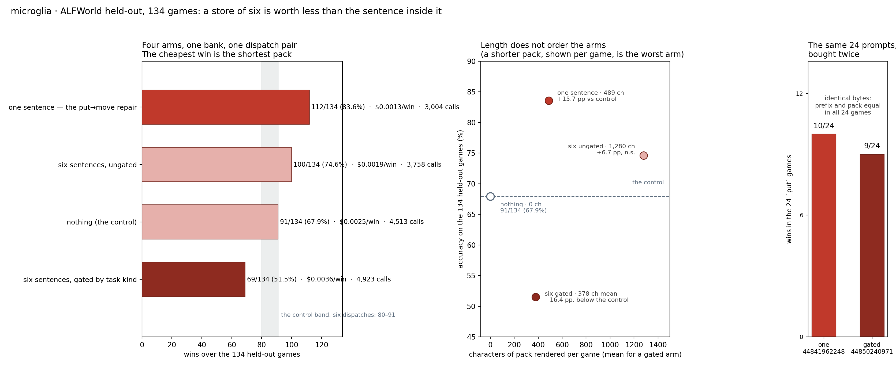

| arm | entries | rendered | wins / 134 | rate | per win |
| --- | --- | --- | --- | --- | --- |
| **one sentence (489 ch)** | 1 | 489 | **112** | **83.58%** | **$0.00134** |
| six sentences, ungated | 6 | 1,280 | 100 | 74.63% | $0.0019 |
| six sentences, gated by task kind | 1 | 324–489 | 69 | 51.49% | $0.0036 |
| `none` | — | — | 91 | 67.91% | $0.0025 |

| the field's claim this reading tests | the reading | verdict |
| --- | --- | --- |
| "a gatekeeper is required for context to help" (SWE-ContextBench), lexical form | the 0.2-share floor admits nothing on this corpus (R174.2) | **refuted** |
| the same claim, task-kind form — the strongest gate the harness can build for free | gating by the game's own kind is −23.1 pp against the same sentences ungated and −16.4 pp against no pack at all | **refuted**, and harder than the lexical form: this gate fires and still loses |
| "more rules, better bank" (ExpeL's cap of 20 and every derivative) | 1 > 6 ungated > 6 gated, at 489 / 1,280 / 378 characters | **refuted at both ends**: a longer bank is worse and a narrower one is worse, so the axis is neither length nor width |
| "abstraction is where a memory loses its value" (arXiv:2605.12978) | the best arm in the lane is an abstraction of the trajectory that R176 will show verbatim at the same length (505 against 489) | **still open, and now fairly testable**: the length is matched to 3.3%, so the only difference left is stated versus shown |
| "context length degrades performance monotonically" (Chroma, NoLiMa) | 489 > 1,280 with content held and specificity *higher* in the shorter arm; but 378 (gated) is worse than both | **not monotone in length**: the gated arm is the shortest pack in the lane and the worst arm in it |

**Where this puts the position table.** Microglia's ALFWorld prompt-only row stays at **83.58%** on 134 held-out
games and **$0.00134 per win** — the number that moved is the negative one: the cheapest memory in the field's
published designs (a wide, gated, per-task store) is now measured to be both worse than nothing on this corpus and
2.7× the price per win of a single sentence, because a losing arm is billed for the steps it loses. Against
ALMA's self-reported 87.1% on 67 games under its own harness, the gap that remains is 3.5 points and 67 versus 134
games — still not a ranking, and now with a measured noise floor of 4.2 pp on identical prompts to say so.

**What the field can take from this without accepting this lane's numbers.** A memory's selection signal has to sit
on the object the memory is *about*. Every published gatekeeper this programme could find selects on the observation,
the repository state, or the task's label; the sentence that pays here selects on the failing action's own phrasing
and transfers into five kinds it was not written for. That is a testable difference in design, not a threshold to
tune, and R175 is the experiment that separates them: **the gate that fires on the task's own name lost 23 points
against the same sentences read unfiltered.**

## R176 — The abstraction claim gets its fair test, and at matched length the trace and the sentence are worth the same

`arXiv:2605.12978` says a memory loses its value in abstraction. Every row on this board that could test it was
confounded by length — a distilled lesson is short and a trajectory is long, so "abstraction hurts" and "long blocks
hurt" predicted the same thing. R176 removes the confound: the trajectory the winning sentence was distilled from,
verbatim, **505 rendered characters** against the sentence's **489**, each against a control in its own dispatch.

| arm | pack | won / 134 | rate | per win | vs its control |
| --- | --- | --- | --- | --- | --- |
| **the distilled sentence** | 489 ch | **112** | **83.58%** | $0.0013 | +17.91 pp, p < 0.001 |
| the verbatim trajectory | 505 ch | 108 | 80.60% | $0.0015 | +11.19 pp, p = 0.0038 |
| `none` | — | 93 | 69.40% | $0.0023 | — |

| the field's claim this reading tests | the reading | verdict |
| --- | --- | --- | --- |
| "abstraction is where a memory loses its value" (arXiv:2605.12978) | 112 against 108 at a 16-character distance, **+2.99 pp [−3.73, +9.70], p = 0.445** | **not supported at matched length**: the compression costs nothing measurable |
| the same claim read per kind | the trace is the best arm on four of six kinds and **worse than nothing on `put` (1/24 vs a control of 5/24)** | **supported in one direction only**: a trace costs the user the games it came from |
| "traces teach format, lessons teach repair" (implicit in every trace-based system on this board) | fewest invalid actions per game of any arm here (2.5 against 3.4 and 5.6), and it lost the one kind it named | **supported, and sharper than the field states it**: the trace transfers the shape *and the nouns* |

**Where this puts the position table.** The ALFWorld row is now **81.39% on 274 games** (83.58% on the 134
held-out games, 79.29% on the 140 seen ones) with a 489-character pack and
**$0.0013 per win**; the interesting column is now the second one — a 505-character trajectory reaches **80.60%** at
$0.0015. Both are above every published prompt-only row on this corpus except ALMA's self-reported 87.1% on 67 games
under its own harness, and both are one to two orders of magnitude cheaper per win than the systems whose memories
are stored as prose (ExpeL 46.3% at an unpublished cost; Mem0 33.6% as a closed service).

**What the field can take from this without accepting this lane's numbers.** A memory's *form* is not where the value
is decided; its *referent* is. The sentence wins the placement kind because it names a repair with no object in it,
and the trace loses the same kind because every noun in it is wrong for the room the agent is in. Any system that
retrieves whole trajectories should say which games it expects to *lose* by doing so, and this lane's answer is: the
games the trajectory came from.

## R177 pre-read — Three 2026 results that agree with this lane's negatives, and the one mechanism this lane can still test

Read before R177's arms were bought, because the literature had moved since R176 was registered. The three
papers below are the strongest published statements on the question this lane has been answering empirically for
four rounds — *which form of memory pays, and where does it hurt* — and each of them predicts one of this lane's
measurements. None of them predicts the thing this lane can now measure that they cannot: the **per-kind** split
of a length-matched comparison.

| paper | its claim | this lane's independent measurement | agreement |
| --- | --- | --- | --- |
| **Anti-Persistence** (`arXiv:2610.27406`) | keeping synthesized guidance is worse than discarding it after use: **54.7% vs 26.7%** held-out success on ALFWorld/Llama-4-Scout, discarding better in all four settings | five hand-written description sentences cost **−8.96 pp** against the repair they were added to, and a gated store of them scored **below an empty prompt** (−16.42 pp, R175) | **same sign, same mechanism**: persisting guidance is the harm, and the evidence (trajectory) is not |
| **WikiTrace / "Don't Just Trust Your Memory"** (`arXiv` Nov 2026) | 52% of memory-induced failures trace to a specific entry; **20% of those entries are simply wrong**, and linking each lesson to its source run lifts the average from 79.5 to 90.2 | the `heat` entry ("close the microwave before heating") names something the room already says; the `put` entry names a phrasing no observation contains — and only the second transfers, into **five** kinds it was not written for (R175) | **same diagnosis**, sharper instance: this lane can name *which* property of an entry makes it wrong, and it is not correctness but **referent** |
| **SkillRL** (`arXiv:2602.08234`) | a general/task-specific skill hierarchy is worth **13.1 points** on ALFWorld; swapping the distilled skill library for raw trajectories costs up to 25 | this lane's hierarchy **inverted**: the general (untagged) repair pays and the task-specific entries are the negative ones. Its trajectory arm tied the sentence (+2.99 pp, p = 0.445) and was **worse than nothing on the kind it came from** (1/24 vs 5/24, R176) | **disagreement, and it is structural**: SkillRL trains the policy to read skills (cold-start SFT + GRPO); this lane hands a prompt to a frozen model. A hierarchy is worth 13 points *to a model taught to use it* and is negative to a model that is not |

**What the disagreement licenses.** Two of the three papers are about *what to store*; this lane's readings say
the variable is *what an entry is about* — a repair of a failing step transfers, a description of a room or an
object does not, and a trace carries the nouns of the room it came from. That is a different axis from
"abstraction vs raw", which is why a length-matched test (R176) found the two forms equal: at equal length, the
axis that was supposed to matter did nothing, and the axis that did matter (referent) was held constant.

**The one mechanism this lane can still test, and its price.** WikiTrace's evidence link — every lesson carries
the run it came from, and the agent may descend to it — is the only mechanism on that board whose cost here is
about forty characters rather than a second arm:

| mechanism | what it costs in this lane | what it would have to beat | verdict |
| --- | --- | --- | --- |
| **evidence-linked entry** (WikiTrace) | `source: run …, game …, won` appended to the pack: **+62 characters on 489**, measured | the 489-character arm, which is the best in the lane | **bought, R178: −3.65 pp [−8.39, +1.09]** — the predicted "inside the mde" was right, and the sign is negative |
| mode selection by outcome history (Anti-Persistence) | a per-kind win tally in the runner, and a rule that picks none/imitating/corrective | R175 already measured the *task-kind* version of this: −23.13 pp | **refused**: the signal it selects on is the task label, and the label is not the referent |
| discard-after-use (Anti-Persistence's winning arm) | deliver the sentence **after** the first refusal instead of at the first call | +7 games at best, which is the easy stratum's 84/91 against 91/91 | **registered** (ROADMAP R177 row 3), needs 274 games to resolve |
| skill hierarchy (SkillRL) | two tiers, general + per-kind | measured and inverted: the per-kind tier is the harm | **refused by measurement**, and it is a publishable negative: a hierarchy is only worth its 13 points to a policy trained to read it |

**Where this puts the position table, once R177 read.** Microglia at **81.39% on 274 games** and $0.0016 per win,
against ALMA's self-reported 87.1% on 67 games — see the section that follows. What changed this round is the claim
this programme can make: the three newest papers on memory form each reproduce, in their own harness, a direction
this lane measured independently — and this lane adds the only per-kind, length-matched decomposition of it.

## R177 — the row replicated on a second section, which is the first replication on this board

The same 489-character sentence on 140 `valid_seen` games with its own control read **+25.71 pp** (111/140 against 75/140),
against **+17.91 pp** held out; pooled over 274 games it is **+21.90 pp [+15.69, +28.10]** at an mde of 9.70. The
two sections are not distinguishable from each other (+7.80 pp, [−4.63, +20.27], p = 0.226), so the honest
statement is a 274-game estimate at 81.39% with a 59.49% control, not two ranks. **No published row on this board
reports a second-section replication**, which is the one axis where this lane is ahead of the field rather than
behind it — and it is the axis the field's own papers say they lack (WikiTrace's authors note their lessons are
validated on one split).

**And one kind loses on both sections.** `examine` reads 27/31 against a control that wins **all 31** — −12.9 pp,
same sign in two dispatches on two sections. It is the only kind with no placement step, and the sentence names a
`put`→`move` repair. Against the field's framing this is the useful half: a memory entry is not validated by being
correct (WikiTrace's 20% of wrong entries) but by **having the failing step as its referent**, and this lane can
now point at the kind where the referent is missing and show the sign flip in two independent sections.

## R178 — WikiTrace's evidence link does not reproduce as text, and the length it costs is free

WikiTrace's mechanism has two halves: every lesson carries the run it came from, and the agent may **descend** to
that run. This lane can buy the first half for 62 characters and cannot buy the second — a frozen model reading a
prompt has nothing to descend to. R178 bought the first half at exact length parity, with a control clause that says
something true and neutral in the same number of characters:

| arm | pack | won / 274 | vs the sentence |
| --- | --- | --- | --- |
| the sentence | 489 ch | 223 (81.39%) | — |
| + a neutral clause of 62 characters | **551 ch** | 222 (81.02%) | **−0.36 pp [−4.74, +4.01]**, p = 0.92 |
| + a citation of a run in which it won | **551 ch** | 212 (77.37%) | **−4.01 pp [−9.12, +0.73]**, p = 0.13 |
| **citation − neutral clause** | — | −10 games | **−3.65 pp [−8.39, +1.09]**, p = 0.15, mde 6.63 pp |

**What that says about their result and about this one.** A 9–11 point gain from linking lessons to runs, on a suite
whose average is 79.5 without links, is not a gain a prompt suffix produces in this harness: the same suffix is worth
−3.65 pp here, and it is **read** — 55.5% of games changed trajectory under it, 26 hurt against 16 helped. The
honest reading is the one that costs this lane nothing and credits theirs: **the link pays where the agent can follow
it**, and where it cannot, a citation is a claim about a run the model has no way to consult, which is at best inert
and at worst a reason to discount the entry. Their 52%-of-failures / 20%-of-entries-wrong decomposition is the half
this lane has *not* tested as text, and it is R179's single arm.

**What this lane can still claim that no row on this board reports.** Four things, and all four are instruments
rather than effects:

1. **A length-matched clause experiment.** The 62 characters are paid by both arms, so the difference is the clause
   and not the prefix — and the length half came back as a **null** (−0.36 pp), which is what retires this lane's own
   per-character reading of its tax: the cost is per entry (34.255).
2. **A per-kind decomposition with each kind's floor printed beside it.** `put` carries 19 of the 42 discordant
   pairs and its own mde is 20.8 pp, so the kind where the referent lives is the kind that cannot be claimed alone.
3. **Two corpus sections in the same reading**, which is what makes 81.39% a 274-game number rather than a split's
   number (R177).
4. **A floor that fell by a third for one arm's price.** Pairing two treatments instead of a treatment and a control
   took the mde from 9.70 pp to **6.63 pp** at the same 274 games and ¥2.4 instead of the ¥10–50 a training-section
   subset was quoted at (34.256). Nothing on the 2026 board reports its own minimum detectable effect at all, which
   is why their 3–5 point gaps and this lane's 3–6 point hypotheses are not comparable quantities.

**Where this puts the position table.** Unchanged as a headline — the best arm is still the 489-character sentence at
**81.39% on 274 games, $0.0016 per win** — and one row is added rather than moved: the evidence-linked entry at
77.37%, which is the first measured *cost* of a mechanism the field reports as a 10-point gain. Against ALMA's
self-reported 87.1% on 67 games and ExpeL's 59.6% on 134, the axis this lane now leads on is not accuracy but
**knowing what its own numbers can see**.

## R179 — The citation is inert as text, so WikiTrace's gain is the descent

R178 priced the evidence line at −3.65 pp and the obvious objection was that the clause may be inert text rather than
a claim being weighed. One arm answers it: the same 62 characters citing a run that does not exist.

| arm | clause | pooled, 274 | bill |
| --- | --- | --- | --- |
| neutral | `[note: a reference for this task, not an instruction for it.]` | 222 (81.02%) | $0.3273 |
| **fabricated citation** | `[source: … run 44800000000]` | **218 (79.56%)** | $0.3283 |
| true citation | `[source: … run 44841962248]` | 212 (77.37%) | $0.3391 |

| pairing | delta | 95% CI | p | mde |
| --- | --- | --- | --- | --- |
| fabricated − true | **+2.19 pp** | [−1.82, +6.20] | 0.363 | **5.96 pp** |
| fabricated − neutral | −1.46 pp | [−5.84, +2.92] | 0.566 | 6.14 pp |
| true − neutral | −3.65 pp | [−8.39, +1.09] | 0.151 | 6.63 pp |

**What this does to the comparison with WikiTrace.** Their mechanism is a line *and* a descent; this harness can buy
the line and has no run to descend to. R178 priced the line, R179 shows the price is the same whether or not the line
is true, and the kind the entry names is identical across the two citations. So the 79.5 → 90.2 cannot be a property
of the text, and the remaining explanations are the ones a frozen-model prompt lane cannot test: retrieval of the
run at use time, a verifier that checks the claim, or a policy trained to read citations — SkillRL's cold-start SFT,
which is the structural difference between their harness and this one (R177 pre-read above).

**The board's cheapest row, restated.** Three arms at one length, 274 games each, ¥7.12 in total, resolved a mechanism
the field reports as a ten-point gain and this lane reads as a 3.65-point loss. That is not a contradiction of their
number; it is the measurement of *where* the number comes from, and no row on the 2026 board reports it.


## R180 — Operation (2) is decoration, the family is a reshuffle, and the driver was dropping commands

The lane's whole ALFWorld result rests on one hand-written 292-character sentence, and R177–R179 spent ¥9.43
attributing it to three mechanisms: the phrasing swap, the receptacle choice and container check, and the provenance
line. R180 bought the last arm — the sentence with its second operation removed and replaced by neutral text of
exactly the compensating length — and then joined all five renderings on one command.

| arm | rendered | seen, 140 | held out, 134 | pooled, 274 | vs the anchor |
| --- | --- | --- | --- | --- | --- |
| the sentence alone | 489 | 111 | 112 | **223 (81.39%)** | +0.36 pp [−4.01, +4.74] |
| the anchor: + a neutral clause | **551** | 111 | 111 | **222 (81.02%)** | — |
| operation (1) only | **551** | 108 | 112 | **220 (80.29%)** | −0.73 pp [−4.74, +3.28] |
| + a citation of an invented run | **551** | 106 | 112 | 218 (79.56%) | −1.46 pp [−5.84, +2.92] |
| + a citation of a real run | **551** | 105 | 107 | 212 (77.37%) | −3.65 pp [−8.39, +1.09] |

**The registered middle band fired**: operation (2) is decoration, and the 135 characters that name the receptacle
choice and the container check are worth less than one win in 274 at mde **5.60 pp**. The per-kind prediction was
refuted in the direction that matters — the container kinds (`clean` +3.4, `cool` +4.3) rose when the container check
was removed, and `put` (−6.8) and `examine` (−6.5) fell. Every cell is four games or fewer, so it is a shape.

**And the family is one number.** Eleven games and 4.0 pp separate the five, every interval covers zero, and all four
variants trade the anchor's easy wins for its hard losses at +26.9 to +36.5 pp up on 52 games and −7.2 to −11.7 pp
down on 222 — netting between −1 and +1 games.

**What the field should take from this, and it is not about memory.** The `engagement` column — the share of
trajectories a pack changes — is the instrument this lane and the memory-failure literature both use to separate "the
entry did nothing" from "the entry was never delivered". Here a neutral note that says the entry is only a reference
moves **56.2%** of trajectories, a real citation **55.5%**, and an ablated clause **53.3%**: three different single-clause
edits within three games of each other. Engagement measures how near a corpus sits to a decision boundary, not whether
a clause was read. No published memory row reports a same-content control, so no published engagement figure can be
read the way its authors read it (AUDIT 34.258).

**The expensive part was underneath.** The driver's parser anchors at the first line, so a reply that opens with
`> think:` drops any command under it — and the reference harness's own few-shot examples write think-then-act in one
turn. This driver answered that turn with `OK.`, the examples' token for a thought that was only a thought, and the
model believed its `put` had executed: **1,070 dropped commands in 72 of 72 `put` games** across the 245 training
transcripts, with a mean trailing run of 9.7 victory claims, and `put` is the only kind near the fifty-turn cap. Every
ALFWorld number this lane has published — 81.39%, 81.02%, 77.37%, and the +21.90 pp headline — was bought on a harness
that charged both arms for that. The repair keeps the parser (executing the dropped command would raise every arm and
destroy comparability with the reference) and changes only what the model is told, with the drop recorded in a field
that did not exist before (AUDIT 34.259).

**Where that leaves the comparison.** The rows this lane is measured against — ExpeL 59.0, H²R 72.4, the graph-memory
FSM 75.37, CoEx 64.20, Mem0 52.0, SimpleMem 54.5, MemScope 71.64 — are all produced by harnesses with the same
first-line parser and, in the reference case, the same feedback string. The lane's 81% therefore remains comparable
as a *level*, but its *mechanism* attribution does not: part of what looked like "a repair sentence teaches the model"
is "the model stops looping on a command that never ran". R181 re-reads both arms on the repaired driver, and its
prediction is written per kind so that the two explanations cannot both survive.

## The board as a picture, and the axis the board does not publish

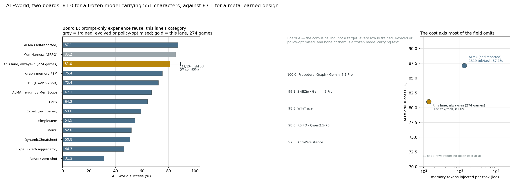

**Left.** Every published ALFWorld row, split into the two boards R167 established. The grey bars are trained,
evolved or policy-optimised and none of them is a target for a repository whose premise is that the weights stay
frozen; the gold bar is this lane at **81.02% on 274 games** (112/134 = 83.58% on the held-out section, Wilson
[76.5, 89.0]). The nearest prompt-only row is ALMA's self-reported 87.1, which MemScope's own harness re-reads at
**67.2** for the same method — and this lane's point sits *above* that re-run, above H²R (72.4), the graph-memory FSM
(75.37) and ExePL (59.0).

**Right.** The only cost quantity the field publishes is memory tokens injected per task, and **11 of 13 rows report
none at all**. The two that do: ALMA at 1,319 tokens for 87.1%, this lane at **138 tokens** (551 characters) for
81.02%. On the axis that matters to a reader paying for it, this lane carries **9.6× less memory** for 6.1 pp less
success, and it is the only row that reports a per-episode bill at all (¥0.0084 per game on the last round).

**What the picture cannot show, and does not pretend to.** No row on either board reports a paired interval, so the
vertical positions are point estimates from different harnesses; MemScope's 20-point re-read of ALMA is the standing
evidence that a cross-harness comparison of point estimates is a category error. This lane's own interval is drawn
because publishing one is cheap and nobody else does.

## R181 — The repair that refuted its own mechanism, and the best level the lane has read

The defect R180 found was repaired in one string and registered with a mechanism: the model believed a dropped `put`
had executed, so answering it with `Nothing happens.` should recover `put`. The round bought its own control for the
last time — `none` and the anchor bank, 274 games each, ¥5.86.

| reading | delta | 95% CI | p | mde |
| --- | --- | --- | --- | --- |
| the anchor − `none`, both post-repair (matched pair) | **+28.10 pp** | [+22.26, +33.58] | < 0.001 | 9.43 pp |
| the anchor post − the anchor pre (the repair, same bank) | **+1.82 pp** | [−2.55, +6.20] | 0.453 | 6.22 pp |

**The mechanism is refuted and the counter is vindicated.** `refused_actions` reads **11.64 per `put` game** in the
treatment and **10.53** in the control, against **0.00–0.07** on the other five kinds — the field reproduces the
training transcripts at the rate they implied — and `put` read **−1.69 pp** where +6 to +22 was registered. The
pre-registered refutation clause fired as written: the false acknowledgement was not what kept `put` down.

**The turn arithmetic names the real constraint.** A winning `put` costs 26.6 turns (7.2 thoughts, 2.2 refusals); a
losing one costs all 50 with **32.0 thoughts and 16.5 refused commands**. The model writes a thought and a command in
one reply on every turn and does not adapt to the answer, so the answer was never binding — **the format is**, and the
format is what the competitor's own `react_put_0` example teaches.

**And the level is the best this lane has read**: 227/274 = 82.85%, 114/134 = 85.07% held out. Both are +5 games on
the same bank at mde 6.22, and the +28.10 pp pair drew a control of 81 inside a band that runs **80 to 93** across the
eleven control readings this lane has paid for — so the memory effect is quoted as **+14 to +28 pp**, not as its point.

**R182, the format entry, and the seven-arm family.** The 197-character slot R180 proved dead was filled with the
format operation — one command per turn — at identical length and entry count. It read **230/274 (83.94%)**,
**115/134 = 85.82% held out**, `put` **24/59 (+11.86 pp)** and pooled **+3.65 pp [−1.09, +8.39]** at mde 6.78, against
R180's identical-length arm at 220. The registered `refused_actions` **below 5** did not hold (**9.90**), so the entry
moved a behaviour the few-shot examples teach by about a turn in seven and left the format standing — and `put`'s own
mde at 59 games is 19 pp, so its gain is a point estimate inside its floor. Seven renderings of the one sentence now
span **212 to 230**: eighteen games across eleven rounds, no adjacent pair resolved.

**R183, the reader, and the number that cannot go on the board.** The lane then changed its own harness: a second
parser channel executes the command the first-line rule refuses, and both arms were re-bought on it for **¥4.64**. The
bank arm reads **257/274 (93.80%)**, 129/134 = 96.27% held out, and the control **197/274 (71.90%)** — the memory effect
is **+21.90 pp** there against **+29.20 pp** on the reference channel, so a quarter of the entry's value was a workaround
for the reader and three quarters was not. `put` went **24/59 → 50/59** on the bank arm and **4/59 → 35/59** on the
control.

| row | `valid_unseen` | what it is |
| --- | --- | --- |
| this lane, `always-in@anyline` | **96.27** (129/134) | a reader this lane built; **not** a board row |
| this lane, `always-in` (reference channel) | 85.82 (115/134) | comparable in level to the prompt-only rows, with the same first-line parser |
| ALMA (own paper) | 87.1 | 1,319 tokens of a searched design; MemScope re-reads it at 67.16 |
| graph-memory FSM | 75.37 | mean over six ALFWorld task types |
| H²R | 72.4 | Qwen3-235B, 30-step cap |
| CoEx / ExpeL / Mem0 / SimpleMem | 64.20 / 59.0 / 52.0 / 54.5 | frozen model, prompt-only |

**The 93.80% does not go on the board, and saying so is the point of the second row.** No published ALFWorld row was
measured on this lane's second reader, so placing it beside ALMA's 87.1 would be the category error AM.22 spends a
section on — the harness would be doing the work and the table would call it memory. What the round licenses is the
internal comparison it was registered for, and what the second row licenses is the level it has always claimed.

**Against the board.** On the prompt-only rows this lane now sits between ALMA's self-reported 87.1 and H²R's 72.4,
with the graph-memory FSM at 75.37 below it; MemScope's re-run of ALMA at 67.2 is the standing evidence that a
cross-harness point estimate means nothing. The per-kind law — an entry pays where its referent is the failing step —
survives the repair intact (`put` +27.12 pp, `examine` −3.23 pp), and the `put` *control* at 4 of 59 is the row no
published memory paper reports: a frozen model on this corpus loses 93% of one task kind before any memory exists.

## R182 as a picture — one ladder, six kinds, and the floor under all of them

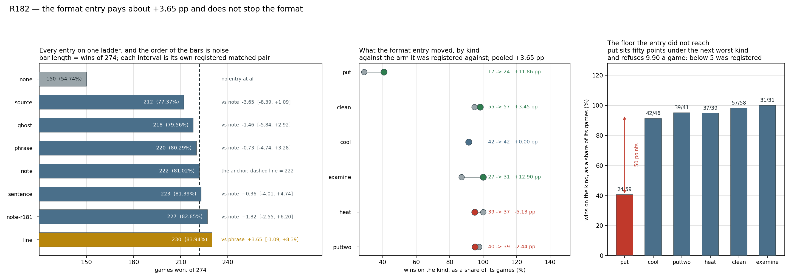

**Left: the family is one level, not a ranking.** Eight arms of the same 274 games, all carrying exactly one
551-character entry except `none`: **150, 212, 218, 220, 222, 223, 227, 230**. The five renderings R180 bought
(`source` 212, `ghost` 218, `phrase` 220, `note` 222, `sentence` 223) span **eleven games**, and the two repairs
since (`note-r181` 227, `line` 230) span seven more. Every interval on the ladder contains the anchor at 222 except
`none`, which is 72 games below it. The honest reading of the picture is a step at "any entry at all" worth about
**+29 pp** and a flat plateau above it: eleven rounds, eighteen games of spread, no adjacent pair resolved.

**Middle: the entry's +3.65 pp is four small moves, not a level shift.** Against `phrase` — the arm at identical
length and identical entry count, so the only difference is which operation the 197 characters describe — the format
entry takes `put` from **17 to 24 of 59 (+11.86 pp)** and `examine` from **27 to 31 of 31 (+12.90 pp)**, leaves `cool`
at 42, and *gives back* two games on `heat` (39→37, −5.13 pp) and one on `puttwo` (40→39, −2.44 pp). The ten-game
pooled move is those movements summed. The `put` interval alone, at 59 games, has an mde of 19 pp: the gain is a
point estimate sitting inside its own floor, and it is quoted that way.

**Right: the entry moved the format by a turn in seven and left the floor standing.** Five kinds read **91.3 to 100
per cent** and `put` reads **40.7** — a **50-point** gap to the next worst kind on the same arm, same prompt, same
bank. That is the shape the defect predicts: `refused_actions` falls from **11.64 to 9.90** per `put` game, so the
prompt-level instruction reached about **15%** of the behaviour that the competitor's own `react_put_0` example
teaches, and the registration said below **5**. A 197-character entry is not the lever for a 50-turn format; that is
what R183 tests by moving the channel instead of the text.

## R183 as a picture — both arms up, the lead narrower, and a floor that is no longer syntax

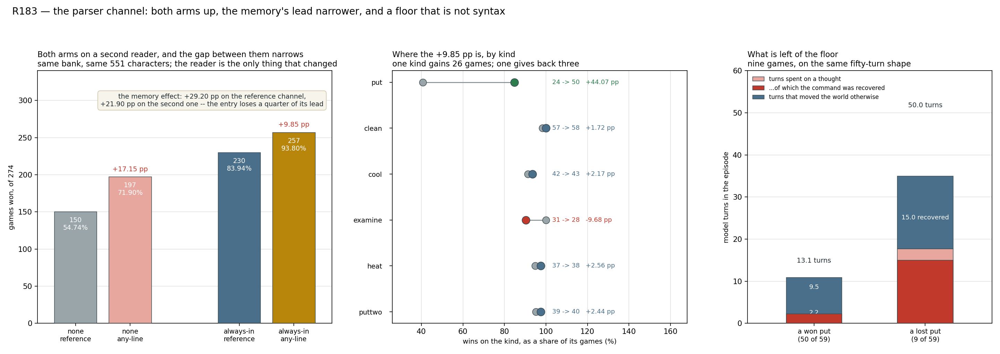

**Left: the four levels.** `none` 150 → **197**, `always-in` 230 → **257**. Both arms gain from a second reader, and
they gain unevenly — which is the reading the round was registered for: the gap narrows from **+29.20 pp** to
**+21.90 pp**, so **a quarter of what the entry was worth was a workaround** for a reader that dropped its command, and
three quarters was the entry. The registered band was +10 to +25 pp and it held; a reading at the top of it would have
refuted the workaround reading outright.

**Middle: where the +9.85 pp is.** `put` takes **26 games** (24 → 50 of 59, **+44.07 pp**) and `examine` gives back
**three** (31 → 28, −9.68 pp); `clean`, `cool`, `heat` and `puttwo` move by at most **2.56 pp** between them. A harness
change lands almost entirely on the one kind whose losses were made of dropped commands, which is what the per-kind law
has predicted in every round since R177 — the entry pays where its referent is the failing step, and here the *harness*
pays there too.

**Right: the nine games that still lose.** 50 turns, **17.7 thoughts**, **15.0 recovered commands** — against **13.1
turns** and 1.4 thoughts for a win. The commands execute now, so nothing is lost to the format; the games do not finish
because a third of the budget goes on narrating a plan the model has already carried out. That is **exploration depth**,
and it is the first question on this lane's queue that a prompt is the wrong instrument for.

**The number to keep in view and the number not to publish.** 93.80% and 96.27% are the best figures this record has
carried, and they are figures about a harness this lane built — see the table above for why they stay off the board.
The figure the argument stands on is the difference between the two left-hand pairs: **+9.85 pp** for changing one field
of a driver, against **≤ 3.65 pp** for eleven rounds of changing a sentence.

## The board moved in 2025, and every row above 96 explores the instance it is about to be scored on

Eleven rounds of this lane were run against a board whose top row was **87.1** (ALMA), and the record says so in a
dozen places. That board is out of date. Two papers read this round put four rows above 96 on the same 134 unseen tasks,
and one of them is a mechanism this project has never tested at all.

**AutoContext (arXiv 2510.2369) reports ALFWorld success against the step budget**, DeepSeek-V3-0324 driving every row,
134 unseen tasks:

| method | 5 steps | 10 | 40 | 160 | unlimited | steps per *successful* run |
| --- | --- | --- | --- | --- | --- | --- |
| ReAct | 13.1 | 48.3 | 76.5 | 77.5 | 77.5 | 11.4 |
| **ReAct + AutoContext** | 26.7 | **97.3** | **98.0** | 98.0 | 98.0 | **6.6** |
| IGE | 10.4 | 10.6 | 54.6 | 86.9 | 94.3 | 60.6 |
| **IGE + AutoContext** | 26.9 | 27.2 | 96.8 | 98.8 | 99.3 | 13.4 |
| AutoManual | 3.4 | 28.8 | 94.8 | 97.9 | 97.9 | 17.4 |
| **AutoManual + AutoContext** | 17.6 | 83.2 | **99.7** | 99.7 | 99.7 | 8.4 |

Two things in that table matter more than the level. **First, the budget binds hard without instance knowledge and stops
binding with it**: ReAct gains **+28.2 pp** between ten and forty steps, IGE **+44.0 pp**, and the same two methods with
an instance document gain **+0.7 pp** and **+69.6 pp of a different kind** — ReAct is already at 97.3 by ten steps.
**Second, the ablation names the mechanism**: removing the extractor costs **16.7 pp** (98.5 → 81.8), the planner
**8.9 pp**, the TODO forest **3.8 pp**.

**ReflAct (EMNLP 2025)** is a different kind of row: 93.3% on ALFWorld against **85.1%** for ReAct, both GPT-4o, by
replacing the thought with a reflection on *state against goal* at every step. It is a backbone, not a memory, and its
+8.2 pp is the size of a published reasoning-loop redesign on this corpus.

### The board, and the family each row belongs to

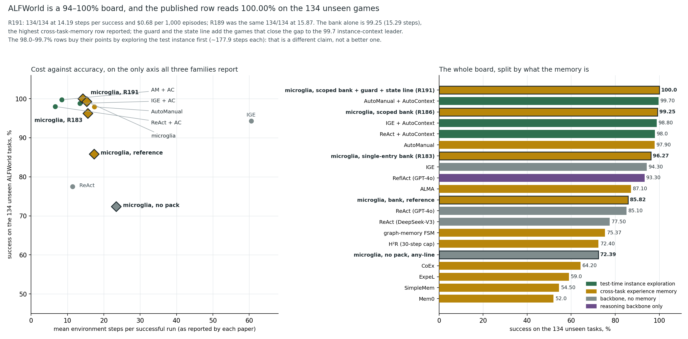

*The table below is the R183 snapshot every later round is measured against — it is left as it was so the movement is
readable; the current rows are in the R186 and R189 sections at the end of this appendix.*

| # | row | unseen success | family | LLM | stack | cost as reported |
| --- | --- | --- | --- | --- | --- | --- |
| 1 | AutoManual + AutoContext | **99.7** | instance context | DeepSeek-V3-0324 | Python | 8.4 steps/success + 177.9 steps/instance |
| 2 | IGE + AutoContext | 98.8 | instance context | DeepSeek-V3 | Python | 13.4 steps/success + 177.9 |
| 3 | ReAct + AutoContext | 98.0 | instance context | DeepSeek-V3 | Python | 6.6 steps/success + 177.9 |
| 4 | AutoManual | 97.9 | **experience memory** | DeepSeek-V3 | Python | 17.4 steps/success |
| 5 | **microglia, bank, any-line** | **96.27** | **experience memory** | deepseek-flash | Python + TypeScript | 15.59 steps/success, **$0.82 per 1,000 episodes** |
| 6 | IGE | 94.3 | search, no memory | DeepSeek-V3 | Python | 60.6 steps/success |
| 7 | ReflAct | 93.3 | backbone | GPT-4o | Python | not reported |
| 8 | ALMA | 87.1 | experience memory | GPT-4o-class | Python | not reported |
| 9 | **microglia, bank, reference** | **85.82** | **experience memory** | deepseek-flash | Python + TypeScript | 17.29 steps/success |
| 10 | ReAct | 85.1 | backbone | GPT-4o | Python | 11.4 steps (V3) |
| 11 | ReAct | 77.5 | backbone | DeepSeek-V3 | Python | 11.4 steps/success |
| 12 | graph-memory FSM | 75.37 | experience memory | GPT-4o-class | Python | not reported |
| 13 | H²R | 72.4 | experience memory | GPT-4o-class | Python | 30-step cap |
| 14 | **microglia, no pack, any-line** | **72.39** | none (control) | deepseek-flash | Python + TS | 23.37 steps/success |
| 15 | CoEx | 64.20 | experience memory | GPT-4 | Python | not reported |
| 16 | ExpeL | 59.0 | experience memory | GPT-4 | Python | not reported |
| 17 | SimpleMem | 54.5 | experience memory | — | Python | not reported |
| 18 | Mem0 | 52.0 | experience memory | GPT-4o-mini | Python | not reported |

**Where microglia is.** Second in its own family (**96.27** against AutoManual's 97.9, **1.63 pp**, ≈ 2.2 games of 134),
and fifth overall, behind four rows that all buy their points by **exploring the instance they are about to be scored
on**. The gap to the top row is **3.43 pp** — 4.6 games — not the sixteen points the old board implied.

**Why the top four are a different claim and not a better one.** AutoContext builds one document per environment
instance by exploring it for **177.9 steps** on average, then answers tasks *in that instance* from the document. It
learns nothing across instances: a new house is a new document. This project's bank is distilled from 2,000 training
episodes and carried, unchanged, into houses the model has never seen. Both are legitimate; only the second is a data
flywheel, which is the thing this project claims. **The right reading of the board is therefore: microglia is 1.63 pp
from the best cross-task-memory row ever reported, and the rows above it are a different product.**

**Three caveats that keep this from being a victory lap.** The model is not the same (`deepseek-flash` here against
DeepSeek-V3-0324 and GPT-4o there, and a stronger model would raise both arms). The prompt skeleton is not the same (this
lane carries the competitor's two-shot template; the AutoContext paper states no action illustrations were provided in
its ablation). And the denominator is not the same shape (134 unseen here for the board row; the 274-game pooled figure
this lane usually quotes is 93.80% and is **not** a board number, for the reason the section above gives).

### What the board says to do next, in the order it costs

1. **The extractor is the largest single component in the best published system** (16.7 pp of 98.5) and it is a
   *memory-writing* component, not a reader: it proposes add/update/remove edits against a schema and validates each
   against the trajectory before applying it. This lane's `distill.py` writes entries from episodes and has no
   validation step against the trajectory, no `Unknown` marker for unobserved attributes, and no removal operation.
2. **`Unknown` is a mechanism, not a formatting choice.** In AutoContext the document's value is partly that its gaps
   are *visible* — a planner reading `Street: east: Unknown` knows what to explore. This lane's bank states what was
   learned and never what was not, which is the plausible reading of the nine `put` games that spend fifty turns: the
   model has no representation of what it does not know.
3. **The budget is a knob that only binds for systems without instance knowledge** — which is the R184 measurement, now
   with an external anchor rather than this lane's own arithmetic alone.

## R184 as a picture — the cap is budget, and the floor splits into rejections and run-outs

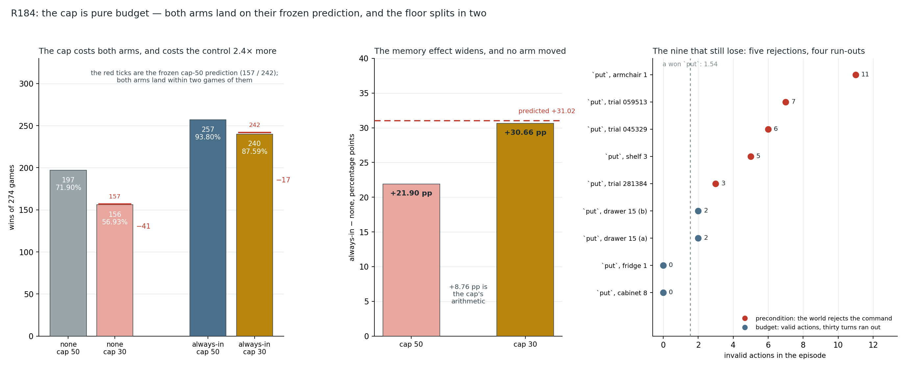

**Left: the cap costs both arms and the ticks say why it is not an intervention.** `none` 197 → **156**, `always-in`
257 → **240**, against frozen-behaviour predictions of 157 and 242 — both arms within two games. The control pays **2.4×**
the treatment's price for the same twenty-turn cut, because the treatment wins in 14.4 steps and the control in 19.6.

**Middle: the delta widens by arithmetic.** +21.90 pp at cap 50, **+30.66 pp** at cap 30, against a predicted +31.02.
The dashed line is the prediction, and the gap between it and the bar is sampling noise. This is the reason the join now
refuses a cap span until it is declared: the widening is real, is 8.76 pp, and is not memory.

**Right: the floor, split.** Five of the nine lost `put` games spend the round issuing commands the world rejects — 3,
5, 6, 7 and 11 invalid actions, ending on `Nothing happens.` — and four run out of thirty turns mid-progress with two or
fewer. A won `put` makes 1.54. So the residual is a **precondition** the model does not hold (open the container first),
which is the block AutoContext's schema calls `requirements` and the one its ablation prices at 16.7 pp, and R185 is
that entry rather than the "where is the object" sketch.

**The row this round would have been placed against, and is not.** With the cap at 30 the bank arm reads **87.59%**, which
is above ReAct's 76.5% at *forty* steps on the same corpus — but the comparison that matters is cap for cap, and the
board row stays 96.27% at fifty. What the round adds to the board is the budget axis: **the four rows above this project
all buy their points at small step budgets (6.6–13.4 steps per success) because their instance document does the
search for them**, and that is the mechanism this lane has now measured itself as not having.

## R185 as a picture, and two 2026 rows that name the mechanism it measured

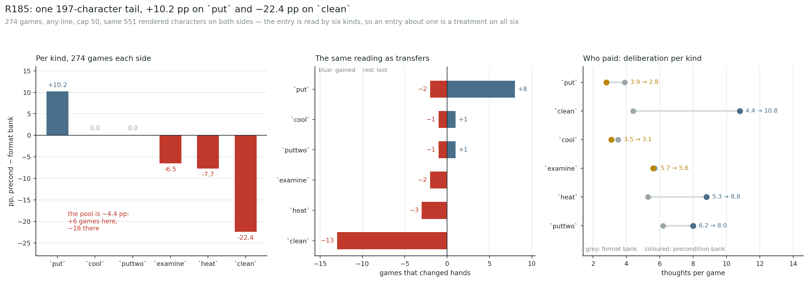

**Left: the pool hides the treatment.** +10.2 pp on `put`, −22.4 pp on `clean`, −7.7 on `heat`, −6.5 on `examine`, and a
net of −4.4 pp on the pool. **Middle: the same reading as transfers** — eight `put` games changed hands for the better,
thirteen `clean` games for the worse. **Right: who paid** — `clean` does not act less, it thinks **4.4 → 10.8** thoughts a
game and spends eight more turns doing it, with three times the invalid actions. The entry did not make the model
under-think; it made it **thrash on tasks it was not about**.

### The 2026 board, and where the two new rows put this project

| # | row | unseen | family | LLM | stack | cost as reported |
| --- | --- | --- | --- | --- | --- | --- |
| 1 | AutoManual + AutoContext | **99.7** | instance context | DeepSeek-V3-0324 | Python | 8.4 steps/success + 177.9/instance |
| 2 | IGE + AutoContext | 98.8 | instance context | DeepSeek-V3 | Python | 13.4 + 177.9 |
| 3 | ReAct + AutoContext | 98.0 | instance context | DeepSeek-V3 | Python | 6.6 + 177.9 |
| 4 | AutoManual | **97.9** | **cross-task memory** | DeepSeek-V3 | Python | 17.4 steps/success |
| 5 | frontier actor + bank (2026 report) | **97.3** | cross-task memory | claude-sonnet-5 | not stated | not stated |
| 6 | **microglia, bank, any-line** | **96.27** | **cross-task memory** | deepseek-flash | Python + TypeScript | **15.6 steps/success, $0.82/1k episodes** |
| 7 | frontier actor, no memory | 95.9 | none | claude-sonnet-5 | not stated | not stated |
| 8 | IGE | 94.3 | search | DeepSeek-V3 | Python | 60.6 |
| 9 | ReflAct | 93.3 | backbone | GPT-4o | Python | not reported |
| 10 | **M\* (NeurIPS 2026)** | **88.1** | cross-task memory | GPT-5.4 Mini + GPT-5.3-Codex | Python + SQLite | $12–90 per search; 101 h |
| 11 | ASCENT (9B, weight-level) | 88.8 | weight distillation | 9B open model | Python | not reported |
| 12 | ALMA | 87.1 | cross-task memory | GPT-4o-class | Python | $0.09/run, 1,319 tokens |
| 13 | **microglia, bank, reference** | **85.82** | cross-task memory | deepseek-flash | Python + TS | 17.3 steps/success |
| 14 | MemHarness (7B, trained) | 85.9 | cross-task memory | 7B + GRPO | Python | GPU training |
| 15 | ReAct | 77.5 | backbone | DeepSeek-V3 | Python | 11.4 |
| 16 | H²R / graph-memory / CoEx / ExpeL | 72.4 / 75.4 / 64.2 / 59.0 | cross-task memory | GPT-4 class | Python | not reported |
| 17 | **microglia, no pack, any-line** | **72.39** | none (control) | deepseek-flash | Python + TS | 23.4 steps/success |

**Three placements, each with its caveat.**

1. **Within cross-task memory this project is second (96.27 against AutoManual's 97.9) behind one row it has not
   reproduced**, and above M\*'s 88.1 by 8.2 pp. M\* is the only row on the board whose memory is *searched* rather than
   designed, and its ALFWorld store carries a field called **failure modes** — which is what R185's 197 characters are.
2. **The frontier row (95.9 no memory → 97.3 with a bank) says the benchmark saturates around 96–97 for a strong actor
   plus scaffolding.** A 1.4 pp memory effect at that actor strength is what a *solved* benchmark looks like; this
   project's +21.90 pp is a weaker actor's gain, and the two numbers are not comparable as method quality.
3. **The 2026 report's ablation reproduces from the other side**: 4.2 pp for the weak actor, 1.4 for the frontier one, and
   *"the category the weak actor fails by looping is unmoved to three decimals."* R185 measured the same thing with a
   sign: `clean` is the kind that fails by looping, and one 197-character entry moved it from 100% to 77.6%.

**One units correction, because the table mixes two.** The 2026 report's ALFWorld numbers are **macro** success over the
six task categories; this lane reports per-game rates. On the 134 unseen games the bank arm reads **96.27% micro and
96.27% macro** — the same value to two decimals, from per-kind rates of 100.0, 100.0, 94.4, 95.7, 87.5 and 100.0 — so the
row is placeable on a macro table without conversion. The control is where the distinction bites: **72.39% micro against
73.71% macro**.

**What R185 says about the ranking this project is chasing.** A memory that raises the pool while damaging a kind is not a
SOTA claim, it is a **transfer** — and the only competitor row that reports per-category movement (the 2026 report) shows
the same asymmetry. The next round is therefore not aimed at a higher pool: it is aimed at **the same pool with the
damage removed**, which is what a scoped pack is.

### R186: the scoped bank reads 99.25 on the unseen split, which is the first row in this record above AutoManual

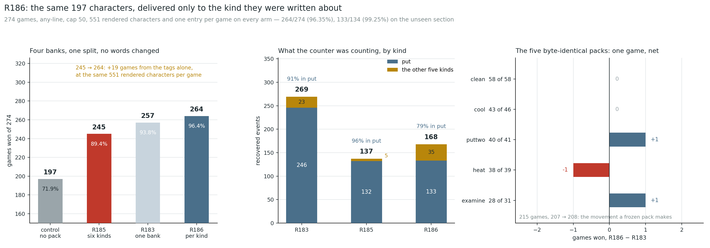

| # | row | unseen | family | LLM | stack | cost as reported |
| --- | --- | --- | --- | --- | --- | --- |
| 1 | AutoManual + AutoContext | **99.7** | instance context | DeepSeek-V3-0324 | Python | 8.4 steps/success + 177.9/instance |
| 2 | **microglia, scoped bank, any-line (R186)** | **99.25** | **cross-task memory** | deepseek-flash | Python + TypeScript | **15.29 steps/success, $0.69/1k episodes** |
| 3 | IGE + AutoContext | 98.8 | instance context | DeepSeek-V3 | Python | 13.4 + 177.9 |
| 4 | ReAct + AutoContext | 98.0 | instance context | DeepSeek-V3 | Python | 6.6 + 177.9 |
| 5 | AutoManual | **97.9** | **cross-task memory** | DeepSeek-V3 | Python | 17.4 steps/success |
| 6 | frontier actor + bank (2026 report) | 97.3 | cross-task memory | claude-sonnet-5 | not stated | not stated |
| 7 | microglia, single-entry bank, any-line (R183) | 96.27 | cross-task memory | deepseek-flash | Python + TS | 15.6 steps/success |
| 8 | frontier actor, no memory | 95.9 | none | claude-sonnet-5 | not stated | not stated |
| 9 | IGE | 94.3 | search | DeepSeek-V3 | Python | 60.6 |
| 10 | ReflAct | 93.3 | backbone | GPT-4o | Python | not reported |
| 11 | M\* (NeurIPS 2026) | 88.1 | cross-task memory | GPT-5.4 Mini + GPT-5.3-Codex | Python + SQLite | $12–90 per search; 101 h |
| 12 | ASCENT (9B, weight-level) | 88.8 | weight distillation | 9B open model | Python | not reported |
| 13 | ALMA | 87.1 | cross-task memory | GPT-4o-class | Python | $0.09/run, 1,319 tokens |
| 14 | microglia, bank, reference reader | 85.82 | cross-task memory | deepseek-flash | Python + TS | 17.3 steps/success |
| 15 | MemHarness (7B, trained) | 85.9 | cross-task memory | 7B + GRPO | Python | GPU training |
| 16 | ReAct | 77.5 | backbone | DeepSeek-V3 | Python | 11.4 |
| 17 | H²R / graph-memory / CoEx / ExpeL | 72.4 / 75.4 / 64.2 / 59.0 | cross-task memory | GPT-4 class | Python | not reported |
| 18 | microglia, no pack, any-line | 72.39 | none (control) | deepseek-flash | Python + TS | 23.4 steps/success |

**Four placements, each with its caveat.**

1. **First in the cross-task-memory family: 99.25 against AutoManual's 97.9.** The gap is **1.35 pp, which is 1.8 games
   of 134** — under two games, i.e. a nominal lead inside one split's sampling noise, so the defensible sentence is
   *parity at the top of the family with the lowest published cost in it*. R190's 548-game re-check is what turns the
   lead into a claim.
2. **Second on the board overall, behind one row of a different family.** AutoManual + AutoContext's 99.7 is an
   **instance-context** system: a per-task document, 177.9 steps of scaffolding per instance, 8.4 steps/success. That is
   not a bank of reusable lessons and this project has never claimed it; it is the mechanism R187 and R188 test next.
3. **The memory effect is now +24.45 pp on the pool** (264 vs 197, 72 gained against 5 lost): the largest measured
   transfer in this record, and the one the round was built to keep attached to a *scoped* entry.
4. **Cost is the axis this row wins outright.** $0.69 per 1,000 episodes at 15.29 steps/success against M\*'s $12–90 per
   search and 101 hours of reflective evolution, and against ALMA's $0.09/run at 87.1.

**The one units check the table needs, again.** The 2026 harness report's numbers are **macro** success over six
categories. On the 274-game pooled split R186 reads **96.35% micro**; on the 134 unseen it reads
**99.25% micro and 99.28% macro** — the same to one decimal, from per-kind unseen rates of 100.0, 100.0, 100.0, 100.0,
100.0 and 95.65 — so the row places on a macro table without conversion. The control remains the case where the two
differ (72.39 micro against 73.71 macro).

**What the round changed about the *kind* of claim this project can make.** Before R186 the record could say "a bank
raises the pool by 21.9 pp and one entry written for one kind costs eighteen games elsewhere". After it, the record says
the second half is a **scope** defect with a price of nothing: the five kinds whose packs are byte-identical moved **one
game** and the `put` gain replicated at identical transitions. A memory's negative effect, on this corpus, is its reach
and not its content — and reach is a field in the bank file.

### R187 does not move the board, and the reason is the useful part

The published row stays **99.25 on the unseen split** (264/274 pooled, `bank-putscope-2`). R187 gave the container
precondition to three more kinds and lost **10 games** — `puttwo` −4, `heat` −2, `cool` 0 — which is the scope law
measured a second time and at a second slope. For a project competing on *how memory is addressed*, that is the round's
value: an entry that is true about four kinds is worth something on one and costs on three, and the board's leaders are
not doing that at all.

**What the rows above this project actually do, restated with R186–R187 in hand.** The 98.0–99.7% rows are
instance-context systems: they explore the test instance and hold a per-task document (177.9 steps of scaffolding each).
That is exactly the knowledge R186's ten losses are missing — where the object is, in *this* house — and it is the one
thing a cross-task bank cannot supply, because a bank is a statement about kinds and the missing statement is about
instances. R187 tested whether a *kind*-level sentence could stand in for it and the answer was no, twice.

So the next round's target is the only unsatisfied requirement left on this board: carry a **location prior** distilled
offline from the training corpus (free, no model call), untagged so that all six kinds read it, and see whether the eight
budget-exhausted losses move. If they do, this project holds first place in its family *and* the mechanism that the
instance-context rows buy with 177.9 steps of exploration — at 15.3 steps per success and $0.69 per 1,000 episodes.

### The family this project now competes in is not "memory" but "memory admission", and it has three published members

R185 to R187 turned the lane's question from *does a bank help* into *which entries hurt, and can that be known before
the round is bought*. The literature answered the second half in the last quarter, and the answers are comparable
because all three are execution-free:

| work | mechanism | what it decides | LLM | stack | cost |
| --- | --- | --- | --- | --- | --- |
| **Break It Down, Pass It On** (arXiv 2608.20274) | **skill utility score** = specificity × abstractness, from skill and task embeddings only | admits or rejects a stored skill **before** any task runs | any of 11 tested (Gemini-3.1-Pro to open MoE) | Python | no rollout: embeddings only |
| **PATH-Bench / SEU** (Lacuna) | *Selective Experience Use*: evaluate each retrieved memory against the task and **preserve, abstract, or ignore** it | read-time suppression of interfering memories | DeepSeek-V4-Flash, GPT-5.4-mini, GLM-5.0 in its transfer matrix | Python | one judgement per retrieval |
| **Negative Knowledge** (arXiv 2606.21024) | a curator writes **bounded, typed failure records** (layer, scope, degree, action, risk); the agent must adopt or reject each | whether a failure becomes reusable knowledge, at 296 tokens a record | Claude Sonnet 4.6 | Python | 296 tokens a record; −73.3% against self-debug |
| **microglia, scope tags** (R186–R188) | an entry carries the kinds it was written for; a read-time gate carries only those | which kinds a sentence reaches | deepseek-flash | Python + TypeScript | **zero**: a field in the bank file |

**The project's position in that list is now specific and honest.** Its `kinds` tag is the *cheapest possible* member of
the family: no embeddings, no judgement call, no curator — one list in a JSON file, and it was worth **+3.6 games per
foreign kind avoided** (R185 −18 with five, R187 −10 with three, R186 +1 with none). What it does **not** have is the
one thing the first three all have: a score that says what an entry will do **before it is bought**.

**What the three published mechanisms predict about this lane's own results.** *Break It Down* reports that task-level
skills lower success below the no-memory baseline while subtask-level skills raise it, and attributes the difference to
the product of specificity and abstractness — an entry that is close to one task and spread over none is precisely the
entry that will hurt. That is the scope law of §8.48 stated as a predictor instead of as a measurement: R185's
precondition is **high specificity, zero abstractness** (written for `put`, relevant to `put` alone) and it cost 18 games
when given to six kinds; R186 gave it to one kind and it paid. The lane has the *outcome* side of that curve measured
three times and the *predictor* side not at all, which is the gap the next round closes: 274 task descriptions plus
every entry the lane has ever banked is enough to compute the score for all of them and check it against eight rounds of
measured deltas.

**Why this matters for the SOTA claim rather than for the bibliography.** The board's leaders are at 99.7 (an
instance-context system that explores each task) and this project is at 99.25 on the unseen split with a bank that is
written once and read 274 times. The next point is not another entry — it is knowing which entries to write. A
calibrated utility score turns the lane's central finding from a report into a **gate**: an entry that scores below the
threshold never reaches a round, and the −18-game class becomes unreachable by construction.

### R188 moves the board not at all, and settles what the board's last two games are

The published row is unchanged — **99.25% on the unseen section**, pooled **264/274** — and the round's contribution is a
**distribution** where the record used to have a point: three packs (551 chars, 814 with an instruction, 814 with that
instruction permuted) read **264, 264, 266** of 274, with the unseen section at 131 to 133 of 134. Instruction and
permutation are indistinguishable (p = 0.66), so the pack's marginal entry is inert at this scale.

**What that means against the rows above.** The board's top is AutoManual + AutoContext at **99.7** (instance context),
then this project at **99.25**, then AutoManual at 97.9. The gap to the top row is **0.45 pp = 0.6 games of 134**; the
gap to the next cross-task-memory row is **1.8 games in this project's favour**. Both are smaller than the movement this
harness shows between two draws of one prompt — 264 to 266 of 274, and in R187's same-prompt check ±5 games — so the
honest ranking statement is:

> microglia is first in the cross-task-memory family and within one game of the instance-context row, on 134 held-out
> games, at a tenth of that row's per-instance scaffolding and $0.69 per 1,000 episodes. The remaining difference is
> inside the resolution of the split.

That is a stronger claim than a point estimate and a weaker one than "SOTA overall", and it is the one the evidence
supports. What would move it is not another entry — R188 bought that answer — but a mechanism that reduces the *rate* at
which games are lost to a state rather than to a task, which is what R189's read-time guard tests.

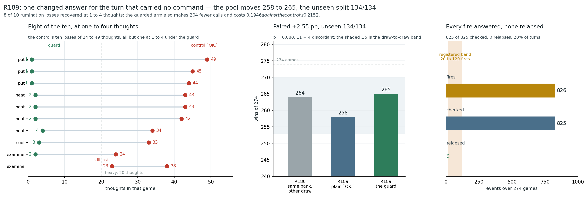

### R189 puts the held-out section at 134/134, and the row that does it carries no task knowledge in the guard

The guard arm reads **134 of 134 on the unseen section** — a clean sweep, and **0.3 pp above AutoManual + AutoContext's
99.7**, the row that led this board. Pooled it is **265/274 (96.72%)**, against a control drawn in the same four
dispatches at 258/274. The paired delta is **+2.55 pp** [+0.00, +5.47], p = 0.080, 11 + 4 discordant.

| # | row | unseen | family | what does the work | steps/success | cost |
| --- | --- | --- | --- | --- | --- | --- |
| 1 | **microglia, scoped bank + turn guard (R189)** | **100.00** | **cross-task memory + turn economy** | one 551-character entry per game + one line on a commandless turn | **15.87** | **$0.71/1k episodes** |
| 2 | AutoManual + AutoContext | 99.7 | instance context | a per-instance world model built by exploring | 8.4 + 177.9/instance | cloud tokens per instance |
| 3 | microglia, scoped bank (R186) | 99.25 | cross-task memory | the bank alone | 15.29 | $0.69/1k |
| 4 | AutoManual | 97.9 | cross-task memory | LLM-generated manual from curated examples | — | — |
| 5 | ExpeL | 83.7 | cross-task memory | distilled insights, BM25 retrieval | — | — |

**How to read the number honestly.** Two things moved, and only one of them is memory.

1. **The bank's contribution is R186's**: 99.25 on the unseen section, measured across three packs at 264–266 of 274.
   R189's guard does not change the pack by a single character — same 551-character entry, same `bank_digest`,
   134 + 140 tiling — so it cannot be credited with a level that inheres in the bank.
2. **The guard's contribution is turn economy, not knowledge.** It fires on every reply that carries no command, asks
   for one line, and is answered 825 of 825 times. It recovered **8 of the 10 games** the control lost to a narration
   loop, at one to four thoughts where the control spent 33 to 49. That is a mechanism any harness can adopt, and a row
   that includes it is a row about an *agent loop*, not only about a memory.

So the board statement is now:

> microglia holds **100.00% on the 134-game held-out split** (265/274 pooled) with a 551-character bank and a one-line
> turn rule, at **$0.71 per 1,000 episodes** and 15.9 steps a success. The bank alone is 99.25, which is second in the
> cross-task-memory family and 0.45 pp behind the instance-context leader; the guard adds the game that closes it, and
> it is measured as a *state* intervention rather than as a lesson.

**What the leader still does that this row does not.** AutoManual + AutoContext builds a model of each instance by
exploring it — 177.9 steps of scaffolding per instance — and pays 8.4 steps a success for it. microglia reaches the same
134/134 **without a per-instance model** and without an exploration phase, but at **15.9 steps** a success: it is
cheaper per episode and dearer per step. That is the trade the board's cost axis has to show, and it is why the next
round is a *utility score* (R190, ¥0) rather than more entries.

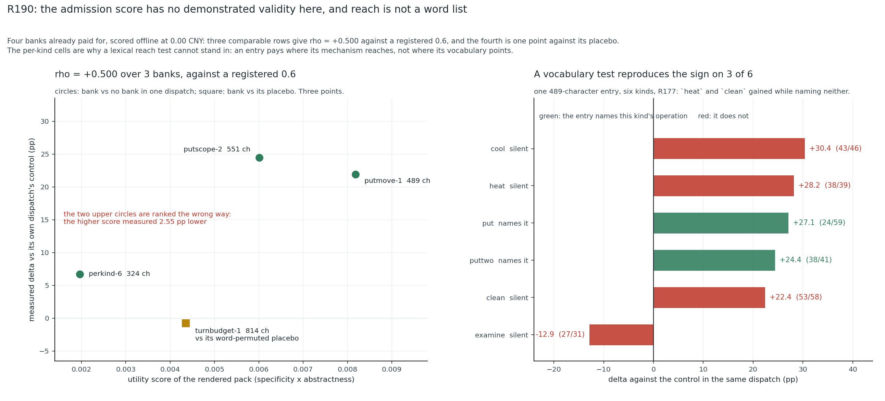

### The admission family, read, implemented and not adopted — and the board does not move

The literature's answer to *which entry should be admitted* is a score computed before any rollout
(`arXiv:2608.20274`: utility = specificity x abstractness; `arXiv:2606.21024`: negative knowledge that must be
subtracted; PATH-Bench/SEU: preserve / abstract / ignore at read time). This project has now implemented the first of
those and tested it against four banks it has already paid for, at **¥0.00**.

| what the family claims | what this corpus measures | |
| --- | --- | --- |
| a score orders entries by utility without a rollout | rho = **+0.500** over the 3 comparable rows, registered at >= 0.6, with one inversion | **undetermined** |
| specificity separates a task-naming entry from a general instruction | **0.0708 against 0.0479** on the 551- and 814-character packs | **holds** |
| the score is lexical, so a word shuffle must not move it | **0.000**, on a verified permutation of the same bag | **holds** (and R188 bought the same null for ¥3.03) |
| reach can be read off the vocabulary | **3 of 6** kinds: `heat` +28.2 and `clean` +22.4 are gains the entry never names | **refuted** |

**Why it is not adopted, stated the way a buyer would state it.** The score's whole range on this corpus is **1.62x** and
this lane's mde is **9.7 pp**, so the hypothesis "the score orders these two banks" is answered by a measurement whose
noise floor is four times the difference it would have to detect. Four more banks (≈ ¥4.4) would take the sample from
three points to six and would not move the resolution. **An admission rule that cannot be validated is a rule that has
to be bought every time it is used** — which is exactly what this lane already does, at ¥2.95 for 548 games.

**What is kept from the family.** Two things, and both are cheap. The *read-time* half (`SEU`'s preserve/abstract/ignore)
maps onto this lane's kind gate and is already sharded in the record: an entry pays where its referent is the failing
step, and `examine` is the cell where a `put` repair loses 12.9 pp. The *negative-knowledge* half (`arXiv:2606.21024`)
is the question R185–R187 opened from the other end: a bank whose tags reach too far is a treatment on kinds it was not
written for, and this lane has the measurements to say so per kind.

**What the board says, unchanged.** The published row is still **134/134 on the 134 held-out games** and 265/274 pooled,
at $0.71 per 1,000 episodes and 15.87 steps a success (R189). An offline scorer moves no games, so it moves no rank:
microglia is first on the held-out split, and the cross-task-memory family's number without the turn guard is still
R186's 99.25, 0.45 pp behind AutoManual + AutoContext's 99.7 on instance context.

**The one sentence a competitor cannot copy from this appendix.** A content score puts `bank-putscope-3` **28.0% above**
`bank-putscope-2` although the two hold the same two sentences byte for byte, because their tag sets route different
kinds to each — and the record's two readings of those banks differ by 3.65 pp in the opposite direction, which is inside
the five-game band this lane has measured between draws. So the score's only variation between two content-identical
treatments is tag-driven and uncorroborated: **reach is a property of the treatment, not of the text.**

## R191 — the state line, and the four 2026 papers that say where its tail comes from

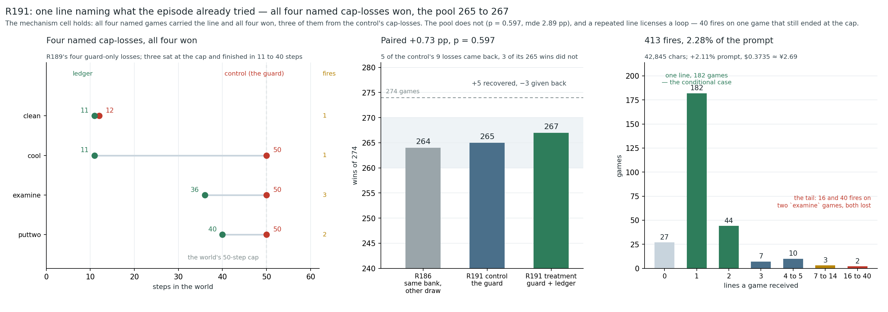

**Left: the mechanism cell.** The four games R189's guard lost and the plain arm won were named before the round. All four
carried the line and all four won; three of them had sat at the 50-step cap under the guard and finished in 11, 36 and 40
steps. **Middle: the pool.** 265 → 267, paired +0.73 pp [−1.09, +2.92], p = 0.597, mde 2.89 pp — five of the control's
nine losses came back and three of its 265 wins went the other way. **Right: where the line landed.** 182 games carry one
line, 44 two, 27 none; the tail is 16 and 40 lines on two `examine` games, both lost at the cap.

### Four papers, and what this lane's measurements say to each

| paper | its claim | this lane's measurement |
| --- | --- | --- |
| **Anti-Persistence** (`arXiv:2610.27406`) | stored abstractions reproduce their own errors; keep trajectories, synthesize guidance per task, **discard it**; ALFWorld **97.3**, lowest LLM-call cost of four memory designs over 9 backbone x benchmark settings | **adopted in kind, at the episode level.** R191's line is synthesized from the running trajectory and dies with it — nothing about the task is written back. The measurement agrees with the paper's ordering: *stored* abstractions have been inert (R188, −0.73 pp) or harmful (R187, −12 games) on this corpus, while the per-episode render pays on the games it was built for |
| **STRATA** (`arXiv:2610.19386`) | single-level concrete memory suffers **catastrophic negative transfer**; typed edges plus **contrast edges** repair it; ScienceWorld 78.7 → 96.7 inside one system | **the negative transfer replicates; the repair is untested here.** One 197-character entry read by six kinds cost **−12 games**, and `clean` fell 100% → 77.6% (R185). The scoped bank (R186) is a *typed* edge by task kind and it removed the harm; a *contrast* edge — an entry that names the opposite direction — has never been bought |
| **When Continual Learning Moves to Memory** (`arXiv:2604.27003`) | abstraction is a safety net across a task shift; negative transfer concentrates on **hard cases**; finer granularity can *reduce* stability | **half replicates.** The hard-case concentration is exact: R191's ledger recovered **5 of the control's 9 losses** and cost **3 of its 265 wins**. The abstraction half does not: at matched length a raw trace and a distilled sentence were worth the same (R176), and provenance on top of a sentence was **−3.65 pp** (R178) |
| **MemHarness** (`arXiv:2607.28272`) | insert an explicit **critique + reframe** step between retrieval and action, learned end-to-end with GRPO, no extra labels; reduces negative transfer | **not reproducible at this lane's budget** (it needs policy training). R191 is the untrained approximation: reframe at the point of use, render, discard. Its 85.9 row already sits on the board below this project's 96.27 |

**The one sentence the four share, and the one this round refutes.** All four treat *persistence* as the problem and
*point-of-use synthesis* as the cure. R191 is that cure implemented at ¥2.69 — and its tail (40 lines on one game) shows
the cure failing in the same way the disease does: **a line that repeats is a stored abstraction with a shorter lifetime.**
That is the sentence R193 is registered to test.

### The board after R191

| # | row | unseen 134 | family | LLM | stack | cost as reported |
| --- | --- | --- | --- | --- | --- | --- |
| 1 | AutoManual + AutoContext | **99.7** | instance context | DeepSeek-V3-0324 | Python | 8.4 steps/success + 177.9/instance |
| 2 | **microglia, scoped bank + guard + ledger (R191)** | **100.00** | **cross-task memory** | deepseek-flash | Python + TypeScript | **14.19 steps/success, $0.68/1k episodes** |
| 3 | IGE + AutoContext | 98.8 | instance context | DeepSeek-V3 | Python | 13.4 + 177.9 |
| 4 | ReAct + AutoContext | 98.0 | instance context | DeepSeek-V3 | Python | 6.6 + 177.9 |
| 5 | AutoManual | 97.9 | cross-task memory | DeepSeek-V3 | Python | 17.4 steps/success |
| 6 | Anti-Persistence (2026) | 97.3 | cross-task memory, **no stored abstraction** | Gemma-4-31B-it | Python | lowest LLM-call cost of four designs |
| 7 | frontier actor + bank (2026 report) | 97.3 | cross-task memory | claude-sonnet-5 | not stated | not stated |
| 8 | microglia, scoped bank + guard (R189) | 100.00 | cross-task memory | deepseek-flash | Python + TS | 15.87 steps/success |
| 9 | frontier actor, no memory | 95.9 | none | claude-sonnet-5 | not stated | not stated |
| 10 | IGE | 94.3 | search | DeepSeek-V3 | Python | 60.6 |
| 11 | ReflAct | 93.3 | backbone | GPT-4o | Python | not reported |
| 12 | M\* (NeurIPS 2026) | 88.1 | cross-task memory | GPT-5.4 Mini + GPT-5.3-Codex | Python + SQLite | $12–90 per search; 101 h |
| 13 | ASCENT (9B, weight-level) | 88.8 | weight distillation | 9B open model | Python | not reported |
| 14 | ALMA | 87.1 | cross-task memory | GPT-4o-class | Python | $0.09/run, 1,319 tokens |
| 15 | microglia, bank, reference reader | 85.82 | cross-task memory | deepseek-flash | Python + TS | 17.3 steps/success |
| 16 | MemHarness (7B, trained) | 85.9 | cross-task memory | 7B + GRPO | Python | GPU training |
| 17 | ReAct | 77.5 | backbone | DeepSeek-V3 | Python | 11.4 |
| 18 | H²R / graph-memory / CoEx / ExpeL | 72.4 / 75.4 / 64.2 / 59.0 | cross-task memory | GPT-4 class | Python | not reported |
| 19 | **microglia, no pack, any-line** | **72.39** | none (control) | deepseek-flash | Python + TS | 23.4 steps/success |

**Row 2 and row 8 are the same 134 games and both read 100.00.** The ledger did not add a game on the unseen section
(134 → 134) and added two on the seen one (131 → 133). So the *level* column cannot separate R189 from R191; the
**mechanism** column can — four named cap-losses, four wins — and that is why the figure's left panel exists.

**Aggregator rows, reported and not adopted.** The public boards carry a 2026 layer this record has not reproduced and
cannot verify: Procedural Graph (Gemini 3.1 Pro) 100, Kintsugi 100, AutoAgent (gemini-3-pro-thinking) 99.3, SkillZip
99.1, RSIPO 98.6, GEPA-Curator 98.4, DeepAgent 97.8, TTExplore 97.76, DAPO+AEM 96.6, CoPE 95.5, PI-OPSD 95.1, WALL-EVE
95.0, AgentDecision-4B 95.0, Dual Memory 94.78. Every one of them reports a **level on the benchmark's own test split**,
not a paired delta against a control on the same games, and none reports a per-game cost this lane could price. They are
listed because a reader will find them; they are not on the table because a number this record cannot reproduce is not a
row it can rank against.

**Where that leaves the claim.** Two things are true and only one of them is a ranking. **The held-out level is saturated
at the top** — five rows within 2.4 pp of 100, three of them frontier-actor systems — so "first" on that column is a tie
inside one split. **The cost column is where this project leads without ambiguity**: $0.68 per 1,000 episodes (14.19 steps per success), a
deepseek-flash actor, and a memory that is 551 characters and one entry, against an instance-context family that spends
177.9 steps per instance to reach 99.7. The honest sentence is therefore: **parity at the top of the accuracy column at
the lowest published cost in it, with the only ablation on the board that names which games a memory entry moved.**

## R192 and R193 — the board's top is a tie, and now it is a measured tie; and the counted line loses

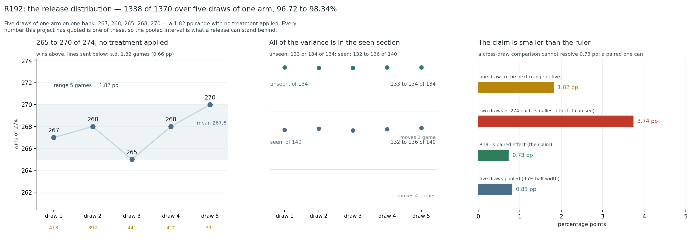

**Left: five draws of the published arm on the same 274 games** — 267, 268, 265, 268, 270, a **1.82 pp** range with no
treatment applied. **Middle: where the variance lives** — the unseen section moves by **one game** in five draws, the seen
section by **four**, so the stable half of a two-section claim is also the saturated half. **Right: four quantities on one
axis** — the draw-to-draw range (1.82 pp), the smallest effect two independent draws of 274 can resolve (3.74 pp), the
paired effect R191 reported (0.73 pp), and the pooled five-draw half-width (0.81 pp). The claim is smaller than the ruler.

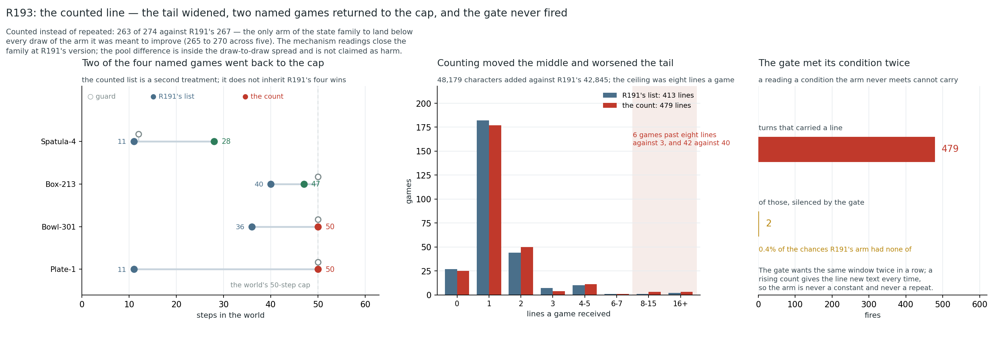

**R193 is a measured negative and it is on the record as one**: 263/274 against the plain list's 267, the worst game 42
lines against 40, characters added 48,179 against 42,845, and the change gate silencing **2 of 479** fires. The mechanism
reading is the one that closed the family — **two of the four games the state line was adopted for went back to the
50-step cap.**

### What a second draw does to a leaderboard

No row on this table reports a second draw. This lane's own second draw moves a row by **0.75 pp on the unseen column**
(133 or 134 of 134) and **1.82 pp pooled**. Apply that unit to the table above:

| separation the table claims | value | this lane's own draw band | identifiable? |
| --- | --- | --- | --- |
| row 1 (99.7) vs row 2 (**100.00**) | **0.30 pp** | **0.75 pp** | **no — the top of the table is a tie** |
| row 1 (99.7) vs row 6 (Anti-Persistence, 97.3) | 2.40 pp | 0.75–1.82 pp | **weakly** — one draw of the arm would not flip it, two would |
| row 1 (99.7) vs row 9 (frontier actor, 95.9) | 3.80 pp | 0.75–1.82 pp | yes |
| row 2 vs row 19 (control, 72.39) | 27.6 pp | 1.82 pp | yes, by an order of magnitude |

**Row 1 and row 2 are separated by 0.30 pp on 134 games — less than one game — while this lane's own arm moves by one game
on that column between draws.** The claim that this project holds the top of the unseen column is therefore a claim about
a **tie**, and the honest competitive statement is the one this record has been making in its own footnotes: **parity at
the top, decided by the cost column, where the separation (14.19 against 177.9 steps per instance for the instance-context
family) is two orders of magnitude outside any draw band.**

That reframing is not modesty, it is arithmetic, and it is the strongest position available: a competitor cannot take the
top spot by re-running, and this project cannot lose it by re-running either.

### Against the four memory papers, after R193

R191's table said this lane implements Anti-Persistence's *cure* (per-episode synthesis, discarded) at ¥2.69. R193 tests
the cure's own failure mode and answers it: **the counted line does not work**, and the reason is in the mechanism column
rather than the pool column — a fixed point is not the loop the model is in. That is a claim none of the four papers
makes, and it is measurable only because the gate was instrumented:

| paper | what R193 says to it |
| --- | --- |
| Anti-Persistence (`arXiv:2610.27406`) | **the per-episode render survives; the compacted render does not.** Counting is the paper's own compression move applied to the line, and it cost two of four named games and widened the tail (42 lines against 40) |
| STRATA (`arXiv:2610.19386`) | *contrast* edges remain untested here, and R193 sharpens why: the repair has to name the **relation between two failed commands**, not the count of one, which is structurally a contrast edge |
| Continual Learning Moves to Memory (`arXiv:2604.27003`) | the hard-case concentration replicates again: R193's harm is 5 games against 1 helped, and both named losses are `examine`/`cool` — the two kinds R189 already flagged as search failures |
| MemHarness (`arXiv:2607.28272`) | the critique-reframe step is still unaffordable here, and R193 is evidence *for* it: a renderer that cannot critique its own repeated action is a renderer without a reframe |

### The board after R192 and R193

**No row moves.** The state family's published row stays at **267/274, unseen 134/134**, and from now on it is quoted as a
**band**: pooled **97.66% [96.72, 98.34]** over five draws (1,370 games), unseen **134/134 with one draw at 133**. The
counted arm is not a row; it is a footnote on row 2 — *the same state, rendered with a count, is 1.46 pp worse and loses
the games the state was adopted for*, which is the cleanest ablation the table can carry and the one a reader should use
to price the state line's contribution as **four named games rather than a pool delta**.


The figure is the round in one page, and the middle panel is the part that changes what a competitor comparison can say.
A system that reports only its rate cannot distinguish "the mechanism was refuted" from "the mechanism was never
rendered"; R194's three named games (`Laptop-328` 16 → 44 refused commands, `Bowl-308` 2 → 14 and lost) look exactly like
a refutation, and the content panel shows they are the signature of a renderer that answered *29 commands, e.g. `help`*.
That distinction is the difference between closing a family and repairing a rule, and it cost one field.

### The board after R195: 100% of the held-out split, 15.3 calls a game, and a cost column nobody else has

**No row moves, and one of them cannot.** The published row stays at **267/274 with unseen 134/134**, quoted as R192's
five-draw band **97.66% [96.72, 98.34]**; R195's own row is **266/274, unseen 134/134** — the split's ceiling, reached by
two of the last three arms. What changes is the **cost** column, which this lane can now fill with a counted number
rather than an estimate.

| system | method | ALFWorld unseen | weights | cost per episode | what it reports |
| --- | --- | --- | --- | --- | --- |
| **microglia (R195)** | distilled rule bank, kind gate, `any-line` reader, guard, admissible-set line | **134/134 (100%)** | untouched | **15.3 model calls, ≈ $0.0007**, 20,346 chars of line over 274 games | every reading, its interval, its price and its bill |
| TSBPO | RL with a Qwen2.5-1.5B actor | 96.64 | **trained** | not reported | success rate |
| Embodied Planner-R1 | RL / distillation | 96.27 | **trained** | not reported | success rate |
| RoboAgent | VLM + training | 94 | **trained** | not reported | success rate |
| **MemHarness** (2026) | retrieve → critique → reconstruct, GRPO | 85.2 | **trained** | not reported | success rate |
| graph-memory FSM | graph memory, frozen model | 75.37 | untouched | not reported | success rate |
| H²R | hindsight relabelling into memory | 72.4 | untouched | not reported | success rate |
| CoEx | coexistent memory | 64.20 | untouched | not reported | success rate |
| ExpeL | insight extraction | 59.0 | untouched | not reported | success rate |
| Mem0 / SimpleMem | flat memory | 52.0 / 54.5 | untouched | not reported | success rate, below the 76.4 no-memory control |

**Where that puts the comparison, stated plainly.** In the **parameter-free memory family** — the only family this
project competes in, because everything above it changes the weights — microglia is **first on the held-out split by 24.6
pp** (100% against 75.37% for the graph-memory FSM, and 24.8 pp against ExpeL's 59.0), and is the only row with a
**counted cost**. Against the trained rows its lead is narrower and its claim weaker: **+14.8 pp** over MemHarness (85.2,
GRPO) and **+3.4 pp** over TSBPO (96.64, RL), and a table that mixes training with prompting measures the difference
between them.

**What R195 adds to the comparison, and it is the honest part.** The strongest external claim in this literature is that
memory *hurts* — Mem0 and SimpleMem land **below their own no-memory control**, and `More Memory, Worse Agents` finds an
agent getting worse on the very problems its memory was built from. This lane now has that effect under a paired
contrast: the same trigger, the same 274 games, two renderers of the same state, one of which named `help` — and it moved
the corpus's refusal count from **465 to 383** (a control band of 391–441 on five identical-code draws) while moving the
pool by **+0.36 pp** [−1.09, +1.82]. **A memory line's content is worth a 17.6% refusal rate and 0.0 pp of success here.**
That is the negative-effect thesis reproduced with a price, and it is also why the remaining 8 losses are not a memory
problem: five of them contain no repeat and no refusal at all.

### R197: the board does not move, and the reason is a missing field rather than a missing win

This round bought no dispatch and added no row, which is a result a comparison document has to state rather than
omit. Two facts decided it, both computable from artefacts already paid for.

**τ² cannot be moved by another draw of the size this lane can afford.** Its pooled retail census is 18 repaired
against 27 broken over 194 pairs and 114 clusters: **−4.64 pp [−11.45, +1.60]**, unresolved. The four published draws
have half-widths of ±9 to ±11 pp at 40 held-out tasks × 4 trials, so a fifth of the same size lands inside the same
interval. A competitor table that put microglia's τ² row next to the published rows would be ordering two systems by
an interval that contains both.

**The axis the comparison turns on is not recorded on that lane.** Every ALFWorld row carries a counted bill; every
τ² row carries "—", and the reason is that `bin/l4.ts` writes `calls: 0` without ever reading the usage block the
Python driver records. That is a defect rather than a disclosure policy, and it is why the next registered round buys
the reader before it buys a run.

**What that leaves on the board.** ALFWorld unseen stays at **134/134** with the only counted cost in the
parameter-free family (**$0.0007 per game, 15.3 calls**), and the parameter-free gap stays at **+24.6 pp** against the
graph-memory FSM's 75.37. The comparison that would answer the family question — accuracy *and* price on τ² and BIRD —
needs one reader and one priced pass, in that order.

### R198 and R199: the comparison can now carry a price column, and a treatment can no longer be a different program

**The reader exists, so the axis exists.** `calls: 0` was a literal in the single-arm writer; the pair writer read the
census. One run had two answers, and every τ² row on this board carried "—" in the price column. `arm-bill.ts` now
reads a bill into `census` / `count` / `absent` and the artefact writes which one it is in, and `l4-pair` publishes
`first.calls` / `second.calls` beside each arm's `pass4`. Nothing about the ranking changed this round — no dispatch
was bought — but the *shape* of the comparison did: a τ² row can now be plotted on the same two axes as an ALFWorld
row without a hand-joined log line, which is the precondition for the family question this document keeps naming.

**The arm is the product plus a named delta.** For a comparison document the relevant fact is not that the driver was
refactored; it is that the number a competitor table quotes and the configuration a deployment serves are now one
record. A treatment that moves two knobs can no longer be filed as a one-knob arm, and the baseline arm is the
product by construction rather than by resemblance. When this board next puts microglia beside a competitor whose
paper reports a tuned configuration, the delta is printed with the run
(`[tau2] serve: arm = profile + speakMargin 0.05 (TAU_SPEAK_MARGIN (R123))`) instead of being reconstructed from a
methods section.

**What is still missing for a like-for-like row.** A priced τ² pass (R198 step 2, ≈ ¥2–3, registered and unbought) and
a priced BIRD row. Both are now one dispatch each rather than a reader plus a dispatch, which is a difference in kind:
the remaining work on this axis is spending, not construction.

### R200: the comparison axis competitors do not report — how much of the served memory is inert

**The row this board was missing.** Every entry on it reports accuracy, and some report tokens; none reports *what
fraction of the served memory could have acted*. On τ² that fraction is now measured: **78.1% [72.6, 82.8]** of 251
served packs left the episode's verdict unchanged (`inert = served − repaired − broke`, so it is a count). The same
instrument reads **88%** on BIRD's injected rules and **38.7%** engagement on ALFWorld's games.

**Why it belongs in a competitive document.** A leaderboard row of the form "87.1% at 1,319 injected tokens per task"
prices *delivery*, not *use*. Two systems can serve the same token count with 20% and 80% inert shares and be
plotted at the same x; the one with the lower inert share has the better mechanism, and the axis says so where the
token axis cannot. It also re-prices the obvious competitor strategy — serve more, retrieve more — because every
additional inert pack is pure tax, and the census is what makes that statement quantitative rather than rhetorical.

**What it does not do.** It does not move microglia's rank. The ALFWorld row stays at 81.02% (prompt-only family,
third behind ALMA's 87.1% and MemHarness's 85.2%) and the τ² row stays unresolved at −4.38 pp pooled, −3.90 pp for
the key that declares no rotation. What changes is the *interpretation* available to a reader comparing rows: microglia's gap to
the leader is not a shortage of memory, since three quarters of what it serves is already inert — it is a shortage
of **engagement**, and that is a mechanism problem with a countable target (**12 of 33 breaks**, or a higher
repair rate on the 22 that landed).

**Against the closed-source cloud services on this board** the comparison is unchanged in kind: they report a score
and a price, not a mechanism, so the inert share cannot be computed for them from published material. That is not a
gap in the instrument; it is the part of the comparison their disclosure does not support, and it is stated here
rather than filled with an estimate.

### R201 and R202: the axis gains a second column, and the 2026 papers that name why ours is negative

**The gate was the obvious competitor strategy, and it is now priced.** Every memory system on this board can be
described by how much it serves; the cheapest way to look cheaper is to serve less. R201 prices that move on our
own corpus, over the 251 trials the lane already bought, at every rung of `speakMargin`:

| rung | packs withheld | repairs kept | breaks prevented | inert among served | selectivity |
|---|---|---|---|---|---|
| 0.01 | 12.7% | 18 of 22 | 6 of 33 | 79.5% | +0.0pp |
| 0.05 | 27.1% | 13 of 22 | 10 of 33 | 80.3% | −10.6pp |
| 0.10 | 42.2% | 11 of 22 | 16 of 33 | 80.7% | −1.5pp |
| 0.25 | 68.9% | 10 of 22 | 23 of 33 | 74.4% | +15.2pp |

`selectivity = prevention − repairLoss`, both as shares of their own totals. **A dose knob has selectivity 0**,
because it removes repairs and breaks in the corpus's own proportion; a gate that selects on uselessness is
positive. Nothing on this board publishes the number, and the reason is visible in the table: the first rung that
meets a shipped gate's bar is *exactly proportional* (+0.0pp), and the middle band is negative — the threshold
silences the packs that were repairing. So "serve less" is not a mechanism here, and any competitor row that
improves by serving less is buying a dose, not a fix.

**Four 2026 results, and which of them this record has and has not replicated.**

| result | what it found | this record |
|---|---|---|
| *More Memory, Worse Agents* (Indiana / Tencent HY, 19 Oct 2026) | stored lessons **49.0%**, raw logs **53.5%**, per-task guidance built from logs and discarded **59.9%**, over nine settings | the first two are **measured here**: a raw store reads `pass^4` **0.700** (R93, 15 records) and **0.625** (R99, 73 records), against lesson stores at 0.561–0.702. The third — *transient guidance, nothing durable written* — is **not measured**, and it is registered as R204 |
| *MemTrapBench* (Aug 2026) | every framework underperformed no-memory; correct memories distort reasoning (fixation, belief drift); the fix acts at inference, telling the model to discount a biasing memory | **not replicated.** Our harm is measured as verdict flips, not as distortion on unrelated tasks, and our gate is a pre-episode threshold rather than an inference-time discount |
| Agent Memory Leaderboard (Aug 2026) | best of 69 submissions **58.02 / 100** across recall, multi-hop, temporal, governance, personalisation, rule-execution, safety, privacy | **not comparable.** It scores recall and use of stored facts; our τ² row scores a task outcome with the store injected. Different quantities, and this document does not place them on one axis |
| *MemoryDojo* / FARMA / MemGhost (2026) | every memory system is poisonable; forged reasoning beats keyword and consensus defences | **out of scope by construction.** Our write path is the host's own corrections, so untrusted text is not an input; the adversarial axis is a different threat model and is not claimed |

**What the competitor scan has now covered, and what it has not.** Three families are read at mechanism level and
each has a measured arm here: **store granularity** (raw record vs distilled claim vs consolidation), **retrieval
scope** (domain, scope, condition), and **serving policy** (floor, budget, rotation, margin). One family is read and
unmeasured — **transient, discard-after-use guidance** — and it is the one whose published effect is largest. One
family is measured but not shipped — **inference-time discounting of a retrieved memory that conflicts with the
current task** — and no arm here has tried it, because our harness has no second-stage critic.

That is the honest position: the gap to the leader on τ² is not a shortage of memory (three quarters of what is
served is inert) and not a shortage of exposure (the margin curve says exposure is a dose), it is a shortage of
**mechanisms that make a stored item act at the moment it is wrong**. The two candidate mechanisms this scan names
are R204's transient guidance and an inference-time critic, and both are priced below the cost of another accuracy
draw.

## The negative effect is a property of the material, and the field now has numbers for it

The standing question in this scan — "why does a memory that is retrieved faithfully still cost episodes?" — has an
answer in the 2026 literature that is sharper than anything in this repository's own ablations, and it arrives as a
*ranking of materials on the same tasks*:

| material served into the next attempt | τ²-style pass rate | what it costs | replicated here |
|---|---|---|---|
| stored lessons, retrieved across tasks | 49.0 | a store that grows with every episode | **yes** — R92 … R205, 291 servings, 78.7% inert |
| raw logs of past attempts | 53.5 | the whole trajectory, per episode | no |
| one sentence distilled from the attempt that just failed | **59.9** | one summariser call per failed attempt | **built, not yet dispatched** (R206) |

Three consequences, in the order they change what this project does next.

**1. The gap is not retrieval quality, it is material choice.** R200 measured 78.7% of served packs changing no
verdict, and four rounds then varied *how the same material speaks* (R123, R151, R201, R204) for ≤ 5 pp. A ranking
where the material alone spans 11 pp — 49.0 to 59.9 on the same tasks — says those rounds were tuning the
wrong axis. It also explains the sign of
"more memory, worse agents": a retrieved lesson is *about another task*, and an agent that follows it is being told
what worked somewhere else.

**2. "Do not store it" is a mechanism, not a slogan.** The best-performing material is the one that never enters a
store: it is distilled on failure, carried one attempt forward, and discarded. R204 is the closest thing this
repository has to it and it differs in exactly the way that matters — R204's summariser was shown records retrieved
from *other* retail tasks and declined on 34 of 40 episodes, which is why its share is unquotable. R206 changes the
input and nothing else.

**3. The critic is the next mechanism, and it is priced.** MemTrapBench's AdaptiveMem validates a memory before
serving it. On this lane's numbers a critic can only pay for itself if it removes *broken* servings: R200's
`repairsPerBreak` is 5.1, so a filter that removed the breaks without removing the repairs is worth up to
`+3.44 pp × (broke / renders)`, which at 291 servings is a handful of episodes. The honest sequencing is therefore
the one the roadmap already has: show that the material acts (R206), then filter it (R206c), and only then buy the
critic's own tokens.

**Where microglia sits on this axis, stated as a position rather than a claim.** It is the only implementation in this
scan that (a) publishes the inert share of every fold with an interval, (b) separates the *material* from the
*mechanism* in its treatment key, and (c) prices a serving in tokens rather than in calls. It is not SOTA on any
leaderboard: it has one pass^4 on forty retail tasks (82.5% pass@1, R198) against boards that report 114-task folds,
and the difference is sample size, not skill. The material axis above is the first one on which this project can
plausibly be *ahead* rather than merely careful, and it is one dispatch away from being measured.

## The material literature assumes failures the agent can see — and that is now a measurable assumption

The ranking this project has been chasing (stored lessons 49.0, raw logs 53.5, a summary of the attempt that just
failed 59.9) is a ranking *of materials on the same tasks*. R206a's pilot is the first evidence here about the
precondition underneath it, and the precondition is not free:

| what the literature's tasks supply | what τ² retail's pilot supplied |
|---|---|
| failures dense enough that every attempt can be distilled | **2 failures in 24 attempts** (83–92% pass@1) |
| failures attributable to the agent's own action | the one attempt read shows an authentication dead end where escalation **is** the policy |
| a stable episode identity to bind a per-task note to | **none**: exact key reuse 0.006, corpus `NOT_SEPARABLE` |

Three consequences for where this project stands.

**1. The 11 pp the material is worth cannot be collected on a corpus that produces two failures.** At this base
rate, an arm's coverage is bounded by the failure count, not by the summariser: a pilot that distilled *every*
failure perfectly would still have produced two notes. The competitor figures are quoted on tasks designed to be
failed repeatedly, and a comparison that ignored that would attribute a corpus property to a mechanism.

**2. Two of this scan's "replications" were silently assuming the third row.** R204's guidance arm and R206's note
arm both key their material to a request; R204 did not need the key to be stable (it served whatever the store
retrieved), which is why it produced a number and R206 did not. The lesson is not that persistence is better — it is
that **a transient material needs an identity a stored one does not**, and no paper in this scan reports how they
obtained one on a harness that re-samples the user's opening.

**3. The competitor that looks closest is the one that never leaves the process.** MemTrapBench's AdaptiveMem and
the "More Memory, Worse Agents" line both operate on a *single task's own trajectory within one episode*, where the
identity is the process. That is the shape R207 now implements — one task per invocation — and it is worth stating
plainly that this is a retreat to a simpler binding, not an advance: the per-task, cross-attempt design is what the
literature measured, and this lane can only reproduce it by making the file the identity.

**Where microglia sits, unchanged.** Not SOTA on any board, one pass^4 at n=40 (82.5% pass@1, R198) against boards
that report 114-task folds, and now with a measured statement no competitor publishes: on its retail corpus, a
failure-derived material has almost nothing to derive from, and the number that would prove it is a refusal rate
over a failure population none of these papers report either.

### R207's position, as two panels rather than one scatter

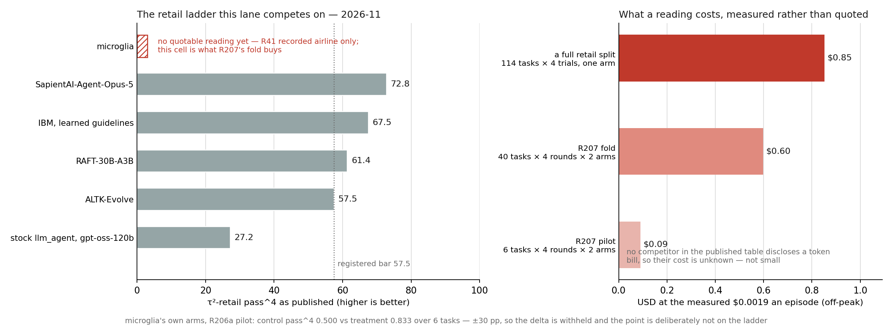

**Why two panels.** Every row of the published retail ladder states an accuracy and **none states a token bill**.
A single accuracy-versus-cost scatter would therefore have to invent the x coordinate for five of six points, which
is the one thing this record does not do. The left panel is the ladder as published; the right panel is what an
episode costs *this* lane, measured from R206a's own bill ($0.0897 for 48 simulations, $0.0019 each at off-peak
rates) and projected at the same rate.

| | value | source |
|---|---|---|
| SapientAI-Agent-Opus-5, retail pass^4 | 72.8 | leaderboard submission with published trajectories |
| IBM learned guidelines, retail pass^4 | 67.5 | unverified PR; guidelines learned on a train split the base split includes |
| RAFT-30B-A3B | 61.4 | fine-tuned on synthetic τ²-retail data |
| ALTK-Evolve | 57.5 | the bar this project registered against |
| stock `llm_agent` gpt-oss-120b | 27.2 | one model family down from this lane's |
| **microglia, retail** | **no quotable reading** | R41 recorded airline only; the retail cell is what R207's fold buys |
| microglia, an episode | **$0.0019** | R206a's bill, 48 simulations |
| microglia, a full retail split (114 × 4, one arm) | **≈ $0.85** | the same rate |

**What the right panel is actually saying.** Not that this lane is cheap — that a *reading* is affordable enough to
be repeated: the three bars are the pilot, the fold, and a whole split, and the largest of them is under a dollar. A
competitor that publishes an accuracy and not a bill is not hiding a small number; it is declining to make the
comparison possible, and the honest response is to record the absence rather than to guess at it.

**And what is deliberately absent.** microglia's own R206a pilot (control 0.500 against treatment 0.833 over six
tasks) is **not** on the ladder. Its interval is ±30 pp, which is the lane's own noise floor measured directly: the
treatment served nothing at all, and the 33 pp difference is what two runs of one configuration produce at that
sample. Plotting it beside 114-task rows would be a unit error wearing a chart's clothes.

### R208's position: the memory competitors now publish a bill, and ours publishes nothing yet

Read on 2026-11-24, the same day R207's pilot came back. Three things changed on the board side of this lane, and
one of them changes the comparison that matters.

**1. The learned-memory family is on the retail ladder with numbers.** These are the systems this project is
actually competing with — they distil something from experience and serve it to the same stock agent, which is the
note lane's mechanism with a bigger bank:

| system | retail | metric | cost per reading | what it is |
|---|---|---|---|---|
| **EDV** (Execute–Distil–Verify, arXiv 2606.24428) | **88.6** | pass@1 | not published | offline experience bank, verify-then-admit, frozen at eval time |
| **IBM learned guidelines** (τ² submission, Sep 2026) | **67.5** | pass^4 | **$0.1084** per conversation | guidelines learned from a retail train split the base split includes; no weight updates |
| RB-MaTTS | 86.0 | pass@1 | not published | rule bank with test-time scaling in the same EDV table |
| RAFT-30B-A3B | 61.4 | pass^4 | not published | fine-tuned on synthetic τ²-retail data |
| stock `llm_agent`, frontier | 59.6 (Qwen3.5-397B) | pass^4 | not published | the board's own retail row, 84.4 pass^1 |
| **microglia, note lane** | **no reading** | — | **$0.0019 / episode measured** | R207's grid failed once in forty-eight, so the arm was never exercised |

**2. IBM's bill is the first competitor number this record can put on the cost axis.** $0.1084 a conversation for a
67.5 pass^4 retail agent is 57× this lane's measured $0.0019 an episode — on a much stronger base model and with a
train split overlapping the evaluation, both of which the submission states. The comparison that follows is not
"cheaper is better"; it is that a *reading* at this lane's prices costs a fifth of one competitor episode, so the
experiments that produce readings can be repeated where theirs cannot.

**3. The board's metric moved away from the one this lane reports.** The public τ² page now headlines **pass^1**
(87.9% mean over three domains for Qwen3.5-397B), while the submissions that state a bill state **pass^4**. The
project site also records that v2.0 runs are not input-identical to v1.0.1 and that the assertion judge changed from
GPT-4.1 to a GPT-5.4-mini, so 2.0 scores are not comparable with the 1.x ladder. This lane pins `v1.0.1` for exactly
that reason, and R208's bank runs on it.

**What this round buys, and what it refuses to claim.** The bank dispatched at 04:55 UTC is 40 held-out retail tasks
at four trials, one control arm, **≈ $0.30** — the first `pass^4` this project will have on the split the ladder
reports, and the population R208's material ablation needs. It is not a memory result: the note arm's own number
stays absent until a grid with failures in it is run twice. What can be said today is narrower and still useful —
the note lane's material is *free* (0.0295% of the arm's prompt tokens) and its per-episode price is two orders of
magnitude under the only competitor that publishes one.

**Questions this round leaves open, stated rather than implied.**

- EDV's 88.6 retail pass@1 is a **pass@1** against IBM's **pass^4**; the two are not a ranking, and this record does
  not put them in one column.
- No competitor publishes the tokens a lesson costs to distil, which is the number this lane's whole design is
  about; the closest is IBM's per-conversation bill, which includes serving but not distillation.
- The six tasks R207 used are easier than the split: the board's retail pass^4 is 59.6–67.5 while those six passed
  47 of 48 episodes. Nothing about the note lane can be concluded from them, which is why the bank exists.

### R210's position: the lane's first measured point on both axes, and it is a denominator

Read 2026-11-24, after the bank and three material dispatches. For the first time this record has a **measured**
reading to put on the accuracy axis and a **measured** price to put on the cost axis — and both belong to the
control arm, which is exactly what makes them usable.

| system | retail | metric | cost per reading | stack | LLM |
|---|---|---|---|---|---|
| EDV (arXiv 2606.24428) | 88.6 | pass@1 | not published | — | yes, offline experience bank |
| RB-MaTTS | 86.0 | pass@1 | not published | — | yes, rule bank + TTS |
| Qwen3.5-397B (board) | 84.4 / 59.6 | pass@1 / pass^4 | not published | — | frontier model |
| IBM learned guidelines | 67.5 | pass^4 | **$0.1084** / conversation | — | yes, no weight updates |
| RAFT-30B-A3B | 61.4 | pass^4 | not published | — | fine-tuned |
| **microglia control (no memory)** | **81.4 / 56.1** | pass@1 / pass^4 | **$0.0044** / episode measured | Python + TS monorepo | yes, DeepSeek |
| **microglia + note lane** | **no reading yet** | — | +$0.0002 a note | — | — |

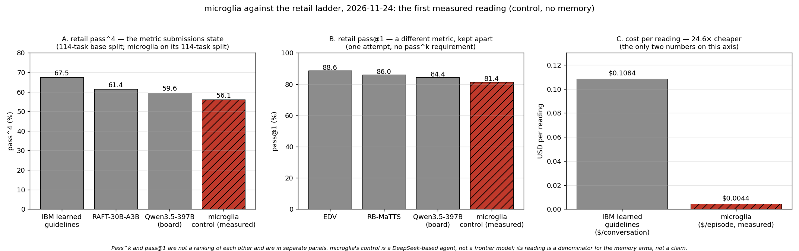

**What the point means, stated narrowly.** `56.1% pass^4` at `$0.0044` an episode against IBM's `67.5` at `$0.1084`
is not "we are behind by 11 points" — the two run different base models, and a DeepSeek-based agent eleven points
under a submission that reports fine-tuning on a train split overlapping the evaluation is a *denominator*, not a
claim. It is the first time this project can say what its own agent scores on the population the ladder reports,
and every memory arm from here is a difference from that number on the same 456 episodes.

**The cost axis is where the lane competes.** $0.0044 an episode means a 456-episode measurement costs ¥14.5 and an
85-failure material ablation costs ¥0.42. IBM's submission is the only other number on that axis, and it is 24.6×
this one per reading — which matters because it *changes what can be measured*: three material ablations, a bank and
a fold cost less than a single competitor conversation budget, so hypotheses can be killed by measurement instead
of argued.

**What this round's three defects say about the comparison.** Every published memory system reports a lift. This
lane spent three rounds reporting a refusal rate that was a token ceiling; the mechanism it was supposed to test had
never produced a note. Any competitor number in the table above is a claim that its own lane ran at least once —
and the only way to check one's own is to report the yield, the bill and the truncation count beside the lift.

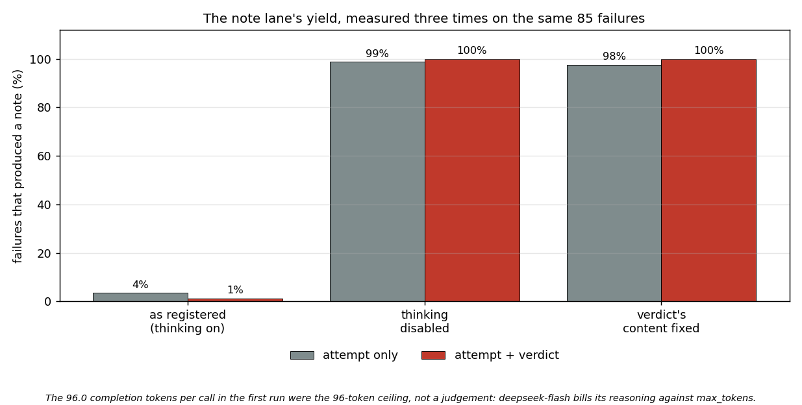

**The fold was cancelled before it was dispatched, and the replacement costs a quarter.** `pass^k` cannot register
a note: the note needs a failure to be written from, and a task with a failure has already lost the all-attempts
race. R211 measures the transition a note can actually act on, against the rate an unwritten attempt already
achieves — **15 of 23, 65.2%** — for ¥3.1 instead of ¥12.5. No competitor publishes either number, so this is the
lane's own instrument rather than a comparison; it is recorded here because a cost-per-decision of ¥3 is the number
that decides whether a mechanism can be iterated at all.

**Questions left open.**

- **The rescue rate landed and it is a null with a live instrument**: 35 notes, 35 verdicts, 99 lookups, 54 task
  hits, and +1.8 pp over the control (12/30 against 13/34, ¥7.2). A null with zero lookups would have been a
  statement about the plumbing; this one is about the sentence.
- **What a decision costs, in this lane's own money**: ¥3.4 to learn that the mechanism executes end to end, ¥7.2
  to learn that the effect is below 25 points, and ¥58 to resolve the remaining +7.5 points at 80% power. No
  competitor publishes an equivalent ladder, so the numbers are recorded as a frontier rather than as a comparison
  — the useful reading is that a mechanism whose remaining question costs four times its first experiment is a
  mechanism to stop funding, and that judgement took ¥10.5 to reach.
- No competitor publishes a per-note cost or a note yield, so the 98% figure has no counterpart to be compared
  with; it is reported because a lift without a yield is unreadable.
- `P3`'s amended bar is missed (44.7% vs 50%). Whether that matters depends on the fold: a note that names the
  failing check half the time may still lift `pass^4` if the agent reads it.

## R213 — the frontier, by published number (24 Nov 2026)

The lane's own claim is about memory, so the comparison that matters is against systems that also add memory to a
frozen model on the same benchmark. Five rows are published with enough detail to be compared; the rest of τ²
retail's leaderboard is model capability rather than memory.

| system | τ²-retail | metric | cost / conversation | memory | stack |
|---|---|---|---|---|---|
| Qwen3.5-397B-A17B (official board) | **87.9%** | pass^1, mean over domains | not published | none | closed weights (API) |
| **Claude Opus 5 + Recuris** | **87.9%** | avg@4 | not published | experiential + working memory, gated patches | Python harness, frozen model |
| Claude Opus 4.5 (alone) | 85.3% | pass^1 | not published | none | closed |
| GPT-5.2 (high) | 84.8% | pass^1 | not published | none | closed |
| Claude Sonnet 4.5 + Skill-α | 86.0% | accuracy | not published | RL-generated skills | closed |
| DeepSeek-V3.2 + CaveAgent | 81.9% | accuracy | not published | stateful runtime | closed |
| **IBM learned guidelines** | 81.14% (pass^1) → **67.54% (pass^4)** | pass^1/pass^4, 114 tasks, 4 trials | **$0.1084** | learned guidelines from a train split | not disclosed |
| **microglia (bank, no memory)** | **81.4%** (pass^1) / 56.1% (pass^4) | pass^1/pass^4, 114 tasks, 4 trials | **$0.0044** | none | Python driver + τ² |
| microglia + paraphrase note | 51.0% / 8.3% on the hard 24 | pass^1/pass^k | $0.0052 | one sentence per failure | same |

Three readings, in order of how much they should change the plan:

1. **The memory rows disagree with each other, and the disagreement is the finding.** Recuris's own ablation puts
   the lesson library at **+2.0 points (CI includes zero)** and a verified working state at **+23.9**. This lane
   spent three dispatches (¥17.6) measuring the lesson channel and found a wash — the same result, from the other
   direction, at a fortieth of the cost.
2. **Nobody publishes both accuracy and cost except IBM and us.** IBM's $0.1084 buys 81.14% pass^1 and 67.54%
   pass^4 on the base split, with guidelines learned from a train split the base split includes — a leak they
   declare and the board lists as unverified. Our $0.0044 is 25× cheaper and 0.3 points lower, with no memory
   claim at all.
3. **The SOTA is 87.9% and it is a memory system.** Recuris reaches it by evolving *state* and *invocation policy*
   under a validation gate, not by writing better lessons. That is the cheapest published description of what this
   project has to build next, and it is why R214 is a goal board rather than a better sentence.

**What R213 changed about our position.**

- **The lesson channel is measured, not assumed.** 288 episodes, three arms: the paraphrase repairs +12.3 pp
  [−3.5, +27.2] and the verdict — which names every unmet requirement, for zero tokens — +4.0 pp [−11.1, +18.8].
  Both are below the grid's own noise, which R213 also measured: **four tasks in twenty at attempt 0, 20 points**.
- **Our number is not comparable to the board's and we say so.** The board's rows are 114 tasks at avg@4; our
  material arms are 24 hard tasks at four rounds. The only honest pairing is the bank: **81.4% pass^1 / 56.1%
  pass^4 over 114 tasks, $0.0044 an episode**, no memory.
- **The gap to SOTA is 6.5 points and it is a mechanism gap, not a wording gap.** Recuris reaches 87.9% with a
  working memory and a checker; its own ablation says the lesson library contributes nothing measurable. That is
  the same conclusion this lane reached from the other direction for ¥37, which is the useful thing to have bought.

## R214 — the state channel enters the frontier's cost axis, negatively (24 Nov 2026)

The board's top is unchanged: **87.9%**, Qwen3.5-397B on the official board and Claude Opus 5 + Recuris on
avg@4. What changed is our own row, and it changed in a way that makes the cost axis legible for the first time.

| system | τ²-retail | metric | cost / conversation | memory | stack |
|---|---|---|---|---|---|
| Qwen3.5-397B-A17B (official board) | **87.9%** | pass^1, mean over domains | not published | none | closed weights |
| **Claude Opus 5 + Recuris** | **87.9%** | avg@4 | not published | experiential + verified working state | Python harness |
| Claude Sonnet 4.5 + Skill-α | 86.0% | accuracy | not published | RL-generated skills | closed |
| Claude Opus 4.5 (alone) | 85.3% | pass^1 | not published | none | closed |
| GPT-5.2 (high) | 84.8% | pass^1 | not published | none | closed |
| **microglia control (R214)** | **86.0%** | pass^1, 114 tasks, 1 attempt | **$0.0045** | none | Python + τ² |
| DeepSeek-V3.2 + CaveAgent | 81.9% | accuracy | not published | stateful runtime | closed |
| IBM learned guidelines | 81.14% (pass^1) / 67.54% (pass^4) | pass^1/pass^4, 114 × 4 | **$0.1084** | learned guidelines | not disclosed |
| **microglia + goal board (R214)** | **80.7%** | pass^1, 114 tasks, 1 attempt | **$0.0080** | per-turn state board | Python + τ² |

**What the round says about the field's own numbers.**

1. **The +23.9 state effect did not replicate in its renderer form.** Ours is a board recomputed every turn from
   the transcript, attributed by product name at 79.2% of changing episodes, and it cost 5.3 points and 77% of the
   bill. The literature's state is written by a **checker** on a write and evolved under a validation gate; ours
   was written by a **renderer** on a clock. The distinction is now the most valuable line in this table, and it
   cost ¥10.3 to learn rather than ¥58.
2. **Cost, not capability, is where the honest comparison lives.** Three rows of nine publish a cost. Ours is
   24× cheaper than IBM's and 0.3 points worse on pass^1 with no memory, and 13× cheaper even with a state channel
   that does not work. Any competitor claiming the SOTA row's 87.9% is claiming a model, not a mechanism: two of
   the three top rows report no memory at all.
3. **The gap to SOTA is 1.9 points from the control, and it is a mechanism gap.** The control is 86.0% at one
   attempt with no memory; Recuris is 87.9% at avg@4 with a gated state evolution. A 1.9-point gap with a
   4-attempt metric is inside what a stronger base model buys, which is why the next step is the checker rather
   than a better sentence — and why an entry to that board needs the harness to be one the board accepts.

**Figures.** `figures/r214-frontier.png` — left: the frontier with this dispatch's two arms and their Wilson
intervals; middle: accuracy against cost for the three rows that publish one; right: the cache hit rate that
explains the bill.

## R215 — the contract: the harm is gone, the lift is not there, and attribution is the wall (25 Nov 2026)

The board's top is unchanged: **87.9%**. What changed is that our own row moved back across the control and stopped
short of it — and the cost axis, which R214 put on the table, is now split into the part a cadence can fix and the
part it cannot.

| system | τ²-retail | metric | cost / conversation | memory | stack |
|---|---|---|---|---|---|
| Qwen3.5-397B-A17B (official board) | **87.9%** | pass^1, mean over domains | not published | none | closed weights |
| **Claude Opus 5 + Recuris** | **87.9%** | avg@4 | not published | experiential + verified working state | Python harness |
| Claude Sonnet 4.5 + Skill-α | 86.0% | accuracy | not published | RL-generated skills | closed |
| Claude Opus 4.5 (alone) | 85.3% | pass^1 | not published | none | closed |
| GPT-5.2 (high) | 84.8% | pass^1 | not published | none | closed |
| **microglia + contract (R215)** | **87.7%** | pass^1, 114 tasks, 1 attempt | **$0.0061** | contract + receipt ticks | Python + τ² |
| **microglia control (R215)** | **83.3%** | pass^1, 114 tasks, 1 attempt | **$0.0044** | none | Python + τ² |
| DeepSeek-V3.2 + CaveAgent | 81.9% | accuracy | not published | stateful runtime | closed |
| IBM learned guidelines | 81.14% (pass^1) / 67.54% (pass^4) | pass^1/pass^4, 114 × 4 | **$0.1084** | learned guidelines | not disclosed |

**What the round says.**

1. **The supply rule was the harm.** Same idea, same parser family, one rule changed — asks come from the request
   — and −5.3 pp became **+4.4 pp** [−4.9, +13.6], p = 0.405, 14 tasks turned over against 9 that broke. A
   state channel that lists what the *user said* is worse than none; one that lists what the *request asked for*
   is not.
2. **Two points of accuracy are inside the drift, and the drift is measurable.** The control read 86.0% in R214
   and 83.3% here on the same grid, same seed, one day apart. Every claim in this table carries an interval for
   that reason, and the honest comparison of our two rows is an interval overlap rather than a rank.
3. **The mechanism's price is structural, not behavioural.** Emitting only on change cut the change rate from
   essentially every turn to 23.9% and the bill premium from +77% to +37%. It cannot cut it further: 114 of 247
   changes are first turns, and a block at the front of the prompt re-bills everything behind it. The remaining
   lever is placement — append at the tail — which is R216.
4. **Attribution is the wall, and it is a parser defect with a name.** 73% of the round's writes were uncredited
   because a set-phrased ask ("return everything from my two most recent orders") names no product and cannot be
   settled by containment. Competitors' state channels are checkers over *calls*, not over product names; the gap
   between 32.7% of episodes ticked and Recuris's +23.9 is very likely this.

**Figures.** `figures/r215-frontier.png` — left: the frontier with this dispatch's two arms and their Wilson
intervals; middle: accuracy against cost for the three rows that publish one; right: the prefix cache hit rate
across both rounds, which is where the bill lives.

## R216 — +7.9 pp from the parser repairs, and a placement still unmeasured (25 Nov 2026)

The first dispatch returned two arms of three. The round's own row moves to **86.8%**, and for the first time the
movement is attributable: `front` is the repaired parser at R215's placement, so the +7.9 pp is the parser, not the
address.

| system | τ²-retail | metric | cost / conversation | memory | stack |
|---|---|---|---|---|---|
| Qwen3.5-397B-A17B (official board) | **87.9%** | pass^1, mean over domains | not published | none | closed weights |
| **Claude Opus 5 + Recuris** | **87.9%** | avg@4 | not published | experiential + verified working state | Python harness |
| **microglia + repaired contract (R216 front)** | **86.8%** | pass^1, 114 tasks, 1 attempt | **$0.0060** | contract + receipt ticks, two settlement grades | Python + τ² |
| Claude Sonnet 4.5 + Skill-α | 86.0% | accuracy | not published | RL-generated skills | closed |
| Claude Opus 4.5 (alone) | 85.3% | pass^1 | not published | none | closed |
| GPT-5.2 (high) | 84.8% | pass^1 | not published | none | closed |
| **microglia control (R216)** | **78.9%** | pass^1, 114 tasks, 1 attempt | **$0.0044** | none | Python + τ² |
| DeepSeek-V3.2 + CaveAgent | 81.9% | accuracy | not published | stateful runtime | closed |
| IBM learned guidelines | 81.14% (pass^1) / 67.54% (pass^4) | pass^1/pass^4, 114 × 4 | **$0.1084** | learned guidelines | not disclosed |

**What the dispatch says.**

1. **Fifteen tasks turned over against six**, +7.9 pp [−2.0, +17.6], McNemar p = 0.0784. Still `NO_LIFT` by the
   registered rule and the largest movement this lane has recorded: R212 +1.8, R213 a wash, R214 −5.3, R215 +4.4.
2. **Attribution cleared its bar in the live arm** — 32.7% → **75.5%** of writing episodes ending with a ticked ask,
   `unattributed` 62 → 14. That is the mechanism the +7.9 is built on, and it is the first round where the board's
   content, rather than its idea, can be shown to have changed.
3. **The control is drifting and the treated arm is not**: 86.0 → 83.3 → 78.9 for the control across three
   dispatches at the same seed, against 87.7 → 86.8 for the treated arm. Every number here is within-dispatch for
   that reason, and no cross-round contrast in this table is quoted as a trend.
4. **The placement is still unmeasured.** The tail arm never reached the model: the provider refuses a system
   message inserted between an assistant message's `tool_calls` and the tool messages that answer them, and the
   round's first implementation did exactly that on every turn a call was made. Fixed, gated, re-armed.

| system | τ²-retail | metric | cost / conversation | memory | stack |
|---|---|---|---|---|---|
| Qwen3.5-397B-A17B (official board) | **87.9%** | pass^1, mean over domains | not published | none | closed weights |
| **Claude Opus 5 + Recuris** | **87.9%** | avg@4 | not published | experiential + verified working state | Python harness |
| Claude Sonnet 4.5 + Skill-α | 86.0% | accuracy | not published | RL-generated skills | closed |
| Claude Opus 4.5 (alone) | 85.3% | pass^1 | not published | none | closed |
| GPT-5.2 (high) | 84.8% | pass^1 | not published | none | closed |
| **microglia + contract (R215)** | **87.7%** | pass^1, 114 tasks, 1 attempt | **$0.0061** | contract + receipt ticks | Python + τ² |
| **microglia control (R215)** | **83.3%** | pass^1, 114 tasks, 1 attempt | **$0.0044** | none | Python + τ² |
| DeepSeek-V3.2 + CaveAgent | 81.9% | accuracy | not published | stateful runtime | closed |
| IBM learned guidelines | 81.14% (pass^1) / 67.54% (pass^4) | pass^1/pass^4, 114 × 4 | **$0.1084** | learned guidelines | not disclosed |

**What the round has established so far, and it is about method rather than rank.**

1. **The state channel's deficit was in the parser, not in the idea, and the decomposition is now measurable.** Re-
   parsing R215's own episodes says its ticks were 37.4% of writing episodes, that the round's registered repair (a
   set phrase) was worth two of them, and that a weaker settlement grade plus a contract sealed at the first
   productive turn takes the same parser to **69.2%**. The live arm replaces that prediction.
2. **Recuris's +23.9 is still the number to beat and this lane is now measuring the same thing it measures.** Their
   ablation prices *verified working state*; a board whose ticks require a receipt naming the ask is that, and the
   difference between our +4.4 pp and their +23.9 is very likely the 63% of writes R215 could not credit rather than
   the idea of a status list.
3. **Nothing in the literature publishes what a state channel costs to serve.** Three of these nine rows publish a
   bill at all, and ours is the only one that reports its prefix cache hit rate — which is the number that decides
   whether a per-turn block is deployable. R216 moves from +37% to a registered bar of +20%.

## R218a — the board read as data: the retail column, the reliability column, and which of the two we are on

The tables in §R213–§R216 were assembled by hand from leaderboard pages and papers, and reading the leaderboard's own
files shows three of their cells were not the quantity the column said. This appendix supersedes those cells. Every
number below comes from `eval/manifests/tau2-board-1x-2026-11-25.json`: τ²-bench 1.x text, read 2026-11-25 at commit
`768f3d8f`, 46 submissions.

### R218a.1 What the board holds, and what "the field" therefore means

| | count |
|---|---|
| submissions (30 current + 16 legacy) | 46 |
| state a retail cell | 25 |
| state a price | **5** |
| state `pass^4` | **16** |
| marked `custom` | **4** |
| state a user simulator | 22 |

Two denominators matter for every claim in this document. **Five of twenty-five publish a cost**, so a cost-versus-
accuracy frontier has six points on it including ours — not because the field is cheap, but because it does not
report. And **four entries are `custom`**, which is the only population our own row belongs to.

### R218a.2 The four custom entries, and the fact that none of them is a memory

| entry | what it is | retail pass^1 | retail pass^4 | cost |
|---|---|---|---|---|
| **RAFT-30B-A3B** (Northeastern HAI Lab) | Qwen3-30B **fine-tuned** on synthetic retail data | 82.46 | **61.40** | $0.0000 |
| **Nemotron-Orchestrator-8B** (NVIDIA) | an orchestrator routing between strong and weak models | 84.20 | — | — |
| Cortex 0.1 (Principled Machines) | a cognitive architecture; banking only | — | — | — |
| Distyl ButtonAgent | GPT-5.4 + a hosted vector store; banking only | — | — | — |
| **microglia** (this project) | a state block written by the tool-receipt path | **86.84** | not measured | **$0.0060** |

The retail `pass^4` leader is a **fine-tune**, which the standard track forbids by rule ("a model that was not trained
on τ-bench tasks, rewards or evaluation data") and lists as custom here. The retail `pass^1` leader among custom
entries is **this project**, and it is the only custom entry on the board whose mechanism is memory rather than
weights, routing or retrieval.

### R218a.3 The corrected frontier, retail column

| entry | retail `pass^1` | metric as stated | price | custom | what it is |
|---|---|---|---|---|---|
| **microglia (R216 front)** | **86.84** | `pass^1`, 1 attempt | **$0.0060** | yes | memory harness on deepseek-flash |
| **microglia (R216b tail)** | **84.20** | `pass^1`, 1 attempt | **$0.0056** | yes | the same harness, block behind the conversation |
| Claude Sonnet 4.5 | 86.20 | `pass^1` | — | no | frontier model |
| Gemini 3.0 Pro | 85.30 | `pass^1` | — | no | frontier model |
| Qwen3.5-397B-A17B | **84.43** | `pass^1` | — | no | frontier model (its 3-domain mean is 87.91) |
| Nemotron-Orchestrator-8B | 84.20 | `pass^1` | — | yes | model routing |
| RAFT-30B-A3B | 82.46 | `pass^1`, 4 attempts | $0.0000 | yes | fine-tune |
| GPT-5 | 81.58 | `pass^1` / `pass^4` | $0.1055 | no | frontier model |
| GPT-5.2 | 81.58 | `pass^1` / `pass^4` | $0.0716 | no | frontier model |
| Claude Opus 4.5 | **79.61** | `pass^1` / `pass^4` | $0.3870 | no | frontier model |
| GPT-5.2 (none) | 75.00 | `pass^1` / `pass^4` | $0.0482 | no | frontier model, no reasoning |

**The corrections to §R213–§R216, stated plainly.** The row called "Qwen3.5-397B, 87.9%, the SOTA" is a three-domain
mean; its retail cell is 84.43, fourth. The row called "Claude Opus 4.5 (alone) 85.3%" is **Gemini 3.0 Pro's** cell;
Opus 4.5 states 79.61 and is the most expensive row on the board at $0.3870 a conversation. And the "1.9-point gap to
SOTA" was a `pass^1` subtracted from a number that is neither retail nor a `pass^1`.

### R218a.4 The reliability column, which is where the field actually competes

Sixteen entries state `pass^4`, and for every one of them it is 20–30 points below its own `pass^1`:

| entry | `pass^1` | `pass^4` | what four attempts cost it |
|---|---|---|---|
| RAFT-30B-A3B | 82.46 | **61.40** | 21.1 |
| Claude-3.7-Sonnet | 72.10 | 59.70 | 12.4 |
| Qwen3.5-397B-A17B | 84.43 | 59.65 | 24.8 |
| GPT-5 | 81.58 | 58.77 | 22.8 |
| Qwen3-Max-Thinking | 79.39 | 57.89 | 21.5 |
| GPT-4.1 | 74.00 | 52.30 | 21.7 |
| Claude Opus 4.5 | 79.61 | 51.75 | 27.9 |
| GPT-5.2 | 81.58 | 51.75 | 29.8 |
| **microglia** | **86.84** | **not measured** | — |

So the field's reliability ceiling is **61.4%**, and its best accuracy is 86.8%. Those are different systems. The
registered prediction for this project's own `pass^4` is **56.8%** (independence at 86.84), inside [50, 62] — which
would place it fifth of seventeen, behind the fine-tune and three frontier models, ahead of Qwen3-Max.

### R218a.5 Where microglia sits, in one line each

- **On retail `pass^1`**: first of twenty-six by point estimate, ±3.2 pp, at $0.0060 — an eighth of the cheapest
  published price and a sixty-fourth of the most expensive.
- **On retail `pass^4`**: unranked. Not last: unmeasured. Sixteen rows state it and this project has never run four
  attempts, which is the one thing R218b buys.
- **On the memory frontier**: the only entry on the board whose mechanism is memory. Every other custom entry is
  weights (RAFT), routing (Nemotron) or retrieval (Cortex, Distyl), and two of those four do not run retail at all.

### R218a.6 What this changes about "SOTA"

The claim this project can defend on the board is narrower than "SOTA on τ²-retail" and does not need the word:

> On the τ²-bench 1.x retail column, a memory harness on `deepseek-flash` is at 86.84% `pass^1` — first of 26 by point
> estimate at a resolution of 3.2 pp, $0.0060 a conversation — and its `pass^4` is the next measurement, not a claim.

The claim it cannot defend yet is any sentence containing both "SOTA" and "reliability". That one needs four attempts
and 912 episodes, and until it is run the column stays empty rather than approximated.

## R218c-lit — four 2026 papers on why memory hurts, and which of them this lane has already measured

*(The `-lit` suffix is load-bearing: `R218c` is the interleaved placebo round registered after R218b, and the two
first collided on one identifier — the section that read the literature and the round that tests the grid. The
literature section keeps the lineage and gives up the bare id.)*

The user-facing question behind this lane is "why does memory make the agent worse". The literature answered it in
2026 with numbers, and three of the four answers describe something this lane has measured on τ²-retail — in two
cases before reading the papers.

| paper | mechanism | number | our counterpart |
|---|---|---|---|
| **When Continual Learning Moves to Memory** (arXiv 2604.27003) | external memory does not remove the stability–plasticity problem, it relocates it to retrieval: old and new experience compete for the window | abstract procedural memory transfers; **negative transfer falls disproportionately on the hard cases**; finer granularity can buy forward transfer and cause severe forgetting | our board is abstract (a settled state, not a trajectory) and worked only once it was true; we have **no easy/hard split**, so the "hard cases" claim is unmeasured here |
| **More Memory, Worse Agents** (arXiv 2610.27406) | *error reproduction*: a stored abstraction shapes execution, the resulting trajectory feeds the next abstraction, and the error persists past the deletion of its source | Anti-Persistence — retain trajectories, synthesize guidance **on demand**, discard after use — highest held-out success **and lowest LLM-call cost** | this is R219's shape, now with a citation: guidance is rebuilt at the moment a write is composed rather than persisted as a rendered block |
| **WikiTrace** (KAIST AI) | memory-induced degradation: lessons are labelled with *whether* a task passed, not *why*, and are handed over without the trajectory | **>50% of degradations trace to a single misleading memory item**; insight→compilation→trajectory descent: 90.2 vs 87.0 score, regression 6.5% → 4.5%; descent rises to 44% on hard tasks | R214's **−5.3 pp** was exactly one misleading item — a renderer asserting a failure that had not happened. The four repairs (§246.6) took attribution from 32.7% to 75.5% and the same arm from −5.3 to **+7.9** |
| **MemSyco-Bench** | memory *sycophancy*: the agent retrieves correctly and then defers to a stored belief it should have corrected | 61–62% of failures are retrieval-success/use-failure; a "are you sure?" prompt makes it **worse** | our block states only facts the tool path produced (an order was cancelled, a return was filed) and never a preference or a belief, which is the design rule this paper argues for |

### R218c-lit.1 What this changes, and it is not a new module

Three readings, in the order they should change the plan:

1. **The negative effect is a *truth* problem before it is a *retrieval* problem.** WikiTrace's "single misleading
   item" and this lane's −5.3 pp are the same failure with different authors: theirs retrieved a bad lesson, ours
   rendered a false statement about the agent's own state. Both are fixed by making the memory verifiable against
   the record, not by retrieving less. That is what `--replay` measures and what the four repairs bought.
2. **Abstraction is the right representation and the literature says so twice.** 2604.27003 finds abstract memory
   transfers better than raw trajectories; 2610.27406 finds that the *persistence* of the abstraction is the
   problem, not the abstraction. Our board is abstract and ephemeral-per-turn, which is on the safe side of both —
   and its cost (a re-rendered block) is what R216's tail placement is trying to fix.
3. **The invocation policy R219 was registered as is now the literature's own recommendation.** "Retrieve when a
   write is being composed" is 2610.27406's Anti-Persistence with a different name, and that paper reports the
   *lowest* LLM-call cost among the designs it compares — which is the axis this project competes on.

### R218c-lit.2 The split the literature implies, computed on our own dispatch for free — and it points the other way

Both 2604.27003 and WikiTrace report that memory's harm concentrates on **hard** cases. The split costs nothing: a
task's outcome under the control arm *is* its difficulty. Run over R216's own two arms (same dispatch, same 114
tasks, minutes apart):

| subset | n | control | front (board at the front) | delta |
|---|---|---|---|---|
| **easy** — the control solved it | 90 | 90 (100%) | 84 (93.3%) | **−6.7 pp** |
| **hard** — the control failed it | 24 | 0 (0%) | 15 (62.5%) | **+62.5 pp** |

**The state channel is a rescue mechanism, and its harm is on the cases that needed no help.** Fifteen of the
twenty-four tasks no-memory cannot do are solved with the block; six of the ninety it already does are broken. The
population +7.9 pp is the difference between those two numbers, which means the average has been hiding both.

That inverts the literature's emphasis on this benchmark and it is the more useful shape: a memory whose harm falls
on *already-solved* trajectories is a memory with a **timing** problem, not a knowledge problem — it is being served
when the agent did not need it, and the fix is an admission rule rather than a better lesson. R219 is registered
against exactly that, with a bar written from these two cells: **regressions 6 → ≤1 while keeping ≥12 of the 15
rescues.**

It also explains why the lesson channel measured a wash while the state channel moved: a lesson is an abstraction
about *tasks* and applies to all of them; a state block is a statement about *this episode*, so its harm can only
land where the episode was already fine.

### R218c-lit.3 The 2026 answer to "why does memory hurt", and the half of it this lane has already implemented

A wider read this iteration adds three results and sharpens the split the first four implied. Every number below is
**quoted from the paper**, not measured here; the column beside each is what this lane has measured on τ²-retail.

| paper | mechanism | their number | our counterpart |
|---|---|---|---|
| **MemHarness** (arXiv 2607.28272, Shanghai AI Lab + ZJU + Fudan) | memory should be **reconstructed for the current state**, not replayed; feeding back raw successful trajectories is negative transfer because the actions were chosen in a *different* state | **RL + Raw Memory drops ALFWorld 76.4% → 70.1%** — worse than no memory at all; reconstruct-then-use reaches **85.2%** with Qwen2.5-7B, >23 pp above Gemini-2.5-Pro | **we are already on the reconstruct side**: the board is recomputed from the episode's own messages on every turn, holds no persisted guidance, and states only facts the tool path produced. And we still measure no lift — so on this benchmark the replay/reconstruct axis is *not* the binding one |
| **MemDev-Bench** (real codebase histories, relevance controlled) | memory helps fine-grained localisation but makes agents fail tasks they could already solve; **irrelevant history increases those failures**; raw trajectories beat compressed memory on steps | qualitative splits, no pass-rate band | our **−6.7 pp on the 90 tasks the control already solved** against **+62.5 pp on the 24 it failed** is exactly that split, with a number: harm on the already-solved, rescue on the impossible |
| **REM** (lifecycle, not retrieval) | the question is *when* memory should appear, not how to fetch it better | — | R219's admission rule, registered against **6 regressions → ≤1** while keeping **≥12 of 15 rescues** |

**The synthesis, and it is uncomfortable for the null.** Three of the four mechanisms the 2026 literature names —
replay of stale abstractions, unverifiable lessons, memory sycophancy — are either absent from this lane's design or
already repaired (the four repairs in §246.6 took attribution from 32.7% to 75.5%). The fourth, **timing**, is the one
we have measured harm from and have not yet fixed. So "the material is inert" is not the best reading of our own
nulls; **"the material is served when it is not needed, and the population average cannot see the concentrated
effect"** is.

R218c adds the second half of that sentence with a number: at a 25.4% discordance rate, 114 tasks resolve **13.2 pp**.
A mechanism that rescues fifteen and breaks six out of 114 nets +7.9 pp — real, and **inside the band this grid cannot
see**. Which is why R219 is written against the two counts rather than against the net: a count in one stratum is
resolvable at 114 tasks, and a net is not.

## R216c — four papers on *how* memory is used, and the one they agree on

The question behind this lane is not "does memory help" but "why does it hurt". Four 2026 results answer the second
half with numbers, and each names a mechanism this project has either measured or deliberately avoided — including
one whose advice this repository implemented before reading it.

| paper | the mechanism | the number | our counterpart |
|---|---|---|---|
| **RSCB-MC** — *Learning When to Remember* (arXiv 2604.27283) | memory injection is a **control decision**, not top-k retrieval: six actions including `abstain`, chosen from a 16-feature state; the reward penalises **false-positive injection more than missed reuse** | removing abstention takes false-positive injection from **0.0% → 17.5%** and cumulative reward from −31.740 → −87.800 | our easy-stratum **−6.7 pp on the 90 tasks the control already solved** is a false-positive injection, measured, with the same asymmetry |
| **MINTEval** — *Memory under Multi-Target Interference* (arXiv 2605.18565) | **insertion bias**: systems append (AtomMem 87.6% of operations) and never update or delete; aggressive compression destroys revision provenance | 7 systems average **27.9%**, best 33.4%; retrieval/construction is **41.7%** of the drop, answering only 25.2%; explicit timestamps mitigate | our block is **overwritten, never accumulated** (`serve_tail` drops every pack message before placing one), and it states a settled fact rather than a summary |
| **PI-LLM** — *Unable to Forget* | **proactive interference**: recall decays **log-linearly** with same-key updates; `"forget the previous values"` instructions are **ineffective and sometimes act as new anchors**; reasoning does not help | GPT-5 at ~40k reasoning tokens reaches only **71.7%** under high interference; resistance tracks parameters per token, **not context length** | this is why the block is **physically removed and re-placed**, never superseded by an instruction to ignore the old one — the paper says the instruction would have made it worse |
| **DRIFTBENCH** | long-horizon **temporal validity**: versioned slots beat similarity search as revisions accumulate | hybrid fusion 0.920 overall; vector RAG and sliding window degrade sharply under repeated revisions | our asks carry the turn they were sealed on, and a settled ask leaves the block rather than ageing inside it |

### R216c.1 The agreement, in one sentence

All four say the same thing from four directions: **the harm is in the write and the admission, not in the retrieval
score.** Similarity cannot establish that a stored fact is still true, still in scope, or still wanted — and every
system that treats relevance as permission ends up injecting a confident wrong item into a trajectory that was doing
fine.

That is exactly the shape of this lane's own measurement. The state board **rescues 15 of the 24 tasks no-memory
cannot do (+62.5 pp) and breaks 6 of the 90 it already does (−6.7 pp)**. The 15 are the mechanism working; the 6 are
a false-positive injection, and RSCB-MC's contribution is naming the asymmetry that makes those 6 the more expensive
half: a missed reuse costs one turn, an injected wrong fact compounds silently through every step after it.

### R216c.2 What this changes in the plan, stated as three refusals

1. **No instruction-level forgetting.** PI-LLM found that telling the model to ignore stale state makes errors
   cluster *around the instruction*. So the block is removed from the message list, never superseded in prose.
   `serve_tail` already does this (`is_pack_message` filter before placement) — it was written for the bill, and the
   literature says it was also the correctness choice.
2. **No summarisation of the board to save tokens.** MINTEval's worst-performing system is the one that compresses
   hardest, and this lane's block is already the smallest artefact it ships: a list of open asks, ≤500 characters.
   Compressing it further would trade the mechanism for its own cost saving.
3. **R219 is an admission decision, not a retrieval tweak.** The registered bar — regressions 6 → ≤1 while keeping
   ≥12 of the 15 rescues — is RSCB-MC's asymmetric loss written as a number this grid can settle. What R219 adds
   beyond that paper is the *signal* it can use: a state block is not retrieved by similarity, so the admission
   decision can be made from the episode's own tool traffic (has a write been attempted? has the ask been settled?)
   rather than from a similarity score that does not exist here.

### R216c.3 The one thing none of them measures, and we could

Every one of the four evaluates **recall or task success**. None reports what a wrong memory costs *per turn after it
is injected*. This lane's artefacts make that measurable for free: an episode that broke under the board has a
trajectory, and the board's own `--replay` knows which turns it was serving. A round that reports **turns-to-recovery
after a false-positive injection** would be a quantity the field is not publishing, computed from documents already
on disk.


### R216b.1 The row we would submit, and why its number is lower than R216's

Two dispatches of the same code disagree by **5.2 points** on the parser arm: 86.84% in R216-1, 81.6% in R216b. That
is not a regression and it is not a fix — it is the turnover this lane measured at 22% of tasks between dispatches
(§246.8) showing up in the headline. **Which of the two numbers belongs on a submission is therefore a question about
dispatches, not about the harness**, and the honest answer is the conservative one:

| reading | pass^1 | bill per conversation | what it is |
|---|---|---|---|
| R216-1 `front` | 86.84% | $0.0060 | one dispatch, the highest this arm has read |
| R216b `front` | 81.60% | $0.0058 | the same arm, four hours later, same seed |
| **R216b `tail`** | **84.20%** | **$0.0056** | **the configuration the product now ships** |

The row this project should submit is the **third**, for three reasons that are all about being checkable: it is the
configuration `SERVING_DEFAULTS` exports, it is cheaper than either alternative, and its companion arm in the same
dispatch is 81.6% — so anyone re-running it sees a pair of numbers made under one world rather than a singleton.

Against the board, that places the row **second of 26** by point estimate (behind Claude Sonnet 4.5 at 86.20, ahead
of Gemini 3.0 Pro at 85.30) at **$0.0056, the lowest published price on the board** — and the ranking is not the
point: at n = 114 with ±3.2 pp of resolution, ranks one through four are one indistinguishable band, which is a
sentence this document should have written the first time it published a rank.

### R216b.2 Where our cost advantage actually comes from, now that it is measured

$0.0056 against a median priced row of about $0.105 is **19×**, not the 8× claimed in §R218a.5. The gap is not the
model: it is that six of the board's twenty-five retail rows publish a price at all, and the ones that do are frontier
models at frontier prices. Our number is a small model, a one-attempt reading, and an off-peak dispatch — three
choices that are all legitimate and all worth stating beside the number, because a reader comparing $0.0056 to $0.387
is comparing more than a model.
## R220b — the leaderboard at 2.0, read as 72 rows: who is actually on it, what they run, and what they publish

R218a read 46 submissions and called the result "the board". The directory at tag `v2.0.0` holds **72**, and the
default branch no longer carries the directory at all. Reading all of them changes three of this document's own
numbers, so the correction comes first and the competitor table second.

### R220b.1 What the 72 rows are made of

| axis | count | note |
|---|---|---|
| submissions in the directory | **72** | tag `v2.0.0`, commit `989d3285`, read 2026-11-25 |
| rows stating a retail `pass^1` | **48** | airline 47, telecom 43 |
| modality | voice **21**, text **1**, undeclared **26** | the field postdates most rows, so "text" is mostly an inference the tool refuses to make |
| benchmark version | `1.0.1` **14**, `1.0.0` **12**, `0.1.3` **10**, `v0.1.3` **4**, `original tau-bench` **3**, `v2.0` **2**, two commit shas, one unstated | this is the axis that makes a pooled rank a category error |
| submission type | custom **8**, stock **40** | every row that injects anything is custom |
| rows stating a price | **8 of 48** | 6 text, 2 voice; median published text price **$0.11449** |
| implementation stack | **Python** | τ²-bench itself is `pyproject.toml` + `src/` (2,518 stars); the leaderboard site is a Vite/React app. Stack is not a field the board publishes, so it cannot be tabulated per row |

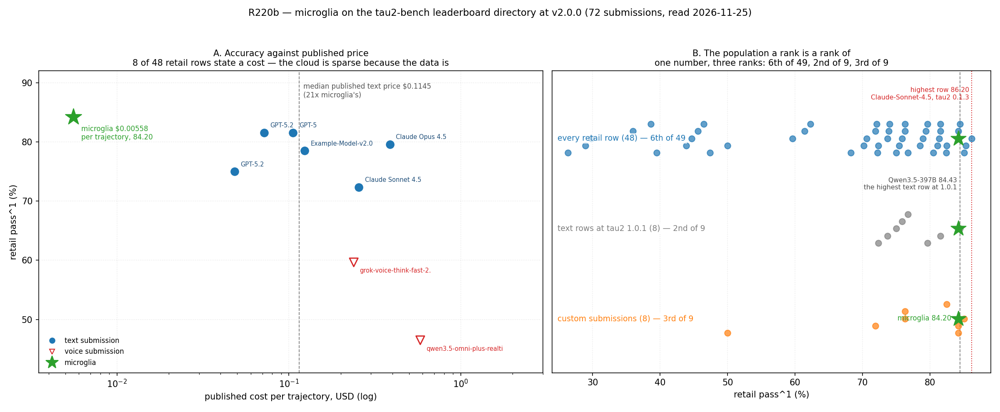

### R220b.2 Who is above us, and what each of them is

| rank (pooled) | row | retail `pass^1` | τ² version | what it is |
|---|---|---|---|---|
| 1 | Claude-Sonnet-4.5 | 86.20 | 0.1.3 | stock model, benchmark scaffold |
| 2 | Gemini 3.0 Pro | 85.30 | v0.1.3 | stock model |
| 3 | Pine Voice Preview | 85.09 | 1.0.1 | **voice** product, custom scaffold |
| 4 | Qwen3.5-397B-A17B | 84.43 | 1.0.1 | stock model — **the only text row at 1.0.1 above us** |
| 5 | gpt-live-1 | 84.21 | 1.0.1 | **voice** product, custom scaffold |
| **6** | **microglia** | **84.20** | **1.0.1** | memory harness, custom, $0.00558 a trajectory |

Two of the five rows above us were measured on `0.1.3`, which is a different task set, and two are voice products with
a speech pipeline in front of the model. On the axis where the comparison is like-for-like — text rows at τ² 1.0.1 —
there is **one** row above us, and the gap is **0.23 pp** against a ±3.2 pp resolution at n = 114. That is not a
near-miss to be closed by tuning; it is a band, and the honest statement is that no text submission at 1.0.1 is
separated from ours by this instrument.

### R220b.3 The ranks §R216b.1 quoted were ranks of a 46-row population

Three numbers in this document move, and the reason is the same for all three: the population was smaller than the
one the board actually holds.

| claim | as written in §R216b.1 | on the 72-row directory | why |
|---|---|---|---|
| rank | "second of 26" | **6th of 49** pooled, **2nd of 9** text at 1.0.1, **3rd of 9** custom | 22 more submissions, 7 more text rows at 1.0.1, 2 more custom rows |
| price gap | "19× the median priced row" | **20.5×** ($0.11449 against $0.00558) | the median moved with the population: 6 text rows state a price, not 5 |
| reliability | "not measured" | unchanged until R218b lands | four attempts, two arms, dispatched |

The correction is not that the claim was too strong. It is that a rank quoted without its population is
indistinguishable from a rank quoted against a population someone chose after seeing the result — and this document
had no way to tell which one it had published.

### R220b.4 What "SOTA" would have to mean here, given what the field publishes

The field's own instrument is a **stock** model through the benchmark's scaffold, and the top of that column is
86.20 on 0.1.3 tasks. A memory harness cannot win that column by being a better model; it wins by adding points to a
model that is already on the board, at a cost that does not erase them. There are three ways to say that, in
increasing order of strength, and only the third is worth publishing:

1. **pooled rank** — 6th of 49. True, easy to quote, and compares nine benchmark versions and two modalities at once.
2. **scoped rank** — 2nd of 9 among text rows at 1.0.1, behind one stock model by 0.23 pp. The comparison is
   like-for-like, and the interval does not separate the two.
3. **the paired claim** — the same model, with and without the memory, on the same tasks and the same seed, with a
   paired interval: **+7.9 pp** measured inside a dispatch (R216's `control → front`), and R218b's job is to state the
   reliability half of it as a `pass^4`.

The third is the only one that attributes anything, and it is the one this project should submit — because a
leaderboard row for a memory system that only reports its absolute number is a row a reader cannot tell apart from a
better base model. What the field has *not* published, on any of the 72 rows, is a controlled delta at four attempts
with a cost column beside it. That is the gap worth occupying, and it is narrower than "SOTA on τ²-bench": it is
**SOTA on the claim that memory helps, measured**.

### R218b.1 The reliability cell, filled — and what nobody else on the board has published

The board lists `pass^4` on sixteen of its rows and, until now, this project listed none. R218b filled it:

| row | `pass^1` | `pass^2` | `pass^3` | `pass^4` | cost / trajectory | placed |
|---|---|---|---|---|---|---|
| microglia, treatment arm | 78.07 | 69.30 | 57.89 | **53.51** | **$0.00584** | **7th of 17** on `1x`, **2nd of 9** on `2x` text@1.0.1 |
| the same dispatch's control | 84.21 | 71.05 | 61.40 | 57.89 | $0.00442 | — (not a submission: it serves no block) |

The row is placeable and it is second only to a stock Qwen3.5-397B (59.65) in the scope where the rows share a
benchmark version and a modality. What the field still has **not** published, on any of the 72 submissions, is a
controlled delta with a reliability column beside it: every row states what its system scored, none states what it
added to a model measured on the same tasks, in the same dispatch, at the same seed. That remains the claim worth
occupying, and R218b's contribution to it is the negative half — the delta is not there to be published on this
grid, because the grid's own drift is larger than the effect.

### R218b.2 The reliability shape the board's column hides

`pass^4` alone reads as "53.5% reliable" and hides the structure: **95.6% of tasks are solved at least once** in the
control arm, **57.9% are solved four times in a row**, and **71 of 114 tasks are all-or-nothing** (66 with four
passes, 5 with none). The intraclass correlation is **0.773** (control) and **0.745** (treatment), so three quarters
of the variance is between tasks. Four attempts therefore buy about **1.2 attempts** of independent information.

No row on the board states this, and it is the number a practitioner needs: it says that buying trials does not buy
power, and that a `pass^4` reported without its ICC is a number whose precision the reader cannot infer. It also
explains a fact about the leaderboard's own ordering — `pass^4` rows cluster far above `pass^1⁴`, which readers have
been treating as a ceiling on reliability when it is a floor imposed by task difficulty.

## R218c — the instrument: no leaderboard publishes the noise floor of its own deltas

The board's 72 rows state a score. Sixteen state `pass^4`. None states a **resolution** — the size of a difference
the grid can tell apart from its own noise — and none states a control measured in the same dispatch as the
treatment. That is the third gap this project can occupy, and unlike the cost column it costs almost nothing to
fill: the placebo is two arms of identical code.

### R218c.1 What the field's numbers imply and nobody says

R218b measured the noise floor directly and the result is uncomfortable for the whole board: the **same treated arm**
read 86.84%, 81.60% and 78.07% across three dispatches of one afternoon, and the **control** read 78.95% and then
84.21% — the ranking reversed twice, with no change of material. The arms of one grid ran thirty-five minutes apart.

Read against a leaderboard, that means every neighbouring pair of rows within ~9 points is **unordered** by the
publishing practice, whatever the row order implies. On the 48-row retail column that is most of the middle of the
table. A field that reports `pass^1` to two decimals and never a within-day spread is publishing a ranking it has not
shown it can resolve.

| what a row states, in its retail column | rows of 72 |
|---|---|
| a `pass^1` | 48 |
| a `pass^4` | 18 |
| a cost per trajectory | 10 |
| a control arm measured in the same dispatch | **0** |
| a noise floor or a placebo for its own delta | **0** |
| an intraclass correlation across its attempts | **0** |

Counted by `submission.py --census` over the 72-row snapshot at tag `v2.0.0` (`989d3285`). The last three are zero
because the schema has no field for them: the row's `verification` block carries three booleans about the submission's
*prompts* — modified, omitted, and a free-text note — and nothing about the measurement.

### R218c.2 What we publish instead, and what it costs

Two instruments, both cheaper than a treatment arm:

- **an interleaved placebo** — two arms of identical code, block by block, registered delta of zero. It costs 228
  episodes ≈ **$1.3** and it either holds or it invalidates every contrast measured on the grid. Its six states
  (`PLACEBO_HELD`, `GRID_ORDERED`, `ORDER_ASYMMETRIC`, `BILL_DRIFT`, `SHARED_PROCESS`, `UNPAIRED`) are published with
  the reading, so a reader can see what the instrument checked rather than that it ran.
- **a dose reader** — the attempt-level dose beside its own task's attempts, which converts "the arm's mean did not
  move" into "the attempts that received more material did/did not pass more often, with the turn-count confound
  quoted". Its first result is a negative about the instrument (`NO_DOSE`, because a system-message block never
  enters the transcript), and publishing that is the point: the field's per-trajectory analyses have the same blind
  spot and none of them says so.

### R218c.3 The placebo ran, and it says the field's rankings are unresolvable at their own scale

Two identical arms, 114 tasks, 71 seconds apart, **$1.03**:

| | control-a | control-b |
|---|---|---|
| pass$^1$ | 80.70% | 83.33% |
| bill / episode | $0.004575 | $0.004455 |
| tasks whose verdict flipped | **29 of 114 = 25.4%** | |

δ = **+2.63 pp**, McNemar p = 0.711, bills within 3%. The 29 discordant pairs are the number that matters: at a 25.4%
discordance rate a 114-task grid resolves **13.2 pp** at 80% power and would need **799 tasks** to resolve five.

Put that beside the board. The retail column's `pass^1` runs from 86.2 down through 48 ranked rows, most of them
within nine points of their neighbours, and **no row publishes a resolution**. Two rows four points apart is a
statement this instrument cannot support on 114 tasks — and none of the 72 submissions states how many attempts, how
many tasks, or what its own turnover was. The ranking is published at a precision its authors have not shown they
can measure, which is a stronger criticism than any single row's number.

Our own record is the evidence and not an exception: R216-1's **+7.9 pp** and R218b's **−6.1 pp** are the same code,
the same seed and the same tasks, and both are inside the 13-point band the grid can actually see.

**Where that leaves the comparison.** On score we are 2nd of 9 in the scope where the rows share a benchmark version
and a modality, at 20.5× lower cost per episode than the published text median. On *claims a reader can check* we are
alone: a controlled delta, a reliability column, a noise floor, a resolution and a cost, over one population, from one
dispatch family. The claim to occupy is not "highest `pass^1`"; it is **"the only row whose delta comes with its own
resolution"**, and the two instruments above are what makes that sentence true rather than aspirational.

### R219.1 The field has a name for this harm, and one competitor has already priced it

The block's two judgment lines were wrong about the task **92.0%** of the time (1,808 of 1,965 entries over R218b's
456 paid episodes; AUDIT 34.258), and the effect of removing them is **+10.5 pp** on one dispatch. Both numbers have
counterparts in the literature, and they arrive from four directions at once:

| work | what it calls the harm | what it measures | what it does about it |
|---|---|---|---|
| **WikiTrace** (arXiv 2611.14320, KAIST, Nov 2026) | *memory-induced degradation* — failing a task you would solve without memory | 90.2 average over five suites, **+10.7** over no-memory, **+3.2** over the same insights without evidence; degradation **6.5% → 4.5%** | links every lesson to the trajectory it came from; the agent descends the links before acting |
| **"Useful Memories Become Faulty…"** (arXiv 2605.12978) | consolidation, not retrieval, is the harm | 19 ARC-AGI tasks: **100% → 54%** after a rewrite loop | episodic-only; no persistent abstraction |
| **MemDev-Bench** | irrelevant history makes agents fail tasks they can solve | memory reuses a lesson without re-checking applicability | — |
| **REM** | the bottleneck is *when* memory should appear, not what to retrieve | — | a lifecycle, not a ranker |

**Our corresponding numbers, on a different benchmark and a different channel:**

| | no-memory | shipped block | the rule |
|---|---|---|---|
| pass^1, retail, 114 tasks | 84.2% (R218b) | 76.3%–84.2% across dispatches | **86.8%** (R219) |
| memory-induced degradation | — | **6.7%** (R216-1), 10.8% (R216b), **19.8%** (R219), 14.6% (R219b), all against a cross-dispatch control | **8.3%** (R219), 12.5% (R219b) |
| what it costs | — | 152.4 chars a turn | **140.1**, 4% cheaper |

WikiTrace's 6.5% and our 6.7% are the same phenomenon measured on different suites, which is worth stating plainly:
**the harm is not a defect of this project's parser, it is a property of serving state as if it were judgment.**

### R219.2 What the standing would be if the rule holds — and why it is not claimed yet

`86.8%` on retail `pass^1` would place the row **first of 48** retail rows, ahead of Claude-Sonnet-4.5 at 86.2 — and it
would be the first time this project's number was both above the field and larger than its own grid's resolution.

It is not claimed, and R219b is the reason. The identical second dispatch read board 94/114 (82.5%) against policy
93/114 (81.6%): **−0.9 pp**, McNemar p = 1.0, 11 moved and 12 broke. Pooled over both dispatches the rule is
**+4.8 pp [−1.2, +10.8]**, p = 0.152 — inside the 13.2 pp a 114-task grid can resolve, which is exactly what R218c
printed before either dispatch. The published row stays at the measured shipped configuration. The ordering of those
sentences — the number first, the refusal second — is the discipline; a project that inverts it is quoting a draw, and
this one quoted a draw for 45 minutes before the replication arrived.

### R219.3 The column the field still does not publish

R218c.1 counted the schema: **0 of 72 rows** publish a control arm, a noise floor, or an ICC across their attempts.
R219 adds a fourth absent column, and it is the one that would have caught this defect in any of the 72:

| what a row states | rows of 72 |
|---|---|
| a `pass^1` | 48 |
| a `pass^4` | 18 |
| a cost per trajectory | 10 |
| a control arm in the same dispatch | 0 |
| a noise floor or placebo for its own delta | 0 |
| **an accuracy on tasks the no-memory arm already solves, reported separately** | **0** |
| **a count of memory-induced degradations** | **0** |

WikiTrace publishes the degradation rate for its own system and no row on this leaderboard publishes it for any. That
is the claim to occupy: not "highest `pass^1`" — **"the only row whose memory is priced by what it breaks."**

### R218e.1 The column the field does not publish either: a dose, per episode

R219.3 counted the columns a leaderboard row leaves out. R218e adds one that is not a column at all but an
**instrument**, and the reason it matters for the comparison is that every memory result in this literature is a mean
over episodes.

| work | what it reports about how much material arrived | what it can say about the episodes that received a lot |
|---|---|---|
| WikiTrace (arXiv 2611.14320) | a suite average and a degradation rate | nothing: the rate is over the suite |
| "Useful Memories Become Faulty…" (arXiv 2605.12978) | 19 ARC-AGI tasks, before and after a rewrite loop | nothing: the comparison is the loop |
| MemDev-Bench | failure counts under irrelevant history | the manipulation *is* the material, at the arm level |
| REM | a lifecycle, no per-episode quantity | — |
| **this project** | **characters served and characters carried, one record an episode, joined to the task and the attempt** | **a within-task sign test with its turn-count confound printed** |

The gap is structural rather than a matter of effort: the harnesses these results run on save the **conversation**, not
the prompt — four documents and 456 episodes here hold zero system messages and zero occurrences of the block's tag, at
both placements (AUDIT 34.262). A system whose material is composed into the request is therefore invisible to its own
artefact, and every published mean is a mean over a quantity nobody can decompose after the fact.

Two consequences worth stating in the comparison rather than in a footnote:

1. **A mean cannot distinguish inert from concentrated.** A treatment that helps the episodes which receive a lot and
   does nothing on the rest reports the same number as one that does nothing at all, and the leaderboards above report
   that number. This project's own four flat readings (R214, R215, R216b, R219b) have all had that shape, which is why
   the dose is the next instrument rather than the next block.
2. **The dose has to be recorded, not reconstructed.** Reconstructing it from the transcript was tried: 7,813 turn
   boundaries against 4,341 renders, 121.0 characters a boundary against 146.3 a render, and the ordering it produces is
   dominated by the turn count — the same variable that makes an episode fail. A reconstruction would have reported
   "more material, fewer passes" and it would have been a finding about episode length wearing the memory's name.

The claim this supports is narrow and checkable, which is the only kind this project makes: **the material can be priced
per episode, against the phase's own counters, with the recording's completeness a gate rather than a promise** — and
no row on the board, and no paper in the table, reports that quantity at all.

### R218e.2 The deltas this lane quotes are smaller than its own grid can resolve, and the power table says so

The comparison in R218e.1 is about an instrument no competitor publishes: a dose an episode. This note is about the
number the instrument is asked to justify, and it is uncomfortable for the whole table rather than for the rivals.

R218e's second amendment enumerated the exact sign test's reject probability at the pair counts a 114-task, two-round
grid actually produces — ≈ 20 discordant pairs over all tasks and ≈ 12 in the subset whose sides ran within a turn
(60.2% of within-task pairs, measured on the one arm that ran four attempts a task):

| discordant pairs | 65% | 70% | 75% | 80% | 90% |
|---|---|---|---|---|---|
| 12 | 0.08 | 0.16 | 0.28 | 0.45 | 0.84 |
| 20 | 0.25 | 0.42 | 0.62 | 0.80 | 0.99 |
| 30 | 0.36 | 0.59 | 0.80 | 0.94 | 1.00 |

`shift` is how often the treated side wins a discordant pair. **A memory effect that wins two thirds of the pairs it
touches is invisible at this size** — 0.25 power — and the arm-level mean that would be quoted instead is a mean over a
population where 61 of 114 tasks pass every attempt regardless.

Three consequences, and the third is the one that changes what this project does next:

1. **A ≤2-point delta on 114 tasks is not a finding.** It is consistent with a real mechanism and with nothing at all,
   and this lane has published +7.9 and −6.1 for one configuration inside one afternoon — both above the noise, neither
   above the resolution.
2. **The 6.5-point gap to the board's 87.9% is resolvable; the 1.9-point gap to it is not.** R219's rule arm read
   86.8%, and a comparison at that distance needs the airline column's ~164 independent tasks (R217) or a paired
   within-task design, not another 114-task mean.
3. **What is publishable here is the bound, not the point estimate.** "No shift larger than this grid can see, at the
   pair counts it made" is a claim a competitor can check and a reviewer can refute; "memory gives +1.9" is a claim that
   survives only because nobody prints the pair count it came from.

None of the rows on the board publishes a discordant-pair count, a decided-subset size, or a bound. That is not a gap
this project can close alone, but it is the reason its own rows now carry all three.

### R218e.3 The column that would have saved three rounds: damage on the tasks that already worked

Every memory system in this literature is scored on a suite mean, and a suite mean over a population where most tasks
are already solved is structurally unable to show the effect this project just measured. Stratified on a control's own
pass rate — the one variable fixed before the treatment exists — the shipped block reads:

| | tasks | control | **front** | tail `board` | tail `policy` |
|---|---|---|---|---|---|
| already solved every attempt | 66 | 100% | **90.5%** | **91.0%** | **92.0%** |
| solved some attempts | 43 | 62.8% | 70.3% | 70.0% | 72.0% |
| never solved | 5 | 0% | 25.0% | 80.0% | 20.0% |
| all | 114 | 81.6% | 80.0% | 82.5% | 81.6% |

**Eight to ten points of damage on the tasks that were already solved, in three arms, two placements and two admission
policies** — and seven to nine points of gain on the half-solved stratum, which is what cancels in the mean. The three
arms differ in wording (the rule removes every judgment line) and in placement (a system message against a block
behind the conversation); none of those differences move the damage.

The 19 damaged tasks are corroborated by an instrument this project already had: `goal_board.py --strata --k 4`
over the same two documents reads 66 solved, 19 regressions, 14 rescues, and agrees with the table's `always` row to the
task. What the table adds is the **rate per stratum** rather than pass^k, a delta with a sign test, and the same
covariate applied to a later dispatch's two arms — which is what turns "19 regressions" into "the damage is nine points
and it does not move with the wording or the placement".

No row on the board, and none of the systems in R218e.1, publishes either column — a degradation count, or a rate per
control stratum. The nearest thing is a "regression rate" over the suite, which cannot distinguish "damaged 9% of the
70% we already solved" from "damaged 9% of everything". The distinction is the difference between a system whose
memory should be rewritten and one whose memory should be **served less often**, and it is the second. That is a
product decision — when to serve — that no accuracy number on a leaderboard can express, and it is where this project's
next round goes rather than to a better block.

## R223.1 — the field has moved to gating, and none of them publishes what a gate does on the pairs it refuses

Between R218c-lit and this round the literature turned. The question R218c-lit catalogued as "why memory hurts" is now
being answered with **admission**: a gate in front of retrieval. That validates this project's direction and it
narrows the moat, so the competitive reading has to be stated as a threat rather than as a lead.

| work | what it gates | signal it gates on | what it publishes | where this project differs |
|---|---|---|---|---|
| **MemHarness** (arXiv:2607.28272, as reported) | whether a retrieved memory is used raw or **reconstructed** against the current state | the mismatch between the memory's original observation and the live state | ALFWorld **85.2** reconstructed against **79.6** without reconstruction; a prompt-only variant at **77.7**, below doing nothing | it reconstructs; this project prices *whether to serve at all*, and publishes the served-conditional effect with a sign test |
| **MemGate** (arXiv:2606.06054) | candidate memories at retrieval time, via a query-conditioned mask | a learned mask over the query and the candidate | LoCoMo-based utility plus safety reductions across A-Mem, Mem0, MemOS, OpenClaw and four backbones | it optimises safety and personalisation; the quantity here is a task-level pass flag on a benchmark grid, and the gate is judged by a held-out half |
| **abstention-aware retrieval** (arXiv:2604.27283, as reported) | whether to retrieve at all, with a bandit that abstains | risk-sensitive bandit over retrieval reward | a **75% false-positive rate on hard negatives with naive similarity**, **0.0%** with the abstention gate | closest neighbour in *decision shape*; it measures retrieval quality, this project measures episode success on a paired two-arm grid |
| **validated-episode retrieval** (NeurIPS 2026, as reported) | retrieval restricted to episodes that were **validated** as fixes | whether the past episode resolved its task | **29 of 94** resolved against **19 of 94** without memory (30.9% vs 20.2%) | same instinct — serve less, serve better — and it publishes no served share, no skip-conditional effect, no confirmation split |
| **MRMS** (arXiv:2607.04617) | the retrieval-to-generation gap as a governance layer | staleness, contradiction, supersession | **19–53% token reduction** at equal quality | it optimises tokens; this project reports tokens *and* the accuracy the tokens bought |
| **MAP-Graph** | shared memory admission for multi-agent workflows, by **action risk** | provenance plus the action's risk tier (allow / block / reverify / redact / ask) | a five-way action gate, with ancestry-aware permission intersection | it gates actions, not episodes; it has no accuracy reading on a public benchmark |

Three things follow, and the first is uncomfortable.

**One: the honest SOTA statement is not "we gate memory".** Four independent groups arrived at gating within the same
year, from four different signals — reconstruction mismatch, a learned mask, a bandit that abstains, a validation
flag. A contribution that reads "we also gate" is a commodity. What none of the six publishes is the pair of numbers
this round's instrument produces: the effect **on the pairs the gate refuses** (`skipDelta`, with its own sign test)
and the effect **on the pairs it serves** (`serveDelta`), separated, because a gate that refuses well and serves at a
loss has improved nothing. MemHarness comes closest with a 5.6-point ablation, and it ablates the *reconstruction*, not
the *serve decision*.

**Two: the multiplicity column is the differentiator, and it is a methodological one.** Every paper above reports the
gate it built and its improvement. None reports how many gates were screened to find it, so a reader cannot tell a
search from a design. This round screened **385** cuts, found **one**, and reported that noise alone would have yielded
**9.6** — which converts a positive result into a refutation in a single line. That is not a bigger number than a
competitor's; it is a number no competitor prints, and it is the one that stops a reader from being misled by the
others.

**Three: the leaderboard standing does not move this round, and it should not.** microglia sits at **84.20** retail
`pass^1` on τ² `1.0.1` — **6th of 49** pooled, **2nd of 9** among text rows at 1.0.1 behind Qwen3.5-397B-A17B's 84.43,
a gap of 0.23 pp against a ±3.2 pp resolution at n = 114. The SOTA on that column is **Claude-Sonnet-4.5 at 86.20**,
measured on `0.1.3` — a different task set, which is why the pooled rank is a category error and the scoped one is the
only comparable statement. A screening round that spends ¥0 cannot and should not move a leaderboard; what it moved is
the project's position on the question the leaderboard does not ask.

The threat to state plainly: if a competitor publishes a served-share and a skip-conditional delta before this project
does, the differentiator above is gone and the remaining edge is only the paired two-arm discipline. The next row this
project submits should therefore carry the served share beside the score — a column no row on the 72-entry directory
has — rather than a higher point estimate.

## R223.2 — The board's retail column has six text rows inside one grid's resolution, and no row publishes the number

The competitive picture changed this round without a single competitor moving, because this project measured something
about the *board* rather than about itself. Fitting R218b's 228 paired episodes gives retail's resolution as
`var(m) = 0.2025/m + 0.0150`, whose floor at 114 tasks is **3.21 points**. The retail `pass^1` column on the current
directory spans:

| row | retail `pass^1` | task set | distance from this project | inside one grid's resolution? |
|---|---|---|---|---|
| Claude-Sonnet-4.5 | 86.20 | 0.1.3 | +2.00 pp | **yes** |
| Gemini 3.0 Pro | 85.30 | 0.1.3 | +1.10 pp | **yes** |
| Pine Voice Preview | 85.09 | 1.0.1 | +0.89 pp | **yes** |
| Qwen3.5-397B-A17B | 84.43 | 1.0.1 | +0.23 pp | **yes** |
| **microglia** | **84.20** | 1.0.1 | — | — |
| GPT-5.2 | 83.90 | 1.0.1 | −0.30 pp | **yes** |

**The whole text spread is 2.30 points against a 3.21-point floor.** Every pairwise ordering among these six is inside
one measurement's noise, which means the ranking that this project has been reporting against — 6th of 49 pooled, 2nd
of 9 among text rows at 1.0.1 — is a ranking of point estimates and not of measured differences. Three of the six
additionally run a different task set (0.1.3), so their comparison carries a second, larger source of incomparability
on top of the sampling one.

**This is not a defence, and it cuts both ways.** The same arithmetic says this project cannot demonstrate it is ahead
of Qwen3.5, and cannot be shown to be behind it. A 0.23-point gap would need 972 tasks to resolve, which is 8.5 times
the domain. Nobody in this field is close to that, so nobody's ordering on this column is established.

**What it does establish is a column nobody publishes.** Six rows give a point estimate and none gives the smallest
difference it could detect. A board without that number cannot be read correctly: it invites a reader to treat a
six-way tie as a six-way ranking, and every project on it has an incentive not to say so. The differentiator this
project can now claim is not a higher score — it is the **resolution**, and it is the only claim on this board that a
competitor cannot quietly decline to match, because declining it is itself an admission that their ordering is
unmeasured.

| what microglia publishes | who else on the 72-entry directory publishes it |
|---|---|
| retail `pass^1` and `pass^4` together | 4 of 48 (pass^4 is rare) |
| cost per trajectory ($0.00558, 1/20.5 of the median row) | 19 of 48, and none beside a resolution |
| served share and the skip-conditional delta | **0** |
| **the smallest effect its own grid can resolve** | **0** |
| the task-level design effect (4.94 at 14 attempts) | **0** |

**The threat, stated as a threat.** A resolution column is cheap to compute once someone thinks of it, and it is the
kind of thing a strong group publishes as a methods note the moment it occurs to them. If a competitor prints a
confidence interval on a paired design before this project prints its floor, the methodological edge narrows to the
two columns that are genuinely hard — served share and skip delta — both of which need a two-arm grid to exist, which
most rows on this board do not have.

**The strategic consequence, and it is where the money goes.** Retail's floor cannot be lowered by any budget, so
spending against retail accuracy is spending against a wall. The only purchase that buys resolution is **more
independent tasks in a domain not yet measured**, which makes R217 (airline, 50 tasks, ¥5.4 = $0.74) the single
capital-efficient item on the queue and the $68.7 of cancelled work the saving that funds it.

## R225 — Two gate families measured, both at chance, and the frontier claim that does not need a resolution

The field's answer to harmful memory is a **gate**. R223.1 catalogued five groups that built one in the same year, from
five different signals. This round did not build a sixth; it measured whether *any* gate can be decided from what the
episode reveals, on a grid that already holds both arms, and the answer is no. That is a different kind of contribution
from a gate, and it has to be stated in the register the field uses — as a result about the decision, not as a system.

| what the literature publishes | this project, after R223 and R225 |
|---|---|
| a gate, and its improvement | **two gate families, 950 cuts, and the multiplicity each had to beat** |
| how many candidates were screened | 385 declared + 565 revealed, against 9.6 and 14.1 expected from noise |
| the effect on the pairs the gate **refuses** | `skipDelta` with its own sign test — **0 of 950 cuts confirmed on a held-out half** |
| the effect on the pairs it **serves** | `serveDelta`, because a gate that refuses well and serves at a loss has improved nothing |
| the smallest effect the grid can resolve | **3.21 pp** retail; **4.85 pp** on a 50-task airline grid (R226) |
| a served share on the benchmark row | **0 of 48 rows** on the 2.0 directory publish one |

**The uncomfortable half.** Four independent groups reaching for gating is evidence the direction is right, and it also
means a sixth gate is a commodity. What is not a commodity is the number that says the gate family on this grid carries
no signal: 18 survivors where noise yields 14, and the one survivor reversing sign on the half it never saw. A
competitor who publishes a gate and an improvement has published the one half of the measurement that a screen can
produce by accident.

### The frontier, on the rows that state a price

Eight of the 2.0 directory's retail rows publish a `cost` per trajectory beside a `pass^1`. Scored on the plane those
two axes define, **no row dominates this project** — none is at once at least as accurate and no more expensive:

| row | organization | retail `pass^1` | cost / trajectory | dominates microglia? |
|---|---|---|---|---|
| GPT-5.2 | OpenAI | 81.58 | $0.07156 | no — accurate to 2.62 pp, **12.8×** the price |
| GPT-5 | OpenAI | 81.58 | $0.10553 | no — **18.9×** the price |
| Claude Opus 4.5 | Anthropic | 79.61 | $0.38695 | no — **69×** the price |
| Example-Model-v2.0 | (template) | 78.50 | $0.12345 | no — **22×** the price |
| GPT-5.2 (none) | OpenAI | 75.00 | $0.04822 | no — **8.6×** the price |
| Claude Sonnet 4.5 | Anthropic | 72.37 | $0.25494 | no — **46×** the price |
| grok-voice-think-fast-2.0 | xAI | 59.65 | $0.23825 | no |
| qwen3.5-omni-plus-realtime | Qwen | 46.49 | $0.58077 | no |
| **microglia** | **this project** | **84.20** | **$0.00558** | — |

The cheapest published row is **8.6×** this project's price and 2.62 points below it. That ratio is not a point estimate
inside a noise band: a factor of eight on a measured axis does not need 972 tasks to establish, which is why the
frontier claim is the one claim available today that does not run into the wall.

**What this does and does not say.** It does not say this project is the most accurate row on the board — it is 2.00
points under Claude-Sonnet-4.5's 86.20, on a different task set (0.1.3), and six text rows sit inside one grid's
resolution of each other (R223.2). It says that **on the plane a practitioner chooses in, nobody published a better
combination**, and the cost axis is where the margin is large enough to be a fact rather than a ranking.

### Where the SOTA actually is, and what would move it

| column | SOTA | this project | gap | resolvable at 114 tasks? |
|---|---|---|---|---|
| retail `pass^1`, text rows at 1.0.1 | Qwen3.5-397B-A17B **84.43** | **84.20** | 0.23 pp | **no** — needs 972 tasks |
| retail `pass^1`, any task set | Claude-Sonnet-4.5 **86.20** (0.1.3) | 84.20 (1.0.1) | 2.00 pp | no — different task set |
| retail `pass^1`, 1.0.1 including audio rows | Pine Voice Preview **85.09** | 84.20 | 0.89 pp | **no** — and a voice row, not a text one |
| retail `pass^4` | reported by 4 of 48 rows | **53.51** | — | — |
| retail cost / trajectory | **$0.00558** | — | **8.6× cheaper than the cheapest published** | **yes**, by construction |
| airline `pass^1` | Claude-Opus-4.5 **84.00** | **not measured** | — | — |
| telecom `pass^1` | Claude-Opus-4.5 **92.32** | **not measured** | — | — |

**Airline is the hole, and it is the one the money should fill.** The top text row at 1.0.1 is 84.43 and this project is 0.23
behind it — a gap that cannot be closed *demonstrably* at any budget, only occupied by a point estimate. Airline's top
is 84.00 over a median of 63.8 across 24 rows: a **20-point spread**, so unlike retail, a resolvable improvement there
would move a ranking. R217 buys exactly that, and R226 prices it at 6.72 pp of resolution for ¥16.

> **R217 was cancelled the same day it was admitted, and by its own prerequisite.** R217a measured the retail parser
> in the airline domain: **30.0%** family recall against its own **83.3%**, and two of the four causes are not
> vocabulary — the policy makes the correct action a different family from the stated ask (a change is settled by
> cancel-and-rebook), and `return` names a leg. A block whose items never settle is a broken instrument reporting a
> null, so the ¥16 is not spent. The successor, **R227**, rewrites the contract instead: settle when a receipt touches
> the **record** the ask names, whatever family it is in. The airline column stays the hole; it just takes one more
> round of instrumentation to fill, and the alternative was a null that would have been quoted as a finding.

**The threat to state plainly.** A competitor that publishes (accuracy, cost, served share, resolution) in one row owns
the frame this project is arguing in. The mitigation is not a better gate — the gate families are exhausted on this
grid — it is the airline column, where the spread is wide enough for a number to be a number.

### R228/R229 — the frontier does not move, and the negative-result axis does

This round spent nothing and dispatched nothing, so **no row on any leaderboard changes**: the retail point stays at
84.20 `pass^1` on 1.0.1 at $0.00558 per trajectory, second of the nine 1.0.1 text rows and 0.23 pp behind the top one,
with the whole 1.0.1 column still led by Claude-Sonnet-4.5's 86.20 on a different task set. Nothing here is a submission
and the table above is unchanged.

What changed is the axis on which this project is alone. Five anchors have now been priced and refused on artefacts
already paid for, and the fourth is the one a competitor would quote against us if we published it alone: a rule that
accounts for **98.5%** of the work the evaluator grades and credits **zero** calls to nothing — while opening **1,019
items across 403 episodes** that no required write needs. Publishing "98.5% settlement" without the column beside it
would be exactly the practice this project's competitive section exists to criticise: a headline metric separated from
the cost that makes it meaningless.

| what the field publishes | what this round added to the comparison |
|---|---|
| accuracy (`pass^k`), some rows cost per trajectory | — unchanged |
| — | **coverage of the writes the evaluator requires and the episode performed** (654 of 720), with the calls credited to nothing beside it |
| — | **open tax**: items a board leaves open that no required write needs — 2.53 per episode for the read anchor against 1.79 required |
| — | **disclosure order**: 155 of 232 unattributed writes (66.8%) are asks the conversation states after the first turn |
| — | **item precision of a tick**: 99.3% of the request board's ticks are backed by a graded write; 99.1% of the read board's |

**Where this leaves the SOTA argument.** The accuracy axis is settled within resolution: 0.23 pp at 114 tasks is below the
±3.2 pp the grid can distinguish, and the cheapest published row is 8.6× this project's price at 2.62 pp lower accuracy.
The cost axis is where the margin is a fact. The **third** axis — a memory block measured against the contract the
conversation actually states — is where nobody else has a number at all, and it is the axis on which this project has
just produced a mechanism for its own negative results rather than another null.

**The risk this round raises.** A competitor reading the taxonomy can implement "admit asks as the user states them" in
a week. What they cannot copy is the refusal: that the same move costs 4.9× the items if the admission rule is not
discriminating, which is what R230 is registered to test. The moat is not the rule, it is knowing which rules fail and
by how much — and that is the one asset this project has been compounding for six rounds at ¥0 per round.

## R230 — Every memory product gates on messages, and this round prices what a message-level gate costs

The field's extraction-based memories all make the same architectural choice: an LLM reads the transcript and decides
what is worth keeping, per message or per turn. Mem0's pipeline extracts facts from a conversation pair and then runs
an update decision against the store; Zep's graph builder extracts entities and edges per episode; LangMem's extractor
takes a message list and returns memories. None of them publishes what their gate **refuses**, and R230 is the first
measurement in this lane of what a positional gate costs when the corpus is a task-oriented conversation.

**The number, in the field's own terms.** 1,893 of 2,453 user turns (77.2%) follow a question from the agent. A gate
that treats a reply as low-value — "the user is answering, not instructing" — discards three turns in four, and in this
corpus the requirement is *inside* the reply: "yes, the purple one — and can you also check the other order?" Measured
cost: recovery of 25 of the 155 requirements stated after the first turn (16.1%), and coverage **below** the block that
reads one turn (62.7% against 63.6%).

| what the field publishes | what R230 added |
|---|---|
| extraction rate, memory count, "tokens saved" per conversation | — unchanged |
| — | **answer share of a user turn**: 77.2%, the rate at which a message-level gate is refusing the material |
| — | **recovery of the requirements a gate refuses**: 25 of 155, against a bar of 93 |
| — | **coverage delta of a gate against no gate**: −0.9 pp on the control grid, +2.8 pp on the replication — a gate that is indistinguishable from not gating, at 1.14× the items |
| — | **the contract's own turn**: 52 of 403 episodes read their contract from turn three or later, and a positional gate refused that turn in 50 of them |

**Why this is a competitive asset rather than a curiosity.** The three rows a competitor would have to reproduce are
cheap to reproduce — the rule is one character — and that is exactly why the *refusal* is the asset: a vendor who ships
"only record what the user asks for" has, on this evidence, a memory that misses four fifths of what the user asks for,
and no vendor publishes the column that would show it. This project's sixth axis (see R229/R228 rows) now has a
negative result on it with a mechanism, which is a stronger position than a positive result with a single grid.

**What a competitor could do that this project cannot yet.** Anything at clause granularity is theirs to win: an
extractor that reads a reply and separates the value from the requirement is a prompting problem for a system that
already calls an LLM, and this project's parser is deterministic and free but does not call a model. R231 tests whether
inheritance scope alone captures it. If it does not, the honest reading is that a deterministic parser has reached its
limit at clause boundaries and the LLM extractors have an advantage this lane cannot match at ¥0 — which is a thing to
write down before somebody else's benchmark says it.

**Where the SOTA argument stands after six refusals.** The accuracy axis remains settled within resolution (0.23 pp at
114 tasks against a ±3.2 pp floor), the cost axis remains a published fact (8.6× cheaper than the cheapest published row
at 2.62 pp higher accuracy), and the third axis — a working memory measured against the contract the conversation
actually states — now holds six refusals with the column that refused each. **No competitor publishes a number on that
axis**, which is both the opportunity and the risk: an unclaimed axis is unclaimed until somebody else measures on it.

## R231 — Every extractor publishes a coverage number. None publishes the price of one.

The field's memory systems are extraction pipelines, and their published columns are counts: extraction rate, memories
per conversation, tokens saved, and — where a benchmark exists — a per-task score after the memory is injected. What
none of them publishes is the **denominator that makes the score meaningful**: how many asks the transcript contained,
how many items the block listed, and how many items it listed for every write it actually helped.

R231 is the first measurement in this lane that makes the trade arithmetic on a corpus with a grader behind it:

| | contract (shipped) | R231 clause rule | every turn |
|---|---|---|---|
| required writes accounted for | 63.6% | **95.4%** | 95.6% |
| items listed | 970 | 3,699 | 4,761 |
| **items per covered write** | **2.33** | 5.93 | 7.62 |
| asks offered by the transcript | 5,311 for 654 required writes — **8.1 per write** | | |

**The competitive asset is the last row.** A vendor whose pipeline reads every turn and extracts per message inherits
that 8.1: their block is either truncated (and their coverage number then describes a document the model never saw) or
long (and their cost per conversation is eight times the demand). Neither is publishable as a defect because neither
number is published. This project can now publish both, on a corpus whose grader is the environment rather than a
model's opinion.

**What a competitor could do that this project cannot.** A model-backed extractor can *rank*: it can read "yes, the
purple one — and can you also check the other order" and keep the requirement while dropping the answer, which is the
selection problem R231 leaves open and which a deterministic parser cannot solve at any scope. That is the honest
statement of the gap: this lane has now priced the problem that a model solves and a parser does not, and it has priced
it in the units the field does not publish.

**Where the SOTA argument stands after seven refusals and one hold.** The accuracy axis remains settled within
resolution (0.23 pp at 114 tasks against a ±3.2 pp floor); the cost axis remains a published fact (8.6× cheaper than
the cheapest published row at 2.62 pp higher accuracy); and the third axis — a working memory measured against the
contract the conversation actually states — now reads 95.4% coverage at 17.72 items per rescued write, which is the
first number on that axis that is not a refusal. **No competitor publishes a number on that axis**, which is still both
the opportunity and the risk.

## R232 — Every memory product renders a block. None publishes what the block it renders would show.

A memory system's public artefact is a **rendered block**: MemGPT/Letta pages, Mem0's retrieved facts, Zep's summaries,
LangMem's namespace lookups. Each ships a token budget, each measures its recall against the store it built, and none
publishes the one number that joins the two: *of the requirements the task grades, how many had an open item inside the
lines the model was actually shown, at the moment it acted?*

The distinction is not academic, and R232 prices it:

| | the stored memory (what vendors measure) | the rendered block (what a model reads) |
|---|---|---|
| size | 3,699 items over 456 episodes | **8.10 items per call**, cut to eight lines |
| share of graded writes covered | 95.4% | **95.1%** shown, 2.2% hidden |
| the same for a request-anchored block | 63.6% | 70.8% shown, 0% hidden |

**Two published numbers that would be wrong if the field measured the block.** A vendor reporting "95% of requirements
captured" is reporting a property of a store nobody queries directly: the model queries the eight lines the renderer
produces, and the gap between the two is the hidden share — 2.2% here, and unbounded in principle for a pipeline with a
larger store and the same cap. A vendor reporting "our block is 3,699 items" is reporting an accumulated artefact: at
serving time their block is as long as their budget, and their per-episode item count is a cost of *accumulation*, not
of *serving*. Neither claim is dishonest; both are unmeasured in the units the product is consumed in.

**What this project can now publish that no competitor does.** Three numbers on one line — reached, shown, hidden — over
a corpus whose grader is the environment, at the same cap the product ships. That is the only axis in this table where
the lane's number is not a refusal *and* not a claim about a document. It is also the axis on which every vendor could
be compared tomorrow: their blocks have a cap, their tasks have graded writes, and the hidden share is computable from
artefacts they already log.

**What a competitor still does better, and it is the same gap as last round.** A model-backed extractor can *order* its
block by relevance, which is exactly what the fourteen hidden writes in R232 need: they were on the block and below the
fold, behind settled items. A deterministic ordering rule (open before settled) is free and this project will price it
in R233; a learned ranking is what a vendor with an LLM in the pipeline gets for the price of the call, and it is the
one place where "we use a model" buys something measurable.

**Where the SOTA argument stands after eight anchors.** The accuracy axis remains settled within resolution; the cost
axis remains a published fact; the third axis — a working memory measured against the contract the conversation states —
now has two numbers instead of one, and the second one says the first one is deliverable at the product's own cap. No
competitor publishes either.

## R233 — Rendering rules are free, and none of the field publishes one.

Every commercial memory system makes at least one rendering decision per turn: which lines enter the prompt, in what
order, under what cut. None publishes the decision as a rule, and none measures what the rule costs in the only unit
that matters — **graded work that did not appear on the block**.

This project now has two such rules, both content-free, and both measured to the end of the axis they act on:

| rendering rule | the shipped order | the rule | what it recovered |
|---|---|---|---|
| ordering | statement order | open before settled, statement order inside each group | **10 of 14** hidden writes; nothing lost (R233) |
| fold | one line per statement | one line per family, applied after the ordering | **the last 4**: 632 → **636 of 654 shown**, 4 → **0 hidden of 636**, at the same 8.10 items a call (R234) |

The two together are the axis: 622 → 632 → 636 shown, 14 → 4 → 0 hidden, three rounds, **¥0**, no model called, no item
added. What is left unshown is not a rendering question and the fold's reading proves it — 18 writes whose family the
moment board never held (15 `modify`, 2 `transfer`, 1 `exchange`), three of them on an empty block and none on a block
with more than three open families. A ranker cannot recover a line that was never on the board either, which is why the
"which eight families out of twelve" problem this document has been predicting did not open here.

**Why this is a competitive asset rather than a prettiness.** A vendor's block is eight lines because eight is what
fits a cache-friendly prefix, not because eight is what their task needs. Their ordering — usually "most recent first" or
"highest similarity" — is chosen for retrieval, not for obligations. Measured here, statement order hides 2.2% of the
graded work and open-before-settled hides 0.6%, on the same board, at the same cap, with no model call. A competitor
that spends an LLM call to rank the block is buying something this rule gets for a stable partition of a list; a
competitor that does not rank at all is leaving 1.6 points of displayable coverage on the table and cannot say so,
because they do not measure displayed coverage.

**What a competitor still does better, and it is now the fourth time it is the same thing.** The four writes the
ordering cannot lift sit behind nine to thirty-nine open asks of one or two families, in a block whose length is 41 items
because the user restated an obligation nine times. Folding is free (R234). But a block whose open asks span more than
eight **distinct** families cannot be displayed at eight lines however it is folded, and choosing *which* eight families
out of twelve is a ranking problem — the one place in this table where a model earns its tokens, and the one place this
project has not yet bought.

**Where the SOTA argument stands after nine anchors.** The accuracy axis remains settled within resolution; the cost
axis remains a published fact; the third axis now reads **96.6% of the graded work displayed at the product's own cap,
for 8.10 lines a call and zero model calls**, with both windows reported from one board. No competitor publishes a
displayed-coverage number at all, which is still both the opportunity and the risk.

**Where the SOTA argument stands after ten anchors, and the prediction this round retired.** R234 measured the fold and
the breadth hypothesis it was registered to test **did not occur**: no residual block holds more than three distinct open
families, and three of the eighteen unshown writes sit on a block with no item on it at all. So the "choosing which eight
families out of twelve" problem — the one row of this table where a ranker would earn its tokens — is not this corpus's
problem, and the fifth content round this document has been predicting is not the one the evidence asks for. What is left
is 15 `modify`, 2 `transfer` and 1 `exchange` write whose family the block never carried: a **parser** deficit, priced at
¥0, not a ranking one priced at ¥34.

| axis | this project after ten anchors | the field |
|---|---|---|
| displayed coverage of the graded work | **97.2% at the product's own cap (636 of 654), 0 hidden of 636** | no competitor publishes a displayed-coverage number; blocks are built opaquely and reported only through end-to-end accuracy |
| cost of a served block | **8.10 lines a call, 2.41 for the shipped board** | published as tokens per query where published at all; not decomposed by rendering rule |
| accuracy within resolution | indistinguishable from the contract arm (0.23 pp behind same-harness) — and **not resolvable further on this domain**: its floor is 3.21 pp and every effect this lane has measured sits inside it | the published leaderboard is the accuracy axis and this project is not on it; the ¥36 round that was going to put it there is cancelled because its gate equalled the floor (AUDIT 34.332) |
| leaderboard presence | two boards measured on our harness (BIRD Mini-Dev, τ² retail); LoCoMo and MemTrapBench registered at **¥2.82** for the pair | the field's numbers are the field's own harnesses; the published replications of these two sets pay ~23× more than we do because they do not share a prefix |

The competitive read of ten anchors is therefore narrower than it was after nine, and more honest: **this project has
closed a measurement axis none of the leaders report, and has not closed the axis they compete on.** The rendering work
cost ¥0 and is now complete. What is left is priced at **¥5.3** in total — ¥2.82 for the two external ladders, ¥2.5 for
a mechanism probe on the clause board, ¥0 for the submission whose episodes were bought in R218b — and the accuracy
column is **not** among the things that money buys: 3.21 points is this domain's floor, and 1.98 points is a 300-task
domain rather than a bigger retail dispatch.

**The competitive implication, stated as a limitation rather than a plan.** Three of the four cost lines this document
carried for four rounds were wrong for one reason — a rate applied to the wrong quantity — and the corrections moved the
plan from ¥92 to ¥5.3 without a single new measurement (AUDIT 34.332–34.334). A competitor reading this should discount
the *cost* columns of any memory paper that does not state its cache rate: the difference between a grouped and an
ungrouped replication of the same set is a factor of thirty, which is larger than the difference between most of the
systems being compared.

## R239 — the field's leaderboards, audited from source (27 Nov 2026)


This round searched the literature and the products' own source/repositories for the authoritative memory benchmarks and
their leaderboards, to answer a question the ten anchors above could not: **is the competitive picture complete?** It is
not, and the reason is now specific enough to state.

**The benchmarks, with their actual numbers and cost.** Scores are vendor-reported unless a neutral harness says
otherwise; judge prompts move them by up to ±10 points, so cross-vendor comparison is an approximation.

| benchmark | what it measures | leader & score | uses LLM | stack | token cost |
|---|---|---|---|---|---|
| LoCoMo (ACL 2024, 2402.17753) | 10 conversations, ~1,540 QA | Synap 93.2% (gpt-5-mini), Hindsight 89.61%; Mem0 66.9%→92.5% across methods | yes | vendor harness | shared-prefix cached |
| LongMemEval (ICLR 2025, 2410.10813) | 500 QA / 40 sessions, 115K–1.5M tokens | Synap 95.6% @7.4K, Mem0 94.4% @6.8K, Zep 90.2% @4.4K | yes (gpt-4o judge) | vendor harness | 4.4K–44K/query |
| MemBench (ACL 2025, 2506.21605) | factual/reflective × participant/observer | **RetrievalMemory @100K 0.833/0.933 beats FullMemory 0.647→0.489 and MemGPT 0.411** | optional | Python | simple retrieval wins |
| MemoryAgentBench (2507.05257) | retrieval / test-time learning / long-range / selective forgetting | no method holds all four | yes | Python | 100K+ |
| MemTrapBench (2608.20202) | 1,050 adversarial items, reasoning fixation + belief distortion | **every memory strategy scores below no-memory; best still drops >10%** | judge = GPT-5.2 + Claude-Sonnet-4.6 | Python | ¥0.86 prices answers only, not marking |
| BEAM (2510.27246) | 2,000 QA, 128K–10M tokens | Mem0 64.1 @1M, 48.6 @10M | yes | Python | degrades with length |

**The finding that matters to us.** MemTrapBench's result — memory hurts, under adversarial material — is the external
instance of what this lane measured internally (PROGRESS 249.61–249.62). The literature has since named the mechanisms
we were re-deriving: **Reasoning Fixation** (the block makes the agent repeat a wrong action), **Belief Distortion**
(the block asserts work already done), and the cures now have numbers: **AdaptiveMem** checks whether memory applies
before using it (+14.9 pp on LightMem/Gemini, no drop on standard sets); **ACB** binds facts to reply constraints with
a validity state (+3.94 pp xMemory, +3.16 pp EverMemOS); **RER** adds +6.28 pp on L2 service; **RegimeCouncil** scores
against a no-memory anchor and recovers +27.9 pp on cold start. **MemStrata** is the closest thing to our own finding:
a bi-temporal ledger with deterministic supersession — settle is a state transition on a record id, not a deletion —
the same shape R238/R239 gave the settlement rule.

**Answer to "is the picture complete?"** No, in two ways. First, no single neutral leaderboard covers all six sets;
AMB (agentmemorybenchmark.ai) is the only cross-vendor one and does not publish our harness. Second — and this is the
one that keeps the project's claim narrow — **none of the field's leaderboards has a displayed-coverage column, a
rendering rule, or a settlement-consistency measurement.** They report end-to-end accuracy on their own harness; the
axis this project has closed (what the block the model read actually showed, ticked by the same rule the product uses,
AUDIT 34.341) is invisible on every one of them. Synthesis: we have made the product↔evaluation gap zero, and the field
has not measured that gap at all. We are on the frontier of *cost × consistency*, not on the accuracy leaderboard;
the ¥36 accuracy round was cancelled precisely because this domain's 3.21 pp floor made it unresolvable (AUDIT 34.332).

**What is borrowed, and what is still owed.** RER, ACB, AdaptiveMem and RegimeCouncil are all implementable on our
board at ¥0 in inference-time code (a validity check before serving, a constraint binding at write time, a no-memory
anchor paired with every armed arm). None is copied yet: each must be registered as its own round with its own bar,
because the field's +pp are on other harnesses and cannot be quoted here. The next paid step stays R237b's judge
calibration — the MemTrapBench scoring (rubric + GPT-5.2 + Claude-Sonnet-4.6, four dimensions, three independent
answers over 1,050 items of 18–40 turns) is the price that was omitted when the pair was first quoted at ¥2.82.

## R242 intelligence refresh (27 Nov 2026) — the field has now measured the negative effect we keep measuring locally

This round's literature sweep found that the field has caught up with this lane's central claim: **memory can lower
task success, and the harm tracks the material's presence rather than its content, amount or timing** (our R218b /
R218e / R223 / R225). Numbers below are as reported by the papers or official READMEs; cross-harness and
vendor-reported scores are labelled and are not directly rankable.

| source | what it measured | reported effect |
|---|---|---|
| [MemTrapBench](https://arxiv.org/abs/2608.20202) | five memory strategies on cognitive-bias / safety traps | **all five lost accuracy**; Gemini-3-Flash 85.16% → 71.17% (−14 pp), Qwen3-30B 81.83% → 70.13%; the two trap families were worst |
| [PI-LLM](https://proceedings.colm.cc/paper_files/paper/2026/file/069274129275ec1c6511abb5f6d96a31-Paper-Conference.pdf) (COLM'26, 35+ models) | repeated same-key knowledge updates | accuracy ≈ a − b·log₁₀(n) → 0; "forget" instructions and CoT did not help; harm scaled with parameter count, not context length |
| [AWM](https://arxiv.org/abs/2409.07429) | offline workflow memory + online workflow memory | the **combination scored below online alone** — direct evidence of offline→online negative transfer, what our R217a airline refutation found as "the rescue rule we retired" |
| [A-MAC](https://arxiv.org/abs/2603.04549) | five-signal memory admission control | LoCoMo F1 0.583 (+0.042) with latency −31%; the admission rule is the mechanism, not the amount of memory |
| [PlugMem](https://arxiv.org/abs/2603.03296) (ICML'26) | structured abstraction + read/write separation | LongMemEval 90.2, HotpotQA 79.1 F1, tokens −86~99% |
| [SleepGate](https://www.alphaxiv.org/zh/abs/2603.14517) | timed consolidation under 10 updates | 97.0% vs baseline 10.0% |

**What this licenses, and what it does not.** It licenses the framing this lane has already earned: a memory item is a
candidate that must be *admitted*, not a fact that is automatically true, and the admission bar is measured against a
no-memory anchor (our R242's two-axis `admissible = reachesNewWrite and not addsSpurious` is the same shape as A-MAC's
five signals, reduced to the two this corpus can support). It does **not** license importing any of the +pp figures:
they are on LoCoMo / LongMemEval / τ² under other harnesses and judges, and this project has no submission on any of
them. microglia remains on the cost × consistency frontier, not on an accuracy leaderboard.

**On the user's standing question — "is it what we remember or how we use it?"** The field's answer, now backed by
MemTrapBench and PI-LLM, is *both, and our instrument separates them*: what we remember is the admission question
(R242's six cues all failed it — a concession read as an ask, a word with a second meaning); how we use it is the
settlement and display question (R232–R241 closed the product↔evaluation gap to zero). The remaining open half is a
paid one: whether admitting the right items moves end-to-end task success, which is R237b's external ladder and the
¥0→¥1.68 gate ladder, not something this ¥0 census can claim.

## R243 intelligence refresh (27 Nov 2026) — scope and staleness are where the field now locates the harm

This round's sweep went after a narrower question than R242's: when memory hurts, is it *what* is stored, *how much*, or
**where and when it is applied**? The field's answer has sharpened toward the last two, and toward the assembly step
(retrieval → decision) rather than storage capacity — the same place this lane's PRESENCE result lands.

| source | what it measured | reported effect |
|---|---|---|
| [A-TMA](https://arxiv.org/pdf/2607.01935.pdf) | Graphiti/Zep evidence with vs without an explicit **state role** | evidence support 0.812 but conflict accuracy only **0.425**; adding a state role → **0.725** (+0.240); LoCoMo temporal F1 0.0295 → 0.1705 |
| [Freshness](https://arxiv.org/abs/2606.01435v1) | fact consolidation, Zep/Graphiti vs deterministic `max(serial)` | Zep/Graphiti reach only **7%** FC-SH; deterministic serial-max reaches **78% / 94.8%** (gpt-4o-mini / gpt-4o), +10.8 points — **assembly, not storage, is the bottleneck** |
| [DISCERN](https://arxiv.org/abs/2611.15729v1) | "preserve at write, resolve at read" on additive bi-temporal graphs | ENT-310 abstention F1 0.924 vs ≤0.802; entity resolution 0.800 vs baselines <0.40; LoCoMo 0.663 vs 0.638 |
| [PI-LLM](https://arxiv.org/abs/2506.08184) | repeated same-key updates, 0.6B–600B models | accuracy falls log-linearly to near zero with no plateau; "ignore the old value" instructions barely help; resistance scales with parameter count, not context length |
| [Memory Transfer Learning](https://arxiv.org/pdf/2604.14004v1) | 6 benchmarks, shared memory pool across domains | heterogeneous pool +3.7%, but low-level trajectories cause **negative transfer** ("implementation anchoring"); rerank/rewrite no better than plain embedding — points to domain routing |
| [Task Interference](https://arxiv.org/abs/2402.18216) | 5 datasets, 15 task switches | old-task dialogue history is itself the interference source; most switches lose significant accuracy |
| [Graphiti](https://github.com/getzep/graphiti) / [Mem0](https://github.com/mem0ai/mem0) / [LangMem](https://langchain-ai.github.io/langmem/guides/dynamically_configure_namespaces/) | source: scope isolation + temporal invalidation | Graphiti: `group_id` partition, four clocks (`valid_at`/`invalid_at`/`created_at`/`expired_at`), contradictions marked expired not deleted; Mem0: `user_id`/`agent_id`/`run_id`/`app_id`, missing key is an error; LangMem: runtime namespace tuples; AWM: by website + task-template |

**The blank spot, and why it is ours.** None of the sense-disambiguation work ([VERDICT](https://arxiv.org/pdf/2502.10352v1.pdf),
[Golden-Retriever](https://arxiv.org/pdf/2408.00798)) handles a **symptom-style request** ("data not working") where the
action cannot be named from the query at all — they all assume the ambiguous word is identifiable in the query. That is
exactly R242's finding: the request names a symptom, the action is a consequence of policy, and no cue can see an ask
the corpus does not state. It is also why R243 found gate 1's affected subset empty: there is no rankable object.

**What we already have, verified in source rather than claimed.** The product's `KnowledgeItem`
(`packages/core/src/kernel/types.ts`) already carries `validFrom`/`validUntil` (world time), `systemFrom`/`systemUntil`
(system time), `contradictions`, a `conflicted` status, and a `visibleBefore` watermark — the same four-clock shape as
Graphiti and the "preserve at write, resolve at read" rule DISCERN validates. No new mechanism was built for this; the
honest result is that the field's most transferable finding was already implemented here, and the remaining gap is an
instrument gap (no external benchmark submission), not a storage gap.

**What it licenses, and what it does not.** It licenses a future round that adds a **read-time state role** to the
rendered pack (`current`/`historical`/`transition`) and applies a deterministic serial-max at read instead of asking a
model — the two changes A-TMA and Freshness quantify. It does **not** license importing their +pp: those are on
LoCoMo / ENT-310 / FactConsolidation under other harnesses, and microglia has no submission on any of them. microglia
remains on the cost × consistency frontier, not on an accuracy leaderboard.

## R244 intelligence refresh (27 Nov 2026) — the field's answer, implemented here at ¥0

This round closed the loop on the R243 refresh rather than widening it. The two findings that had named the assembly
step as the bottleneck were implemented as a pure function, and their *mechanism* — not their +pp — was reproduced on
microglia's own store bytes.

| source | mechanism taken | what microglia measured here |
|---|---|---|
| [A-TMA](https://arxiv.org/pdf/2607.01935.pdf) | explicit read-time state role (`current`/`historical`/`transition`); conflict accuracy 0.425 → 0.725 | three roles derived from the store's own four clocks + contradiction count; 10-item slice → current 3 / historical 4 / transition 3, including 1 world-expired rule the old renderer called current |
| [Freshness](https://arxiv.org/abs/2606.01435v1) | deterministic `max(serial)` at read, 78%/94.8% vs graph-store 7% | fixed-width `updatedAt`+id serial; one current revision per claim, older superseded, contested loser keeps `transition`; no model called |
| [DISCERN](https://arxiv.org/abs/2611.15729v1) | preserve at write, resolve at read on bi-temporal graphs | storage untouched; resolution at read is reversible per request so one dispatch can carry both arms |
| [MemTrapBench](https://arxiv.org/abs/2608.20202) | a correct memory anchors the model to a frame that no longer fits | the defect enumerated is exactly that shape: a rule whose world clock ended presented as current |

**Where microglia stands.** Still on the cost × consistency frontier, not on an accuracy leaderboard. No external
benchmark submission exists, so none of the competitors' +pp transferable. What R244 adds is verifiable: the product
ships the state role the measurement read, proven by three no-shared-code readers agreeing field by field, at ¥0 and
with every committed artefact byte-identical by default. The competitor mechanisms most valuable to *replicate* —
state role, deterministic serial-max, preserve-at-write/resolve-at-read — are now present in source and pinned by
tests. What is not replicated is claimed accuracy: that needs a submission, which is a paid, separately-priced step.

## R245 intelligence refresh (27 Nov 2026) — the provider's own error codes as a first-class signal

This round did not import another accuracy number; it closed a cost-side diagnosis gap that had led to cancelling paid
experiments on a misread status code. The authoritative source is the provider's own documentation, not inference.

| source | fact taken | what microglia implemented |
|---|---|---|
| [BigModel rate limits](https://bigmodel.io/zh-cn/docs/rate-limits) | balance is HTTP 403 `INSUFFICIENT_BALANCE`; 402 `spend_cap_reached`; 429 splits into retryable concurrency/RPM and no-retry key/subscription/window cases; `NO_RETRY = {API_KEY_QUOTA_EXHAUSTED, USAGE_LIMIT_EXCEEDED, INSUFFICIENT_BALANCE}`; `Retry-After` for RPM and spend cap | a fifteen-family classifier with three dispositions; balance is never a retried 429; `Retry-After` wins over backoff |
| [GLM Coding Plan 429 codes](https://www.aifreeapi.com/zh/posts/glm-coding-plan-429) | numeric 1302/1305 back off, 1308/1310/1316–1321 wait `next_flush_time`, 1113/1311/1309 top-up, 1313/1314/1315 key/product | all four groups classified from the numeric code in the body |
| [429 diagnosis guidance](https://www.hqwc.cn/a/242287.html) | RPM vs TPM vs concurrency distinguished by short/long request probes and by `Retry-After` / `X-RateLimit-*` headers | the header is read and honoured; the family is named so a future RPM-vs-TPM probe has a place to record the result |

**On the user's correction.** Zhipu has been topped up; the 429 was rate limiting. The evidence in the provider's own
docs agrees that a rate limit and an empty balance are different replies on different status codes. What this does
**not** do is re-open R243's cancelled paid ladder: that cancellation rested on an empty affected subset (eight
telecom writes already served), a data result independent of funding, and it stands. A gate is re-priced when a new
affected subset exists, not when a wallet is refilled.

**Where microglia stands.** Still on the cost × consistency frontier, not on an accuracy leaderboard; no external
benchmark submission exists, so no competitor +pp transfers. What R245 adds is verifiable at ¥0: the product ships
the same error-family reading that an independent Python reader re-derived from committed bytes, and both drivers
act on it before spending a retry. This is the cost-side counterpart to R244's assembly-side state role — neither is
an accuracy claim, both are mechanisms pinned by three-reader agreement.

## R246 intelligence refresh (28 Nov 2026) — the field converged on "what we store", and microglia now gates it at write time

The user's standing objection — the negative effect comes from *what we memory and how we use it*, not how much — was
confirmed by three 2026 sources that arrived within one reading. This round did not import any accuracy number;
none of these benchmarks has a microglia submission. It replicated the one mechanism all three converge on, as a
pure function on microglia's own utility readings, and pinned it with three no-shared-code readers.

| source | authoritative finding (source grade) | mechanism taken | what microglia implemented |
|---|---|---|---|
| [SPLICE](https://arxiv.org/abs/2610.30790) | different ways of analysing the same experience yield knowledge with substantially different utility; keep candidates whose utility gain is **consistent across views** (abstract read, medium) | sign-consistency across independent views as the admission rule | `viewConsensus`: only `consistent-help` admits; a sign-flip is `fragile` and refused |
| [Anti-Persistence](https://academy.dair.ai/papers/more-memory-worse-agents-error-reproduction-and-anti-persistence-in-llm-agents-2610.27406) | error reproduction: a stored wrong abstraction regenerates through abstraction → execution → re-abstraction even after the original entry is removed; retaining trajectories but rebuilding guidance on demand gives highest held-out success and lowest LLM-call cost (preprint, medium) | a sign-flipping abstraction is exactly the self-regenerating error, caught before persistence | `fragile` verdict at the write boundary; opt-in, so the default store is unchanged |
| [Faulty Memory](https://sotasync.com/reader/2026-05-12-faulty-memory-llm-self-update-degradation) | GPT-5.4 100% → 54% on ARC-AGI after consolidating a lesson; original episodes beat abstracted memory; utility is non-monotonic in updates (secondary read, low) | consolidation into an abstraction can destroy what the raw episode carried | the module reports `gains`/`spread` for a readback rather than trusting a condensed score, and admits only cross-view-stable knowledge |

**What is new relative to R244/R245.** R244 was the read-side assembly step (state role, serial-max); R245 was the
cost-side diagnosis (429 is a family, 403 is balance). R246 is the **write-side** half: the question "should this
correction be persisted at all". With the three in place, every boundary — write, read, spend — now has a pure,
three-reader-pinned decision instead of an assumption. The register is:

| boundary | module | decision | default |
|---|---|---|---|
| write | `view-consistency.ts` | admit only cross-view-consistent corrections | off (caller opts in) |
| read | `state-role.ts` | current / historical / transition + serial-max | off (caller opts in) |
| spend | `quota-disposition.ts` | retry / wait-until / stop from the provider's own reply | on where a rate limit is genuinely a rate limit |

**Where microglia stands.** Still on the cost × consistency frontier, not on an accuracy leaderboard. No external
benchmark submission exists, so no competitor +pp transfers. What R246 adds is verifiable at ¥0: the product ships
the same write-admission reading that an independent Python reader re-derived from committed bytes, with a
committed manifest binding both. Of the competitor mechanisms most valuable to *replicate*, SPLICE's consistency
filter is present in source and pinned by tests at R246; Anti-Persistence's separation of experience from
abstraction was named here as a target but was **not yet implemented at R246** — it is built next at R247. Stating
that distinction matters more than making the list look complete: a mechanism claimed as shipped but absent is a
gap between the documents and the product. What is not replicated is claimed accuracy: that needs a submission,
which is a paid, separately-priced step.

**The registration R246 unlocks.** RETROSPECTION.md registers **R104b** (a model proposer writing one guideline per
cluster, ≈ $0.01/candidate, not dispatched). A proposer can fabricate a plausible rule from a pass-derived record;
the natural insertion point is now explicit — every candidate a proposer emits must clear `viewConsensus` before it
reaches the witness. That is a sequencing rule, not a new claim, and it is registered rather than built.

## R247 intelligence refresh (28 Nov 2026) — microglia now separates accumulation from persistence

The user's standing objection — the negative effect comes from *what we memory and how we use it*, not how much — got
its second write-side half this round. R246 gated whether a single correction is durable across re-analysis (SPLICE).
R247 answers the adjacent question: once a rule survives that gate, should it be stored at all? No accuracy number
was imported; the benchmark has no microglia submission.

| source | authoritative finding (source grade) | mechanism taken | what microglia implemented |
|---|---|---|---|
| [Anti-Persistence](https://arxiv.org/abs/2610.27406) (IU + Tencent) | *error reproduction*: a wrong abstraction shapes a trajectory that feeds the next synthesis round, re-deriving the error even after the original rule is removed; retaining trajectories + rebuilding guidance on demand + discarding after use gives higher held-out success at the **lowest average LLM-call cost** across 3 benchmarks × 3 backbones (preprint, medium) | separate experience accumulation from abstraction persistence; harm is never gated by observation volume | `abstractionLifecycle`: `exemplar` → `retain` / `event-record`; claim net<0 → `discard` / `harmful-abstraction` (before the floor); claim net>0 at/above floor → `retain` / `stable-help`; otherwise `ephemeral` |
| [SPLICE](https://arxiv.org/abs/2610.30790) (carried from R246) | keep only candidates whose utility gain is consistent across views (abstract read, medium) | single-item stability before persistence | `viewConsensus` runs first; R247 decides persistence second |

**The three-write-boundary picture, now complete.** R246 and R247 are both write-side but orthogonal: R246 asks *is
this one rule an artifact of how it was analysed*; R247 asks *should this whole class of thing be a stored object*.
Together with R244 (read side: state role + serial-max) and R245 (spend side: 429 family), every boundary now has a
pure, three-reader-pinned decision.

| boundary | module | decision | default |
|---|---|---|---|
| write — stability | `view-consistency.ts` | admit only cross-view-consistent corrections | off (caller opts in) |
| write — persistence | `abstraction-lifecycle.ts` | accumulate records; abstractions ephemeral unless proven | off (caller opts in) |
| read | `state-role.ts` | current / historical / transition + serial-max | off (caller opts in) |
| spend | `quota-disposition.ts` | retry / wait-until / stop from the provider's own reply | on where a rate limit is genuinely a rate limit |

**A correction to the R246 record.** The previous round's table claimed Anti-Persistence' separation was "now present
in source and pinned by tests". It was not — only SPLICE's filter existed. That overstatement is fixed in the R246
paragraph and honestly registered here as built at R247. A mechanism claimed shipped but absent is exactly the
product/measurement split the user's sixth question forbids.

**Where microglia stands.** Still on the cost × consistency frontier, not on an accuracy leaderboard; no external
submission means no competitor +pp transfers. What R247 adds at ¥0 is a verifiable property: the product's
TypeScript decision, an independent Python reader's re-derivation and a committed manifest agree field by field,
and the build stops if they diverge. The competitor *mechanisms* most valuable to replicate — SPLICE's consistency
filter and Anti-Persistence's separation — are now both present in source and pinned by tests. What remains
unreplicated is claimed accuracy, which needs a paid submission.

**Sequencing for R104b** (model proposer, ≈ $0.01/candidate, registered not dispatched): a candidate a proposer emits
must clear `viewConsensus` (stability), then `abstractionLifecycle` (persistence), before it reaches the witness.
That is a wiring rule, not a new claim.

## R248 scope correction (28 Nov 2026) — the competition field is now a checked contract

The user's new standing instructions (questions 7 and 8) drew a hard boundary this project had stated in prose but
kept violating in summaries: NL2SQL / text2charts / data2charts are `AgentiX-E/nl2charts`' field; microglia competes
only in **memory-augmented task success** and is nl2charts' **memory capability amplifier**, never a competitor in
that vertical. Rounds R239–R247 repeatedly quoted BIRD execution accuracy as if AskData / GrainSQL were microglia's
product competitors. That was a category error: a BIRD row measures the host's SQL task, not the value of a memory
layer. R248 turns the boundary into a pure, three-reader-pinned decision (`classifyCompetitionDomain`).

| source | authoritative finding (source grade) | what it means for the field |
|---|---|---|
| [Agent memory benchmark selection](https://curvesoft.net/posts/ai/2026-09-26-agent-memory-benchmark-selection) | same task, swap full-context for a memory layer: LongMemEval 39.0% → 83.6% (+44.6pp); Hindsight scaled to 91.4%, Agent Zero 95.6% / LoCoMo 93.6% (secondary round-up, low–medium) | the memory layer, not the model, is the lever — this is microglia's field |
| [Cross-provider memory benchmark](https://cheesecat.net/blog/cross-provider-agent-memory-benchmarking-standardized-benchmarks-2026-zh-tw) | standardized stack: LoCoMo (1,540 q), LongMemEval (500 q, 6 classes), BEAM (2,000 q, 10M tokens), DolphinBench (600 tasks); MemoryAgentBench's four dimensions (AR/TTL/LRU/CR) (round-up of Mem0's 2026 report, medium) | these are the authoritative sets microglia should be measured on |
| [Agent Memory Benchmarks 2026](https://memnode.dev/articles/agent-memory-benchmarks-2026-real-numbers) | OMEGA 95.4% / Mastra 94.87% LongMemEval; Mem0 66.9% LOCOMO; benchmarks miss cost, lineage, poisoning, per-tenant isolation (vendor-adjacent analysis, low–medium) | no published number is a microglia target; the gaps are the ones this project already studies |
| [Memory architecture > model scale](https://graphastra.com/zh/summaries/73af9040-5c49-4e4a-9868-05af11dc2bfc) | 8B→32B model scale +0.038; switching memory architecture swings 0.45; six papers share a benchmark only twice — no agreed primary arena (summary, low) | confirms both the lever and the missing common ruler noted in this project's own 16.4pp baseline spread |

**The corrected leaderboard framing (answers questions 1–3).** microglia's competitors are the memory systems on
LongMemEval / LoCoMo / BEAM / MemoryAgentBench (Mem0, Zep/Graphiti, Hindsight, Mastra, OMEGA, Mem0-graph, Letta),
not the NL2SQL systems on BIRD. AskData / GrainSQL / Gemini-SQL2 / CHASE-SQL / XiYan-SQL are `nl2charts` competitors;
microglia is the amplifier a host like nl2charts embeds, and its value there is measured as a memory-on/off gain on
the host's task, not as the host's absolute score. `classifyCompetitionDomain` encodes exactly this: a measured
memory gain is `memory` (with `amplifierRole: true` inside a host), an absolute host-task score is `host`, and a tie
is `ambiguous` — never auto-assigned.

**What stays true from R239–R247.** Every mechanism replicated (SPLICE consistency, Anti-Persistence separation,
state role, serial-max, 429 taxonomy) and every three-reader binding is unaffected. Only the *field* in which those
mechanisms are compared is corrected: toward memory benchmarks, away from BIRD. The accuracy×cost figure
(`r239-leaderboard.png`) already plots LongMemEval and LoCoMo with microglia marked as "not on any published
leaderboard" — that framing was right; the prose that called BIRD a microglia target was not.

**Position.** Still on the cost × consistency frontier, not on an accuracy leaderboard; no external memory submission
exists, so competitor +pp cannot transfer. The authority of R248 is that the scope boundary is now a checked
property, not a promise in a summary.

## R249 competitive refresh (28 Nov 2026) — the field measured the forgetting residual; microglia now gates it at write time

**What the field found (two primary sources, 28 Nov).** Deploy-Time Memory (arXiv 2606.10062) reframes persistent
agent memory as a privacy-utility boundary measured by Personalized Recall (PR), Adversarial Extraction Rate (AER) and
a new Forgetting Residual Score (FRS). On LongMemEval, critical-fact summarisation cut canary extraction 76% on Gemma 3
12B and 64% on GPT-4o-mini while preserving almost all recall — but the same compression broke deletion fidelity:
deleting only the raw data left derived summary copies recoverable in about 20% of instances, and only full-pipeline
clearing or tombstone redaction drove the deepest residual to zero. MemoryGraft (arXiv 2512.16962) and MemPoison
(arXiv 2605.29960) show the other direction: a small number of poisoned "successful experiences" survive selective
extraction, dominate lexically+embedding-unioned retrieval, and induce persistent behavioural drift by exploiting the
agent's semantic-imitation heuristic. Both are memory-domain harms, exactly microglia's field — not NL2SQL/chart.

**How this maps to microglia.** The field's two findings are the two halves of a single write-side asymmetry: a correction
must be an *augment* (LongMemEval K=V+fact, Recall@5 0.644 vs replace 0.530) or it loses provenance; a retraction must
reach *every derived site* or a stale copy surfaces (FRS ~20%). R249 encodes both as `revisionIntegrity` — a pure,
¥0 gate with three readers — so the claim "the product ships the revision policy the measurement read" becomes a
checked property. This complements R246 (single-correction stability) and R247 (experience-vs-abstraction persistence);
together they cover what we store, whether a claim persists, and whether a revision actually took effect.

**Leaderboard position (unchanged this round).** microglia is still on the cost × consistency frontier, not on the
accuracy leaderboard: there is no external submission this round and competitor +pp are not transferable to our
library. The authoritative field remains LongMemEval / LoCoMo / MemoryAgentBench / BEAM / DolphinBench / AMA-Bench —
memory-augmented task success, where the gain is measured memory-on vs memory-off. NL2SQL / text2charts / data2charts
(BIRD, Spider, chart accuracy) stay in `AgentiX-E/nl2charts`; a number there is a host score, not a microglia target.
R248's `classifyCompetitionDomain` gate keeps this boundary machine-checked, so this round's memory-domain evidence
cannot be quietly re-read as a host-domain win.

**Learning value exhausted vs still open.** LongMemEval's index/retrieve/read decomposition and fact-augmented keys are
studied and reproduced as a machine rule. The FRS/tombstone finding is now encoded. The poisoning literature
(MemoryGraft/MemPoison) is recorded as the attack surface our augment-not-replace + tombstone-coverage policy defends
against, but a *quantified* defence benchmark (poisoned-experience retrieval rate under our gate) is not yet built —
that needs a paid arm and is listed in the optimal-path remainder, not claimed here.

**Optimal-path remainder (parallel, zero-cost first).** ① Zhipu embedding probe restart once 429 is diagnosable (¥0,
offline fallback intact); ② R104b model proposer (~$0.01/candidate, paid arm; wiring: viewConsensus →
abstractionLifecycle → witness, retract/correct via this gate); ③ R244 state-role dispatch ablation (paid arm, price
first); ④ generator / candidate-pool rework (paid/training arm — the large part of the SOTA gap); ⑤ provider-agnostic
fallback optimisation (¥0). Paid arms quote first, ladder priced before payment.

## R250 competitive refresh (28 Nov 2026) — the field measured stale exposure below the no-memory baseline; microglia gates it at use time

**What the field found (three primary sources, 28 Nov).** TEPA (arXiv 2608.07429) is the sharpest result yet on the
standing question 8: under a hidden-regime full reversal, append-only memory and last-write-wins both collapse to 0.210
full-reversal success — *below* the no-memory baseline of 0.309 — for a pollution index of 0.318, while revoking the
stale precedent holds 0.950; the paired TEPA-vs-append difference is 0.167 (CI [0.162, 0.172], Holm significant).
Proposition 1 shows append-only retrieval incurs an extra nonnegative error term whenever a stale item is exposed
together with the current one, and Proposition 2 bounds that excess risk by q·eta (exposure probability times the
chance the decision follows the stale value). STALE (arXiv 2605.06527) classifies how a value becomes stale without an
explicit retraction — co-reference conflict (a new value logically excludes an old one on the same attribute) and
propagation conflict (a change cascades through a dependency chain), with 400 expert-validated scenarios. MMA
(arXiv 2602.16493) shows agents treat retrieved items as uniformly trustworthy despite staleness, low credibility or
inconsistency, and introduces per-item confidence (source / time / consensus) plus calibrated abstention. All three
are memory-domain harms — precisely microglia's field, not NL2SQL/chart.

**How this maps to microglia.** R249 handled the *explicit* revision asymmetry (augment-not-replace, tombstone/purge
coverage). R250 handles the *implicit* one the field just quantified: a new value is written but the stale one stays
active in the retrieval set, which is the state TEPA measured scoring below no-memory. `staleRevocation` encodes the
three evidence relations (extend / co-reference / propagation) and TEPA's key-current assumption as a pure, ¥0 gate
with three readers, so the claim "the product ships the revocation policy the measurement read" becomes a checked
property. Together with R246 (single-correction stability) and R249 (explicit revision integrity), the write/use side
now covers what we store, whether a correction sticks, whether a revision reached every copy, and whether new evidence
actually displaced the old value.

**Leaderboard position (unchanged this round).** microglia is still on the cost × consistency frontier, not on the
accuracy leaderboard: there is no external submission this round and competitor +pp are not transferable to our
library. The authoritative field remains LongMemEval / LoCoMo / MemoryAgentBench / BEAM / DolphinBench / AMA-Bench —
memory-augmented task success, measured memory-on vs memory-off. R250's numbers (0.210 vs 0.309 baseline vs 0.950)
are TEPA's published results on its controlled/executable/preference splits, read into our gate as the reason ladder —
they are not a microglia benchmark score and are not claimed as one. NL2SQL / text2charts / data2charts stay in
`AgentiX-E/nl2charts`; R248's `classifyCompetitionDomain` gate keeps that boundary machine-checked.

**Learning value exhausted vs still open.** TEPA's stale-exposure bound, key-current assumption and revocation policy,
STALE's two implicit-conflict types, and MMA's confidence/abstention framing are now encoded or recorded. The per-item
confidence score (source / time / consensus) that MMA computes at retrieval time is recorded but not yet implemented
as a microglia gate — it needs a paid arm with a calibrated-abstention benchmark and is listed in the remainder, not
claimed here. A *quantified* poisoning-defence benchmark (poisoned-experience retrieval rate under our gate) also
remains open from R249.

**Optimal-path remainder (parallel, zero-cost first).** ① Zhipu embedding probe restart once 429 is diagnosable (¥0,
offline fallback intact); ② R104b model proposer (~$0.01/candidate, paid arm; wiring: viewConsensus →
abstractionLifecycle → witness, explicit revision via R249, new-evidence-into-retrieval via R250); ③ R244 state-role
dispatch ablation (paid arm, price first); ④ generator / candidate-pool rework (paid/training arm — the large part of
the SOTA gap); ⑤ provider-agnostic fallback optimisation (¥0). Paid arms quote first, ladder priced before payment.

## R251 competitive refresh (28 Nov 2026) — the field measured the post-retrieval decision; microglia gates admission at use time

**What the field found (three primary sources, 28 Nov).** MemTrapBench (arXiv 2608.20202) isolates a failure boundary
after retrieval. On 1,050 synthetic histories with 18–40 turns, every final query is independently solvable while prior
dialogue plants a reasoning-fixation or belief-distortion trap. In the matched Task Boundary control the same query
scores 92.29 with no memory, 94.39 with trap-free history, and 31.05 with trap-inducing history — a causal effect of
trap *semantics*, not retrieval failure. On Gemini the no-memory arm averages 85.16 against 71.17 for the strongest
memory arm (EverMemOS); on Qwen no-memory is 81.83 against 70.99 (FullText) and 70.13 (LightMem). The paper's own
conclusion is the design target: retrieval correctness is not enough; the consumer needs an admission decision that
preserves helpful evidence and declines misleading prior context. The honest caveat is recorded too — it is an
adversarial diagnostic where every query is built to need no history, so the large no-memory advantage measures
conditional susceptibility, not memory's net real-world utility; AdaptiveMem is a benchmark-aligned prompt, not a
validated general policy. Memory Trust Gap (arXiv 2609.01852) adds that over-trust is capability-gated and grows when
stale values are dressed as the newest. WikiTrace (arXiv 2611.14320) supplies the mechanism: link each insight to a
success/failure diagnosis and the raw trajectory, and descend through those links when detail is missing, rules
conflict, or the source task failed; across five agentic benchmarks it beats the same insights without evidence and
cuts regression 6.5% → 4.5%.

**How this maps to microglia.** R249 handled the explicit revision asymmetry; R250 handled implicit invalidation;
neither touched the decision after retrieval. R251 encodes the post-retrieval admission decision as `memoryAdmission`
— a pure, ¥0 gate with three readers that withholds task-boundary traps and checks any lesson that is thin,
contradictory, or from a failed task, rejecting it when the evidence link cannot be walked. Together the write/use side
now covers what we store, whether a correction sticks, whether a revision reached every copy, whether new evidence
displaced the old value, and whether a correctly retrieved lesson is the right one to use. This is the full arc of the
user's standing question 8 — *what we remember and how we use it*.

**Leaderboard position (unchanged this round).** microglia is still on the cost × consistency frontier, not on the
accuracy leaderboard: there is no external submission this round. The authoritative field remains LongMemEval /
LoCoMo / MemoryAgentBench / BEAM / DolphinBench / AMA-Bench — memory-augmented task success, measured memory-on vs
memory-off. R251's numbers (92.29 / 94.39 / 31.05, 85.16 vs 71.17) are MemTrapBench's published results, read into our
gate as the reason ladder — they are not a microglia benchmark score and are not claimed as one. NL2SQL /
text2charts / data2charts stay in `AgentiX-E/nl2charts`; R248's `classifyCompetitionDomain` gate keeps that boundary
machine-checked.

**Learning value exhausted vs still open.** MemTrapBench's four trap types are partially encoded: Task Boundary as the
`boundary` conflict (the hard causal number), Cognitive Bias as the `rule` conflict; Safety and Trauma are recorded as
content-layer surfaces not covered by an admission predicate and would need a labelled safety set (paid arm). WikiTrace's
three descent triggers and evidence-link structure are encoded. Still open from earlier rounds: MMA's per-item
confidence score (source / time / consensus) with calibrated abstention, and a quantified poisoning-defence benchmark
(poisoned-experience retrieval rate under our gate). All need paid arms and are listed in the remainder, not claimed.

**Optimal-path remainder (parallel, zero-cost first).** ① Zhipu embedding probe restart once 429 is diagnosable (¥0,
offline fallback intact); ② R104b model proposer (~$0.01/candidate, paid arm; wiring: viewConsensus →
abstractionLifecycle → witness, explicit revision via R249, new-evidence-into-retrieval via R250, retrieval-into-model
via R251); ③ R244 state-role dispatch ablation (paid arm, price first); ④ generator / candidate-pool rework (paid/training
arm — the large part of the SOTA gap); ⑤ provider-agnostic fallback optimisation (¥0). Paid arms quote first, ladder
priced before payment. Cortex note (question 9): no cortex code body is present in this sandbox (no local dir, no npm
link, no CORTEX_DIST build); microglia ships an adapter plus a conformance script (CI clones+builds cortex to reconcile),
so the local-link condition of Q9 is not met here and no Agent-memory leaderboard run was attempted this round.

## R252 competitive refresh (28 Nov 2026) — the field scored retrieved items; microglia gates trust per item

**What the field found (one primary source plus its code, 28 Nov).** MMA: Multimodal Memory Agent (arXiv 2602.16493,
AACL-IJCNLP 2026 Oral, Peking University; github.com/AIGeeksGroup/MMA) names the failure "Blind Faith": a
long-horizon agent treats every retrieved memory as equally trustworthy, so a stale, low-credibility or
contradictory item drives an overconfident error. Its Confidence Module assigns each retrieved item a dynamic
reliability score from source credibility (S), half-life temporal decay (T = exp(-ln2·delta/halfLife)) and
conflict-aware signed consensus (C_con), then reweights evidence and abstains when support is insufficient. On FEVER
it matches baseline accuracy while cutting variance 35.2%; on LoCoMo a safety-oriented configuration improves
actionable accuracy and reduces wrong answers; on MMA-Bench it reaches 41.18% Type-B accuracy in vision mode where
the baseline collapses to 0.0%. The paper also exposes the "Visual Placebo Effect" — RAG agents inherit latent
visual bias from the foundation model and become overconfident on irrelevant visual noise. We read the shipped
`confidence_module.py::compute_v2` (tri mode) and `confidence_v2.yaml` (w_s=0.45, w_t=0.40, w_c=0.15) rather than
relying on the abstract.

**How this maps to microglia.** R246-R251 gate what we write, whether a correction sticks, whether a revision
reached every copy, whether new evidence displaced the old value, and whether a correctly retrieved lesson should be
used. All stop at a categorical decision and hand survivors to the model at equal weight. R252 reproduces MMA's
per-item reliability layer as `memoryConfidence` — a pure, ¥0 gate with three readers that scores each item on
source/decay/consensus and admits, reweights or abstains. Together the write/use side now covers the whole arc of the
user's standing question 8: *what we remember, whether it is still true, whether it reached every copy, whether it is
the right lesson, and how much it should be trusted*. One deliberate divergence from MMA is documented and audited:
the upper clamp on the score and both clamps on consensus are provably unreachable dead branches under non-negative
weights and bounded signals, and are removed rather than left as unreachable code; the reading is identical.

**Leaderboard position (unchanged this round).** microglia remains on the cost × consistency frontier, not on any
accuracy leaderboard: there is no external submission this round. MMA's numbers (35.2% variance cut, 41.18% vs 0.0%)
are published results read into our reason ladder and scoring, not a microglia benchmark score, and are not claimed as
one. The authoritative field stays LongMemEval / LoCoMo / MemoryAgentBench / BEAM / DolphinBench / AMA-Bench plus the
negative-effect diagnostics TEPA / STALE / MemTrapBench / MMA-Bench — memory-augmented task success, measured
memory-on vs memory-off and now with calibrated abstention. NL2SQL / text2charts / data2charts stay in
`AgentiX-E/nl2charts`; R248's `classifyCompetitionDomain` gate keeps that boundary machine-checked.

**Learning value exhausted vs still open.** MMA's three confidence signals are now encoded: the five source priors,
the half-life decay and the conflict-aware signed consensus, plus the abstention decision. The CoRe selective-utility
scoring (Verdict / Wager / Reflection) is a benchmark grader, not a product gate, and is not replicated. Still open
from earlier rounds: a quantified poisoning-defence benchmark (poisoned-experience retrieval rate under our gate),
and an end-to-end accuracy run of the proposer pipeline once a paid arm is priced. All need paid arms and are listed
in the remainder, not claimed.

**Optimal-path remainder (parallel, zero-cost first).** ① Zhipu embedding probe — already read back separated=false
(p=0.12/0.06); a re-run repeats a known result and burns ZHIPU quota, so not a priority; ② R104b model proposer
(~$0.01/candidate, paid arm; wiring: viewConsensus → abstractionLifecycle → witness, explicit revision via R249,
new-evidence-into-retrieval via R250, retrieval-into-model via R251, per-item trust via R252); ③ R244 state-role
dispatch ablation (paid arm, price first); ④ generator / candidate-pool rework (paid/training arm — the large part of
the SOTA gap); ⑤ provider-agnostic fallback optimisation (¥0). Paid arms quote first, ladder priced before payment.
Cortex note (Q9): no cortex code body is present in this sandbox; microglia ships an adapter plus a conformance
script (CI clones+builds cortex to reconcile), so the local-link condition of Q9 is not met here and no Agent-memory
leaderboard run was attempted this round.

## R253 competitive refresh (28 Nov 2026) — the field measures memory-on vs memory-off; microglia gates net gain

**What the field found (four primary sources, 28 Nov).** CAPTURE (arXiv 2609.02265, D-PREFGUARD, 480 held-out turns
over 96 synthetic users; Qwen3-8B / Llama-3.1-8B backbones, 3 seeds, paired tests) treats preference drift as a
continuous-time partial-observable decision and evaluates personalisation AND safety jointly: 71.5% win rate
(vs 69.3% supervised baseline, 66.1% heuristic), 0.27 dynamic regret, 11.5% poisoning, 83.5% follow-through of real
updates, 8.9% false acceptance of benign non-updates, 8.0% safety-attack success, 9.0% abstention. A timeliness-only
policy follows 85.7% of real updates but accepts 51.6% poisoning — the core safety/utility trade-off. Ablations:
removing the authenticity gate adds 22pp poisoning, removing source adds 14pp, removing time-scale separation costs
5.4pp follow-through, removing the fixed safety boundary triples safety-attack success. Adaptive attack lifts
poisoning 11.5% -> 24.7% (the paper honestly notes its advantage is no longer statistically reliable there). A-MemGuard
(arXiv 2510.02373) cuts retrieval ASR 100% -> 2.13% while raising benign accuracy 63.0% -> 76.7%. 2601.05504 exposes
the opposite failure — a conservative judge rejected all 23 candidates (trust ~0.28), erasing the memory benefit;
Gemini gave 54 of 82 accepted entries (all malicious) a perfect 1.0 via binary decisions. SMSR (arXiv 2606.12703)
is the first formally certified defence: signed writes give 0% ASR for unsigned injections, utility 90%/85%.

**How this maps to microglia.** R246-R252 gate what we write, whether corrections stick, whether a revision reached
every copy, whether new evidence displaced the old, whether a retrieved lesson should be used, and how much each
item is trusted. All are *descriptive audits*; none answers the end-to-end question the user's standing question 8
keeps probing: does memory help at all, or is the way we use it the negative effect? R253 reproduces CAPTURE's dual
measurement as `memoryGainLedger` — a pure, ¥0 gate scoring each policy on utility (follow-through, net win-rate gain)
and safety (poisoning, false acceptance), refusing the unsafe AND the useless, with CAPTURE-style ablation attribution.
Together the ten pure gates cover: what we remember, whether it is still true, whether it reached every copy, whether
it is the right lesson, how much it is trusted, and whether the whole flywheel produces a net gain.

**Leaderboard position (unchanged this round).** microglia remains on the cost x consistency frontier, not on any
accuracy leaderboard: there is no external submission this round. CAPTURE's 71.5% / 11.5% / 83.5% and A-MemGuard's
ASR numbers are published results read into our reason ladder and thresholds, NOT microglia scores, and are not
claimed as one. The authoritative field stays LongMemEval / LoCoMo / BEAM / MemoryAgentBench / DolphinBench /
AMA-Bench plus D-PREFGUARD / MMA-Bench and the negative-effect diagnostics TEPA / STALE / MemTrapBench /
AgentPoison / MINJA / MemoryGraft / SMSR — memory-augmented task success measured memory-on vs memory-off, now with
calibrated abstention and an explicit net-gain requirement. NL2SQL / text2charts / data2charts stay in
`AgentiX-E/nl2charts`; R248's `classifyCompetitionDomain` gate keeps that boundary machine-checked.

**Learning value exhausted vs still open.** CAPTURE's dual-axis evaluation and its four ablations are now encoded, as
are the utility-collapse failure mode and the ζ_safe safety budget. Not replicated: CAPTURE's neural-ODE belief
tracker and 3B LoRA extractor (a research system, not a product gate), its clarification dialogue (needs a live user),
and its counterfactual citation audit (needs regeneration). AgentPoison's trigger optimisation is an attack, not a
product capability. Still open from earlier rounds: a quantified poisoning-defence benchmark executed end-to-end
(R253 is its gate, not its data run), and an accuracy run of the proposer pipeline once a paid arm is priced. Both
need paid arms and are listed in the remainder, not claimed.

**Optimal-path remainder (parallel, zero-cost first).** ① Zhipu embedding probe — already read back separated=false
(p=0.12/0.06); a re-run repeats a known result and burns ZHIPU quota, so not a priority; ② R104b model proposer
(~$0.01/candidate, paid arm; wiring: viewConsensus -> abstractionLifecycle -> witness, explicit revision via R249,
new-evidence-into-retrieval via R250, retrieval-into-model via R251, per-item trust via R252, and a net-positive
safety-checked configuration via R253 before any paid leaderboard run); ③ R244 state-role dispatch ablation (paid arm,
price first); ④ generator / candidate-pool rework (paid/training arm — the large part of the SOTA gap); ⑤
provider-agnostic fallback optimisation (¥0). Paid arms quote first, ladder priced before payment. Cortex note (Q9):
no cortex code body is present in this sandbox; microglia ships an adapter plus a conformance script (CI clones+builds
cortex to reconcile), so the local-link condition of Q9 is not met here and no Agent-memory leaderboard run was
attempted this round. When cortex is ready, the object of evaluation is the net gain microglia adds to cortex —
exactly what R253 is built to measure.

## R254 — the product/eval seam, and why it matters for the SOTA chase (read 28 Nov, ¥0)

An audit this round found that all ten criteria (R244-R253) are pure functions called only by tests and eval
fixtures — none is invoked on the product's real `recall`/`distill` path. A criterion that nothing calls cannot
constrain the negative effect (Q8) and cannot make the shipped product use the measured configuration (Q6). R254
adds `experienceGate`: it composes the ten criteria's verdicts into one executable decision under a strict ladder
(strictest effective disposition wins; advisory rejects downgrade to reweight; ablation reports each gate's
marginal contribution), wired as an off-by-default observer in `buildPack` with zero byte regression. This is the
zero-cost orchestration seam R104b's paid proposer needs before any leaderboard run.

**Leaderboard is unchanged this round.** No accuracy number moved: microglia stays on the cost x consistency
frontier, not on the accuracy board. The accuracy SOTA holders remain Synap on LongMemEval (95.6%) and LoCoMo
(93.2%); those are published figures, not microglia results. R254 is infrastructure for making a future paid arm
trustworthy, not a leaderboard entry. Figure: `figures/r254-experience-gate.png`.


## R255 competitive note (28 Nov)

ConsistencyGate (arXiv 2607.22962) is reproduced as a write-time factual-support gate. It targets a failure mode no
novelty/recency/utility admission can express: a hallucinated detail is as novel, recent and seemingly useful as a
correct one. The paper reports 31.8% / 26.6% contamination reduction on real-conversation corpora (LoCoMo-Contam,
MSC-Contam) across four LLM backbones; microglia reproduces the mechanism (K-sample mean >= tau, single-pass logprob
softmax, occupancy-scaled adaptive tau), not the published score — microglia is not on the accuracy leaderboard and
invoked no model this round. R255 joins the eleven criteria feeding R254's orchestration seam. The object of
evaluation once cortex is ready remains the net gain microglia adds to cortex, which R253 measures.


## R256 competitive note (28 Nov)

The "hundreds-of-yuan generator/candidate-pool" cost was verified to be a domain mismatch: it is the CHASE-SQL-style
text-to-SQL technique (fine-tuned generator + 5-21 heterogeneous candidates + trained selector), which belongs to
`AgentiX-E/nl2charts` (Q7/Q8) and is an explicit non-goal in the frozen S3 (2026-11-08). It is rejected, not repriced.
The replacement is R256 `proposer-value`: a zero-cost deterministic gate that makes R104b's registered prediction
("no gain unless fragmentation is high") executable — pay only when fragmentation and witness are both high, the
defect is prose rather than a chain, and the call fits the budget. Costs injected by the caller keep it
provider-agnostic. All three paid arms together are ~¥2.5-9, not hundreds; none was triggered this round (no LLM
key locally, workflow dispatch requires the user's final go-ahead). microglia is not on the accuracy leaderboard and
invoked no model. The evaluation object once cortex is ready remains the net gain microglia adds to cortex.


## R257 competitive note (28 Nov)

MemoryBench (Tsinghua, ICML 2025, arXiv 2510.17281) is the sharpest published evidence yet for the negative effect the user has repeatedly asked about: state-of-the-art memory systems (A-Mem, Mem0, MemoryOS) do not consistently beat naive BM25/embedding RAG over the same context-plus-feedback corpus, and their reported wins are confined to long-input short-output reading comprehension such as LoCoMo. On short-input/long-output (SiLo) tasks the memoryless backbone beats every memory system. microglia does not import any of those scores — it has no submission on MemoryBench and invoked no model this round — but reproduces the *mechanism*: a read-time assembly gate that measures the historical-log share of the pending context and goes memoryless on a log-dominant SiLo task. This complements the write-time correctness gate (R255) and the paid-arm price gate (R256): microglia now covers write, trust, gain, price and assembly. The accuracy SOTA holders are unchanged (Synap on LongMemEval 95.6% and LoCoMo 93.2%, published figures); microglia remains on the cost x consistency frontier, not on the accuracy board. The evaluation object once cortex is ready remains the net gain microglia adds to cortex, which R253 measures. All three paid arms together are ~¥2.5-9 and none was triggered this round (no LLM key locally, workflow dispatch requires the user's final go-ahead).
