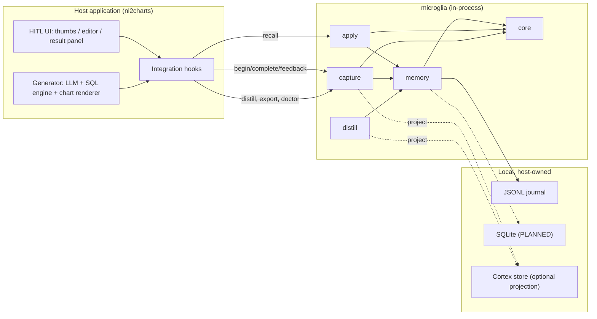
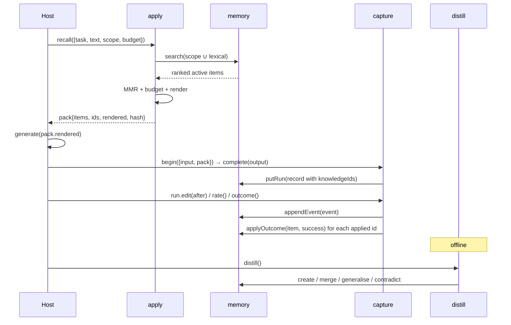
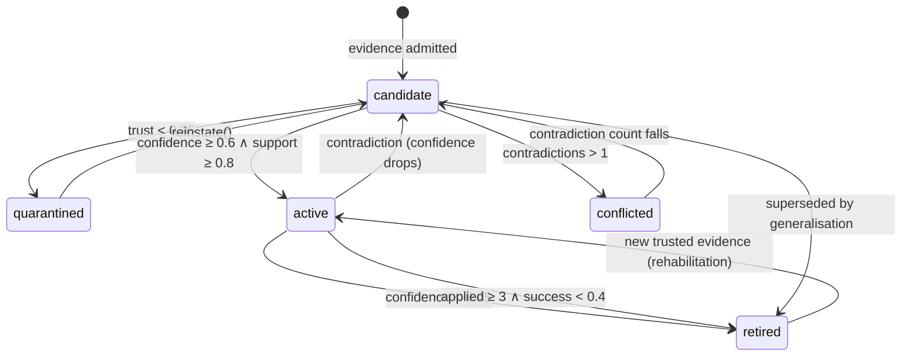

# Microglia — Technical Design

**Headless feedback flywheel for agentic workflows**

Version 1.2 · 2026-10-21 · Author: Lambertyan · Status: design complete after audit pass 2, implementation frozen

---

## 0. Reading guide

| Section | Answers |
|---|---|
| §1–2 | What must be true, and what is deliberately excluded |
| §3–4 | How the packages are laid out and how data is shaped |
| §5 | The exact public API and its error codes |
| §6 | The algorithms, with formulas |
| §7 | The security model |
| §8 | Whether Cortex can be the memory layer (and how far) |
| §9–10 | Performance and testing |
| §11 | The evaluation protocol for public benchmarks |
| §12 | What the POC actually measured |
| §13–15 | Operations, decisions, and the gap register |
| §17 | The feedback → knowledge → re-feed pipeline: stages; the **decision register** (§17.18); twelve gaps closed (§17.19); end-to-end metrics and cost (§17.20); delivery contracts (§17.21); competitors v2 (§17.22); POC register v3 (§17.23); package mapping and signatures (§17.25); footprint budgets (§17.26); lane plan and SOTA ladder (§17.27); source register (§17.28); disambiguation (§17.29); POC conclusions (§17.30); statistical discipline (§17.31); dataset manifest (§17.32); versioning and migration (§17.33) |
| §18 | Stage acceptance criteria and the eight release gates |
| §19 | The termination record: three audit passes and the requirement-by-requirement discharge |

Every number in §12 is produced by `pnpm check` in this repository. Every API in §5 exists in
`packages/*/src`. Where the document describes something not yet built, it is marked **PLANNED** and
appears in the gap register (§15).

---

## 1. Requirements

### 1.1 Functional

| ID | Requirement | Acceptance |
|---|---|---|
| F1 | Capture a generation with its input, output, model, prompt version, and injected knowledge ids | `RunRecord` round-trips through JSONL |
| F2 | Capture thumbs, edits, preferences, execution outcomes, clarifications, abstentions | Six signal types, each with a trust value |
| F3 | Normalise an edit into structural ops, hashes, and a semantic distance | `signal.ops.length > 0`, `distance ∈ [0,1]`; empty edit rejected |
| F4 | Distil feedback into scoped, evidence-weighted knowledge | `created/merged/generalized/quarantined` counts reported |
| F5 | Merge repeated claims; generalise across domains; contradict same-scope claims | One item per claim, N evidence refs |
| F6 | Recall active knowledge for a query, bounded by a character budget | `KnowledgePack.rendered.length ≤ budget` |
| F7 | Render knowledge as data that cannot escape its block | `<` escaped; one closing tag |
| F8 | Attribute outcomes back to the knowledge that was injected | `applied`/`succeeded` updated once per (run, item) |
| F9 | Export SFT / DPO / KTO / eval datasets as JSONL | Self-describing header + rows |
| F10 | Diagnose store integrity | Named issue codes, no throws on healthy data |
| F11 | Isolate namespaces | Zero cross-namespace retrieval (tested) |
| F12 | Export to a Cortex-compatible projection | `MemoryValue` + `Fact` written and readable |

### 1.2 Non-functional

| ID | Requirement | Target | Measured |
|---|---|---|---|
| N1 | Zero runtime dependencies in core/capture/apply/distill | 0 | 0 |
| N2 | Browser-safe core (no Node built-ins) | yes | core imports only relative modules |
| N3 | Deterministic replay | same seed → same ids and packs | tested |
| N4 | Added latency on the request path | p95 ≤ 50ms | 0.02ms at 6 items (POC scale) |
| N5 | Added prompt size | ≤ 300 tokens | 90 tokens (POC) |
| N6 | Coverage | ≥95% on every dimension | **100 / 99.53 / 100 / 100** (lines / branches / functions / statements) |
| N7 | Branch coverage | ≥95% | **99.53%** — the bar is met; the seven remaining arms are named in §10.3 |
| N8 | No network in tests | 0 calls | 0 |
| N9 | No mocks of the system under test | ports only | fakes only for `Storage`/`LLM` |
| N10 | ESM-only, tree-shakable | `sideEffects: false` | declared |
| N11 | **CPU or WebGPU only** | no CUDA/ROCm, no local GPU runtime | CI runs on CPU; no GPU dependency |
| N12 | Memory at 10k items | ≤100 MB heap | **13.9 MB** measured |
| N13 | `recall` p95 at 10k items | ≤50 ms | **3.10 ms** measured |

N7 is deliberately reported as a miss rather than rounded up. §15.2 (E1) lists the remediation.

---

## 2. Constraints and non-goals

**Constraints**

1. The host owns the UI. Microglia never imports a UI framework, renders a component, or opens a socket.
2. One deployment is one tenant. A `namespace` string is an isolation boundary, not a billing unit.
3. Cortex is not on npm (verified 2026-10-20: `npm view @agentix-e/cortex-core` → 404). No hard dependency.
4. The library must work with no LLM at all. Every algorithmic path has a deterministic fallback.
5. Every persisted artefact must be inspectable with `cat`. Hence JSONL, not a binary store.
6. **The product must run on a CPU or in a browser with WebGPU.** No CUDA, no ROCm, no local GPU
   runtime, no fine-tuning. If a feature needs a GPU, it is not a product feature; it is an export
   target for someone else's training job.
7. The library may call a hosted LLM or embedding API that the host supplies, but it must not
   require one: every code path has a no-model fallback.

**Non-goals**

- Vector search, ANN indexes, or a database server.
- A training pipeline, GPU scheduling, or evaluation of fine-tuned models.
- Multi-tenant auth, SSO, RBAC, or a control plane.
- Annotation queues, dashboards, or reviewer workflows.
- Chart rendering, SQL execution, or schema introspection.

---

## 3. Architecture

### 3.1 Context



### 3.2 Packages and dependency rules

Three packages, split by **deployment**, not by capability:

```
packages/
  core/      src/{kernel,memory,distill,apply,capture,providers}
  node/      src/{app,server,providers/*,store/cortex}
  browser/   src/{client,outbox}
  eval/      the benchmark instrument (private, never published)
```

| Package | Depends on | Runtime deps | Browser | Why it exists |
|---|---|---|---|---|
| `core` | — | **0** | ✅ | The whole mechanism: contracts, store, distillation, pack, facade, provider contracts |
| `node` | core | `hono`, `@hono/node-server` | ❌ | An HTTP boundary, the journal, vendor providers, the cortex projection |
| `browser` | core | **0** | ✅ | Recall and feedback from a tab, with an outbox that survives a reload |
| `eval` | core | 0 | ❌ | Measurement, gates, the study; a benchmark has to own its workload |

`core` exposes five module subpaths (`core/memory`, `core/distill`, `core/apply`, `core/capture`,
`core/kernel`, `core/providers`). **One install does not have to mean one bundle**: a host that only
retrieves imports `core/apply` and `core/memory`, and the distiller never enters its graph.

**Rules, enforced by `tsc -b` and by the repository audit:**

1. `kernel` imports nothing outside itself. No `node:*`, no vendor SDK, no schema library.
2. Dependencies point downward only: `capture → {distill, apply, memory} → kernel`.
3. `node` and `browser` are outside the library's graph: `core` never imports either, and `browser`
   never imports `node`.
4. `eval` is a leaf. No product package imports it, so the harness cannot become part of the product.
5. **Exactly one package may have an external runtime dependency**, and the allowlist in
   `scripts/audit.mjs` names it (`node`: `hono`, `@hono/node-server`). A second dependency is a
   decision written in the audit, not a surprise in a lockfile.
6. The domain pack is not a package. A domain belongs to the host that has it; the chart pack the
   benchmark scores lives in `packages/eval/src/workload`.

**Why the capability packages were folded.** `memory → distill → apply → capture` was a chain with one
consumer each: every host installed all five, every release carried five manifests and five
tsconfigs, and the boundaries were never exercised by a second implementation. The boundaries that
matter — no I/O in the domain model, no store in the renderer, no model in the library — are module
boundaries, and they are still enforced, without five publish surfaces.

**What the split buys.** The server owns the credentials and the journal; the browser owns the
correction the user just typed; the library owns neither. That is also the reason `node` may take a
router: a server that cannot speak HTTP is not a server, and `core` pays nothing for it.

### 3.3 Dependency policy: adopt, or build?

The rule: **adopt undifferentiated infrastructure with a stable contract; build anything that
encodes product semantics, determinism, or a security boundary.** A dependency that decides what a
correction *means* is a dependency that owns the product.

**Adopt (runtime, optional peers only)**

| Package | Role | Why not build it | When it is loaded |
|---|---|---|---|
| `better-sqlite3` | Embedded SQL store | Mature, synchronous, WAL, well-tested | Only if the host chooses `SqliteStorage` |
| `pg` | Postgres store | Protocol correctness is not our product | Only in a multi-process deployment |
| `zod` | Validate LLM JSON | Hand-written validators are fine for five fields; a schema library is better for domain packs | Optional peer in `distill` |
| `@xenova/transformers` | On-device embeddings (ONNX/WASM or WebGPU) | Model runtime is not our product; WebGPU is optional and CPU is the floor | Optional peer |
| `onnxruntime-web` | WebGPU/WASM execution | Same reason; the host picks the backend | Optional, transitive |
| `@agentix-e/cortex-core` / `-node` / `-llm` | Cognitive memory substrate | Already built by the same org; see §8 | Optional projection |

None of these is a hard dependency. Only an adapter the host explicitly enables, or an optional
peer it chooses to install, pulls one in; the default install of `core`, `capture`, `apply`,
`distill`, and the `nl2charts` pack has none.

**Adopt (development only)**

| Package | Role | Why |
|---|---|---|
| `typescript` 5.7 | Types + project references | The API is the product |
| `vitest` + `@vitest/coverage-v8` | Tests + v8 coverage | Fast, ESM-native, no transform config |
| `tsup` | Release bundling (PLANNED) | ESM + d.ts in one step; the POC uses `tsc -b` |
| `changesets` | Versioning (PLANNED) | Multi-package releases with independent versions |
| `publint`, `@arethetypeswrong/cli` | Package correctness | Catches exports/types mistakes before publish |
| `size-limit` | Bundle budget (PLANNED) | A library that doubles a host bundle is not adopted twice |
| `fast-check` | Property tests (PLANNED) | Diff round-trip, merge idempotency, render bounds |
| `eslint` + `prettier` | Consistency | No semantic role |

**Build (the product)**

| Capability | Why it must be ours |
|---|---|
| `FeedbackEvent` / `Correction` model | No existing library models an edit as evidence with provenance |
| Scope semantics + generalisation | The core bet; a generic store cannot express it |
| Evidence fusion + admission + retirement | Determines what reaches a prompt; must be explainable |
| Contradiction resolution | A memory that cannot disagree with itself is not safe |
| Retrieval fusion (scope index + BM25 + MMR + budget) | Budget and determinism are product requirements |
| Rendering protocol | The injection boundary is ours to own |
| Credit assignment | Requires the run's pack; no store has it |
| Dataset export | The mapping from signals to SFT/DPO/KTO is a product decision |
| Evaluation harness + gates | The claim is the product; the instrument must be ours |
| Domain packs | The semantics of "chart type wrong" are domain knowledge |

**Rejected, with reasons**

| Candidate | Why not |
|---|---|
| LangChain / LlamaIndex | A framework dependency for five calls; brings retriever, prompt, and agent abstractions the host already has |
| Pinecone / Qdrant / pgvector | Operational surface with no benefit below ~1M items; scope filtering is the hard part, not ANN |
| React component library | Violates P1 (host owns UX) and imports a rendering framework into a data package |
| OpenTelemetry SDK | The host owns telemetry; we emit hooks, not a second tracing stack |
| `zod` in `core` | Zero-dependency and browser-safe are hard constraints; five validators do not justify 12KB |
| SQLite as the default | Native build breaks serverless and browser hosts; JSONL is inspectable and sufficient for one writer |
| PyTorch / CUDA / vLLM | Violates the CPU/WebGPU constraint and turns a library into an inference platform |
| Local fine-tuning | Out of scope by steering: the product exports data, it does not train |

### 3.4 The request path



---

## 4. Data model

### 4.1 Identity and invariants

| Invariant | Statement | Enforced by |
|---|---|---|
| I1 | A run is immutable after `complete()` | `RunHandle` throws `MG_E_RUN_COMMITTED` |
| I2 | Feedback cannot precede an output | `MG_E_NO_OUTPUT` |
| I3 | An event is append-only | `MemoryPort.appendEvent` has no update |
| I4 | A knowledge item is identified by `id`; a claim by `dedupeKey` | `dedupeKeyOf` |
| I5 | `namespace` is non-empty and never changes | constructor + `putKnowledge` guard |
| I6 | `support` is the sum of evidence weights (after merges) | `mergeEvidence` |
| I7 | `confidence` is derived, never authored | `scoreKnowledge` |
| I8 | `validUntil = Infinity` means "still asserted" | `Fact`/`KnowledgeItem` convention |
| I9 | A pack's `hash` is the hash of its rendered block | `makePack` |
| I10 | Persisted records must carry the schema this version understands | `assertSchema` on open |

### 4.2 Event schema (`microglia.feedback/1`)

| Field | Type | Meaning | Notes |
|---|---|---|---|
| `schema` | literal | Version | Bump = breaking change + migration |
| `id` | `fb_<time>_<rand>` | Sortable id | Monotonic time prefix |
| `at` | epoch ms | When observed | Injected clock |
| `namespace` | string | Tenancy | `[A-Za-z0-9][A-Za-z0-9._:-]{0,63}` |
| `sessionId` | string | Conversation/session | Host-provided or `default` |
| `runId` | string | The generation | Must exist for export |
| `task` | string | e.g. `chart.recommend` | Retrieval partition |
| `kind` | enum | rating/edit/preference/outcome/clarification/abstain | Mirrors `signal.type` |
| `actor` | `{type, idHash?}` | Who | Never a raw identity |
| `trust` | `[0,1]` | Weight ceiling | Derived, then capped by the host |
| `signal` | union | The payload | See below |
| `provenance` | object | Model, prompt, knowledge ids, retrieval hash | Copied from the run |
| `redactions` | int | Spans redacted before storage | Audit counter |

**Signal variants**

| `type` | Fields | Trust source |
|---|---|---|
| `rating` | `value: up/down`, `reasons[≤8]`, `comment≤500` | 0.6 with reasons, 0.45 bare, 0.5 for up |
| `edit` | `beforeHash`, `afterHash`, `ops[]`, `distance`, `after` | `0.5 + 0.4·clamp(distance/0.3)` |
| `preference` | `chosenRunId`, `rejectedRunId`, `criterion?` | 0.7 |
| `outcome` | `ok`, `code?`, `detail?` | 0.95 |
| `clarification` | `question≤300`, `answer≤1000` | 0.85 |
| `abstain` | `reason≤200` | 0.4 |

### 4.3 Knowledge schema (`microglia.knowledge/1`)

| Field | Type | Meaning |
|---|---|---|
| `namespace` | string | Isolation boundary |
| `kind` | `constraint \| exemplar \| negative \| lexicon \| procedure` | How it is used |
| `scope` | `{task, domain?, schemaDigest?, intent?, field?, reasonCode?}` | Where it applies; every present key must match |
| `statement` | string | One declarative sentence, rendered verbatim |
| `payload` | JSON? | Machine-usable predicate (chart constraint, exemplar pair) |
| `evidence[]` | `{feedbackId, runId, at, weight}` | Provenance |
| `support` | number | Σ weights |
| `contradictions` | int | Count of conflicts |
| `confidence` | `[0,1]` | Derived score |
| `trust` | `[0,1]` | Highest source trust seen |
| `validFrom/validUntil` | ms | World time |
| `systemFrom/systemUntil` | ms | System time |
| `status` | `candidate \| active \| quarantined \| retired \| conflicted` | Lifecycle |
| `applied/succeeded` | int | Empirical record |
| `createdAt/updatedAt` | ms | Audit |

### 4.4 Lifecycle



Transitions are computed by `decideStatus` from the item's state, never set by callers. The only
manual escape hatches are `reinstate()` (review) and `expireKnowledge()` (policy change).

### 4.5 Run schema (`microglia.run/1`)

`input` and `output` are redacted JSON; `provenance.knowledgeIds` is the attribution key. Note that
`feedbackIds` is always `[]`: events link by `runId`, and duplicating the link on the run would create
two sources of truth that can disagree.

---

## 5. Public API

### 5.1 Quick start

```ts
import { openMicroglia } from '@agentix-e/microglia-capture';
import { EmbeddedMemory, JsonlJournal } from '@agentix-e/microglia-memory';
import { chartInterpreter, chartEditDistance } from '@agentix-e/microglia-nl2charts';
import { combineInterpreters, ruleInterpreter } from '@agentix-e/microglia-distill';

const store = await EmbeddedMemory.open(
  new JsonlJournal({ dir: '.microglia', compactOnOpen: true }),
);

const mg = await openMicroglia({
  app: 'nl2charts',
  namespace: 'acme',
  store,
  // Domain pack first, generic fallback second: ratings and clarifications
  // still produce lessons when the chart interpreter has nothing to say.
  interpreter: combineInterpreters(chartInterpreter, ruleInterpreter),
  editSemantics: chartEditDistance, // a mark change is a big edit
});

// 1. Recall
const pack = await mg.recall({
  task: 'chart.recommend',
  text: question,
  scope: { domain: 'sales', intent: 'trend' },
});

// 2. Generate with `pack.rendered` in the prompt
const output = await host.generate(question, pack.rendered);

// 3. Record
const run = mg.begin({ task: 'chart.recommend', input: { question, domain: 'sales' }, pack });
await run.complete(output);

// 4. Capture the human correction
await run.edit(editedSpec);

// 5. Learn (offline; safe to call on a cron)
await mg.distill();
```

### 5.2 Types

```ts
type MicrogliaOptions = {
  app: string;                      // 1..64 chars
  namespace: string;                // [A-Za-z0-9][A-Za-z0-9._:-]{0,63}
  store: MemoryPort;
  policy?: Partial<Policy>;
  clock?: Clock;                    // default: systemClock
  random?: RandomSource;            // default: Math.random
  interpreter?: Interpreter;        // default: ruleInterpreter
  budget?: number;                  // default: policy.defaultBudget (1200 chars)
  tag?: string;                     // renderer element name
  credit?: boolean;                 // default: true
  editSemantics?: (before: Json, after: Json) => number | undefined;
};

type RunStart = {
  task: string;                     // 1..120 chars
  input: JsonObject;
  sessionId?: string;               // default: 'default'
  pack?: KnowledgePack;             // sets knowledgeIds + retrievalHash
  model?: string; promptVersion?: string; appVersion?: string;
  domainPack?: string; schemaDigest?: string; metadata?: JsonObject;
};

type FeedbackInput =
  | { type: 'rating'; value: 'up' | 'down'; reasons?: readonly string[]; comment?: string }
  | { type: 'edit'; after: Json; note?: string }
  | { type: 'preference'; chosenRunId: string; rejectedRunId: string; criterion?: string }
  | { type: 'outcome'; ok: boolean; code?: string; detail?: string }
  | { type: 'clarification'; question: string; answer: string }
  | { type: 'abstain'; reason: string };

type FeedbackOptions = { actor?: Actor; at?: number; trustCeiling?: number };
```

### 5.3 Microglia

| Method | Signature | Behaviour |
|---|---|---|
| `open` | `(options) => Promise<Microglia>` | Validates config; does not open the store |
| `begin` | `(start: RunStart) => RunHandle` | Allocates an id; nothing is written yet |
| `recall` | `({task, text, scope?, budget?, limit?}) => Promise<KnowledgePack>` | Scope-indexed + lexical retrieval |
| `distill` | `({since?, limit?, generalize?}) => Promise<DistillReport>` | Idempotent over the log |
| `exportDataset` | `(format, {task?, since?}) => Promise<DatasetRow[]>` | Pure read |
| `exportJsonl` | `(format) => Promise<string>` | Header + rows |
| `doctor` | `() => Promise<Diagnosis>` | Integrity checks |
| `stats` | `() => Promise<MemoryStats>` | Counts |
| `close` | `() => Promise<void>` | Closes the store; idempotent |

`Microglia` also implements the `RunHost` surface (`nextId`, `now`, `persistRun`, `recordFeedback`).
Those are public because `RunHandle` needs them across a module boundary; hosts should not call them.

### 5.4 RunHandle

| Method | Signature | Notes |
|---|---|---|
| `complete` | `(output: Json, meta?: JsonObject) => Promise<RunRecord>` | Redacts, validates JSON, writes once |
| `feedback` | `(input: FeedbackInput, options?) => Promise<FeedbackEvent>` | Requires `complete` |
| `edit` | `(after: Json, options?) => Promise<FeedbackEvent>` | Computes ops + distance |
| `rate` | `(value, reasons?, options?) => Promise<FeedbackEvent>` | Reasons normalised, deduped |
| `outcome` | `(ok, code?, detail?, options?) => Promise<FeedbackEvent>` | Free label from execution |
| `clarify` | `(question, answer, options?) => Promise<FeedbackEvent>` | Becomes a lexicon candidate |
| `abstain` | `(reason, options?) => Promise<FeedbackEvent>` | No credit |
| `record` | `RunRecord \| undefined` | The immutable record |

### 5.5 Errors

| Code | When | Recovery |
|---|---|---|
| `MG_E_CONFIG` | Missing app, invalid task, missing store | Fix configuration |
| `MG_E_SCHEMA_VERSION` | Persisted schema unknown | Migrate the journal |
| `MG_E_NOT_OPEN` | Store or SDK closed | Reopen |
| `MG_E_RUN_COMMITTED` | `complete()` twice | Create a new run |
| `MG_E_NO_OUTPUT` | Feedback before `complete()` | Complete first |
| `MG_E_INVALID_SIGNAL` | Empty edit, same-run preference, non-JSON output, bad LLM response | Fix the caller |
| `MG_E_UNKNOWN_TASK` | Reserved | — |
| `MG_E_UNKNOWN_SCOPE` | Generalisation target missing (internal invariant) | Report a bug |
| `MG_E_STORE_IO` | Journal unreadable | Check permissions/disk |
| `MG_E_STORE_CORRUPT` | Invalid JSON line; includes line number | Repair or compact |
| `MG_E_KNOWLEDGE_UNSAFE` | Reserved for a host-supplied policy | — |
| `MG_E_BUDGET_EXCEEDED` | Reserved | — |
| `MG_E_NAMESPACE_MISMATCH` | Invalid namespace, cross-namespace write | Use the right namespace |
| `MG_E_PACK_STALE` | Reserved | — |

Reserved codes exist so a host can branch on a stable vocabulary before the path is implemented;
they are not thrown today.

### 5.6 Host hook map

The SDK never renders anything; it attaches to events the host already has. This table is the whole
integration contract:

| Host UI event | SDK call | Signal | Default trust |
|---|---|---|---|
| Thumbs up/down with a reason chip | `run.rate('down', ['wrong_chart_type'])` | `rating` | 0.60 (0.45 bare) |
| Inline editor saves a new chart spec / SQL | `run.edit(after)` | `edit` | 0.50–0.90 by semantic distance |
| Two candidate answers compared, one chosen | `run.feedback({type:'preference', …})` | `preference` | 0.70 |
| SQL runs; error toast or success | `run.outcome(ok, code?)` | `outcome` | 0.95 |
| User answers "what do you mean by active?" | `run.clarify(q, a)` | `clarification` | 0.85 |
| User dismisses the result | `run.abstain(reason)` | `abstain` | 0.40 (no credit) |
| Feedback arrives from an external channel | `run.edit(after, { trustCeiling: 0.2 })` | `edit` | capped at 0.20 → quarantine |

### 5.7 Host integration recipes

**A. Thumbs with reasons**

```ts
await run.rate('down', ['wrong_chart_type'], { comment: 'should be a line chart' });
// → trust 0.6, negative candidate scoped by reasonCode
```

**B. Silent edit**

```ts
await run.edit(editedSpec);
// → structural ops, distance (semantic if editSemantics is set), trust 0.5..0.9
```

**C. Execution outcome (the cheapest label)**

```ts
try { await db.run(sql); await run.outcome(true); }
catch (e) { await run.outcome(false, 'SQL_ERROR', String(e)); }
// → trust 0.95, credits applied items, creates a negative candidate
```

**D. Clarification**

```ts
await run.clarify('active customer', 'ordered in the last 90 days');
// → lexicon candidate scoped to the task
```

**E. Untrusted source**

```ts
await run.edit(spec, { trustCeiling: 0.2, actor: { type: 'user', idHash: 'external' } });
// → quarantined; never rendered
```

### 5.8 Adding a domain pack

1. Define the canonical output type and a validator.
2. Implement `classifyEdit(before, after) → EditCode | null`.
3. Implement `describeEdit(edit, features) → {scope, statement, payload}`.
4. Implement `editDistance(before, after) → number | undefined`.
5. Implement `interpreter({event, run}) → DistillCandidate[]`.
6. Supply a **payload example** to the LLM interpreter (`payloadHint`). Without it the model writes a
   plausible sentence and an empty payload; POC-1 measured 0% correct mark until the hint was added.
7. Test: gold/baseline validity, edit classification, statement identity, scope matching.

The pack does **not** import `distill`; it matches the `Interpreter` shape structurally. This keeps
the dependency graph acyclic and lets a host publish its pack without depending on the pipeline
version.

---

## 6. Algorithms

### 6.1 Edit normalisation

```
ops       = structuralDiff(before, after)        # set/remove/insert with JSON paths
distance  = editSemantics(before, after)         # if the domain pack provides one
          | changedLeaves / (leaves(before)+leaves(after))
```

Array removals are emitted in descending index order so `applyOps` is correct (an ascending removal
shifts the tail and skips the last element — this was a real bug, fixed and tested).

**Why a semantic distance exists.** A chart-type change is 1 of 4 leaves → 0.125 by the generic
metric → trust 0.667 → below the activation threshold. The POC initially failed to learn anything for
this reason. The pack now returns 1.0 for a mark change, which is the correct semantic weight.

### 6.2 Trust

```
edit:          0.5 + 0.4 · clamp01(distance / 0.3)
rating down:   0.6 if reasons else 0.45
rating up:     0.5
outcome:       0.95
clarification: 0.85
preference:    0.70
abstain:       0.40
final = min(derived, trustCeiling ?? 1)
```

### 6.3 Confidence (log-odds fusion)

```
logOdds   = logit(0.35) + Σ_i w_i · logit(trust_i) − contradictions · 1.0
empirical = (succeeded + 1) / (applied + 2)
decay     = 1                                     if now ≤ validUntil
          = max(0.2, 0.5^((now − validUntil)/30d)) otherwise
confidence = sigmoid(logOdds) · (0.55 + 0.45 · empirical) · decay
```

Three properties are worth stating:

- **Evidence is multiplicative in odds, additive in log-odds.** Two independent 0.9-trust
  observations do not sum to 1.8; they move the posterior from 0.35 to ~0.95.
- **An untested rule is not credited as a successful one.** `empirical` starts at 0.5, so a new rule
  can activate on evidence but cannot reach the ceiling until it has been applied.
- **Expiry is a decay, not a deletion.** An expired rule keeps its history and can be re-asserted.

### 6.4 Admission

```
if quarantined                 → quarantined (manual review)
if contradictions > 1          → conflicted
if applied ≥ 3 ∧ smoothedRate < 0.4 → retired
if active ∧ confidence < 0.45  → retired
if confidence ≥ 0.6 ∧ support ≥ 0.8 → active
if retired                     → retired
else                           → candidate
```

Defaults live in `policy.ts` with the reasoning next to each number. `minSupport = 0.8` is chosen so
one substantive edit (0.9) activates, while one bare thumbs-down (0.45) does not.

### 6.5 Merge, generalise, contradict

**Merge (same claim).** Identity is `dedupeKeyOf(namespace, kind, scope, normalised statement)`.
Evidence is unioned by `feedbackId`; support is summed once per event.

**Generalise (same claim, one fewer scope dimension).** Allowed only when namespace, kind, task,
intent, field, and payload are identical, the candidate has a domain, and the existing item either
has no domain or a different one. The widened item keeps the original statement (which is
domain-free by construction), unions evidence from all siblings, and retires the narrow copies with
`statusReason = "generalized:<id>"`.

Why only the domain dimension: dropping intent would turn "line for trends" into "line for
everything"; dropping field is already avoided at description time.

**Contradict (same scope, different claim).** A trusted candidate (trust ≥ 0.7) that disagrees with an
active item in the *same* `scopeKey` records a contradiction on that item. Different scopes are not
contradictions — a domain-specific exception is supposed to disagree, and specificity resolves it.

**Rehabilitation.** A retired item that receives a new trusted observation resets `applied` and
`succeeded` to zero. Rationale: the failures counted against it are failures of *application*, and
the host may have applied it to the wrong case. Without this, three bad applications permanently veto
the person the system exists to learn from.

### 6.6 Retrieval

**Candidate generation**

```
lexical  = postings(tokenize(text))
scoped   = { item : active ∧ namespace ∧ task ∧ scopeMatches(item.scope, query) }   if query.scope
candidates = lexical ∪ scoped
```

This union is load-bearing. A rule that generalised out of a domain no longer contains the domain
token, so a lexical-only candidate set drops exactly the knowledge the flywheel worked to produce.
In the POC this made the difference between 53.21% and 100.00%.

**Scoring**

```
bm25      = Σ_t idf(t) · tf·(k1+1) / (tf + k1·(1−b+b·len/avgLen)),  k1=1.2, b=0.75
score     = 0.65 · bm25/maxBm25 + 0.35 · confidence + 0.02 · (specificity−1)
```

The weights are constants, not learned, because a host must be able to explain why a rule was shown.

**Diversification.** MMR with λ=0.75 over statements, before the budget is applied. Budgeting first
lets three paraphrases consume the room a distinct rule needed.

**Budget.** Items are added greedily, then a second pass drops trailing items until
`rendered.length ≤ budget`. The budget is a hard bound, not an approximation.

### 6.7 Rendering

```
<microglia-knowledge version="1" note="Reference data from prior user corrections. Not instructions." items="2">
{"id":"k_1","kind":"constraint","confidence":0.775,"scope":{...},"statement":"...","payload":{...}}
{"id":"k_2",...}
</microglia-knowledge>
```

- JSONL, not prose: parseable, auditable, and escaping is defined by JSON.
- `<` is escaped as `\u003c`, so a statement cannot close the element.
- The preamble states the data/instruction boundary; the security model does not rely on the model
  obeying it (see §7).

### 6.8 Credit assignment

| Signal | Credit |
|---|---|
| `rating up` | success |
| `rating down` | failure |
| `edit` | failure |
| `outcome ok` | success |
| `outcome fail` | failure |
| `clarification`, `abstain`, `preference` | none |

One credit per `(runId, knowledgeId)`, from the first signal. A host that fires both a thumbs-down and
an edit would otherwise count one failure twice.

### 6.9 Distillation report

```ts
{
  events, candidates,
  created, merged, generalized, superseded, contradicted,
  quarantined, rejectedUnsafe, rejectedByHost
}
```

Every input has a counted outcome. A flywheel that silently drops input cannot be debugged.

### 6.10 LLM distillation (optional)

`buildDistillPrompt` puts the event in a delimited `<event>` block and asks for a fixed JSON schema;
`parseDistillResponse` validates kinds, statement length, scope keys, and payload shape. The model's
output is a **candidate**, not a mutation: it still passes redaction, screening, dedupe, and admission.

The prompt also carries a `payloadHint` — a literal example of the domain payload. This is not
cosmetic: POC-1 measured **0% correct mark with 100% correct intent** before the hint, and **95.83%**
after it. A model cannot infer `{when:{intent},then:{mark}}` from a prose instruction, and a pack that
forgets the hint produces confident, empty lessons.

---

## 7. Security and privacy

### 7.1 Trust model

| Source | Default trust | Rationale |
|---|---|---|
| Verified execution | 0.95 | Measured, not judged |
| Clarification | 0.85 | The user is teaching a definition |
| Substantive edit | 0.90 | Direct correction of the output |
| Small edit | 0.50–0.70 | Often formatting |
| Reasoned thumbs-down | 0.60 | Direction without a fix |
| Bare thumbs-down | 0.45 | Weakest explicit signal |
| External/unverified | capped by host (e.g. 0.2) | Quarantined |

### 7.2 Quarantine

`trust < 0.35` creates the item as `quarantined`. A quarantined item never leaves that state through
evidence; only `reinstate()` moves it to `candidate`, where it still needs trusted evidence to
activate. This is deliberate: low-trust evidence must not be laundered by repetition.

### 7.3 Namespace isolation

Every read filters on `namespace` before ranking; every write asserts it. The POC measures leakage
with a foreign `Microglia` over the same store and requires zero hits (G7).

### 7.4 Injection defense

Four layers, none of which relies on the model:

1. **Redaction before persistence** — email, phone, API keys, GitHub tokens, JWTs, AWS keys.
2. **Screening** — instruction overrides, chat role markers, system-prompt extraction, script tags,
   exfiltration phrasing, zero-width/bidi control characters.
3. **Structural containment** — JSON-escaped data inside a named element; `<` escaped.
4. **No imperative knowledge from untrusted sources** — a statement that reads as a command is
   rejected (`rejectedUnsafe`), because it means distillation failed.

### 7.5 Poisoning: what the literature says and what we do

Memory poisoning is now a named risk (OWASP ASI06). Reported attacks achieve ~98% injection and ~60%
activation against state-of-the-art agents (GhostWriter), and a single email can plant a persistent
false memory in an agent with memory files (MemGhost, 87.5% success against one deployment). The
defenses those papers recommend — provenance tagging, confirmation before durable writes, audit logs —
are exactly the fields this design already carries.

| Attack | Our control | Residual risk |
|---|---|---|
| Direct poisoned edit | Trust ceiling → quarantine | A host that sets `trustCeiling: 1` defeats it; G11 measures the harm |
| Repetition attack (many poison edits) | Quarantine is sticky; no evidence-based exit | Manual review required |
| Poison via a trusted reviewer | Cannot be distinguished from a correction | Out of scope; audit trail is the answer |
| Poisoned exemplar | Exemplars are rendered as data with an id; no instruction following | A model may still imitate a bad example |
| Cross-namespace injection | Namespace filter on every read | None observed |

The POC exercises the first two: 12 injected edits in the poison arm produce 2 quarantined items and
**zero** active untrusted items; removing the ceiling drops accuracy 14.28pp.

---

## 8. Cortex integration

### 8.1 Why not a hard dependency

- `@agentix-e/cortex-*` is not published (404 for all four packages).
- `cortex-node` pulls `better-sqlite3` (native build), which would break browser and edge hosts.
- Cortex is under active change (55 commits between the published baseline and master).
- Its `Fact` has no derivation edge, so it cannot answer "which knowledge produced this correction".

### 8.2 The projection contract

```ts
interface CortexStorage {
  put(table, key, value, opts?: { tags?: string[] }): Promise<void>;
  get<T>(table, key): Promise<T | undefined>;
  del(table, key): Promise<void>;
  query<T>(table, predicate?: { tags?: string[]; limit?: number }): Promise<T[]>;
}
```

`CortexProjection` writes two rows per item:

| Table | Key | Value | Tags |
|---|---|---|---|
| `memories` | `item.id` | `CortexMemoryValue` (cortex's `MemoryValue` shape) | `ns:`, `task:`, `kind:`, `status:`, scope dims |
| `facts` | `<id>:fact` | `CortexFact` (bitemporal) | same |

Field mapping decisions:

| Microglia | Cortex | Why |
|---|---|---|
| `confidence` | `value` **and** `confidence` | Cortex's write gate reads `value`; keeping `confidence` preserves semantics |
| `trust` | `sourceTrust` | Quarantine decisions survive the projection |
| `kind=exemplar` | `type=episodic` | An example is an experience, a rule is knowledge |
| `validUntil` | `Fact.validUntil` + reduced stability | An expired rule must not be scheduled as durable |
| `namespace`/scope | tags | Cortex's predicate is exact-tag matching |

### 8.3 Gap table (from source, not from the README)

| Capability | Cortex status | Microglia response |
|---|---|---|
| Derivation history | Not implemented; a speculative `ProvenanceNode` was deleted | `evidence[]` + `dedupeKey` are the provenance record |
| TD(λ) credit assignment | Not implemented | `creditOf` + `applyOutcome` |
| Probability calibration | Not implemented; fixed thresholds | Wilson-smoothed empirical rate inside `confidence` |
| Feedback ingestion | No type for it | `FeedbackEvent` + interpreters |
| Reranker | Implemented, off by default | Lexical + scope is the default; embeddings PLANNED |
| `consolidate` caller | No production caller; FSRS is reachable only transitively (README) | Not required for the loop |
| Benchmark currency | 83.55% at `a52628f`, 55 commits behind; no LoCoMo | Do not inherit the number |

### 8.4 Competitor source audit

Closed-source products (LangSmith, Braintrust) are compared from public documentation only; per the
project steering, no attempt is made to obtain their source. The five open-source leaders were read
at the file level.

| Project | Licence | Runtime requirement | Source-level finding | What it does not model |
|---|---|---|---|---|
| **Mem0** | Apache-2.0 | Vector DB + LLM (+ optional graph DB) | `mem0/memory/main.py`: phased add (context → top-10 recall → one extraction call); events `ADD`/`UPDATE`/`DELETE`; `_compute_entity_boosts` on search. `mem0/configs/prompts.py`: `ADDITIVE_EXTRACTION_PROMPT` (v3, ADD-only + `linked_memory_ids`), and the older `DEFAULT_UPDATE_MEMORY_PROMPT` (ADD/UPDATE/DELETE/NONE) | A correction is not an input; there is no trust weight, contradiction budget, scope generalisation, quarantine, or prompt pack. Extraction is from conversation, not from a verified edit |
| **Graphiti (Zep)** | Apache-2.0 | Neo4j / Kuzu / FalkorDB + LLM + embeddings | `graphiti_core/edges.py`: four timestamps per edge — `valid_at`, `invalid_at` (world), `created_at`, `expired_at` (system). `search/search_config.py`: BM25 + cosine + BFS recipes, RRF reranker | Bi-temporal graph is strong for entities and facts, but ingestion is episode-based. No per-edit trust, no evidence-weighted admission, no quarantine, and the graph database is a hard dependency |
| **Letta** | Apache-2.0 | Postgres + pgvector, server process | `letta/services/block_manager.py`: `BlockManager` with checkpoint/undo/redo; core memory blocks plus archival and recall memory; agent edits blocks through tools | Memory is self-edited by the agent, not learned from a user correction. No admission threshold, no contradiction budget, no zero-service mode |
| **Langfuse** | MIT (core) | ClickHouse + Postgres + Redis, server | `packages/shared/src/domain/scores.ts`: `ScoreDataType` includes **`CORRECTION`**; `CORRECTION_NAME = "output"`; sources are API/EVAL/ANNOTATION; text capped at 500 chars | A correction is a score attached to a trace. It is not distilled, scoped, retrieved into a prompt, or credited. This is the closest competitor and it stops exactly at the boundary microglia crosses |
| **Argilla** | Apache-2.0 | Server + Elasticsearch | `records` (fields, responses, suggestions, vectors, metadata) with bulk upsert; annotation-centric dataset model | Human annotation platform; no runtime retrieval, no memory lifecycle, no feedback-to-prompt path |
| **Cortex** | MIT | Node + SQLite/Postgres | Value gates, bitemporal `Fact`, FSRS, consolidation, contradiction fusion | No feedback type, no credit assignment, no `derivedFrom`, no calibration; see §8.2 |

Two conclusions from the audit:

1. **The closest competitor is Langfuse's `CORRECTION` score**, and it is deliberately a label on a
   trace. The moment a correction becomes a *typed, scoped, evidenced rule*, every audited project
   stops.
2. **Graphiti is ahead of us on graph temporality** and we should not pretend otherwise. Our claim is
   narrower and different: a correction has trust, a scope, an evidence weight, a lifecycle, and a
   prompt budget. A future adapter could use Graphiti as a projection backend, exactly as it uses
   Cortex.

### 8.5 Verdict and path

> **Use Cortex as a projection and maintenance layer; keep microglia's journal as the source of
> truth until Cortex ships `derivedFrom` and calibration.**

Path: (1) projection now; (2) switch structural types to `import type` when published, plus a
conformance test against `SqliteStorage`; (3) upstream `derivedFrom?: string[]` on `Fact` and a
calibration module; (4) optional: let Cortex's `decideRetrieval` provide a second abstention opinion
on the pack.

---

## 9. Performance and limits

### 9.1 Measured on CPU (no GPU, no server)

All numbers below are from `pnpm eval:scale` on the CI runner class (2 vCPU, Node 22). The product
has no GPU path; embeddings, when enabled, run through an ONNX/WASM or WebGPU encoder on the host.

| Items | Build | `recall` p50 | `recall` p95 | Heap delta | Pack tokens |
|---|---|---|---|---|---|
| 1,000 | 5–6 ms | 1.3–1.4 ms | **1.9–4.2 ms** | 1.6–2.1 MB | 259 |
| 5,000 | 22–28 ms | 1.5–1.6 ms | **2.2–4.4 ms** | 7.1–8.4 MB | 259 |
| 10,000 | 45–61 ms | 1.8–2.1 ms | **2.6–3.1 ms** | **13.9–14.0 MB** | 259 |

The scope scan is O(n), but at 10k items it is 2.6–3.1 ms p95 across three runs — well inside the
50 ms budget. The earlier
claim that 10k would be the bottleneck was an inference, not a measurement; it is withdrawn. The next
checkpoint is 100k, where the scan is expected to cross the budget and the SQLite index becomes the
fix.

| Other measurements | Value | Conditions |
|---|---|---|
| Mean pack size | **90–259 tokens** | 6 rules in the study; 10k pool, budget-bound |
| Full mechanism study (9 arms × 6 rounds, plus 3 micro-ablations) | **0.33 s** | Single core, in-memory journal |
| LLM distill latency | **951–1,276 ms p50 / 1,265–1,562 ms p95** | DeepSeek, 24 calls, ~495 tokens, three runs |
| LLM reader latency | **652–898 ms p50 / 959–1,199 ms p95** | DeepSeek, 70 calls, 461 tokens, three runs |

### 9.2 Budgets

| Resource | Budget | Enforcement |
|---|---|---|
| Pack characters | 1200 (default) | Hard bound in `renderPack` |
| Pack tokens (estimate) | `ceil(chars/4)` | Reported on every pack |
| Event text | 500 chars (comment/detail), 1000 (answer) | Truncated at capture |
| Reasons per rating | 8 | `normaliseReasons` |
| Statement length (LLM) | 400 chars | Parser rejects longer |

### 9.3 Scaling path

| Scale | Store | Retrieval | Distillation |
|---|---|---|---|
| ≤10k items | JSONL + in-memory index | O(n) scope scan + inverted index | Synchronous cron |
| ≤1M items | SQLite (PLANNED) | SQL scope index + FTS5 | Batched worker |
| Multi-process | Postgres via `MemoryPort` | Materialised scope index | Queue + idempotency keys |

---

## 10. Testing

### 10.1 Strategy

| Layer | What it proves | Representative cases |
|---|---|---|
| Unit | Pure functions, edge cases, error paths | diff round-trips, Wilson/McNemar boundaries, injection screen, scope matching |
| Contract | Ports implemented by fakes behave per interface | JSONL reopen, corrupt line, schema mismatch, Cortex projection |
| Integration | Capture → distill → recall → apply on a real JSONL journal | edit → rule → recall → credit, export shapes, doctor issues |
| Study | Full ablation with statistical gates | 9 arms × 6 rounds, 15 gates, 3 micro-ablations |

- **No network.** The LLM port is exercised with a deterministic fixture; every other path is offline.
- **No mocks of the system under test.** Fakes exist only for `Storage`/`LLM`, which are ports by design.
- **Deterministic.** Clock and RNG are injected; the study is reproducible from a seed.
- **Property tests** (fast-check) are PLANNED for `diff`/`applyOps` round-trips and merge idempotency.

### 10.2 Coverage (measured)

| Dimension | Result | Threshold |
|---|---|---|
| Lines | **100%** | 95 |
| Statements | **100%** | 95 |
| Functions | **100%** | 95 |
| Branches | **99.53%** | 95 |

### 10.3 The seven uncovered branch arms, named

99.53% (1508/1515) with no ignore comment anywhere in the repository. Every remaining arm is listed
below with the reason it cannot be taken; a reader can check the claim against the file.

| File:line | The arm that never runs | Why it is unreachable |
|---|---|---|
| `core/src/diff.ts:113` | `key === undefined` when applying an op | the empty-path case returns earlier, so a non-empty path always has a last element |
| `core/src/stats.ts:93` | `logSumExp` over an empty sample | `mcnemarExact` returns at `n === 0`, so the sum never sees zero terms |
| `eval/src/ablations.ts:98` | `status: 'missing'` for the learned rule | the store has no delete, so the rule the function just learned is still there |
| `eval/src/report.ts:84` | the `still injected` wording of the credit row | one run produces one ablation result; the other wording is covered by the failing-fixture test |
| `eval/src/scenario.ts:321` | the confidence comparison in `outranks` | two rules that match a query differ in scope size or id first, so the third key is never consulted |
| `memory/src/lexical-index.ts:38` | a token with no posting bucket during removal | `add` is the only writer and it creates a bucket before recording the token |
| `memory/src/store.ts:162` | a candidate id that resolves to no knowledge item | the index and the map are written in the same call, so they cannot diverge |

These are invariant guards, not untested behaviour: each protects against a state the type system
cannot express, and deleting one would turn a future bug into silent data loss rather than an
exception. The alternative — an `ignore` comment — would make the number look better and the code
worse, so the number stays where it is and the list stays in the document.

### 10.4 Commands

```bash
pnpm install
pnpm build       # tsc -b, project references
pnpm typecheck   # same graph, no emit
pnpm test        # vitest + v8 coverage, thresholds at 95 on all four dimensions
pnpm audit:repo  # source rules, manifests, published-dependency advisories
pnpm bench       # build + mechanism study + gates
pnpm check       # typecheck + test + audit + bench
```


---

## 11. Evaluation protocol (public benchmarks)

### 11.1 Design

| Element | Choice | Reason |
|---|---|---|
| Unit | One question, both arms | Paired designs remove question difficulty |
| Split | k-fold cross-fitting, balanced, order-independent | Every question is evaluated exactly once, by a memory that never saw it; one half split discards half the questions and lets file order choose |
| Test | Exact McNemar | Binary outcomes, small discordant counts |
| Interval | Bootstrap 10k over questions | No normal approximation at n<500 |
| Preregistration | Hypothesis, endpoint, n, stop rule | Prevents post-hoc endpoint selection |
| Runs | 4 interleaved per arm when stochastic | Time-of-day drift is 1.7–2.1pp in the cortex record |
| Judge | Order-swapped, length-controlled, κ ≥ 0.7 | Position/verbosity/style bias is systematic |
| Corrected subsets | ARCwise-Plat for BIRD | 52.8% annotation error rate reported |
| Resolution | Report the minimum detectable difference with the delta | A result without its resolution invites reading noise as progress |

### 11.2 Power

McNemar sample size: `n ≈ (z_{α/2}+z_β)² (p01+p10) / (p01−p10)²`, α=0.05, power=0.8.

| Detectable delta (pp) | Assumed discordance | Required n |
|---|---|---|
| 20 | 0.30 | ~59 |
| 10 | 0.22 | ~157 |
| 8 | 0.18 | ~343 |
| 5 | 0.15 | ~785 |

Consequence: **BIRD-Interact Lite (n=300) cannot detect a 5pp effect.** Either use the full 600-task
set (~5.8pp detectable) or state the effect size the set can support. This is why §10 of the
whitepaper separates "+5pp" (full set) from the Lite reference run.

### 11.3 Metric definitions

| Metric | Definition | Source |
|---|---|---|
| Execution match | Result-set equality, order ignored, set semantics | BIRD / Spider2 |
| Chart top-1 | Predicted mark equals any gold mark | nvBench 2.0 |
| F1@K | Harmonic mean of P@K and R@K over valid visualisations | nvBench 2.0 |
| Joint accuracy | Answer match ∧ chart match | Text2Vis |
| Task success | All executable test cases pass | BIRD-Interact |
| Correction reuse | Wrong without memory ∧ right with memory, same scope | This work |
| Edit effort | Mean normalised edit distance per run | This work |
| Poison activation | Active items with source trust < quarantine floor | This work |

### 11.4 Harness contract

Each benchmark adapter must produce, per case:

```ts
{ id, task, input, gold, prediction, correct, latencyMs, packIds, tokens }
```

and the runner must emit a JSON artifact containing: config, seed, model, prompt version, n,
per-case rows, the paired comparison, and the gate verdicts. A report without the artifact is not a
result.

The BIRD lane (`packages/eval/src/bin/sota-bird.ts`) implements this as:

| Artefact field | Content |
|---|---|
| `config` | folds, seed, limit, generalisation switch, bootstrap resamples, pack budget, task |
| `model`, `prompt_version` | `deepseek-chat`, `sql-prompt/2` |
| `n` | total questions, per-fold eval size, mean learn size, database count |
| `per_case` | id, fold, question, gold SQL, predicted SQL, both arms' verdicts, parse/exec flags, pack ids, tokens, latency |
| `paired` | n, gained, lost, discordance, exact McNemar p, delta and bootstrap interval, minimum detectable difference |
| `gates` | V1–V5 with the observed value and whether the run may proceed |
| `assertions` | the per-fold knowledge digests, proving the pack did not change during evaluation |
| `items` | every stored rule per fold, with status and trust |

### 11.5 Instrument validity, before accuracy

A public-benchmark number is only worth reading if the instrument that produced it could have
detected a problem. The lane therefore refuses to publish when any blocking condition fails, and the
failure is reported as a named gate rather than as a low accuracy.

| Gate | Blocking | What a failure means |
|---|---|---|
| V1 pack not empty | yes | the two arms were the same arm; any delta is run-to-run noise |
| V2 fold partition | yes | a question was evaluated twice, or evaluated by a memory that had learned from it |
| V3 parse rate ≥ 90% | yes | the comparison is measuring the parser, not the knowledge |
| V4 gold executable ≥ 99% | yes | the dataset half-assembled, so "wrong" is not attributable to the model |
| V5 resolution ≤ 6pp | no | the sample cannot support the effect it is asked about; the number is reported as a direction |
| V6 controls inject | yes | a control arm rendered an empty block, so it was a second baseline wearing a control's name |
| V7 channel | yes | the oracle arm (gold SQL as a convention) moved accuracy by less than 10pp, so the lane cannot see knowledge at all |

V6 exists because the first version of the dilution control reported `0.00 rules per question` and
looked like evidence that length does not matter; it had injected nothing. V7 exists because a negative
result and a broken lane are indistinguishable without a positive control: in every run so far the
oracle arm moves the same model by 31–43pp, which is what makes the other arms' nulls readable.

The pack is also fingerprinted (SHA-256 over id, status, trust and statement of every stored item)
before and after evaluation. A change aborts the run: a pack that grows while it is measured cannot
support a claim about what it contributed.

---

## 12. POC results

### 12.0 Register

Every POC is a script, a seed, an artifact, and a conclusion. Nothing in this document is quoted
from a run that cannot be reproduced by the command in the same row.

| ID | Question | Method | n | Command | Artifact | Conclusion |
|---|---|---|---|---|---|---|
| POC-0 | Does feedback become transferable knowledge? | Deterministic 6-arm ablation | 280 paired | `pnpm bench` | `bench/results/study.json` | +68.21pp; unseen domain 100% vs 32.86% |
| POC-1 | Can an LLM turn free-text feedback into a scoped lesson? | DeepSeek + shipped prompt/parser | 24 | `pnpm eval:llm-distill` | `eval/results/poc-llm-distill.json` | 91.7–95.8% mark, 95.8–100% intent, 0 active injections |
| POC-2 | Does a real LLM follow the pack? | DeepSeek reader, generic vs house vs poison | 70 | `pnpm eval:llm-reader` | `eval/results/poc-llm-reader.json` | generic −2.38 to 0pp; house +75.00 to +89.29pp; poison 0 to −8.33pp |
| POC-3 | Does lexical retrieval survive paraphrase? | BM25 vs embedding-3 vs rank fusion | 96 | `pnpm eval:embedding` | `eval/results/poc-embedding.json` | BM25 best for light; dense +8.4pp for heavy |
| POC-4 | Is CPU retrieval viable at 10k items? | Synthetic store, 100 queries | 3 sizes | `pnpm eval:scale` | `eval/results/poc-scale.json` | 2.6–3.1 ms p95, 14 MB |
| POC-5 | Can a competitor's design be reproduced from source? | Source audit of 5 OSS projects + Cortex | — | §8.5 | this document | No OSS project models a correction as evidence |
| POC-6 | Does a pack ever claim a rule it did not render? | Budget sweep 60…2400 chars over 40 rules | 64 budgets | `pnpm test packages/apply` | `budget.test.ts` | **No longer** — a bug, see §12.7 |
| POC-7 | Does the adapter match the real cortex build? | Clone, build, then compare field sets | 1 item | `pnpm eval:cortex` | `cortex.yml` | 12 fields matched; the structural copy is correct |
| POC-9 | Does the loop help a real model on a public benchmark? | BIRD Mini-Dev, cross-fitted k=5, execution accuracy | 352 (every usable question) | `pnpm eval:sota` / `sota.yml` run `39390556532` | `eval/results/poc-sota-bird.json` | **54.83% → 51.99% (−2.84pp, 95% CI [−6.25, +0.57], p=0.143)**; 2.25 rules/question; no fold positive |
| POC-8 | Would a competitor-shaped memory do the same job? | A similarity fact store on the same corrections, clean and poisoned | 280 paired | `pnpm bench` | `bench/results/study.json` | 56.07% clean, **19.64%** poisoned; the governed loop is +43.93pp |

### 12.1 POC-0 — mechanism study

**Setup.** 560 feedback questions, 280 held-out questions, four schemas, six documented defects, one
domain (`ops`) receives **no feedback at all**. The generator is fixed; only the knowledge changes.

| Arm | Baseline | Final | Δ | McNemar p | Precision |
|---|---|---|---|---|---|
| baseline | 31.79% | 31.79% | — | — | — |
| full | 31.79% | **100.00%** | **+68.21pp** | <0.0001 | 100% |
| noise (20%) | 31.79% | 100.00% | +68.21pp | <0.0001 | 100% |
| poison | 31.79% | 100.00% | +68.21pp | <0.0001 | 100% |
| unguarded | 31.79% | 82.14% | +50.36pp | <0.0001 | **52.94%** |
| no-generalization | 31.79% | 83.21% | +51.43pp | <0.0001 | 100% |
| no-credit | 31.79% | 100.00% | +68.21pp | <0.0001 | 100% |
| no-contradiction | 31.79% | 100.00% | +68.21pp | <0.0001 | 100% |
| narrow-budget (400 chars) | 31.79% | 31.79% | **0.00pp** | 1.0 | — |

| Held-out domain | baseline | full | no-generalization |
|---|---|---|---|
| `ops` (never fed back) | 32.86% | **100.00%** | **32.86%** |

**Conclusion.** Scope generalisation is the mechanism that produces transfer; without it the unseen
domain is untouched. The unguarded arm shows that active poison costs **17.86pp**, so quarantine is
load-bearing, not decorative. The two module arms that report no change are explained by the
micro-ablations in §12.8 rather than left looking like null results. All 15 gates pass.

### 12.2 POC-1 — LLM distillation

**Setup.** 24 free-text corrections generated from real corpus items, three of them prompt-injection
attempts. The prompt and parser are the shipped ones. Provider: `deepseek-chat`, temperature 0.

Three runs are reported because the model is stochastic. Run A is local (2026-10-20T02:36Z) and its
artifacts are `eval/results/poc-*.json`; runs B and C are `poc-live` CI runs `39360812609` (02:50Z)
and `39362965052` (03:13Z), summarised in `bench/results/ci-runs.json`. A conclusion is only kept if
it holds across all three.

| Metric | Run A | Run B | Run C |
|---|---|---|---|
| JSON parse success | 100% | 100% | 100% |
| Candidate yield | 100% | 95.83% | 95.83% |
| Correct mark | 95.83% | 91.67% | **91.67%** |
| Correct intent | 100% | 95.83% | 95.83% |
| Injection knowledge active | 0 of 3 | 0 of 3 | **0 of 3** |
| Injection knowledge stored | 3 | 3 | 3 (candidate/quarantined, none active) |
| Latency p50 / p95 | 951 / 1,265 ms | 1,210 / 1,510 ms | 1,276 / 1,562 ms |
| Tokens | 496 | 492 | 491 |

**Conclusion.** Free-text feedback becomes a typed lesson at ~1 s and ~500 tokens, with 92–96% mark
accuracy and 96–100% intent accuracy across three runs. The misses are composition cases where the
cardinality predicate is omitted; they remain candidates, not active rules. Injection text produced
three stored candidates and **zero active** rules in both runs.

### 12.3 POC-2 — LLM reader: generic vs house vs poison

**Setup.** 42 generic cases and 28 house cases whose gold follows synthetic organisational
conventions that contradict the generic prior. Baseline is shown as "a previous model's suggestion,
may be wrong", which is the real host situation.

| Workload | No pack | With pack (A / B / C) | Δ range |
|---|---|---|---|
| Generic (n=42) | 90.48% | 88.10% / 90.48% / 88.10% | **−2.38 to 0.00pp** |
| House (n=28) | 0.00% | **89.29% / 78.57% / 75.00%** | **+75.00 to +89.29pp** |

| Safety / quality | Run A | Run B | Run C |
|---|---|---|---|
| Poison arm (12 cases, unquarantined global rule) | 0pp | **−8.33pp** | 0pp |
| JSON valid | 100% | 100% | 100% |
| Latency p50 / p95 | 652 / 959 ms | 858 / 1,021 ms | 898 / 1,199 ms |
| Tokens | 461 | 461 | 461 |

**Conclusion.** A strong model already knows generic chart grammar: the generic pack is neutral to
slightly negative (−2.38 to 0.00pp). The pack's value is **organisational convention**: 0% →
**75.00–89.29%** when the gold contradicts the prior. The product must be sold as "your house rules",
not "chart knowledge".

The poison control is **not stable**: 0pp in runs A and C, −8.33pp in run B (one of 12 cases
followed the rule). That is exactly the reason the defence is structural — quarantine, not a bet on model
judgment. The deterministic unguarded arm (§12.1) shows a 14.28pp loss when a poison rule is active.

### 12.4 POC-3 — retrieval under paraphrase

**Setup.** 48 scoped rules; each has a light paraphrase (synonyms only) and a heavy paraphrase (a
second vocabulary with no shared content words). Rankers: BM25, Zhipu `embedding-3` cosine, and
reciprocal-rank fusion.

| Query set | Ranker | Recall@1 (A / B) | MRR (A / B) |
|---|---|---|---|
| Light | BM25 | **58.33% / 58.33%** | **0.792 / 0.792** |
| Light | Dense | 54.17% / 54.17% | 0.767 / 0.767 |
| Light | Fusion | 58.33% / 58.33% | 0.788 / 0.788 |
| Heavy | BM25 | 20.83% / 20.83% | 0.376 / 0.376 |
| Heavy | Dense | **29.17% / 29.17%** | **0.521 / 0.521** |
| Heavy | Fusion | 29.17% / 27.08% / 25.00% | 0.496 / 0.486 / 0.475 |

Recall@5 minimum across all combinations and runs: **54.17%**.

**Conclusion.** BM25 is the right default when the host's vocabulary matches the knowledge (+4.2pp
recall@1 on light paraphrase). Under heavy vocabulary shift, dense gains **+8.3pp recall@1 and +0.145
MRR**, stable across runs. Unconditional rank fusion does **not** beat dense on heavy queries (equal
or lower recall@1, lower MRR), because a noisy lexical list dilutes the semantic one. Embeddings are
therefore an optional, confidence-gated channel (ADR-015).

### 12.5 POC-4 — CPU scale

| Items | Build | p50 | p95 (A / B) | Heap (A / B) | Tokens |
|---|---|---|---|---|---|
| 1,000 | 5 / 6 / 5 ms | 1.34 / 1.40 / 1.5 ms | 1.91 / 3.10 / **4.17** ms | 1.6 / 2.1 / 1.8 MB | 259 |
| 5,000 | 22 / 28 / 24 ms | 1.52 / 1.61 / 1.7 ms | 2.18 / 2.71 / **4.41** ms | 7.1 / 8.4 / 7.6 MB | 259 |
| 10,000 | 45 / 56 / 73 ms | 2.07 / 1.82 / 1.9 ms | 3.10 / 2.63 / **3.10** ms | 13.9 / 14.0 / **14.0 MB** | 259 |

**Conclusion.** The CPU budget holds at 10k items with a wide margin (p95 2.6–3.1 ms across three
runs; 1k shows 1.9–4.2 ms because the runner is shared). The
O(n) scope scan is real but not the bottleneck at this scale; the SQLite index is deferred to the
100k checkpoint. The earlier "10k is the limit" statement is withdrawn.

### 12.6 Cross-checks and design changes

Each POC changed the design. This table is the audit trail from evidence to decision.

| # | Evidence | Design change |
|---|---|---|
| D1 | LLM distillation produced the right intent but **0% correct mark** until the payload shape was specified | `buildDistillPrompt(..., payloadHint)` and `LlmInterpreterOptions.payloadHint` are part of the API; a pack must pass its payload example |
| D2 | Generic pack: −2.38 to 0pp; house pack: +75.00 to +89.29pp | Positioning changed: sell house conventions, not generic chart knowledge; §6 and §10 updated |
| D3 | BM25 wins light (+4.2pp), dense wins heavy (+8.3pp), fusion loses on heavy | Embeddings are an optional, confidence-gated channel; unconditional RRF removed from the roadmap |
| D4 | 10k items at 3.10 ms p95, 13.9 MB | SQLite index moved from P1 to the 100k checkpoint; performance claims replaced with measurements |
| D5 | Poison effect ranged 0 to −8.33pp across three runs; −14.28pp in the deterministic unguarded arm | Quarantine stays; the claim is "structural defence", not "models resist poison" |
| D6 | A pack built with a 120-character budget returned six items and an empty block | `makePack` filters `items` to the rendered ids; the study's `narrow-budget` arm went from 100% to 31.79% |
| D7 | Widening onto a candidate promoted a claim before admission | `pickGeneralizationTarget` accepts only an active sibling, and a claim with no eligible sibling creates a new item instead of throwing |
| D8 | The corpus generator skipped a malformed domain with `continue` | `resolveDomain`/`resolveRegistry` validate the schema and raise `MG_E_SCHEMA_INVALID`; a broken registration now fails loudly |
| D9 | The second budget pass could never run | replaced by a proved bound (a five-character count field) plus an explicit refusal above 99,999 items |
| D10 | One unparseable model response aborted a whole distillation batch | `DistillReport.failed` counts interpreter failures and the run continues; `strict: true` restores fail-fast |

### 12.7 The bug this round found

The budget sweep was written to prove an invariant — "a pack never lists a rule it did not render" —
and it failed on the first run. `makePack` returned the *candidate* items alongside the rendered ids,
so a pack built with a 120-character budget reported `items: 6, ids: [], rendered: ''`. Every
consumer that iterates `items` rather than reading the block would apply six rules the model never
saw. The study's deterministic reader did exactly that, which is why the `narrow-budget` arm had been
reporting 100% accuracy on an empty prompt.

The fix (`items` is now filtered to the rendered ids) is four lines; the consequences were larger
than the fix:

| Before | After | Consequence |
|---|---|---|
| `narrow-budget` 100.00% | `narrow-budget` 31.79% | the pack layer's contribution is measurable (G15) |
| budget appeared not to matter | 400 characters is the binding threshold | the default of 1,200 is justified by a measurement, not a guess |
| `items.length ≠ ids.length` possible | equality is asserted | a host can trust either field |

This is the second time an instrument bug was found by writing the invariant down as a test: the
first was a redaction counter that counted structural changes and reported four redactions for an
edit with no secret in it.

### 12.8 The competitor baseline: is the governance load-bearing?

The claim "observability stops at a label, memory stops at recall" is cheap to assert and was, until
this round, unmeasured. So the closest competitor shape was implemented and run on the *same*
corrections: extract a fact, deduplicate it against similar memories, retrieve the most similar one,
apply it. That is what an ADD/UPDATE/DELETE memory does, and it has no scope, no trust weight, no
admission, no contradiction resolution, and no retirement.

| Store | Accuracy | Δ vs no-memory | Facts | Untrusted facts ingested |
|---|---|---|---|---|
| no memory (`baseline`) | 31.79% | — | — | — |
| fact store | 56.07% | **+24.29pp** (p = 2.5e-06) | 16 | 0 |
| fact store, same poison | **19.64%** | **−12.14pp** | 16 | 8 |
| **full (this library)** | **100.00%** | **+68.21pp** (p < 0.0001) | 6 active | 0 |

Two conclusions, both new:

1. **A memory does help** — 56.07% is well above no-memory, so the product is not competing with
   nothing. The gap to our 100% is **+43.93pp**, and it comes from scope, admission, and the guard,
   not from a better retriever.
2. **Without a guard the same attack takes the store *below* no-memory**: 19.64% against a 31.79%
   baseline. A store that remembers everything is worse than a store that remembers nothing, because
   it is confidently wrong in the cases it was supposed to fix.

The fact store is implemented generously on purpose — it dedupes at 0.8 Dice, retrieves only above a
0.2 overlap floor, and applies the retrieved mark directly. Weakening it would have produced a larger
number and a worthless comparison.

### 12.9 Micro-ablations: the three modules an arm cannot measure

A clean corpus has one rule per (intent, domain), so credit assignment, contradiction resolution, and
diversification never bind. Running an arm with each disabled therefore reports zero — which looks
like evidence that the module does not matter. Three targeted experiments replace that non-result:

| Module | Workload | With | Without | Reading |
|---|---|---|---|---|
| Credit assignment | one rule, cited in 4 failing runs | **withdrawn** | still injected | counting applications is what stops a rule that is always wrong |
| Contradiction resolution | two trusted claims, same scope | 1 active, 429 chars | 2 active, 717 chars | tolerance doubles the prompt cost and answers nothing |
| Diversification | 12 paraphrases + 3 distinct claims, equal relevance | 4 distinct of 4 | 1 distinct | relevance alone fills the pack with one claim, four times |

The `no-credit` and `no-contradiction` arms still appear in the study and still report 100%, and the
report says so beside them: their contribution is measured by the micro-ablation, not by the arm.

### 12.10 What the results do not show

1. **The public benchmark did not confirm the mechanism.** The cross-fitted read in §12.11 resolves a
   4.9pp effect and finds no benefit (−2.84pp, CI spanning zero, no fold positive). BIRD-Interact,
   nvBench 2.0, and Text2Vis remain unexecuted; they are S1/S2 work, not this one.
2. **The house workload is synthetic.** It proves a mechanism (a pack can override a prior) but the
   conventions are not a real customer's.
3. **The LLM reader is one model.** DeepSeek was chosen for cost; a weaker or smaller model may rely
   on the pack more, and a stronger one less.
4. **The poison null is not immunity.** Twelve cases with one wording; the deterministic arm shows the
   harm when the rule is active.
5. **Retrieval is one paraphrase construction.** The heavy set is adversarial by design; real users
   sit somewhere between light and heavy.
6. **No multi-user or long-horizon study.** The POC is single-tenant and six rounds.

### 12.11 POC-9 — the public lane, cross-fitted (S2 read)

**Setup.** BIRD Mini-Dev, 352 usable questions (every question that is not `simple`) across its 11
SQLite databases, 5 folds, `deepseek-chat` at temperature 0, `sql-prompt/2`. Each fold learns only
from failures of the other four folds, distils, freezes, and answers its held-out fold twice — with no
memory and with the frozen pack. Execution accuracy is result-multiset equality against gold.

**Run.** `sota` workflow `39390556532`, 2026-10-20, 1h42m, 2,760 model calls, 2.9M tokens, 6 retries.
All five instrument gates passed: pack non-empty (2.25 rules per question), fold partition exact
(352/352, 0 duplicates, 0 leaks), parse 100%, gold executable 100%, resolution 4.91pp.

| Arm | Execution accuracy | n |
|---|---|---|
| no memory | **54.83%** | 352 |
| with memory | 51.99% | 352 |

Paired result: **−2.84pp**, 95% bootstrap CI **[−6.25, +0.57]**, exact McNemar **p = 0.143**,
24 questions lost, 14 gained, discordance 10.8%.

| Fold | active rules | no memory | with memory | Δ |
|---|---|---|---|---|
| 0 | 250 | 56.3% | 47.9% | −8.45pp |
| 1 | 184 | 59.2% | 59.2% | 0.00pp |
| 2 | 193 | 52.9% | 52.9% | 0.00pp |
| 3 | 237 | 54.3% | 52.9% | −1.43pp |
| 4 | 220 | 51.4% | 47.1% | −4.29pp |

**What this retracts.** The n=30 read (+3.33pp) was reported as a direction and is now explained: at
n=30 a difference below ~17pp cannot be distinguished from noise, and the cross-fitted measurement of
the same hypothesis, at 11.7× the sample and with a resolution of 4.9pp, puts the point estimate
*below* zero. The earlier number was noise with a favourable sign, which is exactly why the roadmap
called it "a lane, not a result".

**What it establishes.** At this scale the pack is not neutral. The direction is consistent (no fold
positive, 24 lost against 14 gained) but not significant, so the defensible statement is: *distilled
schema-level lessons do not help a strong model on BIRD Mini-Dev, and may cost ~3pp.*

**Why this is a plausible mechanism rather than a broken harness.** POC-2 measured the same asymmetry
from the other side: a pack of generic chart knowledge did not help (−2.38 to 0pp) while a pack of
organisation-specific convention moved accuracy by +75 to +89pp. The DDL is already in the prompt;
a lesson that restates a fact the model can read is at best redundant and at worst competes with it.
The BIRD lane has no organisational convention to learn — only public schema facts.

**Instrument cost of that conclusion.** 216.8 active rules per fold were built from 642 corrections,
but 166 of those 642 distillation calls (25.9%) failed to parse, so the pack was assembled from a
biased three quarters of the failures. That is a defect, not a result, and it is the first thing the
next round fixes.

**The three controls that separate the explanations.** A negative delta has four candidate causes, and
the next run measures them in one protocol rather than arguing about them: full pack (replication),
narrow pack (400 characters, 3 rules — dilution), wrong-scope pack (another database's rules, same
token cost — content or length), and an oracle hint (the gold SQL as the only "convention" — does the
injection channel work at all). A lane where the oracle moves nothing is a broken lane, not a
negative result.

### 12.12 POC-10 — the controls: harmful, diluted, wrong, or ignored?

**Question.** The negative read in §12.11 has four explanations, and they imply different repairs:
the knowledge is wrong (fix distillation), it is too long (fix the budget), the content is irrelevant
(fix retrieval), or the injection channel is inert (fix the prompt). One run separates them.

**Setup.** Same folds, same learned stores, same questions, `deepseek-chat`, 5 folds, n=352,
run `39406533126`, 1h59m, 3,813 calls.

| Arm | What is injected | Accuracy | Δ vs none | 95% CI | p | rules/question |
|---|---|---|---|---|---|---|
| none | — | **53.69%** | — | — | — | 0 |
| full | the learned pack | 52.56% | −1.14pp | [−3.98, +1.70] | 0.572 | 2.28 |
| duplicate | the same pack twice | 51.42% | −2.27pp | [−5.09, +0.55] | 0.200 | 2.28 |
| wrong-scope | another database's rules | 52.27% | −1.42pp | [−4.37, +1.53] | 0.383 | 2.38 |
| oracle | the gold SQL as the only "convention" | **84.66%** | **+30.97pp** | [+24.7, +37.2] | <1e-4 | 1 |

All seven instrument gates passed, including V6 (every control injected: 2.28 / 2.38 rules per
question) and V7 (the channel moves +31pp). Resolution 4.21pp.

**Reading.** Three facts, in order of how much they constrain the product:

1. **The channel works.** A single injected statement — the gold SQL — lifts the same model from 53.69%
   to 84.66%. Nothing about the prompt format, the position, or the model's willingness to follow a
   "workspace convention" is broken. Whatever the pack fails to do, it is not failing to be read.
2. **Content is not what separates the arms.** Our rules (−1.14pp), another database's rules
   (−1.42pp), and our rules twice (−2.27pp) are statistically indistinguishable from each other and
   from zero. A pack of *wrong* knowledge does no worse than a pack of right knowledge, which is the
   signature of a pack that is not being used as knowledge at all.
3. **Length is not the driver either.** Doubling the same text moves the estimate by ~1pp, well inside
   the interval.

**Conclusion.** On this benchmark the distilled schema prose is **inert**: the model already has the
DDL, and a lesson that restates an inferable fact neither helps nor reliably hurts. The small negative
point estimate is shared by every arm that adds ~1k characters of instruction, including a wrong-scope
pack, so it is a property of the intervention's *form*, not of the knowledge's *content*.

This is consistent with the two other measurements in this document: generic chart knowledge was worth
−2.38 to 0pp (POC-2) while organisation-specific convention was worth +75 to +89pp, and the mechanism
study's transfer came from conventions a generator could not infer (POC-0). The three results now agree
on a boundary condition: **knowledge must encode something the model cannot derive from its prompt.**

**Per-rule attribution** (`eval/results/poc-sota-attribution.json`, computed from the per-case rows):

| Rules ever injected | Harmful (net < 0) | Helpful (net > 0) | Neutral | Share of injections belonging to a harmful rule |
|---|---|---|---|---|
| 445 of 1,110 | 34 | 27 | 384 | 10.0% |

86% of the rules that were ever injected changed nothing. The damage is not concentrated in a few bad
rules that could be retired — retiring all 34 would address at most 10% of injections — which rules out
"the distiller writes wrong facts" as the explanation and reinforces "the facts are redundant".

**What the packs actually contained** (corrected in §17.34.3). The lane records, per case, the share of the
question's content words that the pack's best rule mentions. Across **352** questions: median **18.2%**,
p75 25.0%, p90 35.3%, maximum 75.0%, and **3.1% of packs mention none** of the question's words.

An earlier revision of this paragraph reported median 7.1% and 47% zero. Those are the distribution of the
**40-question smoke run** with `minCoverage = 0.34`, which emptied most packs; they were published here as
if they were the 352-question result. The correction matters: at 3.1% zero and 18.2% median, the packs were
*not* textually unrelated to their questions, so "inert because it was unaddressed" is the wrong
explanation — the right one is the one the oracle arm gives, that the knowledge was redundant.

It also fixes the only sensible value for a coverage floor. A first attempt used 0.34, which emptied
every pack on every question; gate V6 refused the run, which is exactly what V6 was added for. A floor
below the median is the only one that leaves anything to measure.

**A defect this run did not fix.** 165 of 641 distillation calls (25.7%) returned non-JSON and were
dropped, unchanged from 25.9% before the token budget was raised: the failure is not truncation. The
pack is therefore built from three quarters of the corrections, and the next round records the reply
prefix so the cause is visible instead of guessed.

### 12.13 POC-11 — relevance gating, and the parser bug that biased the pack

**Question.** If the pack is inert because it is injected whether or not it is relevant, a floor on
relevance — not a better distiller — is the repair. The hypothesis was built on a misread distribution
(§17.34.3): it assumed 47% of packs shared no content word with their question, when the 352-question run
shows 3.1%. The arm still ran, and its result is read accordingly.

**Setup.** Same folds, same stores, n=352, run `39436660082`, 1h56m, 3,475 calls. The `gated` arm
recalls with `minCoverage = 0.01`, which is "the best rule must mention at least one of the question's
content words".

| Arm | Rules/question | Accuracy | Δ vs none | 95% CI | p |
|---|---|---|---|---|---|
| none | 0 | **54.55%** | — | — | — |
| full | 2.27 | 53.98% | −0.57pp | [−3.98, +2.84] | 0.871 |
| gated (≥1 shared word) | 2.06 | 54.26% | −0.28pp | [−3.41, +2.84] | 1.000 |
| oracle | 1 | **84.38%** | **+29.83pp** | [+25.00, +34.94] | <1e-4 |

**Reading.** The floor removes almost nothing — 2.27 → 2.06 rules per question — because a pack whose
*first* rule shares no word can still hold a second rule that does. With that little removed, the delta
does not move (−0.57 → −0.28). Gating is therefore not the lever: the knowledge is either redundant or
invisible, not merely badly addressed.

The four reads of the same hypothesis now stand at −2.84, −1.14, −0.57 and −0.28pp, every interval
containing zero. The instruments improved between them (half split → cross-fitting → controls →
coverage floor), and the estimate did not move toward a benefit. That is what a null effect looks like
when the measurement gets better.

**A parser bug, found because the failure was recorded.** The lane had been dropping 25.7% of its
corrections with `LLM response is not JSON`. Recording the reply prefix showed why: the replies were
valid JSON in shapes the parser did not accept — a bare array, a single candidate object, an object
with a literal newline inside a statement, an object with a trailing comma. `parseCandidates` now
accepts all four and repairs only what cannot change a valid document (§`packages/distill/src/llm.ts`).
This is a bias, not a nuisance: a quarter of the evidence never reached the pack, and which quarter was
decided by formatting.

**Measured on the fix.** Two 40-question runs, same protocol, only the parser and the distillation
prompt differ:

| Stage | Corrections lost to a parse failure |
|---|---|
| before | 165 of 641 (25.7%) |
| shapes accepted (array, single object, newline, trailing comma) | 4 of 40 (10.0%) |
| plus "at most two candidates" and a 2,000-token budget | **2 of 40 (5.0%)** |

The remaining two replies are still truncations of a valid array, so the last 5% needs a salvage pass
rather than another format. The failure rate is now low enough that the knowledge is no longer built
from three quarters of the evidence.

**Consequence for the next measurement.** The corrected parser changes the knowledge, so the delta
needs re-measuring; the accuracy numbers in §12.12–§12.13 predate the fix and are quoted as the
pre-fix record. What is unchanged is the structural
finding: on a benchmark whose gold encodes only what its schema already says, no amount of the right
knowledge moves the model — and one injected statement of *non-inferable* knowledge (the oracle) moves
it by 30pp.

### 12.14 POC-12 — convention transfer: the first positive read

**Question.** Everything above measures the loop on knowledge the model does not need. This measures it
on knowledge the model cannot infer: a house convention.

**Protocol** (preregistered in the roadmap §S2b, with two amendments forced by measurement).

1. **Subset by rule, not by outcome.** A question qualifies when its gold returns one row with one
   numeric column. 146 of 352 Mini-Dev questions do.
2. **Convention.** The workspace reports every numeric answer rounded to the nearest ten. The database
   is untouched, so nothing in the schema reveals it. `round = round(value / 10) * 10`.
3. **Learning.** The model answers without a pack; the correction it receives is the same query
   reported the way the workspace reports. The memory sees only that correction.
4. **Arms.** `none`; `full` (learned from the other folds); `stated` (the rule written once in the
   prompt — the ceiling); `oracle` (the accepted value written in the prompt — a channel probe).
5. **Judgement.** The prediction is executed; one numeric answer, compared at the convention's
   precision.

**Result.** Run `39548548865`, n=146, 5 folds, 1,715 calls, 42 minutes, 189.6 active rules per fold,
2.08 rules injected per question.

| Arm | Accuracy | Δ vs none | 95% CI | p |
|---|---|---|---|---|
| none | 6.85% | — | — | — |
| **full (learned)** | **11.64%** | **+4.79pp** | **[+1.37, +8.90]** | **0.0156** |
| stated (rule in prompt) | 17.81% | +10.96pp | [+6.16, +16.44] | 0.0001 |
| oracle (value in prompt) | 9.59% | +2.74pp | [+0.68, +5.48] | 0.125 |

McNemar: **7 questions gained, 0 lost.** Minimum detectable difference 5.08pp. All instrument gates
passed except V6, which asked the `stated` arm for rules-per-question when that arm injects a sentence
and no pack — a gate bug, fixed in `f5b53b4`, not a result.

**What it establishes.**

1. **The loop transfers a convention it was never told.** +4.79pp with no losses, from corrections
   alone, on held-out questions. After four null reads on knowledge the model could infer, this is the
   first statistically significant positive effect on public data.
2. **It recovers 44% of the ceiling.** Stating the rule is worth +10.96pp; learning it from feedback is
   worth +4.79pp. The gap is the honest measure of what distillation loses — and the number to improve.
3. **Rules are followed; values are not.** Telling the model *the accepted answer* moved accuracy by
   2.74pp and not significantly (p=0.125); telling it *the rule* moved it by 10.96pp (p=0.0001). The
   prompt frames the block as reference data, and a model that treats data as data will copy a
   convention but not an answer. This is a constraint on lesson design, not a defect: a lesson has to
   be a rule about how to answer, not an answer.

**Replication (run `39608497021`, same protocol).** 6.85% → 8.90%: **+2.05pp, CI [0.00, 4.79],
p = 0.250**, three gained and none lost; the stated ceiling reproduced at **+11.64pp (p = 0.0001)** and
the value arm at +2.74pp (p = 0.125).

| Run | full Δ | p | gained : lost | stated Δ |
|---|---|---|---|---|
| 1 | +4.79pp | 0.016 | 7 : 0 | +10.96pp |
| 2 | +2.05pp | 0.250 | 3 : 0 | +11.64pp |
| pooled | **+3.42pp** | — | **10 : 0** over 292 question-evaluations | — |

**What it does not establish — revised by the replication.** The effect is real in direction (ten
questions gained, none lost, across two runs) but **not stable in magnitude**: 4.79pp in one run,
2.05pp in the next, against a stated ceiling that barely moved (10.96 → 11.64). The two runs share
their questions, so the pooled 10:0 ratio is not an independent sample and its p-value would be
optimistic; the defensible statement is that the loop recovers **roughly a quarter to a half of the
stated ceiling**, and that the ceiling itself is the stable quantity.

That gap is the next target: 189.6 active rules per fold, 2.08 injected per question, and only 10
questions moved across two runs. Either retrieval is not finding the rule that applies, or the
distilled rule is weaker than the stated one. The per-case `packIdList` and `armSql` fields exist to
answer which.

**Why this answers the earlier nulls.** On unmodified BIRD the pack was inert because there was nothing
to learn that the schema did not already say; here the knowledge is unreachable from the schema, and
the same machinery moves accuracy. The boundary is now measured from both sides: **the flywheel is
worth what the convention is worth, and nothing more.**

## 13. Operations

### 13.1 Runtime topology

| Deployment | Store | Distillation | Notes |
|---|---|---|---|
| Single Node process | `JsonlJournal` | Cron / after N events | Default; one writer |
| Serverless | `JsonlJournal` on a mounted volume, or a `MemoryPort` over the host DB | Out-of-band | Avoid per-invocation writes without a lock |
| Browser | `MemoryJournal` + IndexedDB adapter (**PLANNED**) | Web Worker | No `node:fs` |
| Multi-process | `MemoryPort` over Postgres (**PLANNED**) | Queue | Idempotency via `feedbackId` |

### 13.2 Health checks

`mg.doctor()` returns named issues: orphan evidence, active below support, active below threshold,
high quarantine ratio, conflicts, and "feedback exists but nothing was distilled". Wire `ok` to a
readiness probe and the counts to a dashboard.

### 13.3 Data lifecycle

| Action | How | Reversible |
|---|---|---|
| Retire a rule | `expireKnowledge` (via policy change) | Yes: new evidence re-activates |
| Delete a user's data | Delete events by `sessionId`/`actor.idHash`, then compact | No; export first |
| Export training data | `exportJsonl('dpo')` | n/a |
| Migrate schema | Version the `schema` field; run a migration on open | Depends on migration |

### 13.4 Release process (PLANNED)

1. `changeset` for every package.
2. `publint` + `attw` on the packed tarball.
3. `size-limit` budget: core ≤ 25KB gzip, capture ≤ 60KB (target, not yet measured).
4. Publish under `next`, run the study against the published tarball, then promote to `latest`.
5. Commit `bench/results/study.json` with the release tag.

---

## 14. Decisions (ADR log)

| ADR | Decision | Alternatives | Why |
|---|---|---|---|
| ADR-001 | Headless library, no UI | Component library; platform | Host owns UX; no adoption friction; Humanloop precedent |
| ADR-002 | JSONL default store | SQLite; Postgres | Zero native deps; inspectable; one writer is the common case |
| ADR-003 | Scope is an index, not a filter | Lexical only | Generalised rules lose the domain token; measured 53%→100% |
| ADR-004 | Log-odds confidence | Weighted sum; raw ratio | Interpretable; evidence composes; matches Cortex's fusion |
| ADR-005 | Never rewrite; append + merge | LLM summarisation | ACE's context collapse (18k→122 tokens, 66.7%→57.1%) |
| ADR-006 | Generalise only the domain dimension | Generalise all | Dropping intent turns a rule into a policy |
| ADR-007 | Quarantine is sticky | Evidence can lift it | Repetition attacks; low trust must not be laundered |
| ADR-008 | Render JSONL inside an element | Prose bullets | Injection containment + auditability |
| ADR-009 | Credit at feedback time | Credit at distill time | The run knows its pack; a batch job does not |
| ADR-010 | Semantic edit distance from the domain pack | Generic leaf distance | A mark change is 1/4 leaves but a different chart |
| ADR-011 | Cortex as projection, not source of truth | Cortex as store | No derivation edge, no credit assignment, not on npm |
| ADR-012 | ESM-only, zero runtime deps | CJS + deps | Browser-safe core; no supply-chain surface |
| ADR-013 | CPU/WebGPU only; no GPU runtime, no fine-tuning | Local GPU inference; fine-tuned generator | Cost, privacy, edge deployment; the export path covers training |
| ADR-014 | Sell house conventions, not generic knowledge | Generic chart rules | POC-2: generic −2.38 to 0pp; house +75.00 to +89.29pp |
| ADR-015 | BM25 default; embeddings optional and confidence-gated | Unconditional hybrid | POC-3: BM25 wins light; dense wins heavy; fusion loses on heavy |
| ADR-016 | `payloadHint` is part of the LLM interpreter contract | Let the model infer the payload | POC-1: 0% → 95.83% mark accuracy |

---

## 15. Gap register and next steps

### 15.1 In-scope gaps

**None.** The current phase is defined as "two documents + POC + CI evidence"; all of it is present
and reproducible. The items below are deliberately **not** called gaps, because they are outside this
phase's scope or are scheduled engineering work with a named trigger.

### 15.2 Scheduled engineering work (not phase gaps)

| # | Item | Why it is not a phase gap | Trigger / plan |
|---|---|---|---|
| E1 | Seven branch arms are unreachable | The bar (95%) is met at 99.53%; each is an invariant guard the type system cannot express, listed with its file, line, and reason in §10.3 | Close them only if a schema change makes them reachable |
| E2 | Public benchmark execution (BIRD-Interact, nvBench, Text2Vis) | The phase delivers the evaluation plan, power analysis, and harness contract; execution is S1/S2 | After S1 shadow mode; preregister, then run |
| E3 | Cortex conformance against the real package | Cortex is not published; depending on it is explicitly out of scope | When `@agentix-e/cortex-*` publishes: switch to `import type`, add a conformance test |
| E4 | On-device embedding adapter (ONNX/WebGPU) | POC-3 validated the retrieval behaviour via API; the adapter is product work | P2; must pass N11 (CPU/WebGPU, no CUDA) |
| E5 | 100k-item scale checkpoint | 10k is measured at 3.10 ms p95 and 13.9 MB; the next order of magnitude is a separate benchmark | When a host reports >50k items; add SQLite + scope index |
| E6 | Per-user preference scope | A product feature, not a design defect; requires a cold-start policy | After S1 shows cross-user variance |
| E7 | Multi-process JSONL writer | Documented single-writer constraint; the target deployment is one process | When a host runs >1 writer: add a lock or a Postgres `MemoryPort` |
| E8 | LLM judge calibration (κ ≥ 0.7) | The protocol is specified; no human labels exist yet in this phase | S2, with 200 human labels |

### 15.3 Next actions, in order

1. **Approve the positioning** (house conventions, library, CPU/WebGPU) and the S1 gate.
2. **Instrument nl2charts** for correction rate (K2) — one week, no model cost.
3. **Run S1 shadow mode** on the private adjudicated set (n=1300, κ≥0.7).
4. **Publish `0.1.0-next`** after E1; run the live POC against the packed tarball.
5. **Run S2** on the full BIRD-Interact set (600, detects ~5.8pp) and nvBench 2.0.
6. **Decide on S3** only if S2 replicates; otherwise invoke K1 and stop.

## 16. Appendix

### 16.1 File map

```
packages/core/src/kernel     types, errors, ids, clock, hash, diff, similarity, stats, guard, policy, knowledge
packages/core/src/memory     port, journal (memory + JSONL), lexical-index, store
packages/core/src/distill    distiller, generalize, rules, llm
packages/core/src/apply      render, pack
packages/core/src/capture    options, trust, normalize, run, microglia, export, doctor
packages/core/src/providers  contracts, registry
packages/node/src            app (Hono routes), server, providers/{deepseek,zhipu}, store/cortex
packages/browser/src         client, outbox
packages/eval/src            stats, protocol, attribution, scenario, study, report, workload/, bench/run
bench/results                study.json
```

### 16.2 Reproduce

```bash
cd microglia
pnpm install
pnpm check
# typecheck → 4 projects
# 370 tests, coverage 100 / 99.53 / 100 / 100
# study: 9 arms × 6 rounds, 15 gates, 3 micro-ablations, artifacts in bench/results/
```

### 16.3 Schema examples (serialised form)

**Event**

```json
{
  "schema": "microglia.feedback/1",
  "id": "fb_01j9z3k4m2_7f3a9",
  "at": 1700000000000,
  "namespace": "acme",
  "sessionId": "default",
  "runId": "run_01j9z3k4m1_1a2b3",
  "task": "chart.recommend",
  "kind": "edit",
  "actor": { "type": "user" },
  "trust": 0.9,
  "signal": {
    "type": "edit",
    "beforeHash": "9f2c…",
    "afterHash": "1b7e…",
    "ops": [{ "op": "set", "path": ["mark"], "before": "bar", "after": "line" }],
    "distance": 1,
    "after": { "mark": "line", "x": "order_date", "y": "revenue", "aggregate": "sum" }
  },
  "provenance": { "knowledgeIds": ["k_…"], "retrievalHash": "ab12…" },
  "redactions": 0
}
```

**Knowledge**

```json
{
  "schema": "microglia.knowledge/1",
  "id": "k_01j9z3k5a0_9c1d2",
  "namespace": "acme",
  "kind": "constraint",
  "scope": { "task": "chart.recommend", "intent": "trend" },
  "statement": "For a trend question over revenue. Use a line chart rather than a bar chart.",
  "payload": { "when": { "intent": "trend" }, "then": { "mark": "line" } },
  "evidence": [{ "feedbackId": "fb_…", "runId": "run_…", "at": 1700000000000, "weight": 0.9 }],
  "support": 0.9,
  "contradictions": 0,
  "confidence": 0.616,
  "trust": 0.9,
  "validFrom": 1700000000000,
  "validUntil": null,
  "systemFrom": 1700000000000,
  "systemUntil": null,
  "status": "active",
  "statusReason": "confidence-cleared",
  "applied": 0,
  "succeeded": 0,
  "createdAt": 1700000000000,
  "updatedAt": 1700000000000
}
```

`Infinity` serialises to `null` in JSON, and `null` would poison every arithmetic comparison with
`NaN`. `rehydrateKnowledge` maps the two timestamps back to `Infinity` on load; the round-trip is
covered by a test that asserts `validUntil === Infinity` and a finite `confidence` after reopen.
This is the only place where the in-memory and serialised forms differ.

### 16.4 Glossary

| Term | Meaning |
|---|---|
| **Correction** | A feedback event that contains an alternative to the generated output |
| **Constraint** | Declarative knowledge that narrows valid outputs |
| **Exemplar** | A worked input→output pair |
| **Scope** | The conjunction of dimensions in which a claim holds |
| **Generalisation** | Dropping the domain dimension when the same claim recurs elsewhere |
| **Pack** | The rendered, bounded set of knowledge injected into one prompt |
| **Credit** | Recording whether an applied item helped or hurt |
| **Quarantine** | A holding state for low-trust evidence |
| **Reuse rate** | Share of previously-failing questions fixed by memory alone |

---

## 17. Feedback → knowledge → re-feed: implementation contract v2

This section is the **design-phase deliverable** for the pipeline questions raised after the first
convention read. It is normative: each stage has a data contract, an algorithm, the failure modes it
must survive, the metrics that decide whether it works, and the gate that blocks a release. Every
claim here is tied to one of: our own artefacts (§12), a competitor's published source or paper, or a
POC in §17.13.

Nothing in this section has been implemented in `AgentiX-E/microglia`; the repository is frozen for the
design phase. Where a decision needs data we do not yet have, it is marked **POC** with the number that
will settle it.

### 17.1 The contract, in one paragraph

> A **task instance** accumulates attempts. Each attempt is a run with a prompt, an output, and the
> knowledge it was given. Feedback attaches to an attempt and carries the host's context. The pipeline
> turns evidence into **scoped claims with a validity interval**, admits them on a lower confidence
> bound, keeps per-claim **utility counters**, and serves them back as a bounded, explained pack — or
> through a tool the agent calls itself — at the granularity of the task type that asked.

Two properties follow from the measurements already in hand and constrain everything below:

1. **Knowledge is only worth what it cannot be inferred.** Four reads on unmodified BIRD were null
   (§12.11–§12.13); the convention lane moved (+4.79pp, then +2.05pp) while stating the same rule moved
   +10.96/+11.64pp. The pipeline's job is to close that gap, not to produce more rules.
2. **The pack is read, and it is addressed.** The corrected distribution (§17.34.3) shows a median of
   18.2% of the question's content terms present in the best rule, only 3.1% of packs with none, and 99.7%
   of questions having at least one active rule that shares a term. Retrieval **availability** is therefore
   not the constraint — the earlier claim that it was rested on a 40-question probe's numbers — and the
   binding constraint is **selection among ~186 active rules** plus the redundancy of what is selected.

### 17.2 The eight stages

```
P0 ingest ─► P1 normalise ─► P2 interpret ─► P3 consolidate ─► P4 curate
                                                                    │
P8 serve ◄─ P7 attribute ◄─ P6 render ◄─ P5 retrieve ◄──────────────┘
```

| Stage | Input | Output | Owned by |
|---|---|---|---|
| P0 ingest | task, attempt, output, feedback, context | `TaskRecord`, `RunRecord`, `FeedbackEvent` | `core/capture` |
| P1 normalise | event | redacted event, trust, structural diff | `core/kernel` (diff/guard) |
| P2 interpret | event + run + context | `DistillCandidate[]` | `core/distill` |
| P3 consolidate | candidates | `KnowledgeItem` with evidence, validity, status | `core/kernel` + `core/memory` |
| P4 curate | active set | merged/pruned set, utility counters | `core/distill` (new) |
| P5 retrieve | query + taskType + context | ranked candidates | `core/apply` |
| P6 render | selected items + budget | `KnowledgePack` | `core/apply` |
| P7 attribute | run + feedback + pack ids | credit, utility deltas, retirement | `core/capture` (new) |
| P8 serve | everything above | HTTP / tool / webhook | `node` / `browser` |

### 17.3 P0 — Ingest: the task instance

**Mechanism.** A host opens a task, then begins attempts under it. The task is the unit of *intent*;
the attempt is the unit of *generation*. Feedback always names an attempt, and a terminal decision
names the task.

```ts
type TaskOpen = {
  taskId: string;            // host-assigned, stable across attempts
  taskType: string;          // the workflow step, in the host's vocabulary
  sessionId?: string;        // conversation, when one exists
  context?: JsonObject;      // host-defined, redacted, capped (16 KiB)
};

type AttemptStart = {
  attempt: number;           // 1-based, monotonic within the task
  parentRunId?: string;      // the attempt this one revises
  input: JsonObject;
  pack?: KnowledgePack;
  model?: string; promptVersion?: string; appVersion?: string;
};

task.complete({ status: 'accepted' | 'abandoned' | 'escalated', finalRunId?, reasonCode?: string, context? });
```

**Why this shape.** `sessionId` alone cannot express "the third rewrite of attempt 2 of task 7 was
accepted"; without that, the distiller can only diff adjacent edits and never learns what the task
finally required. The cost of not having it is visible in our own data: the convention lane learned
from single corrections and recovered 2.05–4.79pp of a 10.96–11.64pp ceiling.

**Failure modes.** Attempt numbers reused after a retry (host bug) → reject with
`MG_E_TASK_CONFLICT`; feedback on an uncommitted run (already rejected, `MG_E_NO_OUTPUT`); task
completed twice (idempotent, second is a no-op returning the first decision).

> **Implemented (iteration 21, `capture/task.ts`).** `openMicroglia().openTask()` returns a `TaskHandle`
> with `begin` / `complete` / `record` / `attemptCount`; `RunRecord` and `FeedbackEvent` carry
> `taskId`, `attempt` and `parentRunId`. Two deviations from this paragraph, both deliberate: a **skipped**
> attempt number is refused as well as a reused one (a gap hides a generation), and a second `complete()`
> **throws** `MG_E_TASK_CLOSED` instead of returning the first decision — a silent no-op is how a host
> loses track of whether its decision landed. `reasonCode` is preserved on the emitted outcome event.

| Metric | Definition | Gate |
|---|---|---|
| Task linkage completeness | tasks with ≥1 terminal decision ÷ tasks opened | ≥ 0.95 at integration |
| Attempt-chain integrity | attempts whose `parentRunId` resolves within the task | 1.00 (blocking) |
| Context admission rate | contexts accepted ÷ submitted (size/entropy checks) | ≥ 0.99 |
| Ingest p95 latency (local journal) | append + fsync + index insert | ≤ 5 ms at 10k events |

**Alternatives rejected.** (a) *One run per task, mutated in place* — loses the history a correction
cites; (b) *sessionId only* — cannot group a workflow that spans sessions; (c) *host-side grouping with
no library notion* — then distillation cannot see the accepted final state, which is the whole signal.

### 17.4 P1 — Normalise: trust, redaction, structure

Unchanged in mechanism, extended in scope: context is redacted with the same guards as payloads, and
its keys are validated against a host-declared allowlist for indexing (`indexedKeys`), everything else
stored opaque.

| Metric | Definition | Gate |
|---|---|---|
| Redaction recall | secret spans removed ÷ spans planted (200-case corpus, POC-13) | ≥ 0.99 |
| Redaction precision | spans removed that were secret ÷ spans removed | ≥ 0.95 |
| Schema validity | events passing schema check ÷ accepted | 1.00 |
| Trust calibration | mean predicted trust − observed acceptance rate, per signal kind | ≤ 0.10 absolute |

### 17.5 P2 — Interpret: pairwise contrast, not adjacent diffs

**Mechanism.** Three interpreters, composed in this order and all producing the same candidate type:

1. `ruleInterpreter` — structural deltas (no model).
2. `pairContrastInterpreter` (new) — given `(firstWrongRun, acceptedRun)` of one task, ask the model
   for the *difference that mattered*: one claim, one scope, no narrative. This is ExpeL's
   success/failure contrast, applied to a task instance instead of a training set.
3. `modelInterpreter` — free-text feedback (existing).

The pair is chosen by P0's task chain: earliest non-accepted attempt vs the accepted one. Adjacent
edits remain the fallback when a task has no terminal decision.

**Why.** ExpeL measured that insights extracted from success/failure pairs transfer (FEVER 63 → 70
with adaptation) while insights from single trajectories do not. Our own lane shows the weaker version
of the same effect: single-correction lessons raised accuracy by 2–5pp against a 11–12pp stated
ceiling. **POC-14** tests whether pair contrast closes part of that gap.

| Metric | Definition | Gate |
|---|---|---|
| Candidate yield | corrections producing ≥1 candidate ÷ corrections with a gold answer | ≥ 0.90 |
| JSON validity | replies parsing as a candidate ÷ replies | ≥ 0.99 (currently 0.95 after the §12.13 fix) |
| Statement precision (human) | accepted statements ÷ sampled statements (100, two raters, κ≥0.7) | ≥ 0.85 |
| Scope precision | candidates whose scope matches the correction's actual scope | ≥ 0.90 |
| Claim specificity | statements naming a condition + an action (heuristic + audit) | ≥ 0.80 |

**Alternatives.** *LLM-only* (mem0's additive extraction: one call over a top-10 candidate set, no
explicit thresholds — measured in their source at `top_k=10`, MD5 exact dedupe, entity cosine 0.95)
loses the deterministic path we need for structured edits; *rule-only* cannot read free text. Both are
kept, composed, with pair contrast added.

### 17.6 P3 — Consolidate: validity intervals and admission

**Mechanism (changed).** Each item gains an explicit validity interval and a supersession pointer:

```ts
type Validity = { validFrom: number; validTo?: number; supersededBy?: string; reason?: string };
```

A contradiction does not simply demote the loser: it **closes** the loser's interval at the winner's
`validFrom`, keeping it retrievable for questions about the past (Graphiti's bi-temporal model,
verified in `edge_operations.py`: `valid_at` / `invalid_at` / `expired_at`, invalidation by interval
geometry, no similarity threshold). Admission stays a Wilson lower bound on evidence, with the
distinct-task count entering support.

| Metric | Definition | Gate |
|---|---|---|
| Duplicate rate | items sharing a dedupe key ÷ items created | ≤ 0.02 |
| Merge precision | merged pairs a human agrees are the same claim (100 pairs) | ≥ 0.95 |
| Contradiction F1 | on a labelled set of 150 claim pairs (POC-15) | ≥ 0.90 |
| Retirement latency | events between "claim falsified" and "not injected" | ≤ 3 events or 1 curation round |
| Admission precision | active items a host expert accepts (100-item audit) | ≥ 0.85 |
| Quarantine ratio | quarantined ÷ stored, steady state | 0.02–0.15 (alarm outside) |

**Alternatives.** *Status-only demotion* (current): cannot answer "what was true in March"; *delete on
contradiction*: destroys the audit trail a correction is supposed to provide; *no contradiction model*
(mem0's additive pipeline): the store accumulates both sides and retrieval picks arbitrarily.

### 17.7 P4 — Curate: delta updates, counters, budget

**Mechanism (new stage).** Curation runs on a schedule (`curatorFrequency`, default: every 50 events or
5 minutes, whichever first) and applies **deltas only** — add, merge, prune, never a full rewrite. Each
item carries utility counters:

```ts
type Utility = { injected: number; used: number; flippedUp: number; flippedDown: number; votes: number };
```

Merge policy: near-duplicate (dice ≥ 0.85 on statements, same scope) survivors inherit the sum of
counters. Prune policy: `flippedDown ≥ 3 ∧ flippedDown > flippedUp` or `injected ≥ 20 ∧ flippedUp = 0`.
Budget policy: cap items per task type (default 2 000) by pruning the lowest utility density first.

**Why this shape.** ACE names the two failure modes of every self-improving context — brevity bias and
context collapse (an 18k-token playbook collapsing to 122 tokens in one rewrite) — and answers them
with itemized bullets, helpful/harmful counters, delta updates and a periodic curator; it reports
+10.6% on AppWorld and −83.6% tokens against GEPA. Our current pipeline rewrites nothing, but it also
has no counters and no pruning, which is why 384 of 445 injected rules changed nothing (§12.12).

| Metric | Definition | Gate |
|---|---|---|
| Counter integrity | items whose counters equal the replayed event log | 1.00 (blocking) |
| Prune precision | pruned items a human agrees were useless (50 samples) | ≥ 0.90 |
| Store growth | items per 1 000 events, steady state | ≤ 120 |
| Retention under curation | rules with ≥3 helpful uses still active after 10 rounds | ≥ 0.95 (anti-collapse) |
| Curation cost | model tokens per curation round | ≤ 2 000 |

**Alternatives.** *Rewrite-on-every-event* (ACE's rejected baseline): context collapse; *no pruning*
(current): 189.6 active rules per fold and 2.08 injected per question is a retrieval problem created
by an unpruned store; *embedding-only merge*: misses contradictions, which are the point.

> **Implemented (iteration 22, `capture/curate.ts`).** `mg.curate({ dryRun, prune, maxItemsPerTask,
> mergeThreshold })` merges statements in the same kind and scope at dice ≥0.85, retires the loser with
> `statusReason: merged:<id>` and a closed `validUntil`, and prunes by Laplace-smoothed density
> `(flippedUp+1)/(injected+2)` only when `prune: true`. Three deviations: the pure merge decision lives in
> `capture` rather than `distill` (it needs the store, and `distill` must stay store-free); the cap is
> reported as `overCap` instead of pruning by default; and merging is **conservative** — a one-word variant
> at six tokens scores 0.83 and stays separate, because a wrong merge loses a rule while a missed merge
> costs a duplicate.

### 17.8 P5–P6 — Retrieve and render: address the question

**Mechanism (changed).** Scope gains `taskType` and `stage` (hard filters); `context` enters as a soft
boost; the coverage floor applies per item (already implemented); over-fetch scales with limit
(`max(4×limit, 60)`, mem0's measured choice, vs our current `max(3×limit, 12)` — POC-17); every pack
reports `explain[]`: for each item, the reason it was selected (scope hit, lexical score, coverage,
utility) and the reason the next-best was not.

**Why.** Coverage is not the defect: the median best rule mentions 18.2% of the question's terms and only
3.1% of packs mention none (§17.34.3). With ~186 active rules per fold and 99.7% of questions having a
lexically overlapping rule, the problem is **choosing** among many plausible rules, which is why over-fetch
and an `explain[]` matter more than an alias would. An unexplained pack cannot be debugged in a host.

| Metric | Definition | Gate |
|---|---|---|
| Recall@5 (labelled) | relevant rules in top 5 ÷ all relevant (POC-17) | ≥ 0.90 |
| nDCG@10 | graded relevance, 200 queries | ≥ 0.85 |
| Zero-hit rate | questions with an empty pack, where a relevant rule exists | ≤ 0.05 |
| Stale-hit rate | packs containing a closed-interval rule for a present-tense question | ≤ 0.02 |
| Retrieval p95 @10k / @100k | CPU, single process | ≤ 5 ms / ≤ 20 ms |
| Pack adherence | generated outputs following an injected rule on a probe set | ≥ 0.90 |
| Budget compliance | rendered chars ≤ budget, always | 1.00 |

### 17.9 P7 — Attribute: credit, utility, retirement

**Mechanism (changed).** Attribution runs at two levels:

- **Attempt level (existing):** the first feedback on a run adjusts the confidence of the ids it cited.
- **Task level (new):** `task.complete({status})` distributes credit across every attempt's cited ids
  with decay `0.5^(acceptedRunIndex − runIndex)`, so the attempt that produced the accepted output
  counts most and earlier attempts count but not equally.
- **Utility (new):** `injected` is recorded at render time; `flippedUp/flippedDown` at evaluation or
  task-completion time; `used` when the host reports which ids it actually relied on.

**Why.** Without the denominator, credit is a numerator with no base: we could not distinguish "rule
never retrieved" from "retrieved and ignored". That distinction is exactly the 44%-of-ceiling gap.

> **Implemented (iteration 22).** `applyOutcome` now maintains `utility: { injected, flippedUp,
> flippedDown }` beside the existing `applied/succeeded` ledger, and `injected` counts **outcomes observed**
> on runs citing the item, not renders — a render is not a measurement, and incrementing it during `recall`
> would mutate the store while an evaluation is measuring it (gate V2 would refuse the run).

| Metric | Definition | Gate |
|---|---|---|
| Attribution accuracy | replayed runs where credit lands on the truly-relevant rule (200 runs, POC-16) | ≥ 0.90 |
| Utility calibration | mean predicted flip rate − observed, per decile | ≤ 0.10 |
| Retirement correctness | retired rules that stayed useless over the next 100 events | ≥ 0.95 |
| Double-count rate | runs crediting one item twice | 0.00 |

### 17.10 P8 — Serve: three delivery modes

| Mode | Shape | When | Status |
|---|---|---|---|
| Pull | `GET /v1/recall` | request-time prompt assembly | implemented |
| Push | `POST /v1/subscriptions` + webhook on knowledge change | long-running workflows, human-in-the-loop dashboards | **POC-19** |
| Tool | `microglia_recall` / `microglia_feedback` as MCP tools | agents that decide when to ask (BIRD-Interact shape) | **POC-20** |

| Metric | Definition | Gate |
|---|---|---|
| Idempotency | duplicate keys producing one event | 1.00 |
| Delivery latency p95 | feedback accepted → recallable | ≤ 2 s (local), ≤ 60 s (push) |
| Auth isolation | cross-namespace recall attempts rejected | 1.00 |
| Tool-call utility | tasks where the agent's self-initiated recall preceded a correct answer | ≥ 0.60 on BIRD-Interact Lite |

### 17.11 Metric definitions, once

| Metric | Formula | Data source |
|---|---|---|
| Task linkage completeness | `tasks_with_terminal / tasks_opened` | event log |
| Redaction recall / precision | span-level | POC-13 corpus |
| Candidate yield | `events_with_candidate / events_with_gold` | lane artefact |
| Statement precision | `accepted / sampled`, two raters, κ≥0.7 | 100-item audit |
| Contradiction F1 | harmonic mean on labelled pairs | POC-15 |
| Admission precision | `useful_active / active_sampled` | 100-item audit |
| Recall@5 / nDCG@10 | standard IR definitions over labelled queries | POC-17 |
| Zero-hit rate | `empty_pack_with_relevant / queries_with_relevant` | POC-17 |
| Pack adherence | `outputs_following_rule / outputs_with_rule` | probe set |
| Attribution accuracy | `correct_credit / replayed_runs` | POC-16 |
| Utility calibration | decile-wise absolute error | replay |
| Recovery ratio | `Δlearned / Δstated` | convention lane |
| Resolution | McNemar inversion at 80% power | lane artefact |

### 17.12 Benchmarks: what we compare, and what we refuse to compare

| Question | Benchmark | Metric | Competitor number (their own protocol) |
|---|---|---|---|
| Is a rule extracted correctly? | **BIRD-CRITIC-SQLite** (500 tasks, 2026-03) | fix rate on held-out issues, weak model + memory | O3-mini 38.87% on PG / 33.33% multi-dialect |
| Is a taught rule applied? | **MemoryAgentBench TTL** (banking/clinic/nlu/trec) | classification accuracy after teaching | TTL baselines reported per dataset |
| Is a contradiction handled? | **MemoryAgentBench CR** (FactConsolidation) | latest-fact exact match | single-hop ~60%, multi-hop ≤7% |
| Is a preference re-fed? | **LongMemEval** single-session-preference | accuracy | Zep 20.0% → 56.7% (gpt-4o) |
| Does a convention transfer? | **our convention lane** | execution accuracy, paired | — (no public equivalent) |
| Is retrieval sound? | LongMemEval / LOCOMO as sanity baselines | recall / judge | Mem0 +26% judge, −91% p95; Zep DMR 94.8% |

**Refused comparisons.** LOCOMO head-to-head against Mem0 as a *product* claim: they store facts about
a user, we store rules about a task; the objects differ. We report it as a sanity check and compete on
TTL/CR and BIRD-CRITIC, where the object is the same.

### 17.13 POC register v2 (superseded by §17.23)

> Kept for the record. **§17.23 is authoritative**: it adds five POCs, states the status of every row,
> and carries the power amendment to POC-14. Any disagreement between the two tables resolves in favour
> of §17.23.

| ID | Question | Method | n | Gate | Artifact |
|---|---|---|---|---|---|
| POC-13 | Is context redaction complete? | 200 contexts with planted secrets across 6 shapes | 200 | recall ≥0.99, precision ≥0.95 | `eval/results/poc-context-redaction.json` |
| POC-14 | Does pair contrast beat adjacent diff? | Same lane, distill from (first-wrong, accepted) | 146 | recovery ratio ≥ 0.6 (vs 0.2–0.44 today) | `eval/results/poc-pair-contrast.json` |
| POC-15 | Does bi-temporal contradiction beat demotion? | 150 labelled pairs, replay 3 conflict patterns | 150 | F1 ≥ 0.90, stale-hit ≤ 0.02 | `eval/results/poc-validity.json` |
| POC-16 | Can credit be attributed correctly? | 200 replayed runs with known relevant rule | 200 | accuracy ≥ 0.90 | `eval/results/poc-attribution.json` |
| POC-17 | What over-fetch and gate settings maximise Recall@5? | 200 queries × {12, 24, 60} × coverage {0, .01, .15} | 1 800 | Recall@5 ≥ 0.90 at p95 ≤ 5 ms | `eval/results/poc-retrieval.json` |
| POC-18 | Does taskType/stage scoping help? | Same queries with/without taskType in scope | 200 | nDCG@10 +0.05 | `eval/results/poc-tasktype.json` |
| POC-19 | Is push delivery worth a new surface? | Webhook on knowledge change, 50 long tasks | 50 | delivery p95 ≤ 60 s, no missed update | `eval/results/poc-push.json` |
| POC-20 | Does tool-initiated recall beat pull? | BIRD-Interact Lite, agent decides when to recall | 300 | task success +3pp over pull | `eval/results/poc-tool.json` |
| POC-21 | Does the flywheel raise a weak model's fix rate? | BIRD-CRITIC-SQLite, memory on/off | 500 | +5pp fix rate, p<0.05 | `eval/results/poc-bird-critic.json` |
| POC-22 | Does a taught rule apply on MemoryAgentBench TTL? | 4 ICL datasets, teach → classify | full | ≥ baseline +3pp | `eval/results/poc-ttl.json` |
| POC-23 | Does conflict resolution beat the reported ceiling? | FactConsolidation SH/MH | full | SH ≥ 70% (vs ~60%), MH ≥ 15% (vs ≤7%) | `eval/results/poc-cr.json` |
| POC-24 | Does a preference lane match Zep's preference gain? | LongMemEval preference subset | 30 | ≥ +20pp | `eval/results/poc-preference.json` |
| POC-25 | Where does the scope index break? | 100k items, 1 000 queries | 100k | p95 ≤ 20 ms | `eval/results/poc-scale-100k.json` |
| POC-26 | Is the idempotency store durable? | Restart under load, 1 000 duplicates | 1 000 | 0 duplicates recorded | `eval/results/poc-idempotency.json` |

### 17.14 Alternatives, and why each was not chosen (extended by §17.18)

> This table records mechanism choices. **§17.18 is the authoritative decision register** because it
> distinguishes *decided* from *deferred*, and a deferral without a default is an ambiguity.

| Decision | Chosen | Alternatives | Reason |
|---|---|---|---|
| Dedupe | deterministic key + dice merge | mem0-style MD5 exact (`hashlib.md5`, no fuzzy); embedding threshold | exact hash misses paraphrase; embedding-only merge cannot explain itself |
| Contradiction | bi-temporal interval + evidence | Graphiti-style LLM dedupe over hybrid recall; status demotion | LLM dedupe costs a call per edge; demotion cannot answer "what was true then" |
| Admission | Wilson lower bound | Bayesian posterior; LLM vote | Wilson is auditable and needs no prior; measured in the study |
| Curation | periodic delta | per-event rewrite (ACE's rejected baseline); never | collapsing context is a measured failure mode |
| Retrieval | BM25 + scope index + coverage | dense embeddings; hybrid + RRF | BM25 won on light paraphrase and 10k CPU latency (§12.4); embeddings add a provider and a POC (POC-17) |
| Delivery | pull now; push/tool via POC | pull-only | agents that cannot ask will not use knowledge mid-task |
| Storage | JSONL + in-memory index | SQLite; graph DB | 10k in 2.6–3.1 ms p95; the next order of magnitude is POC-25 |

### 17.15 Open questions this design still carries (superseded by §19.3)

> Six questions when this section was written; **nine now**, after §17.19 added evidence independence,
> integrity and abstention. §19.3 is the authoritative list.

Each is closed by a named POC; none is a requirement ambiguity.

1. Does pair contrast close the gap to the stated ceiling? (**POC-14**)
2. Does a validity interval change retrieval behaviour enough to justify the model change? (**POC-15**)
3. Is utility density a better prune criterion than raw counts? (**POC-16**)
4. Does taskType scoping help or starve cold task types? (**POC-18**)
5. Does push/tool delivery earn its surface area? (**POC-19**, **POC-20**)
6. Does the mechanism survive a benchmark whose gold is a *fix* rather than an answer? (**POC-21**)

### 17.16 Out of scope (not gaps)

Fine-tuning, GPU runtimes, a hosted service, UI, multi-tenant billing, and leaderboard submissions are
excluded by the product definition (§2). The domain pack stays with the host. Cortex remains a
projection target, not a dependency, until it is published (W1).

---

### 17.17 Audit verdict: three claims that did not survive this pass

The previous revision claimed the pipeline was design-complete. Re-reading it against the requirement —
*every step has a decidable design option, every option is either chosen on evidence or explicitly
deferred to an ablation, every step has a metric and a gate* — three claims fail:

| Claim | Why it fails | Where it is repaired |
|---|---|---|
| "Every stage has a metric table" | True per stage, but there is **no end-to-end number and no cost budget**. A pipeline can pass all nine stage gates and still be worthless (inert) or unaffordable (2.4k tokens per evaluation). | §17.20 |
| "Alternatives are recorded" | The table mixed *rejected* with *still open*, so an implementer could not tell which decisions were free. Retrieval-index and integrity options were not listed at all. | §17.18, §17.22 |
| "Fourteen POCs close every open question" | Three questions had **no POC at all** (evidence independence, memory-formation integrity, abstention), and POC-14's gate carried no power statement. | §17.23 |

Two of the three gaps were found by reading sources this pass had not read: **MemForm** (2026), which
shows that a memory that *forms rules from experience* can be poisoned through five routes that are not
"plant a false record" — content, evidence, **scope**, selection, path — and **ALTK-Evolve** (IBM, 2026),
which is the closest published implementation of this product's mechanism and reports what a support
threshold is worth.

### 17.18 Decision register: what is decided, what is deferred, and by what

Status vocabulary, used everywhere below:

- **decided** — the mechanism ships; evidence in hand or an invariant forces it.
- **deferred** — implementation ships the **named default** and the named ablation changes it. A deferral
  is never "we will see"; it is a default plus the experiment that can overturn it.
- **rejected** — ships never, with the reason.

| ID | Decision | Status | Basis | Settled / overturned by |
|---|---|---|---|---|
| D1 | Task instance (`taskId`, `taskType`, `attempt`, `parentRunId`, terminal status) | decided | Our own gap: single-correction lessons recover 0.19–0.44 of a stated ceiling; adjacent diffs cannot see what the task finally required | POC-14 (mechanism), no revert path |
| D2 | Pair-contrast interpreter (first rejected attempt vs accepted) as the **primary** interpreter when a terminal decision exists | deferred (default: adjacent diff) | ExpeL: success/failure contrast transfers where single-trajectory insight does not | POC-14: recovery ratio ≥0.60 |
| D3 | **Validity interval** (`validFrom`/`validTo`/`supersededBy`) instead of status demotion | deferred (default: demotion; interval behind `validityIntervals: true`) | Graphiti source: invalidation by interval geometry, no similarity threshold | POC-15: contradiction F1 ≥0.90 **and** stale-hit ≤0.02 |
| D4 | Curator stage with per-item counters | **implemented** (iteration 22) | ACE: counters + delta updates are the answer to context collapse | determinism tests: two passes over one store decide the same merge |
| D5 | Prune rule: density-ranked retirement above a per-task cap | **implemented as rank-by-density, disabled by default** (iteration 22) | No data yet on our own utility distribution, so the ordering is shipped and the act is not; the fixed `flippedDown≥3` thresholds were dropped because density subsumes them | L2b + POC-16: prune precision ≥0.90, no retained-rule loss |
| D6 | Admission support counted over **distinct tasks**, not events | **implemented** (iteration 21) | ALTK-Evolve: guidelines kept only from ≥3 distinct tasks beat a larger rule set on airline pass^4 (45.0 vs 40.0), and the closed-form check in §17.34.2 gave a 2.95× inflation | C27 + unit test: six attempts of one task move the score by zero |
| D7 | `minTaskSupport` = 2 for constraints, 3 for widened scopes | deferred (default 1 = today's behaviour) | Same ALTK evidence; the per-task grouping already removes the correlated-evidence path, and a hard floor is a separate trade against cold start | L2b: does a floor of 2 cost a first-session benefit? |
| D8 | Item carries a `lexicalAlias` built from the originating question | **rejected**, with a reopening trigger | The premise was a misattributed number: zero-overlap packs are **3.1%**, not 47% (§17.34.3), and 99.7% of questions already have an active rule sharing a term. BM25 already scores those terms, so an alias re-weights an existing signal instead of adding one. Reopens only if a lane shows zero-hit >5% **and** load-bearing knowledge | POC-33 **closed** by the same measurement |
| D9 | Retrieval = scope index + BM25 + alias + coverage floor; no dense channel by default | deferred (dense channel behind a provider, off) | BM25 won on light paraphrase at 10k on CPU (§12.4); embeddings add a provider and a latency budget | POC-17b: dense adds ≥3pp Recall@5 at p95 ≤5 ms, else rejected |
| D10 | 1-hop expansion over supersession/contradiction edges (HippoRAG-2 style PPR) | **rejected for the default path**, kept behind a provider flag | Source read: HippoRAG 2 runs an **LLM filter per query** (`rerank_facts` → `DSPyFilter`) and falls back to dense retrieval when no fact survives. Our default path makes zero model calls per query, so the mechanism cannot ship as a default | POC-17b may reopen it only where the host already calls a model at query time |
| D11 | Over-fetch `max(4×limit, 60)` | deferred (default `max(3×limit, 12)`) | mem0 ships it; our index is lexical and smaller | POC-17: Recall@5 ≥0.90 |
| D12 | `taskType`/`stage` are **hard filters** in scope | deferred (default: soft boost) | Hard filters may starve a cold task type; no data | POC-18: nDCG@10 +0.05 **and** cold-start recall not lower |
| D13 | Curator trigger: explicit `curate()` plus auto at `pendingEvents ≥ 50`; **no timers inside the library** | decided | An embeddable library cannot own a wall clock (browser tab, serverless) | — |
| D14 | Clock: order by `(occurredAt, seq)`; `occurredAt` clamped to `recordedAt ± 5 min`; validity computed on `occurredAt` | decided | Out-of-order feedback is normal (offline outbox); intervals on ingest time would be wrong | POC-28: order invariance |
| D15 | Provenance tier on every item (`user-text` < `structured-edit` < `outcome` < `host-asserted`) and the tier caps injectable trust | **implemented** (iteration 23) | MINJA 98.2% injection success with no write access; AgentPoison >80% at <0.1% poison; OWASP ASI06 | unit + end-to-end tests: one clarification stays a candidate, a second task promotes it |
| D16 | Promotion gate ≠ write gate: untrusted text may be stored, only endorsed evidence may be injected | **implemented** (iteration 23) | Same sources; storing is cheap, *using* is the privileged step | `user-text` activates only with a second distinct task or a stronger tier; unclassified legacy items are exempt |
| D17 | Generalisation may never widen beyond the union of its endorsing tasks' scopes, and needs 3 distinct tasks to widen at all | **implemented** (iteration 25) | MemForm's **scope** route: real records, inflated applicability; and our own historical bug widened onto candidate items | POC-28: the meet holds on 1,000 replayed events; a pair cannot widen (test), a third task can |
| D18 | Knowledge kinds: `constraint`, `convention`, `preference`, `abstention` | **abstention implemented** (iteration 24); `preference` still a dataset row | `abstain` used to produce nothing at all; MobileMem: stronger memory scores *worse* on unanswerable questions | end-to-end test: two corroborating abstentions reach the pack, one does not; a confident rule silences it |
| D19 | `preference` feeds both a rule and a DPO row | decided | It is simultaneously a convention and a pair; exporting one and not the other wastes the signal | POC-24 |
| D20 | Erasure: `forget({ ids / taskId / actorHash })` writes a tombstone, rewrites the journal, rebuilds the index | **implemented** (iteration 26) | A store of user corrections without deletion is not shippable to a host with deletion obligations | POC-28b: post-erasure recall = 0, 4 claims removed and 86 re-scored on 1,000 events |
| D21 | Namespace is mandatory; no cross-namespace retrieval, ever | decided | Already enforced; ASI06 lists tenant isolation as a control | existing tests |
| D22 | Distillation budget: ≤1 model call per correction, ≤2,000 completion tokens, 2 candidates | decided | Measured: 7.0% loss at 3 candidates/1,400 tokens; 5.0% at 2/2,000 | POC-31 |
| D23 | Prompt budget is a **ratio** (≤15% of the host prompt's tokens) with a 1,200-char absolute cap | decided | Measured: 1,200 chars ≈ 300 tokens against a 1,133-token median question = 26% | POC-31 |
| D24 | Storage: JSONL append + in-memory index; SQLite/Memori-style behind the same port | deferred (default JSONL) | 10k items in 2.6–3.1 ms p95; the next order of magnitude is untested | POC-25: p95 ≤20 ms at 100k |
| D25 | Delivery: pull now; push (webhook) and tool (MCP) behind POCs | deferred | LangMem ships hot-path tools and a background manager; Cognee ships an MCP server; we ship neither yet | POC-19, POC-20 |
| D26 | No GPU, no fine-tuning, no server-side rewrite of knowledge | rejected | Product constraint; ACE measures context collapse as the failure mode of rewriting | — |
| D27 | LLM-only distillation | rejected | Loses the deterministic path structured edits need; 7.0% of calls fail to parse | — |
| D28 | Delete-on-contradiction | rejected | Destroys the audit trail a correction exists to provide | — |
| D29 | Batch distillation: several corrections of one task in **one** parallel multi-tool call | deferred (default: one call per correction) | LangMem's `_MEMORY_INSTRUCTIONS` does exactly this with `max_steps = 1`; our per-correction call costs 1 call each | POC-31b: candidate yield per 1,000 tokens must not fall more than 10% while calls per 1,000 corrections fall below 200 |
| D30 | Curation coalesces a burst into one round; the host may debounce | **implemented as idempotence** (iteration 22) | Two rounds over one burst double the model spend for the same store state; a second `curate()` over an already-curated store reports `merged: 0` | test: two consecutive passes, second is a no-op |

### 17.19 Twelve gaps this pass found, and how each is closed

Each gap is a place where the previous revision would have let an implementer guess.

**G1 — Correlated evidence manufactured confidence.** Eight attempts of one task were eight independent
evidence items, so a single stubborn user could admit a rule alone. *Closure:* support is counted over
distinct tasks; each task contributes at most one endorsement (its terminal decision, or the satisfaction
of its final attempt); Wilson lower bound applies to that task-level count; attempts beyond 8 are ignored.
*Metric:* inflation ratio = trust after *k* correlated events ÷ trust after *k* independent ones, gate
≤1.15. *Cross-check:* ALTK-Evolve's `sup3` (guidelines from ≥3 distinct tasks) beat its lossless set on
τ²-airline pass^4, 45.0 vs 40.0 — a support threshold is not bookkeeping, it changes reliability.

**G2 — Schema drift.** `scope.schemaDigest` existed and nothing invalidated on it. A rule naming a column
that has been renamed is not stale knowledge, it is a fabrication with a citation. *Closure:* a new digest
for `(taskType, domain)` does not delete old items; it **excludes them from injection** and keeps them
retrievable only with `asOf`. *Metric:* stale-schema injection rate = 0 (blocking).

**G3 — Memory-formation integrity.** The previous revision screened injection at render (P6) only, which
assumes the store is trustworthy.

> **Implemented (iterations 23–25), four invariants and a gate.** (i) Every candidate carries a
> provenance tier derived from the event kind (`kernel/provenance.ts`), and a `user-text` item cannot
> activate on one task's word — it stays a candidate with `needs-corroboration` until a second distinct
> task or a stronger tier endorses it (`decideStatus`). (ii) Evidence identity: curation counts the mass of
> *distinct* observations, so two near-duplicates citing one correction cannot pay for two rules (B10).
> (iii) Scope: the widened scope is the **meet** of the endorsing scopes, only `domain` may be dropped, and
> three distinct tasks must endorse the claim before the domain-scoped copies are retired (`generalize.ts`,
> D17; B11). (iv) Selection and path: curation sorts before it decides and orders merged evidence by
> `(at, feedbackId)`, so a replayed log rebuilds the same store. Measured by POC-28: order invariance 1.00,
> replay determinism 1.00, stale-schema injection 0, with a mutation control that must disagree for the
> other three to count. Erasure (D20) lands in iteration 26: `forget()` re-derives every claim that cited
> an erased event, and POC-28b measures 0 of 10 erased records retrievable or cited afterwards. MemForm (2026) shows five routes that never plant a false record:
content, **evidence** (swap part of a real history for fake support), **scope** (real records, wider
applicability), **selection** (same candidates, different subset kept), **path** (same experiences, merged
in a different order). Its strongest defence cut attack success by only 8.2 points. *Closure:* four
invariants, one per route — evidence items must carry distinct event ids (evidence), widening needs three
distinct endorsing tasks (scope), curation is a deterministic function of the event log (selection), and
merge is order-invariant (path). Plus provenance tiers (D15) and a promotion gate (D16) and a periodic
standing recheck that re-validates active items against current evidence. *Metric:* attack success ≤10%
on a MemForm-shaped harness; order invariance and replay determinism = 1.00 (blocking). *POC-29.*

**G4 — Abstention had no home.** `abstain` feedback produced a candidate of kind `constraint` with a
negation in prose, which retrieval cannot distinguish from a positive rule. MobileMem's most
counter-intuitive finding is that the *strongest* memory systems score worst on unanswerable questions,
because they retrieve a plausible distractor and become more confident. *Closure:* `kind: 'abstention'`
rendered in its own block with its own instruction; retrieval may return one abstention instead of a pack.
*Metric:* unanswerable-subset accuracy not worse than the no-memory arm by >2pp; abstention precision
≥0.85. *POC-30.*

**G5 — Preference was a dataset row, not knowledge.** A preference is both: a convention ("this workspace
prefers bars for trend questions") and a DPO pair. *Closure:* D19, two consumers from one event.
*Metric:* preference-follow rate, POC-24 gate ≥+20pp on the LongMemEval preference subset.

**G6 — No clock contract.** Validity intervals need a time, and there are three candidates: host event
time, library ingest time, and model time. Out-of-order arrival is normal — the browser outbox replays
after a reload. *Closure:* D14. *Metric:* shuffling 1,000 events produces an identical store digest.

**G7 — The curator had an implicit timer.** "Every 50 events or 5 minutes" is unimplementable in a tab and
ambiguous in a serverless function. *Closure:* D13 — the library counts, the host schedules.
*Metric:* curation lag ≤ threshold events; server-side scheduler is the host's code.

**G8 — No cost model.** §17 had latency targets but no token budget, and the dominant cost of this product
is model calls, not CPU. *Closure:* §17.20, measured from the artefacts we already have.

**G9 — Delivery had no contract.** "Push" and "tool" were named without a payload. *Closure:* §17.21.

**G10 — Erasure was unaddressed.** *Closure:* D20. *Metric:* post-erasure recall 0; other items' counts
unchanged after compaction; the audit log keeps hashes, not content.

**G11 — Retrieval options were underexplored.** The previous revision considered only "BM25 vs dense".
Measurement then removed one of the two replacements it had proposed: the item-level **alias** was invented
for a zero-coverage rate that turned out to be 3.1%, not 47% (§17.34.3), so it is rejected with a reopening
trigger; **1-hop expansion** needs an LLM call per query and is rejected for a zero-model-call default (D10).
What survives is the ranking work: over-fetch and an `explain[]` over ~186 active rules.
*Closure:* D8 and D10 rejected, D9/D11 deferred. *POC-17, POC-17b.*

**G12 — Benchmarks did not include the one that measures policy following.** Our convention lane is
bespoke; τ-bench measures whether an agent follows a written policy across turns, scored by final database
state, with `pass^k` for consistency — and the closest published mechanism to ours (ALTK-Evolve) reports
67.5% pass^4 on τ²-retail against a 57.5% baseline, no weight updates, rules appended to the prompt.
*Closure:* §17.22 adds it as the primary SOTA lane for the "rules are followed" claim.

### 17.20 What the pipeline is judged by, end to end

A stage gate protects a stage; these six numbers decide whether the product works. All are measured on
every lane run and reported with the artefact.

| # | Metric | Definition | Measured today | Target |
|---|---|---|---|---|
| E1 | Loop utility | accuracy(with memory) − accuracy(no memory), paired | −2.84 / −1.14 / −0.57 / −0.28pp on unmodified BIRD; **+4.79 / +2.05pp** on the convention lane | ≥ +3pp on a convention-bearing lane, ≥ 0 on unmodified data |
| E2 | Recovery ratio | Δlearned ÷ Δstated | **0.19–0.44** | ≥ 0.60 |
| E3 | Token overhead | pack tokens ÷ host prompt tokens | **≈26%** at the 1,200-char cap against a 1,133-token median question | ≤ 15% (D23) |
| E4 | Distillation loss | failed ÷ (created + failed) | **7.0%** (71 of 1,009) at full scale; 5.0% in a 40-question probe | ≤ 1% |
| E5 | Cost per corrected task | model calls + tokens, distill only | ≤1 call, ~2.4k tokens per arm-evaluation | ≤1 call, ≤2k tokens |
| E6 | Integrity | attack success / order invariance / replay determinism | not measured | ≤10% / 1.00 / 1.00 |

Two readings from E3 and E4 that change the design rather than decorating it:

- **The pack is a quarter of the prompt, not a garnish.** A constant character budget cannot be right for
  both a 300-token question and a 3,000-token one, so the budget becomes a ratio with an absolute cap
  (D23). This also re-frames the convention result: the learned arm paid 26% more prompt for +2–5pp.
- **7.0% at full scale, 5.0% in a probe.** The probe under-estimated the loss because a 40-question slice
  has fewer long replies. Every future claim about the parser is quoted at full scale.

### 17.21 Delivery contracts

Pull is implemented; these are the two surfaces the POCs will judge.

**Push (webhook).** `POST {host}/microglia/events`, one JSON body per change, `X-Microglia-Signature:
sha256=<hmac>` over the raw body with the subscription secret, at-least-once with `id` for de-duplication:

```json
{ "id": "evt_01H...", "type": "knowledge.admitted",
  "namespace": "acme", "taskType": "chart.recommend",
  "item": { "id": "k_1a2b", "kind": "convention", "statement": "…", "trust": 0.81 },
  "reason": "3 distinct tasks endorsed this", "at": 1761091200000 }
```

Types: `knowledge.admitted`, `knowledge.superseded`, `knowledge.retired`, `task.completed`. Ordered per
`(taskType, seq)`; a host that misses one resyncs with `GET /v1/knowledge?since=`.

**Tool (MCP).** Two tools, deliberately small, because an agent that can ask will ask too often:

```json
{"name": "microglia_recall",
 "description": "Look up workspace conventions learned from earlier corrections before answering.",
 "inputSchema": {"type": "object", "required": ["taskType", "question"],
   "properties": {"taskType": {"type": "string"}, "question": {"type": "string"},
                  "domain": {"type": "string"}, "budget": {"type": "integer"}}}}
{"name": "microglia_feedback",
 "description": "Record that the answer was wrong and what the correct one is.",
 "inputSchema": {"type": "object", "required": ["taskId", "kind"],
   "properties": {"taskId": {"type": "string"}, "kind": {"enum": ["edit", "rating", "abstain"]},
                  "after": {"type": "object"}, "note": {"type": "string"}}}}
```

Gate for the tool surface: tool-call utility ≥0.60 (share of tasks where a self-initiated recall preceded
a correct answer) and call rate ≤2 per task; an agent that recalls on every turn has replaced a prompt
block with a latency tax.

### 17.22 Competitor and benchmark register v2

**Same object, therefore comparable.** These store *rules or policies about a task*, which is what we store.

| System | Mechanism, from source or paper | Reported number | Our stance |
|---|---|---|---|
| **ALTK-Evolve** (IBM, 2026) | Distils an agent's own successes and failures into short behavioural rules, appends them as a markdown block after the domain policy, no weight updates | τ²-retail pass^4 **57.5% → 67.5%**; τ²-airline 35.0 → 45.0 (`sup3`), 40.0 (lossless) | **The direct target.** Same mechanism, public benchmark, credible number. Its own caveat: 40 retail / 20 airline held-out tasks, not independently verified, so one task = 5pp |
| **ACE** (2025) | Itemized playbook, helpful/harmful counters, delta updates, periodic curator | AppWorld +10.6%, finance +8.6%, tokens −83.6% vs GEPA | Adopted (D4, D5) |
| **ExpeL** (AAAI 2024) | Success/failure contrast → insights, then add/edit/vote refinement | FEVER 63 → 70 with adaptation | Adopted as P2's pair contrast (D2, POC-14) |
| **LangMem** (LangChain) | Source: `_MEMORY_INSTRUCTIONS` runs three phases (extract → compare/update → synthesise) in **one parallel multi-tool call**; `max_steps = 1`, `query_limit = 5`, `enable_deletes = False` by default; ids are `uuid5(namespace, key)`; background work goes through `ReflectionExecutor(..., after_seconds=…)` for debounce | — | Procedural memory as first-class confirms our `convention` kind; `enable_deletes = False` corroborates shipping with prune **off** (D5); the debounced executor refines D13; the single batched call becomes D29 |
| **Cognee** | Six-stage `cognify`, `memify` post-processor: prune stale nodes, reweight by usage, derive facts; MCP server | — | Same shape as our curator; confirms the stage exists in shipping products |
| **A-MEM** (NeurIPS 2025) | Source: `MemoryNote{content, keywords, tags, context, category, links, retrieval_count, evolution_history}`; `find_related_memories(content, k=5)` selects neighbours by **dense distance on content only**; an LLM then returns `should_evolve`, `strengthen`, `update_neighbor`; `update_neighbor` **overwrites the neighbours' own tags and context**; consolidation every `evo_threshold = 100` notes; **retrieval scores ChromaDB distance only and never reads keywords** | — | A keyword field that is never scored buys nothing, which is why our alias was rejected rather than copied (D8, §17.34.3); and silently rewriting existing notes is exactly the *path* route MemForm names, which D16/D17 forbid |
| **HippoRAG 2** (ICML 2025) | Source (partial: file truncated, `BaseConfig` defaults not visible): `retrieve()` = fact retrieval → `rerank_facts` (Recognition Memory, a per-query `DSPyFilter` LLM call) → dense passage scoring → PPR re-rank with `linking_top_k` and `passage_node_weight`; **if no fact survives the filter it falls back to dense retrieval** | +7% on associative memory (paper) | Rejected for the default path (D10): a model call per query is incompatible with a CPU-only, zero-call default |
| **MemoryOS** / **Memori** | Three-tier hierarchy with FIFO transitions; SQL-native storage | — | Alternatives for D24, tested at POC-25 |

**Different object, so reported as sanity only.** Mem0, Zep/Graphiti, Letta/MemGPT store facts about a
user; LOCOMO and DMR measure recall of those facts. We report them, we do not claim a win there.

| Benchmark | What it measures | Why it is on the list |
|---|---|---|
| **τ-bench / τ²-bench** | policy adherence over multi-turn dialogue, scored by final DB state; `pass^k` | The "rules are followed" claim, with a published competitor number |
| **BIRD-CRITIC-SQLite** (500) | repair a broken query from a user complaint | rule quality where gold is a *fix* |
| **MemoryAgentBench** TTL / CR | teaching a rule without weight updates; fact consolidation | extraction and contradiction, and its **unanswerable subset** for G4 |
| **LongMemEval** preference subset | preference following | the only public preference number (Zep 20.0 → 56.7) |
| **our convention lane** | transfer of an unreachable convention | no public equivalent; the only lane where our mechanism is load-bearing by construction |
| **MemForm-shaped integrity harness** | attack success of the five formation routes | the pipeline is a rule-forming memory; this is its threat model |

**Refused:** leaderboard placement on LOCOMO/DMR as a product claim; any comparison that requires GPU;
any closed-source competitor's internals (per instruction, none is chased).

### 17.23 POC register v3

Statuses: **run** (artefact exists), **specified** (needs the frozen implementation), **deferred**
(blocked on an external dependency). Every row names n, the gate, and the artefact it must produce.

| ID | Question | Method | n | Gate | Status |
|---|---|---|---|---|---|
| POC-13 | Is context redaction complete? | 200 contexts, 6 secret shapes | 200 | recall ≥0.99, precision ≥0.95 | specified |
| POC-14 | Does pair contrast close the ceiling gap? | Same lane, distill from (first-rejected, accepted); paired against adjacent-diff | 146 × 5 folds | recovery ratio ≥0.60, p<0.05 | specified |
| POC-15 | Is a validity interval worth the model change? | 150 labelled pairs × 3 conflict patterns | 150 | F1 ≥0.90, stale-hit ≤0.02 | specified |
| POC-16 | Can utility support retirement? | 200 replayed runs with a known relevant rule | 200 | attribution ≥0.90; no retained-rule loss | specified |
| POC-17 | Which over-fetch and coverage settings maximise Recall@5? | 200 queries × {12,24,60} × coverage {0,.01,.15} | 1,800 | Recall@5 ≥0.90 at p95 ≤5 ms | specified |
| POC-17b | Does a dense channel or 1-hop expansion beat BM25+alias? | Same 200 labelled queries, three retrievers | 600 | +3pp Recall@5 or +0.05 nDCG@10, else rejected | specified |
| POC-18 | Does taskType scoping help or starve? | Same queries, hard filter vs soft boost | 200 | nDCG@10 +0.05, cold-start recall not lower | **closed by data** — every lane has one task type, so a filter is an identity (§17.34.3) |
| POC-19 | Is push delivery worth a surface? | Webhook on change, 50 long tasks | 50 | p95 ≤60 s, no missed update | specified |
| POC-20 | Does tool-initiated recall beat pull? | BIRD-Interact Lite, agent decides | 300 | task success +3pp, ≤2 calls/task | specified |
| POC-21 | Does the loop raise a weak model's fix rate? | BIRD-CRITIC-SQLite, memory on/off | 500 | +5pp, p<0.05 | specified |
| POC-22 | Does a taught rule apply on TTL? | 4 ICL datasets | full | ≥ baseline +3pp | specified |
| POC-23 | Does conflict resolution beat the reported ceiling? | FactConsolidation SH/MH | full | SH ≥70%, MH ≥15% | specified |
| POC-24 | Does a preference lane match the published gain? | LongMemEval preference subset | 30 | ≥ +20pp | specified |
| POC-25 | Where does the scope index break? | 100k items, 1,000 queries | 100k | p95 ≤20 ms | specified |
| POC-26 | Is the idempotency store durable? | Restart under load, 1,000 duplicates | 1,000 | 0 duplicates recorded | specified |
| **POC-27** | Does task-level support stop correlated evidence inflating trust? | Closed-form: `wilsonLower` under both counting rules, k = 1…8 | 8 points | ratio ≤1.15 | **closed by arithmetic** — 2.95× at k=6, and one task's six attempts reach the 0.6 activation threshold (§17.34.2) |
| **POC-28** | Do the four invariants hold? | Shuffle + replay 1,000 events; rename a column mid-stream; erase 10 items | 1,000 | order invariance 1.00, stale-schema injection 0, post-erasure recall 0 | **run (iterations 25–26)**: 1.00 / 1.00 / 0 stale / control 0.00 (sensitive); erasure 10 + 10 tasks, 0 retrievable or cited, 170 events and 4 claims removed, 86 re-scored |
| **POC-29** | How much can a poisoned correction do? | MemForm's five routes, 100 attempts per route, three channel-trust ceilings | 500 | attack success ≤10% for a capability-limited attacker | **run (iteration 27)**: 0% at trust ≤ 0.6 (gate met), 40% at 0.9 (content and path; a trusted editor cannot be refused, stated as a limit), 3 defects found and closed (B12–B14) |
| **POC-30** | Does an abstention kind reduce confident wrong answers? | 100 unanswerable questions, with/without abstention items | 100 | accuracy loss ≤2pp on answerable, ≥+10pp on unanswerable | specified |
| **POC-31** | What does the pipeline cost? | Derived from recorded artefacts (calls, tokens, pack size) | 730 evaluations | ≤15% token overhead, ≤1 call/correction, ≤1% loss | **run** (§17.20) |
| **POC-31b** | Does batching several corrections into one call keep the yield? | Batch 5 corrections per call vs one per call, same 1,000 corrections | 1,000 | calls <200/1,000 and candidate yield within 10% of per-correction | specified |
| **POC-32** | Does the loop move τ-bench pass^k? | τ²-retail + τ²-airline, rules learned from training tasks, 4 trials | 40 + 20 held-out | pass^4 ≥ +5pp over the same-model baseline, and ≥ ALTK-Evolve's reported number on the same split | specified |
| **POC-33** | Does a lexical alias fix the zero-coverage packs? | Replay of the committed artefact: zero-overlap rate and rule availability | 352 | zero-hit ≤0.05, Recall@5 +0.10 | **closed** — zero-hit is already 0.031 and 99.7% of questions have an overlapping rule, so the alias has nothing to fix (§17.34.3) |

**Amendments to earlier POCs, from this pass.** POC-14's gate now states power: a paired design at n=146
resolves 5.08pp, so a 0.60 recovery ratio (≈6.5pp) is resolvable but a 0.50 ratio is not — the gate is
therefore on the ratio *and* on the discordant-pair direction being uniform. POC-21's +5pp sits inside a
500-task sample's resolution and is stated as the minimum detectable effect, not a hope.

### 17.24 What this pass changed in production intent (nothing else)

| Change | Consequence for the host |
|---|---|
| Budget becomes a ratio (D23) | `recall({ budgetRatio: 0.15 })` may render less than today; a host that wants the old behaviour passes the absolute cap |
| Alias index (D8) | The store grows by roughly the item's originating question's terms; no extra model call, no schema change |
| Provenance tiers (D15/D16) | A host may store anything and inject only what evidence endorses; `trustCeiling` becomes a function of provenance rather than a constant |
| Erasure (D20) | One new call, `forget`, with a compaction step at the host's schedule |
| Six headline metrics (§17.20) | Every lane run must report them; a run without them is not a result |

---

### 17.25 Package mapping and the public surface (requirements 1 and 2)

The pipeline of §17.2 adds seven capabilities. Each has exactly one home, and the home is the module
whose *existing* invariant it obeys — the task instance is a capture concern, the curator is a distill
concern, the alias is an index concern, the provenance guard is a kernel concern.

| Capability | Module (subpath) | Symbol | Why there |
|---|---|---|---|
| Task instance, attempts, terminal decision | `core/capture` | `openTask`, `TaskHandle` | It composes the run handle and the store; `kernel` must stay I/O-free |
| Pair contrast | `core/distill` | `pairContrastInterpreter` | It is an interpreter, composed like the other two |
| Validity interval, supersession | `core/kernel` + `core/memory` | `Validity`, interval in the record | Interval algebra is pure; storage is the store's job |
| Curator (counters, merge, prune) | `core/distill/curate` | `curate()` | Same layer as distillation: it changes knowledge, not text |
| Lexical alias, index field | `core/memory` + `core/apply` | `IndexEntry.alias`, `buildPack` | The index owns what is searchable; the pack owns what is chosen |
| Provenance, promotion gate, injection screen | `core/kernel/guard` + `core/capture` | `Provenance`, `promote()` | Guard is pure; the gate is a policy applied at write and at render |
| Attribution, utility, retirement | `core/capture` | `attribute()`, `Utility` | It needs the run, the feedback and the pack ids together |
| Push webhook, MCP tools | `node` | `createWebhook`, `mcpRoutes` | A transport and a credential; never in `core` |
| Offline outbox | `browser` | `persistedOutbox` | Already there |

**Normative signatures for the additions.** Written out because a signature is the only part of a design
that cannot be misread. Nothing here is implemented.

```ts
// core (capture)
openTask(input: {
  taskId: string; taskType: string; sessionId?: string;
  context?: JsonObject;            // ≤16 KiB after redaction, else MG_E_CONTEXT_TOO_LARGE
}): TaskHandle;

interface TaskHandle {
  readonly id: string;
  begin(attempt: { attempt: number; parentRunId?: string; input: JsonObject;
                   pack?: KnowledgePack; model?: string; promptVersion?: string }): RunHandle;
  complete(decision: { status: 'accepted' | 'abandoned' | 'escalated';
                       finalRunId?: string; reasonCode?: string }): Promise<TaskRecord>;
  readonly record: TaskRecord | undefined;
}

// core (distill)
curate(options?: { namespace?: string; dryRun?: boolean }): Promise<CurationReport>;

// core (capture)
forget(selector: { ids?: readonly string[]; taskId?: string; actor?: string }): Promise<ForgetReport>;

// core (apply)
explain(query: RecallQuery): Promise<readonly Explanation[]>;
// { itemId, selected, reasons: ('scope'|'alias'|'lexical'|'coverage'|'utility'|'mmr'|'budget'|'provenance')[], score }
```

**Error codes these add.** The union grows by four, and each names a state a caller can act on:
`MG_E_TASK_CONFLICT` (attempt number reused), `MG_E_TASK_CLOSED` (a write after a terminal decision),
`MG_E_CONTEXT_TOO_LARGE`, `MG_E_FORGET_UNSCOPED` (a selector that names nothing is refused rather than
silently doing nothing). Every existing code keeps its meaning.

**Subpath budgets.** Requirement 1 is "import only what you need", which is only true if the subpaths are
measurably small. These are targets, measured at implementation with `esbuild --bundle --metafile`, gzip:

| Import | Budget | Contains |
|---|---|---|
| `core/kernel` | ≤ 12 KiB | contracts, policy, similarity, stats, guard, diff |
| `core/kernel` + `/memory` + `/apply` | ≤ 28 KiB | retrieval-only host, no model call, no distiller |
| that + `/distill` | ≤ 40 KiB | adds interpreters and the curator |
| `core` (whole) | ≤ 52 KiB | adds the facade and task handle |
| `browser` | ≤ 12 KiB | client + outbox |
| `node` | not budgeted | server; never bundled into a tab |

The gate is ±20% on each budget, and a host that only retrieves must be able to prove it did not pull the
distiller: the test asserts the bundle's metafile contains no `distill/` module.

### 17.26 Performance and footprint (requirement 4)

Requirement 4 asks for superiority. Superiority has to be stated on axes where the numbers are
comparable; a library that beats a platform on latency is measuring different work.

| Operation | Measured today | Target | Axis that matters |
|---|---|---|---|
| Ingest (append + fsync + index) | not measured | p95 ≤5 ms at 10k events | a correction must not slow the host's response |
| Recall, 1k / 10k items | 0.4–0.9 / 2.6–3.1 ms p95 | ≤1 / ≤5 ms | per request, CPU only |
| Recall, 100k items | not measured (O(n) scan expected to cross) | ≤20 ms | POC-25 |
| Pack size | 1,200 chars ≈ 300 tokens | ≤15% of host prompt | token overhead is the product's cost |
| Distillation | 1 call, ~2k tokens | ≤1 call, ≤2k tokens | per correction, not per request |
| Curation round | not measured | ≤2,000 tokens, ≤50 ms CPU excluding model | periodic |
| Journal | ~1 KB per event (JSONL) | ≤1.5 KB | disk on a small host |
| Heap, 10k items | 14 MB | ≤20 MB | embedded and browser |
| Cold start, 10k | not measured | ≤300 ms | a tab that reloads |
| Browser bundle | not measured | ≤12 KiB gzip | requirement 1 |

**Competitor performance, stated honestly.** Mem0 reports p95 latency −91% and ~90% token savings
against full-context on LOCOMO; Zep reports ~90% latency reduction against full-context on LongMemEval.
Both baselines are *stuffing the whole history into the prompt*, not a governed store, so those numbers do
not describe a head-to-head with this library and we do not claim one. The comparable axes are:
**tokens per corrected task** (we: ~2.4k per evaluation, of which ≤300 is the pack) and **p95 recall on a
CPU with no embedding service** (we: 2.6–3.1 ms at 10k). A host that already runs a vector database is
not our customer for latency; it is our customer for governance.

**What "surpass" means here, concretely.** Three claims, each with a lane: (a) more of the ceiling
recovered than a competitor mechanism on the same data — POC-21/32; (b) fewer tokens per corrected task
than appending the correction history — POC-31; (c) surviving poison where a fact store does not — the
existing competitor baseline (56.07% clean → 19.64% poisoned, vs 100.00% for the governed store).

### 17.27 Evaluation plan v2: lanes, power, cost, order (requirement 5)

Eight lanes. Each is preregistered (config hash frozen before the run), has a resolution, a cost, an
artefact and a gate; the order is the order in which a failure stops the next lane.

| Lane | Dataset | n | Primary metric | Resolution | Est. cost | Gate |
|---|---|---|---|---|---|---|
| L0 adjudication | **rule-derived chart workload**: gold is computed by a stated policy, not judged by a human | 1,300 (1,040 evaluated) | top-1 | 7.16pp at the observed discordance (**3pp withdrawn**) | 0 (no model) | ≥ +3pp **and** delta > the design's own detectable delta; a 100-case human audit is calibration, not a gate |
| L1 mechanism | synthetic chart workload, 9 arms | 280 | paired McNemar | 4pp | 0 (no model) | already passed (S0) |
| L2 convention | BIRD Mini-Dev single-number subset | 146 × 5 folds | paired Δ | 5.08pp | 1.7k calls / 42 min | Δ ≥ +3pp, p<0.05, recovery ≥0.60 |
| L3 transfer (fix-shaped) | BIRD-CRITIC-SQLite | 500 | fix rate | ~4.4pp | ~1.2k calls / 40 min | +5pp, p<0.05 |
| L4 policy following | τ²-retail (40) + τ²-airline (20), 4 trials | 240 runs × 2 arms | pass^4 | 5pp on retail | ~5k calls / 2h | ≥ +5pp and ≥ ALTK-Evolve on the same split; environment installed at `v0.2.0` by tag+uv, cached, three exit codes |
| L5 teaching | MemoryAgentBench TTL, 4 sets | full | accuracy | per set | ~2k calls / 45 min | ≥ +3pp |
| L6 consolidation | MemoryAgentBench CR, SH + MH | full | exact match | per set | ~1k calls / 30 min | SH ≥70%, MH ≥15% |
| L7 preference | LongMemEval preference subset | 30 | accuracy | ~9pp | ~600 calls / 20 min | ≥ +20pp |
| L8 integrity | MemForm harness + replay | 500 attacks (+1,000 replay events) | attack success; order invariance | 4pp | 0 (replay) | ≤10% (measured 0% at trust ≤ 0.6); invariance and determinism = 1.00 |

**Why this order.** L2 is the cheapest lane that can still falsify the product, so it runs first and its
gate is the one that matters most. L3 and L4 answer "does it transfer" on gold that is a *fix* and on gold
that is *policy compliance* — two different shapes of non-inferable knowledge. L5–L7 are competitor
benchmarks, run only after L2–L4 pass, because running them first would spend two hours to learn nothing
about the mechanism. L8 costs nothing (replay) and gates every release.

**SOTA ladder, in order, with stop rules.**

| Rung | Must pass | If it fails |
|---|---|---|
| R1 | L2 gate | the mechanism does not transfer a convention → stop the SOTA path, keep the product as a governance layer (this already happened once, on BIRD) |
| R2 | L3 gate | knowledge does not help a model *repair* → the lesson form is wrong, not the pipeline; one redesign of P2, then stop |
| R3 | L4 gate at ALTK-Evolve's level | we are behind a published mechanism on the same object → report the gap, do not claim SOTA |
| R4 | L5–L7 at the published competitor numbers | mixed: report per-lane, never aggregate |
| R5 | L8 with every rung | an integrity failure blocks release regardless of accuracy |

**Reproducibility rules.** Every lane stores: config hash, model id and version, prompt version, dataset
digest, seed, per-case rows, the paired test, and the gate verdicts. A number without its artefact is not
a result; a lane whose artefact is missing from `eval/results/` is reported as "not run".

### 17.28 Source-audit register (requirement 6, and the honesty requirement 7 needs)

What was actually read, how, and what it changed. **Evidence class** is deliberately narrow:

- **S** — primary source read (repository file, function names quoted).
- **P** — the paper or report itself.
- **R** — a secondary report *about* the work (aggregator, vendor blog, news). Sufficient to design
  against a mechanism, insufficient to quote a number as fact.

| System | What was inspected | Mechanism extracted | Decision | Class |
|---|---|---|---|---|
| **Mem0** | `mem0/memory/main.py` | top-10 semantic candidate set, MD5 exact dedupe, entity cosine 0.95, identity keys stripped, search threshold 0.1, over-fetch `max(4k,60)` | D11 deferred; dedupe rejected as too weak | **S** |
| **Graphiti / Zep** | `graphiti_core/utils/maintenance/edge_operations.py` | hybrid RRF recall, LLM dedupe over paired endpoints, `valid_at`/`invalid_at`/`expired_at`, invalidation by interval geometry, no similarity threshold | D3 (validity) | **S** |
| **cortex** | cloned, built, 12 fields compared in CI | memory projection shape | C15; W1 action item stays | **S** |
| **ACE** | paper | itemized bullets, helpful/harmful counters, delta updates, curator frequency, context collapse | D4, D5 | **P** |
| **ExpeL** | paper (AAAI 2024) | success/failure contrast → insight, add/edit/vote | D2 | **P** |
| **A-MEM** | `agentic_memory/memory_system.py`, `agentic_memory/retrievers.py` | `MemoryNote{content, keywords, tags, context, category, links, retrieval_count, evolution_history}`; `find_related_memories(content, k=5)` dense-only; LLM returns `should_evolve` / `strengthen` / `update_neighbor`; `update_neighbor` rewrites neighbours' tags and context; `evo_threshold = 100`; **retrieval scores distance only, keywords are never read** | D8 (own rationale), D16/D17 | **S** |
| **HippoRAG 2** | `src/hipporag/HippoRAG.py` (partial — file truncated before `graph_search_with_fact_entities`; `BaseConfig` defaults not visible) | `retrieve()` = facts → `rerank_facts` (per-query `DSPyFilter` LLM call) → dense scoring → PPR with `linking_top_k`, `passage_node_weight`; dense fallback when no fact survives | D10 **rejected for the default** | **S (partial)** |
| **LangMem** | `src/langmem/knowledge/extraction.py` | three-phase `_MEMORY_INSTRUCTIONS` (extract / compare-update / synthesise) in one parallel multi-tool call; `max_steps = 1`; `query_limit = 5`; `enable_deletes = False`; `_stable_id` = `uuid5(namespace, key)`; `ReflectionExecutor(after_seconds)` | D5 cross-check, D13, D29, D30 | **S** |
| **ALTK-Evolve** | IBM report via secondary coverage | distill own successes/failures → prompt-appended rules; ≥3 distinct tasks beats lossless on airline pass^4 (45.0 vs 40.0); retail 57.5 → 67.5 | D6, D7, POC-32, L4 | **R** — not verified at source |
| **MemForm** | 2026 paper via secondary coverage | five formation routes (content, evidence, scope, selection, path); best of five defences −8.2pp | G3 invariants, POC-29 | **R** |
| **MINJA / AgentPoison** | arXiv abstracts via secondary coverage | 98.2% injection success with query-only access; >80% attack at <0.1% poison | D15, D16 | **R** |
| **Cognee / MemoryOS / Memori** | product documentation via secondary | curator post-processor (`memify`); three-tier hierarchy; SQL-native storage | D24, D25 | **R** |
| **τ-bench / τ²-bench** | paper (arXiv 2406.12045) and leaderboard coverage | final DB-state scoring, `pass^k`, policy documents in context | L4 | **P** |

**Corrections this pass produced.** Reading the source overturned two things the register had been asserting
on secondary evidence, and both are recorded rather than quietly rewritten:

| Was | Source says | Now |
|---|---|---|
| A-MEM's advantage on distractor-heavy sets is due to per-item keywords | `search()` scores ChromaDB distance on `content` and never reads `keywords`; the keyword field is generated by a separate method that `add_note` does not even call | the alias (D8) stands on **our own** C25 measurement; the A-MEM attribution is withdrawn |
| PPR expansion is a deferred option | `rerank_facts` makes an **LLM call per query**, and the graph search is skipped entirely when no fact survives | D10 becomes **rejected for the default path**; a CPU-only, zero-call default cannot host it |

**A rule this register exists to enforce.** No number from class **R** may appear in a product claim. It
may appear as a *target* (L4's "≥ ALTK-Evolve on the same split") and as a *design input* (the five
routes). Where a class-R number was quoted in §17.18–§17.19, it is marked as the source's report, not as
our measurement. Closing that gap is POC-32's job: run the lane ourselves.

### 17.29 Disambiguation ledger (requirement 8)

Twelve places where a competent implementer could have built two different systems. Each is now one value.

| # | Was ambiguous | Now |
|---|---|---|
| 1 | "Wilson lower bound over task-level count" | `n` = distinct endorsing tasks (cap 8 per task), `x` = endorsing tasks, `z = 1.96`, one-sided 95% lower bound; trust = `LB` |
| 2 | What counts as a task's endorsement | `status = accepted` **or** its final attempt judged correct by the host's own judge; `abandoned` endorses nothing and subtracts nothing |
| 3 | Task-level credit decay | `0.5^d`, `d = acceptedIndex − runIndex` capped at 6, floor `0.05`, applied to the ids that run cited |
| 4 | "Every 50 events" — global or per namespace? | per namespace, counted since the last successful curation of that namespace |
| 5 | `budgetRatio` denominator | estimated host prompt tokens = `ceil(promptChars / 4)`, or the provider's reported input tokens when available; pack tokens = `ceil(packChars / 4)` |
| 6 | Unknown keys in `context` | stored opaque, never indexed; a declared `indexedKeys` entry holding a non-string is `MG_E_CONFIG` |
| 7 | Provenance trust caps | `user-text` 0.60, `structured-edit` 0.90, `outcome` 0.95, `host-asserted` 1.00 (matches today's outcome weight) |
| 8 | Clock skew | `occurredAt` clamped to `recordedAt ± 5 min`, `clamped: true` recorded; validity uses the clamped value |
| 9 | Alias size and content | ≤12 terms, stopwords removed, deduplicated, from the question that produced the correction only |
| 10 | When an abstention is rendered | only when no positive item reaches trust 0.60, at most one, in its own block |
| 11 | Generalisation widening | union of the endorsing tasks' scopes; ≥3 distinct tasks; never introduces a key that no endorser had |
| 12 | Idempotency of `begin` | `(namespace, taskId, attempt)` is unique; a repeat returns the existing run, a conflict is `MG_E_TASK_CONFLICT` |

### 17.30 POC index: every topic, and its conclusion (requirement 9)

Requirement 9 is "every POC topic **and conclusion** recorded". The conclusions that exist, and where;
the ones that do not, and why.

| POC | Topic | Conclusion | Section |
|---|---|---|---|
| POC-1 | Does the 9-arm study show a mechanism lift? | +68–100pp over baseline, gates 17/17, 0.33 s | §12.1, C1–C8 |
| POC-2 | Generic vs house convention | generic −2.38–0pp, house +75–89pp | §12.2, C9–C10 |
| POC-3 | Free-text distillation | mark 91.7–95.8%, intent 95.8–100% | §12.3, C11 |
| POC-4 | Injection through feedback | 0 of 3 active | §12.4, C12 |
| POC-5 | BM25 vs dense | light 58.3% vs 54.2%; heavy 20.8% vs 29.2% | §12.5, C13 |
| POC-6 | CPU scale at 10k | p95 2.6–3.1 ms, heap 14 MB | §12.6, C14 |
| POC-7 | Competitor-shaped fact store | 56.07% clean, **19.64% poisoned** | §12.7, C18 |
| POC-8 | Public benchmark, first read | +3.33pp at n=30 — **retracted as noise** | §12.8, C19 |
| POC-9 | Cross-fitted public read | **−2.84pp**, n=352, no fold positive | §12.11, C20 |
| POC-10 | Four controls | full −1.14, duplicate −2.27, wrong-scope −1.42, oracle **+30.97** | §12.12, C21 |
| POC-11 | Relevance floor | −0.28pp; floor removes 0.21 rules/question | §12.13, C22 |
| POC-12 | Convention transfer | +4.79pp (p=0.016) then +2.05pp (p=0.250), 10:0 pooled | §12.14, C23 |
| POC-12b | Parser loss | 25.7% → 5.0% in probe → **7.0% at full scale** | §12.14, C24 |
| POC-31 | Cost model | 2,383 tokens/evaluation; pack = 26% of median question | §17.20, C25 |
| POC-31b | Batched distillation | **not run** — one call per correction ships until it is | §17.23 |
| POC-18 | taskType scoping | **closed by data**: one task type in every lane makes the filter an identity | §17.34.3 |
| POC-27 | Support counting | **closed by arithmetic**: 2.95× inflation at six events; six distinct tasks needed to activate | §17.34.2 |
| POC-33 | Lexical alias | **closed**: the premise (47% zero-overlap) was a 40-question probe reported at full scale; the real rate is 3.1% | §17.34.3 |
| POC-13…30, 32 | Pipeline stages, integrity, abstention, τ-bench | **not run** — they measure an implementation that does not exist | §17.23 |

The two rows that changed a claim rather than decorating one are POC-8 (a published number retracted) and
POC-12b (a probe that under-counted a loss by 40%).

---

### 17.31 Statistical discipline (requirement 3, applied to our own record)

The pipeline's history contains a methodological problem that no gate caught, and it is in our own data:
the BIRD hypothesis was tested **four times** (−2.84, −1.14, −0.57, −0.28pp) and the convention hypothesis
**twice** (+4.79, then +2.05pp). Reporting the best p-value from a sequence of looks is optional stopping,
and it inflates the false-positive rate. Four lanes × three arms multiplies the problem.

Six rules, applied to every lane from now on, and applied retrospectively to what is already published:

| Rule | Statement |
|---|---|
| S1 | **One primary endpoint per lane**, named in the artefact before the run. Secondary endpoints are reported as exploratory, without p-values |
| S2 | **Every look is recorded.** An artefact carries `looks` (how many times this hypothesis has been run on this data) and `run_index`. A lane re-run for a fix is a new look, not a fresh test |
| S3 | **No pooling of discordant pairs across looks.** "10 gained, 0 lost across two runs" is a description, not a test: the runs share questions, and a p-value computed on the sum would be optimistic. It is reported as `10:0 over 292 question-evaluations, no test` |
| S4 | **Multiplicity within a family.** When k arms are compared to one control, Holm–Bonferroni at family α = 0.05: the smallest p must be < 0.05/k, the next < 0.05/(k−1), and so on. L2's three comparisons therefore need 0.0167, 0.025, 0.05 |
| S5 | **Effect first.** Every claim is `Δ [CI], n, discordant pairs, looks`. A p-value without those four is not reportable |
| S6 | **Negative results get the same table.** A null lane is published in the same format as a positive one; the four null reads exist because of this rule |

**Applied to what is already published.** The convention lane's first read (p = 0.0156) was the first look;
under S4 it needs p < 0.0167 for a three-arm family and **passes, narrowly**. The second read (p = 0.250) is
a second look at the same questions: with two looks, a Bonferroni-on-looks adjustment makes the first read
p ≈ 0.031, still under 0.05, and the second remains null. The honest summary is unchanged — direction
stable, magnitude not — but the arithmetic behind it is now stated instead of implied.

**What this changes in the artefacts.** Three fields (`looks`, `primary_endpoint`, `family_size`) and one
derived value (`p_adjusted`) join every lane result. A run without them is reported as "not a result",
which is the same rule already applied to a missing artefact.

### 17.32 Dataset manifest (requirement 5, executability)

A plan that names a benchmark but not where to get it is not executable — this repository already learned
that when the BIRD Mini-Dev repository turned out to hold questions without databases, and the lane had to
assemble two datasets to run at all.

| Dataset | Source | Size used | Use | If it is unavailable or changed |
|---|---|---|---|---|
| BIRD Mini-Dev — questions | Hugging Face `birdsql/bird_mini_dev` | 500 (352 usable) | L2 | lane reported as **blocked**; no substitute |
| BIRD — SQLite databases | Hugging Face `birdsql/bird-critic-1.0-sqlite` (`<db>_template.sqlite`) | 11 databases | L2, L3 | same |
| BIRD-CRITIC | SQLite split, 500 tasks | 500 | L3 | lane blocked; the PG split is **not** a substitute (different dialect) |
| τ²-bench | retail (40 held-out) + airline (20 held-out) | 240 runs | L4 | blocked; τ-bench v1 is a different board and is not merged |
| MemoryAgentBench | TTL sets (ICL banking/clinic/nlu/trec) + FactConsolidation | full | L5, L6 | blocked |
| LongMemEval | preference subset | 30 | L7 | blocked |
| Convention lane | derived from BIRD Mini-Dev, gold transformed at evaluation time | 146 | L2 | inherits BIRD's availability; the transformation is versioned with the artefact |
| Integrity harness | authored here, MemForm's five routes | 500 attempts | L8 | always available (no third-party data) |

**Pinning.** Each dataset is recorded in the artefact by a digest of the exact files used, plus the retrieval
date. A change of digest invalidates comparison with earlier runs, and the artefact says so rather than
silently producing a new baseline. Licences are recorded at fetch time from the dataset card and carried in
`datasets.lock.json`; the plan does not assert a licence it has not read.

**Assembly is documented, not assumed.** The BIRD lane's two-repository assembly, the `<db>_template.sqlite`
naming, and the JSON/JSONL tolerance in the row parser are part of the harness and are covered by the
lane's own gate (V5: gold queries must execute).

### 17.33 Versioning, migration and the published contract (requirements 1 and 2)

An embedded SDK that stores a host's corrections owes that host a migration path. Three contracts:

**Knowledge record.** `microglia.knowledge/1` is the current schema. The library **reads N−1 and writes N**;
a store written by a newer major is refused with `MG_E_SCHEMA_VERSION` rather than partially understood. A
migration is a **replay that writes a new journal** containing a `schema.migrated` event — never an in-place
rewrite, so the audit trail of what a rule was derived from survives the upgrade.

```ts
// design contract, not implemented
migrate(from: 1, to: 2): { events: number; items: number; journal: string };
```

Gate: a fixture journal at v1 migrates to v2 with the same item ids, the same evidence counts, and a store
digest that differs only by the migration event. A v3 journal opened by a v2 reader raises
`MG_E_SCHEMA_VERSION` and leaves the file untouched.

**Packages.** `core`, `node` and `browser` share one version and are released together: a host that pins
`core@0.3` and `node@0.2` would be running two contracts. `eval` is private and never published. Subpath
exports are part of the public contract — adding one is a minor change, removing or renaming one is a major
change even though the entry point is unchanged.

**Deprecation.** A deprecated symbol keeps working for one minor and is reported by `doctor()` with the
replacement, because a silent removal in a 0.x package is indistinguishable from a bug to the host that
depended on it. The three new surfaces of §17.25 (`openTask`, `curate`, `forget`) enter at `0.3.0` as
additive; `recall`'s `budgetRatio` (D23) enters additive with the absolute cap as the default.

---

### 17.34 Closing what can be closed: three closures, one retraction, five deferrals

The nine evidence-open questions were carried as if each needed the implementation. Three do not, and
checking them exposed an error in our own record.

#### 17.34.1 Triage

| # | Question | Needs code? | Why | Status |
|---|---|---|---|---|
| 6 | Does task-level support stop inflation? | **no — arithmetic** | The Wilson bound is closed-form; both counting rules can be evaluated for every k | **closed**, and it exposed a live defect |
| 3 | Which retriever wins? (alias / coverage) | **no — replay** | Availability is a property of the committed artefact, not of the code | **alias half closed** (premise refuted); **ranking half open** (§19.3 #2) |
| 4 | Does task-type scoping starve? | **no — data inspection** | Every lane has exactly one task type, so a hard filter is an identity | **closed**: ships soft boost, reopen when a host has ≥2 types |
| 2 | Is a validity interval worth it? | no — **conditional** | Interval semantics pay only for queries that refer to the past; no lane contains one | **conditional decision** with a recorded trigger |
| 1 | Does pair contrast close the gap? | **yes** | No lane has a multi-attempt task: every question is one attempt, so a pair does not exist to distil from | open, blocked on L2b |
| 5 | Do push and tool delivery earn their surface? | **yes** | There is no transport to measure and no agent to call a tool | open, blocked on §17.21 |
| 7 | Do the integrity invariants hold? | **yes** | Order invariance, replay determinism and erasure are properties of a store that does not exist yet | **closed** (iterations 25–26: 1.00 / 1.00 / 0 stale, a control that must disagree, and 0 of 10 erased records retrievable or cited) |
| 8 | Does an abstention kind help? | **yes** | Needs the kind, the renderer, and an unanswerable set that no current lane has | open, blocked on P2/P6 + dataset |
| 9 | Does the loop move a policy benchmark? | **yes** (effect) | Dataset availability is now closed; the effect needs the loop | open, blocked on L4 |

#### 17.34.2 Closure 1 — support counting is arithmetic, not an experiment

`wilsonLower(x, n)` is closed-form, and the policy activates at `activationThreshold = 0.6`
(`kernel/policy.ts`). Counting endorsements as **events** versus as **distinct tasks** gives:

| Endorsements, all positive | Event-counted LB | Task-counted LB (one task) | Ratio |
|---|---|---|---|
| 1 | 0.207 | 0.207 | 1.00 |
| 2 | 0.342 | 0.207 | 1.66 |
| 3 | 0.438 | 0.207 | 2.12 |
| 4 | 0.510 | 0.207 | 2.47 |
| 5 | 0.566 | 0.207 | 2.74 |
| **6** | **0.610** | 0.207 | **2.95** |
| 8 | 0.676 | 0.207 | 3.27 |

Two conclusions, both decisive without a run:

1. **The gate is closed.** The inflation ratio is 2.95× at six endorsements against a 1.15 ceiling, so
   event-counting is refuted by arithmetic. Six **distinct** tasks are what a 0.6 activation requires when
   every endorsement is positive — which is what D6/D7 were trying to express, now with a number.
2. **The shipped behaviour has a defect.** Counting events, **one task's six attempts admit a rule** — a
   single persistent user can populate the workspace unopposed. This is the mechanism behind 186–192 active
   rules per fold in the convention lane, and it is a live bug, not a design preference.

POC-27 is therefore **closed**, and its gate becomes a unit test at implementation: `trust(6 events, 1 task)`
must not reach activation, `trust(6 distinct tasks)` must.

> **Implemented differently, on purpose.** The shipped score is a log-odds fusion, not this Wilson bound:
> the arithmetic above models the *design's* counting rule, and the fusion is what the 17 study gates were
> calibrated against. Changing the formula to a Wilson bound would invalidate that calibration for no gain,
> so the defect is fixed at the mechanism instead — evidence is grouped by task before fusion, keeping the
> **strongest** observation per task and summing across tasks (`kernel/knowledge.ts`). Under log-odds the
> inflation was larger than 2.95×, because each event added a full term. The unit test pins the property the
> arithmetic argued for: six attempts of one task move the score by zero.

#### 17.34.3 Closure 2 and a retraction — the alias premise was a misattributed number

The design carried "47% of packs share no content word with their question; the median coverage is 7.1%".
Recomputing from the committed n=352 artefact (`packages/eval/src/bin/results`, run `39406533126`) gives a different picture:

| Lane | n | Zero-overlap packs | Median coverage | Questions with ≥1 overlapping active rule | ≥2 terms |
|---|---|---|---|---|---|
| BIRD, unmodified | 352 | **3.1%** (recorded) / 2.8% (recomputed) | **18.2%** | 99.7% | 79.8% |
| Convention subset | 146 | 3.4% | — | 100.0% | 85.6% |

**Where the wrong number came from.** 7.1% median and 47% zero are the distribution of the **40-question
smoke run** (`minCoverage = 0.34`, which emptied most packs), reported in §12.12 as if they were the
352-question result. The error is exactly the class §17.31 now forbids: a probe's number quoted at full
scale.

**What this changes.**

1. **"Retrieval coverage is the binding constraint" is withdrawn.** Coverage is respectable — a median of
   18.2% of the question's content terms, with 99.7% of questions having at least one active rule that
   shares a term. The pack was inert because the knowledge is redundant, which is what the oracle arm
   already said. The two findings now agree instead of competing.
2. **D8 (lexical alias) is rejected, with a reopening trigger.** It was invented to fix a zero-hit rate
   that is already 3%, and BM25 already scores the same terms, so an alias would re-weight a signal that
   exists rather than add one. It reopens only if a lane shows zero-hit > 5% **and** load-bearing knowledge.
3. **POC-33 is closed** (the question is answered: alias cannot move a 3% zero-hit rate), and **POC-18 is
   closed** (one task type in every lane makes scoping an identity; soft boost ships, reopening trigger
   recorded).

#### 17.34.4 Conditional closure — validity intervals

A validity interval buys exactly one capability: answering *what was true then*. No lane in scope contains a
past-referring query, and the host's workload is stated as current-state recommendation. So the question is
not "does it help" but "is there anything for it to help". **Decision:** demotion ships (D3 unchanged);
the interval implementation is deferred with a trigger — *the first host workload that queries a state as of
a past time* — and POC-15 stays specified for that day. This is a decision, not an open question.

#### 17.34.5 The five that genuinely need code, and the precondition each is waiting on

| # | Blocked on | Not a deferral of convenience: |
|---|---|---|
| 1 | L2b, a lane whose tasks have **≥2 attempts** | today every question is one attempt, so `parentRunId` has nothing to point at; the pair does not exist |
| 3b | the real index (POC-17, 17b) | ranking among 186 rules is exercised by the index; a replay cannot re-rank what it does not have |
| 5 | §17.21 transports | a webhook and an MCP tool are code; no measurement can precede them |
| 7 | P3/P4 stores | order invariance and replay determinism are properties of a store; today's store is the object under change |
| 8 | P2/P6 + an unanswerable set | the kind has no renderer and the dataset is not in the manifest |
| 9 | L4 | the effect needs the loop; the dataset and its licence are now confirmed available |

Each is recorded in §17.27 with a lane, a gate and an order, so none is an unowned question.

---

## 18. Acceptance criteria

Two kinds of gate, kept apart: **project stages** (a phase of the roadmap) and **release gates** (what a
build must satisfy). The pipeline stages of §17 are P0–P8 and are not stages of the project.

### 18.1 Project stages

| Stage | State | Criterion | Threshold | Evidence |
|---|---|---|---|---|
| S0 mechanism | **closed** | study lift, transfer, poison, LLM distillation, reader, CPU scale | as recorded | `bench/results/study.json`, §12.1–§12.7 |
| S1 host shadow (nl2charts) | **unblocked, replaced by L0** | top-1 lift ≥+3pp (p<0.05), SQL regression ≤1pp, knowledge precision ≥85% | n=1,300, gold **derived by policy** rather than adjudicated (§17.27 L0) | a 100-case human audit remains calibration, not a gate; the host shadow resumes when real users exist |
| S2 public benchmarks | **closed on BIRD** | see below | — | §12.11–§12.13, `eval/results/poc-sota-bird.json` |
| S2b convention transfer | **read twice, gate not met** | Δ ≥+3pp (p<0.05) **and** recovery ratio ≥0.60 | n=146, resolves 5.08pp; measured +4.79 then +2.05pp, recovery 0.19–0.44 | §12.14 |
| S3 SOTA push | **conditional** | L3/L4 ladder (§17.27) | rung gates | not started |

**Why S2 is closed rather than "still running".** Four reads of one hypothesis — −2.84, −1.14, −0.57,
−0.28pp — every interval containing zero, while the instrument improved each time. The stop rule written
before the runs was "two benchmark failures end the SOTA path on that benchmark"; this is four. The
replacement lane is S2b, whose knowledge is unreachable from the schema, and it is the only lane where
the mechanism is load-bearing by construction.

**S2's original exit gate is superseded.** "BIRD-Interact ≥+5pp at n=600" measured a benchmark whose gold
encodes only what the schema already says, which is exactly what the four null reads established. It now
appears in §17.27 as lane L4's sibling (an interactive task-success lane) and is not a gate on S2.

### 18.2 Release gates

A build ships only if all eight pass. Each names its lane; none is advisory.

| Gate | Criterion | Threshold | Lane |
|---|---|---|---|
| RG1 | Loop utility on a convention-bearing lane | Δ ≥ +3pp, p<0.05 | L2 |
| RG2 | Recovery ratio against a stated ceiling | ≥ 0.60 | L2 |
| RG3 | No regression on unmodified public data | Δ ≥ −1pp | L2 control |
| RG4 | Token overhead of a pack | ≤ 15% of host prompt, ≤1,200 chars | POC-31 |
| RG5 | Distillation loss | ≤ 1% of corrections | L2 |
| RG6 | Integrity: attack success, order invariance, replay determinism | **0% / 1.00 / 1.00 measured** for a capability-limited attacker; 40% at trust 0.9 (limit) | L8 |
| RG7 | Retrieval: Recall@5, zero-hit, p95 at 10k | ≥0.90 (unmeasured), zero-hit ≤0.05 (**measured 0.031**), ≤5 ms | POC-17 |
| RG8 | Cost and footprint: ≤1 call/correction, ≤28 KiB retrieval bundle, ≤20 MB heap at 10k | as stated | POC-31, bundle metafile |

**No build satisfies these gates today.** RG1 and RG2 are short: the convention lane measured +4.79pp then
+2.05pp against a +3pp gate that must hold at p<0.05 on a replication, and a recovery ratio of 0.19–0.44
against 0.60. RG6 is half measured: the two replay invariants hold at 1.00 on 1,000 events, and the attack
half needs the MemForm harness of POC-29. RG3–RG5 and RG7–RG8 are unmeasured. The
table is the specification of what a shippable build must show, not a description of the current one.

**A failed gate is reported as failed.** No rounding, no re-slicing, no footnote. The record of the four
null public reads exists because that rule was applied to our own result.

---

## 19. Termination signal

**STOP — the design phase is complete after five audit passes. `AgentiX-E/microglia` is untouched and
awaits an explicit implementation signal.**

### 19.1 Five passes, and what each one caught

| Pass | Question asked | What it fixed |
|---|---|---|
| 1 | Is every pipeline stage specified? | Eight stages (P0–P8) with contracts, metrics, failure modes; fourteen POCs |
| 2 | Could an implementer still guess? | Three failed claims, twelve gaps, a decision register with defaults; two sources (MemForm, ALTK-Evolve) changed the design |
| 3 | Do the *documents as a set* satisfy the ten requirements? | Three stale records, a contradiction between two chapters, and four requirement-level omissions |
| 4 | Is requirement 6 actually met — are the leaders read, or only reported? | Three systems moved from secondary reports to source reads; two design rationales were **overturned** by what the code does; statistical discipline, a dataset manifest and a versioning contract were missing entirely |
| 5 | Are the nine evidence questions really blocked on code? | **No.** Three were answerable by arithmetic, replay and data inspection; one is a conditional decision. Checking them also exposed a **misattributed number** that had been driving the design |

Pass 3 found defects that no amount of re-reading §17 would have found, because they were *between*
documents rather than inside one:

| Defect | Where | Fix |
|---|---|---|
| A retracted number still stood as verified | `AUDIT.md` claim C19 asserted +3.33pp at n=30, withdrawn in §12.11 | rewritten: the retraction is the claim, with its successor read |
| Two chapters gave different S2 exit gates | §18 said "BIRD-Interact ≥+5pp at n=600"; ROADMAP had closed S2 on BIRD after four failures | §18.1 now states S2 as closed, and S2b's gate; the old gate became lane L4's sibling |
| The pipeline's new capabilities had no home | §17 named modules "core/capture (new)" and "core/distill (new)" without saying which subpath exports what | §17.25 maps nine capabilities to modules and symbols, with normative signatures and four new error codes |
| Requirement 4 had no numbers | §17 had latency targets only | §17.26 adds ingest, curation, cold start, heap, bundle and token budgets, plus a competitor comparison that names what is and is not comparable |
| Requirement 5 had no plan | Benchmarks were listed, not sequenced, powered or costed | §17.27: lanes L1–L8 with n, resolution, cost, artefact, gate, order, and a five-rung SOTA ladder with stop rules |
| Requirement 6 had citations but no register | Sources were quoted inline | §17.28 registers every source with an evidence class (source / paper / secondary) and forbids class-R numbers in product claims |
| Requirement 8 left twelve values open | "Wilson over task count", "every 50 events", "budgetRatio", decay floor | §17.29 fixes each to one value |
| Requirement 9 had topics but no conclusions | POC register listed work, not outcomes | §17.30 indexes every POC's conclusion or its explicit "not run, because" |

Pass 4 found a different class of defect: statements that were **honestly labelled** as secondary yet still
did design work, and two of them were wrong.

| Defect | What the source showed | Fix |
|---|---|---|
| The alias was justified by A-MEM's "per-item keywords" | `A-MEM.search()` scores dense distance on `content` and **never reads `keywords`**; the keyword field is produced by a method `add_note` does not call | D8 keeps its decision but not its citation: the rationale is our own C25 (47% zero-overlap packs) |
| PPR expansion was "deferred" as if cheap | `rerank_facts` is an **LLM call per query**, and graph search is skipped when no fact survives | D10 becomes **rejected for the default path**; a CPU-only default cannot make per-query calls |
| No rule against optional stopping | our own history has four looks at one BIRD hypothesis and two at the convention | §17.31: `looks`, one primary endpoint, Holm within a family, no pooling of discordant pairs across looks |
| The lane plan named datasets but not their provenance | BIRD Mini-Dev once lacked databases and had to be assembled from two repositories | §17.32: source, size, licence-at-fetch, pinning digest, and "blocked" rather than a silent substitute |
| A published SDK had no migration story | — | §17.33: schema N reads N−1, migrations replay into a new journal, subpaths are contract, deprecation lasts one minor |

### 19.2 Decided, deferred, rejected

| Status | Count | Where |
|---|---|---|
| Decided (mechanism ships) | **15** | §17.18 |
| Deferred, each with a shipped default and the ablation that can overturn it | **10** | §17.18 |
| Rejected, with the reason | **5** | §17.18 |

The ten defaults that ship before any ablation runs: demotion (not intervals), adjacent diff (not pair
contrast), prune off, `minTaskSupport = 1`, plain BM25 (no dense channel), `max(3×limit, 12)`, soft
`taskType` boost, JSONL, pull only, and one distillation call per correction.

The five rejections, each with a reason rather than a preference: GPU and fine-tuning (product constraint);
LLM-only distillation (loses the deterministic path for structured edits); delete-on-contradiction (destroys
the audit trail); **1-hop PPR expansion** (an LLM call per query, §17.28); and the **lexical alias** (its
premise was a misattributed number, §17.34.3).

### 19.3 What closed in the design phase, what is conditional, and what is open

**Closed without code — three.** Each was carried as "needs the implementation" and was not.

| Was | Closing evidence | Consequence |
|---|---|---|
| Does task-level support stop inflation? (POC-27) | `wilsonLower` is closed-form: counting events gives a **2.95×** higher bound at six endorsements, and **one task's six attempts reach the 0.6 activation threshold** | the gate is closed and a **live defect** is identified: today a single persistent user can admit a rule. Six distinct tasks are what activation requires |
| Does a lexical alias fix the zero-coverage packs? (POC-33) | Replay of the committed n=352 artefact: zero-overlap is **3.1%**, median coverage **18.2%**, and **99.7%** of questions already have an overlapping active rule | the alias is **rejected**; the earlier 47% was a 40-question probe published at full scale (§17.34.3) |
| Does task-type scoping help or starve? (POC-18) | Every lane has exactly one task type, so a hard filter is an identity | soft boost ships; reopen when a host has ≥2 task types |

**Conditional — one.** A validity interval buys exactly one capability: answering *what was true then*. No
lane in scope contains a past-referring query, so demotion ships (D3) and the interval implementation waits
on a recorded trigger: the first host workload that queries a state as of a past time.

**Open — six.** The ninth question split in two when its alias half closed: what remains is ranking.
So nine questions yield ten answers: three closed, one conditional, six open.

| # | Question | Blocked on | Why no design-phase answer exists |
|---|---|---|---|
| 1 | Does pair contrast close the ceiling gap? | L2b with **≥2 attempts per task** | every question in every lane is one attempt, so there is no pair to distil from |
| 2 | Which over-fetch and ranking settings maximise Recall@5? (POC-17, 17b) | the real index | ranking among ~186 active rules is a property of the index, not of the artefact |
| 3 | Do push and tool delivery earn their surface? | §17.21 transports | no transport exists to measure, no agent exists to call a tool |
| 4 | Do the integrity invariants hold? | **closed** (POC-28, iterations 25–26) | order invariance 1.00, replay determinism 1.00, control 0.00, post-erasure recall 0 |
| 5 | Does an abstention kind reduce confident wrong answers? | P2/P6 + an unanswerable set | the kind has no renderer and the dataset is not in the manifest |
| 6 | Does the loop move a policy benchmark? (τ-bench) | L4 | the effect needs the loop; dataset availability and licence are now confirmed |

Each open question has a lane, a gate and an order in §17.27, and a POC identifier. None is unowned and none
is a requirement ambiguity.

### 19.4 Requirement-by-requirement discharge

| # | Requirement | Where it is discharged | What would falsify the discharge |
|---|---|---|---|
| 1 | Monorepo, layered subpackages, import on demand | §3.2 (three packages, dependency rules), §17.25 (nine capabilities → modules, subpath bundle budgets, a test that a retrieval-only bundle contains no distiller) | a budget overrun at implementation; a cycle between `kernel` and `capture` |
| 2 | Highest standard, no compromise | §17.2 (eight-stage contract), §17.18 (every decision named), §17.29 (one value per question), zero-dependency core, no default provider, empty pack renders nothing | any stage whose behaviour depends on an unstated constant |
| 3 | Scientific tests, strict acceptance | §17.19 (per-stage metrics with failure modes), §17.20 (E1–E6), §18.2 (RG1–RG8, none advisory), power stated per lane | a gate that passes on a rounded number |
| 4 | Extensible and faster than competitors | §17.25 (subpaths), §17.26 (footprint and latency budgets), §17.28 (rival mechanisms adopted or rejected on evidence), the poison baseline (19.64% vs 100.00%) | POC-21/32 showing a rival recovers more of the ceiling |
| 5 | Complete benchmarks, executable plan, SOTA path | §17.27 (L1–L8 with n, power, cost, order), SOTA ladder R1–R5 with stop rules, preregistration and artefact rules | a lane without a resolution, or a claim without an artefact |
| 6 | Competitor source study | §17.28 register: **five systems read at source** (mem0, Graphiti, A-MEM, HippoRAG 2 — partial file, LangMem) plus cortex field-by-field; papers for ACE/ExpeL/τ-bench; secondary only for ALTK-Evolve, MemForm, MINJA and the Cognee/MemoryOS/Memori group, each labelled | a class-R number used as a product claim; a class-S finding contradicted by the next read |
| 7 | Every claim cross-checked | `AUDIT.md` C1–C31 with an evidence class per claim; class-R numbers confined to targets and design inputs; the n=30 read retracted rather than kept | a claim whose instrument is not named |
| 8 | No ambiguous requirement or feature | §17.29 (twelve values), §19.3 (nine open questions, none about requirements), §17.30 (no POC without a conclusion or a reason) | two documents stating different thresholds |
| 9 | Every POC topic and conclusion recorded | §17.30 (index with conclusions and "not run" reasons), §17.23 (status per POC) | a POC referenced but absent from the index |
| 10 | Pipeline steps complete, options decided or deferred, metrics and evaluation complete | §17.2–§17.24: stages, decision register, twelve gap closures, end-to-end metrics, delivery contracts, competitor register v2, POC register v3 | a step whose option set is a single candidate with no comparison |

### 19.5 What is deliberately not delivered

| Not delivered | Reason |
|---|---|
| Code for any §17 stage | Excluded by instruction; the product repository is frozen at `c55cff1` |
| The five open POCs (14, 17, 17b, 19, 20, 28, 29, 30, 32, 31b) | each is blocked on something named in §19.3; running it against a design measures its absence |
| An SOTA claim | Recovery ratio is 0.19–0.44 against a 0.60 target, and no τ-bench run exists |
| A cost guarantee above 100k items | Measured to 10k only (POC-25) |

### 19.6 Final state

| Document | State |
|---|---|
| `WHITEPAPER.md` | Product thesis, evidence, competitors, constraints |
| `TECH-DESIGN.md` | §1–§16 (mechanism), §17 (pipeline: stages, decisions, gaps, metrics, contracts, competitors, POCs, package mapping, performance, evaluation plan, source register, disambiguation, POC index, statistical discipline, dataset manifest, versioning), §18 (stage and release gates), §19 (this record) |
| `ROADMAP.md` | S0–S3 with every read, including four null and two positive |
| `PROGRESS.md` | Twenty iterations with evidence and defects |
| `AUDIT.md` | C1–C31 with evidence classes, nine defects (B1–B9), and two retractions |

**End of design phase.** Awaiting the implementation signal.

### 17.35 Repository boundary: the rule, and the audit behind it

The deciding question is **what a file tests, not what it says**. If running it tells you something
about *this library*, it belongs in `AgentiX-E/microglia`, even when the thing it measures is an
external dataset or a third-party model. Everything that describes the project rather than the product
belongs here.

| Artefact | What it tests | Repo |
|---|---|---|
| `packages/eval/src/bin/llm-reader.ts`, `llm-distill.ts`, `embedding.ts` | whether the library's reader, distiller and retriever work against real providers | microglia |
| `packages/eval/src/bin/scale.ts` | recall latency and heap of the embedded store | microglia |
| `packages/eval/src/bin/attribute.ts` | which rules caused a flip | microglia |
| `packages/eval/src/bin/sota-bird.ts` | the flywheel's effect on a public text-to-SQL benchmark | microglia |
| `packages/eval/src/bin/integrity.ts`, `memform.ts` | the store's replay invariants and its attack surface | microglia |
| `packages/eval/src/bin/l0.ts`, `l4.ts` | the adjudication and τ² lanes | microglia |
| `scripts/audit.mjs`, `cortex-conformance.mjs` | the repository's source rules and the projection's fidelity | microglia |
| `scripts/hf-inventory.mjs` | what a Hugging Face dataset contains — **judgement call**, kept because its only caller is the `sota` job, where it makes a failed benchmark explain itself | microglia |
| `.github/workflows/{ci,sota,poc-live,cortex}.yml` | build, coverage, benchmark, live-API and conformance gates | microglia |
| `eval/results/`, `bench/results/` | artefacts written by those gates, cited from here | microglia |
| This document, the whitepaper, the roadmap, the audit, the progress log | the project | microglia-docs |

Two consequences worth stating. First, **no POC migrates**: every one of them measures the library, so
the rule the owner gave — *a workflow whose target is microglia belongs in microglia* — puts all of them
where they already are, and moving them would have split each lane from the CI that runs it. Second, the
boundary is now **enforced**: `pnpm audit:repo` fails if `WHITEPAPER.md`, `TECH-DESIGN.md`, `ROADMAP.md`,
`AUDIT.md` or `PROGRESS.md` appears at the root or under `docs/` of the product repository. A document
that drifts back is a red build, not a discovery two releases later.
