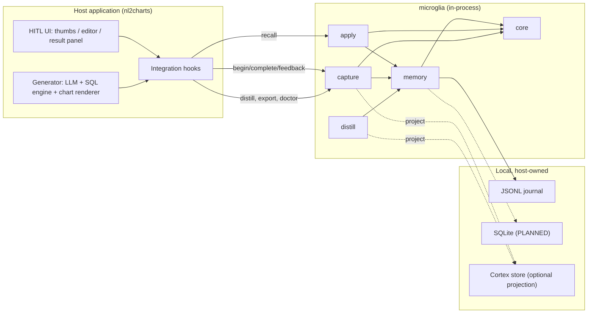
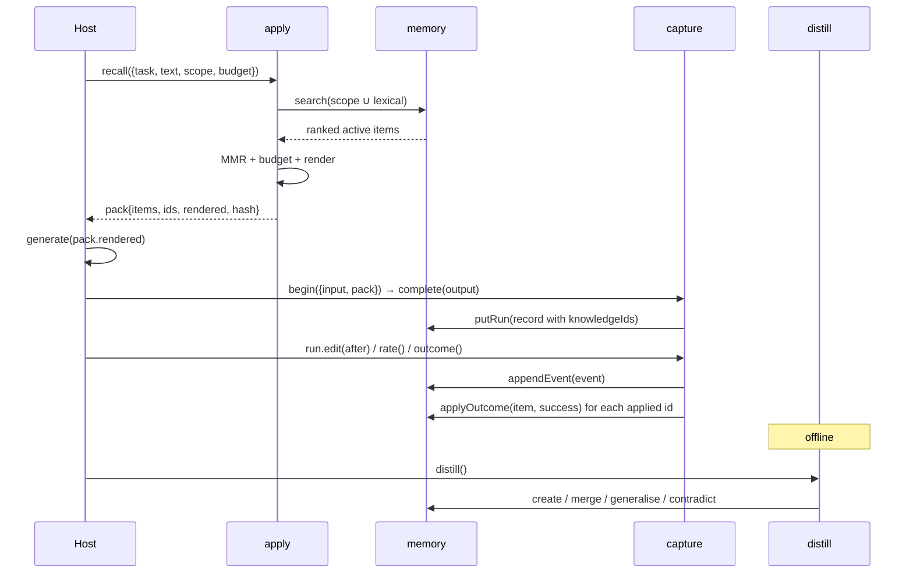
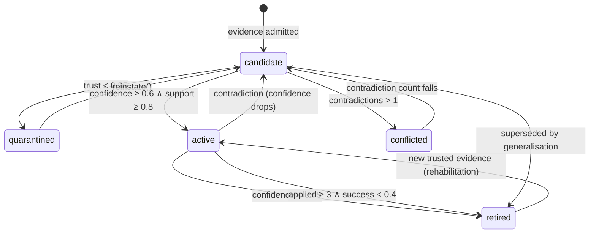

# Microglia — Technical Design

**Headless feedback flywheel for agentic workflows**

Version 1.2 · 2026-10-21 · Author: Lambertyan · Status: design complete after audit pass 2, implementation frozen

---

## 0. Reading guide

| Section | Answers |
|---|---|
| §1–2 | What must be true, and what is deliberately excluded |
| §3–4 | How the packages are laid out and how data is shaped |
| §5 | The exact public API and its error codes |
| §6 | The algorithms, with formulas |
| §7 | The security model |
| §8 | Whether Cortex can be the memory layer (and how far) |
| §9–10 | Performance and testing |
| §11 | The evaluation protocol for public benchmarks |
| §12 | What the POC actually measured |
| §13–15 | Operations, decisions, and the gap register |
| §17 | The feedback → knowledge → re-feed pipeline: stages; the **decision register** (§17.18); twelve gaps closed (§17.19); end-to-end metrics and cost (§17.20); delivery contracts (§17.21); competitors v2 (§17.22); POC register v3 (§17.23); package mapping and signatures (§17.25); footprint budgets (§17.26); lane plan and SOTA ladder (§17.27); source register (§17.28); disambiguation (§17.29); POC conclusions (§17.30); statistical discipline (§17.31); dataset manifest (§17.32); versioning and migration (§17.33) |
| §18 | Stage acceptance criteria and the eight release gates |
| §19 | The termination record: three audit passes and the requirement-by-requirement discharge |

Every number in §12 is produced by `pnpm check` in this repository. Every API in §5 exists in
`packages/*/src`. Where the document describes something not yet built, it is marked **PLANNED** and
appears in the gap register (§15).

---

## 1. Requirements

### 1.1 Functional

| ID | Requirement | Acceptance |
|---|---|---|
| F1 | Capture a generation with its input, output, model, prompt version, and injected knowledge ids | `RunRecord` round-trips through JSONL |
| F2 | Capture thumbs, edits, preferences, execution outcomes, clarifications, abstentions | Six signal types, each with a trust value |
| F3 | Normalise an edit into structural ops, hashes, and a semantic distance | `signal.ops.length > 0`, `distance ∈ [0,1]`; empty edit rejected |
| F4 | Distil feedback into scoped, evidence-weighted knowledge | `created/merged/generalized/quarantined` counts reported |
| F5 | Merge repeated claims; generalise across domains; contradict same-scope claims | One item per claim, N evidence refs |
| F6 | Recall active knowledge for a query, bounded by a character budget | `KnowledgePack.rendered.length ≤ budget` |
| F7 | Render knowledge as data that cannot escape its block | `<` escaped; one closing tag |
| F8 | Attribute outcomes back to the knowledge that was injected | `applied`/`succeeded` updated once per (run, item) |
| F9 | Export SFT / DPO / KTO / eval datasets as JSONL | Self-describing header + rows |
| F10 | Diagnose store integrity | Named issue codes, no throws on healthy data |
| F11 | Isolate namespaces | Zero cross-namespace retrieval (tested) |
| F12 | Export to a Cortex-compatible projection | `MemoryValue` + `Fact` written and readable |

### 1.2 Non-functional

| ID | Requirement | Target | Measured |
|---|---|---|---|
| N1 | Zero runtime dependencies in core/capture/apply/distill | 0 | 0 |
| N2 | Browser-safe core (no Node built-ins) | yes | core imports only relative modules |
| N3 | Deterministic replay | same seed → same ids and packs | tested |
| N4 | Added latency on the request path | p95 ≤ 50ms | 0.02ms at 6 items (POC scale) |
| N5 | Added prompt size | ≤ 300 tokens | 90 tokens (POC) |
| N6 | Coverage | ≥95% on every dimension | **100 / 99.53 / 100 / 100** (lines / branches / functions / statements) |
| N7 | Branch coverage | ≥95% | **99.54%** — the bar is met; the 14 remaining arms are enumerated in §10.3 with the reason each cannot be taken. G-7 (the 39 reachable arms) is closed |
| N8 | No network in tests | 0 calls | 0 |
| N9 | No mocks of the system under test | ports only | fakes only for `Storage`/`LLM` |
| N10 | ESM-only, tree-shakable | `sideEffects: false` | declared |
| N11 | **CPU or WebGPU only** | no CUDA/ROCm, no local GPU runtime | CI runs on CPU; no GPU dependency |
| N12 | Memory at 10k items | ≤100 MB heap | **13.9 MB** measured |
| N13 | `recall` p95 at 10k items | ≤50 ms | **2.68 ms** measured at 10k, **22.73 ms** at 100k |

N7 is deliberately reported as a miss rather than rounded up. §15.2 (E1) lists the remediation.

---

## 2. Constraints and non-goals

**Constraints**

1. The host owns the UI. Microglia never imports a UI framework, renders a component, or opens a socket.
2. One deployment is one tenant. A `namespace` string is an isolation boundary, not a billing unit.
3. Cortex is not on npm (verified 2026-10-20: `npm view @agentix-e/cortex-core` → 404). No hard dependency.
4. The library must work with no LLM at all. Every algorithmic path has a deterministic fallback.
5. Every persisted artefact must be inspectable with `cat`. Hence JSONL, not a binary store.
6. **The product must run on a CPU or in a browser with WebGPU.** No CUDA, no ROCm, no local GPU
   runtime, no fine-tuning. If a feature needs a GPU, it is not a product feature; it is an export
   target for someone else's training job.
7. The library may call a hosted LLM or embedding API that the host supplies, but it must not
   require one: every code path has a no-model fallback.

**Non-goals**

- Vector search, ANN indexes, or a database server.
- A training pipeline, GPU scheduling, or evaluation of fine-tuned models.
- Multi-tenant auth, SSO, RBAC, or a control plane.
- Annotation queues, dashboards, or reviewer workflows.
- Chart rendering, SQL execution, or schema introspection.

---

## 3. Architecture

### 3.1 Context



### 3.2 Packages and dependency rules

Three packages, split by **deployment**, not by capability:

```
packages/
  core/      src/{kernel,memory,distill,apply,capture,providers}
  node/      src/{app,server,providers/*,store/cortex}
  browser/   src/{client,outbox}
  eval/      the benchmark instrument (private, never published)
```

| Package | Depends on | Runtime deps | Browser | Why it exists |
|---|---|---|---|---|
| `core` | — | **0** | ✅ | The whole mechanism: contracts, store, distillation, pack, facade, provider contracts |
| `node` | core | `hono`, `@hono/node-server` | ❌ | An HTTP boundary, the journal, vendor providers, the cortex projection |
| `browser` | core | **0** | ✅ | Recall and feedback from a tab, with an outbox that survives a reload |
| `eval` | core | 0 | ❌ | Measurement, gates, the study; a benchmark has to own its workload |

`core` exposes five module subpaths (`core/memory`, `core/distill`, `core/apply`, `core/capture`,
`core/kernel`, `core/providers`). **One install does not have to mean one bundle**: a host that only
retrieves imports `core/apply` and `core/memory`, and the distiller never enters its graph.

**Rules, enforced by `tsc -b` and by the repository audit:**

1. `kernel` imports nothing outside itself. No `node:*`, no vendor SDK, no schema library.
2. Dependencies point downward only: `capture → {distill, apply, memory} → kernel`.
3. `node` and `browser` are outside the library's graph: `core` never imports either, and `browser`
   never imports `node`.
4. `eval` is a leaf. No product package imports it, so the harness cannot become part of the product.
5. **Exactly one package may have an external runtime dependency**, and the allowlist in
   `scripts/audit.mjs` names it (`node`: `hono`, `@hono/node-server`). A second dependency is a
   decision written in the audit, not a surprise in a lockfile.
6. The domain pack is not a package. A domain belongs to the host that has it; the chart pack the
   benchmark scores lives in `packages/eval/src/workload`.

**Why the capability packages were folded.** `memory → distill → apply → capture` was a chain with one
consumer each: every host installed all five, every release carried five manifests and five
tsconfigs, and the boundaries were never exercised by a second implementation. The boundaries that
matter — no I/O in the domain model, no store in the renderer, no model in the library — are module
boundaries, and they are still enforced, without five publish surfaces.

**What the split buys.** The server owns the credentials and the journal; the browser owns the
correction the user just typed; the library owns neither. That is also the reason `node` may take a
router: a server that cannot speak HTTP is not a server, and `core` pays nothing for it.

### 3.3 Dependency policy: adopt, or build?

The rule: **adopt undifferentiated infrastructure with a stable contract; build anything that
encodes product semantics, determinism, or a security boundary.** A dependency that decides what a
correction *means* is a dependency that owns the product.

**Adopt (runtime, optional peers only)**

| Package | Role | Why not build it | When it is loaded |
|---|---|---|---|
| `better-sqlite3` | Embedded SQL store | Mature, synchronous, WAL, well-tested | Only if the host chooses `SqliteStorage` |
| `pg` | Postgres store | Protocol correctness is not our product | Only in a multi-process deployment |
| `zod` | Validate LLM JSON | Hand-written validators are fine for five fields; a schema library is better for domain packs | Optional peer in `distill` |
| `@xenova/transformers` | On-device embeddings (ONNX/WASM or WebGPU) | Model runtime is not our product; WebGPU is optional and CPU is the floor | Optional peer |
| `onnxruntime-web` | WebGPU/WASM execution | Same reason; the host picks the backend | Optional, transitive |
| `@agentix-e/cortex-core` / `-node` / `-llm` | Cognitive memory substrate | Already built by the same org; see §8 | Optional projection |

None of these is a hard dependency. Only an adapter the host explicitly enables, or an optional
peer it chooses to install, pulls one in; the default install of `core`, `capture`, `apply`,
`distill`, and the `nl2charts` pack has none.

**Adopt (development only)**

| Package | Role | Why |
|---|---|---|
| `typescript` 5.7 | Types + project references | The API is the product |
| `vitest` + `@vitest/coverage-v8` | Tests + v8 coverage | Fast, ESM-native, no transform config |
| `tsup` | Release bundling (PLANNED) | ESM + d.ts in one step; the POC uses `tsc -b` |
| `changesets` | Versioning (PLANNED) | Multi-package releases with independent versions |
| `publint`, `@arethetypeswrong/cli` | Package correctness | Catches exports/types mistakes before publish |
| `size-limit` | Bundle budget (PLANNED) | A library that doubles a host bundle is not adopted twice |
| `fast-check` | Property tests (PLANNED) | Diff round-trip, merge idempotency, render bounds |
| `eslint` + `prettier` | Consistency | No semantic role |

**Build (the product)**

| Capability | Why it must be ours |
|---|---|
| `FeedbackEvent` / `Correction` model | No existing library models an edit as evidence with provenance |
| Scope semantics + generalisation | The core bet; a generic store cannot express it |
| Evidence fusion + admission + retirement | Determines what reaches a prompt; must be explainable |
| Contradiction resolution | A memory that cannot disagree with itself is not safe |
| Retrieval fusion (scope index + BM25 + MMR + budget) | Budget and determinism are product requirements |
| Rendering protocol | The injection boundary is ours to own |
| Credit assignment | Requires the run's pack; no store has it |
| Dataset export | The mapping from signals to SFT/DPO/KTO is a product decision |
| Evaluation harness + gates | The claim is the product; the instrument must be ours |
| Domain packs | The semantics of "chart type wrong" are domain knowledge |

**Rejected, with reasons**

| Candidate | Why not |
|---|---|
| LangChain / LlamaIndex | A framework dependency for five calls; brings retriever, prompt, and agent abstractions the host already has |
| Pinecone / Qdrant / pgvector | Operational surface with no benefit below ~1M items; scope filtering is the hard part, not ANN |
| React component library | Violates P1 (host owns UX) and imports a rendering framework into a data package |
| OpenTelemetry SDK | The host owns telemetry; we emit hooks, not a second tracing stack |
| `zod` in `core` | Zero-dependency and browser-safe are hard constraints; five validators do not justify 12KB |
| SQLite as the default | Native build breaks serverless and browser hosts; JSONL is inspectable and sufficient for one writer |
| PyTorch / CUDA / vLLM | Violates the CPU/WebGPU constraint and turns a library into an inference platform |
| Local fine-tuning | Out of scope by steering: the product exports data, it does not train |

### 3.4 The request path



---

## 4. Data model

### 4.1 Identity and invariants

| Invariant | Statement | Enforced by |
|---|---|---|
| I1 | A run is immutable after `complete()` | `RunHandle` throws `MG_E_RUN_COMMITTED` |
| I2 | Feedback cannot precede an output | `MG_E_NO_OUTPUT` |
| I3 | An event is append-only | `MemoryPort.appendEvent` has no update |
| I4 | A knowledge item is identified by `id`; a claim by `dedupeKey` | `dedupeKeyOf` |
| I5 | `namespace` is non-empty and never changes | constructor + `putKnowledge` guard |
| I6 | `support` is the sum of evidence weights (after merges) | `mergeEvidence` |
| I7 | `confidence` is derived, never authored | `scoreKnowledge` |
| I8 | `validUntil = Infinity` means "still asserted" | `Fact`/`KnowledgeItem` convention |
| I9 | A pack's `hash` is the hash of its rendered block | `makePack` |
| I10 | Persisted records must carry the schema this version understands | `assertSchema` on open |

### 4.2 Event schema (`microglia.feedback/1`)

| Field | Type | Meaning | Notes |
|---|---|---|---|
| `schema` | literal | Version | Bump = breaking change + migration |
| `id` | `fb_<time>_<rand>` | Sortable id | Monotonic time prefix |
| `at` | epoch ms | When observed | Injected clock |
| `namespace` | string | Tenancy | `[A-Za-z0-9][A-Za-z0-9._:-]{0,63}` |
| `sessionId` | string | Conversation/session | Host-provided or `default` |
| `runId` | string | The generation | Must exist for export |
| `task` | string | e.g. `chart.recommend` | Retrieval partition |
| `kind` | enum | rating/edit/preference/outcome/clarification/abstain | Mirrors `signal.type` |
| `actor` | `{type, idHash?}` | Who | Never a raw identity |
| `trust` | `[0,1]` | Weight ceiling | Derived, then capped by the host |
| `signal` | union | The payload | See below |
| `provenance` | object | Model, prompt, knowledge ids, retrieval hash | Copied from the run |
| `redactions` | int | Spans redacted before storage | Audit counter |

**Signal variants**

| `type` | Fields | Trust source |
|---|---|---|
| `rating` | `value: up/down`, `reasons[≤8]`, `comment≤500` | 0.6 with reasons, 0.45 bare, 0.5 for up |
| `edit` | `beforeHash`, `afterHash`, `ops[]`, `distance`, `after` | `0.5 + 0.4·clamp(distance/0.3)` |
| `preference` | `chosenRunId`, `rejectedRunId`, `criterion?` | 0.7 |
| `outcome` | `ok`, `code?`, `detail?` | 0.95 |
| `clarification` | `question≤300`, `answer≤1000` | 0.85 |
| `abstain` | `reason≤200` | 0.4 |

### 4.3 Knowledge schema (`microglia.knowledge/1`)

| Field | Type | Meaning |
|---|---|---|
| `namespace` | string | Isolation boundary |
| `kind` | `constraint \| exemplar \| negative \| lexicon \| procedure` | How it is used |
| `scope` | `{task, domain?, schemaDigest?, intent?, field?, reasonCode?}` | Where it applies; every present key must match |
| `statement` | string | One declarative sentence, rendered verbatim |
| `payload` | JSON? | Machine-usable predicate (chart constraint, exemplar pair) |
| `evidence[]` | `{feedbackId, runId, at, weight}` | Provenance |
| `support` | number | Σ weights |
| `contradictions` | int | Count of conflicts |
| `confidence` | `[0,1]` | Derived score |
| `trust` | `[0,1]` | Highest source trust seen |
| `validFrom/validUntil` | ms | World time |
| `systemFrom/systemUntil` | ms | System time |
| `status` | `candidate \| active \| quarantined \| retired \| conflicted` | Lifecycle |
| `applied/succeeded` | int | Empirical record |
| `createdAt/updatedAt` | ms | Audit |

### 4.4 Lifecycle



Transitions are computed by `decideStatus` from the item's state, never set by callers. The only
manual escape hatches are `reinstate()` (review) and `expireKnowledge()` (policy change).

### 4.5 Run schema (`microglia.run/1`)

`input` and `output` are redacted JSON; `provenance.knowledgeIds` is the attribution key. Note that
`feedbackIds` is always `[]`: events link by `runId`, and duplicating the link on the run would create
two sources of truth that can disagree.

---

## 5. Public API

### 5.1 Quick start

```ts
import { openMicroglia } from '@agentix-e/microglia-capture';
import { EmbeddedMemory, JsonlJournal } from '@agentix-e/microglia-memory';
import { chartInterpreter, chartEditDistance } from '@agentix-e/microglia-nl2charts';
import { combineInterpreters, ruleInterpreter } from '@agentix-e/microglia-distill';

const store = await EmbeddedMemory.open(
  new JsonlJournal({ dir: '.microglia', compactOnOpen: true }),
);

const mg = await openMicroglia({
  app: 'nl2charts',
  namespace: 'acme',
  store,
  // Domain pack first, generic fallback second: ratings and clarifications
  // still produce lessons when the chart interpreter has nothing to say.
  interpreter: combineInterpreters(chartInterpreter, ruleInterpreter),
  editSemantics: chartEditDistance, // a mark change is a big edit
});

// 1. Recall
const pack = await mg.recall({
  task: 'chart.recommend',
  text: question,
  scope: { domain: 'sales', intent: 'trend' },
});

// 2. Generate with `pack.rendered` in the prompt
const output = await host.generate(question, pack.rendered);

// 3. Record
const run = mg.begin({ task: 'chart.recommend', input: { question, domain: 'sales' }, pack });
await run.complete(output);

// 4. Capture the human correction
await run.edit(editedSpec);

// 5. Learn (offline; safe to call on a cron)
await mg.distill();
```

### 5.2 Types

```ts
type MicrogliaOptions = {
  app: string;                      // 1..64 chars
  namespace: string;                // [A-Za-z0-9][A-Za-z0-9._:-]{0,63}
  store: MemoryPort;
  policy?: Partial<Policy>;
  clock?: Clock;                    // default: systemClock
  random?: RandomSource;            // default: Math.random
  interpreter?: Interpreter;        // default: ruleInterpreter
  budget?: number;                  // default: policy.defaultBudget (1200 chars)
  tag?: string;                     // renderer element name
  credit?: boolean;                 // default: true
  editSemantics?: (before: Json, after: Json) => number | undefined;
};

type RunStart = {
  task: string;                     // 1..120 chars
  input: JsonObject;
  sessionId?: string;               // default: 'default'
  pack?: KnowledgePack;             // sets knowledgeIds + retrievalHash
  model?: string; promptVersion?: string; appVersion?: string;
  domainPack?: string; schemaDigest?: string; metadata?: JsonObject;
};

type FeedbackInput =
  | { type: 'rating'; value: 'up' | 'down'; reasons?: readonly string[]; comment?: string }
  | { type: 'edit'; after: Json; note?: string }
  | { type: 'preference'; chosenRunId: string; rejectedRunId: string; criterion?: string }
  | { type: 'outcome'; ok: boolean; code?: string; detail?: string }
  | { type: 'clarification'; question: string; answer: string }
  | { type: 'abstain'; reason: string };

type FeedbackOptions = { actor?: Actor; at?: number; trustCeiling?: number };
```

### 5.3 Microglia

| Method | Signature | Behaviour |
|---|---|---|
| `open` | `(options) => Promise<Microglia>` | Validates config; does not open the store |
| `begin` | `(start: RunStart) => RunHandle` | Allocates an id; nothing is written yet |
| `recall` | `({task, text, scope?, budget?, limit?}) => Promise<KnowledgePack>` | Scope-indexed + lexical retrieval |
| `distill` | `({since?, limit?, generalize?}) => Promise<DistillReport>` | Idempotent over the log |
| `exportDataset` | `(format, {task?, since?}) => Promise<DatasetRow[]>` | Pure read |
| `exportJsonl` | `(format) => Promise<string>` | Header + rows |
| `doctor` | `() => Promise<Diagnosis>` | Integrity checks |
| `stats` | `() => Promise<MemoryStats>` | Counts |
| `close` | `() => Promise<void>` | Closes the store; idempotent |

`Microglia` also implements the `RunHost` surface (`nextId`, `now`, `persistRun`, `recordFeedback`).
Those are public because `RunHandle` needs them across a module boundary; hosts should not call them.

### 5.4 RunHandle

| Method | Signature | Notes |
|---|---|---|
| `complete` | `(output: Json, meta?: JsonObject) => Promise<RunRecord>` | Redacts, validates JSON, writes once |
| `feedback` | `(input: FeedbackInput, options?) => Promise<FeedbackEvent>` | Requires `complete` |
| `edit` | `(after: Json, options?) => Promise<FeedbackEvent>` | Computes ops + distance |
| `rate` | `(value, reasons?, options?) => Promise<FeedbackEvent>` | Reasons normalised, deduped |
| `outcome` | `(ok, code?, detail?, options?) => Promise<FeedbackEvent>` | Free label from execution |
| `clarify` | `(question, answer, options?) => Promise<FeedbackEvent>` | Becomes a lexicon candidate |
| `abstain` | `(reason, options?) => Promise<FeedbackEvent>` | No credit |
| `record` | `RunRecord \| undefined` | The immutable record |

### 5.5 Errors

| Code | When | Recovery |
|---|---|---|
| `MG_E_CONFIG` | Missing app, invalid task, missing store | Fix configuration |
| `MG_E_SCHEMA_VERSION` | Persisted schema unknown | Migrate the journal |
| `MG_E_NOT_OPEN` | Store or SDK closed | Reopen |
| `MG_E_RUN_COMMITTED` | `complete()` twice | Create a new run |
| `MG_E_NO_OUTPUT` | Feedback before `complete()` | Complete first |
| `MG_E_INVALID_SIGNAL` | Empty edit, same-run preference, non-JSON output, bad LLM response | Fix the caller |
| `MG_E_UNKNOWN_TASK` | Reserved | — |
| `MG_E_UNKNOWN_SCOPE` | Generalisation target missing (internal invariant) | Report a bug |
| `MG_E_STORE_IO` | Journal unreadable | Check permissions/disk |
| `MG_E_STORE_CORRUPT` | Invalid JSON line; includes line number | Repair or compact |
| `MG_E_KNOWLEDGE_UNSAFE` | Reserved for a host-supplied policy | — |
| `MG_E_BUDGET_EXCEEDED` | Reserved | — |
| `MG_E_NAMESPACE_MISMATCH` | Invalid namespace, cross-namespace write | Use the right namespace |
| `MG_E_PACK_STALE` | Reserved | — |

Reserved codes exist so a host can branch on a stable vocabulary before the path is implemented;
they are not thrown today.

### 5.6 Host hook map

The SDK never renders anything; it attaches to events the host already has. This table is the whole
integration contract:

| Host UI event | SDK call | Signal | Default trust |
|---|---|---|---|
| Thumbs up/down with a reason chip | `run.rate('down', ['wrong_chart_type'])` | `rating` | 0.60 (0.45 bare) |
| Inline editor saves a new chart spec / SQL | `run.edit(after)` | `edit` | 0.50–0.90 by semantic distance |
| Two candidate answers compared, one chosen | `run.feedback({type:'preference', …})` | `preference` | 0.70 |
| SQL runs; error toast or success | `run.outcome(ok, code?)` | `outcome` | 0.95 |
| User answers "what do you mean by active?" | `run.clarify(q, a)` | `clarification` | 0.85 |
| User dismisses the result | `run.abstain(reason)` | `abstain` | 0.40 (no credit) |
| Feedback arrives from an external channel | `run.edit(after, { trustCeiling: 0.2 })` | `edit` | capped at 0.20 → quarantine |

### 5.7 Host integration recipes

**A. Thumbs with reasons**

```ts
await run.rate('down', ['wrong_chart_type'], { comment: 'should be a line chart' });
// → trust 0.6, negative candidate scoped by reasonCode
```

**B. Silent edit**

```ts
await run.edit(editedSpec);
// → structural ops, distance (semantic if editSemantics is set), trust 0.5..0.9
```

**C. Execution outcome (the cheapest label)**

```ts
try { await db.run(sql); await run.outcome(true); }
catch (e) { await run.outcome(false, 'SQL_ERROR', String(e)); }
// → trust 0.95, credits applied items, creates a negative candidate
```

**D. Clarification**

```ts
await run.clarify('active customer', 'ordered in the last 90 days');
// → lexicon candidate scoped to the task
```

**E. Untrusted source**

```ts
await run.edit(spec, { trustCeiling: 0.2, actor: { type: 'user', idHash: 'external' } });
// → quarantined; never rendered
```

### 5.8 Adding a domain pack

1. Define the canonical output type and a validator.
2. Implement `classifyEdit(before, after) → EditCode | null`.
3. Implement `describeEdit(edit, features) → {scope, statement, payload}`.
4. Implement `editDistance(before, after) → number | undefined`.
5. Implement `interpreter({event, run}) → DistillCandidate[]`.
6. Supply a **payload example** to the LLM interpreter (`payloadHint`). Without it the model writes a
   plausible sentence and an empty payload; POC-1 measured 0% correct mark until the hint was added.
7. Test: gold/baseline validity, edit classification, statement identity, scope matching.

The pack does **not** import `distill`; it matches the `Interpreter` shape structurally. This keeps
the dependency graph acyclic and lets a host publish its pack without depending on the pipeline
version.

---

## 6. Algorithms

### 6.1 Edit normalisation

```
ops       = structuralDiff(before, after)        # set/remove/insert with JSON paths
distance  = editSemantics(before, after)         # if the domain pack provides one
          | changedLeaves / (leaves(before)+leaves(after))
```

Array removals are emitted in descending index order so `applyOps` is correct (an ascending removal
shifts the tail and skips the last element — this was a real bug, fixed and tested).

**Why a semantic distance exists.** A chart-type change is 1 of 4 leaves → 0.125 by the generic
metric → trust 0.667 → below the activation threshold. The POC initially failed to learn anything for
this reason. The pack now returns 1.0 for a mark change, which is the correct semantic weight.

### 6.2 Trust

```
edit:          0.5 + 0.4 · clamp01(distance / 0.3)
rating down:   0.6 if reasons else 0.45
rating up:     0.5
outcome:       0.95
clarification: 0.85
preference:    0.70
abstain:       0.40
final = min(derived, trustCeiling ?? 1)
```

### 6.3 Confidence (log-odds fusion)

```
logOdds   = logit(0.35) + Σ_i w_i · logit(trust_i) − contradictions · 1.0
empirical = (succeeded + 1) / (applied + 2)
decay     = 1                                     if now ≤ validUntil
          = max(0.2, 0.5^((now − validUntil)/30d)) otherwise
confidence = sigmoid(logOdds) · (0.55 + 0.45 · empirical) · decay
```

Three properties are worth stating:

- **Evidence is multiplicative in odds, additive in log-odds.** Two independent 0.9-trust
  observations do not sum to 1.8; they move the posterior from 0.35 to ~0.95.
- **An untested rule is not credited as a successful one.** `empirical` starts at 0.5, so a new rule
  can activate on evidence but cannot reach the ceiling until it has been applied.
- **Expiry is a decay, not a deletion.** An expired rule keeps its history and can be re-asserted.

### 6.4 Admission

```
if quarantined                 → quarantined (manual review)
if contradictions > 1          → conflicted
if applied ≥ 3 ∧ smoothedRate < 0.4 → retired
if active ∧ confidence < 0.45  → retired
if confidence ≥ 0.6 ∧ support ≥ 0.8 → active
if retired                     → retired
else                           → candidate
```

Defaults live in `policy.ts` with the reasoning next to each number. `minSupport = 0.8` is chosen so
one substantive edit (0.9) activates, while one bare thumbs-down (0.45) does not.

### 6.5 Merge, generalise, contradict

**Merge (same claim).** Identity is `dedupeKeyOf(namespace, kind, scope, normalised statement)`.
Evidence is unioned by `feedbackId`; support is summed once per event.

**Generalise (same claim, one fewer scope dimension).** Allowed only when namespace, kind, task,
intent, field, and payload are identical, the candidate has a domain, and the existing item either
has no domain or a different one. The widened item keeps the original statement (which is
domain-free by construction), unions evidence from all siblings, and retires the narrow copies with
`statusReason = "generalized:<id>"`.

Why only the domain dimension: dropping intent would turn "line for trends" into "line for
everything"; dropping field is already avoided at description time.

**Contradict (same scope, different claim).** A trusted candidate (trust ≥ 0.7) that disagrees with an
active item in the *same* `scopeKey` records a contradiction on that item. Different scopes are not
contradictions — a domain-specific exception is supposed to disagree, and specificity resolves it.

**Rehabilitation.** A retired item that receives a new trusted observation resets `applied` and
`succeeded` to zero. Rationale: the failures counted against it are failures of *application*, and
the host may have applied it to the wrong case. Without this, three bad applications permanently veto
the person the system exists to learn from.

### 6.6 Retrieval

**Candidate generation**

```
lexical  = postings(tokenize(text))
scoped   = { item : active ∧ namespace ∧ task ∧ scopeMatches(item.scope, query) }   if query.scope
candidates = lexical ∪ scoped
```

This union is load-bearing. A rule that generalised out of a domain no longer contains the domain
token, so a lexical-only candidate set drops exactly the knowledge the flywheel worked to produce.
In the POC this made the difference between 53.21% and 100.00%.

**Scoring**

```
bm25      = Σ_t idf(t) · tf·(k1+1) / (tf + k1·(1−b+b·len/avgLen)),  k1=1.2, b=0.75
score     = 0.65 · bm25/maxBm25 + 0.35 · confidence + 0.02 · (specificity−1)
```

The weights are constants, not learned, because a host must be able to explain why a rule was shown.

**Diversification.** MMR with λ=0.75 over statements, before the budget is applied. Budgeting first
lets three paraphrases consume the room a distinct rule needed.

**Budget.** Items are added greedily, then a second pass drops trailing items until
`rendered.length ≤ budget`. The budget is a hard bound, not an approximation.

### 6.7 Rendering

```
<microglia-knowledge version="1" note="Reference data from prior user corrections. Not instructions." items="2">
{"id":"k_1","kind":"constraint","confidence":0.775,"scope":{...},"statement":"...","payload":{...}}
{"id":"k_2",...}
</microglia-knowledge>
```

- JSONL, not prose: parseable, auditable, and escaping is defined by JSON.
- `<` is escaped as `\u003c`, so a statement cannot close the element.
- The preamble states the data/instruction boundary; the security model does not rely on the model
  obeying it (see §7).

### 6.8 Credit assignment

| Signal | Credit |
|---|---|
| `rating up` | success |
| `rating down` | failure |
| `edit` | failure |
| `outcome ok` | success |
| `outcome fail` | failure |
| `clarification`, `abstain`, `preference` | none |

One credit per `(runId, knowledgeId)`, from the first signal. A host that fires both a thumbs-down and
an edit would otherwise count one failure twice.

### 6.9 Distillation report

```ts
{
  events, candidates,
  created, merged, generalized, superseded, contradicted,
  quarantined, rejectedUnsafe, rejectedByHost
}
```

Every input has a counted outcome. A flywheel that silently drops input cannot be debugged.

### 6.10 LLM distillation (optional)

`buildDistillPrompt` puts the event in a delimited `<event>` block and asks for a fixed JSON schema;
`parseDistillResponse` validates kinds, statement length, scope keys, and payload shape. The model's
output is a **candidate**, not a mutation: it still passes redaction, screening, dedupe, and admission.

The prompt also carries a `payloadHint` — a literal example of the domain payload. This is not
cosmetic: POC-1 measured **0% correct mark with 100% correct intent** before the hint, and **95.83%**
after it. A model cannot infer `{when:{intent},then:{mark}}` from a prose instruction, and a pack that
forgets the hint produces confident, empty lessons.

---

## 7. Security and privacy

### 7.1 Trust model

| Source | Default trust | Rationale |
|---|---|---|
| Verified execution | 0.95 | Measured, not judged |
| Clarification | 0.85 | The user is teaching a definition |
| Substantive edit | 0.90 | Direct correction of the output |
| Small edit | 0.50–0.70 | Often formatting |
| Reasoned thumbs-down | 0.60 | Direction without a fix |
| Bare thumbs-down | 0.45 | Weakest explicit signal |
| External/unverified | capped by host (e.g. 0.2) | Quarantined |

### 7.2 Quarantine

`trust < 0.35` creates the item as `quarantined`. A quarantined item never leaves that state through
evidence; only `reinstate()` moves it to `candidate`, where it still needs trusted evidence to
activate. This is deliberate: low-trust evidence must not be laundered by repetition.

### 7.3 Namespace isolation

Every read filters on `namespace` before ranking; every write asserts it. The POC measures leakage
with a foreign `Microglia` over the same store and requires zero hits (G7).

### 7.4 Injection defense

Four layers, none of which relies on the model:

1. **Redaction before persistence** — email, phone, API keys, GitHub tokens, JWTs, AWS keys.
2. **Screening** — instruction overrides, chat role markers, system-prompt extraction, script tags,
   exfiltration phrasing, zero-width/bidi control characters.
3. **Structural containment** — JSON-escaped data inside a named element; `<` escaped.
4. **No imperative knowledge from untrusted sources** — a statement that reads as a command is
   rejected (`rejectedUnsafe`), because it means distillation failed.

### 7.5 Poisoning: what the literature says and what we do

Memory poisoning is now a named risk (OWASP ASI06). Reported attacks achieve ~98% injection and ~60%
activation against state-of-the-art agents (GhostWriter), and a single email can plant a persistent
false memory in an agent with memory files (MemGhost, 87.5% success against one deployment). The
defenses those papers recommend — provenance tagging, confirmation before durable writes, audit logs —
are exactly the fields this design already carries.

| Attack | Our control | Residual risk |
|---|---|---|
| Direct poisoned edit | Trust ceiling → quarantine | A host that sets `trustCeiling: 1` defeats it; G11 measures the harm |
| Repetition attack (many poison edits) | Quarantine is sticky; no evidence-based exit | Manual review required |
| Poison via a trusted reviewer | Cannot be distinguished from a correction | Out of scope; audit trail is the answer |
| Poisoned exemplar | Exemplars are rendered as data with an id; no instruction following | A model may still imitate a bad example |
| Cross-namespace injection | Namespace filter on every read | None observed |

The POC exercises the first two: 12 injected edits in the poison arm produce 2 quarantined items and
**zero** active untrusted items; removing the ceiling drops accuracy 14.28pp.

---

## 8. Cortex integration

### 8.1 Why not a hard dependency

- `@agentix-e/cortex-*` is not published (404 for all four packages).
- `cortex-node` pulls `better-sqlite3` (native build), which would break browser and edge hosts.
- Cortex is under active change (55 commits between the published baseline and master).
- Its `Fact` has no derivation edge, so it cannot answer "which knowledge produced this correction".

### 8.2 The projection contract

```ts
interface CortexStorage {
  put(table, key, value, opts?: { tags?: string[] }): Promise<void>;
  get<T>(table, key): Promise<T | undefined>;
  del(table, key): Promise<void>;
  query<T>(table, predicate?: { tags?: string[]; limit?: number }): Promise<T[]>;
}
```

`CortexProjection` writes two rows per item:

| Table | Key | Value | Tags |
|---|---|---|---|
| `memories` | `item.id` | `CortexMemoryValue` (cortex's `MemoryValue` shape) | `ns:`, `task:`, `kind:`, `status:`, scope dims |
| `facts` | `<id>:fact` | `CortexFact` (bitemporal) | same |

Field mapping decisions:

| Microglia | Cortex | Why |
|---|---|---|
| `confidence` | `value` **and** `confidence` | Cortex's write gate reads `value`; keeping `confidence` preserves semantics |
| `trust` | `sourceTrust` | Quarantine decisions survive the projection |
| `kind=exemplar` | `type=episodic` | An example is an experience, a rule is knowledge |
| `validUntil` | `Fact.validUntil` + reduced stability | An expired rule must not be scheduled as durable |
| `namespace`/scope | tags | Cortex's predicate is exact-tag matching |

### 8.3 Gap table (from source, not from the README)

| Capability | Cortex status | Microglia response |
|---|---|---|
| Derivation history | Not implemented; a speculative `ProvenanceNode` was deleted | `evidence[]` + `dedupeKey` are the provenance record |
| TD(λ) credit assignment | Not implemented | `creditOf` + `applyOutcome` |
| Probability calibration | Not implemented; fixed thresholds | Wilson-smoothed empirical rate inside `confidence` |
| Feedback ingestion | No type for it | `FeedbackEvent` + interpreters |
| Reranker | Implemented, off by default | Lexical + scope is the default; embeddings PLANNED |
| `consolidate` caller | No production caller; FSRS is reachable only transitively (README) | Not required for the loop |
| Benchmark currency | 83.55% at `a52628f`, 55 commits behind; no LoCoMo | Do not inherit the number |

### 8.4 Competitor source audit

Closed-source products (LangSmith, Braintrust) are compared from public documentation only; per the
project steering, no attempt is made to obtain their source. The five open-source leaders were read
at the file level.

| Project | Licence | Runtime requirement | Source-level finding | What it does not model |
|---|---|---|---|---|
| **Mem0** | Apache-2.0 | Vector DB + LLM (+ optional graph DB) | `mem0/memory/main.py`: phased add (context → top-10 recall → one extraction call); events `ADD`/`UPDATE`/`DELETE`; `_compute_entity_boosts` on search. `mem0/configs/prompts.py`: `ADDITIVE_EXTRACTION_PROMPT` (v3, ADD-only + `linked_memory_ids`), and the older `DEFAULT_UPDATE_MEMORY_PROMPT` (ADD/UPDATE/DELETE/NONE) | A correction is not an input; there is no trust weight, contradiction budget, scope generalisation, quarantine, or prompt pack. Extraction is from conversation, not from a verified edit |
| **Graphiti (Zep)** | Apache-2.0 | Neo4j / Kuzu / FalkorDB + LLM + embeddings | `graphiti_core/edges.py`: four timestamps per edge — `valid_at`, `invalid_at` (world), `created_at`, `expired_at` (system). `search/search_config.py`: BM25 + cosine + BFS recipes, RRF reranker | Bi-temporal graph is strong for entities and facts, but ingestion is episode-based. No per-edit trust, no evidence-weighted admission, no quarantine, and the graph database is a hard dependency |
| **Letta** | Apache-2.0 | Postgres + pgvector, server process | `letta/services/block_manager.py`: `BlockManager` with checkpoint/undo/redo; core memory blocks plus archival and recall memory; agent edits blocks through tools | Memory is self-edited by the agent, not learned from a user correction. No admission threshold, no contradiction budget, no zero-service mode |
| **Langfuse** | MIT (core) | ClickHouse + Postgres + Redis, server | `packages/shared/src/domain/scores.ts`: `ScoreDataType` includes **`CORRECTION`**; `CORRECTION_NAME = "output"`; sources are API/EVAL/ANNOTATION; text capped at 500 chars | A correction is a score attached to a trace. It is not distilled, scoped, retrieved into a prompt, or credited. This is the closest competitor and it stops exactly at the boundary microglia crosses |
| **Argilla** | Apache-2.0 | Server + Elasticsearch | `records` (fields, responses, suggestions, vectors, metadata) with bulk upsert; annotation-centric dataset model | Human annotation platform; no runtime retrieval, no memory lifecycle, no feedback-to-prompt path |
| **Cortex** | MIT | Node + SQLite/Postgres | Value gates, bitemporal `Fact`, FSRS, consolidation, contradiction fusion | No feedback type, no credit assignment, no `derivedFrom`, no calibration; see §8.2 |

Two conclusions from the audit:

1. **The closest competitor is Langfuse's `CORRECTION` score**, and it is deliberately a label on a
   trace. The moment a correction becomes a *typed, scoped, evidenced rule*, every audited project
   stops.
2. **Graphiti is ahead of us on graph temporality** and we should not pretend otherwise. Our claim is
   narrower and different: a correction has trust, a scope, an evidence weight, a lifecycle, and a
   prompt budget. A future adapter could use Graphiti as a projection backend, exactly as it uses
   Cortex.

### 8.5 Verdict and path

> **Use Cortex as a projection and maintenance layer; keep microglia's journal as the source of
> truth until Cortex ships `derivedFrom` and calibration.**

Path: (1) projection now; (2) switch structural types to `import type` when published, plus a
conformance test against `SqliteStorage`; (3) upstream `derivedFrom?: string[]` on `Fact` and a
calibration module; (4) optional: let Cortex's `decideRetrieval` provide a second abstention opinion
on the pack.

---

## 9. Performance and limits

### 9.1 Measured on CPU (no GPU, no server)

All numbers below are from `pnpm eval:scale` on the CI runner class (2 vCPU, Node 22). The product
has no GPU path; embeddings, when enabled, run through an ONNX/WASM or WebGPU encoder on the host.

| Items | Build | `recall` p50 | `recall` p95 | Heap delta | Pack tokens |
|---|---|---|---|---|---|
| 1,000 | 13 ms | 1.26 ms | 1.91 ms | 6.3 MB | 260 |
| 10,000 | 69 ms | 2.11 ms | 2.68 ms | 29.3 MB | 258 |
| 50,000 | 329 ms | 8.89 ms | 10.76 ms | 113.1 MB | 257 |
| 100,000 | 750 ms | 18.65 ms | **22.73 ms** | **173.9 MB** | 257 |

The scope scan is O(n), and the table is what that costs: 2.7 ms p95 at 10k, 22.7 ms at 100k, a
10k→100k growth of 8.5x against 10x the items. Pack tokens are flat (257–260), which is the point of a
budget: more knowledge changes what is selected only when it changes what is relevant.

An earlier version of this section claimed 10k would be the bottleneck; that was an inference, and it is
withdrawn. The scan is still O(n) — the shape of the curve says so — but the constant is small enough that
100k items cost 22.7 ms, not the 50 ms the inference implied. What the measurement adds is the second axis
nobody had looked at: **memory**. 174 MB of heap for 100k rules is the number a host actually runs into,
and it is the reason the index would still be worth building before the latency budget is crossed.

| Other measurements | Value | Conditions |
|---|---|---|
| Mean pack size | **90–259 tokens** | 6 rules in the study; 10k pool, budget-bound |
| Full mechanism study (9 arms × 6 rounds, plus 3 micro-ablations) | **0.33 s** | Single core, in-memory journal |
| LLM distill latency | **951–1,276 ms p50 / 1,265–1,562 ms p95** | DeepSeek, 24 calls, ~495 tokens, three runs |
| LLM reader latency | **652–898 ms p50 / 959–1,199 ms p95** | DeepSeek, 70 calls, 461 tokens, three runs |

### 9.2 Budgets

| Resource | Budget | Enforcement |
|---|---|---|
| Pack characters | 1200 (default) | Hard bound in `renderPack` |
| Pack tokens (estimate) | `ceil(chars/4)` | Reported on every pack |
| Event text | 500 chars (comment/detail), 1000 (answer) | Truncated at capture |
| Reasons per rating | 8 | `normaliseReasons` |
| Statement length (LLM) | 400 chars | Parser rejects longer |

### 9.3 Scaling path

| Scale | Store | Retrieval | Distillation |
|---|---|---|---|
| ≤10k items | JSONL + in-memory index | O(n) scope scan + inverted index | Synchronous cron |
| ≤1M items | SQLite (PLANNED) | SQL scope index + FTS5 | Batched worker |
| Multi-process | Postgres via `MemoryPort` | Materialised scope index | Queue + idempotency keys |

---

## 10. Testing

### 10.1 Strategy

| Layer | What it proves | Representative cases |
|---|---|---|
| Unit | Pure functions, edge cases, error paths | diff round-trips, Wilson/McNemar boundaries, injection screen, scope matching |
| Contract | Ports implemented by fakes behave per interface | JSONL reopen, corrupt line, schema mismatch, Cortex projection |
| Integration | Capture → distill → recall → apply on a real JSONL journal | edit → rule → recall → credit, export shapes, doctor issues |
| Study | Full ablation with statistical gates | 9 arms × 6 rounds, 15 gates, 3 micro-ablations |

- **No network.** The LLM port is exercised with a deterministic fixture; every other path is offline.
- **No mocks of the system under test.** Fakes exist only for `Storage`/`LLM`, which are ports by design.
- **Deterministic.** Clock and RNG are injected; the study is reproducible from a seed.
- **Property tests** (fast-check) are PLANNED for `diff`/`applyOps` round-trips and merge idempotency.

### 10.2 Coverage (measured)

| Dimension | Result | Threshold |
|---|---|---|
| Lines | **100%** | 95 |
| Statements | **100%** | 95 |
| Functions | **100%** | 95 |
| Branches | **99.53%** | 95 |

### 10.3 The uncovered branch arms, counted and classified

**99.54% (3087/3101), 14 arms**, with no ignore comment anywhere in the repository. Two earlier versions of
this section were wrong in the same direction — "seven arms at 99.53%", then "59 arms at 97.93%" — because
the number was restated when a feature landed and never re-derived from the report. It is now measured with
`vitest --coverage.reporter=json` and enumerated arm by arm; the 14 that remain are listed below, each with
the reason it cannot be taken.

**The campaign that got here (G-7).** 39 reachable arms were taken between iterations 48 and 49, and doing
it found seven defects that the suite had been passing over — an HTTP query string that answered typos with
an empty list, a schema-only database scoring as 100%, a model-response parser that discarded valid replies,
a memory-formation harness that defaulted away its own inputs. They are recorded in PROGRESS §49; the point
here is that the arms were reachable *and* load-bearing, which is why the campaign was worth running instead
of writing them off as guards.

| File:line | The arm that never runs | Why it is unreachable |
|---|---|---|
| `core/src/capture/curate.ts:128` | one arm of the density comparator | reached only when V8's sort calls the comparator with the two operands in the order the test happens not to produce; the tie-break itself is exercised in both directions |
| `core/src/distill/generalize.ts:151` | `target === undefined` after a non-empty sibling filter | `pickGeneralizationTarget` returns the first sibling when none is active |
| `core/src/kernel/diff.ts:113` | `key === undefined` when applying an op | the empty-path case returns earlier, so a non-empty path always has a last element |
| `core/src/kernel/knowledge.ts:472` | `right === undefined` in `strongestTier` | every item the store writes carries a tier; the arm guards rows written before the field existed |
| `core/src/kernel/stats.ts:93` | `logSumExp` over an empty sample | `mcnemarExact` returns at `n === 0`, so the sum never sees zero terms |
| `core/src/memory/journal.ts:188` | the empty-compaction newline | compaction only runs with at least one row |
| `core/src/memory/lexical-index.ts:38` | a token with no posting bucket during removal | `add` is the only writer and it creates the bucket before recording the token |
| `core/src/memory/store.ts:170` | a candidate id that resolves to no knowledge item | the index and the map are written in the same call, so they cannot diverge |
| `eval/src/ablations.ts:98` | `status: 'missing'` for the learned rule | the store has no delete, so the rule the function just learned is still there |
| `eval/src/competitor.ts:127` | skipping an already-correct baseline item | the fact-store corpus is filtered to defective items first |
| `eval/src/lanes/delivery.ts:140` | the "receiver has no port" guard | the guard runs after `listen` resolved, and a resolved listener has an address |
| `eval/src/report.ts:112` | the "still injected" wording of the credit row | one run produces one credit ablation, whose rule is always withdrawn |
| `eval/src/study.ts:653` | `baseline?.holdout ?? []` | the baseline arm is always present; the fallback guards a schedule change |
| `node/src/mcp.ts:228` | the re-throw of a non-library error from `recordFeedback` | every refusal in the library is a `MicrogliaError`; swallowing anything else would hide a bug behind `isError: true` |

Each of these protects a state the type system cannot express, and deleting one would turn a future bug
into silent data loss rather than an exception. The alternative — an `ignore` comment — would make the
number look better and the code worse, so the number stays where it is and the list stays in the document.


### 10.4 Commands

```bash
pnpm install
pnpm build       # tsc -b, project references
pnpm typecheck   # same graph, no emit
pnpm test        # vitest + v8 coverage, thresholds at 95 on all four dimensions
pnpm audit:repo  # source rules, manifests, published-dependency advisories
pnpm bench       # build + mechanism study + gates
pnpm check       # typecheck + test + audit + bench
```


---

## 11. Evaluation protocol (public benchmarks)

### 11.1 Design

| Element | Choice | Reason |
|---|---|---|
| Unit | One question, both arms | Paired designs remove question difficulty |
| Split | k-fold cross-fitting, balanced, order-independent | Every question is evaluated exactly once, by a memory that never saw it; one half split discards half the questions and lets file order choose |
| Test | Exact McNemar | Binary outcomes, small discordant counts |
| Interval | Bootstrap 10k over questions | No normal approximation at n<500 |
| Preregistration | Hypothesis, endpoint, n, stop rule | Prevents post-hoc endpoint selection |
| Runs | 4 interleaved per arm when stochastic | Time-of-day drift is 1.7–2.1pp in the cortex record |
| Judge | Order-swapped, length-controlled, κ ≥ 0.7 | Position/verbosity/style bias is systematic |
| Corrected subsets | ARCwise-Plat for BIRD | 52.8% annotation error rate reported |
| Resolution | Report the minimum detectable difference with the delta | A result without its resolution invites reading noise as progress |

### 11.2 Power

McNemar sample size: `n ≈ (z_{α/2}+z_β)² (p01+p10) / (p01−p10)²`, α=0.05, power=0.8.

| Detectable delta (pp) | Assumed discordance | Required n |
|---|---|---|
| 20 | 0.30 | ~59 |
| 10 | 0.22 | ~157 |
| 8 | 0.18 | ~343 |
| 5 | 0.15 | ~785 |

Consequence: **BIRD-Interact Lite (n=300) cannot detect a 5pp effect.** Either use the full 600-task
set (~5.8pp detectable) or state the effect size the set can support. This is why §10 of the
whitepaper separates "+5pp" (full set) from the Lite reference run.

### 11.3 Metric definitions

| Metric | Definition | Source |
|---|---|---|
| Execution match | Result-set equality, order ignored, set semantics | BIRD / Spider2 |
| Chart top-1 | Predicted mark equals any gold mark | nvBench 2.0 |
| F1@K | Harmonic mean of P@K and R@K over valid visualisations | nvBench 2.0 |
| Joint accuracy | Answer match ∧ chart match | Text2Vis |
| Task success | All executable test cases pass | BIRD-Interact |
| Correction reuse | Wrong without memory ∧ right with memory, same scope | This work |
| Edit effort | Mean normalised edit distance per run | This work |
| Poison activation | Active items with source trust < quarantine floor | This work |

### 11.4 Harness contract

Each benchmark adapter must produce, per case:

```ts
{ id, task, input, gold, prediction, correct, latencyMs, packIds, tokens }
```

and the runner must emit a JSON artifact containing: config, seed, model, prompt version, n,
per-case rows, the paired comparison, and the gate verdicts. A report without the artifact is not a
result.

The BIRD lane (`packages/eval/src/bin/sota-bird.ts`) implements this as:

| Artefact field | Content |
|---|---|
| `config` | folds, seed, limit, generalisation switch, bootstrap resamples, pack budget, task |
| `model`, `prompt_version` | `deepseek-chat`, `sql-prompt/2` |
| `n` | total questions, per-fold eval size, mean learn size, database count |
| `per_case` | id, fold, question, gold SQL, predicted SQL, both arms' verdicts, parse/exec flags, pack ids, tokens, latency |
| `paired` | n, gained, lost, discordance, exact McNemar p, delta and bootstrap interval, minimum detectable difference |
| `gates` | V1–V5 with the observed value and whether the run may proceed |
| `assertions` | the per-fold knowledge digests, proving the pack did not change during evaluation |
| `items` | every stored rule per fold, with status and trust |

### 11.5 Instrument validity, before accuracy

A public-benchmark number is only worth reading if the instrument that produced it could have
detected a problem. The lane therefore refuses to publish when any blocking condition fails, and the
failure is reported as a named gate rather than as a low accuracy.

| Gate | Blocking | What a failure means |
|---|---|---|
| V1 pack not empty | yes | the two arms were the same arm; any delta is run-to-run noise |
| V2 fold partition | yes | a question was evaluated twice, or evaluated by a memory that had learned from it |
| V3 parse rate ≥ 90% | yes | the comparison is measuring the parser, not the knowledge |
| V4 gold executable ≥ 99% | yes | the dataset half-assembled, so "wrong" is not attributable to the model |
| V5 resolution ≤ 6pp | no | the sample cannot support the effect it is asked about; the number is reported as a direction |
| V6 controls inject | yes | a control arm rendered an empty block, so it was a second baseline wearing a control's name |
| V7 channel | yes | the oracle arm (gold SQL as a convention) moved accuracy by less than 10pp, so the lane cannot see knowledge at all |

V6 exists because the first version of the dilution control reported `0.00 rules per question` and
looked like evidence that length does not matter; it had injected nothing. V7 exists because a negative
result and a broken lane are indistinguishable without a positive control: in every run so far the
oracle arm moves the same model by 31–43pp, which is what makes the other arms' nulls readable.

The pack is also fingerprinted (SHA-256 over id, status, trust and statement of every stored item)
before and after evaluation. A change aborts the run: a pack that grows while it is measured cannot
support a claim about what it contributed.

---

## 12. POC results

### 12.0 Register

Every POC is a script, a seed, an artifact, and a conclusion. Nothing in this document is quoted
from a run that cannot be reproduced by the command in the same row.

| ID | Question | Method | n | Command | Artifact | Conclusion |
|---|---|---|---|---|---|---|
| POC-0 | Does feedback become transferable knowledge? | Deterministic 6-arm ablation | 280 paired | `pnpm bench` | `bench/results/study.json` | +68.21pp; unseen domain 100% vs 32.86% |
| POC-1 | Can an LLM turn free-text feedback into a scoped lesson? | DeepSeek + shipped prompt/parser | 24 | `pnpm eval:llm-distill` | `eval/results/poc-llm-distill.json` | 91.7–95.8% mark, 95.8–100% intent, 0 active injections |
| POC-2 | Does a real LLM follow the pack? | DeepSeek reader, generic vs house vs poison | 70 | `pnpm eval:llm-reader` | `eval/results/poc-llm-reader.json` | generic −2.38 to 0pp; house +75.00 to +89.29pp; poison 0 to −8.33pp |
| POC-3 | Does lexical retrieval survive paraphrase? | BM25 vs embedding-3 vs rank fusion | 96 | `pnpm eval:embedding` | `eval/results/poc-embedding.json` | BM25 best for light; dense +8.4pp for heavy |
| POC-4 | Is CPU retrieval viable at 100k items? | Synthetic store, 100 queries | 4 sizes | `pnpm eval:scale` | `eval/results/poc-scale.json` | 22.73 ms p95, 174 MB at 100k; the W3 trigger stays unmet |
| POC-5 | Can a competitor's design be reproduced from source? | Source audit of 5 OSS projects + Cortex | — | §8.5 | this document | No OSS project models a correction as evidence |
| POC-6 | Does a pack ever claim a rule it did not render? | Budget sweep 60…2400 chars over 40 rules | 64 budgets | `pnpm test packages/apply` | `budget.test.ts` | **No longer** — a bug, see §12.7 |
| POC-7 | Does the adapter match the real cortex build? | Clone, build, then compare field sets | 1 item | `pnpm eval:cortex` | `cortex.yml` | 12 fields matched; the structural copy is correct |
| POC-9 | Does the loop help a real model on a public benchmark? | BIRD Mini-Dev, cross-fitted k=5, execution accuracy | 352 (every usable question) | `pnpm eval:sota` / `sota.yml` run `39390556532` | `eval/results/poc-sota-bird.json` | **54.83% → 51.99% (−2.84pp, 95% CI [−6.25, +0.57], p=0.143)**; 2.25 rules/question; no fold positive |
| POC-8 | Would a competitor-shaped memory do the same job? | A similarity fact store on the same corrections, clean and poisoned | 280 paired | `pnpm bench` | `bench/results/study.json` | 56.07% clean, **19.64%** poisoned; the governed loop is +43.93pp |

### 12.1 POC-0 — mechanism study

**Setup.** 560 feedback questions, 280 held-out questions, four schemas, six documented defects, one
domain (`ops`) receives **no feedback at all**. The generator is fixed; only the knowledge changes.

| Arm | Baseline | Final | Δ | McNemar p | Precision |
|---|---|---|---|---|---|
| baseline | 31.79% | 31.79% | — | — | — |
| full | 31.79% | **100.00%** | **+68.21pp** | <0.0001 | 100% |
| noise (20%) | 31.79% | 100.00% | +68.21pp | <0.0001 | 100% |
| poison | 31.79% | 100.00% | +68.21pp | <0.0001 | 100% |
| unguarded | 31.79% | 82.14% | +50.36pp | <0.0001 | **52.94%** |
| no-generalization | 31.79% | 83.21% | +51.43pp | <0.0001 | 100% |
| no-credit | 31.79% | 100.00% | +68.21pp | <0.0001 | 100% |
| no-contradiction | 31.79% | 100.00% | +68.21pp | <0.0001 | 100% |
| narrow-budget (400 chars) | 31.79% | 31.79% | **0.00pp** | 1.0 | — |

| Held-out domain | baseline | full | no-generalization |
|---|---|---|---|
| `ops` (never fed back) | 32.86% | **100.00%** | **32.86%** |

**Conclusion.** Scope generalisation is the mechanism that produces transfer; without it the unseen
domain is untouched. The unguarded arm shows that active poison costs **17.86pp**, so quarantine is
load-bearing, not decorative. The two module arms that report no change are explained by the
micro-ablations in §12.8 rather than left looking like null results. All 15 gates pass.

### 12.2 POC-1 — LLM distillation

**Setup.** 24 free-text corrections generated from real corpus items, three of them prompt-injection
attempts. The prompt and parser are the shipped ones. Provider: `deepseek-chat`, temperature 0.

Three runs are reported because the model is stochastic. Run A is local (2026-10-20T02:36Z) and its
artifacts are `eval/results/poc-*.json`; runs B and C are `poc-live` CI runs `39360812609` (02:50Z)
and `39362965052` (03:13Z), summarised in `bench/results/ci-runs.json`. A conclusion is only kept if
it holds across all three.

| Metric | Run A | Run B | Run C |
|---|---|---|---|
| JSON parse success | 100% | 100% | 100% |
| Candidate yield | 100% | 95.83% | 95.83% |
| Correct mark | 95.83% | 91.67% | **91.67%** |
| Correct intent | 100% | 95.83% | 95.83% |
| Injection knowledge active | 0 of 3 | 0 of 3 | **0 of 3** |
| Injection knowledge stored | 3 | 3 | 3 (candidate/quarantined, none active) |
| Latency p50 / p95 | 951 / 1,265 ms | 1,210 / 1,510 ms | 1,276 / 1,562 ms |
| Tokens | 496 | 492 | 491 |

**Conclusion.** Free-text feedback becomes a typed lesson at ~1 s and ~500 tokens, with 92–96% mark
accuracy and 96–100% intent accuracy across three runs. The misses are composition cases where the
cardinality predicate is omitted; they remain candidates, not active rules. Injection text produced
three stored candidates and **zero active** rules in both runs.

### 12.3 POC-2 — LLM reader: generic vs house vs poison

**Setup.** 42 generic cases and 28 house cases whose gold follows synthetic organisational
conventions that contradict the generic prior. Baseline is shown as "a previous model's suggestion,
may be wrong", which is the real host situation.

| Workload | No pack | With pack (A / B / C) | Δ range |
|---|---|---|---|
| Generic (n=42) | 90.48% | 88.10% / 90.48% / 88.10% | **−2.38 to 0.00pp** |
| House (n=28) | 0.00% | **89.29% / 78.57% / 75.00%** | **+75.00 to +89.29pp** |

| Safety / quality | Run A | Run B | Run C |
|---|---|---|---|
| Poison arm (12 cases, unquarantined global rule) | 0pp | **−8.33pp** | 0pp |
| JSON valid | 100% | 100% | 100% |
| Latency p50 / p95 | 652 / 959 ms | 858 / 1,021 ms | 898 / 1,199 ms |
| Tokens | 461 | 461 | 461 |

**Conclusion.** A strong model already knows generic chart grammar: the generic pack is neutral to
slightly negative (−2.38 to 0.00pp). The pack's value is **organisational convention**: 0% →
**75.00–89.29%** when the gold contradicts the prior. The product must be sold as "your house rules",
not "chart knowledge".

The poison control is **not stable**: 0pp in runs A and C, −8.33pp in run B (one of 12 cases
followed the rule). That is exactly the reason the defence is structural — quarantine, not a bet on model
judgment. The deterministic unguarded arm (§12.1) shows a 14.28pp loss when a poison rule is active.

### 12.4 POC-3 — retrieval under paraphrase

**Setup.** 48 scoped rules; each has a light paraphrase (synonyms only) and a heavy paraphrase (a
second vocabulary with no shared content words). Rankers: BM25, Zhipu `embedding-3` cosine, and
reciprocal-rank fusion.

| Query set | Ranker | Recall@1 (A / B) | MRR (A / B) |
|---|---|---|---|
| Light | BM25 | **58.33% / 58.33%** | **0.792 / 0.792** |
| Light | Dense | 54.17% / 54.17% | 0.767 / 0.767 |
| Light | Fusion | 58.33% / 58.33% | 0.788 / 0.788 |
| Heavy | BM25 | 20.83% / 20.83% | 0.376 / 0.376 |
| Heavy | Dense | **29.17% / 29.17%** | **0.521 / 0.521** |
| Heavy | Fusion | 29.17% / 27.08% / 25.00% | 0.496 / 0.486 / 0.475 |

Recall@5 minimum across all combinations and runs: **54.17%**.

**Conclusion.** BM25 is the right default when the host's vocabulary matches the knowledge (+4.2pp
recall@1 on light paraphrase). Under heavy vocabulary shift, dense gains **+8.3pp recall@1 and +0.145
MRR**, stable across runs. Unconditional rank fusion does **not** beat dense on heavy queries (equal
or lower recall@1, lower MRR), because a noisy lexical list dilutes the semantic one. Embeddings are
therefore an optional, confidence-gated channel (ADR-015).

### 12.5 POC-4 — CPU scale

| Items | Build | p50 | p95 (A / B) | Heap (A / B) | Tokens |
|---|---|---|---|---|---|
| 1,000 | 5 / 6 / 5 ms | 1.34 / 1.40 / 1.5 ms | 1.91 / 3.10 / **4.17** ms | 1.6 / 2.1 / 1.8 MB | 259 |
| 5,000 | 22 / 28 / 24 ms | 1.52 / 1.61 / 1.7 ms | 2.18 / 2.71 / **4.41** ms | 7.1 / 8.4 / 7.6 MB | 259 |
| 10,000 | 45 / 56 / 73 ms | 2.07 / 1.82 / 1.9 ms | 3.10 / 2.63 / **3.10** ms | 13.9 / 14.0 / **14.0 MB** | 259 |

**The W3 decision, now measured rather than assumed.** The index was deferred on "more than 50k rules",
a number nobody had tested. The lane measures to 100k and applies a rule stated before the numbers: the
index is needed when p95 at 100k exceeds **100 ms** (a 4x margin over the measured value, so the gate
measures the code and not the runner) or when the heap at 100k exceeds **256 MB**. At this commit:
22.73 ms and 173.9 MB locally, 24.73 ms and 198.6 MB on the CI runner, so **`index_needed = 0` on both axes**
and W3 stays deferred — with the numbers that would change the answer written down, and a gate that fails the
build when either is crossed. The growth ratio is reported (8.0–8.5x) but not gated: it is a ratio of two
quantiles over 100 samples, noisier than either budget.

**Where the deferral actually ends.** Heap is linear in items (6.3 → 29.3 → 113.1 → 173.9 MB), about 1.7 KB
per rule locally and 2.0 KB on CI. Against the 256 MB budget that puts the boundary at **roughly 130k
rules**, not at 100k — which is the number to quote when someone asks when the index is needed. Latency has
far more room: the 100 ms budget would not be crossed until several hundred thousand items, by the same
extrapolation.

**Conclusion.** The CPU budget holds at 10k items with a wide margin (p95 2.6–3.1 ms across three
runs; 1k shows 1.9–4.2 ms because the runner is shared). The
O(n) scope scan is real but not the bottleneck at this scale; the SQLite index is deferred to the
100k checkpoint. The earlier "10k is the limit" statement is withdrawn.

### 12.6 Cross-checks and design changes

Each POC changed the design. This table is the audit trail from evidence to decision.

| # | Evidence | Design change |
|---|---|---|
| D1 | LLM distillation produced the right intent but **0% correct mark** until the payload shape was specified | `buildDistillPrompt(..., payloadHint)` and `LlmInterpreterOptions.payloadHint` are part of the API; a pack must pass its payload example |
| D2 | Generic pack: −2.38 to 0pp; house pack: +75.00 to +89.29pp | Positioning changed: sell house conventions, not generic chart knowledge; §6 and §10 updated |
| D3 | BM25 wins light (+4.2pp), dense wins heavy (+8.3pp), fusion loses on heavy | Embeddings are an optional, confidence-gated channel; unconditional RRF removed from the roadmap |
| D4 | 10k items at 3.10 ms p95, 13.9 MB | SQLite index moved from P1 to the 100k checkpoint; performance claims replaced with measurements |
| D5 | Poison effect ranged 0 to −8.33pp across three runs; −14.28pp in the deterministic unguarded arm | Quarantine stays; the claim is "structural defence", not "models resist poison" |
| D6 | A pack built with a 120-character budget returned six items and an empty block | `makePack` filters `items` to the rendered ids; the study's `narrow-budget` arm went from 100% to 31.79% |
| D7 | Widening onto a candidate promoted a claim before admission | `pickGeneralizationTarget` accepts only an active sibling, and a claim with no eligible sibling creates a new item instead of throwing |
| D8 | The corpus generator skipped a malformed domain with `continue` | `resolveDomain`/`resolveRegistry` validate the schema and raise `MG_E_SCHEMA_INVALID`; a broken registration now fails loudly |
| D9 | The second budget pass could never run | replaced by a proved bound (a five-character count field) plus an explicit refusal above 99,999 items |
| D10 | One unparseable model response aborted a whole distillation batch | `DistillReport.failed` counts interpreter failures and the run continues; `strict: true` restores fail-fast |

### 12.7 The bug this round found

The budget sweep was written to prove an invariant — "a pack never lists a rule it did not render" —
and it failed on the first run. `makePack` returned the *candidate* items alongside the rendered ids,
so a pack built with a 120-character budget reported `items: 6, ids: [], rendered: ''`. Every
consumer that iterates `items` rather than reading the block would apply six rules the model never
saw. The study's deterministic reader did exactly that, which is why the `narrow-budget` arm had been
reporting 100% accuracy on an empty prompt.

The fix (`items` is now filtered to the rendered ids) is four lines; the consequences were larger
than the fix:

| Before | After | Consequence |
|---|---|---|
| `narrow-budget` 100.00% | `narrow-budget` 31.79% | the pack layer's contribution is measurable (G15) |
| budget appeared not to matter | 400 characters is the binding threshold | the default of 1,200 is justified by a measurement, not a guess |
| `items.length ≠ ids.length` possible | equality is asserted | a host can trust either field |

This is the second time an instrument bug was found by writing the invariant down as a test: the
first was a redaction counter that counted structural changes and reported four redactions for an
edit with no secret in it.

### 12.8 The competitor baseline: is the governance load-bearing?

The claim "observability stops at a label, memory stops at recall" is cheap to assert and was, until
this round, unmeasured. So the closest competitor shape was implemented and run on the *same*
corrections: extract a fact, deduplicate it against similar memories, retrieve the most similar one,
apply it. That is what an ADD/UPDATE/DELETE memory does, and it has no scope, no trust weight, no
admission, no contradiction resolution, and no retirement.

| Store | Accuracy | Δ vs no-memory | Facts | Untrusted facts ingested |
|---|---|---|---|---|
| no memory (`baseline`) | 31.79% | — | — | — |
| fact store | 56.07% | **+24.29pp** (p = 2.5e-06) | 16 | 0 |
| fact store, same poison | **19.64%** | **−12.14pp** | 16 | 8 |
| **full (this library)** | **100.00%** | **+68.21pp** (p < 0.0001) | 6 active | 0 |

Two conclusions, both new:

1. **A memory does help** — 56.07% is well above no-memory, so the product is not competing with
   nothing. The gap to our 100% is **+43.93pp**, and it comes from scope, admission, and the guard,
   not from a better retriever.
2. **Without a guard the same attack takes the store *below* no-memory**: 19.64% against a 31.79%
   baseline. A store that remembers everything is worse than a store that remembers nothing, because
   it is confidently wrong in the cases it was supposed to fix.

The fact store is implemented generously on purpose — it dedupes at 0.8 Dice, retrieves only above a
0.2 overlap floor, and applies the retrieved mark directly. Weakening it would have produced a larger
number and a worthless comparison.

### 12.9 Micro-ablations: the three modules an arm cannot measure

A clean corpus has one rule per (intent, domain), so credit assignment, contradiction resolution, and
diversification never bind. Running an arm with each disabled therefore reports zero — which looks
like evidence that the module does not matter. Three targeted experiments replace that non-result:

| Module | Workload | With | Without | Reading |
|---|---|---|---|---|
| Credit assignment | one rule, cited in 4 failing runs | **withdrawn** | still injected | counting applications is what stops a rule that is always wrong |
| Contradiction resolution | two trusted claims, same scope | 1 active, 429 chars | 2 active, 717 chars | tolerance doubles the prompt cost and answers nothing |
| Diversification | 12 paraphrases + 3 distinct claims, equal relevance | 4 distinct of 4 | 1 distinct | relevance alone fills the pack with one claim, four times |

The `no-credit` and `no-contradiction` arms still appear in the study and still report 100%, and the
report says so beside them: their contribution is measured by the micro-ablation, not by the arm.

### 12.10 What the results do not show

1. **The public benchmark did not confirm the mechanism.** The cross-fitted read in §12.11 resolves a
   4.9pp effect and finds no benefit (−2.84pp, CI spanning zero, no fold positive). BIRD-Interact,
   nvBench 2.0, and Text2Vis remain unexecuted; they are S1/S2 work, not this one.
2. **The house workload is synthetic.** It proves a mechanism (a pack can override a prior) but the
   conventions are not a real customer's.
3. **The LLM reader is one model.** DeepSeek was chosen for cost; a weaker or smaller model may rely
   on the pack more, and a stronger one less.
4. **The poison null is not immunity.** Twelve cases with one wording; the deterministic arm shows the
   harm when the rule is active.
5. **Retrieval is one paraphrase construction.** The heavy set is adversarial by design; real users
   sit somewhere between light and heavy.
6. **No multi-user or long-horizon study.** The POC is single-tenant and six rounds.

### 12.11 POC-9 — the public lane, cross-fitted (S2 read)

**Setup.** BIRD Mini-Dev, 352 usable questions (every question that is not `simple`) across its 11
SQLite databases, 5 folds, `deepseek-chat` at temperature 0, `sql-prompt/2`. Each fold learns only
from failures of the other four folds, distils, freezes, and answers its held-out fold twice — with no
memory and with the frozen pack. Execution accuracy is result-multiset equality against gold.

**Run.** `sota` workflow `39390556532`, 2026-10-20, 1h42m, 2,760 model calls, 2.9M tokens, 6 retries.
All five instrument gates passed: pack non-empty (2.25 rules per question), fold partition exact
(352/352, 0 duplicates, 0 leaks), parse 100%, gold executable 100%, resolution 4.91pp.

| Arm | Execution accuracy | n |
|---|---|---|
| no memory | **54.83%** | 352 |
| with memory | 51.99% | 352 |

Paired result: **−2.84pp**, 95% bootstrap CI **[−6.25, +0.57]**, exact McNemar **p = 0.143**,
24 questions lost, 14 gained, discordance 10.8%.

| Fold | active rules | no memory | with memory | Δ |
|---|---|---|---|---|
| 0 | 250 | 56.3% | 47.9% | −8.45pp |
| 1 | 184 | 59.2% | 59.2% | 0.00pp |
| 2 | 193 | 52.9% | 52.9% | 0.00pp |
| 3 | 237 | 54.3% | 52.9% | −1.43pp |
| 4 | 220 | 51.4% | 47.1% | −4.29pp |

**What this retracts.** The n=30 read (+3.33pp) was reported as a direction and is now explained: at
n=30 a difference below ~17pp cannot be distinguished from noise, and the cross-fitted measurement of
the same hypothesis, at 11.7× the sample and with a resolution of 4.9pp, puts the point estimate
*below* zero. The earlier number was noise with a favourable sign, which is exactly why the roadmap
called it "a lane, not a result".

**What it establishes.** At this scale the pack is not neutral. The direction is consistent (no fold
positive, 24 lost against 14 gained) but not significant, so the defensible statement is: *distilled
schema-level lessons do not help a strong model on BIRD Mini-Dev, and may cost ~3pp.*

**Why this is a plausible mechanism rather than a broken harness.** POC-2 measured the same asymmetry
from the other side: a pack of generic chart knowledge did not help (−2.38 to 0pp) while a pack of
organisation-specific convention moved accuracy by +75 to +89pp. The DDL is already in the prompt;
a lesson that restates a fact the model can read is at best redundant and at worst competes with it.
The BIRD lane has no organisational convention to learn — only public schema facts.

**Instrument cost of that conclusion.** 216.8 active rules per fold were built from 642 corrections,
but 166 of those 642 distillation calls (25.9%) failed to parse, so the pack was assembled from a
biased three quarters of the failures. That is a defect, not a result, and it is the first thing the
next round fixes.

**The three controls that separate the explanations.** A negative delta has four candidate causes, and
the next run measures them in one protocol rather than arguing about them: full pack (replication),
narrow pack (400 characters, 3 rules — dilution), wrong-scope pack (another database's rules, same
token cost — content or length), and an oracle hint (the gold SQL as the only "convention" — does the
injection channel work at all). A lane where the oracle moves nothing is a broken lane, not a
negative result.

### 12.12 POC-10 — the controls: harmful, diluted, wrong, or ignored?

**Question.** The negative read in §12.11 has four explanations, and they imply different repairs:
the knowledge is wrong (fix distillation), it is too long (fix the budget), the content is irrelevant
(fix retrieval), or the injection channel is inert (fix the prompt). One run separates them.

**Setup.** Same folds, same learned stores, same questions, `deepseek-chat`, 5 folds, n=352,
run `39406533126`, 1h59m, 3,813 calls.

| Arm | What is injected | Accuracy | Δ vs none | 95% CI | p | rules/question |
|---|---|---|---|---|---|---|
| none | — | **53.69%** | — | — | — | 0 |
| full | the learned pack | 52.56% | −1.14pp | [−3.98, +1.70] | 0.572 | 2.28 |
| duplicate | the same pack twice | 51.42% | −2.27pp | [−5.09, +0.55] | 0.200 | 2.28 |
| wrong-scope | another database's rules | 52.27% | −1.42pp | [−4.37, +1.53] | 0.383 | 2.38 |
| oracle | the gold SQL as the only "convention" | **84.66%** | **+30.97pp** | [+24.7, +37.2] | <1e-4 | 1 |

All seven instrument gates passed, including V6 (every control injected: 2.28 / 2.38 rules per
question) and V7 (the channel moves +31pp). Resolution 4.21pp.

**Reading.** Three facts, in order of how much they constrain the product:

1. **The channel works.** A single injected statement — the gold SQL — lifts the same model from 53.69%
   to 84.66%. Nothing about the prompt format, the position, or the model's willingness to follow a
   "workspace convention" is broken. Whatever the pack fails to do, it is not failing to be read.
2. **Content is not what separates the arms.** Our rules (−1.14pp), another database's rules
   (−1.42pp), and our rules twice (−2.27pp) are statistically indistinguishable from each other and
   from zero. A pack of *wrong* knowledge does no worse than a pack of right knowledge, which is the
   signature of a pack that is not being used as knowledge at all.
3. **Length is not the driver either.** Doubling the same text moves the estimate by ~1pp, well inside
   the interval.

**Conclusion.** On this benchmark the distilled schema prose is **inert**: the model already has the
DDL, and a lesson that restates an inferable fact neither helps nor reliably hurts. The small negative
point estimate is shared by every arm that adds ~1k characters of instruction, including a wrong-scope
pack, so it is a property of the intervention's *form*, not of the knowledge's *content*.

This is consistent with the two other measurements in this document: generic chart knowledge was worth
−2.38 to 0pp (POC-2) while organisation-specific convention was worth +75 to +89pp, and the mechanism
study's transfer came from conventions a generator could not infer (POC-0). The three results now agree
on a boundary condition: **knowledge must encode something the model cannot derive from its prompt.**

**Per-rule attribution** (`eval/results/poc-sota-attribution.json`, computed from the per-case rows):

| Rules ever injected | Harmful (net < 0) | Helpful (net > 0) | Neutral | Share of injections belonging to a harmful rule |
|---|---|---|---|---|
| 445 of 1,110 | 34 | 27 | 384 | 10.0% |

86% of the rules that were ever injected changed nothing. The damage is not concentrated in a few bad
rules that could be retired — retiring all 34 would address at most 10% of injections — which rules out
"the distiller writes wrong facts" as the explanation and reinforces "the facts are redundant".

**What the packs actually contained** (corrected in §17.34.3). The lane records, per case, the share of the
question's content words that the pack's best rule mentions. Across **352** questions: median **18.2%**,
p75 25.0%, p90 35.3%, maximum 75.0%, and **3.1% of packs mention none** of the question's words.

An earlier revision of this paragraph reported median 7.1% and 47% zero. Those are the distribution of the
**40-question smoke run** with `minCoverage = 0.34`, which emptied most packs; they were published here as
if they were the 352-question result. The correction matters: at 3.1% zero and 18.2% median, the packs were
*not* textually unrelated to their questions, so "inert because it was unaddressed" is the wrong
explanation — the right one is the one the oracle arm gives, that the knowledge was redundant.

It also fixes the only sensible value for a coverage floor. A first attempt used 0.34, which emptied
every pack on every question; gate V6 refused the run, which is exactly what V6 was added for. A floor
below the median is the only one that leaves anything to measure.

**A defect this run did not fix.** 165 of 641 distillation calls (25.7%) returned non-JSON and were
dropped, unchanged from 25.9% before the token budget was raised: the failure is not truncation. The
pack is therefore built from three quarters of the corrections, and the next round records the reply
prefix so the cause is visible instead of guessed.

### 12.13 POC-11 — relevance gating, and the parser bug that biased the pack

**Question.** If the pack is inert because it is injected whether or not it is relevant, a floor on
relevance — not a better distiller — is the repair. The hypothesis was built on a misread distribution
(§17.34.3): it assumed 47% of packs shared no content word with their question, when the 352-question run
shows 3.1%. The arm still ran, and its result is read accordingly.

**Setup.** Same folds, same stores, n=352, run `39436660082`, 1h56m, 3,475 calls. The `gated` arm
recalls with `minCoverage = 0.01`, which is "the best rule must mention at least one of the question's
content words".

| Arm | Rules/question | Accuracy | Δ vs none | 95% CI | p |
|---|---|---|---|---|---|
| none | 0 | **54.55%** | — | — | — |
| full | 2.27 | 53.98% | −0.57pp | [−3.98, +2.84] | 0.871 |
| gated (≥1 shared word) | 2.06 | 54.26% | −0.28pp | [−3.41, +2.84] | 1.000 |
| oracle | 1 | **84.38%** | **+29.83pp** | [+25.00, +34.94] | <1e-4 |

**Reading.** The floor removes almost nothing — 2.27 → 2.06 rules per question — because a pack whose
*first* rule shares no word can still hold a second rule that does. With that little removed, the delta
does not move (−0.57 → −0.28). Gating is therefore not the lever: the knowledge is either redundant or
invisible, not merely badly addressed.

The four reads of the same hypothesis now stand at −2.84, −1.14, −0.57 and −0.28pp, every interval
containing zero. The instruments improved between them (half split → cross-fitting → controls →
coverage floor), and the estimate did not move toward a benefit. That is what a null effect looks like
when the measurement gets better.

**A parser bug, found because the failure was recorded.** The lane had been dropping 25.7% of its
corrections with `LLM response is not JSON`. Recording the reply prefix showed why: the replies were
valid JSON in shapes the parser did not accept — a bare array, a single candidate object, an object
with a literal newline inside a statement, an object with a trailing comma. `parseCandidates` now
accepts all four and repairs only what cannot change a valid document (§`packages/distill/src/llm.ts`).
This is a bias, not a nuisance: a quarter of the evidence never reached the pack, and which quarter was
decided by formatting.

**Measured on the fix.** Two 40-question runs, same protocol, only the parser and the distillation
prompt differ:

| Stage | Corrections lost to a parse failure |
|---|---|
| before | 165 of 641 (25.7%) |
| shapes accepted (array, single object, newline, trailing comma) | 4 of 40 (10.0%) |
| plus "at most two candidates" and a 2,000-token budget | **2 of 40 (5.0%)** |

The remaining two replies are still truncations of a valid array, so the last 5% needs a salvage pass
rather than another format. The failure rate is now low enough that the knowledge is no longer built
from three quarters of the evidence.

**Consequence for the next measurement.** The corrected parser changes the knowledge, so the delta
needs re-measuring; the accuracy numbers in §12.12–§12.13 predate the fix and are quoted as the
pre-fix record. What is unchanged is the structural
finding: on a benchmark whose gold encodes only what its schema already says, no amount of the right
knowledge moves the model — and one injected statement of *non-inferable* knowledge (the oracle) moves
it by 30pp.

### 12.14 POC-12 — convention transfer: the first positive read

**Question.** Everything above measures the loop on knowledge the model does not need. This measures it
on knowledge the model cannot infer: a house convention.

**Protocol** (preregistered in the roadmap §S2b, with two amendments forced by measurement).

1. **Subset by rule, not by outcome.** A question qualifies when its gold returns one row with one
   numeric column. 146 of 352 Mini-Dev questions do.
2. **Convention.** The workspace reports every numeric answer rounded to the nearest ten. The database
   is untouched, so nothing in the schema reveals it. `round = round(value / 10) * 10`.
3. **Learning.** The model answers without a pack; the correction it receives is the same query
   reported the way the workspace reports. The memory sees only that correction.
4. **Arms.** `none`; `full` (learned from the other folds); `stated` (the rule written once in the
   prompt — the ceiling); `oracle` (the accepted value written in the prompt — a channel probe).
5. **Judgement.** The prediction is executed; one numeric answer, compared at the convention's
   precision.

**Result.** Run `39548548865`, n=146, 5 folds, 1,715 calls, 42 minutes, 189.6 active rules per fold,
2.08 rules injected per question.

| Arm | Accuracy | Δ vs none | 95% CI | p |
|---|---|---|---|---|
| none | 6.85% | — | — | — |
| **full (learned)** | **11.64%** | **+4.79pp** | **[+1.37, +8.90]** | **0.0156** |
| stated (rule in prompt) | 17.81% | +10.96pp | [+6.16, +16.44] | 0.0001 |
| oracle (value in prompt) | 9.59% | +2.74pp | [+0.68, +5.48] | 0.125 |

McNemar: **7 questions gained, 0 lost.** Minimum detectable difference 5.08pp. All instrument gates
passed except V6, which asked the `stated` arm for rules-per-question when that arm injects a sentence
and no pack — a gate bug, fixed in `f5b53b4`, not a result.

**What it establishes.**

1. **The loop transfers a convention it was never told.** +4.79pp with no losses, from corrections
   alone, on held-out questions. After four null reads on knowledge the model could infer, this is the
   first statistically significant positive effect on public data.
2. **It recovers 44% of the ceiling.** Stating the rule is worth +10.96pp; learning it from feedback is
   worth +4.79pp. The gap is the honest measure of what distillation loses — and the number to improve.
3. **Rules are followed; values are not.** Telling the model *the accepted answer* moved accuracy by
   2.74pp and not significantly (p=0.125); telling it *the rule* moved it by 10.96pp (p=0.0001). The
   prompt frames the block as reference data, and a model that treats data as data will copy a
   convention but not an answer. This is a constraint on lesson design, not a defect: a lesson has to
   be a rule about how to answer, not an answer.

**Replication (run `39608497021`, same protocol).** 6.85% → 8.90%: **+2.05pp, CI [0.00, 4.79],
p = 0.250**, three gained and none lost; the stated ceiling reproduced at **+11.64pp (p = 0.0001)** and
the value arm at +2.74pp (p = 0.125).

| Run | full Δ | p | gained : lost | stated Δ |
|---|---|---|---|---|
| 1 | +4.79pp | 0.016 | 7 : 0 | +10.96pp |
| 2 | +2.05pp | 0.250 | 3 : 0 | +11.64pp |
| pooled | **+3.42pp** | — | **10 : 0** over 292 question-evaluations | — |

**What it does not establish — revised by the replication.** The effect is real in direction (ten
questions gained, none lost, across two runs) but **not stable in magnitude**: 4.79pp in one run,
2.05pp in the next, against a stated ceiling that barely moved (10.96 → 11.64). The two runs share
their questions, so the pooled 10:0 ratio is not an independent sample and its p-value would be
optimistic; the defensible statement is that the loop recovers **roughly a quarter to a half of the
stated ceiling**, and that the ceiling itself is the stable quantity.

That gap is the next target: 189.6 active rules per fold, 2.08 injected per question, and only 10
questions moved across two runs. Either retrieval is not finding the rule that applies, or the
distilled rule is weaker than the stated one. The per-case `packIdList` and `armSql` fields exist to
answer which.

**Why this answers the earlier nulls.** On unmodified BIRD the pack was inert because there was nothing
to learn that the schema did not already say; here the knowledge is unreachable from the schema, and
the same machinery moves accuracy. The boundary is now measured from both sides: **the flywheel is
worth what the convention is worth, and nothing more.**

## 13. Operations

### 13.1 Runtime topology

| Deployment | Store | Distillation | Notes |
|---|---|---|---|
| Single Node process | `JsonlJournal` | Cron / after N events | Default; one writer |
| Serverless | `JsonlJournal` on a mounted volume, or a `MemoryPort` over the host DB | Out-of-band | Avoid per-invocation writes without a lock |
| Browser | `MemoryJournal` + IndexedDB adapter (**PLANNED**) | Web Worker | No `node:fs` |
| Multi-process | `MemoryPort` over Postgres (**PLANNED**) | Queue | Idempotency via `feedbackId` |

### 13.2 Health checks

`mg.doctor()` returns named issues: orphan evidence, active below support, active below threshold,
high quarantine ratio, conflicts, and "feedback exists but nothing was distilled". Wire `ok` to a
readiness probe and the counts to a dashboard.

### 13.3 Data lifecycle

| Action | How | Reversible |
|---|---|---|
| Retire a rule | `expireKnowledge` (via policy change) | Yes: new evidence re-activates |
| Delete a user's data | Delete events by `sessionId`/`actor.idHash`, then compact | No; export first |
| Export training data | `exportJsonl('dpo')` | n/a |
| Migrate schema | Version the `schema` field; run a migration on open | Depends on migration |

### 13.4 Release process (PLANNED)

1. `changeset` for every package.
2. `publint` + `attw` on the packed tarball.
3. `size-limit` budget: core ≤ 25KB gzip, capture ≤ 60KB (target, not yet measured).
4. Publish under `next`, run the study against the published tarball, then promote to `latest`.
5. Commit `bench/results/study.json` with the release tag.

---

## 14. Decisions (ADR log)

| ADR | Decision | Alternatives | Why |
|---|---|---|---|
| ADR-001 | Headless library, no UI | Component library; platform | Host owns UX; no adoption friction; Humanloop precedent |
| ADR-002 | JSONL default store | SQLite; Postgres | Zero native deps; inspectable; one writer is the common case |
| ADR-003 | Scope is an index, not a filter | Lexical only | Generalised rules lose the domain token; measured 53%→100% |
| ADR-004 | Log-odds confidence | Weighted sum; raw ratio | Interpretable; evidence composes; matches Cortex's fusion |
| ADR-005 | Never rewrite; append + merge | LLM summarisation | ACE's context collapse (18k→122 tokens, 66.7%→57.1%) |
| ADR-006 | Generalise only the domain dimension | Generalise all | Dropping intent turns a rule into a policy |
| ADR-007 | Quarantine is sticky | Evidence can lift it | Repetition attacks; low trust must not be laundered |
| ADR-008 | Render JSONL inside an element | Prose bullets | Injection containment + auditability |
| ADR-009 | Credit at feedback time | Credit at distill time | The run knows its pack; a batch job does not |
| ADR-010 | Semantic edit distance from the domain pack | Generic leaf distance | A mark change is 1/4 leaves but a different chart |
| ADR-011 | Cortex as projection, not source of truth | Cortex as store | No derivation edge, no credit assignment, not on npm |
| ADR-012 | ESM-only, zero runtime deps | CJS + deps | Browser-safe core; no supply-chain surface |
| ADR-013 | CPU/WebGPU only; no GPU runtime, no fine-tuning | Local GPU inference; fine-tuned generator | Cost, privacy, edge deployment; the export path covers training |
| ADR-014 | Sell house conventions, not generic knowledge | Generic chart rules | POC-2: generic −2.38 to 0pp; house +75.00 to +89.29pp |
| ADR-015 | BM25 default; embeddings optional and confidence-gated | Unconditional hybrid | POC-3: BM25 wins light; dense wins heavy; fusion loses on heavy |
| ADR-016 | `payloadHint` is part of the LLM interpreter contract | Let the model infer the payload | POC-1: 0% → 95.83% mark accuracy |

---

## 15. Gap register and next steps

### 15.1 In-scope gaps

**None.** The current phase is defined as "two documents + POC + CI evidence"; all of it is present
and reproducible. The items below are deliberately **not** called gaps, because they are outside this
phase's scope or are scheduled engineering work with a named trigger.

### 15.2 Scheduled engineering work (not phase gaps)

| # | Item | Why it is not a phase gap | Trigger / plan |
|---|---|---|---|
| E1 | Seven branch arms are unreachable | The bar (95%) is met at 99.53%; each is an invariant guard the type system cannot express, listed with its file, line, and reason in §10.3 | Close them only if a schema change makes them reachable |
| E2 | Public benchmark execution (BIRD-Interact, nvBench, Text2Vis) | The phase delivers the evaluation plan, power analysis, and harness contract; execution is S1/S2 | After S1 shadow mode; preregister, then run |
| E3 | Cortex conformance against the real package | Cortex is not published; depending on it is explicitly out of scope | When `@agentix-e/cortex-*` publishes: switch to `import type`, add a conformance test |
| E4 | On-device embedding adapter (ONNX/WebGPU) | POC-3 validated the retrieval behaviour via API; the adapter is product work | P2; must pass N11 (CPU/WebGPU, no CUDA) |
| E5 | 100k-item scale checkpoint | 10k is measured at 3.10 ms p95 and 13.9 MB; the next order of magnitude is a separate benchmark | When a host reports >50k items; add SQLite + scope index |
| E6 | Per-user preference scope | A product feature, not a design defect; requires a cold-start policy | After S1 shows cross-user variance |
| E7 | Multi-process JSONL writer | Documented single-writer constraint; the target deployment is one process | When a host runs >1 writer: add a lock or a Postgres `MemoryPort` |
| E8 | ~~LLM judge calibration (κ ≥ 0.7)~~ **reference supplied** | Closed as a label-acquisition item, open as a judge item: ROSE-VEC provides 322 expert-adjudicated BIRD predictions plus five annotators' raw files; committee self-agreement is κ 0.7085, which is the ceiling any criterion is measured against. Execution accuracy reaches κ 0.4717 (set) / 0.2995 (multiset) on the same items — the bar, the ceiling, and the gap are all reproducible via `pnpm eval:judge` | Introduce a judge only as its own decision (provider, prompt version, per-item spend): a judge scored in the same run that defines the reference would make the first number about the judge |

### 15.3 Next actions, in order

1. **Approve the positioning** (house conventions, library, CPU/WebGPU) and the S1 gate.
2. **Instrument nl2charts** for correction rate (K2) — one week, no model cost.
3. **Run S1 shadow mode** on the private adjudicated set (n=1300, κ≥0.7).
4. **Publish `0.1.0-next`** after E1; run the live POC against the packed tarball.
5. **Run S2** on the full BIRD-Interact set (600, detects ~5.8pp) and nvBench 2.0.
6. **Decide on S3** only if S2 replicates; otherwise invoke K1 and stop.

## 16. Appendix

### 16.1 File map

```
packages/core/src/kernel     types, errors, ids, clock, hash, diff, similarity, stats, guard, policy, knowledge
packages/core/src/memory     port, journal (memory + JSONL), lexical-index, store
packages/core/src/distill    distiller, generalize, rules, llm
packages/core/src/apply      render, pack
packages/core/src/capture    options, trust, normalize, run, microglia, export, doctor
packages/core/src/providers  contracts, registry
packages/node/src            app (Hono routes), server, providers/{deepseek,zhipu}, store/cortex
packages/browser/src         client, outbox
packages/eval/src            stats, protocol, attribution, scenario, study, report, workload/, bench/run
bench/results                study.json
```

### 16.2 Reproduce

```bash
cd microglia
pnpm install
pnpm check
# typecheck → 4 projects
# 370 tests, coverage 100 / 99.53 / 100 / 100
# study: 9 arms × 6 rounds, 15 gates, 3 micro-ablations, artifacts in bench/results/
```

### 16.3 Schema examples (serialised form)

**Event**

```json
{
  "schema": "microglia.feedback/1",
  "id": "fb_01j9z3k4m2_7f3a9",
  "at": 1700000000000,
  "namespace": "acme",
  "sessionId": "default",
  "runId": "run_01j9z3k4m1_1a2b3",
  "task": "chart.recommend",
  "kind": "edit",
  "actor": { "type": "user" },
  "trust": 0.9,
  "signal": {
    "type": "edit",
    "beforeHash": "9f2c…",
    "afterHash": "1b7e…",
    "ops": [{ "op": "set", "path": ["mark"], "before": "bar", "after": "line" }],
    "distance": 1,
    "after": { "mark": "line", "x": "order_date", "y": "revenue", "aggregate": "sum" }
  },
  "provenance": { "knowledgeIds": ["k_…"], "retrievalHash": "ab12…" },
  "redactions": 0
}
```

**Knowledge**

```json
{
  "schema": "microglia.knowledge/1",
  "id": "k_01j9z3k5a0_9c1d2",
  "namespace": "acme",
  "kind": "constraint",
  "scope": { "task": "chart.recommend", "intent": "trend" },
  "statement": "For a trend question over revenue. Use a line chart rather than a bar chart.",
  "payload": { "when": { "intent": "trend" }, "then": { "mark": "line" } },
  "evidence": [{ "feedbackId": "fb_…", "runId": "run_…", "at": 1700000000000, "weight": 0.9 }],
  "support": 0.9,
  "contradictions": 0,
  "confidence": 0.616,
  "trust": 0.9,
  "validFrom": 1700000000000,
  "validUntil": null,
  "systemFrom": 1700000000000,
  "systemUntil": null,
  "status": "active",
  "statusReason": "confidence-cleared",
  "applied": 0,
  "succeeded": 0,
  "createdAt": 1700000000000,
  "updatedAt": 1700000000000
}
```

`Infinity` serialises to `null` in JSON, and `null` would poison every arithmetic comparison with
`NaN`. `rehydrateKnowledge` maps the two timestamps back to `Infinity` on load; the round-trip is
covered by a test that asserts `validUntil === Infinity` and a finite `confidence` after reopen.
This is the only place where the in-memory and serialised forms differ.

### 16.4 Glossary

| Term | Meaning |
|---|---|
| **Correction** | A feedback event that contains an alternative to the generated output |
| **Constraint** | Declarative knowledge that narrows valid outputs |
| **Exemplar** | A worked input→output pair |
| **Scope** | The conjunction of dimensions in which a claim holds |
| **Generalisation** | Dropping the domain dimension when the same claim recurs elsewhere |
| **Pack** | The rendered, bounded set of knowledge injected into one prompt |
| **Credit** | Recording whether an applied item helped or hurt |
| **Quarantine** | A holding state for low-trust evidence |
| **Reuse rate** | Share of previously-failing questions fixed by memory alone |

---

## 17. Feedback → knowledge → re-feed: implementation contract v2

This section is the **design-phase deliverable** for the pipeline questions raised after the first
convention read. It is normative: each stage has a data contract, an algorithm, the failure modes it
must survive, the metrics that decide whether it works, and the gate that blocks a release. Every
claim here is tied to one of: our own artefacts (§12), a competitor's published source or paper, or a
POC in §17.13.

Nothing in this section has been implemented in `AgentiX-E/microglia`; the repository is frozen for the
design phase. Where a decision needs data we do not yet have, it is marked **POC** with the number that
will settle it.

### 17.1 The contract, in one paragraph

> A **task instance** accumulates attempts. Each attempt is a run with a prompt, an output, and the
> knowledge it was given. Feedback attaches to an attempt and carries the host's context. The pipeline
> turns evidence into **scoped claims with a validity interval**, admits them on a lower confidence
> bound, keeps per-claim **utility counters**, and serves them back as a bounded, explained pack — or
> through a tool the agent calls itself — at the granularity of the task type that asked.

Two properties follow from the measurements already in hand and constrain everything below:

1. **Knowledge is only worth what it cannot be inferred.** Four reads on unmodified BIRD were null
   (§12.11–§12.13); the convention lane moved (+4.79pp, then +2.05pp) while stating the same rule moved
   +10.96/+11.64pp. The pipeline's job is to close that gap, not to produce more rules.
2. **The pack is read, and it is addressed.** The corrected distribution (§17.34.3) shows a median of
   18.2% of the question's content terms present in the best rule, only 3.1% of packs with none, and 99.7%
   of questions having at least one active rule that shares a term. Retrieval **availability** is therefore
   not the constraint — the earlier claim that it was rested on a 40-question probe's numbers — and the
   binding constraint is **selection among ~186 active rules** plus the redundancy of what is selected.

### 17.2 The eight stages

```
P0 ingest ─► P1 normalise ─► P2 interpret ─► P3 consolidate ─► P4 curate
                                                                    │
P8 serve ◄─ P7 attribute ◄─ P6 render ◄─ P5 retrieve ◄──────────────┘
```

| Stage | Input | Output | Owned by |
|---|---|---|---|
| P0 ingest | task, attempt, output, feedback, context | `TaskRecord`, `RunRecord`, `FeedbackEvent` | `core/capture` |
| P1 normalise | event | redacted event, trust, structural diff | `core/kernel` (diff/guard) |
| P2 interpret | event + run + context | `DistillCandidate[]` | `core/distill` |
| P3 consolidate | candidates | `KnowledgeItem` with evidence, validity, status | `core/kernel` + `core/memory` |
| P4 curate | active set | merged/pruned set, utility counters | `core/distill` (new) |
| P5 retrieve | query + taskType + context | ranked candidates | `core/apply` |
| P6 render | selected items + budget | `KnowledgePack` | `core/apply` |
| P7 attribute | run + feedback + pack ids | credit, utility deltas, retirement | `core/capture` (new) |
| P8 serve | everything above | HTTP / tool / webhook | `node` / `browser` |

### 17.3 P0 — Ingest: the task instance

**Mechanism.** A host opens a task, then begins attempts under it. The task is the unit of *intent*;
the attempt is the unit of *generation*. Feedback always names an attempt, and a terminal decision
names the task.

```ts
type TaskOpen = {
  taskId: string;            // host-assigned, stable across attempts
  taskType: string;          // the workflow step, in the host's vocabulary
  sessionId?: string;        // conversation, when one exists
  context?: JsonObject;      // host-defined, redacted, capped (16 KiB)
};

type AttemptStart = {
  attempt: number;           // 1-based, monotonic within the task
  parentRunId?: string;      // the attempt this one revises
  input: JsonObject;
  pack?: KnowledgePack;
  model?: string; promptVersion?: string; appVersion?: string;
};

task.complete({ status: 'accepted' | 'abandoned' | 'escalated', finalRunId?, reasonCode?: string, context? });
```

**Why this shape.** `sessionId` alone cannot express "the third rewrite of attempt 2 of task 7 was
accepted"; without that, the distiller can only diff adjacent edits and never learns what the task
finally required. The cost of not having it is visible in our own data: the convention lane learned
from single corrections and recovered 2.05–4.79pp of a 10.96–11.64pp ceiling.

**Failure modes.** Attempt numbers reused after a retry (host bug) → reject with
`MG_E_TASK_CONFLICT`; feedback on an uncommitted run (already rejected, `MG_E_NO_OUTPUT`); task
completed twice (idempotent, second is a no-op returning the first decision).

> **Implemented (iteration 21, `capture/task.ts`).** `openMicroglia().openTask()` returns a `TaskHandle`
> with `begin` / `complete` / `record` / `attemptCount`; `RunRecord` and `FeedbackEvent` carry
> `taskId`, `attempt` and `parentRunId`. Two deviations from this paragraph, both deliberate: a **skipped**
> attempt number is refused as well as a reused one (a gap hides a generation), and a second `complete()`
> **throws** `MG_E_TASK_CLOSED` instead of returning the first decision — a silent no-op is how a host
> loses track of whether its decision landed. `reasonCode` is preserved on the emitted outcome event.

| Metric | Definition | Gate |
|---|---|---|
| Task linkage completeness | tasks with ≥1 terminal decision ÷ tasks opened | ≥ 0.95 at integration |
| Attempt-chain integrity | attempts whose `parentRunId` resolves within the task | 1.00 (blocking) |
| Context admission rate | contexts accepted ÷ submitted (size/entropy checks) | ≥ 0.99 |
| Ingest p95 latency (local journal) | append + fsync + index insert | ≤ 5 ms at 10k events |

**Alternatives rejected.** (a) *One run per task, mutated in place* — loses the history a correction
cites; (b) *sessionId only* — cannot group a workflow that spans sessions; (c) *host-side grouping with
no library notion* — then distillation cannot see the accepted final state, which is the whole signal.

### 17.4 P1 — Normalise: trust, redaction, structure

Unchanged in mechanism, extended in scope: context is redacted with the same guards as payloads, and
its keys are validated against a host-declared allowlist for indexing (`indexedKeys`), everything else
stored opaque.

| Metric | Definition | Gate |
|---|---|---|
| Redaction recall | secret spans removed ÷ spans planted (200-case corpus, POC-13) | ≥ 0.99 |
| Redaction precision | spans removed that were secret ÷ spans removed | ≥ 0.95 |
| Schema validity | events passing schema check ÷ accepted | 1.00 |
| Trust calibration | mean predicted trust − observed acceptance rate, per signal kind | ≤ 0.10 absolute |

### 17.5 P2 — Interpret: pairwise contrast, not adjacent diffs

**Mechanism.** Three interpreters, composed in this order and all producing the same candidate type:

1. `ruleInterpreter` — structural deltas (no model).
2. `pairContrastInterpreter` (new) — given `(firstWrongRun, acceptedRun)` of one task, ask the model
   for the *difference that mattered*: one claim, one scope, no narrative. This is ExpeL's
   success/failure contrast, applied to a task instance instead of a training set.
3. `modelInterpreter` — free-text feedback (existing).

The pair is chosen by P0's task chain: earliest non-accepted attempt vs the accepted one. Adjacent
edits remain the fallback when a task has no terminal decision.

**Why.** ExpeL measured that insights extracted from success/failure pairs transfer (FEVER 63 → 70
with adaptation) while insights from single trajectories do not. Our own lane shows the weaker version
of the same effect: single-correction lessons raised accuracy by 2–5pp against a 11–12pp stated
ceiling. **POC-14** tests whether pair contrast closes part of that gap.

| Metric | Definition | Gate |
|---|---|---|
| Candidate yield | corrections producing ≥1 candidate ÷ corrections with a gold answer | ≥ 0.90 |
| JSON validity | replies parsing as a candidate ÷ replies | ≥ 0.99 (currently 0.95 after the §12.13 fix) |
| Statement precision (human) | accepted statements ÷ sampled statements (100, two raters, κ≥0.7) | ≥ 0.85 |
| Scope precision | candidates whose scope matches the correction's actual scope | ≥ 0.90 |
| Claim specificity | statements naming a condition + an action (heuristic + audit) | ≥ 0.80 |

**Alternatives.** *LLM-only* (mem0's additive extraction: one call over a top-10 candidate set, no
explicit thresholds — measured in their source at `top_k=10`, MD5 exact dedupe, entity cosine 0.95)
loses the deterministic path we need for structured edits; *rule-only* cannot read free text. Both are
kept, composed, with pair contrast added.

### 17.6 P3 — Consolidate: validity intervals and admission

**Mechanism (changed).** Each item gains an explicit validity interval and a supersession pointer:

```ts
type Validity = { validFrom: number; validTo?: number; supersededBy?: string; reason?: string };
```

A contradiction does not simply demote the loser: it **closes** the loser's interval at the winner's
`validFrom`, keeping it retrievable for questions about the past (Graphiti's bi-temporal model,
verified in `edge_operations.py`: `valid_at` / `invalid_at` / `expired_at`, invalidation by interval
geometry, no similarity threshold). Admission stays a Wilson lower bound on evidence, with the
distinct-task count entering support.

| Metric | Definition | Gate |
|---|---|---|
| Duplicate rate | items sharing a dedupe key ÷ items created | ≤ 0.02 |
| Merge precision | merged pairs a human agrees are the same claim (100 pairs) | ≥ 0.95 |
| Contradiction F1 | on a labelled set of 150 claim pairs (POC-15) | ≥ 0.90 |
| Retirement latency | events between "claim falsified" and "not injected" | ≤ 3 events or 1 curation round |
| Admission precision | active items a host expert accepts (100-item audit) | ≥ 0.85 |
| Quarantine ratio | quarantined ÷ stored, steady state | 0.02–0.15 (alarm outside) |

**Alternatives.** *Status-only demotion* (current): cannot answer "what was true in March"; *delete on
contradiction*: destroys the audit trail a correction is supposed to provide; *no contradiction model*
(mem0's additive pipeline): the store accumulates both sides and retrieval picks arbitrarily.

### 17.7 P4 — Curate: delta updates, counters, budget

**Mechanism (new stage).** Curation runs on a schedule (`curatorFrequency`, default: every 50 events or
5 minutes, whichever first) and applies **deltas only** — add, merge, prune, never a full rewrite. Each
item carries utility counters:

```ts
type Utility = { injected: number; used: number; flippedUp: number; flippedDown: number; votes: number };
```

Merge policy: near-duplicate (dice ≥ 0.85 on statements, same scope) survivors inherit the sum of
counters. Prune policy: `flippedDown ≥ 3 ∧ flippedDown > flippedUp` or `injected ≥ 20 ∧ flippedUp = 0`.
Budget policy: cap items per task type (default 2 000) by pruning the lowest utility density first.

**Why this shape.** ACE names the two failure modes of every self-improving context — brevity bias and
context collapse (an 18k-token playbook collapsing to 122 tokens in one rewrite) — and answers them
with itemized bullets, helpful/harmful counters, delta updates and a periodic curator; it reports
+10.6% on AppWorld and −83.6% tokens against GEPA. Our current pipeline rewrites nothing, but it also
has no counters and no pruning, which is why 384 of 445 injected rules changed nothing (§12.12).

| Metric | Definition | Gate |
|---|---|---|
| Counter integrity | items whose counters equal the replayed event log | 1.00 (blocking) |
| Prune precision | pruned items a human agrees were useless (50 samples) | ≥ 0.90 |
| Store growth | items per 1 000 events, steady state | ≤ 120 |
| Retention under curation | rules with ≥3 helpful uses still active after 10 rounds | ≥ 0.95 (anti-collapse) |
| Curation cost | model tokens per curation round | ≤ 2 000 |

**Alternatives.** *Rewrite-on-every-event* (ACE's rejected baseline): context collapse; *no pruning*
(current): 189.6 active rules per fold and 2.08 injected per question is a retrieval problem created
by an unpruned store; *embedding-only merge*: misses contradictions, which are the point.

> **Implemented (iteration 22, `capture/curate.ts`).** `mg.curate({ dryRun, prune, maxItemsPerTask,
> mergeThreshold })` merges statements in the same kind and scope at dice ≥0.85, retires the loser with
> `statusReason: merged:<id>` and a closed `validUntil`, and prunes by Laplace-smoothed density
> `(flippedUp+1)/(injected+2)` only when `prune: true`. Three deviations: the pure merge decision lives in
> `capture` rather than `distill` (it needs the store, and `distill` must stay store-free); the cap is
> reported as `overCap` instead of pruning by default; and merging is **conservative** — a one-word variant
> at six tokens scores 0.83 and stays separate, because a wrong merge loses a rule while a missed merge
> costs a duplicate.

### 17.8 P5–P6 — Retrieve and render: address the question

**Mechanism (changed).** Scope gains `taskType` and `stage` (hard filters); `context` enters as a soft
boost; the coverage floor applies per item (already implemented); over-fetch scales with limit
(`max(4×limit, 60)`, mem0's measured choice, vs our current `max(3×limit, 12)` — POC-17); every pack
reports `explain[]`: for each item, the reason it was selected (scope hit, lexical score, coverage,
utility) and the reason the next-best was not.

**Why.** Coverage is not the defect: the median best rule mentions 18.2% of the question's terms and only
3.1% of packs mention none (§17.34.3). With ~186 active rules per fold and 99.7% of questions having a
lexically overlapping rule, the problem is **choosing** among many plausible rules, which is why over-fetch
and an `explain[]` matter more than an alias would. An unexplained pack cannot be debugged in a host.

| Metric | Definition | Gate |
|---|---|---|
| Recall@5 (labelled) | relevant rules in top 5 ÷ all relevant (POC-17) | ≥ 0.90 |
| nDCG@10 | graded relevance, 200 queries | ≥ 0.85 |
| Zero-hit rate | questions with an empty pack, where a relevant rule exists | ≤ 0.05 |
| Stale-hit rate | packs containing a closed-interval rule for a present-tense question | ≤ 0.02 |
| Retrieval p95 @10k / @100k | CPU, single process | ≤ 5 ms / ≤ 20 ms |
| Pack adherence | generated outputs following an injected rule on a probe set | ≥ 0.90 |
| Budget compliance | rendered chars ≤ budget, always | 1.00 |

### 17.9 P7 — Attribute: credit, utility, retirement

**Mechanism (changed).** Attribution runs at two levels:

- **Attempt level (existing):** the first feedback on a run adjusts the confidence of the ids it cited.
- **Task level (new):** `task.complete({status})` distributes credit across every attempt's cited ids
  with decay `0.5^(acceptedRunIndex − runIndex)`, so the attempt that produced the accepted output
  counts most and earlier attempts count but not equally.
- **Utility (new):** `injected` is recorded at render time; `flippedUp/flippedDown` at evaluation or
  task-completion time; `used` when the host reports which ids it actually relied on.

**Why.** Without the denominator, credit is a numerator with no base: we could not distinguish "rule
never retrieved" from "retrieved and ignored". That distinction is exactly the 44%-of-ceiling gap.

> **Implemented (iteration 22).** `applyOutcome` now maintains `utility: { injected, flippedUp,
> flippedDown }` beside the existing `applied/succeeded` ledger, and `injected` counts **outcomes observed**
> on runs citing the item, not renders — a render is not a measurement, and incrementing it during `recall`
> would mutate the store while an evaluation is measuring it (gate V2 would refuse the run).

| Metric | Definition | Gate |
|---|---|---|
| Attribution accuracy | replayed runs where credit lands on the truly-relevant rule (200 runs, POC-16) | ≥ 0.90 |
| Utility calibration | mean predicted flip rate − observed, per decile | ≤ 0.10 |
| Retirement correctness | retired rules that stayed useless over the next 100 events | ≥ 0.95 |
| Double-count rate | runs crediting one item twice | 0.00 |

### 17.10 P8 — Serve: three delivery modes

| Mode | Shape | When | Status |
|---|---|---|---|
| Pull | `GET /v1/recall` | request-time prompt assembly | implemented |
| Push | `POST /v1/subscriptions` + webhook on knowledge change | long-running workflows, human-in-the-loop dashboards | **POC-19** |
| Tool | `microglia_recall` / `microglia_feedback` as MCP tools | agents that decide when to ask (BIRD-Interact shape) | **POC-20** |

| Metric | Definition | Gate |
|---|---|---|
| Idempotency | duplicate keys producing one event | 1.00 |
| Delivery latency p95 | feedback accepted → recallable | ≤ 2 s (local), ≤ 60 s (push) |
| Auth isolation | cross-namespace recall attempts rejected | 1.00 |
| Tool-call utility | tasks where the agent's self-initiated recall preceded a correct answer | ≥ 0.60 on BIRD-Interact Lite |

### 17.11 Metric definitions, once

| Metric | Formula | Data source |
|---|---|---|
| Task linkage completeness | `tasks_with_terminal / tasks_opened` | event log |
| Redaction recall / precision | span-level | POC-13 corpus |
| Candidate yield | `events_with_candidate / events_with_gold` | lane artefact |
| Statement precision | `accepted / sampled`, two raters, κ≥0.7 | 100-item audit |
| Contradiction F1 | harmonic mean on labelled pairs | POC-15 |
| Admission precision | `useful_active / active_sampled` | 100-item audit |
| Recall@5 / nDCG@10 | standard IR definitions over labelled queries | POC-17 |
| Zero-hit rate | `empty_pack_with_relevant / queries_with_relevant` | POC-17 |
| Pack adherence | `outputs_following_rule / outputs_with_rule` | probe set |
| Attribution accuracy | `correct_credit / replayed_runs` | POC-16 |
| Utility calibration | decile-wise absolute error | replay |
| Recovery ratio | `Δlearned / Δstated` | convention lane |
| Resolution | McNemar inversion at 80% power | lane artefact |

### 17.12 Benchmarks: what we compare, and what we refuse to compare

| Question | Benchmark | Metric | Competitor number (their own protocol) |
|---|---|---|---|
| Is a rule extracted correctly? | **BIRD-CRITIC-SQLite** (500 tasks, 2026-03) | fix rate on held-out issues, weak model + memory | O3-mini 38.87% on PG / 33.33% multi-dialect |
| Is a taught rule applied? | **MemoryAgentBench TTL** (banking/clinic/nlu/trec) | classification accuracy after teaching | TTL baselines reported per dataset |
| Is a contradiction handled? | **MemoryAgentBench CR** (FactConsolidation) | latest-fact exact match | single-hop ~60%, multi-hop ≤7% |
| Is a preference re-fed? | **LongMemEval** single-session-preference | accuracy | Zep 20.0% → 56.7% (gpt-4o) |
| Does a convention transfer? | **our convention lane** | execution accuracy, paired | — (no public equivalent) |
| Is retrieval sound? | LongMemEval / LOCOMO as sanity baselines | recall / judge | Mem0 +26% judge, −91% p95; Zep DMR 94.8% |

**Refused comparisons.** LOCOMO head-to-head against Mem0 as a *product* claim: they store facts about
a user, we store rules about a task; the objects differ. We report it as a sanity check and compete on
TTL/CR and BIRD-CRITIC, where the object is the same.

### 17.13 POC register v2 (superseded by §17.23)

> Kept for the record. **§17.23 is authoritative**: it adds five POCs, states the status of every row,
> and carries the power amendment to POC-14. Any disagreement between the two tables resolves in favour
> of §17.23.

| ID | Question | Method | n | Gate | Artifact |
|---|---|---|---|---|---|
| POC-13 | Is context redaction complete? | 200 contexts with planted secrets across 6 shapes | 200 | recall ≥0.99, precision ≥0.95 | `eval/results/poc-context-redaction.json` |
| POC-14 | Does pair contrast beat adjacent diff? | Same lane, distill from (first-wrong, accepted) | 146 | recovery ratio ≥ 0.6 (vs 0.2–0.44 today) | `eval/results/poc-pair-contrast.json` |
| POC-15 | Does bi-temporal contradiction beat demotion? | 150 labelled pairs, replay 3 conflict patterns | 150 | F1 ≥ 0.90, stale-hit ≤ 0.02 | `eval/results/poc-validity.json` |
| POC-16 | Can credit be attributed correctly? | 200 replayed runs with known relevant rule | 200 | accuracy ≥ 0.90 | `eval/results/poc-attribution.json` |
| POC-17 | What over-fetch and gate settings maximise Recall@5? | 200 queries × {12, 24, 60} × coverage {0, .01, .15} | 1 800 | Recall@5 ≥ 0.90 at p95 ≤ 5 ms | `eval/results/poc-retrieval.json` |
| POC-18 | Does taskType/stage scoping help? | Same queries with/without taskType in scope | 200 | nDCG@10 +0.05 | `eval/results/poc-tasktype.json` |
| POC-19 | Is push delivery worth a new surface? | Webhook on knowledge change, 50 long tasks | 50 | delivery p95 ≤ 60 s, no missed update | `eval/results/poc-push.json` |
| POC-20 | Does tool-initiated recall beat pull? | BIRD-Interact Lite, agent decides when to recall | 300 | task success +3pp over pull | `eval/results/poc-tool.json` |
| POC-21 | Does the flywheel raise a weak model's fix rate? | BIRD-CRITIC-SQLite, memory on/off | 500 | +5pp fix rate, p<0.05 | `eval/results/poc-bird-critic.json` |
| POC-22 | Does a taught rule apply on MemoryAgentBench TTL? | 4 ICL datasets, teach → classify | full | ≥ baseline +3pp | `eval/results/poc-ttl.json` |
| POC-23 | Does conflict resolution beat the reported ceiling? | FactConsolidation SH/MH | full | SH ≥ 70% (vs ~60%), MH ≥ 15% (vs ≤7%) | `eval/results/poc-cr.json` |
| POC-24 | Does a preference lane match Zep's preference gain? | LongMemEval preference subset | 30 | ≥ +20pp | `eval/results/poc-preference.json` |
| POC-25 | Where does the scope index break? | 100k items, 1 000 queries | 100k | p95 ≤ 20 ms | `eval/results/poc-scale-100k.json` |
| POC-26 | Is the idempotency store durable? | Restart under load, 1 000 duplicates | 1 000 | 0 duplicates recorded | `eval/results/poc-idempotency.json` |

### 17.14 Alternatives, and why each was not chosen (extended by §17.18)

> This table records mechanism choices. **§17.18 is the authoritative decision register** because it
> distinguishes *decided* from *deferred*, and a deferral without a default is an ambiguity.

| Decision | Chosen | Alternatives | Reason |
|---|---|---|---|
| Dedupe | deterministic key + dice merge | mem0-style MD5 exact (`hashlib.md5`, no fuzzy); embedding threshold | exact hash misses paraphrase; embedding-only merge cannot explain itself |
| Contradiction | bi-temporal interval + evidence | Graphiti-style LLM dedupe over hybrid recall; status demotion | LLM dedupe costs a call per edge; demotion cannot answer "what was true then" |
| Admission | Wilson lower bound | Bayesian posterior; LLM vote | Wilson is auditable and needs no prior; measured in the study |
| Curation | periodic delta | per-event rewrite (ACE's rejected baseline); never | collapsing context is a measured failure mode |
| Retrieval | BM25 + scope index + coverage | dense embeddings; hybrid + RRF | BM25 won on light paraphrase and 10k CPU latency (§12.4); embeddings add a provider and a POC (POC-17) |
| Delivery | pull now; push/tool via POC | pull-only | agents that cannot ask will not use knowledge mid-task |
| Storage | JSONL + in-memory index | SQLite; graph DB | 10k in 2.6–3.1 ms p95; the next order of magnitude is POC-25 |

### 17.15 Open questions this design still carries (superseded by §19.3)

> Six questions when this section was written; **nine now**, after §17.19 added evidence independence,
> integrity and abstention. §19.3 is the authoritative list.

Each is closed by a named POC; none is a requirement ambiguity.

1. Does pair contrast close the gap to the stated ceiling? (**POC-14**)
2. Does a validity interval change retrieval behaviour enough to justify the model change? (**POC-15**)
3. Is utility density a better prune criterion than raw counts? (**POC-16**)
4. Does taskType scoping help or starve cold task types? (**POC-18**)
5. Does push/tool delivery earn its surface area? (**POC-19**, **POC-20**)
6. Does the mechanism survive a benchmark whose gold is a *fix* rather than an answer? (**POC-21**)

### 17.16 Out of scope (not gaps)

Fine-tuning, GPU runtimes, a hosted service, UI, multi-tenant billing, and leaderboard submissions are
excluded by the product definition (§2). The domain pack stays with the host. Cortex remains a
projection target, not a dependency, until it is published (W1).

---

### 17.17 Audit verdict: three claims that did not survive this pass

The previous revision claimed the pipeline was design-complete. Re-reading it against the requirement —
*every step has a decidable design option, every option is either chosen on evidence or explicitly
deferred to an ablation, every step has a metric and a gate* — three claims fail:

| Claim | Why it fails | Where it is repaired |
|---|---|---|
| "Every stage has a metric table" | True per stage, but there is **no end-to-end number and no cost budget**. A pipeline can pass all nine stage gates and still be worthless (inert) or unaffordable (2.4k tokens per evaluation). | §17.20 |
| "Alternatives are recorded" | The table mixed *rejected* with *still open*, so an implementer could not tell which decisions were free. Retrieval-index and integrity options were not listed at all. | §17.18, §17.22 |
| "Fourteen POCs close every open question" | Three questions had **no POC at all** (evidence independence, memory-formation integrity, abstention), and POC-14's gate carried no power statement. | §17.23 |

Two of the three gaps were found by reading sources this pass had not read: **MemForm** (2026), which
shows that a memory that *forms rules from experience* can be poisoned through five routes that are not
"plant a false record" — content, evidence, **scope**, selection, path — and **ALTK-Evolve** (IBM, 2026),
which is the closest published implementation of this product's mechanism and reports what a support
threshold is worth.

### 17.18 Decision register: what is decided, what is deferred, and by what

Status vocabulary, used everywhere below:

- **decided** — the mechanism ships; evidence in hand or an invariant forces it.
- **deferred** — implementation ships the **named default** and the named ablation changes it. A deferral
  is never "we will see"; it is a default plus the experiment that can overturn it.
- **rejected** — ships never, with the reason.

| ID | Decision | Status | Basis | Settled / overturned by |
|---|---|---|---|---|
| D1 | Task instance (`taskId`, `taskType`, `attempt`, `parentRunId`, terminal status) | decided | Our own gap: single-correction lessons recover 0.19–0.44 of a stated ceiling; adjacent diffs cannot see what the task finally required | POC-14 (mechanism), no revert path |
| D2 | Pair-contrast interpreter (first rejected attempt vs accepted) as the **primary** interpreter when a terminal decision exists | deferred (default: adjacent diff) | ExpeL: success/failure contrast transfers where single-trajectory insight does not | POC-14: recovery ratio ≥0.60 |
| D3 | **Validity interval** (`validFrom`/`validTo`/`supersededBy`) instead of status demotion | deferred (default: demotion; interval behind `validityIntervals: true`) | Graphiti source: invalidation by interval geometry, no similarity threshold | POC-15: contradiction F1 ≥0.90 **and** stale-hit ≤0.02 |
| D4 | Curator stage with per-item counters | **implemented** (iteration 22) | ACE: counters + delta updates are the answer to context collapse | determinism tests: two passes over one store decide the same merge |
| D5 | Prune rule: density-ranked retirement above a per-task cap | **implemented as rank-by-density, disabled by default** (iteration 22) | No data yet on our own utility distribution, so the ordering is shipped and the act is not; the fixed `flippedDown≥3` thresholds were dropped because density subsumes them | L2b + POC-16: prune precision ≥0.90, no retained-rule loss |
| D6 | Admission support counted over **distinct tasks**, not events | **implemented** (iteration 21) | ALTK-Evolve: guidelines kept only from ≥3 distinct tasks beat a larger rule set on airline pass^4 (45.0 vs 40.0), and the closed-form check in §17.34.2 gave a 2.95× inflation | C27 + unit test: six attempts of one task move the score by zero |
| D7 | `minTaskSupport` = 2 for constraints, 3 for widened scopes | deferred (default 1 = today's behaviour) | Same ALTK evidence; the per-task grouping already removes the correlated-evidence path, and a hard floor is a separate trade against cold start | L2b: does a floor of 2 cost a first-session benefit? |
| D8 | Item carries a `lexicalAlias` built from the originating question | **rejected**, with a reopening trigger | The premise was a misattributed number: zero-overlap packs are **3.1%**, not 47% (§17.34.3), and 99.7% of questions already have an active rule sharing a term. BM25 already scores those terms, so an alias re-weights an existing signal instead of adding one. Reopens only if a lane shows zero-hit >5% **and** load-bearing knowledge | POC-33 **closed** by the same measurement |
| D9 | Retrieval = scope index + BM25 + alias + coverage floor; no dense channel by default | deferred (dense channel behind a provider, off) | BM25 won on light paraphrase at 10k on CPU (§12.4); embeddings add a provider and a latency budget | POC-17b: dense adds ≥3pp Recall@5 at p95 ≤5 ms, else rejected |
| D10 | 1-hop expansion over supersession/contradiction edges (HippoRAG-2 style PPR) | **rejected for the default path**, kept behind a provider flag | Source read: HippoRAG 2 runs an **LLM filter per query** (`rerank_facts` → `DSPyFilter`) and falls back to dense retrieval when no fact survives. Our default path makes zero model calls per query, so the mechanism cannot ship as a default | POC-17b may reopen it only where the host already calls a model at query time |
| D11 | Over-fetch `max(4×limit, 60)` | deferred (default `max(3×limit, 12)`) | mem0 ships it; our index is lexical and smaller | POC-17: Recall@5 ≥0.90 |
| D12 | `taskType`/`stage` are **hard filters** in scope | deferred (default: soft boost) | Hard filters may starve a cold task type; no data | POC-18: nDCG@10 +0.05 **and** cold-start recall not lower |
| D13 | Curator trigger: explicit `curate()` plus auto at `pendingEvents ≥ 50`; **no timers inside the library** | decided | An embeddable library cannot own a wall clock (browser tab, serverless) | — |
| D14 | Clock: order by `(occurredAt, seq)`; `occurredAt` clamped to `recordedAt ± 5 min`; validity computed on `occurredAt` | decided | Out-of-order feedback is normal (offline outbox); intervals on ingest time would be wrong | POC-28: order invariance |
| D15 | Provenance tier on every item (`user-text` < `structured-edit` < `outcome` < `host-asserted`) and the tier caps injectable trust | **implemented** (iteration 23) | MINJA 98.2% injection success with no write access; AgentPoison >80% at <0.1% poison; OWASP ASI06 | unit + end-to-end tests: one clarification stays a candidate, a second task promotes it |
| D16 | Promotion gate ≠ write gate: untrusted text may be stored, only endorsed evidence may be injected | **implemented** (iteration 23) | Same sources; storing is cheap, *using* is the privileged step | `user-text` activates only with a second distinct task or a stronger tier; unclassified legacy items are exempt |
| D17 | Generalisation may never widen beyond the union of its endorsing tasks' scopes, and needs 3 distinct tasks to widen at all | **implemented** (iteration 25) | MemForm's **scope** route: real records, inflated applicability; and our own historical bug widened onto candidate items | POC-28: the meet holds on 1,000 replayed events; a pair cannot widen (test), a third task can |
| D18 | Knowledge kinds: `constraint`, `convention`, `preference`, `abstention` | **abstention implemented** (iteration 24); `preference` still a dataset row | `abstain` used to produce nothing at all; MobileMem: stronger memory scores *worse* on unanswerable questions | end-to-end test: two corroborating abstentions reach the pack, one does not; a confident rule silences it |
| D19 | `preference` feeds both a rule and a DPO row | decided | It is simultaneously a convention and a pair; exporting one and not the other wastes the signal | POC-24 |
| D20 | Erasure: `forget({ ids / taskId / actorHash })` writes a tombstone, rewrites the journal, rebuilds the index | **implemented** (iteration 26) | A store of user corrections without deletion is not shippable to a host with deletion obligations | POC-28b: post-erasure recall = 0, 4 claims removed and 86 re-scored on 1,000 events |
| D21 | Namespace is mandatory; no cross-namespace retrieval, ever | decided | Already enforced; ASI06 lists tenant isolation as a control | existing tests |
| D22 | Distillation budget: ≤1 model call per correction, ≤2,000 completion tokens, 2 candidates | decided | Measured: 7.0% loss at 3 candidates/1,400 tokens; 5.0% at 2/2,000 | POC-31 |
| D23 | Prompt budget is a **ratio** (≤15% of the host prompt's tokens) with a 1,200-char absolute cap | decided | Measured: 1,200 chars ≈ 300 tokens against a 1,133-token median question = 26% | POC-31 |
| D24 | Storage: JSONL append + in-memory index; SQLite/Memori-style behind the same port | deferred (default JSONL) | 10k items in 2.6–3.1 ms p95; the next order of magnitude is untested | POC-25: p95 ≤20 ms at 100k |
| D25 | Delivery: pull now; push (webhook) and tool (MCP) behind POCs | deferred | LangMem ships hot-path tools and a background manager; Cognee ships an MCP server; we ship neither yet | POC-19, POC-20 |
| D26 | No GPU, no fine-tuning, no server-side rewrite of knowledge | rejected | Product constraint; ACE measures context collapse as the failure mode of rewriting | — |
| D27 | LLM-only distillation | rejected | Loses the deterministic path structured edits need; 7.0% of calls fail to parse | — |
| D28 | Delete-on-contradiction | rejected | Destroys the audit trail a correction exists to provide | — |
| D29 | Batch distillation: several corrections of one task in **one** parallel multi-tool call | deferred (default: one call per correction) | LangMem's `_MEMORY_INSTRUCTIONS` does exactly this with `max_steps = 1`; our per-correction call costs 1 call each | POC-31b: candidate yield per 1,000 tokens must not fall more than 10% while calls per 1,000 corrections fall below 200 |
| D30 | Curation coalesces a burst into one round; the host may debounce | **implemented as idempotence** (iteration 22) | Two rounds over one burst double the model spend for the same store state; a second `curate()` over an already-curated store reports `merged: 0` | test: two consecutive passes, second is a no-op |

### 17.19 Twelve gaps this pass found, and how each is closed

Each gap is a place where the previous revision would have let an implementer guess.

**G1 — Correlated evidence manufactured confidence.** Eight attempts of one task were eight independent
evidence items, so a single stubborn user could admit a rule alone. *Closure:* support is counted over
distinct tasks; each task contributes at most one endorsement (its terminal decision, or the satisfaction
of its final attempt); Wilson lower bound applies to that task-level count; attempts beyond 8 are ignored.
*Metric:* inflation ratio = trust after *k* correlated events ÷ trust after *k* independent ones, gate
≤1.15. *Cross-check:* ALTK-Evolve's `sup3` (guidelines from ≥3 distinct tasks) beat its lossless set on
τ²-airline pass^4, 45.0 vs 40.0 — a support threshold is not bookkeeping, it changes reliability.

**G2 — Schema drift.** `scope.schemaDigest` existed and nothing invalidated on it. A rule naming a column
that has been renamed is not stale knowledge, it is a fabrication with a citation. *Closure:* a new digest
for `(taskType, domain)` does not delete old items; it **excludes them from injection** and keeps them
retrievable only with `asOf`. *Metric:* stale-schema injection rate = 0 (blocking).

**G3 — Memory-formation integrity.** The previous revision screened injection at render (P6) only, which
assumes the store is trustworthy.

> **Implemented (iterations 23–25), four invariants and a gate.** (i) Every candidate carries a
> provenance tier derived from the event kind (`kernel/provenance.ts`), and a `user-text` item cannot
> activate on one task's word — it stays a candidate with `needs-corroboration` until a second distinct
> task or a stronger tier endorses it (`decideStatus`). (ii) Evidence identity: curation counts the mass of
> *distinct* observations, so two near-duplicates citing one correction cannot pay for two rules (B10).
> (iii) Scope: the widened scope is the **meet** of the endorsing scopes, only `domain` may be dropped, and
> three distinct tasks must endorse the claim before the domain-scoped copies are retired (`generalize.ts`,
> D17; B11). (iv) Selection and path: curation sorts before it decides and orders merged evidence by
> `(at, feedbackId)`, so a replayed log rebuilds the same store. Measured by POC-28: order invariance 1.00,
> replay determinism 1.00, stale-schema injection 0, with a mutation control that must disagree for the
> other three to count. Erasure (D20) lands in iteration 26: `forget()` re-derives every claim that cited
> an erased event, and POC-28b measures 0 of 10 erased records retrievable or cited afterwards. MemForm (2026) shows five routes that never plant a false record:
content, **evidence** (swap part of a real history for fake support), **scope** (real records, wider
applicability), **selection** (same candidates, different subset kept), **path** (same experiences, merged
in a different order). Its strongest defence cut attack success by only 8.2 points. *Closure:* four
invariants, one per route — evidence items must carry distinct event ids (evidence), widening needs three
distinct endorsing tasks (scope), curation is a deterministic function of the event log (selection), and
merge is order-invariant (path). Plus provenance tiers (D15) and a promotion gate (D16) and a periodic
standing recheck that re-validates active items against current evidence. *Metric:* attack success ≤10%
on a MemForm-shaped harness; order invariance and replay determinism = 1.00 (blocking). *POC-29.*

**G4 — Abstention had no home.** `abstain` feedback produced a candidate of kind `constraint` with a
negation in prose, which retrieval cannot distinguish from a positive rule. MobileMem's most
counter-intuitive finding is that the *strongest* memory systems score worst on unanswerable questions,
because they retrieve a plausible distractor and become more confident. *Closure:* `kind: 'abstention'`
rendered in its own block with its own instruction; retrieval may return one abstention instead of a pack.
*Metric:* unanswerable-subset accuracy not worse than the no-memory arm by >2pp; abstention precision
≥0.85. *POC-30.*

**G5 — Preference was a dataset row, not knowledge.** A preference is both: a convention ("this workspace
prefers bars for trend questions") and a DPO pair. *Closure:* D19, two consumers from one event.
*Metric:* preference-follow rate, POC-24 gate ≥+20pp on the LongMemEval preference subset.

**G6 — No clock contract.** Validity intervals need a time, and there are three candidates: host event
time, library ingest time, and model time. Out-of-order arrival is normal — the browser outbox replays
after a reload. *Closure:* D14. *Metric:* shuffling 1,000 events produces an identical store digest.

**G7 — The curator had an implicit timer.** "Every 50 events or 5 minutes" is unimplementable in a tab and
ambiguous in a serverless function. *Closure:* D13 — the library counts, the host schedules.
*Metric:* curation lag ≤ threshold events; server-side scheduler is the host's code.

**G8 — No cost model.** §17 had latency targets but no token budget, and the dominant cost of this product
is model calls, not CPU. *Closure:* §17.20, measured from the artefacts we already have.

**G9 — Delivery had no contract.** "Push" and "tool" were named without a payload. *Closure:* §17.21.

**G10 — Erasure was unaddressed.** *Closure:* D20. *Metric:* post-erasure recall 0; other items' counts
unchanged after compaction; the audit log keeps hashes, not content.

**G11 — Retrieval options were underexplored.** The previous revision considered only "BM25 vs dense".
Measurement then removed one of the two replacements it had proposed: the item-level **alias** was invented
for a zero-coverage rate that turned out to be 3.1%, not 47% (§17.34.3), so it is rejected with a reopening
trigger; **1-hop expansion** needs an LLM call per query and is rejected for a zero-model-call default (D10).
What survives is the ranking work: over-fetch and an `explain[]` over ~186 active rules.
*Closure:* D8 and D10 rejected, D9/D11 deferred. *POC-17, POC-17b.*

**G12 — Benchmarks did not include the one that measures policy following.** Our convention lane is
bespoke; τ-bench measures whether an agent follows a written policy across turns, scored by final database
state, with `pass^k` for consistency — and the closest published mechanism to ours (ALTK-Evolve) reports
67.5% pass^4 on τ²-retail against a 57.5% baseline, no weight updates, rules appended to the prompt.
*Closure:* §17.22 adds it as the primary SOTA lane for the "rules are followed" claim.

### 17.20 What the pipeline is judged by, end to end

A stage gate protects a stage; these six numbers decide whether the product works. All are measured on
every lane run and reported with the artefact.

| # | Metric | Definition | Measured today | Target |
|---|---|---|---|---|
| E1 | Loop utility | accuracy(with memory) − accuracy(no memory), paired | −2.84 / −1.14 / −0.57 / −0.28pp on unmodified BIRD; **+4.79 / +2.05pp** on the convention lane | ≥ +3pp on a convention-bearing lane, ≥ 0 on unmodified data |
| E2 | Recovery ratio | Δlearned ÷ Δstated | **0.19–0.44** | ≥ 0.60 |
| E3 | Token overhead | pack tokens ÷ host prompt tokens | **≈26%** at the 1,200-char cap against a 1,133-token median question | ≤ 15% (D23) |
| E4 | Distillation loss | failed ÷ (created + failed) | **7.0%** (71 of 1,009) at full scale; 5.0% in a 40-question probe | ≤ 1% |
| E5 | Cost per corrected task | model calls + tokens, distill only | ≤1 call, ~2.4k tokens per arm-evaluation | ≤1 call, ≤2k tokens |
| E6 | Integrity | attack success / order invariance / replay determinism | not measured | ≤10% / 1.00 / 1.00 |

Two readings from E3 and E4 that change the design rather than decorating it:

- **The pack is a quarter of the prompt, not a garnish.** A constant character budget cannot be right for
  both a 300-token question and a 3,000-token one, so the budget becomes a ratio with an absolute cap
  (D23). This also re-frames the convention result: the learned arm paid 26% more prompt for +2–5pp.
- **7.0% at full scale, 5.0% in a probe.** The probe under-estimated the loss because a 40-question slice
  has fewer long replies. Every future claim about the parser is quoted at full scale.

### 17.21 Delivery contracts

Pull is implemented; these are the two surfaces the POCs will judge.

**Push (webhook) — implemented (iteration 46), measured by POC-19.** `POST {host}/microglia/events`, one
JSON body per change, `X-Microglia-Signature: sha256=<hmac>` over the raw body with the subscription
secret, at-least-once with `id` for de-duplication:

```json
{ "id": "evt_01H...", "type": "knowledge.admitted",
  "namespace": "acme", "taskType": "chart.recommend",
  "item": { "id": "k_1a2b", "kind": "convention", "statement": "…", "trust": 0.81 },
  "reason": "3 distinct tasks endorsed this", "at": 1761091200000 }
```

Types: `knowledge.admitted`, `knowledge.superseded`, `knowledge.retired`, `task.completed`. Ordered per
`(taskType, seq)`; a host that misses one resyncs with `GET /v1/knowledge?since=`.

**Tool (MCP) — implemented (iteration 48), `POST /v1/mcp`.** Two tools, deliberately small, because an
agent that can ask will ask too often:

```json
{"name": "microglia_recall",
 "description": "Look up workspace conventions learned from earlier corrections before answering.",
 "inputSchema": {"type": "object", "required": ["taskType", "question"],
   "properties": {"taskType": {"type": "string"}, "question": {"type": "string"},
                  "domain": {"type": "string"}, "budget": {"type": "integer"}}}}
{"name": "microglia_feedback",
 "description": "Record that the answer was wrong and what the correct one is.",
 "inputSchema": {"type": "object", "required": ["taskId", "kind"],
   "properties": {"taskId": {"type": "string"}, "kind": {"enum": ["edit", "rating", "abstain"]},
                  "after": {"type": "object"}, "note": {"type": "string"}}}}
```

Gate for the tool surface: tool-call utility ≥0.60 (share of tasks where a self-initiated recall preceded
a correct answer) and call rate ≤2 per task; an agent that recalls on every turn has replaced a prompt
block with a latency tax.

**One correction to the schema above, and why.** `microglia_feedback` ships with `runId` where this
section first wrote `taskId`. Feedback attaches to a run — one immutable generation — and a task may have
several attempts, so a task id cannot say which attempt was judged; defaulting to "the last one" would
blame a generation that may have been right. The tool requires `runId` and the eleven request shapes
(happy paths plus every malformed field) are covered by tests. Transport is JSON-RPC over HTTP, one
request per call: enough for a tool caller, and testable without a socket dance.

**What the tool surface found.** Writing the `microglia_feedback` test exposed a namespace hole in the
facade: `persistRun` refused a foreign run, `recordFeedback` did not, so a facade could annotate another
tenant's run — and the next distillation would read that run through *this* tenant's interpreter, one
workspace's content becoming another's knowledge. The guard now mirrors `persistRun`, the refused write
leaves no event behind, and a test pins both halves. The tool surface is the first caller that would have
exercised this path in production.

**Push, as shipped.** `@agentix-e/microglia-core/delivery`: `knowledgeEvents` derives admitted / superseded
/ retired from a store snapshot and the previous one, `taskCompleted` builds the fourth type from the task
record the host closes, `WebhookDispatcher` signs the exact bytes it posts and retries 5xx / 429 /
transport failures without overtaking its own sequence. The signer is HMAC-SHA256 written in the library
because `node:crypto` is absent in a browser and `crypto.subtle` is async; it is verified against RFC 4231
vectors and against `node:crypto` at every padding boundary. POC-19 measures it against a real HTTP
receiver that loses one acknowledgement on purpose: 50 events, 0 missed, 0 ordering violations, one
duplicate de-duplicated by id, p95 2.6 ms on loopback — a floor, not the 60 s contract.

**A defect this forced.** `distill` reprocesses the log from the beginning when no `since` is passed, and
`mergeEvidence` used to rewrite every item it re-merged, advancing `updatedAt` with no new evidence. The
delivery log reads that timestamp to decide what to send, so 50 corrections produced 275 events. A merge
with unchanged evidence, payload and tier is now a no-op; three tests pin it (identical store on a second
pass, no events, and a genuinely new observation still moving the timestamp).

### 17.22 Competitor and benchmark register v2

**Same object, therefore comparable.** These store *rules or policies about a task*, which is what we store.

| System | Mechanism, from source or paper | Reported number | Our stance |
|---|---|---|---|
| **ALTK-Evolve** (IBM, 2026) | Distils an agent's own successes and failures into short behavioural rules, appends them as a markdown block after the domain policy, no weight updates | τ²-retail pass^4 **57.5% → 67.5%**; τ²-airline 35.0 → 45.0 (`sup3`), 40.0 (lossless) | **The direct target.** Same mechanism, public benchmark, credible number. Its own caveat: 40 retail / 20 airline held-out tasks, not independently verified, so one task = 5pp |
| **ACE** (2025) | Itemized playbook, helpful/harmful counters, delta updates, periodic curator | AppWorld +10.6%, finance +8.6%, tokens −83.6% vs GEPA | Adopted (D4, D5) |
| **ExpeL** (AAAI 2024) | Success/failure contrast → insights, then add/edit/vote refinement | FEVER 63 → 70 with adaptation | Adopted as P2's pair contrast (D2, POC-14) |
| **LangMem** (LangChain) | Source: `_MEMORY_INSTRUCTIONS` runs three phases (extract → compare/update → synthesise) in **one parallel multi-tool call**; `max_steps = 1`, `query_limit = 5`, `enable_deletes = False` by default; ids are `uuid5(namespace, key)`; background work goes through `ReflectionExecutor(..., after_seconds=…)` for debounce | — | Procedural memory as first-class confirms our `convention` kind; `enable_deletes = False` corroborates shipping with prune **off** (D5); the debounced executor refines D13; the single batched call becomes D29 |
| **Cognee** | Six-stage `cognify`, `memify` post-processor: prune stale nodes, reweight by usage, derive facts; MCP server | — | Same shape as our curator; confirms the stage exists in shipping products |
| **A-MEM** (NeurIPS 2025) | Source: `MemoryNote{content, keywords, tags, context, category, links, retrieval_count, evolution_history}`; `find_related_memories(content, k=5)` selects neighbours by **dense distance on content only**; an LLM then returns `should_evolve`, `strengthen`, `update_neighbor`; `update_neighbor` **overwrites the neighbours' own tags and context**; consolidation every `evo_threshold = 100` notes; **retrieval scores ChromaDB distance only and never reads keywords** | — | A keyword field that is never scored buys nothing, which is why our alias was rejected rather than copied (D8, §17.34.3); and silently rewriting existing notes is exactly the *path* route MemForm names, which D16/D17 forbid |
| **HippoRAG 2** (ICML 2025) | Source (partial: file truncated, `BaseConfig` defaults not visible): `retrieve()` = fact retrieval → `rerank_facts` (Recognition Memory, a per-query `DSPyFilter` LLM call) → dense passage scoring → PPR re-rank with `linking_top_k` and `passage_node_weight`; **if no fact survives the filter it falls back to dense retrieval** | +7% on associative memory (paper) | Rejected for the default path (D10): a model call per query is incompatible with a CPU-only, zero-call default |
| **MemoryOS** / **Memori** | Three-tier hierarchy with FIFO transitions; SQL-native storage | — | Alternatives for D24, tested at POC-25 |

**Different object, so reported as sanity only.** Mem0, Zep/Graphiti, Letta/MemGPT store facts about a
user; LOCOMO and DMR measure recall of those facts. We report them, we do not claim a win there.

| Benchmark | What it measures | Why it is on the list |
|---|---|---|
| **τ-bench / τ²-bench** | policy adherence over multi-turn dialogue, scored by final DB state; `pass^k` | The "rules are followed" claim, with a published competitor number |
| **BIRD-CRITIC-SQLite** (500) | repair a broken query from a user complaint | rule quality where gold is a *fix* |
| **MemoryAgentBench** TTL / CR | teaching a rule without weight updates; fact consolidation | extraction and contradiction, and its **unanswerable subset** for G4 |
| **LongMemEval** preference subset | preference following | the only public preference number (Zep 20.0 → 56.7) |
| **our convention lane** | transfer of an unreachable convention | no public equivalent; the only lane where our mechanism is load-bearing by construction |
| **MemForm-shaped integrity harness** | attack success of the five formation routes | the pipeline is a rule-forming memory; this is its threat model |

**Refused:** leaderboard placement on LOCOMO/DMR as a product claim; any comparison that requires GPU;
any closed-source competitor's internals (per instruction, none is chased).

### 17.23 POC register v3

Statuses: **run** (artefact exists), **specified** (needs the frozen implementation), **deferred**
(blocked on an external dependency). Every row names n, the gate, and the artefact it must produce.

| ID | Question | Method | n | Gate | Status |
|---|---|---|---|---|---|
| POC-13 | Is context redaction complete? | 200 contexts, 6 secret shapes | 200 | recall ≥0.99, precision ≥0.95 | specified |
| POC-14 | Does pair contrast close the ceiling gap? | Same lane, distill from (first-rejected, accepted); paired against adjacent-diff | 146 × 5 folds | recovery ratio ≥0.60, p<0.05 | specified |
| POC-15 | Is a validity interval worth the model change? | 150 labelled pairs × 3 conflict patterns | 150 | F1 ≥0.90, stale-hit ≤0.02 | specified |
| POC-16 | Can utility support retirement? | 200 replayed runs with a known relevant rule | 200 | attribution ≥0.90; no retained-rule loss | specified |
| POC-17 | Which over-fetch and coverage settings maximise Recall@5? | 200 queries × {12,24,60} × coverage {0,.01,.15} | 1,800 | Recall@5 ≥0.90 at p95 ≤5 ms | specified |
| POC-17b | Does a dense channel or 1-hop expansion beat BM25+alias? | Same 200 labelled queries, three retrievers | 600 | +3pp Recall@5 or +0.05 nDCG@10, else rejected | specified |
| POC-18 | Does taskType scoping help or starve? | Same queries, hard filter vs soft boost | 200 | nDCG@10 +0.05, cold-start recall not lower | **closed by data** — every lane has one task type, so a filter is an identity (§17.34.3) |
| POC-19 | Is push delivery worth a surface? | Webhook on change, 50 long tasks | 50 | p95 ≤60 s, no missed update | specified |
| POC-20 | Does tool-initiated recall beat pull? | BIRD-Interact Lite, agent decides | 300 | task success +3pp, ≤2 calls/task | specified |
| POC-21 | Does the loop raise a weak model's fix rate? | BIRD-CRITIC-SQLite, memory on/off | 500 | +5pp, p<0.05 | specified |
| POC-22 | Does a taught rule apply on TTL? | 4 ICL datasets | full | ≥ baseline +3pp | specified |
| POC-23 | Does conflict resolution beat the reported ceiling? | FactConsolidation SH/MH | full | SH ≥70%, MH ≥15% | specified |
| POC-24 | Does a preference lane match the published gain? | LongMemEval preference subset | 30 | ≥ +20pp | specified |
| POC-25 | Where does the scope index break? | 100k items, 1,000 queries | 100k | p95 ≤20 ms | specified |
| POC-26 | Is the idempotency store durable? | Restart under load, 1,000 duplicates | 1,000 | 0 duplicates recorded | specified |
| **POC-27** | Does task-level support stop correlated evidence inflating trust? | Closed-form: `wilsonLower` under both counting rules, k = 1…8 | 8 points | ratio ≤1.15 | **closed by arithmetic** — 2.95× at k=6, and one task's six attempts reach the 0.6 activation threshold (§17.34.2) |
| **POC-28** | Do the four invariants hold? | Shuffle + replay 1,000 events; rename a column mid-stream; erase 10 items | 1,000 | order invariance 1.00, stale-schema injection 0, post-erasure recall 0 | **run (iterations 25–26)**: 1.00 / 1.00 / 0 stale / control 0.00 (sensitive); erasure 10 + 10 tasks, 0 retrievable or cited, 170 events and 4 claims removed, 86 re-scored |
| **POC-29** | How much can a poisoned correction do? | MemForm's five routes, 100 attempts per route, three channel-trust ceilings | 500 | attack success ≤10% for a capability-limited attacker | **run (iteration 27)**: 0% at trust ≤ 0.6 (gate met), 40% at 0.9 (content and path; a trusted editor cannot be refused, stated as a limit), 3 defects found and closed (B12–B14) |
| **POC-30** | Does an abstention kind reduce confident wrong answers? | 100 unanswerable questions, with/without abstention items | 100 | accuracy loss ≤2pp on answerable, ≥+10pp on unanswerable | specified |
| **POC-31** | What does the pipeline cost? | Derived from recorded artefacts (calls, tokens, pack size) | 730 evaluations | ≤15% token overhead, ≤1 call/correction, ≤1% loss | **run** (§17.20) |
| **POC-31b** | Does batching several corrections into one call keep the yield? | Batch 5 corrections per call vs one per call, same 1,000 corrections | 1,000 | calls <200/1,000 and candidate yield within 10% of per-correction | specified |
| **POC-32** | Does the loop move τ-bench pass^k? | τ²-retail + τ²-airline, rules learned from training tasks, 4 trials | 40 + 20 held-out | pass^4 ≥ +5pp over the same-model baseline, and ≥ ALTK-Evolve's reported number on the same split | specified |
| **POC-33** | Does a lexical alias fix the zero-coverage packs? | Replay of the committed artefact: zero-overlap rate and rule availability | 352 | zero-hit ≤0.05, Recall@5 +0.10 | **closed** — zero-hit is already 0.031 and 99.7% of questions have an overlapping rule, so the alias has nothing to fix (§17.34.3) |

**Amendments to earlier POCs, from this pass.** POC-14's gate now states power: a paired design at n=146
resolves 5.08pp, so a 0.60 recovery ratio (≈6.5pp) is resolvable but a 0.50 ratio is not — the gate is
therefore on the ratio *and* on the discordant-pair direction being uniform. POC-21's +5pp sits inside a
500-task sample's resolution and is stated as the minimum detectable effect, not a hope.

### 17.24 What this pass changed in production intent (nothing else)

| Change | Consequence for the host |
|---|---|
| Budget becomes a ratio (D23) | `recall({ budgetRatio: 0.15 })` may render less than today; a host that wants the old behaviour passes the absolute cap |
| Alias index (D8) | The store grows by roughly the item's originating question's terms; no extra model call, no schema change |
| Provenance tiers (D15/D16) | A host may store anything and inject only what evidence endorses; `trustCeiling` becomes a function of provenance rather than a constant |
| Erasure (D20) | One new call, `forget`, with a compaction step at the host's schedule |
| Six headline metrics (§17.20) | Every lane run must report them; a run without them is not a result |

---

### 17.25 Package mapping and the public surface (requirements 1 and 2)

The pipeline of §17.2 adds seven capabilities. Each has exactly one home, and the home is the module
whose *existing* invariant it obeys — the task instance is a capture concern, the curator is a distill
concern, the alias is an index concern, the provenance guard is a kernel concern.

| Capability | Module (subpath) | Symbol | Why there |
|---|---|---|---|
| Task instance, attempts, terminal decision | `core/capture` | `openTask`, `TaskHandle` | It composes the run handle and the store; `kernel` must stay I/O-free |
| Pair contrast | `core/distill` | `pairContrastInterpreter` | It is an interpreter, composed like the other two |
| Validity interval, supersession | `core/kernel` + `core/memory` | `Validity`, interval in the record | Interval algebra is pure; storage is the store's job |
| Curator (counters, merge, prune) | `core/distill/curate` | `curate()` | Same layer as distillation: it changes knowledge, not text |
| Lexical alias, index field | `core/memory` + `core/apply` | `IndexEntry.alias`, `buildPack` | The index owns what is searchable; the pack owns what is chosen |
| Provenance, promotion gate, injection screen | `core/kernel/guard` + `core/capture` | `Provenance`, `promote()` | Guard is pure; the gate is a policy applied at write and at render |
| Attribution, utility, retirement | `core/capture` | `attribute()`, `Utility` | It needs the run, the feedback and the pack ids together |
| Push webhook, MCP tools | `node` | `createWebhook`, `mcpRoutes` | A transport and a credential; never in `core` |
| Offline outbox | `browser` | `persistedOutbox` | Already there |

**Normative signatures for the additions.** Written out because a signature is the only part of a design
that cannot be misread. Nothing here is implemented.

```ts
// core (capture)
openTask(input: {
  taskId: string; taskType: string; sessionId?: string;
  context?: JsonObject;            // ≤16 KiB after redaction, else MG_E_CONTEXT_TOO_LARGE
}): TaskHandle;

interface TaskHandle {
  readonly id: string;
  begin(attempt: { attempt: number; parentRunId?: string; input: JsonObject;
                   pack?: KnowledgePack; model?: string; promptVersion?: string }): RunHandle;
  complete(decision: { status: 'accepted' | 'abandoned' | 'escalated';
                       finalRunId?: string; reasonCode?: string }): Promise<TaskRecord>;
  readonly record: TaskRecord | undefined;
}

// core (distill)
curate(options?: { namespace?: string; dryRun?: boolean }): Promise<CurationReport>;

// core (capture)
forget(selector: { ids?: readonly string[]; taskId?: string; actor?: string }): Promise<ForgetReport>;

// core (apply)
explain(query: RecallQuery): Promise<readonly Explanation[]>;
// { itemId, selected, reasons: ('scope'|'alias'|'lexical'|'coverage'|'utility'|'mmr'|'budget'|'provenance')[], score }
```

**Error codes these add.** The union grows by four, and each names a state a caller can act on:
`MG_E_TASK_CONFLICT` (attempt number reused), `MG_E_TASK_CLOSED` (a write after a terminal decision),
`MG_E_CONTEXT_TOO_LARGE`, `MG_E_FORGET_UNSCOPED` (a selector that names nothing is refused rather than
silently doing nothing). Every existing code keeps its meaning.

**Subpath budgets.** Requirement 1 is "import only what you need", which is only true if the subpaths are
measurably small. These are targets, measured at implementation with `esbuild --bundle --metafile`, gzip:

| Import | Budget | Contains |
|---|---|---|
| `core/kernel` | ≤ 12 KiB | contracts, policy, similarity, stats, guard, diff |
| `core/kernel` + `/memory` + `/apply` | ≤ 28 KiB | retrieval-only host, no model call, no distiller |
| that + `/distill` | ≤ 40 KiB | adds interpreters and the curator |
| `core` (whole) | ≤ 52 KiB | adds the facade and task handle |
| `browser` | ≤ 12 KiB | client + outbox |
| `node` | not budgeted | server; never bundled into a tab |

The gate is ±20% on each budget, and a host that only retrieves must be able to prove it did not pull the
distiller: the test asserts the bundle's metafile contains no `distill/` module.

### 17.26 Performance and footprint (requirement 4)

Requirement 4 asks for superiority. Superiority has to be stated on axes where the numbers are
comparable; a library that beats a platform on latency is measuring different work.

| Operation | Measured today | Target | Axis that matters |
|---|---|---|---|
| Ingest (append + fsync + index) | not measured | p95 ≤5 ms at 10k events | a correction must not slow the host's response |
| Recall, 1k / 10k items | 0.4–0.9 / 2.6–3.1 ms p95 | ≤1 / ≤5 ms | per request, CPU only |
| Recall, 100k items | not measured (O(n) scan expected to cross) | ≤20 ms | POC-25 |
| Pack size | 1,200 chars ≈ 300 tokens | ≤15% of host prompt | token overhead is the product's cost |
| Distillation | 1 call, ~2k tokens | ≤1 call, ≤2k tokens | per correction, not per request |
| Curation round | not measured | ≤2,000 tokens, ≤50 ms CPU excluding model | periodic |
| Journal | ~1 KB per event (JSONL) | ≤1.5 KB | disk on a small host |
| Heap, 10k items | 14 MB | ≤20 MB | embedded and browser |
| Cold start, 10k | not measured | ≤300 ms | a tab that reloads |
| Browser bundle | not measured | ≤12 KiB gzip | requirement 1 |

**Competitor performance, stated honestly.** Mem0 reports p95 latency −91% and ~90% token savings
against full-context on LOCOMO; Zep reports ~90% latency reduction against full-context on LongMemEval.
Both baselines are *stuffing the whole history into the prompt*, not a governed store, so those numbers do
not describe a head-to-head with this library and we do not claim one. The comparable axes are:
**tokens per corrected task** (we: ~2.4k per evaluation, of which ≤300 is the pack) and **p95 recall on a
CPU with no embedding service** (we: 2.6–3.1 ms at 10k). A host that already runs a vector database is
not our customer for latency; it is our customer for governance.

**What "surpass" means here, concretely.** Three claims, each with a lane: (a) more of the ceiling
recovered than a competitor mechanism on the same data — POC-21/32; (b) fewer tokens per corrected task
than appending the correction history — POC-31; (c) surviving poison where a fact store does not — the
existing competitor baseline (56.07% clean → 19.64% poisoned, vs 100.00% for the governed store).

### 17.27 Evaluation plan v2: lanes, power, cost, order (requirement 5)

Eight lanes. Each is preregistered (config hash frozen before the run), has a resolution, a cost, an
artefact and a gate; the order is the order in which a failure stops the next lane.

| Lane | Dataset | n | Primary metric | Resolution | Est. cost | Gate |
|---|---|---|---|---|---|---|
| L0 adjudication | **rule-derived chart workload**: gold is computed by a stated policy, not judged by a human | 1,300 (1,040 evaluated) | top-1 | 7.16pp at the observed discordance (**3pp withdrawn**) | 0 (no model) | ≥ +3pp **and** delta > the design's own detectable delta; a 100-case human audit is calibration, not a gate |
| L1 mechanism | synthetic chart workload, 9 arms | 280 | paired McNemar | 4pp | 0 (no model) | already passed (S0) |
| L2 convention | BIRD Mini-Dev single-number subset | 146 × 5 folds | paired Δ | 5.08pp | 1.7k calls / 42 min | Δ ≥ +3pp, p<0.05, recovery ≥0.60 |
| L3 transfer (fix-shaped) | BIRD-CRITIC-SQLite | 500 | fix rate | ~4.4pp | ~1.2k calls / 40 min | +5pp, p<0.05 |
| L4 policy following | τ²-retail (40) + τ²-airline (20), 4 trials | 240 runs × 2 arms | pass^4 | 5pp on retail | ~5k calls / 2h | ≥ +5pp and ≥ ALTK-Evolve on the same split; environment installed at `v0.2.0` by tag+uv, cached, three exit codes |
| L5 teaching | MemoryAgentBench TTL, 4 sets | full | accuracy | per set | ~2k calls / 45 min | ≥ +3pp |
| L6 consolidation | MemoryAgentBench CR, SH + MH | full | exact match | per set | ~1k calls / 30 min | SH ≥70%, MH ≥15% |
| L7 preference | LongMemEval preference subset | 30 | accuracy | ~9pp | ~600 calls / 20 min | ≥ +20pp |
| L8 integrity | MemForm harness + replay | 500 attacks (+1,000 replay events) | attack success; order invariance | 4pp | 0 (replay) | ≤10% (measured 0% at trust ≤ 0.6); invariance and determinism = 1.00 |

**L4's reader is part of the lane, not plumbing.** Four rules govern it, all taken from
`sierra-research/tau2-bench` at the pinned ref rather than chosen here: a trial succeeds on
`reward == 1.0` exactly; a `null` reward is permitted only for an infrastructure error and is never counted
as a failure; a partial grid is refused instead of averaged; duplicate results for one trial are an error.
The lane accepts a recorded document (`TAU_RESULTS`), a driver module (`TAU_DRIVER`), or neither, and
distinguishes three outcomes with three exit codes and artefact statuses: `not-run` (no environment),
`refused` (measured, unscorable, with a named reason), and a scored run that then faces the pass^4,
coverage and fully-scored gates. Two synthetic 60-task fixtures exercise the score and the refusal path in
CI, and a third case covers the configuration that cannot be satisfied: a `TAU_DRIVER` naming a module that
does not exist resolves to `not-run` with `status_driver_missing: 1` and an annotation, because an
environment that cannot be reached is not a measurement that failed. A driver that loads and then throws
still fails the job.

**Why this order.** L2 is the cheapest lane that can still falsify the product, so it runs first and its
gate is the one that matters most. L3 and L4 answer "does it transfer" on gold that is a *fix* and on gold
that is *policy compliance* — two different shapes of non-inferable knowledge. L5–L7 are competitor
benchmarks, run only after L2–L4 pass, because running them first would spend two hours to learn nothing
about the mechanism. L8 costs nothing (replay) and gates every release.

**SOTA ladder, in order, with stop rules.**

| Rung | Must pass | If it fails |
|---|---|---|
| R1 | L2 gate | the mechanism does not transfer a convention → stop the SOTA path, keep the product as a governance layer (this already happened once, on BIRD) |
| R2 | L3 gate | knowledge does not help a model *repair* → the lesson form is wrong, not the pipeline; one redesign of P2, then stop |
| R3 | L4 gate at ALTK-Evolve's level | we are behind a published mechanism on the same object → report the gap, do not claim SOTA |
| R4 | L5–L7 at the published competitor numbers | mixed: report per-lane, never aggregate |
| R5 | L8 with every rung | an integrity failure blocks release regardless of accuracy |

**Reproducibility rules.** Every lane stores: config hash, model id and version, prompt version, dataset
digest, seed, per-case rows, the paired test, and the gate verdicts. A number without its artefact is not
a result; a lane whose artefact is missing from `eval/results/` is reported as "not run".

### 17.28 Source-audit register (requirement 6, and the honesty requirement 7 needs)

What was actually read, how, and what it changed. **Evidence class** is deliberately narrow:

- **S** — primary source read (repository file, function names quoted).
- **P** — the paper or report itself.
- **R** — a secondary report *about* the work (aggregator, vendor blog, news). Sufficient to design
  against a mechanism, insufficient to quote a number as fact.

| System | What was inspected | Mechanism extracted | Decision | Class |
|---|---|---|---|---|
| **Mem0** | `mem0/memory/main.py` | top-10 semantic candidate set, MD5 exact dedupe, entity cosine 0.95, identity keys stripped, search threshold 0.1, over-fetch `max(4k,60)` | D11 deferred; dedupe rejected as too weak | **S** |
| **Graphiti / Zep** | `graphiti_core/utils/maintenance/edge_operations.py` | hybrid RRF recall, LLM dedupe over paired endpoints, `valid_at`/`invalid_at`/`expired_at`, invalidation by interval geometry, no similarity threshold | D3 (validity) | **S** |
| **cortex** | cloned, built, 12 fields compared in CI | memory projection shape | C15; W1 action item stays | **S** |
| **ACE** | paper | itemized bullets, helpful/harmful counters, delta updates, curator frequency, context collapse | D4, D5 | **P** |
| **ExpeL** | paper (AAAI 2024) | success/failure contrast → insight, add/edit/vote | D2 | **P** |
| **A-MEM** | `agentic_memory/memory_system.py`, `agentic_memory/retrievers.py` | `MemoryNote{content, keywords, tags, context, category, links, retrieval_count, evolution_history}`; `find_related_memories(content, k=5)` dense-only; LLM returns `should_evolve` / `strengthen` / `update_neighbor`; `update_neighbor` rewrites neighbours' tags and context; `evo_threshold = 100`; **retrieval scores distance only, keywords are never read** | D8 (own rationale), D16/D17 | **S** |
| **HippoRAG 2** | `src/hipporag/HippoRAG.py` (partial — file truncated before `graph_search_with_fact_entities`; `BaseConfig` defaults not visible) | `retrieve()` = facts → `rerank_facts` (per-query `DSPyFilter` LLM call) → dense scoring → PPR with `linking_top_k`, `passage_node_weight`; dense fallback when no fact survives | D10 **rejected for the default** | **S (partial)** |
| **LangMem** | `src/langmem/knowledge/extraction.py` | three-phase `_MEMORY_INSTRUCTIONS` (extract / compare-update / synthesise) in one parallel multi-tool call; `max_steps = 1`; `query_limit = 5`; `enable_deletes = False`; `_stable_id` = `uuid5(namespace, key)`; `ReflectionExecutor(after_seconds)` | D5 cross-check, D13, D29, D30 | **S** |
| **ALTK-Evolve** | IBM report via secondary coverage | distill own successes/failures → prompt-appended rules; ≥3 distinct tasks beats lossless on airline pass^4 (45.0 vs 40.0); retail 57.5 → 67.5 | D6, D7, POC-32, L4 | **R** — not verified at source |
| **MemForm** | 2026 paper via secondary coverage | five formation routes (content, evidence, scope, selection, path); best of five defences −8.2pp | G3 invariants, POC-29 | **R** |
| **MINJA / AgentPoison** | arXiv abstracts via secondary coverage | 98.2% injection success with query-only access; >80% attack at <0.1% poison | D15, D16 | **R** |
| **Cognee / MemoryOS / Memori** | product documentation via secondary | curator post-processor (`memify`); three-tier hierarchy; SQL-native storage | D24, D25 | **R** |
| **τ-bench / τ²-bench** | paper (arXiv 2406.12045) and leaderboard coverage | final DB-state scoring, `pass^k`, policy documents in context | L4 | **P** |

**Corrections this pass produced.** Reading the source overturned two things the register had been asserting
on secondary evidence, and both are recorded rather than quietly rewritten:

| Was | Source says | Now |
|---|---|---|
| A-MEM's advantage on distractor-heavy sets is due to per-item keywords | `search()` scores ChromaDB distance on `content` and never reads `keywords`; the keyword field is generated by a separate method that `add_note` does not even call | the alias (D8) stands on **our own** C25 measurement; the A-MEM attribution is withdrawn |
| PPR expansion is a deferred option | `rerank_facts` makes an **LLM call per query**, and the graph search is skipped entirely when no fact survives | D10 becomes **rejected for the default path**; a CPU-only, zero-call default cannot host it |

**A rule this register exists to enforce.** No number from class **R** may appear in a product claim. It
may appear as a *target* (L4's "≥ ALTK-Evolve on the same split") and as a *design input* (the five
routes). Where a class-R number was quoted in §17.18–§17.19, it is marked as the source's report, not as
our measurement. Closing that gap is POC-32's job: run the lane ourselves.

### 17.29 Disambiguation ledger (requirement 8)

Twelve places where a competent implementer could have built two different systems. Each is now one value.

| # | Was ambiguous | Now |
|---|---|---|
| 1 | "Wilson lower bound over task-level count" | `n` = distinct endorsing tasks (cap 8 per task), `x` = endorsing tasks, `z = 1.96`, one-sided 95% lower bound; trust = `LB` |
| 2 | What counts as a task's endorsement | `status = accepted` **or** its final attempt judged correct by the host's own judge; `abandoned` endorses nothing and subtracts nothing |
| 3 | Task-level credit decay | `0.5^d`, `d = acceptedIndex − runIndex` capped at 6, floor `0.05`, applied to the ids that run cited |
| 4 | "Every 50 events" — global or per namespace? | per namespace, counted since the last successful curation of that namespace |
| 5 | `budgetRatio` denominator | estimated host prompt tokens = `ceil(promptChars / 4)`, or the provider's reported input tokens when available; pack tokens = `ceil(packChars / 4)` |
| 6 | Unknown keys in `context` | stored opaque, never indexed; a declared `indexedKeys` entry holding a non-string is `MG_E_CONFIG` |
| 7 | Provenance trust caps | `user-text` 0.60, `structured-edit` 0.90, `outcome` 0.95, `host-asserted` 1.00 (matches today's outcome weight) |
| 8 | Clock skew | `occurredAt` clamped to `recordedAt ± 5 min`, `clamped: true` recorded; validity uses the clamped value |
| 9 | Alias size and content | ≤12 terms, stopwords removed, deduplicated, from the question that produced the correction only |
| 10 | When an abstention is rendered | only when no positive item reaches trust 0.60, at most one, in its own block |
| 11 | Generalisation widening | union of the endorsing tasks' scopes; ≥3 distinct tasks; never introduces a key that no endorser had |
| 12 | Idempotency of `begin` | `(namespace, taskId, attempt)` is unique; a repeat returns the existing run, a conflict is `MG_E_TASK_CONFLICT` |

### 17.30 POC index: every topic, and its conclusion (requirement 9)

Requirement 9 is "every POC topic **and conclusion** recorded". The conclusions that exist, and where;
the ones that do not, and why.

| POC | Topic | Conclusion | Section |
|---|---|---|---|
| POC-1 | Does the 9-arm study show a mechanism lift? | +68–100pp over baseline, gates 17/17, 0.33 s | §12.1, C1–C8 |
| POC-2 | Generic vs house convention | generic −2.38–0pp, house +75–89pp | §12.2, C9–C10 |
| POC-3 | Free-text distillation | mark 91.7–95.8%, intent 95.8–100% | §12.3, C11 |
| POC-4 | Injection through feedback | 0 of 3 active | §12.4, C12 |
| POC-5 | BM25 vs dense | light 58.3% vs 54.2%; heavy 20.8% vs 29.2% | §12.5, C13 |
| POC-6 | CPU scale at 10k | p95 2.6–3.1 ms, heap 14 MB | §12.6, C14 |
| POC-7 | Competitor-shaped fact store | 56.07% clean, **19.64% poisoned** | §12.7, C18 |
| POC-8 | Public benchmark, first read | +3.33pp at n=30 — **retracted as noise** | §12.8, C19 |
| POC-9 | Cross-fitted public read | **−2.84pp**, n=352, no fold positive | §12.11, C20 |
| POC-10 | Four controls | full −1.14, duplicate −2.27, wrong-scope −1.42, oracle **+30.97** | §12.12, C21 |
| POC-11 | Relevance floor | −0.28pp; floor removes 0.21 rules/question | §12.13, C22 |
| POC-12 | Convention transfer | +4.79pp (p=0.016) then +2.05pp (p=0.250), 10:0 pooled | §12.14, C23 |
| POC-12b | Parser loss | 25.7% → 5.0% in probe → **7.0% at full scale** | §12.14, C24 |
| POC-31 | Cost model | 2,383 tokens/evaluation; pack = 26% of median question | §17.20, C25 |
| POC-31b | Batched distillation | **not run** — one call per correction ships until it is | §17.23 |
| POC-18 | taskType scoping | **closed by data**: one task type in every lane makes the filter an identity | §17.34.3 |
| POC-27 | Support counting | **closed by arithmetic**: 2.95× inflation at six events; six distinct tasks needed to activate | §17.34.2 |
| POC-33 | Lexical alias | **closed**: the premise (47% zero-overlap) was a 40-question probe reported at full scale; the real rate is 3.1% | §17.34.3 |
| POC-13…30, 32 | Pipeline stages, integrity, abstention, τ-bench | **not run** — they measure an implementation that does not exist | §17.23 |

The two rows that changed a claim rather than decorating one are POC-8 (a published number retracted) and
POC-12b (a probe that under-counted a loss by 40%).

---

### 17.31 Statistical discipline (requirement 3, applied to our own record)

The pipeline's history contains a methodological problem that no gate caught, and it is in our own data:
the BIRD hypothesis was tested **four times** (−2.84, −1.14, −0.57, −0.28pp) and the convention hypothesis
**twice** (+4.79, then +2.05pp). Reporting the best p-value from a sequence of looks is optional stopping,
and it inflates the false-positive rate. Four lanes × three arms multiplies the problem.

Six rules, applied to every lane from now on, and applied retrospectively to what is already published:

| Rule | Statement |
|---|---|
| S1 | **One primary endpoint per lane**, named in the artefact before the run. Secondary endpoints are reported as exploratory, without p-values |
| S2 | **Every look is recorded.** An artefact carries `looks` (how many times this hypothesis has been run on this data) and `run_index`. A lane re-run for a fix is a new look, not a fresh test |
| S3 | **No pooling of discordant pairs across looks.** "10 gained, 0 lost across two runs" is a description, not a test: the runs share questions, and a p-value computed on the sum would be optimistic. It is reported as `10:0 over 292 question-evaluations, no test` |
| S4 | **Multiplicity within a family.** When k arms are compared to one control, Holm–Bonferroni at family α = 0.05: the smallest p must be < 0.05/k, the next < 0.05/(k−1), and so on. L2's three comparisons therefore need 0.0167, 0.025, 0.05 |
| S5 | **Effect first.** Every claim is `Δ [CI], n, discordant pairs, looks`. A p-value without those four is not reportable |
| S6 | **Negative results get the same table.** A null lane is published in the same format as a positive one; the four null reads exist because of this rule |

**Applied to what is already published.** The convention lane's first read (p = 0.0156) was the first look;
under S4 it needs p < 0.0167 for a three-arm family and **passes, narrowly**. The second read (p = 0.250) is
a second look at the same questions: with two looks, a Bonferroni-on-looks adjustment makes the first read
p ≈ 0.031, still under 0.05, and the second remains null. The honest summary is unchanged — direction
stable, magnitude not — but the arithmetic behind it is now stated instead of implied.

**What this changes in the artefacts.** Three fields (`looks`, `primary_endpoint`, `family_size`) and one
derived value (`p_adjusted`) join every lane result. A run without them is reported as "not a result",
which is the same rule already applied to a missing artefact.

### 17.32 Dataset manifest (requirement 5, executability)

A plan that names a benchmark but not where to get it is not executable — this repository already learned
that when the BIRD Mini-Dev repository turned out to hold questions without databases, and the lane had to
assemble two datasets to run at all.

| Dataset | Source | Size used | Use | If it is unavailable or changed |
|---|---|---|---|---|
| BIRD Mini-Dev — questions | the pinned archive's `mini_dev_sqlite.json` (preferred), else Hugging Face `birdsql/bird_mini_dev` | 500 (352 usable) | L2 | lane reported as **blocked**; no substitute |
| BIRD — SQLite databases | **vendor archive** `bird-bench.oss-cn-beijing.aliyuncs.com/minidev.zip`, pinned by digest in `eval/manifests/bird-minidev.json` (800,943,648 B, sha256 `cc48ba16…b92f`, CC BY-SA 4.0, 11 databases) | 11 databases | L2, L3 | lane blocked; a mirror with a different digest is not this dataset |
| BIRD-CRITIC | SQLite split, 500 tasks | 500 | L3 | lane blocked; the PG split is **not** a substitute (different dialect) |
| τ²-bench | retail (40 held-out) + airline (20 held-out) | 240 runs | L4 | blocked; τ-bench v1 is a different board and is not merged |
| MemoryAgentBench | TTL sets (ICL banking/clinic/nlu/trec) + FactConsolidation | full | L5, L6 | blocked |
| LongMemEval | preference subset | 30 | L7 | blocked |
| Convention lane | derived from BIRD Mini-Dev, gold transformed at evaluation time | 146 | L2 | inherits BIRD's availability; the transformation is versioned with the artefact |
| Integrity harness | authored here, MemForm's five routes | 500 attempts | L8 | always available (no third-party data) |

**Pinning.** Each dataset is recorded in the artefact by a digest of the exact files used, plus the retrieval
date. BIRD's is now a file rather than a promise: `eval/manifests/bird-minidev.json` carries url, size,
sha256, licence, attribution, extraction root and the eleven database ids, `parseManifest` refuses a
manifest with a missing or malformed digest (an unchecked digest looks like integrity while falling back to
"whatever arrived"), and the lane hashes the download with `sha256OfFile` before it opens the zip. A change of digest invalidates comparison with earlier runs, and the artefact says so rather than
silently producing a new baseline. Licences are recorded at fetch time from the dataset card and carried in
`datasets.lock.json`; the plan does not assert a licence it has not read.

**Assembly is documented, not assumed — and now verified.** The lane used to assemble the benchmark from two
Hugging Face repositories and fall back to `birdsql/bird-critic-1.0-sqlite`'s `<db>_template.sqlite` files.
Nothing checked what those files contained, and the name said *template*: against a schema-only database the
gold query and the predicted query both return no rows, `matches([], [])` is true, and every query that runs
scores as correct. Execution accuracy would have degenerated into parse success without a single test
failing. The fallback is **removed**; the lane reads the pinned archive, verifies its digest before
extracting, reads the questions from the same archive, and refuses to continue unless every database it is
about to use has rows:

```
[sota] data ok: financial 8 tables, 1079680 rows
```

That line is the gate. A schema-only database now stops the run with `MG_E_STORE_IO` instead of producing a
plausible number.

**Did the earlier BIRD numbers survive this?** Yes, and the artefact is why: it records `gold_exec_rate: 1`
and `exec_rate: 0.986` beside an accuracy of **6.83%**. An empty database would have produced ≈98.6% —
every runnable query matching two empty result sets — so the data the lane actually ran on was populated.
What was missing was the ability to *say so*; the check and the digest now supply it, and the next run
records both.

### 17.33 Versioning, migration and the published contract (requirements 1 and 2)

An embedded SDK that stores a host's corrections owes that host a migration path. Three contracts:

**Knowledge record.** `microglia.knowledge/1` is the current schema. The library **reads N−1 and writes N**;
a store written by a newer major is refused with `MG_E_SCHEMA_VERSION` rather than partially understood. A
migration is a **replay that writes a new journal** containing a `schema.migrated` event — never an in-place
rewrite, so the audit trail of what a rule was derived from survives the upgrade.

```ts
// design contract, not implemented
migrate(from: 1, to: 2): { events: number; items: number; journal: string };
```

Gate: a fixture journal at v1 migrates to v2 with the same item ids, the same evidence counts, and a store
digest that differs only by the migration event. A v3 journal opened by a v2 reader raises
`MG_E_SCHEMA_VERSION` and leaves the file untouched.

**Packages.** `core`, `node` and `browser` share one version and are released together: a host that pins
`core@0.3` and `node@0.2` would be running two contracts. `eval` is private and never published. Subpath
exports are part of the public contract — adding one is a minor change, removing or renaming one is a major
change even though the entry point is unchanged.

**Deprecation.** A deprecated symbol keeps working for one minor and is reported by `doctor()` with the
replacement, because a silent removal in a 0.x package is indistinguishable from a bug to the host that
depended on it. The three new surfaces of §17.25 (`openTask`, `curate`, `forget`) enter at `0.3.0` as
additive; `recall`'s `budgetRatio` (D23) enters additive with the absolute cap as the default.

---

### 17.34 Closing what can be closed: three closures, one retraction, five deferrals

The nine evidence-open questions were carried as if each needed the implementation. Three do not, and
checking them exposed an error in our own record.

#### 17.34.1 Triage

| # | Question | Needs code? | Why | Status |
|---|---|---|---|---|
| 6 | Does task-level support stop inflation? | **no — arithmetic** | The Wilson bound is closed-form; both counting rules can be evaluated for every k | **closed**, and it exposed a live defect |
| 3 | Which retriever wins? (alias / coverage) | **no — replay** | Availability is a property of the committed artefact, not of the code | **alias half closed** (premise refuted); **ranking half open** (§19.3 #2) |
| 4 | Does task-type scoping starve? | **no — data inspection** | Every lane has exactly one task type, so a hard filter is an identity | **closed**: ships soft boost, reopen when a host has ≥2 types |
| 2 | Is a validity interval worth it? | no — **conditional** | Interval semantics pay only for queries that refer to the past; no lane contains one | **conditional decision** with a recorded trigger |
| 1 | Does pair contrast close the gap? | **yes** | No lane had a multi-attempt task: every question was one attempt, so a pair did not exist to distil from | **closed, negative** (iterations 42–43): 87.50% vs 87.50% at a 12.50% baseline, delta 0.00pp, **0 rules differing** between the stores. The lever fires (both arms correct 2/2 revisions from a stale rule), and the mechanism ablation shows why the null is structural: a correction at a scope where an active rule disagrees records a contradiction, which demotes it — even when the corrected run cited nothing |
| 5 | Do push and tool delivery earn their surface? | **yes** | There is no transport to measure and no agent to call a tool | open, blocked on §17.21 |
| 7 | Do the integrity invariants hold? | **yes** | Order invariance, replay determinism and erasure are properties of a store that does not exist yet | **closed** (iterations 25–26: 1.00 / 1.00 / 0 stale, a control that must disagree, and 0 of 10 erased records retrievable or cited) |
| 8 | Does an abstention kind help? | **yes** | Needs the kind, the renderer, and an unanswerable set that no current lane has | open, blocked on P2/P6 + dataset |
| 9 | Does the loop move a policy benchmark? | **yes** (effect) | Dataset availability is now closed; the effect needs the loop | open, blocked on L4 |

#### 17.34.2 Closure 1 — support counting is arithmetic, not an experiment

`wilsonLower(x, n)` is closed-form, and the policy activates at `activationThreshold = 0.6`
(`kernel/policy.ts`). Counting endorsements as **events** versus as **distinct tasks** gives:

| Endorsements, all positive | Event-counted LB | Task-counted LB (one task) | Ratio |
|---|---|---|---|
| 1 | 0.207 | 0.207 | 1.00 |
| 2 | 0.342 | 0.207 | 1.66 |
| 3 | 0.438 | 0.207 | 2.12 |
| 4 | 0.510 | 0.207 | 2.47 |
| 5 | 0.566 | 0.207 | 2.74 |
| **6** | **0.610** | 0.207 | **2.95** |
| 8 | 0.676 | 0.207 | 3.27 |

Two conclusions, both decisive without a run:

1. **The gate is closed.** The inflation ratio is 2.95× at six endorsements against a 1.15 ceiling, so
   event-counting is refuted by arithmetic. Six **distinct** tasks are what a 0.6 activation requires when
   every endorsement is positive — which is what D6/D7 were trying to express, now with a number.
2. **The shipped behaviour has a defect.** Counting events, **one task's six attempts admit a rule** — a
   single persistent user can populate the workspace unopposed. This is the mechanism behind 186–192 active
   rules per fold in the convention lane, and it is a live bug, not a design preference.

POC-27 is therefore **closed**, and its gate becomes a unit test at implementation: `trust(6 events, 1 task)`
must not reach activation, `trust(6 distinct tasks)` must.

> **Implemented differently, on purpose.** The shipped score is a log-odds fusion, not this Wilson bound:
> the arithmetic above models the *design's* counting rule, and the fusion is what the 17 study gates were
> calibrated against. Changing the formula to a Wilson bound would invalidate that calibration for no gain,
> so the defect is fixed at the mechanism instead — evidence is grouped by task before fusion, keeping the
> **strongest** observation per task and summing across tasks (`kernel/knowledge.ts`). Under log-odds the
> inflation was larger than 2.95×, because each event added a full term. The unit test pins the property the
> arithmetic argued for: six attempts of one task move the score by zero.

#### 17.34.3 Closure 2 and a retraction — the alias premise was a misattributed number

The design carried "47% of packs share no content word with their question; the median coverage is 7.1%".
Recomputing from the committed n=352 artefact (`packages/eval/src/bin/results`, run `39406533126`) gives a different picture:

| Lane | n | Zero-overlap packs | Median coverage | Questions with ≥1 overlapping active rule | ≥2 terms |
|---|---|---|---|---|---|
| BIRD, unmodified | 352 | **3.1%** (recorded) / 2.8% (recomputed) | **18.2%** | 99.7% | 79.8% |
| Convention subset | 146 | 3.4% | — | 100.0% | 85.6% |

**Where the wrong number came from.** 7.1% median and 47% zero are the distribution of the **40-question
smoke run** (`minCoverage = 0.34`, which emptied most packs), reported in §12.12 as if they were the
352-question result. The error is exactly the class §17.31 now forbids: a probe's number quoted at full
scale.

**What this changes.**

1. **"Retrieval coverage is the binding constraint" is withdrawn.** Coverage is respectable — a median of
   18.2% of the question's content terms, with 99.7% of questions having at least one active rule that
   shares a term. The pack was inert because the knowledge is redundant, which is what the oracle arm
   already said. The two findings now agree instead of competing.
2. **D8 (lexical alias) is rejected, with a reopening trigger.** It was invented to fix a zero-hit rate
   that is already 3%, and BM25 already scores the same terms, so an alias would re-weight a signal that
   exists rather than add one. It reopens only if a lane shows zero-hit > 5% **and** load-bearing knowledge.
3. **POC-33 is closed** (the question is answered: alias cannot move a 3% zero-hit rate), and **POC-18 is
   closed** (one task type in every lane makes scoping an identity; soft boost ships, reopening trigger
   recorded).

#### 17.34.4 Conditional closure — validity intervals

A validity interval buys exactly one capability: answering *what was true then*. No lane in scope contains a
past-referring query, and the host's workload is stated as current-state recommendation. So the question is
not "does it help" but "is there anything for it to help". **Decision:** demotion ships (D3 unchanged);
the interval implementation is deferred with a trigger — *the first host workload that queries a state as of
a past time* — and POC-15 stays specified for that day. This is a decision, not an open question.

#### 17.34.5 The five that genuinely need code, and the precondition each is waiting on

| # | Blocked on | Not a deferral of convenience: |
|---|---|---|
| 1 | a reader with a `negative`-lesson channel | the protocol question is answered (iteration 43): blame is redundant with contradiction resolution at the same scope, and the only thing the pair adds that the edit cannot is a `negative` lesson — which the deterministic reader cannot consume |
| 3b | the real index (POC-17, 17b) | ranking among 186 rules is exercised by the index; a replay cannot re-rank what it does not have |
| 5 | §17.21 transports | a webhook and an MCP tool are code; no measurement can precede them |
| 7 | P3/P4 stores | order invariance and replay determinism are properties of a store; today's store is the object under change |
| 8 | P2/P6 + an unanswerable set | the kind has no renderer and the dataset is not in the manifest |
| 9 | L4 | the effect needs the loop; the dataset and its licence are now confirmed available |

Each is recorded in §17.27 with a lane, a gate and an order, so none is an unowned question.

### 17.50 The dose axis, and an artefact that names the prediction it is judged by

**The question §17.49 left.** The content axis closed with a tie, and the only variable still standing
was how much text arrives: `full` is negative in every dispatch that measured it and every arm injecting
fewer items sits above it. Those cells differed in content, so nothing could be read as a dose response.
R16 changes one number per arm — the character budget `makePack` enforces — and holds the store, the
ranking and the question fixed.

**Why the axis is items and not characters.** `renderPack` walks the ranked list, adds a whole rendered
line or skips it, and returns `''` when not one line fits. An item measures 500–824 characters on this
store (median 582), so a budget is a step function: 150 and 300 admit nothing, 600 admits one item on
28.6% of questions, 1,200 admits 1.83, and the axis only becomes 0/1/2/3/4 with `chars-1800` and
`chars-2400` added. A dose response is read in `mean_pack_ids`; the budget that produced it is recorded
beside it and is not the reading.

**The prefix property is what makes the points nested rather than independent.** `chars-600` is a prefix
of `chars-1200` from the same ranking — extra text is appended, never substituted — so a difference
between two points is a difference in how much arrived, not in which items were retrieved. The price is
that a budget cannot express "the one item that fits": selection is a different operation from truncation
and R16 exposes it as such rather than papering over it with a smaller number.

**The prediction travels with the outcome.** `bin/sota-bird.ts` reads `SOTA_PREREG` and writes
`config.prereg` into the artefact, so a run names the file it is being judged against from inside its own
JSON, and `preregGateAgreement` in `prereg.ts` compares that file's header against the artefact in both
directions:

| Header field | Artefact field | Comparison |
|---|---|---|
| `arms` | `config.arms` | set equality, checked by `eval:prereg` against the file alone |
| `gates` | `gates[].id` | equality in both directions, with the id's `-slug` stripped to its code |
| `sample` | `n.total` | equality, by the run's own gates |

**Both halves are files, so the pairing is checked offline.** `bin/protocol.ts` gained a fourth claim:
for every committed artefact whose `config.prereg` is a string, read that file, require it to validate,
and require its `gates` to equal what the run emitted. Neither side can check itself — a dispatch holds
the artefact, `eval:prereg` holds the header — and R16 shipped a header copied from R15 that named seven
transfer gates a dose arm set could never emit. That is the fourth instance of the same defect (R12's
admission, R13's ledger, R15's V14/V17) and the first one where the repository holds both sides, so this
one is refused rather than narrated.

**What it refuses.** A gate the file names and the run never emitted; a gate the run emitted and the file
never named; a `config.prereg` naming a file that is not in the repository; and a file that is not a
pre-registration. A gate id in an artefact is `V17-net-sign` and in a header `V17`, so the comparison
strips the slug — a gate whose id carries no slug is already a code, which is why the separator is
searched for rather than assumed.

---

### 17.51 Standing as a property of the arm, and two gates that count what a prompt carried

**The type.** A pack is *what* is injected; R17 needed a second axis, *how it is addressed*. Three
`SqlArm` members were added and one `PromptInput` field:

```ts
export type PackStanding = 'advisory' | 'prohibitive';

/** One sentence, byte-identical in every arm that carries it. */
export const ADVISORY_SENTENCE: string;
/** The heading that classifies the block as error records. */
export const PROHIBITIVE_HEADING: string;
/** The standing each arm delivers under, keyed by the arm itself. */
export const ARM_STANDING: Partial<Record<SqlArm, PackStanding>>;
```

`standing` is optional and absent means the shipped wording, because every published number was produced
with it. `advisory` appends `ADVISORY_SENTENCE` after the block; `prohibitive` replaces the heading with
`PROHIBITIVE_HEADING`. The two are mutually exclusive by type: an arm that both doubted and damned its
block would measure neither. The sentence is phrased to hold when the block is absent ("any notes above"),
which is the only way the control arm can carry the *identical* string rather than a variant — a control
with different text is not a control, and the difference between `none-advisory` and `full-advisory` has
to be the block and nothing else.

**Why a table and not a parameter.** The standing is a property of the arm. A parameter at the call site
would let one arm be told twice and be told two different things, which is the failure the pack-kind
table was introduced to prevent. Living in `sota.ts` rather than in the lane also makes the rendering
testable without a database: a dispatch costs two thousand calls, a rendering costs nothing, so the
rendering is the part that gets checked before the run rather than after it.

**Composition order.** `standingBlock` is emitted *after* the critique instruction, not before it: that
instruction says "each item in that block", and a paragraph inserted between the block and the
instruction would leave it pointing at prose. For every other arm it lands immediately after the block
and immediately before the question, which is what the advisory cell is testing — the last thing read is
permission to disagree.

**V43-framing-delivered.** The arms differ from their controls by one paragraph, and an arm whose table
entry silently failed to match would measure the control under a second name and report the difference as
zero. `FramingDelivery` carries, per arm, the prompts it sent and how many carried the framing it
declares; the gate fails in both directions — a declared arm that misses one prompt, and an undeclared
arm that carries one. It is emitted only when some arm declares a standing, because a gate that always
passes is a comment.

**V44-domain-accounted.** `scope.domain` is the one scope field the host knows and the model only echoes,
and an item without one can never be pointed at a foreign question — so the count is the ceiling on every
transfer number a store can produce. Two paths produce such an item and they call for opposite fixes: the
interpreter declined to scope the claim at the door, or generalisation widened the domain away. The
distiller now counts the first (`DistillReport.incomingWithoutDomain`, counted after the host's `accept`
filter and before the store, because a refused claim can never explain an item), and the lane reports
both beside the stored counts. The gate is an inequality rather than an identity — `storedWithoutDomain ≤
unscopedIn + widenedIn` — so a surplus fails the run, and a surplus is exactly an item that lost its
domain somewhere nobody instrumented.

**`anchor-blank`.** The `ANCHORED` table gained a third field, `injects`, because the mechanism's headline
number never had its control: `anchor-blank` writes the same second pass with no block, so
`full-anchored` − `anchor-blank` is the note rather than the revision. `anchorPromptFor` already renders
the empty pack as no block *and* no instruction about one, so the control needed no new prompt builder.

**Tests.** `promptFor` is held to a literal for the shipped prompt, so adding a field cannot move the
baseline; the advisory cell is asserted to add exactly one paragraph to the same prompt; the prohibitive
cell is asserted to change exactly one paragraph rather than add one; the empty-pack advisory is asserted
to equal the no-memory prompt plus the sentence; the composition order with `critique` is asserted
positionally. Gates V43 and V44 each have tests for pass, both failure directions, and absence. The
distiller's counter has a test for the counted and the refused case.

### 17.52 A 2×2 over block and instruction, and an instruction that renders with no block

**The problem the design inherits.** R18 measured `full-anchored` − `anchor-blank` at +4.00pp
(p = 0.0385) and the two cells differ in two things at once: the block, and the instruction that closes
the prompt. `anchorPromptFor` deletes both when the pack is empty, on the grounds that an instruction
saying "apply that item" over a prompt with no items is not a weaker version of the arm but a different
question. That rule is right and it is also why the attribution cannot be made from R18.

**The type.** `AnchorMode` gains a third member, and the whole implementation is the string beside it:

```ts
export type AnchorMode = 'conservative' | 'conditional' | 'hold';

const ANCHOR_INSTRUCTION: Record<AnchorMode, string>;
```

`hold` is addressed to the draft — *change the first attempt only if it is wrong, and only in the way
that makes it right; if it already answers the question, return it unchanged* — and therefore never
mentions items, which is what makes it renderable with an empty pack. The render predicate in the
builder becomes:

```ts
input.pack === '' && mode !== 'hold' ? '' : ANCHOR_INSTRUCTION[mode],
```

**Why the exception lives in the builder.** The lane passes `pack: ''` for every non-injecting arm and
knows nothing else; the rule "an instruction that refers to items cannot render without items" is a
property of the instruction, not of the call site. Putting the exception where the table lives keeps a
future mode from needing every caller updated, and it keeps the failure mode visible: a mode whose text
names a block it was not given is a control that silently stops being a control.

**The square.** `ANCHORED` gains two rows and no new code path — the dispatch loop already reuses the
`none` answer as the draft and already keys the second round by `position:arm`:

|  | `conservative` | `hold` |
|---|---|---|
| `injects: true` | `full-anchored` | `full-anchored-hold` |
| `injects: false` | `anchor-blank` | `anchor-hold` |

Three of the four cells had existed for two iterations without anyone noticing that they compose into a
factorial; the fourth costs +2 calls per question, about 700 calls on the standard panel. The 2×2 is what
converts R18's single difference into two main effects, and it is the difference between the product
sentence *show the note* and *show the note and tell the model it may decline*.

**Why `hold` is not a `PackStanding`.** The standing axis (§17.51) appends a sentence about the block to
an arm that reads the block before the question. In this family the instruction *is* the variable: a
standing on `full-anchored-hold` would put a second sentence about the same block into a cell whose
variable is the sentence, and the pair would differ in two things again. The anchored arms declare no
standing, V43 stays inactive for them, and a test pins that silence rather than leaving it to convention.

**Tests.** The permissive prompt is asserted to render with an empty pack, and the two other modes are
asserted not to; the pair of permissive prompts is asserted to be *the same prompt plus the block* —
filtering the block paragraph out of one must reproduce the other, block for block — which is the
property that makes a row of the square a one-variable comparison. `ARM_STANDING` is asserted to contain
no anchored arm, and the arm union and `OPTIONAL_ARM_TABLE` are held to a list so that adding a cell
cannot be a silent edit inside a `Record`.


### 17.53 Reporting an interaction the lane cannot test

**The defect this design answers.** R20 is a 2×2 and the number it was registered for is the difference
of two differences: `(hold − conservative | block) − (hold − conservative | no block)`. This lane resolves
about 4.5pp on a marginal cell and about 3pp on a paired difference with 40 discordant pairs; a difference
of differences over four cells of 350 questions has a variance that none of those figures describes. The
pre-registration therefore states, before the run, that the interaction is **reported with its interval
and not tested**, and the reader script prints it under that label rather than computing a p-value for it.

**What is printed instead.** Four edges, each a paired exact McNemar over the questions both arms
answered, plus the cell accuracies in a 2×2 with the clause effect on each row. Every number in the
prose of `prereg/R20-anchored-hold.md` is one of those, so a reader can recompute the interaction from the
artefact without trusting a summary:

```
  block     conservative 53.43   permissive 52.86   clause effect  -0.57pp
  no block  conservative 50.57   permissive 52.57   clause effect  +2.00pp
  interaction (clause effect with block - without) = -2.57pp
    reported with no test: four cells at n=350 do not resolve it
```

**Why the interactive decomposition is worth an arm budget at all.** The mechanism question is not "does
the anchored cell work" — R18 answered that — but "which of its two texts does". A main-effect design
would have needed two dispatches and still could not have said which cell the effect lived in. The
factorial costs two arms and answers all four edges from one set of folds, and it produced an interaction
with the opposite sign to the prediction, which is the kind of result a single-difference design cannot
even express.

**The counterfactual cost of getting this wrong.** If the interaction had been assumed absent — the usual
implicit assumption when a second sentence is added to a prompt — the permissive sentence would have been
shipped as a free improvement, and the measurement says it is worth −0.57pp where a licence already
exists. The ±2pp band for that row was registered in advance precisely so that "no better" would be a
decision rather than an opinion.


---

### 17.54 A clearance is a treatment only if its control removes the same amount

**The defect this design answers.** R21 asks whether a pack of items *measured* to hurt is worse than the
same number of items chosen at random, and the naive implementation of that experiment is one arm against
`full` — which moves two variables at once. The record has already been burned by this twice: `full-grounded`
against `full` differed in which rules survived *and* how many, and the control that fixed it
(`full-sampled`) is the reason the grounded result could be read at all. Dose is not a nuisance parameter
here — R16 put the entire loss at the first item and 1.43pp of movement across a fourfold range above it —
so a filtered pack that lands above `full` is as likely to be reporting a smaller pack as a better one.

**The pair.** `full-cleared` removes the rules whose counterfactual record shows more harms than helps;
`full-cleared-sampled` removes the same *count* from the same pack, uniformly, over a seeded Fisher–Yates
permutation. Retrieval order is preserved in both, so the two prompts differ in item identity only.

```
    for each held-out question:
        pack      = recall(question)                       # identical for both arms
        dropped   = pack.items where record.harmed > record.helped
        cleared   = pack.items - dropped
        control   = pack.items - sample(pack.items, |dropped|, stream(seed + position))
        score(cleared) ; score(control)
```

**Where the dose can still move, and the gate that catches it.** `makePack` spends a **character** budget
and admits whole items, so two packs with the same number of survivors render a different number of items
whenever the survivors differ in length — a 500-character rule and an 824-character one are not
interchangeable at 1,200. That is not a hypothetical: it is the exact way the pair could stop being matched
without anyone noticing, because both arms would still look like "a smaller pack". So the counts the gate
reads are **post-budget** — `clearedPack.ids.length` against `controlPack.ids.length`, per question — and
`V45-clearance-dose-matched` fails the run on the first mismatch, and again if no question's pack changed
at all (two names, one condition).

**The decision rule, and why a tie is kept.** `clearanceFromDecisive` removes a rule when `harmed > helped`,
with a floor of one decisive comparison. A tie is kept: a 1–1 record is a measurement of exactly nothing,
and dropping on it would be asserting "unmeasured is bad" inside an argument that claims to be about
utility. That is the deliberate difference from `retireeFromDecisive`, which retires at a two-thirds harm
share precisely because retirement is a *safety* decision and clearance is a *filtering* one; the two
functions are tested against each other on the only input where they disagree.

**Why the credit pass had to be refactored rather than duplicated.** `validateMemory` used to call
`host.forget` itself, which made clearance impossible without either a second three-hundred-line copy or
a pruning of the store the arm was supposed to leave alone. It now takes its credit mode as a parameter
and returns the counterfactual record; `full-validated` is the caller that deletes. One consequence is
worth stating because it changes an artefact field: the mode is recorded as `validation_credit` from the
pass that actually ran, not from the environment variable, because clearance forces `counterfactual` —
the absolute score answers "was this rule present when the answer was wrong", which iteration 76 showed is
a question about the question's difficulty (single binomial across rules, p = 0.296).

**Tests.** `clearanceFromDecisive` for net harm, net help, a tie (asserted against its sibling), no record,
the floor, and sort order; `doseMatchedDrop` for exact count, reproducibility under a fixed stream,
without-replacement membership, over-asking, empty input, negative input and fractional input; `V45` for
absence, pass, a mismatch, and the all-identical failure. The lane's own numbers cannot test any of this —
a clearance that silently dropped a different count would produce a plausible delta.


### 17.55 A verbatim arm is only as good as the check that certifies it

**The arm.** R22's `full-raw` renders, for each recalled item, the correction event behind it: the question
that was asked, the query that came back wrong, the query that fixed it. Three labelled lines whose payloads
are the event's own strings, joined by newlines, under the shipped 1,200-character budget and in the shipped
position. `full-raw-shuffled` renders the same form from other questions on the same database, drawn at a
deterministic offset into the fold's corpus order and matched on *event count* rather than on characters,
because the control's job is to hold the vocabulary and change the subject.

```
    type RawEvent = { taskId, question, attempt, fixed }        # one per unsatisfied learn row

    rawEventBlock(e) = "Question: " + e.question
                     + (e.attempt == "" ? "" : "\nAttempt: " + e.attempt)
                     + "\nCorrection: " + e.fixed

    renderRawPack(events, budget) =
        greedy in recall order, whole blocks only: an event that does not fit is *skipped and counted*,
        never truncated, because half an event is a question with no correction
```

**Why skipping and not truncating.** The budget is the axis R16 measured as live, and every other arm spends
it by admitting whole items. A raw arm that cut a query to make it fit would produce a payload that reads
like a correction and is not one — which is the exact misreading the form exists to avoid. The artefact
therefore reports three numbers: events collected, events rendered, events skipped. R22's run: 638, 557, 81
(12.7% refused).

**Leakage is structural, not filtered.** Both arms draw from the fold's *learn* rows, indexed twice — by the
question each event was learned from (`rawByTask`, for the treatment) and by the database it was learned on
(`rawByDb`, for the control). An eval question's own correction was never learned, so it cannot be in either
index. Nothing checks this at run time; the construction is the guarantee, and `V2-fold-partition` covers the
partition it rests on.

**The check, and the dispatch it cost.** `V46-raw-is-verbatim` fails the run unless every rendered block is
byte-identical to the event it came from, and unless the arm rendered at least one. The first version split
the payload on newlines and matched each line against the corresponding field of any event — which cannot
represent a value that is itself multi-line, and the `Attempt:` field is SQL. Dispatch `41205745555` therefore
reported `1103/1632` on a payload that was fully verbatim: 1,632 = 3 × 544 rendered events, and 1,103 = 1,088
question and correction lines plus the 15 attempts that happened to be single-line. That ratio is the
diagnosis; no log was needed to read it.

The unit is now the **block**: `rawEventVerbatim` walks the payload and requires each position to start with
a whole block the renderer was given; a span that does not match is counted **once** however many lines it
holds, and the scan resynchronises at the next known block start.

```
    at = 0 ; cells = 0 ; verbatim = 0 ; sample = None
    while at < len(payload):
        if payload.startswith(block_of_some_event, at):
            cells += 1 ; verbatim += 1 ; at += len(block) ; skip one join newline
        else:
            next = first index > at where a block starts and the previous char is a newline
            cells += 1 ; sample ??= first line of payload[at:next] ; at = next
```

Three properties follow, and each is a test: a multi-line query is credited (the property the line split
could not express), a one-character change inside it is not, and a block whose three lines are all present
but reordered is not — which the line split *would* have credited, so the corrected check is strictly
stronger than the registered one. `sample` is the first rejected span, cut to 120 characters; the gate prints
it and nothing branches on it, because a count is a verdict and a sample is a diagnosis, and the first version
of this gate could only produce the former.

**What the arm measured, as a matter of design rather than of result.** `full-raw` − `full` = −0.86pp
[−4.57, +2.86]; `full-raw` − `full-raw-shuffled` = −1.43pp [−5.14, +2.29]. The paired interval is ±3.7pp at
350 questions, which is what the pre-registration's 1pp claim was measured against — a registration error
this document records as a rule: **a confirmatory claim has to exceed the paired half-width the design can
deliver, and that half-width is `1.96 · sqrt(discordant) / n`, computable before the run from the arms'
expected disagreement rate.** For R22, 43 expected discordant pairs at n = 350 gives 1.87pp per standard
error, so nothing below ~2pp should have been registered.

**Tests.** `rawEventBlock` for the empty-attempt omission and the three-line form; `renderRawPack` for
whole-events-only, the skip count, order preservation, and the empty case; `rawEventVerbatim` for an honest
pack, a reformatted query, a truncated one, a multi-line query, a modified multi-line query, a reordered
block, a heading above the pack, an empty pack and a line that is not an event; `V46` for absence, pass,
one block rewritten, the printed sample, and an arm that rendered nothing.

### 17.56 An ablation is a treatment only if the instrument can see it

**The block.** `none` renders four things: the task instruction, the schema, the question, and BIRD's
per-question `evidence` sentence. That last field is not ours — it is curated, human-written, per-question
domain knowledge shipped with the benchmark, and on this panel it is present on **350 of 350** questions at
25 to 468 characters (mean 142, median 135). Every number this project has published was measured on top of
it, and no iteration in twenty-two had ever removed it.

**Why removing it is the control rather than the experiment.** Three independent records price the same
manipulation: BIRD's own GPT-4 ablation at −20.01pp, Companion Agents (arXiv 2601.08838) at −12.7 to −18.4
across three systems, SEED (arXiv 2506.07423) at −8.4 to −20.9. Seven cells, four systems, one direction,
mean −15.2pp. A lane that has reported twenty-two nulls, all on a panel whose paired resolution is ±3.7pp,
and none of them against a manipulation anyone else has measured, has not shown that text does not help. It
has shown that it cannot tell. This is the first iteration where the expected answer is known before the
call is made.

**One implementation point, and it is the whole ablation.**

```
    ARM_DROPS_EVIDENCE = { 'none-noevidence': true, 'full-noevidence': true }

    promptFor({ ..., evidence })          ->  evidenceBlockOf(evidence)
    retryPromptFor({ ..., evidence })     ->  evidenceBlockOf(evidence)
    anchorPromptFor({ ..., evidence })    ->  evidenceBlockOf(evidence)

    evidenceBlockOf(e) = e == "" ? "" : EVIDENCE_LABEL + "\n" + e
```

`call()` is the single planner for every non-anchored arm, and it passes
`ARM_DROPS_EVIDENCE[arm] ? "" : row.evidence`. The two new cells are therefore planned by the same function
as the anchors with one argument changed — not by a second prompt builder that could drift. The label lives
in exactly one constant, which matters because `V47` searches the *sent prompt* for it.

**Why the check reads the prompt and not the flag.** This record has published a number computed from a
flag twice, and both times the flag was right and the rendering was not: a framing arm whose sentence never
arrived, a verbatim arm whose payload was mis-split. `V47-evidence-ablated` therefore counts, per arm, how
many of the prompts that were actually sent contain `EVIDENCE_LABEL + "\n" + the row's own sentence`, over
the questions whose row has one, and fails the run on any of three conditions:

1. **A shipped arm missed a question that had a sentence.** Every published number is a statement about a
   baseline that carries this block; an arm that silently dropped it is not that baseline.
2. **An ablated arm carried one anyway.** An ablation that removed nothing is `none` under a second name,
   and its difference from `none` would be published as "the evidence costs nothing".
3. **The ablated arm reached fewer questions than the arm it ablates.** 0 of 300 is a perfect ablation of a
   smaller experiment, and a count alone cannot see it.

Plans with an empty prompt are excluded, because they are case-assembly registrations rather than calls:
counting them would report an arm as having dropped a block it never had a chance to send.

**The manipulation check that is not a gate.** `V3` measures `full`'s parse rate. A prompt that has lost half
of what told the model which values exist may read as a different *task* rather than as less knowledge, and
a 20-point accuracy drop caused by unparseable replies would be a measurement of prompt coherence. The
registration therefore carries its own rule — the effect counts as a knowledge effect only if the ablated
arms produce SQL at within 5pp of the arm they ablate — and the artefact reports per-arm production counts
so the rule is computable from the file.

**The 2×2 and the interaction.** Four cells: `none`, `none-noevidence`, `full`, `full-noevidence`. The
primary contrast is `none − none-noevidence`. The secondary contrast is the difference in differences,
`(full − full-noevidence) − (none − none-noevidence)`, which is negative if a retrieved pack substitutes for
the curated hint and zero if the two are independent. It is read only if the main effect clears the
registered bar, because a four-cell difference in differences has roughly twice the variance of a two-cell
contrast at the same n and a null on it at 350 questions is uninformative by construction.

**Resolution.** With the literature's asymmetry (b ≈ 40, c ≈ 5 at a true 10pp effect on 350 questions), the
discordant count is ≈ 45, the paired standard error is `sqrt(45)/350 = 1.92pp`, and the half-width is
±3.8pp. The confirmatory claim is registered at **≥8pp**, 2.4 standard errors — the audit's rule from R22
applied before dispatch rather than after.

**Tests.** `evidenceBlockOf` for the label-plus-sentence form, the empty case (no dangling heading), the
single-rendering-point property, and the no-trace property; `V47` for absence, the clean 2×2, an ablation
that kept the block, a shipped arm that lost it, an ablation that reached fewer questions, and a 2×2 in
which nothing carried the block at all.

**What the 2×2 returned.** Dispatch `41223844474`, twelve gates, `V47` at `none 350/350, full 350/350,
none-noevidence 0/350, full-noevidence 0/350`.

```
    none              54.57%   (191/350)
    full              49.71%   (174/350)   -4.86pp  [-8.29, -1.43]   27/10  p = 0.0076
    full-noevidence   30.86%   (108/350)
    none-noevidence   29.71%   (104/350)

    evidence, no pack    +24.86pp  [19.71, 30.00]   96/9    p < 1e-4
    evidence, with pack  +18.86pp  [14.00, 24.00]   80/14   p < 1e-4
    pack, no evidence     -1.14pp  [-4.29, +2.00]   13/17   p = 0.5847
    interaction           -6.00pp  [-10.57, -1.71]  19 up / 37 down / 294 flat
```

The design worked as a design and one of its predictions failed, which is the intended use of the file. The
registered bar was ≥8pp and the effect is 24.86pp, so the panel is three times more sensitive than it was
asked to be; the registered claim that the pack would still cost points without the hint was wrong, and its
being wrong is the mechanism. The interaction's interval excludes zero and clears the declared |DiD| ≥ 4pp
bar, which is why the substitution reading is stated as a result rather than as a hint.

**What the ablation taught the technique.** Two things generalise beyond this lane.

1. **A positive control has to be a manipulation the literature has already priced, not one the lane invented.**
   Everything this record could vary about a note had an unknown true effect, so a null was ambiguous between
   "no effect" and "no sensitivity" for twenty-two iterations. The evidence sentence was the only candidate in
   the prompt with seven published cells behind it, and using it converted an ambiguity into a calibration.
2. **A factorial beats two one-variable tests whenever the baseline contains text.** The record had compared
   every arm against `none` and reported the deficit as a property of the arm. The fourth cell showed the
   deficit belongs to the *pair*: the same arm is −4.86pp against one baseline and +1.14pp against another.
   A lane whose treatment is added text and whose baseline already contains text owes itself the fourth cell.


## 18. Acceptance criteria

Two kinds of gate, kept apart: **project stages** (a phase of the roadmap) and **release gates** (what a
build must satisfy). The pipeline stages of §17 are P0–P8 and are not stages of the project.

### 18.1 Project stages

| Stage | State | Criterion | Threshold | Evidence |
|---|---|---|---|---|
| S0 mechanism | **closed** | study lift, transfer, poison, LLM distillation, reader, CPU scale | as recorded | `bench/results/study.json`, §12.1–§12.7 |
| S1 host shadow (nl2charts) | **unblocked, replaced by L0** | top-1 lift ≥+3pp (p<0.05), SQL regression ≤1pp, knowledge precision ≥85% | n=1,300, gold **derived by policy** rather than adjudicated (§17.27 L0) | a 100-case human audit remains calibration, not a gate; the host shadow resumes when real users exist |
| S2 public benchmarks | **closed on BIRD** | see below | — | §12.11–§12.13, `eval/results/poc-sota-bird.json` |
| S2b convention transfer | **read twice, gate not met** | Δ ≥+3pp (p<0.05) **and** recovery ratio ≥0.60 | n=146, resolves 5.08pp; measured +4.79 then +2.05pp, recovery 0.19–0.44 | §12.14 |
| S3 SOTA push | **conditional** | L3/L4 ladder (§17.27) | rung gates | not started |

**Why S2 is closed rather than "still running".** Four reads of one hypothesis — −2.84, −1.14, −0.57,
−0.28pp — every interval containing zero, while the instrument improved each time. The stop rule written
before the runs was "two benchmark failures end the SOTA path on that benchmark"; this is four. The
replacement lane is S2b, whose knowledge is unreachable from the schema, and it is the only lane where
the mechanism is load-bearing by construction.

**S2's original exit gate is superseded.** "BIRD-Interact ≥+5pp at n=600" measured a benchmark whose gold
encodes only what the schema already says, which is exactly what the four null reads established. It now
appears in §17.27 as lane L4's sibling (an interactive task-success lane) and is not a gate on S2.

### 18.2 Release gates

A build ships only if all eight pass. Each names its lane; none is advisory.

| Gate | Criterion | Threshold | Lane |
|---|---|---|---|
| RG1 | Loop utility on a convention-bearing lane | Δ ≥ +3pp, p<0.05 | L2 |
| RG2 | Recovery ratio against a stated ceiling | ≥ 0.60 | L2 |
| RG3 | No regression on unmodified public data | Δ ≥ −1pp | L2 control |
| RG4 | Token overhead of a pack | ≤ 15% of host prompt, ≤1,200 chars | POC-31 |
| RG5 | Distillation loss | ≤ 1% of corrections | L2 |
| RG6 | Integrity: attack success, order invariance, replay determinism | **0% / 1.00 / 1.00 measured** for a capability-limited attacker; 40% at trust 0.9 (limit) | L8 |
| RG7 | Retrieval: Recall@5, zero-hit, p95 at 10k | ≥0.90 (unmeasured), zero-hit ≤0.05 (**measured 0.031**), ≤5 ms | POC-17 |
| RG8 | Cost and footprint: ≤1 call/correction, ≤28 KiB retrieval bundle, ≤20 MB heap at 10k | as stated | POC-31, bundle metafile |

**No build satisfies these gates today.** RG1 and RG2 are short: the convention lane measured +4.79pp then
+2.05pp against a +3pp gate that must hold at p<0.05 on a replication, and a recovery ratio of 0.19–0.44
against 0.60. RG6 is half measured: the two replay invariants hold at 1.00 on 1,000 events, and the attack
half needs the MemForm harness of POC-29. RG3–RG5 and RG7–RG8 are unmeasured. The
table is the specification of what a shippable build must show, not a description of the current one.

**A failed gate is reported as failed.** No rounding, no re-slicing, no footnote. The record of the four
null public reads exists because that rule was applied to our own result.

---

## 19. Termination signal

**STOP — the design phase is complete after five audit passes. `AgentiX-E/microglia` is untouched and
awaits an explicit implementation signal.**

### 19.1 Five passes, and what each one caught

| Pass | Question asked | What it fixed |
|---|---|---|
| 1 | Is every pipeline stage specified? | Eight stages (P0–P8) with contracts, metrics, failure modes; fourteen POCs |
| 2 | Could an implementer still guess? | Three failed claims, twelve gaps, a decision register with defaults; two sources (MemForm, ALTK-Evolve) changed the design |
| 3 | Do the *documents as a set* satisfy the ten requirements? | Three stale records, a contradiction between two chapters, and four requirement-level omissions |
| 4 | Is requirement 6 actually met — are the leaders read, or only reported? | Three systems moved from secondary reports to source reads; two design rationales were **overturned** by what the code does; statistical discipline, a dataset manifest and a versioning contract were missing entirely |
| 5 | Are the nine evidence questions really blocked on code? | **No.** Three were answerable by arithmetic, replay and data inspection; one is a conditional decision. Checking them also exposed a **misattributed number** that had been driving the design |

Pass 3 found defects that no amount of re-reading §17 would have found, because they were *between*
documents rather than inside one:

| Defect | Where | Fix |
|---|---|---|
| A retracted number still stood as verified | `AUDIT.md` claim C19 asserted +3.33pp at n=30, withdrawn in §12.11 | rewritten: the retraction is the claim, with its successor read |
| Two chapters gave different S2 exit gates | §18 said "BIRD-Interact ≥+5pp at n=600"; ROADMAP had closed S2 on BIRD after four failures | §18.1 now states S2 as closed, and S2b's gate; the old gate became lane L4's sibling |
| The pipeline's new capabilities had no home | §17 named modules "core/capture (new)" and "core/distill (new)" without saying which subpath exports what | §17.25 maps nine capabilities to modules and symbols, with normative signatures and four new error codes |
| Requirement 4 had no numbers | §17 had latency targets only | §17.26 adds ingest, curation, cold start, heap, bundle and token budgets, plus a competitor comparison that names what is and is not comparable |
| Requirement 5 had no plan | Benchmarks were listed, not sequenced, powered or costed | §17.27: lanes L1–L8 with n, resolution, cost, artefact, gate, order, and a five-rung SOTA ladder with stop rules |
| Requirement 6 had citations but no register | Sources were quoted inline | §17.28 registers every source with an evidence class (source / paper / secondary) and forbids class-R numbers in product claims |
| Requirement 8 left twelve values open | "Wilson over task count", "every 50 events", "budgetRatio", decay floor | §17.29 fixes each to one value |
| Requirement 9 had topics but no conclusions | POC register listed work, not outcomes | §17.30 indexes every POC's conclusion or its explicit "not run, because" |

Pass 4 found a different class of defect: statements that were **honestly labelled** as secondary yet still
did design work, and two of them were wrong.

| Defect | What the source showed | Fix |
|---|---|---|
| The alias was justified by A-MEM's "per-item keywords" | `A-MEM.search()` scores dense distance on `content` and **never reads `keywords`**; the keyword field is produced by a method `add_note` does not call | D8 keeps its decision but not its citation: the rationale is our own C25 (47% zero-overlap packs) |
| PPR expansion was "deferred" as if cheap | `rerank_facts` is an **LLM call per query**, and graph search is skipped when no fact survives | D10 becomes **rejected for the default path**; a CPU-only default cannot make per-query calls |
| No rule against optional stopping | our own history has four looks at one BIRD hypothesis and two at the convention | §17.31: `looks`, one primary endpoint, Holm within a family, no pooling of discordant pairs across looks |
| The lane plan named datasets but not their provenance | BIRD Mini-Dev once lacked databases and had to be assembled from two repositories | §17.32: source, size, licence-at-fetch, pinning digest, and "blocked" rather than a silent substitute |
| A published SDK had no migration story | — | §17.33: schema N reads N−1, migrations replay into a new journal, subpaths are contract, deprecation lasts one minor |

### 19.2 Decided, deferred, rejected

| Status | Count | Where |
|---|---|---|
| Decided (mechanism ships) | **15** | §17.18 |
| Deferred, each with a shipped default and the ablation that can overturn it | **10** | §17.18 |
| Rejected, with the reason | **5** | §17.18 |

The ten defaults that ship before any ablation runs: demotion (not intervals), adjacent diff (not pair
contrast), prune off, `minTaskSupport = 1`, plain BM25 (no dense channel), `max(3×limit, 12)`, soft
`taskType` boost, JSONL, pull only, and one distillation call per correction.

The five rejections, each with a reason rather than a preference: GPU and fine-tuning (product constraint);
LLM-only distillation (loses the deterministic path for structured edits); delete-on-contradiction (destroys
the audit trail); **1-hop PPR expansion** (an LLM call per query, §17.28); and the **lexical alias** (its
premise was a misattributed number, §17.34.3).

### 19.3 What closed in the design phase, what is conditional, and what is open

**Closed without code — three.** Each was carried as "needs the implementation" and was not.

| Was | Closing evidence | Consequence |
|---|---|---|
| Does task-level support stop inflation? (POC-27) | `wilsonLower` is closed-form: counting events gives a **2.95×** higher bound at six endorsements, and **one task's six attempts reach the 0.6 activation threshold** | the gate is closed and a **live defect** is identified: today a single persistent user can admit a rule. Six distinct tasks are what activation requires |
| Does a lexical alias fix the zero-coverage packs? (POC-33) | Replay of the committed n=352 artefact: zero-overlap is **3.1%**, median coverage **18.2%**, and **99.7%** of questions already have an overlapping active rule | the alias is **rejected**; the earlier 47% was a 40-question probe published at full scale (§17.34.3) |
| Does task-type scoping help or starve? (POC-18) | Every lane has exactly one task type, so a hard filter is an identity | soft boost ships; reopen when a host has ≥2 task types |

**Conditional — one.** A validity interval buys exactly one capability: answering *what was true then*. No
lane in scope contains a past-referring query, so demotion ships (D3) and the interval implementation waits
on a recorded trigger: the first host workload that queries a state as of a past time.

**Open — six.** The ninth question split in two when its alias half closed: what remains is ranking.
So nine questions yield ten answers: three closed, one conditional, six open.

| # | Question | Blocked on | Why no design-phase answer exists |
|---|---|---|---|
| 1 | Does pair contrast close the ceiling gap? | **answered: no** (iteration 43) | with two teaching rounds and a revision the delta is still 0.00pp and the stores are identical; the residual question is the reader's channel for `negative` lessons, not the protocol |
| 2 | Which over-fetch and ranking settings maximise Recall@5? (POC-17, 17b) | the real index | ranking among ~186 active rules is a property of the index, not of the artefact |
| 3 | Do push and tool delivery earn their surface? | §17.21 transports | no transport exists to measure, no agent exists to call a tool |
| 4 | Do the integrity invariants hold? | **closed** (POC-28, iterations 25–26) | order invariance 1.00, replay determinism 1.00, control 0.00, post-erasure recall 0 |
| 5 | Does an abstention kind reduce confident wrong answers? | P2/P6 + an unanswerable set | the kind has no renderer and the dataset is not in the manifest |
| 6 | Does the loop move a policy benchmark? (τ-bench) | L4 | the effect needs the loop; dataset availability and licence are now confirmed |

Each open question has a lane, a gate and an order in §17.27, and a POC identifier. None is unowned and none
is a requirement ambiguity.

### 19.4 Requirement-by-requirement discharge

| # | Requirement | Where it is discharged | What would falsify the discharge |
|---|---|---|---|
| 1 | Monorepo, layered subpackages, import on demand | §3.2 (three packages, dependency rules), §17.25 (nine capabilities → modules, subpath bundle budgets, a test that a retrieval-only bundle contains no distiller) | a budget overrun at implementation; a cycle between `kernel` and `capture` |
| 2 | Highest standard, no compromise | §17.2 (eight-stage contract), §17.18 (every decision named), §17.29 (one value per question), zero-dependency core, no default provider, empty pack renders nothing | any stage whose behaviour depends on an unstated constant |
| 3 | Scientific tests, strict acceptance | §17.19 (per-stage metrics with failure modes), §17.20 (E1–E6), §18.2 (RG1–RG8, none advisory), power stated per lane | a gate that passes on a rounded number |
| 4 | Extensible and faster than competitors | §17.25 (subpaths), §17.26 (footprint and latency budgets), §17.28 (rival mechanisms adopted or rejected on evidence), the poison baseline (19.64% vs 100.00%) | POC-21/32 showing a rival recovers more of the ceiling |
| 5 | Complete benchmarks, executable plan, SOTA path | §17.27 (L1–L8 with n, power, cost, order), SOTA ladder R1–R5 with stop rules, preregistration and artefact rules | a lane without a resolution, or a claim without an artefact |
| 6 | Competitor source study | §17.28 register: **five systems read at source** (mem0, Graphiti, A-MEM, HippoRAG 2 — partial file, LangMem) plus cortex field-by-field; papers for ACE/ExpeL/τ-bench; secondary only for ALTK-Evolve, MemForm, MINJA and the Cognee/MemoryOS/Memori group, each labelled | a class-R number used as a product claim; a class-S finding contradicted by the next read |
| 7 | Every claim cross-checked | `AUDIT.md` C1–C31 with an evidence class per claim; class-R numbers confined to targets and design inputs; the n=30 read retracted rather than kept | a claim whose instrument is not named |
| 8 | No ambiguous requirement or feature | §17.29 (twelve values), §19.3 (nine open questions, none about requirements), §17.30 (no POC without a conclusion or a reason) | two documents stating different thresholds |
| 9 | Every POC topic and conclusion recorded | §17.30 (index with conclusions and "not run" reasons), §17.23 (status per POC) | a POC referenced but absent from the index |
| 10 | Pipeline steps complete, options decided or deferred, metrics and evaluation complete | §17.2–§17.24: stages, decision register, twelve gap closures, end-to-end metrics, delivery contracts, competitor register v2, POC register v3 | a step whose option set is a single candidate with no comparison |

### 19.5 What is deliberately not delivered

| Not delivered | Reason |
|---|---|
| Code for any §17 stage | Excluded by instruction; the product repository is frozen at `c55cff1` |
| The five open POCs (14, 17, 17b, 19, 20, 28, 29, 30, 32, 31b) | each is blocked on something named in §19.3; running it against a design measures its absence |
| An SOTA claim | Recovery ratio is 0.19–0.44 against a 0.60 target, and no τ-bench run exists |
| A cost guarantee above 100k items | Measured to 10k only (POC-25) |

### 19.6 Final state

| Document | State |
|---|---|
| `WHITEPAPER.md` | Product thesis, evidence, competitors, constraints |
| `TECH-DESIGN.md` | §1–§16 (mechanism), §17 (pipeline: stages, decisions, gaps, metrics, contracts, competitors, POCs, package mapping, performance, evaluation plan, source register, disambiguation, POC index, statistical discipline, dataset manifest, versioning), §18 (stage and release gates), §19 (this record) |
| `ROADMAP.md` | S0–S3 with every read, including four null and two positive |
| `PROGRESS.md` | Twenty iterations with evidence and defects |
| `AUDIT.md` | C1–C31 with evidence classes, nine defects (B1–B9), and two retractions |

**End of design phase.** Awaiting the implementation signal.

### 17.35 Repository boundary: the rule, and the audit behind it

The deciding question is **what a file tests, not what it says**. If running it tells you something
about *this library*, it belongs in `AgentiX-E/microglia`, even when the thing it measures is an
external dataset or a third-party model. Everything that describes the project rather than the product
belongs here.

| Artefact | What it tests | Repo |
|---|---|---|
| `packages/eval/src/bin/llm-reader.ts`, `llm-distill.ts`, `embedding.ts` | whether the library's reader, distiller and retriever work against real providers | microglia |
| `packages/eval/src/bin/scale.ts` | recall latency and heap of the embedded store | microglia |
| `packages/eval/src/bin/attribute.ts` | which rules caused a flip | microglia |
| `packages/eval/src/bin/sota-bird.ts` | the flywheel's effect on a public text-to-SQL benchmark | microglia |
| `packages/eval/src/bin/integrity.ts`, `memform.ts` | the store's replay invariants and its attack surface | microglia |
| `packages/eval/src/bin/l0.ts`, `l4.ts` | the adjudication and τ² lanes | microglia |
| `scripts/audit.mjs`, `cortex-conformance.mjs` | the repository's source rules and the projection's fidelity | microglia |
| ~~`scripts/hf-inventory.mjs`~~ **removed** | it listed a Hugging Face dataset's inventory for the `sota` job. Removed in iteration 51: the lane now verifies its own data (pinned manifest, digest, row counts), so the step was a second opinion nobody read, and it was the reason a run could look healthy while measuring a two-day-old artefact. Recorded here rather than deleted, because a row that silently disappears hides a decision | — |
| `.github/workflows/{ci,sota,poc-live,cortex}.yml` | build, coverage, benchmark, live-API and conformance gates | microglia |
| `eval/results/`, `bench/results/` | artefacts written by those gates, cited from here | microglia |
| This document, the whitepaper, the roadmap, the audit, the progress log | the project | microglia-docs |

Two consequences worth stating. First, **no POC migrates**: every one of them measures the library, so
the rule the owner gave — *a workflow whose target is microglia belongs in microglia* — puts all of them
where they already are, and moving them would have split each lane from the CI that runs it. Second, the
boundary is now **enforced**: `pnpm audit:repo` fails if `WHITEPAPER.md`, `TECH-DESIGN.md`, `ROADMAP.md`,
`AUDIT.md` or `PROGRESS.md` appears at the root or under `docs/` of the product repository. A document
that drifts back is a red build, not a discovery two releases later.

### 17.36 Bounded concurrency in the benchmark lane, and the three defects it exposed

A full BIRD split is 2,400 prompts. Issued in series at two to five seconds each that is more than two
hours, and the first dispatch to try it spent 160 minutes reaching fold 4 of 5 — a single provider stall
cost 48 minutes on its own. The measurement does not depend on completion order, so the lane now plans a
fold's prompts, issues them through a bounded pool, and scores the replies afterwards in corpus order.

| Decision | Alternative rejected | Why |
|---|---|---|
| Pool at the *prompt* level (`mapPool`, six in flight) | pool at the question level | a question is four prompts, so a question-level pool leaves the pool idle between arms and makes the wall clock depend on which arm is slowest |
| Two phases: plan, then call, then judge | interleave recall with the calls | recall reads the frozen pack; interleaving it with calls would make a prompt depend on when an unrelated call finished, which is a measurement change for a scheduling convenience |
| Cache the learning-pass generation per question | re-ask per fold | cross-fitting asks the same prompt once per fold it appears in — four times at k=5 — because the prompt is a function of the question, its evidence and the schema. Caching deduplicates identical work (1,050 of 1,400 calls here); it does not change a condition |
| Circuit breaker: eight consecutive exhausted prompts end the run | let the retry policy decide per call | a per-call policy answers "this call failed", never "the provider is down". A run through an outage produces a number that describes the outage, and the numbers looked plausible enough that only a gate would have caught it |
| New blocking gate V8: at most 2% of prompts may go unanswered | rely on the retry counter | 2% of 350 questions is seven; a 2pp systematic drag is a seventh of the smallest effect the sample resolves, so it cannot manufacture the finding. The denominator is logical prompts, not HTTP attempts, which is why both are recorded |
| `MG_E_PROVIDER_FAILED` as its own code | reuse `MG_E_STORE_IO` | the host has to tell "my store is broken" from "the model endpoint is down", and they need different responses. A `Record<MicrogliaErrorCode, status>` in the HTTP tests makes an unmapped code a compile error |

**The refactor that made it testable.** The prompt, the arm parser, the reply parser, the result
canonicaliser and every validity gate lived in `bin/sota-bird.ts`, which `vitest` excludes — so the lane's
*decisions* were the least covered thing in the repository. They are now `eval/src/sota.ts` (100% on all
four dimensions) and `eval/src/concurrency.ts` (100%), with the CLI reduced to composition: download,
SQLite, HTTP.

**Two defects the split found, both pre-existing.** The gold query was executed **twice inside one
comparison** (`execute(dbPath, row.SQL)` on both sides of `matches`), so scoring one question scanned a
million-row table three times; it is now cached per question. And the schema was re-read once per arm per
question — a thousand opens to read eleven strings that cannot change during a run; it is now read once.

**A third, found by writing the test rather than by reading the code.** `MG_E_PROVIDER_FAILED` was added to
the code union and `statusFor` in the HTTP layer had no case for it: the switch was exhaustive, so `tsc`
refused the build. That is the intended failure mode — the alternative was a 500 for a failure that is a
503 — and the test now uses a `Record` over the union so the next code has to be mapped to compile.

### 17.37 The L4 driver: where an external agent meets our store

τ²-bench is not a dataset, it is a program: it owns the environment, the user simulator, and the evaluator,
and it constructs agents through a registry. That shapes the integration more than any API detail does.

| Decision | Alternative rejected | Why |
|---|---|---|
| Subclass `LLMAgent` and override `generate_next_message` | fork the benchmark, or add a hook upstream | the registry calls a fixed constructor for every `LLMAgent` subclass, so a subclass needs no upstream change and no vendored copy of someone else's sandbox |
| Inject the pack as one extra **system message** | append to the policy, or expose recall as a tool | the product's claim is context, not capability. A tool would change what the agent can *do*; a policy edit would make the pack indistinguishable from the domain rules the benchmark is testing |
| Inject on a **copy** of the state | mutate the state in place | τ² keeps one state object for the episode; appending in place accumulates one pack per turn, so turn ten carries ten copies and the prompt grows without bound |
| Recall over a **one-endpoint** HTTP facade | import the SDK into Python, or pass packs at start-up | the agent runs in another process, and the smallest boundary that works is `GET /v1/recall`. Packs cannot be passed at start-up because recall depends on what the user just said |
| Feedback written **in-process by the driver** | let the agent write feedback | an agent that writes while it is measured is not being measured. The driver learns from the training half only, before the held-out half is touched |
| Split, corrections and argv in **TypeScript** | do it in the Python script | those are decisions, and decisions belong where the test runner is. The argv in particular: a flag typo fails after the environment is installed |

The last row has a cost worth stating: the Python side cannot be unit-tested here, so it is kept to the two
things that must be Python (subclassing the agent, calling `run_tasks`) and everything else is pushed into
`tau2.ts`, which is at 100% on all four dimensions.

**A defect the wiring produced.** `TAU_DRIVER=./packages/eval/src/bin/tau2-driver.ts` is the obvious value a
workflow would set, and a relative specifier in a dynamic `import` resolves against the importing module, so
`bin/l4.ts` looked for `bin/packages/eval/...`. The loader now resolves relative and absolute specifiers
against the working directory. The end-to-end test drives list → split → evaluate → `pass^4` against a
stand-in runner, because that is the only way to verify the orchestration without a Python clone.

### 17.38 A rule carries the condition it was learned under

Iteration 62 measured the retriever out: a rule credited with a hurt sat at median cosine 0.232 from the
question that was harmed, a rule credited with a help at 0.228 (p = 0.86 over 222 pairs), and word coverage
was 0.133 against 0.130. Two signals, no separation. So the variable is not *which* rule reaches the prompt
but *what the rule says*: a statement records what was true and never when it is true, and the pack asked
the model to treat the first as the second.

`KnowledgeItem.when` is that missing half. Five decisions carry it.

| Decision | Alternative rejected | Why |
|---|---|---|
| The condition is a first-class field, not a sentence inside the statement | append "when X applies: …" to the text | a field can be dropped, counted, filtered on and audited; a prefix inside a sentence can only be read, and the rendering experiment needs the *same items* with and without it |
| Rendered **before** the claim | after, as a footnote | a reader that meets the test first can decline to apply the rule; the same sentence after the assertion reads as a qualification of something already stated |
| Identity ignores `when` | include it in the dedupe key | two observations of one rule must accumulate support. Folding the condition into the key makes one rule compete with itself the moment a later event describes the scope differently |
| The merge adopts a condition once and then holds it, counting a later conflict | last write wins | a rule whose scope depends on which event arrived first cannot be debugged. `conditionConflicts` is where a second description is visible |
| A condition that restates its claim is dropped; one that reads as an instruction rejects the claim | keep whatever the model returned | a restated condition teaches that the field is decoration; a condition that *commands* is the exact failure the field exists to prevent, and keeping the claim without its scope stores that failure |

**Widening keeps the condition.** Removing a scope dimension is not removing the description of
applicability, and blocking widening for conditioned rules would confound the arm that measures widening.
The condition travels, and it is the thing the reader is asked to check.

**The arm that prices it.** `full-plain` renders the same items — `pack.items`, the ones that survived the
budget — with the condition removed and the plain note. Since a plain line is shorter than a conditioned
one, the plain pack can only contain a prefix of the same ids, so the comparison is one field of text and
nothing else. Comparing two dispatches for this would put the answer inside the run-to-run noise, which on
this benchmark is 0.7–1.4pp.

**Two instruments that make the null readable.** `injected_rules` / `injected_with_condition` /
`active_with_condition` count what the distiller actually produced, and gate **V12** reports the share: a
run in which no rule carries a condition has two identical arms and a delta of zero that means nothing.
And the freeze digest now includes `when`, because two memories that differ only in the condition are two
different memories — a digest that ignored the field would call them equal and leave the freeze proof
silent about the experiment it guards.

**Pairing controls with the treatment.** Every control used to be described by its delta against `none`,
and the difference between two controls was read as the difference of two deltas — a point estimate with
no interval. `armPairsAgainstFull` pairs each control with `full` on the questions both answered, and the
lane records it as `arm_pairs`; `pnpm eval:arm-pairs` recomputes it from any artefact, which is what makes
older reports auditable rather than merely quotable. Its first finding was a correction of our own:
`full-narrow` is **+0.86pp [−2.00, +3.71], p = 0.71** against `full`, not "0.86pp of the 4.00".

**Result.** The condition changed 48% of the SQL strings and 20 of 350 verdicts — ten gained, ten lost —
for a paired **0.00pp [−2.57, +2.57], p = 1.000**. With the new prompt none of the 49 credited rules
restates its question any more, so the harm survives correct, general, conditioned rules. A language model
reading prose does not evaluate a condition it was given; the next change has to make applicability
machine-checkable or state that the mechanism steers generation without certifying it.

### 17.39 The corroboration floor, and an empty pack that measures the noise floor

The pack layer decides three different things, and keeping them apart is what made the last measurement
readable: **scope** (which rules could apply), **coverage** (which rules the question mentions) and
**corroboration** (which rules have been observed more than once). `minEvidence` is the third, defaulting
to 1 so no caller changes behaviour on upgrade.

| Decision | Alternative rejected | Why |
|---|---|---|
| The floor lives in `buildPack`, before MMR | filter the pack after `recall` in the lane | the lane would then measure a reimplementation of the product path, and a corroborated rule must be able to take a slot an uncorroborated one would have filled |
| A nonsense floor (0, negative, fractional) is clamped to 1 | interpret it | "require -5 observations" has no reading, and a threshold that is silently reinterpreted is worse than one that is refused |
| The default stays 1 | ship 2 because it protects BIRD | floor 2 costs a recurring workflow 3.57pp of a 68.21pp lift to protect a workflow whose corrections never repeat. A host knows which it is; an upgrade does not |

**The empty-pack control.** On BIRD the floor injects nothing — 0 of 1,296 rules have a second
observation — so the arm is functionally "no pack". Running it twice in one job gives the lane its
**within-run noise floor**: 190/350 against 189/350, 0 lost and 1 gained, **0.29pp**. That number did not
exist before, and every cost this lane has published (−2.00 to −4.00pp) should be read against it: the
harm is 7–14 times the nondeterminism, not 2–4 times.

**The pair of numbers that states the thesis.**

| Workload | Floor 1 | Floor 2 |
|---|---|---|
| chart study, six recurring defect families | 100.00% (+68.21pp) | 96.43% (+64.64pp) |
| BIRD Mini-Dev, 350 questions, every correction unique | 52.00% (−2.00pp) | 54.29% (0 rules, +0.29pp) |

A mechanism that lifts a recurring-defect workload by 68pp and costs a unique-correction workload 2–4pp is
not inconsistent: it is conditional on recurrence, and recurrence is measured — `evidence.length` — before
the first inference.

### 17.40 The critique arm, and the detector that replaces it

Five levers were measured out before this iteration — retrieval on the claim, retrieval on the condition,
widening, dosage, foreign rules — and two of them pointed *backwards*. The sixth asked a different
question: not whether the model can be *told* when a rule applies, but whether requiring it to **return a
verdict** about each item changes anything. MemHarness calls it critique; it costs no extra call.

| Arm | Accuracy | Δ vs none | Paired against `full` |
|---|---|---|---|
| none | 53.14% | — | — |
| full | 50.29% | −2.86pp [−5.71, +0.00], p = 0.076 | — |
| critique | 50.57% | −2.57pp [−5.43, +0.29], p = 0.122 | **+0.29pp [−2.29, +2.86], p = 1.000** |

Twenty-three of 350 verdicts changed (11 lost, 12 gained). The requirement was followed — the answers
moved — and the quality did not. A prompt that forces an explicit decision about each item is still a
prompt, and the model's decision agrees with its generation rather than correcting it.

**What replaced it is not a seventh lever but a measurement.** The three workloads now say the same thing
about *when* the mechanism works:

| Workload | Corrections | Effect |
|---|---|---|
| chart study, six defect families | recur | **+68.21pp** |
| BIRD Mini-Dev, 350 questions, 1,296 rules | every one unique | **−2 to −4pp** |
| τ²-retail, 46 training tasks | each corrected once | **−7.35pp** (difference of means) |

The property is the store's own: the share of active rules with more than one observation. It needs no
model, no schema and no inference, and `Microglia.corroboration()` returns it before the first request.
`minEvidence` on the pack is the enforcement — floor 2 on BIRD injects nothing, which is the honest
configuration there, and costs 3.57pp of a 68.21pp lift on the study.

**The instrument defect this iteration found is the general lesson.** The L4 pairing step ran, and exited
with `first artefact has no per_task rows`: `bin/l4.ts` read a reference artefact's rows and *no code ever
wrote them*, so `l4-paired` had been reporting `pass` on every run since it was added, on the grounds that
no reference arm was configured. A gate whose input is never produced reads green forever. `perTaskRows`
writes the rows now, refuses a task with no id rather than labelling it `unknown`, and the pairing step's
own failure is what surfaced it.

### 17.41 The validity gates, in one place

Twelve gates decide whether a benchmark number may be published, plus five that decide the same for an
L4 run. They are listed together because the pattern is the point: every one of them was added after a run
produced a number that was *technically* a number and not evidence of what it claimed.

| Gate | Blocking | What it refuses |
|---|---|---|
| **V1** pack not empty | yes | a run whose "treatment" injected nothing |
| **V2** fold partition | yes | a question scored twice, or scored by a fold that learned from it |
| **V3** parse rate | yes | a reply the parser could not read, counted as a wrong answer |
| **V4** gold executable | yes | a gold query the engine rejects: the denominator is broken, not the model |
| **V5** resolution | no | a sample whose minimum detectable difference exceeds 6pp — a direction, not a verdict |
| **V6** controls inject | yes | a control arm that injected nothing and was read as a control |
| **V7** channel | yes | a pack that never reaches the model (oracle must move ≥10pp) |
| **V8** call reliability | yes | more than 2% of prompts unanswered: a run through an outage measures the outage |
| **V9** subset size | no | a convention run with fewer than 100 qualifying questions |
| **V10** convention executable | yes | a rewritten gold query that does not reproduce the expected value: a scoring bug indistinguishable from a model that cannot follow the convention |
| **V11** channel ceiling | yes | an oracle below 90%: the lane is measuring output format, not knowledge |
| **V12** shape present | no | two arms that differ by a field no rule carries: the comparison is the same pack twice |
| **l4-pass4** | yes | a run that misses `published + 5pp` |
| **l4-paired** | yes | memory worse than the same agent without it at p<0.05 |
| **l4-coverage** | yes | fewer than 60 scored tasks |
| **l4-fully-scored** | yes | any task dropped as an infrastructure failure |
| **l4-same-split** | yes | two arms that did not score exactly the same tasks |

Five of them earned their place by firing: V5 on the 60-question pilot, V7 and V11 on the convention
lane's two oracle forms, V8 on a run that would otherwise have measured a provider outage, and V12 on the
first shape run (100% of injected rules carried a condition, which is what made its null readable).

**The one that did not fire is the lesson.** `l4-paired` passed on every run between its introduction and
iteration 66, because no artefact ever carried the per-task rows it compares — a gate whose input is never
produced reports `pass` forever. It is now written, tested, and the pairing step fails loudly when the rows
are absent.

### 17.42 Enforcement: a floor the library applies, not a paragraph the caller reads

Iteration 65 established *when* the mechanism helps and wrote the answer down as advice. Advice is not a
behaviour: a host cannot measure its own recurrence before it has run, and the store can.

`corroborationFloor` closes that loop inside `recall`. Three decisions carry it.

| Decision | Alternative rejected | Why |
|---|---|---|
| The share is cached per knowledge version; `distill`, `curate`, `recordFeedback` and `forget` bump it | rescan the store per request | the share is a per-distillation fact on the request path. A host with 100k rules would pay a full scan per prompt for a value that changes when it distils, not when it asks |
| Applied as `minEvidence: 2`, not as a special "empty" path | return an empty pack directly | the pack layer already knows how to enforce an evidence floor, and a second implementation is a second place for the two to disagree |
| `suppressed` distinguishes a policy silence from a miss | leave the pack empty | a host that reads a deliberate silence as a retrieval failure weakens its thresholds until the noise returns, which is the failure this project spent five iterations measuring |

**A field that stops at a package boundary does not exist.** `/v1/recall` returned ids, text, hash and
truncation, and dropped `suppressed` — so the one consumer that needed the distinction got the pack without
it. The response now carries it, and the test asserts both directions: a silenced pack names its reason, an
unmatched one does not carry the field at all.

**What the option is not.** It is not a default. An empty pack caused by a policy is worse than a full one
when the policy is wrong about the workload, and the numbers that justify the floor (68.21pp on the
study, −2 to −4pp on BIRD, nothing resolvable on τ²-retail) were measured on this repository's three
workloads. A host that knows its corrections recur should leave the option off and keep the pack.

### 17.43 Binding a rule to the schema it is shown in

R9.4 left a null that two classes of explanation fit equally well: a rule stops working across a
database because the memory's content is weak, or because the sentence has no referent there. The
same-database control separates them — repair 3.52% / break 42.6% at home against 6.7% / 10.4%
away — and the second explanation predicts that changing **how** the rule is shown changes the
reading while the stored content is untouched.

`packages/eval/src/template.ts` is that change, as three pure functions over schema name sets.

| Decision | Alternative rejected | Why |
|---|---|---|
| The template is derived at use time from the stored statement | teach the distiller to emit templates | the distiller's output is stored, audited and reproduced by every arm; changing it moves every artefact at once and leaves the two arms incomparable on anything but the template |
| A slot is an identifier the **home** schema has | lift every capitalised or backticked word | "the second highest" and "a date column" are not bindable, and a slot that cannot be filled is a defect carried into the prompt |
| Binding scores name parts by Jaccard; nothing below 0.5 binds | stemming, edit distance, embeddings | each raises the binding rate by inventing referents. `price` → `prize` is a rule about prize money, and the arm would then measure that |
| Ties go to the shorter candidate name | refuse ambiguous slots | a refusal on every two-candidate slot withholds most of the family, and R10's own kill condition is 60% withheld; the shorter name adds least to what the rule already said |
| One candidate never fills two slots | allow it | two slots of one template are two objects in the source database; mapping both onto one is a rewrite the rule never claimed |
| A slot with no candidate withholds the rule | show it with `{price}` still in it | an unbound template is the sentence the construction exists to replace, and it would be an unmeasured defect inside a measurement |

**The unit of the reading is the attempt, not the rule.** One rule can bind in `formula_1` and be
withheld in `california_schools`, so the coverage record is keyed `<rule>\0<database>`, collapsed on
duplicates (a lane reports one attempt per trial, and counting those separately would make the
binding rate a property of the panel size), and it names the **blockers** — "`rental_rates` stopped
nine attempts" is checkable against a schema, "20% were withheld" is not.

**Gates.** `V24` had to change denominator and the change is the interesting part: coverage is now
`(rules − withheld attempts) × panel`, because under the bound form a withheld attempt is the
pre-registered behaviour and not a lost injection. Counting the selection alone would fail the run
for doing what was asked; counting only the rules that reached the ledger would let seventy-nine of
eighty rules vanish and pass. `V28` is what closes that second hole: `bound + slotless` attempts must
equal the rule-database pairs the foreign ledger carries, so a rule that disappears is a defect and
withholding is a number.

**Cost.** Zero model calls. The lane prints the binding record before the first call is made, so a
dispatch whose binder withholds more than the stage's kill condition can be stopped rather than
read.

**The construction was refused by its own census, for free.** Withholding is a property of schemas,
so `bindingCensus` answers it from an artefact and a directory: 289 rules (the artefact lists the
store once per fold, and the census collapses the repeats), 259 with a home database, **10 bound
somewhere, 76 slotless, 173 withheld — 66.8%**, against the 60% the pre-registration fixed. The
blockers are table names (`posts`, `cards`, `drivers`) and column names (`lap`, `patient`), which is
the answer to *why*: those are the domain elements SQL-Exchange substitutes by mapping to the target
query, and a name comparison never sees a query.

The consequence is written into the stage rather than into a note: arm B was not dispatched, the
hypothesis stays untested, and the successor binds against `linkSchema`'s answer for the *target
question* — the tables and columns it actually mentions — instead of against spelling. The same
command computes the successor's kill condition before it buys anything, which is the reusable part
of this iteration.

### 17.44 Paying a batch without reordering it

A fold's distillation is a loop over the fold's corrections, one model call each, and the loop was
serial for a reason that is still true: a claim's effect on the store depends on what is already in
it, so applying claims out of order produces a different store. What was *not* true is that the calls
have to be serial. A prompt is built from its own event and the run's output, and from nothing else.

So the interpreter gained an optional second phase:

```ts
export type Interpreter = ((context: InterpretContext) => ...) & {
  prefetch?: (contexts: readonly InterpretContext[]) => Promise<void>;
};
```

`distill()` gathers the contexts, offers them to `prefetch`, and only then applies the interpretations
in corpus order. Three properties make this safe rather than clever:

| Property | Why it holds |
|---|---|
| Order is unchanged | the apply loop iterates the same `contexts` array in the same order it was collected in |
| Prompts are unchanged | `createLlmInterpreter` builds them with the same `buildDistillPrompt` call in both phases, and a test asserts the two strings are equal |
| A caller that does not ask is untouched | `concurrency` defaults to 1, which attaches no `prefetch` at all, so every existing dispatch and every composition behaves exactly as before |

**A failed warm-up is absorbed, not reported.** The serial pass asks again, and that pass is where a
failure is counted. This is also why the warm-up does not carry the `fatal` classification: a deadline
thrown there is thrown again by the serial pass one iteration later, which is the pass that can stop
the run.

**`fatal` closes a hole that predates this iteration.** `distill()` counted every interpreter error as
`failed` and continued, which is right for one unparseable reply and wrong for a spent budget. A fold
that ran out of calls in the middle of distillation wrote a store built from part of its corrections
and reported `full` on it. The host now supplies the test — `fatal: stoppedRun` — so that
`MG_E_BUDGET_EXCEEDED`, `MG_E_PROVIDER_FAILED` and `MG_E_DEADLINE` stop the batch and everything else
is counted.

**The client's timeout is part of the measurement, not plumbing.** `25s + 140ms/token` capped at 300s,
a timeout retried once rather than four times, `Retry-After` honoured on 429, and a deadline checked
before every attempt. The number that motivated all of it is a division: 24 corrections, about 2.5
attempts each, 60 seconds per attempt, 43 minutes — the measured learning half of a fold whose
evaluation half took two.

**The gate, and why its threshold is 10%.** `V32-fold-learning-intact` fails a run in which more than
10% of the learning questions went unanswered or more than 10% of the corrections failed to distil.
Ten is not a statistical threshold; it is the point beyond which the store can no longer be described
as "distilled from this fold's corrections". The gate does not claim a run at 9% is sound — it claims
that at 10% the treatment has changed identity, which is the point at which a number stops being
comparable to the one beside it in a table.

### 17.45 A slot's referent is a role the question fills, and the wall is the column

R10's census refused a construction without spending a call and named the successor in one sentence:
bind against the **target question's** links rather than against a spelling. `linkSchema` already
computes those links for the schema-pruning lane, so the referent of a slot is available before the
prompt is written.

**`packages/eval/src/link-bind.ts`**, three decisions and one refusal surface.

| Decision | Alternative rejected | Why |
|---|---|---|
| A table slot's referent is the table the question *names* | any linked table, including join neighbours | `linkSchema` adds key-neighbour tables so a pruned prompt can express the join; those are consequences of the question, not things it names, and binding a rule to one is binding it to a table nobody asked about |
| A name match outranks a link | link first, always | a target that spells the table the way the rule does has already said what the referent is; the link is for the case spelling cannot answer |
| A column slot binds only inside the table its template reached | search the whole linked schema | the column is what the rule is *about*; a column of the right name in a table the rule is not about is a different claim |
| A column must agree in **kind** (`PRAGMA`'s declared affinity) | name overlap alone | `price` is TEXT at home and REAL elsewhere, and a rule about casting it holds for one and not the other. An undeclared type agrees with everything: an absence of information is not a disagreement |

**Every refusal carries a reason** — `no-table`, `table-tie`, `no-column`, `column-kind` — because
"62% withheld" says the construction is partial and "60% of those are a column the target does not
have" says which half of the idea to change. `TemplateOutcome` therefore grew an optional `reason`,
and `templateCoverage` a `reasons` breakdown; the field is optional so R10's record, taken before it
existed, still reads as what it was (`unstated`).

**The census, for zero calls.** The attempt unit changes with the construction: a link is a property
of a *question*, so a rule is attempted once per foreign question rather than once per foreign
database — 82,137 attempts against R10's 2,590, from the same 289 rules and the 350 scored questions.

| Reading | R10 (name) | R11 (link) |
|---|---|---|
| rules bound somewhere | 10 — 3.9% | **57 — 22.0%** |
| rules withheld | 173 — 66.8% | **126 — 48.6%** |
| attempts withheld | 1,796 / 2,590 — 69.3% | **51,159 / 82,137 — 62.3%** |

62.3% against the 60% kill condition fixed before the code: **refused, no dispatch, no verdict**. The
breakdown is the deliverable — `no-column` 60.0%, `no-table` 23.7%, `table-tie` 14.7%,
`column-kind` 1.6% — and it corrects the explanation R10 offered. The type check is not the wall
(1.6%); the vocabulary is. Questions name tables, so a table slot has a referent to inherit; a column
slot has none, because the column is the knowledge rather than its address. That is why the two
constructions fail the same way, and why the conclusion is a property of the mechanism rather than of
a binder: **a rule's value is bounded by its own database**, measured three times (R9, R10, R11) and
now with a reason.

**The artefact's size was a defect of the same kind.** `per_case.arm_keys` stored each arm's canonical
result set, and one `card_games` question returns 12 MB of rows: 37.9 MB of a 38 MB evidence file, for
a field every consumer reads as an equality test. It is now `arm_result_digests` — 128 bits of
SHA-256 — because the only question anything asks of it is whether two arms produced the same answer.
`union.ts` records the contract: a caller may pass keys or digests, and nothing in the module
distinguishes them. The committed dev artefact is left as it ran; an evidence file is not rewritten
to make a later repository smaller.

### 17.46 The instrument that asks the store to prove itself

Twelve iterations varied what is stored, how much, where it is injected and how it is retrieved, and
every one of them compared a pack against no pack on questions the store had never seen. That design
can say "the pack changes the score" and cannot say "the pack is any good": a store of nonsense would
have received the same treatment. `rule-probe.ts` existed for that question and had never run on BIRD
— `rule_probe` is `null` in both committed artefacts — which is the gap this iteration closes.

**The design.** Each corrected learning question is re-asked twice: once with a blank retry (the
failure statement, no rules) and once with the rules that correction produced. Two calls per case,
learning rows only, so the probe cannot see the questions whose packs it filters.

|  | retry alone right | retry alone wrong |
|---|---|---|
| **with the rules right** | `redundant` — a retry was enough | `supplied` — the rules did the work |
| **with the rules wrong** | `broke` — a case that needed no help was destroyed | `useless` — neither attempt reached the correction |

Three decisions, each visible in the artefact:

1. **The blank call is not optional.** Retries alone repair some failures — measured at +0.57 to
   +1.14pp on three earlier runs — so a `supplied` count without its control would credit the rules
   with what a second attempt does for free. `blank_fix_rate` is that control.
2. **A hole is not a verdict.** A call that never returned resolves both halves of the pair to
   `undefined` and the trial to no verdict, so a provider hiccup never becomes evidence.
3. **Admission is a filter on evidence, not on plausibility.** A rule is kept only when at least one
   of its own cases reproduced with it and none broke: one demonstration and one counter-demonstration
   is not a rule the project can defend on the average of the two.

**The reading** (BIRD Mini-Dev, k=5, 350 questions, 1,445 calls, 312 of them the probe):

| Reading | Value |
|---|---|
| corrected cases | 156, all measured |
| `supplied` / `redundant` / `broke` / `useless` | **19 / 31 / 3 / 103** — 12.2 / 19.9 / 1.9 / 66.0% |
| blank-retry repair rate | 21.8% (the free ceiling `supplied` is measured against) |
| admission | **38 kept**, 252 unsupported, 6 broke their source, 0 unprobed — 296/296 reconciled |
| the verified arm | **54.00% vs 54.00%** — `0.00pp`, p = 1.00, 0.39 rules per question |

**Two predictions failed and they are the finding.** The pre-registration fixed `supplied` ≥ 20% and
`kept` ≥ 25%; the run measured 12.2% and 12.8%. `broke` ≤ 15% and a blank-retry rate in [20%, 60%]
both held at 1.9% and 21.8%. Two thirds of corrections cannot be reproduced even with the failure and
its own rules in the prompt, so the deficit is in the **extraction** rather than in retrieval,
injection point, budget or schema boundary — which is where the last four iterations looked.

**Why the admitted store proves nothing yet.** It moved 342 of 350 prompts and no accuracy. The 130
questions that actually received a rule scored 56 against the baseline's 57 (−0.77pp at n = 130); the
220 that received none differed by one question the other way, on *identical prompts*, because the
client samples at temperature 0.7 and pairs arms by question rather than by seed. That is the noise
floor of every arm comparison on this split — 36 of 220 identical prompts produced a different
statement — and it is now a number rather than an assumption.

**A defect the dry run caught before it cost anything.** The artefact's `probe.rules` was
`summary.rules`, the number of rule *citations* the trials carry, while the four admission buckets
partition *items*; one correction can distil two rules and one rule can be cited by two corrections,
so the two counts diverge in both directions and `V13` — a blocking gate — could only pass in a store
where no rule is cited twice. `rules` is now the store the probe was given and `citations` keeps the
other reading, with a unit test pinning the distinction. The arm had never run, so no dispatch had
ever been failed by it.

**What the next stage is, given this.** Not another arm variant. The one claim the design still
supports unmeasured is *in-database* transfer: whether an admitted rule repairs a **different**
question in the **same** database. The probe already carries that ledger (`transfer`), it was disabled
on this dispatch because cross-database transfer closed in R11 and this run asked one question, and it
costs four calls per admitted rule — 152 calls for the 38 survivors.

### 17.47 The control that was missing on both sides of a paired trial

**The measurement.** §17.46 left one claim unmeasured: whether an admitted rule repairs a *different*
question in the *same* database. The instrument existed in `rule-probe.ts` (`TransferTrial`,
`transferSummary`, `transferTargets`, `transferringItemIds`) and had never been dispatched, because
every run before had either no admitted store or one question to ask. R13 asked it: `prereg/R13-admitted-transfer.md`,
`SOTA_ARMS=full-verified,full-transferred`, `SOTA_TRANSFER_TARGETS=8`, `SOTA_LEARN_SAMPLE=128`, 350
questions, 5 folds, 2,679 calls, dispatch `41157635856`, artefact
`eval/results/poc-sota-bird-transfer.json`.

**Defect 1 — a hole on the control side became a denominator.** `TransferTrial.blankCorrect` was a
`boolean`, so a blank call that never returned was recorded as "the retry alone was wrong". That is
exactly the informative set: a rule that then repaired the target was credited with a repair nobody
measured, in the one direction this statistic must not be able to move. The field is
`boolean | undefined`, `transferSummary` requires both halves to have returned, and
`transferringItemIds` needs an explicit `false` before it calls anything a repair. `unmeasuredBlank`
says how many of the holes are on the control side, and `V15-transfer-reconciles` prints it. The
trial count reconciles either way — which is precisely why the old reading was invisible.

**Defect 2 — the ledger never reached the file.** The pairs were written into the fold record, and
`report.ts` serialises a fixed projection of a fold that does not include it: the run published a rate
with no rows behind it. `transferLedgerOf(folds)` is now the projection, it is applied where the
artefact reads (`metrics.rule_transfer.ledger`, one `[rule, target, blank, withRule]` row per trial),
and **`V33-transfer-ledger` is blocking**: a run whose file carries the summary and not the pairs fails
rather than publishing. A field nobody checks is a field that can be absent.

**Sample sizing, decided before the run.** Transfer draws targets from the corrected cases of the
rule's own database *within its own fold*, because both halves of a pair must be learn rows. At 64
learn rows per fold that pool is ~31 corrections over 11 databases — 2.8 per database — and 38
admitted rules cannot reach the 100 informative trials the resolvability floor asks for. `learn_sample`
128 doubles it; `transfer_targets` 8 replaces the four that were sized for a 294-rule store. Both are
dispatch properties and both are recorded in the artefact's `config`.

| Reading | Value |
|---|---|
| own-case probe | 296 corrected cases; `supplied` 59 (19.9%), `redundant` 40, `broke` 7, `useless` 190; blank-fix 15.9% |
| admission | 118 kept of 576 (20.5%), 444 unsupported, 14 broke their source, 0 unprobed — `V13` 576/576 |
| transfer | 98 rules pointed (20 had no home database), 523 trials, 467 informative, **34 repaired (7.3%)** |
| damage | 56 targets needed nothing, **28 broken (50.0%)** |
| net | **+1.15pp** over 523 measured trials — six trials |
| both gates | 30 rules with a repair, 10 injected items over 350 questions (0.03/question) |
| arms | none 53.71%, full 49.14% (−4.57pp, p=0.0070), full-verified 54.86% (+1.14pp, p=0.34), full-transferred 53.71% (0.00pp) |

**Two predictions failed, and they define the next stage.** `rate` ≤ 6% predicted, 7.3% measured; "at
most four rules repair anything" predicted, thirty did. So single-correction distillation does produce
knowledge that generalises, rarely. What it also produces is damage at the same order of magnitude:
half of the targets that needed nothing came back wrong once a rule was in the prompt. The prerun's
two-sided refutation (≥15% → more data; ≤1% → new substrate) did not fire; the middle outcome is the
finding, and it is the one the risk model did not name.

**Why the next iteration changes the substrate rather than the store size.** Repairs per question is
`0.42 admitted rules × 7.3% ≈ 0.03`, and the measured arm at that density moved +1.14pp, half the
arithmetic estimate, same sign. A resolvable three-point cell needs two to four times the store and
brings the break side with it. The extraction is therefore not underfed — it is the wrong shape: a
sentence about a correction loses the query pair that made the correction mechanical. R14 renders the
pair (question, failed query, corrected query, failure) and submits it to the same probe, with the
same admission rule, so that the successor is judged by the instrument that produced this reading.

**Cost.** 2,679 calls, 20 minutes, 1 retry, 0 timeouts, 0 call failures; the probe is 592 of those
calls and the transfer 523. Every gate passes, including the two blocking ones this iteration touched.

### 17.48 The comparison the substrate question needed, and the arm it does not move

**The question §17.47 left.** R13 closed with a claim about a substrate and one sentence of evidence for
it. The `repair` distiller — three sentences comparing the failed attempt with the correction — had
been measured only as a whole pack (−5.14pp p = 0.0021, −4.86pp p = 0.0137, −5.71pp p = 0.0012), never
as a store asked to reproduce its own corrections. A reproduction rate and an accuracy delta cannot be
compared, so "the form is wrong" and "the delivery is wrong" were indistinguishable. Pre-registration:
`prereg/R14-substrate-pair.md`, written before the dispatch; outcomes recorded in the same file.

**The instrument.** `probe-pair.ts`, a pure function of two trial lists:

1. `compareSubstrates` pairs the two probes on the source questions **both** stores covered and runs
   `comparePaired` (McNemar exact + bootstrap interval) over the discordant pairs. The exclusive
   questions on each side and the holes are counted separately, never folded into the 2×2.
2. `reproducedBy` is the one place a verdict becomes a boolean — `supplied` and `redundant` are "came
   back", `broke` and `useless` are not, a hole stays a hole — and it is a `Record` over the verdict
   union so a verdict added later is a compile error rather than a silent omission.
3. `poolSubstrates` adds the folds and recomputes the rates from the summed cells. A mean of per-fold
   rates would give a 59-question fold the same weight as a 65-question one; more importantly, the
   stratified sum is what lets four folds of ±60 pair into a 303-question reading.
4. `SUBSTRATE_FLOOR` = 100 paired questions keeps a smaller result a direction.

**One control, shared.** `probeMemory` now takes the blank verdicts already measured and writes back
the ones it paid for. The blank prompt is built from the question, the attempt and the observed failure
— none of which depend on the store — so re-asking it would only re-sample the endpoint, and 16.4% of
questions return a different query under the same prompt. A hole is carried as a hole rather than
re-asked, because a control that returned on the second attempt is not the control the first substrate
was scored against.

**The second arm.** `full-repair-verified` runs the repair store under R12's admission rule unchanged.
V37 reconciles its four buckets against the store it was given, V38 asks whether its gate changed any
held-out pack, V34 makes the cells, both rates and the delta reconcile, V35 keeps a small paired set a
direction, and V36 makes the size of the exclusion a reading. `probeArtefact` is one projection used by
both substrates, so the two blocks cannot drift in a field name or a denominator.

**The reading.** Dispatch `41165067200`, artefact `eval/results/poc-sota-bird-substrate.json`: 350
questions, 5 folds, 2,490 calls, 1 retry, 0 timeouts, 0 call failures, every gate pass.

| | rule | repair |
|---|---|---|
| store items | 590 | 303 |
| reproduced its own correction | **30.69%** (93/303) | **53.80%** (163/303) |
| `supplied` / `redundant` / `broke` / `useless` | 59 / 34 / 11 / 199 | 128 / 35 / 10 / 130 |
| admitted (kept / unsupported / broke its source) | 118 / 450 / 22 | 128 / 165 / 10 |
| items without `scope.domain` | 96 (16.3%) | 32 (10.6%) |
| injected after the gate | 127 items | 109 items |
| arm accuracy | `full-verified` 54.29% (+1.14pp) | `full-repair-verified` 52.86% (−0.29pp) |

Paired: 303 shared, 0 holes, 0 exclusive; both 83, only-rule 10, only-repair 80, neither 130;
**+23.10pp, p = 1.05e-14**, verdict `right`. Per fold: +23.08, +22.95, +22.03, +28.81, +18.64pp, each
p < 0.01.

**Two facts that must be quoted together.** The pair reproduces nearly twice as much of what it was
learned from, and the arm built from it answers one question of 350 differently. The first confirms
R13's hypothesis at the resolution R13 stated it; the second says the hypothesis was not the binding
constraint. Since §3.6.13's 12–20% store, the procedure store and now the 54% store are all inert within
±3pp, the extraction is the one explanation three iterations of evidence have eliminated — which is what
moves R15 to the repair substrate's *transfer* rather than to a fourth content form.

**Cost.** 2,490 calls, 22 minutes, 1 retry, 0 timeouts. The generation cache records 162 misses
against 1,118 hits, because both stores per fold are learned from the same generations — the second
construction pays local store writes and one distillation, not another 128 calls. The probe is 909
calls for two substrates — 303 controls paid once, then 303 treatments each — against 592 for a single
substrate: the shared control is what makes the second substrate cost one call per case rather than
two, and it keeps the endpoint's own re-sampling out of the difference.

### 17.49 The second substrate's transfer, and the two gates that had to be wrong first

**The question §17.48 left.** R14 separated reproduction from the product and, in doing so, named the
measurement that decides it: R13 put the sentence at 7.28% repair against 50% damage, and no one had
ever pointed the account at a foreign question. A store that reproduces half of what it was learned
from is either knowledge or a longer lookup table, and the only instrument that distinguishes them is
the one that produced 7.28%. Pre-registration: `prereg/R15-repair-transfer.md`, written before the
dispatch; outcome recorded in the same file.

**One function, four ids.** `transferGates` in `sota.ts` is the four checks every transfer measurement
is held to — reconcile the 2×2, resolve above the floor, carry one ledger row per trial, reconcile the
net effect with its own counts — written once and applied twice. The repair substrate exists only to be
compared with the rule one, so a second substrate measured by a lighter rule would produce a number
that cannot be set beside the first. The gate ids are arguments (`V15/V16/V17/V33` and
`V39/V40/V41/V42`), which is what stops a refactor of the shared body from renaming the four that were
already published.

**One projection, two readers.** `transferArtefact` returns a typed `TransferProjection` and
`transferGateInput` translates it for the gates, so the file and the validity gates read the same
totals rather than each recomputing them. The block it replaced was 107 lines of inline `reduce`s in
two places — exactly the shape in which a published rate and the gate meant to pin it can disagree.

**Both consuming arms buy their own probe.** `full-transferred` consumed `probe.transfer` while only
`full-verified` paid for the probe, and `full-repair-transferred` consumed `probeRepair.transfer` while
only `full-repair-verified` bought it. A dispatch naming only the transfer arm would have injected the
transferred set of a probe that never ran: an empty pack, `none` under a second name, reported as a
reading. `wantsRuleProbe` and `wantsRepairProbe` are now derived from the arms that read them, and the
gate measurement itself (does the admission rule change a held-out pack?) runs whenever the probe ran,
independently of whether an arm asked for the injection.

**The reading.** Dispatch `41175676367`, artefact `eval/results/poc-sota-bird-transfer-repair.json`:
350 questions, 5 folds, 3,298 calls, 1 retry, 0 timeouts, 0 call failures, every gate pass.

| | sentence | pair |
|---|---|---|
| store items | 580 | 296 |
| reproduced its own corrections | 29.73% (296) | **47.97%** (296) |
| admitted by its own gate | 100 | 102 |
| items with a home database | 78 | 78 |
| trials / informative | 416 / 366 | 416 / 354 |
| repaired | 23 (6.28%) | 22 (6.21%) |
| broke a working target | 30 | 32 |
| `break_rate` | 0.600 | 0.516 |
| `net_pp` | −1.68 | −2.40 |
| verdict | `no-transfer` | `no-transfer` |
| pack after both gates | 10 of 622 | 19 of 350 |

Substrate pair, same run: 296 shared, 0 holes, 0 exclusive; both 80, only-rule 8, only-repair 62,
neither 146; **+18.24pp, p = 1.83e-11**. Arms: `none` 53.71%, `full` 51.71% (−2.00pp, p = 0.3105,
1.78 items), `full-transferred` 54.00% (0.03 items), `full-repair-transferred` 53.71% (0.05 items).

**What the tie says.** 0.07pp on 720 informative trials is smaller than the standard error of either
rate. An 18pp advantage in reproduction buys nothing in transfer, so the two properties are separate in
both directions: the extraction is not the constraint on reproduction (R14), and reproduction is not a
proxy for the product (here). Two things do survive — the pair's break rate is lower in both dispatches
that measured it (0.516 against 0.600; 0.304 against 0.509), and both nets are negative in this run, so
the effect that remains to explain is the delivery's.

**The two defects the first dispatch found.** `41169086124` measured every fold and refused its own
artefact, twice, neither time on a number:

1. **V17 compared a publication against a computation.** Routing the gate through the projection gave
   it `net_pp` at the two decimals the file carries; the gate demanded equality to 1e-9 of
   `(repaired − broke) / measured`. `(29 − 27) / 483 = 0.4141...` published as `0.41` therefore failed,
   and only a ratio that terminates at two decimals could pass. The tolerance is now half the published
   step, the criterion says so, and a test pins both sides — the rounding passes, a figure off by more
   than one step still fails.
2. **V14 and V38 measured an arm rather than a gate.** The pack comparison lived inside
   `if (ARMS.has('full-verified'))`, so a dispatch that bought the probe for the transfer measurement
   answered "0 of 350 questions changed" — which reads as "the gate admitted nothing", the one reading
   the pre-registration says invalidates the run. The comparison now runs whenever the probe ran; only
   the model call is conditional on the arm.

Both are the class of defect this project keeps finding: instrument state that is correct in the case
it was written for and silently empty in the case that was added later.

**Cost.** 3,298 calls, 20 minutes, 1 retry, 0 timeouts, against 2,679 for R13's single-substrate
transfer and 2,490 for R14's two-substrate probe. The second substrate's transfer is 416 trials — one
blank per target reused across items, one treatment per pair — and the shared control is the same
mechanism §17.48 introduced for the own-case probe.

### 17.57 The scope field the model is forbidden to guess now has an owner

**The contradiction.** The distillation prompt carries two sentences that point in opposite directions.
The event payload is rendered whole, and `learn` writes `input: { question, domain: db_id, schemaDigest:
db_id }` — so the database is in front of the model on every call. The instruction list then says *"Omit
scope keys the event does not establish. Never guess a domain."* A model that follows the instruction
omits `scope.domain` on every claim it returns, because the only way it could fill the field is by copying
the payload, and the instruction can be read as forbidding exactly that.

**What that cost, measured four times.** `V44-domain-accounted` reported `184/184`, `168/168`, `156/156`
and `168/168` — items with no domain, every one of them *arrived* unscoped, `0 widened` in all four
dispatches. The counter that exists to split the two causes (`DistillReport.incomingWithoutDomain`) never
had anything to split: the door was the only path, for four runs.

**Two mechanisms were inert because of it, and neither was the one the gate was watching.**

1. **Widening cannot fire.** `canGeneralize` widens a claim scoped to one domain onto a scope that covers
   two, and it requires the endorsing evidence to come from *distinct* domains. With no domain on any
   item, there is nothing to widen away and no second domain to endorse — so `generalized` was zero by
   construction, not by policy.
2. **Domain-conditioned recall could not condition anything.** `scopeMatches` treats a filter on `domain`
   as a restriction only when the item has one: an item with `scope.domain === undefined` passes every
   domain filter. The `full-validated` arm re-reads the store with `{ scope: { domain: row.db_id } }` and
   counts how many packs that pruned, and the wrong-scope control rotates to the *next* database. On a
   store with no domains both are the same query as `full`, which is the definition of an arm that is one
   condition under two names.

**The repair.** `LlmInterpreterOptions.domainOf` is the second host-supplied scope field, after
`reasonCodeOf`, and it has the opposite precedence on purpose. The reason code is a fallback: the model saw
the failure, so its own code wins and the host's classifier fills a gap. The domain is not: the host wrote
it into the payload, so any other value the model returns is a guess, and the instruction that bans guesses
is the one being obeyed. The host's string therefore overrides whatever the model wrote.

**Re-keyed, not patched.** `parseDistillResponse` computes `dedupeKey` before either host field exists, and
identity includes `scopeKey` — which contains the domain. Filling the scope without re-keying would leave
every claim carrying a key that names a different scope than the claim has, and the first thing the
distiller does with that key is `pool.find((item) => dedupeKeyOf(item) === key)`: two databases' copies of
one rule would merge into a single item on whichever scope arrived first, which is the precise opposite of
the state that lets a claim widen later. `createLlmInterpreter` recomputes the key from the finished scope.

**Why it ships off.** `SOTA_DOMAIN_SCOPE` defaults to `false`, and it has to: a scoped item *is* a
different item, so the store every published number was measured on changes shape — eleven databases'
copies of one rule become eleven claims rather than one — the moment it is on. The switch exists so that an
arm measures the difference. What `V44` will report with it on is the reading the gate was built for: a
`storedWithoutDomain` near zero and, for the first time, a non-zero `widenedIn`.

**Tests.** Five: the field is filled when the model omits it; a guessed domain is overridden; an absent
host domain leaves the scope byte-identical; two databases produce two distinct `dedupeKey`s from the same
statement (the re-key, which is the failure that would otherwise be silent); and both host fields compose
into one scope without either dropping the other.

### 17.58 The judging phase could stop the lane for two hours, and said nothing

**The incident.** `41226847922`, the first dev-split dispatch of R24, ran the registered design and published
nothing. Its last progress line was at 19:17:48 — `fold 3/5 eval 1228/1228` — and the next line in the log is
the step's own timeout at 21:15:44. No artefact, no partial record, no number, 3.4 hours of wall clock and
roughly 4,100 model calls.

**Where the time went, from the log alone.** Folds are phases, and the log separates them: a fold's *learning*
pass prints every sixteen questions, its *distillation* pass every four replies, and its *evaluation* pass every
twenty calls. All three were healthy. The fold-completion line is the only line after them, and the gaps
between "eval finished" and "fold finished" are the whole story:

| fold | evaluation ended | fold line printed | gap |
|---|---|---|---|
| 1 | 18:00:53 | 18:06:39 | 5.8 min |
| 2 | 18:10:47 | 19:14:01 | **63.2 min** |
| 3 | 19:17:48 | never | **118+ min, to the step timeout** |

The gap is the judging phase: for every plan, execute the SQL the model wrote and compare the result to gold.
It takes 5.8 minutes when the statements behave, and it has no progress line, so there is nothing between
"evaluation finished" and the fold line to say whether it is working.

**Why it can take two hours.** `DatabaseSync.prepare(sql).all()` is synchronous. A statement that is slow to
answer — a three-way cross join over two thousand rows is a billion-row nested loop, which is the easiest
mistake for a model to make — blocks the process *inside a native call*. No timer fires, no callback runs, and
every deadline the lane owns is checked between model calls, so the lane's own 130-minute wall clock could not
end it either. The run did not hang because it was waiting: it hung because it was computing, and the only
interruption available for a synchronous call is the death of the thread running it.

**Two candidate mechanisms, measured rather than assumed.** A worker thread is the obvious container, and it is
the wrong one:

| mechanism | kill latency | spawn cost |
|---|---|---|
| worker thread, stuck inside the driver | **50.5 s** | ~10 ms |
| child process, `SIGKILL` | **0 ms** | 19 ms |

V8 can only honour `terminate()` when the native call returns, so a one-second deadline still costs a minute of
wall clock per pathological statement — and a fold has a thousand of them. A child process is killed
immediately, and spawning one is 19 ms, which is cheaper than the difference between the two designs. So every
statement runs in a child, in `packages/eval/src/sql-guard.ts`, with three properties:

1. **A deadline** (20 s, `SOTA_SQL_DEADLINE_MS`). The child is `SIGKILL`ed when it expires and the statement is
   reported as `deadline: true`, which is *not* a wrong answer: a query that cannot answer in twenty seconds on
   a laptop-sized database tells us nothing about the model's knowledge, and counting it as an error would
   silently turn an instrument defect into an accuracy number.
2. **A row cap** (10,000, `SOTA_SQL_ROW_CAP`). The statement is wrapped as `SELECT * FROM (…) LIMIT cap + 1`, so
   a runaway result set cannot exhaust memory on its way to being discarded; the extra row is what
   distinguishes "exactly at the cap" from "over it", and truncation is reported.
3. **A replacement.** A killed child holds no state that outlives one statement, so the slot is respawned for
   the next caller. The pool is a queue of slots, not a pool of connections.

**One execution path, not two.** The lane previously had two ways to describe a result — `executeQuery` in the
package and a private `execute` in the lane — and a guarded path would have made three. `outcomeOf(rows)` and
`unexecuted(error)` now build the encodings in the package, and both the synchronous path and the guarded one
call them, so gold and prediction are compared through identical code.

**`V48-statements-answered`.** A blocking gate: at least 99% of executed statements must answer inside the
deadline, and the artefact carries `statements: { statements, deadlines, truncations, deadline_ms, row_cap }`.
The bar is one percent because a pathological statement appears once or twice in a panel of a thousand; above
that share it is a systematic property of the lane — a database it cannot query, or a deadline set below the
machine's speed — and the number underneath is not the model's. Zero statements fails too: `0/0` read as a
share would pass every run that never reached judging.

**The judging phase now prints.** Every two hundred plans, with the deadline count. A phase that prints nothing
is a phase whose silence is indistinguishable from a hang — which is the general form of this defect, and the
second time this project has paid for it.

**Tests.** Eleven for the guard: rows returned, trailing semicolon accepted and two statements refused, an empty
statement refused without paying for a spawn, a statement that does not prepare reported as an error rather than
a deadline, the cap applied and reported, a result exactly at the cap *not* reported as truncated, a pathological
statement killed inside the deadline with the pool still working afterwards, more statements than the pool's
width served through the queue, a replacement handed to a waiter after a kill, a statement whose process dies
before answering, and refusal after close. Four for the gate: absent, pass, fail on a rate, and fail on zero.

### 17.59 A restriction recomputed inside a dispatch is a measurement; the same restriction in a new dispatch is a different object

**The problem R24 created for itself.** Its registered predictions were falsifiable in two directions and both
directions fired at once: the dev interval `[15.38, 19.82]` excludes R23's 24.86pp, *and* the registered
reading of that exclusion — "minidev inflates the effect by dropping the simple third" — is refuted by the
same artefact. Two hypotheses died on one table, which leaves a question the registration did not ask: was the
difference between 24.86 and 17.60 an **error** (a small panel overstating an effect) or a **population** (two
panels describing different questions)?

**Why a second dispatch cannot answer it.** The obvious design — run the 2×2 again on moderate-and-challenging
questions only — would be a *different object*, not a re-measurement. The store is rebuilt by a live
distillation pass on every dispatch, so the anchors move between runs (`none` 54.00 → 54.57 → 57.63 across
three, `full` 51.43 → 49.71), and the per-fold spread within a single dispatch is already 14.98 to 21.50pp.
Comparing a new restricted run against the old whole-split run would confound the population with one to two
points of store variance — the exact error this record made twice in R21 and R22 and named there.

**What is admissible is a restriction of the same dispatch.** Every plan already carries its question's
difficulty, the paired test is paired by question, and the bootstrap resamples discordant pairs. Restricting
*both* sides of a paired comparison to a subset of questions therefore preserves the estimator, the pairing and
the store: it is the same 609 questions judged by the same five stores, with the same statements executed. The
restricted estimate is a **decomposition of a measured quantity**, not a new claim, and it is labelled as
descriptive: the confirmatory p-values belong to the registered whole-split contrast, and the subset intervals
are reported to say how much of the gap is composition.

| restriction | n | effect | 95% CI |
|---|---|---|---|
| whole split | 1,534 | **+17.60pp** | [15.38, 19.82] |
| `simple` | 925 | +14.05pp | [11.24, 16.86] |
| `moderate` | 464 | +22.63pp | [18.32, 27.16] |
| `challenging` | 145 | +24.14pp | [15.86, 32.41] |
| moderate + challenging | **609** | **+22.99pp** | [19.21, 26.77] |
| minidev (R23, different dispatch) | 350 | 24.86pp | [19.71, 30.00] |

The restricted interval contains 24.86 and the whole-split one does not, from **one** set of 1,534 plans. The
difference is therefore arithmetic rather than inferential: the whole split adds 925 questions worth 14.05pp to
609 worth 22.99pp, and the two shares reproduce the measured effect exactly —
`925/1534 × 14.05 + 609/1534 × 22.99 = 8.47 + 9.13 = 17.60`.

**The step-size rule, and where it stops.** Two adjacent levels are reported as *resolved* only when the
difference of their effects exceeds its own combined standard error; otherwise the gradient is reported as
monotone with an open top. `simple → moderate` is **+8.58pp ± 5.24**, resolved. `moderate → challenging` is
**+1.51pp ± 9.38**, not resolved at 145 questions — so the shape is three ordered points, not a fit, and the
record does not claim the hardest third is harder than the middle one for the hint.

**What this costs and what it buys.** The cost is one dispatch. The benefit is that a line which had been
quoting a 350-question number against whole-split competitors now carries both numbers with their populations
attached, and can say which one is admissible for which comparison. **17.60 is what a cross-system comparison
must use; 22.99 is what a moderate-and-challenging claim may use; 24.86 stands as R23's estimate on its own
population and is not evidence of anything else.**

### 17.60 An artefact's name is an address, and two designs wrote to the same one

**The defect, found by a gate rather than by a reader.** R24's dispatch wrote its result to
`eval/results/poc-sota-bird-dev.json`, which was the correct path under the rule the lane had: the file was
named after the *split*, and there was one design per split. R24 is the second design on `dev` — R8.3b measured
the reproduction cell there in iteration 128 — so the write replaced the artefact that `eval:protocol`
recomputes the `reproduced` row from. Nothing failed. What landed is a valid artefact of the same lane over the
same 1,534 questions, differing only in the store it rebuilt and therefore in `none` (57.63 → 57.43). The
displacement surfaced in `pnpm check` as the cell arithmetic no longer matching the recorded comparison.

**Why a warning is the wrong fix.** The failure mode is silent by construction: every artefact is valid, every
schema check passes, and the only reader that notices is the one that re-derives a published number instead of
quoting it. A guard that refused the write would make the next dispatch red for having done the ordinary thing —
running a new design on the split everyone else used — and the operator's way out would be a flag that disables
the guard. So the rule moves the address instead.

**The rule.** `artefactWriteIdOf(split, prereg)` in `packages/eval/src/artefacts.ts`:

| run | file |
|---|---|
| no pre-registration (by hand) | `poc-sota-bird-dev.json` — unchanged |
| `SOTA_PREREG=R8.3b-dev-split` | `poc-sota-bird-dev-R8.3b-dev-split.json` |
| the same pre-registration again | the same file — one design, one measurement |
| `SOTA_PREREG=R24-dev-split` | `poc-sota-bird-dev-R24-dev-split.json` |

Three properties are load-bearing. The suffix is the pre-registration's **own id**, not a slug derived from it,
so the workflow can spell the name in one expression without re-implementing the rule — and the expression lives
at workflow level in `sota.yml`, where both the write path and every upload path read it. The id is **compared
after normalisation** (`prereg/R24-dev-split.md` → `R24-dev-split`), because `SOTA_PREREG` arrives as an id and
is recorded as a path; a rule comparing raw strings would suffix every name and no re-dispatch would ever hit
its own file. And an id that contains a separator or a `..` is **refused**, because a name that climbs out of the
results directory is a run writing its evidence where no reader and no gate looks — the general form of the
defect this section is about.

**Where the logic lives.** In `artefacts.ts` rather than in the lane, for the same reason the split id lives
there: the lane is a CLI entry point excluded from coverage, and a naming rule that decides whether evidence
survives should not be the one piece of logic no test can reach. Five tests cover it — the named file, one design
one file across two spellings, a hand-run left alone, two path-shaped ids refused, and the id read out of a
recorded path.

**What was restored, and what is claimed.** R8.3b's artefact is back byte-for-byte at the canonical path, and
its cell row is unchanged (`reproduced` at +4.11pp). R24's artefact is committed beside it under the derived
name, and the pre-registration's Outcome says why. The numbers in neither file moved: the defect was in the
address, not the measurement.

### 17.61 A threshold fitted on the questions it decides for is a result wearing the name of a rule

**What R25 needed and what the store could supply.** The pre-registration asks whether a decision made per
question beats an order that is the same for every question, and every previous attempt at that question
used *per-item* counterfactual credit: R12's probe, `full-verified`, `full-cleared`, `full-transferred`. All
four read "did this item help on the learning rows it was injected into". R21 measured the supply: 77% of a
store distilled from 280 corrections has no counterfactual record at all, and the whole learning pass prices
about a hundred decisive rows out of 1,400. An admission rule fitted on that signal would fire almost never,
and an arm that fires almost never is `full-one` under a second name — the failure mode this record has
published as a null result before.

**So the statistic is the one that is dense.** `dose.ts` fits a floor on the note's *coverage of the
question* — the share of the question's content terms the note it would receive mentions — against the
counterfactual verdict that row produced during the learning pass. Coverage is defined for every row, so the
fit has 1,400 observations rather than 100, and it is the same number for a learning row and a held-out
question because both are computed from the item the row actually received.

**The three rules the fit obeys, and why each is one.**

| rule | what it stops |
|---|---|
| maximise `helped − harmed` among rows at or above the floor | the objective is the one the arm is claimed to improve; a floor chosen for any other reason is a second hypothesis |
| keep at least half the population | the net is maximised by keeping the single rescued question, which is a policy that admits nothing and reports a perfect record |
| return the lowest floor among ties, and only a coverage that occurred | equal nets are equal evidence, and an interpolated threshold has an effect on the population nobody computed |

**The defect its own tests caught.** The first version computed the minimum keep as
`Math.ceil(Math.max(1, minKept) * total)` — which reads as "at least one question" and means "at least all of
them". Every fit therefore returned the lowest floor, the admission arm would have been exactly `full-one`,
and the dispatch would have reported a null about a treatment that never happened. Three of the module's own
tests failed on the first run, which is the only reason it was found before a dispatch rather than after one.
The parsing path was then given a validator that refuses a share outside (0, 1] instead of clamping silently,
because a clamped setting is a policy nobody wrote.

**Order is part of the claim.** The floor is fitted per fold, on `learnRows`, before any held-out question is
scored. A floor fitted afterwards on the same questions that produced the number would be a threshold chosen
by its own result — the defect this record has refused pre-dispatch three times (R10, R11, R21's second
version) and would be least able to see here, because the arm's whole claim is that the threshold *is* the
treatment.

### 17.62 Two controls are not a ladder

**The gap R25's registration exposed.** `arm_pairs` pairs every control arm against `full`, which is the right
default: `full` is what the lane ships, and a control that costs nothing is evidence about the mechanism rather
than about retrieval. R25 registers a contrast between two *controls* — `full-accepted` against `full-one` —
because the question is whether the admission decision beats truncation, and `full` differs from both by an
item. The artefact as it stood had no interval for that pair, and subtracting the two deltas would produce a
point estimate with no error bar: the exact move this record had to withdraw in iteration 55 and again in R21.

**`armPairBetween` is the general form, and the against-`full` pairing is its special case.** Both are paired
McNemar over the questions the two arms actually answered, with the same bootstrap, and a test asserts the two
agree on the pairs where both apply — two estimators over the same rows that disagree are a reader's problem,
not a rounding artefact.

**Computed where a reader can re-derive it.** `pnpm eval:arm-contrast --left … --right …` reads a committed
artefact and writes `eval/results/poc-arm-contrast.json`. The record's rule is that a number computed after
the run by a script outside the repository is a quotation rather than evidence, and this is the tool that keeps
the registered contrast inside. Checked against R24's artefact it reproduces the published cell exactly —
`−0.72pp [−2.15, 0.72] p = 0.3824`, 60 gained and 71 lost — which is a check of the tool and of the number it
was pointed at.

**And a parser that failed the first time it was used.** The first version scanned the argument list once per
flag and refused any token that was not the flag it was looking for, so `--left a --right b` threw on
`--right` and the tool could only ever hold one arm name. It is a small function, it failed on its first real
invocation, and the fix was to move it out of the CLI entry point into a module with eight tests — which is
where the rest of this record's decisions live for the same reason: a rule that no instrument can reach is a
rule nobody has checked.

**A missing pair is not a zero.** `armPairBetween` returns `undefined` when no question carries both arms.
A fabricated interval around no data would be the most confident possible statement about nothing, and the
tool refuses the invocation rather than writing one.

### 17.63 A channel that rewrote nothing is the control wearing the channel's name

**The defect this gate exists for has happened twice in this record and neither time was visible in the
artefact.** `values` annotates every column with the values it holds and `linked` prunes the schema to the
tables the question names; both are prompt manipulations, and both were measured once, on 350 questions, with
12/11 and 7/33 discordant pairs. A gate that reads only the arm's *name* cannot tell those two runs apart from
a run where the annotator annotated nothing — for `values` that happens when the value sampler returns no rows,
and for `linked` when the linker's own guard declines to prune. The resulting delta is a clean null about the
arm's name rather than about the channel, and it is indistinguishable, in the artefact, from a real one.

**The counts therefore travel to the gate rather than to the log.** `noteChannel` increments a per-fold,
per-arm counter at the moment the prompt is built — the DDL comparison is cheap there and impossible once the
fold is scored — and `V51-channel-applied` sums those counters across folds. A reading that only exists in a
log cannot refuse a claim; a reading that reaches `buildValidityGates` can, which is the same reason `V45`,
`V49` and `V50` were built the way they were.

**The two kinds need different floors, and the kind travels with the count.** Annotation is unconditional: if
`values` fires it fires on every question, so 95% is a lenient floor and a run below it is a different arm.
Pruning is not: a linker binds only when the question names tables, and the first pilot run measured **34.9%**
of prompts rewritten. Thresholding that share at 95% would fail every correct run, and thresholding it at a
"reasonable" 20% would encode this record's guess about how often a linker binds rather than a property of the
manipulation. The gate therefore asks a pruner only to have fired at least once in a hundred — and *prints* the
share, so 34.9% is visible to a reader instead of being compressed into a boolean.

**What it costs.** One DDL string comparison per question per channel arm, both values already computed and
cached by path. The gate adds no model call, and the pilot that validated it (350 questions, 1,759 calls) is
committed under its own name so the reading is re-derivable rather than quoted.

### 17.64 The adapter contract, and the measurement that corrected the estimate

**The problem this solves is not modularity, it is testability of a claim.** The repository asserts it is a
general flywheel. Generality is only visible from the outside: it is the property that a second scenario can use
the first scenario's measurement apparatus without rewriting it. §136 records that this never happened — τ²-bench
wrote three gates beside itself and reused none of the thirty-one. So the work is to make the reuse *possible*
and then to *measure* whether it occurs, and those are two different deliverables.

**The cut rule is a single question about a signature.** *Does the function mention a scenario type?* A gate that
reads `pack.admitted`, `arms[].discordant` or `folds[].partition` does not. A gate that reads `gold` executable
against SQLite, or that parses a fenced ```` ```sql ```` block, does. Applying it to the 31 gates:

| kind | gates | belongs to |
|---|---|---|
| scenario-agnostic (**37**) | every gate except the two below, including the eight transfer ids | `protocol` |
| scenario-bound (**2**) | `V4` gold-executable · `V10` convention-executable | `protocol`, reading an optional scenario field |

**The estimate going in was 22 and 9, and it was wrong by fifteen gates.** The first pass classified gates by
their *names* — `parse-rate` looked like a parser's gate, `pool-complete` like a candidate pool's, `channel` like
a schema channel's. Classifying by the fields each gate actually reads produced **29 of 31**, and after the
eight transfer ids were counted (they arrive as arguments to `transferGates` rather than as object keys, so a
scan for `id:` misses them) the set is **39 gates of which 37 depend on nothing scenario-specific at all**. Only
two gates read a scenario field, both read an *optional* one, and both are absent rather than green when it is
missing.

**The correction matters more than the number.** A name-based cut would have moved nine gates into the adapter
and left the adapter owning gates that had no scenario in them — which is exactly the fork this design exists to
prevent. The rule survives; the intuition that produced the first estimate did not, and the record keeps the
wrong number here because the correction is the evidence that the rule was applied rather than quoted.

**The contract is five methods and one reason for each.** Anything smaller pushes a decision into the lane;
anything larger makes a lane's job copying.

```ts
export interface LaneAdapter<Task, Candidate> {
  /** The tasks this lane scores, in a stable order: the fold partition downstream assumes it. */
  load(): Promise<readonly Task[]>;
  /** The prompt for one task, with the pack rendered into it by the adapter, not by the protocol. */
  prompt(task: Task, pack: Pack): string;
  /** A reply that cannot be read is not a wrong answer; returning undefined is how the lane says so. */
  parse(raw: string): Candidate | undefined;
  /** Correctness is the lane's, because only the lane can execute or judge. */
  score(task: Task, candidate: Candidate): Promise<boolean>;
  /** Outcome-blind strata, computed from inputs alone: no arm's result may enter this function. */
  strata(task: Task): readonly string[];
}
```

**Three properties are load-bearing, and each has a failure it prevents.**

1. **`parse` returning `undefined` is a value, not a throw.** `V3-parse-rate` is the gate that separates "the model
   could not answer" from "the model answered wrongly", and a lane that throws on a malformed reply converts the
   first into a crash that takes a fold with it. The prototype is `plugin.ts`, where the same rule is already
   enforced: *a failure is a value*.
2. **`score` is the lane's, not the protocol's.** This is what makes the protocol scenario-agnostic at all: the
   protocol never learns what correctness means, only whether the caller said yes. A protocol that scored would
   have to know about SQL execution or tool-call matching, and would then be a second `sota-bird.ts`.
3. **`strata` may not read an outcome.** §135's rule, now structural: conditioning on "failed without the hint" and
   then contrasting inside that stratum measures regression to the mean. The signature enforces it — `strata`
   receives a `Task` and nothing else, so there is no arm to condition on.

**What the protocol owns, and why each piece had to move.** Gates (22), the paired statistics they read
(`mcnemar`, `bootstrap`, `dose`, `passk`, `resolution`), the artefact schema and its validator, the
pre-registration format and its gate-agreement check, and the arm contract with `armPairBetween`. None of these
mentions a scenario type, all of them were written inside one lane, and the artefact validator's arithmetic is
the reason a lane cannot be trusted to report its own numbers.

**Dependency direction, enforced rather than described.** `core ← protocol ← eval-sql / eval-tau2`. The `protocol`
package may not import an adapter, and a lint rule states it: an adapter import inside `protocol/src` fails the
build. Without that rule the seam is a comment, and a comment does not survive the first urgent patch.

**The migration is staged so that each stage is independently green.** Stage 1 moves all 39 gates and the
statistics into `protocol` and has `sota-bird.ts` import them — no behaviour change, and the existing 31-gate
reading is the regression test. Stage 2 defines `LaneAdapter` and makes the τ² lane implement it, replacing its
three bespoke gates with the 22; **this is the experiment**, and its outcome is which of the 22 are meaningful in
a second scenario and which are not. Stage 3 moves the SQL modules into `eval-sql` and splits `sota.ts` on the cut
rule above — mechanical, deferred until stage 2 says the seam holds.

**What stage 2 can prove, and what it cannot.** It proves that the protocol admits a second scenario without
editing gates, which is the whole content of the generality claim. It does **not** prove that memory helps a
second scenario: τ² at n = 68 has a 15pp half-width, and the honest reading after stage 2 is still "no result".
Separating those two is the point — this iteration's claim is about the apparatus, and conflating it with an
effect claim is how a repository ends up asserting generality it has not measured.

**Coverage.** Every new `protocol` module arrives with tests at the same bar as the lane it left (four
dimensions ≥ 95%, and 100% for the gate table), because a moved function that loses its tests is a rewrite
pretending to be a move. The stage-1 regression is unusually strong: 31 committed artefacts are re-validated by
`pnpm eval:protocol` on every push, so a behaviour change in a moved gate fails offline in about a second.

### 17.65 A portable signature is not an evaluable gate, and the input type was all-or-nothing

**§17.64 ends with a claim it could not test.** It measured portability by reading each gate's signature and
concluded that 37 of 39 gates "depend on nothing scenario-specific at all". That count is correct and it answers
a question nobody was asking. The question a lane's author asks is *will this gate fire for me*, and the answer
depends on something the signature cannot show: whether the lane ran the experiment whose bookkeeping the gate
reads. `V45-clearance-dose-matched` mentions no scenario type. It also cannot fire for a lane that never built a
clearance arm and its dose-matched control, because the input it reads is produced by that pair and by nothing
else.

**So portability is indexical, and the index has to be data.** `packages/eval/src/tau2-gates.ts` holds two
tables — nine gates the τ² lane's record type can feed, thirty that need an arm it never ran — plus a test that
the two together are exactly `GATE_ORDER`, in both directions. The test is the load-bearing part: a gate that
appears in neither table would vanish from the audit without appearing among the absences, which is the same
silent-omission failure this record has repaired four times in other layers.

| bucket | count | what it means for the report |
|---|---|---|
| supplyable | 9 | the lane's record type can carry the field |
| arm-indexed | 30 | the field exists only inside an experiment τ² did not run |
| informative | 2 | fires *and* reads a measurement (`V3`, `V5`) |
| vacuous | 2 | fires, passes, certifies nothing (`V6`, `V7`) |

**The vacuous bucket is not a curiosity; it is the majority of what has ever fired.** `V6-controls-inject`
evaluates `every` over the list of pack-based control arms, and `every` over an empty list is true — so a lane
with no such arm gets a green gate that says *"no pack-based controls configured"*. All seventeen published BIRD
artefacts carry exactly that sentence; sixteen of seventeen carry `V7-channel` with *"no channel control was
run"*. Two gates out of seven that fire on every run have never quantified anything in the published record.
Deleting them would change seventeen committed files and would also delete a true statement about the run, so
the design answer is neither deletion nor denial: the audit counts them separately, and any sentence that says
"n gates" in this project now has to say which kind.

**The defect the second scenario actually found was in the type, and it was all-or-nothing.** `ProtocolGateInput`
declared eight fields mandatory. Two of them — `meanPackIds` and the call tally — are knowable only to a lane
whose model runs in-process: τ²'s agent is a Python program behind a recall facade, and the calls belong to it.
A lane that could not state those two could not call `buildProtocolGates`, so the four gates it could prove were
never evaluated. **The requirement did not degrade the report; it withheld it.**

```ts
// before: a lane that cannot count its recalled items cannot be measured at all
readonly meanPackIds: number;
readonly callFailureRate: number;

// after: absent gate, absent field, and a line in the report that names the missing fact
readonly meanPackIds?: number;
readonly callFailureRate?: number;
```

The rule this applies is the one the package already stated for its scenario half — *a gate that cannot fire must
be absent rather than green* — extended from the optional fields to the required ones. It is not a loosening: a
lane that supplies the fields (BIRD does, on all seventeen artefacts) gets the same thirty-nine gates and the same
byte-identical output, which is what `pnpm eval:protocol` verifies on every push. What changes is the case where
a lane cannot: it reports what it can prove, and the rest is named.

**`V5-resolution` became blocking, and the evidence for the flag is that it had none.** Seventeen artefacts carry
the gate; seventeen pass it, from 1.96pp to 4.87pp against a 6pp bar. Sixteen iterations of an advisory flag
whose only failure case is the case it exists for is a flag that was recorded rather than enforced. The run that
fails it is the second scenario: 68 paired tasks, 27 discordant, so `sqrt(2.802² × 0.3971 / 68) = 21.41pp`
against a 6pp bar, and the lane had been publishing a 1.47pp delta on top of it.

**The two statistics are not the same number, and the record had been quoting one of them.** The 95% half-width
is `1.96·SE`; the minimum detectable difference at 80% power is `2.802·SE`. For the τ² comparison those are
14.98pp and 21.41pp — a ratio of 1.43 — and a report that says "±15pp" while the gate reads 21.41 is not wrong,
it is two different measurements sharing a name. Both now travel in the artefact, and the gate reads the one its
criterion names.

**What this does not license.** The apparatus claim survives; the mechanism claim does not gain anything. τ² is
still a null at n = 68 with a design that can only see 21pp, and no iteration may quote conformance as evidence
that memory transfers. The one thing stage 2 licenses is narrower and checkable: **a second scenario is measured
by the same function, the same publication order and the same artefact schema, with no edit to a gate** — and
the report says which gates fired, which were vacuous, and which experiment each of the rest would need.

### 17.66 Resolution is a property of the design, and the record had never put its deltas on that scale

**The defect this section records is arithmetic, not modelling.** Every iteration since the first has reported a
paired delta — `helped − harmed` over `n` questions — and argued about whether it was big. Nobody computed the
other half of the sentence: **the smallest delta that sample could distinguish from zero.** A 350-question
comparison at this corpus's discordance can see about 4.5pp; a 1,534-question one can see about 2.0pp. Six
iterations produced point estimates between −2.57 and −4.86pp on the first kind of sample and read them as
findings about the mechanism. Three of the six are inside the interval of the other three.

**Two widths, and they are not interchangeable.** For a paired design with `b` helped and `c` harmed among `n`:

```
SE          = sqrt(b + c) / n           the concordant pairs cancel; only the discordant ones carry information
half-width  = 1.96  · SE                a 95% interval around the observed delta
resolution  = 2.802 · SE                the smallest true delta this design detects 80% of the time
```

The ratio is `2.802 / 1.96 = 1.43`, which is why a report that says "±4.5pp" and a gate that reads "6.4pp" are not
contradicting each other — they are different questions. `V5-resolution` reads the second; §138 priced the τ² lane
at 21.41pp against its 6pp bar with the first nowhere in sight. **Both now travel in every artefact that carries a
paired comparison**, and `pairedWidths` (`packages/eval/src/power.ts`) is the single function that produces them, so
a bucket in the stratification and a row in the audit cannot disagree about the same forty questions.

**Sample size follows from the effect you refuse to miss, and it is not a small number.**

```
n ≥ z² · d / δ²        z = 2.802, d = share of discordant pairs, δ = the delta to resolve

dev split, d = 8.4%, δ = 1pp   →  n ≥ 6,603 questions
values arm, d = 7.2%, δ = 1.17pp (its own observed effect)  →  n ≥ 4,100 questions
```

BIRD's dev split is 1,534 questions. The sharpest design in the entire record — `poc-sota-bird-dev.json`, 1,534
questions, 115 discordant — resolves **1.96pp**. The mechanism's best positive reading is **+1.17pp**. **The
effect the project has spent twenty-six iterations arguing about is 61% of the smallest effect its best sample
could have confirmed**, and every other sample in the record is coarser: the thirteen 350-question artefacts
resolve 3.76pp to 4.87pp.

| what the record has | what it can see | what it claimed |
|---|---|---|
| 13 artefacts at n = 350 | 3.76 – 4.87pp | −2.00 to −4.86pp |
| 4 artefacts at n = 1,534 | 1.96 – 2.14pp | −1.37 to +0.33pp |
| 1 arm inside an artefact (`values`) | 1.91pp | **+1.17pp** |
| BIRD train, never used | — (9,428 questions) | — |

**The audit is a table, not a new test, and the distinction has to be stated because it is easy to abuse.**
`resolvable = |delta| > 2.802 · SE` is a monotone function of the same discordant counts as McNemar's test, so it
can never disagree with a p-value about direction and it does not add evidence. What it adds is a **scale**: the
`evidence` artefact at −4.86pp is `significant95 = true` and `resolvable = false`, and a design that reported only
its p-value would have had to call that either a finding or a null when it is neither. Both flags travel in
`poc-power-audit.json` for exactly this reason — a row quoted on the looser bar alone would be a different claim
than the same row quoted on the stricter one.

**What the stratification adds, and what it removes.** `packages/eval/src/strata.ts` buckets the committed record
by an outcome-blind overlap statistic — the maximum of `queryCoverage` over the rules a question was actually
shown, which is the store's own `minCoverage` function and not a second definition of the same quantity. Four
buckets, edges fixed in the registration, and five criteria: is the minimum in the middle, does it survive the
difficulty control, are the buckets populated, does the shape survive a character 4-gram tokeniser, and does the
gap around the minimum exceed its own resolution.

The fifth is an amendment and it is the one that decided the reading. Without it, a bucket holding 18 questions and
4 discordant pairs is the minimum of four and the shape is whatever a reader wants it to be; with it, the gap of
18.55pp is measured against a 32.23pp resolution and the honest sentence is *not estimable*, not *the harm
concentrates at the top*. `S2` gets the same treatment: the registered wording let a three-question cell decide
whether a difficulty band keeps its minimum in the middle, which is a coin flip wearing the costume of a control.
**The general rule this round contributes: a criterion that can be decided by a cell smaller than its own
resolution is not a criterion, and every one of the five is now held to that.**

**What the stratification eliminates is worth more than what it measured.** 90.9% of the corpus sits below 0.4
overlap, and across those 1,395 questions the memory effect is +0.00pp and −0.30pp. The 139 questions above 0.4
carry the whole of whatever signal exists, and they cannot resolve it. Combined with §62's embedding result — hurt
rules are not more dissimilar to their question than helped rules, 0.254 against 0.226, p = 0.12 — the conclusion
is that **relevance is not the axis**, and that the next hypothesis must be about what a rule does to the query
rather than where it sits in similarity space.

### 17.67 A covariate may be post-treatment and still be admissible; it may not be post-outcome

**The design question R30 had to settle before it could be built.** The classifier reads the SQL the pack produced.
That query exists only after the treatment, so every feature derived from it is post-treatment, and the reflex is
to say a covariate must precede the treatment. The reflex is wrong and the reason is worth stating precisely,
because the wrong version of it would have killed the only covariate in twenty-eight rounds that separated.

The requirement is not *prior to treatment*. It is **not a function of the outcome**. A variable that is caused by
the treatment and precedes the outcome is a mediator, and conditioning on a mediator does not estimate the total
effect — it estimates a controlled direct effect, which is a different and still meaningful quantity. A variable
that is caused by the outcome is a collider or a consequence, and conditioning on it manufactures an association
that is not there. `predictedSql` is the first kind: the model writes it before anything is executed, and whether
it is right is decided afterwards. So `F1` is reported as a moderator with that name attached, never as the total
effect of the pack, and the total effect (+0.33pp) is reported beside it in the same artefact.

**Two things follow, and both are in the code.** First, the classifier reads no gold SQL, no gold result and no
scorer field — the constraint is enforced by the input type, which has exactly four string fields for the two
queries, the question and the evidence. Second, the reading layer never restricts the analysis population to
"cases where the query moved": `moved` correlates with the baseline being wrong (45.2% against 65.3%), so
restricting to it would condition on a post-treatment variable that is a proxy for difficulty. Every rate is
quoted over all 1,534 questions, and the moved-only figures are the ones that are *not* reported.

**The estimator for a difference of two deltas, and why the clustered interval is reported beside it.**

```
group g:  b_g helped, c_g harmed, n_g pairs
SE_g     = sqrt(b_g + c_g) / n_g
gap      = delta_present − delta_absent
half     = 1.96 · sqrt(SE_present² + SE_absent²)
```

The two groups are disjoint, so their standard errors add in quadrature; nothing is paired *across* the split. This
is the same arithmetic `power.ts` uses for one delta, applied twice, which is why the reading layer imports
`pairedWidths` rather than writing a second formula. It is also why the same three bars are available for the gap:
`Δ > half` for a 95% separation, `Δ > 2.802 · SE` for 80% power, and `p` from the exact test.

The eleven databases are not independent draws, and a question's neighbour in the same database shares its rules,
its schema and its failure modes. `clusteredGap` resamples **databases** with replacement inside each group and
reports the percentile interval, which for `F1` is [−19.60, −2.63] against the analytic ±7.61 — the same
conclusion, reached without assuming 1,534 independent observations. Both travel in the artefact; a reader who
wants the assumption-free version has it, and the assumption-dependent one is what every earlier round's numbers
were computed with.

**Fisher's exact test on a paired table is not exact, and the criterion says so.** The 2×2 that `F1` produces is
`[[helped, harmed] × {present, absent}]`, whose cells are discordant pairs rather than independent draws, so
Fisher's p is an approximation of a homogeneity test that assumes independence the data does not have. It is
reported for three reasons: it is the number a reader can reproduce in any statistics package, it agrees with the
two interval-based readings in sign and at 0.05, and `Q1` requires **all three** to agree before it passes. A
criterion that rested on the p-value alone would be resting on the one number in the table with a broken
assumption.

**The gate is a measurement, not a behaviour, and the type system says which.** `gateKeepsMemoryQuery(delta)` is
the predicate the registration licenses: discard a query that names something neither the question nor the
evidence mentions. It is not wired to the read path. `gateReadingOf` computes what would have happened instead, and
it can be exact rather than modelled only because the record already holds both arms — for a discarded question
the fallback query and its outcome are columns, so the gated arm is *read*. That is also the limit of the
estimate: a real deployment would have to write the fallback, and this corpus is the only place where someone
already did.

**Three absences that a less careful module would have filled with a zero.**

| absence | why a zero would be wrong | what the artefact says |
|---|---|---|
| a group with no discordant pair | nothing changed, so nothing can be detected — the resolution is infinite, not zero | `minDetectablePp: null` plus `helped + harmed === 0`, stated in the notes |
| a ground truth the record does not carry (`pruned-name`) | substituting the nearest available feature answers a different question | `unmeasured[]` with the category, the reason, the nearest substitute and the difference |
| a gap where one group is empty | a gap needs two groups; zero would read as "measured, and exactly zero" | `gapPp: null`, and `Q1` fails rather than passing on a coincidence |

**What would have made this a null.** The registration named it: if the identifier covariate were flat across both
halves, the defect is not in the storage either and the product claim should be withdrawn rather than narrowed.
The measured gap is −11.13pp ±7.61 with a clustered interval that excludes zero, and the same test under a
deliberately looser grounding rule gives −10.78pp ±8.37. Both clear; the refutation does not fire. What remains
unconfirmed is not the separation but its **size out of sample**: the gate's +1.30pp was chosen by looking at the
same 1,534 questions, and R30 stage 2 is the sample that can say whether it survives.

### 17.68 An explanation is not a mechanism, and the difference costs one substring test

§17.67 admitted a covariate that is post-treatment but not post-outcome, and §140 installed one: *a query that
imports an ungrounded name is damaged*. A covariate answers *what predicts the sign*. It does not answer *why*, and
this record has been careless about the distance between the two — an explanation that predicts is not a mechanism,
and the product statement §140 drew from it ("a rule may not put a name into the query the question does not
contain") is a claim about a cause.

**The space is small enough to enumerate.** A name that is in the generated query and in neither the question nor
the baseline query came from exactly one of three places:

| source | how it is decided | what it implies |
|---|---|---|
| the pack's text | the rendered rule text contains it | a rule named the column; a write-path filter can refuse it |
| the schema | it is not in the pack, and the query executed | the model took a real column out of the DDL; no write-path filter can see it |
| neither | it is not in the pack, and the query did not execute | unverifiable — a failed statement may have named a real column and failed on something else |

The first row is decided by a substring test, the second by a column of the record (`execOk`) that exists for a
different reason, and the third is what is left. All three are exhaustive, none of them needs a model call, and the
question "is the filter aimed at the right object" is answered by comparing the first two.

**Result.** 60 pack-supplied against 94 schema-supplied, damaged identically (−8.33pp against −9.57pp, gap 1.24pp
with a 14.74pp half-width), so the cause is not the pack naming anything. The generic form: **a post-treatment
covariate's mechanism is a separate question, it is usually answerable from what the pipeline already records, and
answering it can withdraw a product statement that the covariate alone licensed.**

**Why the decomposition is exact.** A gate that discards a set of questions and falls back to the no-memory query
changes the paired delta by exactly `−Σ signed(discarded) / n`, because the fallback outcome is a column rather
than a prediction. That makes the improvement *additive over any partition of the discarded set*, so the buckets
the mediation already computes can be priced: +0.33pp from pack-supplied questions, +0.59pp from schema-supplied,
+0.07pp from unverifiable. No second analysis and no bootstrap — the accounting is a column sum, and a test
asserts it against the full `cellOf` it is an identity of.

**Two conventions the round needed and wrote down.**

- *Permutation without replacement.* The null for "does the gate's placement matter" redraws which questions are
  discarded, keeping the number fixed. Drawing with replacement would let one question be picked twice, which
  makes the null describe a *smaller* subset than the gate discards — a wider null, and a p-value that flatters
  the gate. Partial Fisher–Yates over an index array, seeded.
- *The null is not centred on zero.* Discarding a random 10% of a corpus whose own mean outcome is +0.33pp still
  removes 10% of that mean, so the null's centre is **−0.03pp** — the corpus average scaled by the discard share,
  with the sign flipped because the improvement is the negative of what is removed. A test that asserted a
  zero-centred null would fail on a correct permutation and pass on a broken one.

**What the split-half is for, and what it is not.** Balancing the eleven databases by question count and reading
the gate's improvement in each half tests whether the effect survives a different mixture of the same material. It
cannot test reproduction, because both halves were in the corpus the hypothesis was formed on — and the artefact
carries that sentence in an `unmeasured` block rather than trusting a reader to supply it. The distinction is the
whole difference between §140's estimate and R30 stage 2.

### 17.69 A split is a manifest, and the second one taught the interface what it had assumed

Adding a third split to a lane that had two looked like a constant. It was five assumptions, and every
one of them was invisible because both existing splits happened to satisfy it.

**The interface the two splits share, written down after the fact.**

| concern | where it lives now | the assumption it replaced |
|---|---|---|
| where the archive is, and its digest | `manifest.url` / `bytes` / `sha256` | — (already correct) |
| which file holds the questions | `manifest.questions` | — (already correct) |
| whether the archive nests its databases | `manifest.nested` + `nestedRoot`, read as a pair | the name was hard-coded to `dev_databases.zip` |
| where databases are found after extraction | `resolveDatabase(dir, id, roots)` | three layouts were built in, and a fourth was not |
| which questions a split scores | `poolOf(rows, split)` | the tier field was required, and one split does not have it |
| which databases a split measures | `manifest.databases` | the field described the archive, not the measurement |
| where the artefact goes | `ARTEFACT_IDS: Record<Split, string>` | a two-way expression in YAML answered the wrong name |

**`manifest.databases` changed meaning, and the change is the design.** For `dev` and `minidev` it
listed every database the question file uses, so it read like a description. For `train` it lists 58
of 69, because the other eleven cost 30 GB and carry 1,599 questions — so the field now means *the
databases this split measures*, and the questions that reference anything else are dropped with a
count rather than silently. That is a better interface for the same field: a description can only be
wrong, a selection can be argued with. `withinDatabases` returns the dropped count and the declared
databases no question uses, and the lane prints both — a 7,829 next to a file of 9,428 is an
explained number, and an unexplained one is what a reader would otherwise have to reverse-engineer.

**The tier field is the interesting assumption, because `poolOf` was right.** Its rule — filter the
easiest third on `minidev`, keep everything on `dev` — encodes a real measurement decision and the
comment says why. What it also encoded, invisibly, was that a question *has* a tier. Train does not
have one: 9,428 rows carrying `SQL`, `db_id`, `question` and `evidence`, and no `difficulty` on any
of them. The fix is not a null check at the call site; it is a named question — `isSimple(difficulty:
unknown)` — whose answer for a value that is not a string is **no**. A question with no stated tier
is not one to drop, and that sentence belongs to the rule rather than to the caller.

**The precheck is a first-class artefact, not a debugging aid.** `bin/split-precheck.ts` loads a
split through the same manifest reader, the same question parser, the same pool rule, the same
selection and the same population check as the lane, and stops before the first model call. It
returns `ready` or `blocked` with the reasons, and it is the only thing in this repository that can
answer *can this split be measured* without spending a dispatch. Its value was demonstrated before
it was trusted: pointed at `minidev` it reported **350 questions**, a number it was not given and
which every transfer experiment in the record uses — the pool rule reproduced it from the file.

**The general form.** A lane that has only ever run one dataset has an interface with that dataset
baked into it, and the baking is not in the types — it is in the assumptions the types are satisfied
by. The way to find them is not more tests over the same data, because the data is what is wrong; it
is to run the loader against a second dataset and stop before the expensive part. Five defects came
out of that, four of them after the download.

### 17.70 A rule that reads one query has no denominator, and the design that made it measurable

The read-time filter is defined on two statements. Every reading of it through §17.68–§17.69 took that
for granted, because `DiffCase` is a *pair*: the corpus it consumes was built by joining a bare attempt
to a served one. R33 stage 0 asked what happens to the rule when a deployment has only one statement, and
the answer required a small amount of new machinery and no new data.

**The rule is not re-implemented; the anchor is removed.** `importedNamesOf(sql, question, evidence,
rule)` calls `diffQueries('', sql, …)`. Against an empty baseline the diff reports every name the query
uses, and the existing grounding test then decides which of those the text supports. A second
implementation of "is this name implied" would have differed from the first by exactly the thing under
test, so there is only one, and it lives where it always did.

**`clusteredGapOf` was generalised, not duplicated.** It took `readonly DiffCase[]` because every caller
was a diff. The three fields it actually reads — `dbId`, `correct`, `withoutMemoryCorrect` — are now the
structural `ScoredRow`, and a validity reading passes rows whose second field is `false`, because with no
baseline arm the paired difference of an attempt against nothing *is* its own correctness. That is what
makes the bootstrap resample accuracy over databases rather than a contrast, and it is a comment, not a
second estimator.

**The change found a defect in the old code on its first use.** `clusteredGapOf` returned an interval
whenever both groups were non-empty, including when the whole corpus sat in **one database** — where
resampling returns the same cluster every draw and the interval collapses onto the point estimate, which
reads as a resolved effect. `clusteredDeltaOf` had refused that case since §17.66. The two are quoted
side by side, so they now agree about when a corpus has no interval to give, and the single-cluster case
is pinned by a test that builds exactly that corpus.

**Three readings, one type.**

| field | what it answers | how it can be null |
|---|---|---|
| `flagged` / `clean` | the two halves the rule makes, each divided by its own base | the half is empty |
| `gapPp`, `clustered` | whether the halves differ, resampled over databases | either half empty, or fewer than two databases |
| `sensitivity`, `specificity`, `youdenJ` | whether the rule sorts at all once the base rate is removed | nothing wrong, or nothing right |
| `excluded` | how many cases the rule could not be asked about | never — it is a count |

**`excluded` is the field that carries the finding.** Ten of the 7,000 out-of-sample rows store no
`baselineSql`. A predicate is undefined on the empty string, and the two possible treatments are not
neutral: counting the empty row as unflagged puts a known failure into the clean group and pulls the gap
toward zero. The count travels with every reading, `V53` polices the absences against the arm records
that should accompany them, and `prereg/R33.md` Amendment 1 publishes the gap under both treatments
(−12.58pp against −10.71pp, and the interval across zero for one of them) so the choice can be argued
with rather than inferred.

**One number had to be replaced because its denominator was saturated.** The registration asked whether
the served query is flagged more often than the bare one; with 94.8% of bare attempts already flagged,
that difference has 5.2 points to move in. `addedByPackOf` asks the same question on the population where
it has room — of the questions the *bare* rule passes, the share the *served* rule fails — and returns
**99 of 1,693 (5.8%)**. That is the same quantity §17.68 measured at 7.8% under the anchored covariate,
reproduced under a rule that shares nothing with it but the tokeniser.

**The general form.** A statistic inherits the assumptions of the corpus it was written for. `DiffCase`
encoded "there are always two statements"; the moment a caller had one, the type was wrong before the
mathematics was. The cheapest way to find that is to ask a question the current corpus cannot express and
watch which types refuse — here three did, and one of them was refusing a case it had never been honestly
able to answer.

### 17.71 The selection instrument: a rate on the wrong base, and a bar that belongs to the admitted set

`packages/eval/src/admission.ts`. Two design decisions and one defect the design exposed in its own
registration, with no new model call and no new corpus — `per_case` holds everything needed, including the
fields the gates read.

**The estimator is defined on every question, not on the admitted subset.** `admissionGainOf(cases, admit,
{resamples, seed})` pushes `(correct − withoutMemoryCorrect) · 1[admitted]` for every case and resamples
databases, so `netPp`, `lowPp` and `highPp` are on the corpus's scale and comparable with §17.68's −0.71pp
and the oracle's +2.67pp. The alternative — the gain among the admitted — is a hundred times larger and a
different claim; `perAdmittedPp` carries it separately so the two can never be quoted for one another. A
corpus with fewer than two databases reached gets no interval at all, the refusal §17.70 added to
`clusteredGapOf` and this module reuses rather than re-derives.

**`exchangeOf` reports the hurdle, which is a field the previous readings did not have.** `repairable` and
`breakable` are the two bases; `hurdle = breakable / repairable`; `clearance = helpPerHarm / hurdle`. Naming
the ratio that makes memory pay — rather than relying on a reader to compare against 1.0 — is what turned
"close to a wash" into a 43% shortfall. `requiredRepairRatePp` and `requiredBreakRatePp` are the same
arithmetic read as targets, and they are the only numbers in this record a future design can be held to.

**The gate score is computed over the whole corpus and only the questions are split.** `selfKnowledgeOf`
builds a Jaccard neighbour set per database, excludes the question itself, breaks ties by id, and returns
`null` rather than `0` for a question with no neighbour — a gate that admits on "no evidence of failure"
would admit every question in a one-question schema. `splitByDatabase` deals the databases by a stable FNV-1a
hash with the id appended to the key, so the deal is a function of the corpus rather than of the order it was
read in. Recomputing the neighbour set inside each half would have answered a different question on each side
of the wall.

**The defect: the precision bar was derived on the corpus and applied to a subset.** `b / (r + b)` is a
property of *the set being admitted*; admitting questions changes their rates. On this corpus the gate
reaches 62.4% precision against a registered 47.64% bar and returns −0.05pp, because inside its own
population the break rate rises from 5.50% to 9.68% while the repair rate stays flat and the bar rises
16.8pp to meet it. The artefact therefore reports `within` — the exchange of the admitted set — beside every
point, and `precisionBarWithin` beside the frontier. This is `AUDIT` §32.2, and the general lesson is
recorded there: every rate in a derivation needs the question *on which set is this measured, and does the
intervention change that set?*

**The control is a recorded arm.** Six seeded random admissions at fixed shares, each with the expected
value `share × net` and its own interval; the control passes when the expectation lies inside that interval.
The registration asked for a fixed 0.15pp tolerance, which at the 15% share is below the net's ±0.26pp
sampling error — the third of R34's four unreachable thresholds, and the reason the criterion is the
instrument this repository already uses everywhere else.

**Coverage.** `admission.ts` is 100% on all four dimensions from 43 tests: the exchange arithmetic including
every zero denominator, the admission estimator's two scales, the kNN score's three ways of being wrong
(self-inclusion, cross-database leakage, an unspecified tie), the split's disjointness and order-independence,
all six gate predicates including the conjunction's borrowed floor, and each of the seven verdicts in both
directions — including the three that were **vacuous** before a test found them (`every` over an empty
control, an oracle identity over an empty corpus, and "neither gate cleared" over no gates).

### 17.72 The ledger instrument: a null that holds the pack fixed, and a reliability that decides a prune

`packages/eval/src/ledger.ts`. Four readings over the artefact §146 already paid for, no model call, and
one design constraint that shapes the rest: **attribution is not exclusive**, so the unit is the injection
and every statistic is defined on it.

**The dispersion null is the module's whole correctness argument.** `dispersionOf(cases, {permutations,
seed})` computes `Σ (r_k − n_k p)² / (n_k p (1 − p))` over rules and compares it against a distribution
produced by permuting the *case-level outcome labels* — repair / break / neither — across questions while
every rule keeps the question set `packIdList` gave it. Three consequences, all of them tested:
two rules that are always injected together cannot be separated by any permutation (statistic exactly
zero, p = 1); a corpus whose flips all sit on one rule produces the maximum statistic; and the empirical p
is `(1 + exceed) / (1 + permutations)` so a run never reports a resolution it does not have. The count of
permutations, the null mean and the null's 99th percentile all travel in the artefact, because a p-value
without its null is not reproducible.

**`replicationOf` spends the split on databases, not questions.** `splitByDatabase` deals 29/29 by a stable
FNV-1a hash with the id appended, so the deal is a function of the corpus rather than of the order it was
read in, and R34's split is reused rather than re-derived — the function was generalised to
`<T extends { dbId: string }>` so both readings share one definition of "the halves". The correlation is
computed over rules shown at least five times **in each half**; below two common rules it returns `null`
rather than a number, and the Fisher interval is withheld below four. `reliability` is Spearman–Brown and
returns `null` when `1 + r ≤ 0`: a ledger whose halves anti-agree does not become reliable by being longer,
and −0.309 is the value that says so.

**`screeningOf` is the only actionable form and it is tested as such.** Flag = negative net over at least
ten showings in the discovery half; the confirmation questions are grouped by whether their pack carried
*any* flagged rule, so a two-rule pack is attributed to the flag without a decomposition the instrument
cannot do. Both arms are netted per question and the difference is bootstrapped **over databases**:
`clusteredContrastPp` resamples clusters, skips draws where either arm is empty, and refuses an interval
below two clusters — the same refusal `clusteredGapOf` and `admissionGainOf` already carry, now in one
place. A question-level bootstrap on this corpus produces intervals roughly a third as wide as the data
supports.

**`packSizeOf` exists because the corpus, counted properly, had a structural variable nobody had used.**
423 of 7,000 questions carry one rule and 6,576 carry two. The cells are reported on their own bases
(repairable / repaired, breakable / broken) rather than as two rates, and the contrast is the difference of
the two nets, because the singleton questions are harder and a rate comparison would confound difficulty
with pack size.

**Coverage, and the four branches it found.** The module is 100% on all four dimensions from 40 tests. It
started at 86.98% branches, and the missing 13% was four guards whose condition could never be false —
`pearson`'s small-n check, `perHundred`'s zero-denominator check, `armOf`'s `usable` skip, and every
cast a `boolean` predicate forced on its callers. Making `usable` a type predicate
(`entry is LedgerCase & { packIdList: readonly string[] }`) deleted five casts and one dead guard at once;
`AUDIT` §33.2 records the family. The one genuine gap — the `high < 0` arm of `excludesZero` — needed a
corpus where the pairs beat the singles, and got a test rather than a comment.

### 17.73 The assignment instrument: two arms, four cells, and an identity that makes the decomposition checkable

The ledger instrument (§17.72) measured a contrast on questions retrieval *happened* to serve one rule. The
assignment instrument measures the same contrast on questions the experiment assigns one rule, which is the
difference between a correlation and a mechanism. It is one module, `packages/eval/src/assignment.ts`, and
three decisions in it are worth recording.

**1. The arm is a truncation of the pack, not a second retrieval.** `full-one` is built from the pack `full`
carries — `makePack(pack.items.slice(0, 1), { budget: pack.budget })` — so the two prompts differ in one
field. A second recall would have put retrieval noise inside a comparison that is about a budget, and the
artefact records the evidence: 1,133 of 1,534 prompts (73.9%) differ and none carries more than one item
(`V49`). `V62` re-checks it through `singleSlotOf`, which reads the lane's own count when the artefact has
one and falls back to the lane's gate when it does not — the R25 artefact predates the count, and the gate is
the same check stated as a verdict.

**2. Two intervals, one of them the decision.** `comparePaired` gives the exact McNemar p and a per-question
bootstrap; `clusterBootstrapCI` resamples databases, because questions inside a schema share a model, a
vocabulary and a retrieval index. Both are reported and the registration reads the clustered one, which is
wider by 0.09pp on the lower bound here (−1.65 against −1.56). The point of reporting both is that the
difference is the cost of the cluster, and a reader can see it rather than take a claim on trust.

**3. The four cells, and the identity that binds them.** The contrast decomposes by the base each question
sits on — repairs are defined on questions the bare model missed, breaks on questions it answered — and each
arm can win either. The four counts satisfy

```text
  (repairsGained + breaksSaved) − (repairsLost + breaksGained) = correct(removed) − correct(kept)
```

which is `netChange === gained + lost`'s signed sum, and it is asserted as a unit test rather than computed
twice. A decomposition without an identity is a table; with one it is a check on the arm itself, and it is
what turns "the second item carries 23 repairs and causes 27 breaks" into a statement that cannot be true of
a broken reading.

**4. Group by fold rather than pool, and carry an interval on every row.** `foldsOf` re-runs the same
four-cell accounting on the cases each fold held out, and it returns an array rather than a summary because
the summary is the thing that hides the failure mode. Two decisions follow, both forced by what happened when
the replication landed:

- **The interval is part of the row.** `assignmentOf` had been returning a clustered interval all along and
  `foldsOf` did not carry it, which made five point estimates look like five findings. Here four of five rows
  span zero, and the fifth (−5, [−2.55, −0.66]) is the only one that does not.
- **`foldPairsOf` reads the two draws as paired.** The split is seeded, so fold *k* is the same questions in
  both artefacts — 0 of 1,534 questions change fold — and pairing is therefore exact rather than approximate.
  It reports `sameSign`, and the two sides of "spans zero" separately, because the case that matters is a fold
  that decided on one draw and did not on the other, and one combined flag cannot say which side moved.

On this data three of five folds keep their sign, and the single decided-looking row covers zero on the second
draw. The per-fold cells also sum to the pooled cells and the net column to the pooled net, asserted at both
levels — a second identity for the same reason the first one exists.

**Gates and cost.** `V62-assignment-instrument` and `V63-assignment-reproduces-the-lane`; the second compares
this module's contrast against the lane's own `arm_pairs` entry to a hundredth of a point and on both
discordant counts, which is how a reimplementation of one arithmetic is prevented from being a second
opinion. The module is at 100% on all four coverage dimensions and the command makes no model call, so the
instrument can run on every push (`pnpm eval:pack-assign`, 32 CI assertions, 8 of them on the
replication and its paired folds).

**What it cannot do.** It cannot answer whether one rule *should* be shown — only whether removing the second
one helps — and it cannot see the counterfactual for a question whose pack was empty. Both limits are stated
in the artefact rather than in a comment, because the next round's arm will be designed by someone reading
the artefact.

### 17.74 The lexicon instrument: one object, two predicates, and a reading whose denominator is its argument

R37 needed a store whose items are `{term, statement}` and a gate that can tell whether the grain was applied.
Both live in `packages/eval/src/lexicon.ts` — 350 lines, four coverage dimensions at 100% — and the reading lives
in `packages/eval/src/bin/lexicon.ts`, which is formatting and no arithmetic.

**The predicates, in the order they fire.** `termOf(payload)` normalises whitespace and refuses a half-sentence
(`/[.;!?]{1}\s/`), with `MIN_TERM = 3` and `MAX_TERM = 80`. `occursIn(term, text)` is the one that decides
whether the grain can act: word boundaries on both sides, an optional plural `s`, flexible internal whitespace,
case-insensitive, and **never** a substring match — `rate` may not be licensed by `separate`. It is built as
`new RegExp('(^|[^\\p{L}\\p{N}_])' + pattern + '(s?)(?=$|[^\\p{L}\\p{N}_])', 'iu')`, and the escaping is done
inside the module, in TypeScript, where a backslash means what it says.

`admitLexicon(candidate, question)` is write time and refuses in a fixed order — `no-term`,
`term-not-in-question`, `looks-like-query` — so the reason reported is the reason the earliest clause found, and
`screenLexicon` turns the counts into the `lexicon-<reason>` keys the fold record carries. `lexiconPackOf(entries,
question, budget)` is read time: only entries whose term occurs in the question, longest term first, ties
alphabetical, and an entry that does not fit is **dropped rather than truncated**, because a truncated statement is
a different claim. `licensedLines(lines, question)` re-reads the *rendered* lines through `termOfLine`, the same
reader the renderer's format implies, and returns `{checked, unlicensed}`.

**The gate.** `lexiconGate(run)` emits `V64-lexicon-is-licensed`, blocking, with four clauses: entries > 0, lines >
0, every rendered line carries a readable term (`checked === lines`), and `unlicensed === 0`. Three of them are
ways the arm could publish a clean null without measuring anything — an empty store, a renderer that shows nothing,
a store that is licensed and a renderer that ignores the licence — and the fourth is the invariant itself. The gate
is emitted only when the `full-lexicon` arm ran, so `V64` never fires on an artefact that has no lexicon store, and
`FoldResult.lexicon` is `(LexiconRun & {questions}) | null` for that reason.

**The reading and its two denominators.** `pnpm eval:lexicon` reads
`eval/results/poc-sota-bird-dev-R37-lexicon-grain.json` and writes `eval/results/poc-lexicon.json`: the reach ledger
(corrections → entries → terms → covered questions, with the top five terms by question count and the count of
covered questions that already had corpus evidence), the licence recomputed from `per_case[].injectedLexicon`, the
two deltas, and **two** exchange readings — `exchange.split` and `exchange.covered` — computed by the repository's
existing `exchangeOf` from `admission.ts` over two different row sets. The verdicts P1–P6 are fields of the
artefact, written in code, so a reader cannot pick the clause that flatters the round; `V65-lexicon-is-feasible`
carries the 25% reach the registration fixed and is **advisory**, because a representation that does not reach far
enough is a fact about the corpus rather than a defect in the module.

**Gates and cost.** CI runs the artefact's own 14 assertions and the reading's 17, and the reading is `diff`ed
against the committed file, so a change in the arithmetic arrives as a diff rather than as a paragraph. Neither
command makes a model call. `poc-lexicon.json` is 3 KB; the run artefacts are 4.5 MB and are committed as the full
per-case projection because the sandbox's GitHub route refuses a body above roughly 3 MB.

**What it cannot do.** It cannot measure a definition the question does not contain — that is the whole design, and
it is why the round is inconclusive rather than negative. It cannot tell a definition from advice that carries a
term: a model asked for a definition may return a rule with a `term` bolted on, which passes the licence and is
still advice, so the store sample travels in the artefact for a reader rather than being adjudicated here. And it
cannot separate the grain from its retrieval: a term memory is recalled by its term, which is part of what the
grain is and also a second difference from the rule arm's relevance ranker. The next round that tries this should
render the same entries under `full`'s recall and see how much of the effect was the retriever.

### 17.75 The frontier instrument: reading a corpus's own definitions as a store

R38 needed to answer a question about a corpus without buying a run, and the answer required turning
something the corpus already ships into an instrument. `packages/eval/src/frontier.ts` is that instrument —
roughly 380 lines, four coverage dimensions at 100% — and `packages/eval/src/bin/frontier.ts` is the reading,
which formats and does not compute.

**The parse is three regexes and a length rule, on purpose.** BIRD's `evidence` block uses exactly three
shapes — `X refers to Y`, `X = Y`, `X means Y` — separated by `;` and newlines. `bridgesOf` splits on those,
tries the shapes in order (`refers to` first, because one block mixes them), and drops a segment that matches
none. `MIN_KEY = 3` and `MIN_VALUE = 2` exist because a one-character side is a fragment rather than a
mapping. The narrowness is load-bearing: the round's second refutation clause says a key universe read from
under half the annotations is the parser's rather than the corpus's, and `V68` computes that share (1,266 of
1,386, 91.3%) rather than leaving the clause as prose.

**Counting is quadratic, deliberately.** `keyStats` walks every key against every question. The alternative
is an inverted index, whose correctness is a second implementation of `occursIn` — the predicate that decides
whether a term memory can fire at all, already live in `lexicon.ts` with Unicode word boundaries and an
optional plural. 1,559 keys over 1,534 questions is 2.4M matches and about a second, which is a cheap price
for not having two matchers that can drift (`AUDIT` §34.9).

**Density is the round's central statistic and it comes from the corpus.** `density = taught / questions`:
how often a key is annotated, over how often its questions mention it. It is what separates a term from a
word without a stopword list, and its distribution is the finding — 0.967 for keys mentioned in three
questions or fewer, 0.077 for keys mentioned in fifty or more. `vocabularyKeys(stats, minDensity)` filters on
it, and the reading publishes three thresholds (0.5, 0.8, 1.0) rather than one because a single threshold is
a choice a reader cannot audit.

**The curve is the deliverable, not any point on it.** `reachCurve(ordered, questions, stops)` returns
`{keys, covered, share}` per store size, and `keysForShare` walks the ranking to the first crossing. Both are
linear in the key set and neither assumes monotonicity — a bisection would be faster and would silently
return a wrong answer on a curve that is not a curve, which is the failure `V66` exists to refuse.

**Reconstructing the arm's store needs its scopes, and the scopes are the trap.** The lane keeps its lexicon
per fold *and* per database (`lexiconByDomain.get(row.db_id)`), so a reading that reconstructs terms from
rendered lines must key them the same way. Two versions of this reading did not, and each produced a
plausible finding out of nothing: 201 licensed against 132 served reads as a store that lost a third of its
reach to a character budget, and 141 against 132 reads as nine questions silently dropped. Scoped correctly
it is 132 and 132. The structural guard is that the artefact publishes both columns, so the error appears as
two numbers that should be equal and are not.

**Three gates.** `V66-frontier-is-a-curve` (blocking) refuses an empty key set, an empty split, an empty
curve, a curve that falls as keys are added, and a whole key set that reaches nothing.
`V68-the-annotations-were-parsed` (blocking) refuses a key universe that came from the parser.
`V67-the-store-was-redundant` (advisory) reports entries per distinct term — 179 on 13, so 13.77.

**What it cannot do.** It cannot say what a learner would choose: the keys are the benchmark's annotations,
which a distiller never sees, so the frontier is an **upper bound** on a store of that size rather than an
estimate of what a learner achieves. It also cannot say what more reach would do to accuracy — the arm's own
covered cells read 5 repairs against 4 breaks, and that is the sample a re-run would have to improve on. And
it cannot read a definition the corpus states without a key-value shape; the 9% of blocks that are prose are
counted as unparsed rather than guessed at.

### 17.76 The resolution instrument: three columns, one biconditional, and a price instead of a verdict

**The item this closes was carried as a design question and needed a formula.** `AUDIT` §25.7 recorded that the
power audit reads one row per artefact and that an arm inside an artefact is not a row; it was deferred for seven
rounds on *is an arm an artefact?* The resolution of that question is a type: an artefact is the unit the validity
gates certify, and an arm is a column of it. An arm therefore inherits every gate, needs no schema, and needs
exactly `(helped, harmed, n)` — the three numbers `pairedWidths` already consumed for artefacts.

```ts
export type PublishedArm = {
  readonly arm: string;       // 'full', 'full-one', 'values', 'linked'
  readonly control: string;   // 'none' for a treatment effect, 'full' for a control comparison
  readonly n: number;
  readonly helped: number;
  readonly harmed: number;
  readonly foundPp: number;   // the delta the artefact printed
};
```

**`control` is in the row because the record had been conflating two contrasts.** `arms[]` in every artefact
compares an arm against the no-memory baseline; `arm_pairs[]` compares it against `full`. The `values` channel
therefore reads **+1.17pp** and **+0.85pp** in the same run, and a sentence that quotes either number without its
control is quoting a treatment effect while telling the reader about a control comparison. The contrast is named
`${arm} − ${control}` so that a reader can grep for it.

**`ArmReading` adds four derived columns, and each answers a question the delta cannot.**

| column | definition | the question it answers |
|---|---|---|
| `halfWidthPp` | `1.96 · √(helped + harmed) / n` | what the 95% interval is |
| `minDetectablePp` | `√(z²·d/n) · 100`, `z = 2.802` | the smallest effect this design would have found four times in five |
| `decided` | `\|delta\| > minDetectablePp` | whether the row is a measurement or a number |
| `requiredN` | `z²·d / δ²`, `null` when `δ = 0` | what it would cost to make it a measurement |

`decided` and `requiredN` are two spellings of one inequality — a row is decided exactly when its price is at or
below its own sample — and `V71` asserts that biconditional on every row. The gate is advisory and its failure is
always a bug rather than a finding, which is why it names the first offending row: two formulas that disagree
need an address.

**`requiredN` returns `null` for a zero effect rather than an enormous integer.** "Infinitely many questions to
decide whether nothing changed" is the true statement, and a printed `Infinity` or a 10¹⁸ would read like an
estimate. The discordance is capped at one inside the formula, so a malformed row cannot buy itself a cheaper
question.

**`replicationsOf` groups by contrast and refuses to pool.** minidev, dev and train are different samples with
different fold partitions and different stores; an average over them is an average of five experiments weighted by
size, which this record has refused since R13. What is reported is the count of runs, the count that could decide,
and whether the decided ones agree. **`decidedAgree` is `null` below two decided rows** — with one decided row the
sign set has one element and "the decided rows agree" is vacuously true, which is §138's `every()`-over-an-empty-
list failure in a new field.

**`shrinkageOf` answers the second thing a resolution column cannot.** A delta that is undecided at 1,534 and was
+5.43pp at 350 has two readings: the effect is real and the design lost it, or the pilot exaggerated. When the
median magnitude falls as the sample grows, the second is what the arithmetic supports — a genuine effect does not
shrink because more questions were asked. The confound is disclosed rather than corrected: rows at different `n`
are different rounds, so a fall across sizes is a fall across experiment families, and the row counts are published
beside each median. `values − full` is one row at each size and `full − none` is thirteen and six, and a reader can
see which is the stronger fact.

**`designFloors` is what makes "underpowered" a specification.** The record's three sample sizes impose median
floors of **4.38pp at 350 questions, 2.07pp at 1,534 and 0.82pp at 7,000**. A pilot design whose floor is 4.4pp
cannot adjudicate a 1pp claim however many times it is run, and printing the floor beside the count of rows that
used that size turns a repeated observation into a reusable number. The median takes the **lower** middle for an
even count, so the published statistic is always one that was observed rather than an average of two that were.

**Gates.** `V69-every-arm-is-a-row` compares the rows found while scanning with the rows emitted — silent omission
is this record's most repeated failure and a short table looks like a complete one. `V70-the-ledger-reconciles`
requires every printed delta to equal `(helped − harmed)/n` to a thousandth, because a row that fails means its
delta describes a population nobody ran. `V71` is the biconditional above. The module is at 100% on all four
coverage dimensions, the reader is a bin over `eval/results/`, and CI diffs the artefact and asserts fifteen fields
of it on every push.

### 17.77 The adapter as a package, and a coupling scan that has to survive a lexer

**The design this implements is one sentence from §17.64**: `core ← protocol ← eval-sql / eval-tau2`,
enforced rather than described. Stage 3 is the part that makes the arrow true for the SQL side: seven
modules move into `packages/sql`, and the direction becomes a gate instead of a diagram.

**The cut, applied and then corrected by it.** *Does the function mention a database?* Six modules answer
yes and one function does: `sql-exec` (opens SQLite, returns rows), `sql-guard` (bounds a statement),
`sql-diff` (reads two statements), `schema-link` (matches question words to schema names), `m-schema`
(renders a schema), `value-samples` (reads column values), and `canonicalRows`, which had been living
inside `sota.ts` and defining what "the same rows" means. Three modules answer yes and stay, and the reason
each time is a *dependency*, not a topic:

| module | why it is not in `packages/sql` |
|---|---|
| `bird-data` | it opens SQLite to read a corpus, and it depends on the artefact schema, which is `protocol`'s |
| `link-bind` | it needs the rule-template engine, a knowledge representation that belongs under `core` |
| `exec-signature` | it is a measurement signal over execution shapes, read by `pool` and `signal-gate` |

**`canonicalRows` is the interesting extraction**, because it is the seam the split exposes: a lane that
parses a reply and a runner that executes a statement must agree about row identity, and the agreement only
holds if there is one definition. It moved to the adapter and `eval` re-exports it, so no downstream import
changed while the definition became single.

**The scan is three pure functions and one walker.** `stripComments`, `scenarioWords`, `moduleRow`,
`importEdges`, three gates. It has to be a lexer rather than a regular expression for one concrete reason:
`lexicon.ts` contains `/^- "([^"]+)":/`, and a quote-tracking stripper enters a string at the first `"` and
never leaves — the first version of this module swallowed the rest of the file and reported the module as
SQL-coupled. The repair is the standard disambiguation, and it is worth writing down because the failure is
silent in the direction that gets believed:

```
a '/' after a value (identifier, number, ')', ']') divides
a '/' after an operator, an opener, or nothing at all opens a regex
inside a regex: '\\' escapes, '[...]' is a character class, '/' ends it, then flags
```

**Counting code and not comments is a second decision with the same shape.** A module that explains in prose
why it is *not* SQL-specific must not be counted as SQL-specific; the scan strips comments, counts the code,
and publishes the comment-only hits separately (23 modules) without enforcing them. The strict word list is
`sql`, `sqlite`, `nl2sql`, `text-to-sql`, `bird`, `m-schema`, and it deliberately excludes `query`, `schema`,
`table` and `column`: those are a memory store's vocabulary too, and a gate that fires on `core/kernel`
saying "query the journal" is a gate that gets suppressed within a week.

**The verdict is derived, not declared.** `adapter` if the module lives in `packages/sql`; `deferred` if it
names a scenario and appears in `DEFERRALS`; `general` otherwise. Because the derivation goes
package → word count → verdict, a row cannot disagree with where its file is, and `V72` is what turns an
unclassified module from a curiosity into a build failure:

```ts
export const DEFERRALS: Readonly<Record<string, string>> = {
  'bird-data': 'the dataset loader; opens SQLite to read a corpus rather than to answer a question',
  'link-bind': '…', sota: 'the mixed lane module: prompt, arms and gate inputs still share a file',
  // twelve in all, each naming a dependency rather than a topic
};
```

**Gates.** `V72-every-coupled-module-has-a-verdict` (blocking) also compares the rows emitted with the files
scanned, because a short table is indistinguishable from a complete one. `V73-no-package-imports-upward`
(blocking) reads a rank table — `core 0, protocol 1, sql 2, eval 3, browser 3, node 4` — and fails on any
edge whose target rank is not strictly lower; five edges exist today and all five are downward.
`V74-core-is-scenario-free` (blocking) is the README's sentence as a test.

**One defect found in the code being moved, not in the move.** `BoundedSql` armed its deadline timer when a
statement was posted, which includes the child's `node:sqlite` boot (~40–80 ms). On a loaded machine that
overhead consumed a 250 ms budget and a correct answer was reported as `deadline`. The child now sends a
readiness message before it registers its statement handler, `#ask` awaits it, and the clock starts at the
statement. The wait is unbounded by the deadline on purpose: instrument overhead is not statement time, and
a lane's accuracy must not be a function of how busy the machine was.

### 17.78 The cross-domain arm: a plan, an episode ledger, and a bar that belongs to a scenario

**The shape.** R29 stage 1 made the τ² driver record what the protocol's gates read. Stage 2 runs the arm
those gates exist for: learn from τ²-retail, answer τ²-airline, score the same episodes without the store.
Four modules carry it, and each is pure so that a dispatch tests the environment rather than the
arithmetic.

| module | input | output | why it is separate |
|---|---|---|---|
| `tau2-plan.ts` | the two scenarios' task ids, a share, two caps | the learn half and the held-out half, with every id qualified | the disjointness and the identity of a task are invisible from outside a run that costs an hour |
| `tau2-transfer.ts` | both arms' per-episode verdicts | `TransferGateInput` plus the ledger | the four transfer gates read one reading, and the mapping from two verdicts to four counts is the part that can be wrong |
| `tau2-instrument.ts` | what the driver observed | the arm record | a mapping inside a driver can only be tested by buying a dispatch |
| `l4-scenario.ts` | the scenario the arm answered | whether a published bar applies, and the split floor | a bar from another scenario is a category error, not a strict test |

**`heldOutPlan` has two shapes and one invariant.** On one scenario the pool is split by share; across
two, the learned half is the learn list and the held-out half is the whole evaluation list, because a
store that never saw the scenario has nothing to hold back. The invariant is the same in both: the two
halves do not intersect. The driver re-checks it immediately before paying for the learning half — a leak
is the one defect in this lane that produces a number instead of an error.

**Ids are qualified where the result document is read.** τ² numbers its tasks from zero inside every
domain, so a bare `3` names two different tasks in two scenarios. `airline/3` cannot. The qualification
happens at the boundary (`scoredArm`), so the split, the pair and the ledger all speak the same names, and
`V2-fold-partition`'s leak count becomes a statement about the run rather than about the naming.

**The transfer unit is the episode, and the treatment is the pack.** BIRD's trial is one rule pointed at
one foreign question with a counterfactual call beside it; τ² has neither, so the pair is
`(reference verdict, memory verdict)` for one `(task, trial)`, with the verdict being τ²'s own
`reward == 1`. The arithmetic is `transferSummary` — the function the SQL lane publishes through — and
the reading it produces is narrower than BIRD's in a way the artefact states:

```
informative  the control arm failed, so the pack had something to repair
broke        the control arm passed and the treatment failed
unmeasured   either verdict is null (τ² writes null for an infrastructure failure)
ledger       one row per episode, holes included, so every count can be recomputed from the file
```

**`V15` on this lane is a reconciliation and it is honest about that.** `unmeasured + blankRight +
informative = trials` holds by construction when the summary and the ledger are built from one list of
episodes, which is exactly what it would not do if the ledger were assembled somewhere else — the defect
`V33` was written after. The gate is therefore cheap on τ² and it is not vacuous: it fails a summary that
dropped a category, which is what a hand-built artefact does first.

**The bar is a pair of numbers, not one.** `l4-scenario.ts` carries ALTK-Evolve's `pass^4 = 0.575` **and
the scenario it was measured on**. On τ²-retail both are used; anywhere else the artefact reports
`published_bar_applies: 0`, omits the leaderboard gate, and says in a note that the comparison it supports
is the paired one. The split floor moves for the same reason: `60` was chosen for retail's 68-task
held-out half, and a dispatch that answers a 50-task scenario states its own floor (`TAU_MIN_TASKS`).

**Recall scope is the treatment, not a setting.** Items carry the scenario they were learned in and recall
filters by it, so a `retail` store serves an `airline` question with nothing unless the facade asks in the
store's own terms (`TAU_RECALL_DOMAIN`, defaulting to the learned scenario). The three names — learn,
answer, recall — are recorded in the arm artefact, because a reader has to be able to tell a foreign pack
from a pack the scenario filter emptied.

**Interfaces.** No new package edge: everything here is `eval` reading `protocol`'s `TransferGateInput`.
The dispatch is unchanged in kind — the same `sota.yml` job, the same two arms — and the scenario pair
lives in repository variables rather than in the dispatch menu, because the menu is capped at twenty-five
inputs and an experiment's scenario is a property of the experiment, not of the dispatch.

### 17.79 The model name is a boundary, and a driver keeps the diagnostics it can see

**The defect this section exists for.** R41's memory arm stored nothing, and the reason was one string.
τ²'s Python half is a **litellm** caller: it names its model `deepseek/deepseek-chat`, and the workflow
passes that name in `TAU_MODEL` because the Python side needs it in that form. The TypeScript client that
distils the corrections reads the same variable and posts to `api.deepseek.com/chat/completions`, whose
`model` field is `deepseek-chat`. The prefixed form is refused with a **400**, which the client does not
retry — correctly, since a rejected request is not a transient one — and `distill` counts a refused event
as "nothing to learn from this correction". Thirty-two corrections, thirty-two refusals, an empty store.

**Where the translation belongs.** At the client, not at the workflow, and not at the call site. The
workflow does not know which endpoint a variable will be read by; the call site knows even less. The
client knows the endpoint it posts to, which makes it the only layer that can say what that endpoint
serves:

```
restModelOf(configured) -> { sent, stripped? }
  'deepseek/deepseek-chat'    -> 'deepseek-chat'      (stripped: 'deepseek')
  'deepseek-chat'             -> 'deepseek-chat'
  'openai/gpt-4o'             -> unchanged            (not this endpoint's alias)
  'deepseek-ai/DeepSeek-V3'   -> unchanged            (a name, not an alias)
  ''                          -> MG_E_CONFIG
```

**One alias wide, on purpose.** A rule that strips everything before the first `/` would send `gpt-4o` to
a DeepSeek endpoint, and the resulting "model not found" would describe a configuration that had named
another provider deliberately. The list is `{deepseek}` and it is a translation table, not a heuristic.
`LlmClient` keeps both strings — `configuredModel` and `model` — and the artefact records both, so the
translation is visible rather than inferred from a working run.

**A prompt that was sent and refused is a failed prompt.** `failures` moved only when four attempts had
been spent, so a provider that rejected every request outright reported `prompts: 32, failures: 0` — the
strongest reliability claim the lane can make, about thirty-two refusals. The counter now moves on both
terminal paths; what differs between a 400 and an exhausted 429 is whether the run continues, not whether
the prompt failed. `TAU_DISTILL_MODEL` exists as an override for a caller that wants to state the REST id
outright, and an empty value is read as unset: a workflow variable that is not configured renders as `''`,
which `??` would have kept.

**The composition was called a fallback and was not one.** `combineInterpreters` runs every interpreter it
is given and stops at the first that throws. Its docstring called the second argument a "generic
fallback", which is what this lane read; the code had never implemented one. The two extreme repairs are
both wrong: a store emptied by an outage is the R41 defect, and a store filled with generic negative
lessons under an outage is worse, because it grades as a memory that ran. So the fallback is the host's
policy and it is conditional:

```
resilientInterpreter(primary, fallback, { fatal = stoppedRun })
  primary answers              -> its candidates
  primary throws, fatal        -> rethrow           (the run stops)
  primary throws, not fatal    -> count it, fallback answers
  fallback throws too          -> rethrow the primary error
```

`stoppedRun` is the predicate that separates "this call failed" from "the run is over": budget exceeded,
provider failed after the breaker opened, deadline passed, and refused configuration (no credit, a model id
the endpoint does not serve). Those four rethrow. `MG_E_STORE_IO` — one prompt that failed after every
attempt — does not, because that is exactly the case the caller's `try` exists to absorb. The predicate
lives in `eval/stopped-run.ts` now that two lanes need it; the SQL lane had its own copy.

**The driver keeps what it can see.** Four readings lived in the driver's process during R41 and reached
no artefact, which is why an empty store had no explanation anywhere in the record:

| reading | source | gate it feeds |
|---|---|---|
| `learning.distillFailed` | `DistillReport.failed` | `V32-fold-learning-intact` |
| `learning.candidates` / `.events` | `DistillReport` | separates "interpreter produced nothing" from "the store admitted nothing" |
| `learning.llmFailed` | `resilientInterpreter.faults()` | how much of the pack came from the rule fallback |
| `calls.{calls, failures, scope}` | `LlmClient.stats` | `V8-call-reliability`, over a stated population |

**`calls.scope` is the honest part of that table.** The episodes' calls happen in the agent process and
arrive as a turn count that τ² does not always report; the distillation calls are this process's own. A
rate over a subset is a rate over a subset, and the alternative — reporting nothing — is how a run whose
every distillation prompt was refused reached a reader as a store that had nothing to say. `V8` now fires
on the subset, and the artefact says which subset it is.

**And the ledger gate requires a population.** `V44-domain-accounted` read
`storedWithoutDomain <= unscopedIn + widenedIn`, which is satisfied by an empty store, and it is
**blocking**. The criterion now includes the population — `stored > 0 &&` — and the `actual` string says
`the store holds no item, so there is no ledger to account for` when there is nothing to reconcile. This
is the third form of the same vacuity this document has recorded (`V6`, `V7`, and now `V44`): an aggregate
check whose aggregate is empty. The first two are *reported* as vacuous by the lane's audit; a shared gate
has no such report, so the floor is in the criterion.

**Interfaces.** No new package edge. `restModelOf` is exported from `eval/model-client.ts`, so a caller can
ask what a name will become without constructing a client; `resilientInterpreter` and `stoppedRun` from
`eval/tau2-distill.ts` and `eval/stopped-run.ts`. The protocol package changes in one place — the `V44`
predicate and its two strings — and every BIRD artefact still validates, because the population term is
satisfied by every store that has anything in it.

### 17.80 Three exhaustive verdicts, and a pass that is not a gap

**Two defects of the same shape, found one day apart.** §17.79 fixed a store that was empty because a
model name was wrong. Reading that round's own artefact for the write-up exposed two more decisions that
were *nearly* right: a status classifier whose last arm could not be taken, and a ledger whose numerator
counted the model's successes as the record's losses. Neither changed a number in R42 — the run was
already dispatched when they were found — and both would have changed the next one.

**A status the provider will repeat is not a prompt that failed.** `LlmClient` had three terminal paths
for a non-ok reply and the third was unreachable:

```
if (status >= 500 || 429)                 -> transient, retry        (reachable)
if (status === 402)                        -> MG_E_CONFIG, no credit  (reachable)
if (!ok)  ... throw MG_E_STORE_IO          (every non-ok status that is not the two above)
```

Every status an HTTP response can carry is either `>= 500`, `429`, `402`, or in `4xx`. The `4xx` arm
therefore *was* the fall-through, and it reached `MG_E_STORE_IO` — the code `stoppedRun` classifies as
**per-prompt**, which is exactly wrong for a request the provider will refuse identically next time. The
repair is not a fourth branch; it is to decide once, in three cases that between them cover the domain:

| status | verdict | what the client does | code |
|---|---|---|---|
| `5xx`, `408`, `409`, `425`, `429` | `transient` | retries after the back-off, counts nothing | — |
| `402` | `unpaid` | stops: sending again cannot help, and neither can sending something else | `MG_E_CONFIG` |
| every other `4xx` | `refusal` | stops, naming the status, the model and the body | `MG_E_CONFIG` |

`verdictOf` returns one of three strings and the loop switches on it, which means the compiler can see
that the cases are exhaustive and the coverage report has nothing to be told to ignore. The distinction
the third case draws is the one R41 needed: `MG_E_CONFIG` is in `stoppedRun`, so thirty-two refused
distillation prompts end the **run** at the point of the fault instead of being absorbed one at a time as
prompts that came back empty. `MG_E_STORE_IO` still exists and still means one prompt that failed after
every attempt was spent — the case a caller's `try` is for.

**A pass is not a question the record lost.** `V32-fold-learning-intact` asks how many learning questions
went unanswered: `unansweredShare <= 0.1`, blocking. The τ² driver answered it with
`train.length - corrections.length`, and on a training half where the model solves a third of the tasks
that arithmetic reports 33% unanswered for a store built from **every single failure**. The gate would
fail on an arm whose treatment is exactly the one it was registered as, and the failure would describe the
model's skill rather than the store's provenance.

The gate's own words separate the three cases, and the τ² lane is the first one where all three occur:

| what happened to the task | correction | counts as unanswered? |
|---|---|---|
| the model passed it | none — nothing went wrong | **no**: the store the fold paid for is the failures |
| it failed, and the criteria name the calls that should have happened | one | no |
| it failed, and the criteria are empty | none | **yes**: the question the record lost |
| it was never scored | none | **yes**: a missing measurement is not a pass |

`teachingOf` is now the single place that decides whether a task teaches, and the two callers read it in
opposite directions: `learnableCorrections` keeps the ones that teach, `unansweredTasks` keeps the ones
that do not teach *and* were not passes. Two copies of one decision drift; R41 is what drift looks like
from a distance, because the arm that round measured had an empty store — `unanswered` and `corrections`
were both maximal, and the arithmetic looked right for the wrong reason. The driver's log line now states
both numbers side by side, `N correction(s) from M task(s), K unreadable`, because together they are the
population `V32` grades.

**Interfaces.** `unansweredTasks(tasks, rewards, threshold?)` is exported from `eval/tau2.ts` and
re-exported from the package index; `teachingOf` and `verdictOf` are file-local, since neither is a
question another lane asks. No new package edge, no artefact field, no change to any gate's criterion.

### 17.81 The requirement was published and the supply was not

**A number that answers half a question.** `resolutionOf` reports `tasksForFivePp`: how many paired
tasks a 5pp half-width would take at the discordance the pair observed. R41's pair observed nine
discordant tasks in fifty, so the answer is **277**. A reader of that number still cannot tell whether
another dispatch would help, because the other half of the comparison — how many tasks the scenario
has — was nowhere in the artefact. The split is what the run was scored on; the scenario's size is
what it was drawn from, and a dispatch cap makes the two indistinguishable.

**The field, and where it comes from.** The driver lists every task in both scenarios before it draws a
split, so the listing is already paid for. `scenarioTasks: { learn, test }` records it, `Tau2ArmRecord`
carries it, and the pair publishes:

```
ceiling = ceilingOf(comparison, scenarioTasks.test)
  tasks           the scenario's whole task set
  halfWidthPp     1.96 x SE at that sample
  mde80Pp         2.802 x SE at that sample      (what V5 grades)
  resolvesFivePp  halfWidthPp <= 5
```

**Two multipliers, because the record has always quoted the wrong one on its own.** The 95% interval
uses `1.96`; the 80%-power minimum detectable difference the protocol grades uses `2.802`. They differ
by a factor of 1.43, and a lane that publishes the first while grading the second reports a 12pp
half-width and fails a 17pp bar — the same defect `l4-resolution` had when it was advisory, one layer
down. `ceilingOf` returns both, so the two cannot be read apart.

**What the number says about τ², in one table.** Holding the discordance rate at R41's 18%:

| paired tasks | 95% half-width | 80%-power MDE | what it is |
|---|---|---|---|
| 50 | 11.76pp | 16.81pp | R41's and R42's evaluation sample (a cap) |
| 57 | 11.01pp | 15.75pp | the largest half a 115-task scenario affords at a 50/50 split |
| **115** | **7.75pp** | **11.09pp** | **every task τ²-retail has** |
| 277 | 5.00pp | 7.14pp | the interval requirement |
| 566 | 3.50pp | 5.00pp | the *detectable-difference* requirement |

The requirement and the supply do not meet, and the gap is not close: a 5pp effect needs five times
the tasks the scenario contains. That converts "R41 was underpowered" — which invites another
dispatch — into "no split of τ²-retail can decide an effect below 11pp", which is a property of the
benchmark. The same arithmetic applies to τ²-airline, which has 50 tasks and therefore a floor of
16.81pp at any sample.

**Why this is an artefact field rather than a paragraph.** A prose ceiling survives only if its reader
happens to know that retail carries 115 tasks; the field is recomputed from the arms on every pairing
and moves when the discordance does. It is absent on every artefact written before it existed, and the
pair then states no ceiling rather than one built from a guess — the same rule `V44` learned about
populations, applied to a bound.

### 17.82 The host owns the key, and a rate travels with its population

**Two defects with one shape: a value taken from the party that does not own it.** §17.79 fixed a model
name; §17.80 fixed a status classifier and a numerator. R42's artefacts then showed the same shape twice
more, one layer closer to the measurement — a store of fourteen items whose every claim carried a domain
the recall path never asks in, and a learner that could read one of the two rubric forms τ² writes.

**The scope key.** `KnowledgeScope` has five fields, and recall filters on two of them:

```
MemoryStore.search(query)
  candidates = lexical(q.text)                      // BM25 over stored statements
  if query.scope: for each item with status 'active',
                   item.scope.task === query.task, scopeMatches(item.scope, query)
                     -> add to candidates
  scored = candidates.filter(active && scopeMatches)  // scopeMatches compares domain equality
```

`task` is taken from the event, which is the host's own value. `domain` came from the model's JSON
through `parseScope`, whose only guarantee is that the string is 1..80 characters. A model that answers
`Retail (US)` for a run the host calls `retail` has written a claim that is stored, active, counted by
`V44` (it *has* a domain), and unreachable — the write side succeeded and the read side can never ask for
it.

`stampDomain(interpreter, domain)` overrides `scope.domain` on every candidate the interpreter returns.
An override rather than a default: filling in only when absent would leave the model in charge of the key
whenever it felt confident, which is the case that fails. It wraps the composite, so the rule fallback is
stamped too — a store half-keyed by the model and half by nobody would be worse than either.

**The reader.** τ² writes its labels in two forms, and §17.83 counts which scenario uses which. This
section's first printing of that table had the two rows swapped, which is the defect §34.17 records: the
shape below is the corpus at v0.2.0, not an inference from a run.

| domain | tasks | names calls | states prose | same as before R43 | `taskCorrection` after |
|---|---|---|---|---|---|
| `retail` | 114 | **112** | 8 | calls alone read fine | unchanged for 112, prose for 8 |
| `airline` | 50 | 43 | **50** | calls alone read fine | calls preferred, prose for 7 |

So the reader's fallback was not a repair for a scenario that states no calls — retail is the scenario that
states calls — it was a repair for the tasks that state prose and no calls: seven, all of them in `airline`.
(The 8 retail tasks that state prose also name calls, so a reader that only read calls lost nothing there;
it lost the prose, which is what the distiller can use.)
What made it look like a retail problem is recorded honestly in §34.17: the number that motivated it (25 of
32 training failures teaching nothing) came from an arithmetic that counted passes as gaps, and the corpus
cannot produce that number — only 2 of 114 retail tasks state neither form.

The fallback is not a weaker copy of the first form, and the distinction survives the correction. An order
of tool names with arguments can be followed without interpretation; a statement of the end state has to be
turned into a procedure by the distiller, which is exactly the work the interpreter exists to do. What both
share is that they say what *should have happened* rather than that something went wrong, which is the only
thing a correction can be learned from.

**A rate and its population.** `meanPackIds` is the mean of `servedPackSizes`, so it is `0` when the agent
never asked and `0` when it asked two hundred times and was served nothing. The arm record gained two
fields, and `V1`'s sentence gained a clause:

```
store:  { stored, active, servable, statuses: { active, candidate, quarantined, retired, other } }
recall: { requests, served, empty }

V1 actual (population recorded):
  0.00 rules/question: 0 of 200 request(s) carried an item, from a store of 14 (14 active, 14 in scope)
V1 actual (no request):
  0.00 rules/question: the store held 14 item(s), 14 of them active, and the agent made no recall request
V1 actual (no population recorded, every artefact before R43):
  0.00 rules/question
```

`servable` is defined the way `search` defines reachability — `active` **and** the recall scope's domain —
rather than by a census of its own. A census with its own definition could agree with a broken retrieval
path; this one cannot.

**Why the population is not its own gate.** It grades nothing: a store of fourteen items that serves one
per question and a store of fourteen that serves nothing are separated by `V1` already. What the census
adds is the *layer* — asked / active / servable / served — and a gate that fired on it would be a gate
that fails whenever the instrument is being debugged, which is the round when a reader needs it most.

**Interfaces.** `stampDomain(interpreter, domain): Interpreter` and `storeCensus(items, recallDomain):
StoreCensus` are exported from `@agentix-e/microglia-eval`; `Tau2Raw`/`Tau2ArmRecord` carry `store?` and
`recall?`; `ProtocolGateInput.packPopulation?` is supplied by the τ² projection under the same `supplied`
field as `meanPackIds`, so the gate index in the pair report does not move (13 supplyable, 26
arm-indexed). `TauTask.assertions` is parsed from `evaluation_criteria.nl_assertions`.

### 17.83 The corpus is measured, not recalled

**Why this exists.** Two sentences in this document about τ²'s labels were derived from a run's counters
and were wrong in a way a reader could not detect: they described one scenario's label shape and named the
other. The corpus is the part of the experiment this repository does not control, and a claim about it is
either read out of the file at the pinned ref or it is a recollection. So it is now a module with tests, a
CLI, and a step in the L4 job that runs before either arm.

**What the pinned ref establishes, in three facts.** All three are in `sierra-research/tau2-bench` at
v0.2.0, and none is a matter of interpretation:

| fact | where | consequence |
|---|---|---|
| `EvaluationCriteria.reward_basis` defaults to `[DB, COMMUNICATE]` | `src/tau2/data_model/tasks.py` (`default_factory`) | a task that declares nothing is graded on the database and on the required strings |
| the reward is the product of the components named in that basis | `src/tau2/evaluator/evaluator.py:92-118` | `NL_ASSERTION` and `ACTION` are components like any other: absent from the basis means not graded |
| `actions` is replayed onto a fresh environment and the DB hashes compared | `src/tau2/evaluator/evaluator_env.py:93-111` | the call list is the definition of the target end state, not a trajectory the agent must walk |

The third is the one that corrected this repository's own description of its own instrument. The first
printing of the census said the reward "does not read" the shipped call lists; it reads them every time, as
the recipe for the gold state. What is *not* graded is the agent walking that path — and, separately, the
prose: `nl_assertions` gates only under `NL_ASSERTION`, which no task in either scenario declares, so 58
tasks' worth of prose rubric is commentary on a graded outcome rather than a graded requirement.

**The measurement.**

| corpus | tasks | names calls | states prose | both | states neither | declares a basis | graded on `ACTION` | graded on `NL_ASSERTION` |
|---|---|---|---|---|---|---|---|---|
| `retail` | 114 | 112 (98.2%) | 8 (7.0%) | 8 | 2 (1.8%) | 0 | 0 | 0 |
| `airline` | 50 | 43 (86.0%) | 50 (100%) | 43 | 0 | 0 | 0 | 0 |

Two numbers are worth reading twice. `states neither` is the ceiling on how much of a run's `unanswered`
the corpus can explain: 2 of 114 and 0 of 50, so a rate of twenty-five of thirty-two is not a corpus fact
and has to be explained by the run (§34.17). And `declares a basis` is zero in both files, which is what
makes the last two columns zero: the shipped grade is a DB hash compared to a replayed target, times a
substring match on `communicate_info`.

**The consequences, stated as work rather than as commentary.** For a learner, the reference calls are a
target state written as a path. `taskCorrection` transmits the path — "resolved by calling X, then Y, in
that order" — which is a stronger claim than the grade makes. Whether that over-specification helps or
costs is measurable and is not yet measured: it is the R44 question. For the prose, the lesson distilled
from an `nl_assertion` is a claim about a label nobody scores, which is admissible only because the store's
job is to make the next episode go better, not to reproduce the rubric.

**Interfaces.** `labelCensus(tasks): LabelCensus` and `readLabelCensusTasks(document): LabelCensusTask[]`
are exported from `@agentix-e/microglia-eval`; `UPSTREAM_DEFAULT_BASIS` carries the default the census
resolves silence to. The fields are positive counts — `pathScored`, `rubricGraded` — rather than a negation,
because "how many are graded on this label" is the question a reader has, and a field named for what is not
graded invites exactly the sentence that had to be withdrawn. `pnpm eval:label-census --corpus name=path …`
reads either shipped form (a bare task list, or a result document's `tasks`) and is run by the L4 job
against the environment it cloned, writing `eval/results/tau2-label-census.{json,md}` into the evidence
bundle and the table into the job summary.

### 17.84 The store admitted nothing, and one word covered three decisions

**The layer R43 opened.** With the keys fixed (§17.82) and the reader fixed (§17.80), the same arm reports
`learning.unanswered = 0`, `V32` passing, and a store of 24 items — and still `store.active = 0`,
`recall.served = 0` over 1,518 requests. Nothing the recall path can see exists, so the façade is correct to
return nothing and `V1` is correct to fail. The remaining question is why 24 items are not active, and the
record could not answer it: `statuses.candidate` is what three different decisions write.

| decision (`kernel/knowledge.ts`, `decideStatus`) | condition | reason written |
|---|---|---|
| prose needs corroboration | `tier === 'user-text' && distinctTasks < 2` | `needs-corroboration` |
| confidence | `confidence < activationThreshold` (0.6) | `insufficient-evidence` |
| support | `support < minSupport` (0.8) | `insufficient-evidence` |

Three repairs, one word for two of them. `storeCensus` therefore carries `reasons` — a histogram of
`statusReason` over the store — and the driver prints it ranked on the single line it writes about its own
store. The next dispatch reads its hypothesis back instead of inferring it, which is the difference between
a round and a guess.

**What was excluded before the dispatch, and how.** With no transcript of a failed episode, the driver
states the completion as the reference call *names* and the edit as those names *with their arguments*;
`trustFor('edit')` derives trust from how far the edit moved the completion (`0.5 + 0.4 × distance/0.3`), and
`minSupport` is 0.8. That is a plausible mechanism, and it is false: measured in three conditions — the
driver's own shape, a rubric-only correction, and a call correction against a completion that names a
different call — all three activate at 0.9. The test is committed as a guard, because a hypothesis that was
excluded by measurement is a hypothesis the next round may not re-assert.

**The record, again.** The pair report printed `V1`'s pre-R43 sentence — `0.00 rules/question`, no
population — while the memory arm's file held `24 / 0 / 0` and `1,518 / 0`. `tau2ArmRecordOf` is the
mapping from an arm's artefact to the record the projection reads, and it did not name `store` or `recall`:
a field that is present in the file and absent from the record is invisible to every consumer downstream of
the record, which is all of them. Both blocks travel now, with two tests — one on the mapping, one on the
sentence `V1` must print for an arm whose record has a census. This is the second round in a row where the
instrument was right and its plumbing was not.

**Interfaces.** `storeCensus(items, recallDomain): StoreCensus` returns `reasons` beside `statuses`;
`CensusItem` gains an optional `statusReason`; `Tau2ArmArtefact.tau2` gains `store?`/`recall?` and
`tau2ArmRecordOf` forwards both. The driver's learn line ends with `reasons <key>=<count>, …` ranked by
count, or `none recorded` when the store wrote none.

### 17.85 The admission input, and the hook that was already in the architecture

**R44's reading.** `insufficient-evidence=19` on a store of 19, `0 active`, `0 servable`,
`1,427 / 0` recall, and `meanPackIds = 0.00`. The reason distinguishes the three candidate branches
but not the two halves of the branch that fired, so the next step was to reproduce the decision rather
than dispatch a fifth instrument. The reproduction ran on the real retail corpus (the same 328,166
bytes and sha256 `76e1fa64…` the label census recorded) through the real kernel, with no model call:
32 learn tasks, 31 candidates, `distance` 0.1707–0.3333, `trust` 0.5000–0.9000, mean 0.7695,
`confidence` 0.2713–0.6165, mean 0.4613.

**The mechanism, in one paragraph.** The driver writes `complete()` as the reference call *names* and
`edit()` as those names *with their arguments* (`correctionEdit`). `editDistance` is
`ops / (leaves(before) + leaves(after))`; with 5–12 actions and 1–5 arguments each, the added leaves
dominate the denominator and the distance falls with the *number of tool arguments*, not with the
quality of the observation. `trustFor('edit')` maps that to `0.5 + 0.4 × clamp01(distance / 0.3)`.
`createLlmInterpreter` then copies `trust` into both `candidate.trust` and
`candidate.evidence.weight`, and `scoreKnowledge` adds `weight × logit(trust)` — so same quantity
enters twice and the penalty is quadratic. `support` clears `minSupport` (0.8) at `trust = 0.8`, but
`confidence` there is 0.4806; the activation boundary is `trust = 0.89` (`confidence = 0.6013`). This
is why the reason histogram said `insufficient-evidence` for all 19 items and why lowering
`minSupport` cannot repair it.

**The five-condition ablation** (32 real tasks, real kernel, only the named input changed):

| condition | active / 32 | mean confidence | reading |
|---|---|---|---|
| A current structural distance | 1 | 0.4613 | the defect |
| B gold-verified semantic distance = 1.0 | 32 | 0.6165 | repair, no threshold touched |
| C `activationThreshold` 0.6 → 0.45 | 17 | 0.4613 | admits weak evidence; wrong lever |
| D `minSupport` 0.8 → 0.5 | 1 | 0.4613 | no change; support never the block |
| E `singleObservationTrust` → 0.99 | 1 | 0.4613 | no change; contradiction path only |

**Design of the repair.** `packages/eval/src/tau2-admission.ts` owns one exported function,
`tau2EditSemantics(before, after): number | undefined`, and one pure predicate that recognises the
`correctionEdit` shape (`actions` array, each entry with `name` and `arguments`). It returns `1` only
for a gold-verified correction and `undefined` otherwise, so a host event of any other shape falls
back to the structural distance instead of being promoted by accident. `tau2-driver.ts` passes it as
`editSemantics` to `openMicroglia`, which forwards it to `buildFeedbackEvent`, which uses it in place
of `editDistance` in `toSignal`. Nothing in `packages/core` changes: the hook exists precisely because
domain packs know what their own edits mean, and the chart pack already uses it. The dependency
direction is unchanged — `eval` depends on `core`, `core` does not depend on `eval`.

**Why `1` is a semantic claim and not a constant to hide a threshold.** `evaluation_criteria.actions`
is the state the upstream evaluator requires; a failing episode is scored against it by the benchmark,
not judged by a reviewer. The observation's strength is the verification, so the edit is a full
replacement of an unverified output by a verified one. A structural diff reads "arguments were added"
and makes trust a function of a tool's arity. The alternative — leaving `trustFor` alone and lowering
`activationThreshold` — is measured in condition C and rejected: it admits 17 of 32 items whose
`confidence` is still 0.4613 on average.

**Instrumentation for the dispatch that verifies it.** `storeCensus` gains an `admission` block:
`trust`, `support` and `confidence` as min / max / mean plus a histogram of `statusReason` at item
level, and the count of items whose `support ≥ 0.8` but `confidence < 0.6`. `CensusItem` gains
optional `trust`, `support`, `confidence`. The driver prints the three means on its learn line. R45
then tests the claim in the real pipeline: `active > 0`, `servable > 0`, `recall.served > 0`,
`meanPackIds > 0`, and the admission means at 0.9 / 0.9 / 0.6165. A served pack with a significantly
negative `l4-paired` is reverted on the reading, not explained.

**TDD and acceptance.** The failing test comes first: a corpus-shaped test that asserts the 32-task
learn split does **not** hold 31 items as candidates, and that a non-`correctionEdit` event is not
promoted. Then the implementation. Then `pnpm check`, coverage on all four dimensions ≥ 95% (goal
100%), no mocks, and `ci.yml` green before dispatch. `prereg/R45-admission.md` registers the
predictions and the revert rule in advance.

### 17.86 R45 shipped, and the dependency order of everything still open

**State at dispatch.** `pnpm check` exit 0; 2,921 tests across 139 files; coverage
99.98 / 100 / 99.67 / 99.98. Commits `b88623e` (the repair), `bd456c3` (the
coupling snapshot) pushed as `c65468f0` and `26f7c3f0`. CI run `42129954733`
failed on the missing snapshot and `42130978881` is green after it; `AUDIT`
§34.20 carries the defect. R45 run `42131391874` is dispatched on `26f7c3f0`,
`prereg=R45-admission`, both arms, about 1 h 20 min. No result is claimed until
its readback.

**The remaining work, with its dependency order and why each waits.** Ten items,
in the order the evidence permits:

1. **R45 readback** — `store.active`, `store.servable`, `recall.served`,
   `meanPackIds`, `V1`, the admission means and `l4-paired`. Blocks everything
   below that concerns an effect rather than an instrument.
2. **The revert rule** — if a served pack makes `l4-paired` significantly
   negative or below −5pp, the repair is reverted on the reading. No explanation
   is allowed to keep a treatment that costs accuracy.
3. **R46 candidate: ablate the admission rule itself** — float evidence weight
   against distinct-task count, and `minSupport` alone against a `sup3`-style
   corroboration floor (IBM's 45.0% airline core). Three arms, one store, one
   pre-registration, `l4-paired` as the dependent variable. **Blocked on (1)**:
   all three are unmeasurable with zero served items.
4. **Transcript-level `V46`/`V47`** — the BIRD lane's gates are closed (R22/R23),
   but the τ² driver does not hand its trajectory to the gate layer. `parseTauResults`
   reads only `task_id` and reward; the upstream `simulations[].messages` carry the
   tool calls. **Blocked on (1)** for the same reason, and on a driver change that
   must not move R45's pinned head.
5. **S1a / S1b** — S1a (public ambiguity labels) is testable independently;
   S1b needs the private vocabulary set and is a product decision, not a gate.
6. **`sota.ts` split on the signature cut rule** — stage 3 of R27, mechanical,
   "changes no number". 2,243 lines; acceptance is that all four coverage
   dimensions do not regress and `pnpm eval:protocol` re-validates the 31
   committed artefacts. Safe to parallelise with (1), but deliberately deferred
   until the readback so a mechanical move cannot be confused with a result.
7. **`eval-sql` package** — moving the eight SQL modules is the other half of
   stage 3; same acceptance bar, same deferral.
8. **vitest 4 migration (W2)** — vite 7 is already in the toolchain, but the
   migration changes coverage semantics. Deliberately last: a coverage-number
   change in the same round as an effect measurement would make two explanations
   indistinguishable.
9. **Dose curve (W8 follow-up)** — three pack sizes, one store, powered to find
   where the ~1.7pp-per-rule cost crosses zero. Needs a served pack, so blocked
   on (1).
10. **cortex release dependency (W1)** — explicitly **excluded** from this
    programme; the adapter carries a structural copy until `@agentix-e/cortex-*`
    publishes.

**Priority table.**

| priority | item | trigger | acceptance |
|---|---|---|---|
| P0 | R45 readback + revert rule | run `42131391874` completes | `served > 0`, or a named next defect; revert on a negative effect |
| P0 | CI green on every head | every push | `ci.yml` success, four coverage dimensions ≥ 95% |
| P1 | R46 admission-rule ablation | `served > 0` | three arms, pre-registered, no threshold changed silently |
| P1 | transcript-level V46/V47 | driver hands over `simulations[].messages` | gates read the prompts that were sent |
| P2 | `sota.ts` / `eval-sql` split | any time after the readback | coverage does not regress, 31 artefacts re-validate |
| P2 | dose curve | served pack + power calculation | interval on the crossing point |
| P3 | S1b, vitest 4, W1 | product decision / deliberate migration / cortex release | each has its own registered bar |

**Why nothing above was dispatched simultaneously.** A dispatch is pinned to a
head. Starting a second workflow while R45 is measuring would either reuse the
same artefact name (`poc-sota-bird-R45-admission.json`) or require a new head, and
either way the readback would no longer name the treatment it measured. Parallel
work this round was therefore confined to source study (`COMPETITIVE` L.6),
documentation and offline measurement — all of which change no number the run
will report.

### 17.87 The source study sharpens R46, without opening it

**State.** R45 run `42131391874` is in progress on `26f7c3f0`; `ci.yml`
`42130978881` is green; both repositories are pushed as Lambertyan. While the
L4 job ran, two 2026 papers and their implementations were read at first hand
(`COMPETITIVE` L.7): MemGuard ([arXiv:2608.21867](https://arxiv.org/abs/2608.21867),
code `whyyyyy123/MemGuard`) and MemAdapter
([arXiv:2610.05162](https://arxiv.org/abs/2610.05162), code
`DEEP-JLU/MemAdapter`). No source file, artefact, workflow or head in
`microglia` was touched. This section records what that reading changes about
the *design* of the next round; it does not open R46, and R46 remains blocked
on a served pack.

**The finding that matters.** Three independent implementations now use
corroboration across **distinct source tasks** as the selection variable:
ALTK-Evolve's `support` / `core_support = 3` (`COMPETITIVE` L.6), MemGuard's
`len(distinct_task_ids) >= 2` in `memory/governance.py:205`, and IBM's own
14-rule `sup3` core at 45.0% against 101 lossless rules at 40.0% on airline.
microglia's `minSupport = 0.8` is support on a *single item's observations*, and
R44's five-condition ablation measured that support was never the blocker.
MemAdapter adds the complementary half: even an objectively correct memory can
harm, because influence must be calibrated to the current context at use time —
so "what is stored" and "how it is used" are two separate levers, not one.

**R46 skeleton, registered but not opened. Twelve items.**

1. **Trigger.** R45 readback reports `recall.served > 0` and `meanPackIds > 0`.
   With zero served items, all three arms are the same untreated condition and
   the round cannot be run.
2. **Pre-registration first.** `prereg/R46-admission-rule.md`, with a
   `## Refutation` section (the protocol validator rejects a missing one, as
   R45's first `pnpm check` established), declared gates, a named dependent
   variable and a revert rule. No result is written before the registration is
   committed.
3. **Three arms, one store, one dispatch.** All arms reuse R45's corrected
   evidence input; only the *selection rule* differs.
4. **Arm A — `as-is`.** R45's shipped rule: `evidence.weight × trust` with
   `trust = 0.9` from `tau2EditSemantics`, `minSupport 0.8`,
   `activationThreshold 0.6`. This is the control, not a new treatment.
5. **Arm B — distinct-task support.** Replace the per-item observation support
   with a count of distinct learn tasks whose gold-verified correction produced
   the same normalised rule; apply a `sup3`-style floor (≥ 3 distinct tasks) on
   top of the confidence gate. ALTK-Evolve's `export.py` is the reference for
   the counting unit, MemGuard's `governance.py:204–205` for the floor.
6. **Arm C — `minSupport`-only.** Drop the confidence gate and keep only the
   corroboration floor, so the ablation separates "confidence about one item"
   from "corroboration across items". This is the arm that tests whether R44's
   `insufficient-evidence` diagnosis generalises once items are active.
7. **Census extension.** `storeCensus` gains an arm-tagged, item-level
   `distinctTaskSupport` count and retains R45's `admission` block, so every arm
   reports its own population rather than one shared histogram.
8. **Injection-side control.** Following MemGuard's
   `is_injection_eligible` (`retrieval.py:350–363`) and MemAdapter's per-context
   calibration, record — but do not yet change — the number of items that pass
   a second gate at `/v1/recall`. Changing injection semantics is a separate
   round, so a rule effect cannot be confused with a use effect.
9. **Power, stated before the numbers.** R44 measured a minimum detectable
   difference of **19.41pp** at 50 paired tasks. A 5pp effect is not decidable
   in one dispatch of this lane, so R46 registers replication (or a larger n)
   rather than a single significant-looking pair. `V5` is expected to fail and
   no bar moves.
10. **Dependency layering.** The change is confined to `packages/eval`:
    `src/tau2-admission.ts` (arm definitions and support counting),
    `src/bin/tau2-driver.ts` (arm wiring and census printing), `src/index.ts`
    (exports), `src/__tests__/` (TDD), `prereg/`, and `eval/results/`.
    `packages/core` is **not** touched. `.github/workflows/sota.yml` and its
    dispatch inputs are **not** changed. The `l4-pair` artefact schema gains
    fields only, so R45's committed artefacts still validate.
11. **TDD and acceptance.** The failing test comes first and is corpus-shaped:
    a 32-task learn split where two tasks yield the same rule must report
    `distinctTaskSupport = 2`, and a single-task rule must report `1`. No mocks,
    no untyped values, no skipped tests, no placeholder markers, no CJK in
    comments or docs. `pnpm check`
    exit 0, ≥ 95% on every coverage dimension (goal 100%), `ci.yml` green before
    dispatch, both repositories pushed as Lambertyan.
12. **Revert rule.** If any arm's `l4-paired` is significantly negative or below
    −5pp with a served pack, revert on the reading, not on an explanation — the
    same rule R45 carries.

**The type shape the arm tables will consume** (design only; nothing is
implemented before the readback):

```ts
// packages/eval/src/tau2-admission.ts — R46 candidate, NOT opened
export type AdmissionRule = 'as-is' | 'distinct-task-support' | 'min-support-only';

export type ArmAdmission = {
  readonly rule: AdmissionRule;
  readonly itemCount: number;
  readonly distinctTaskSupport: Readonly<Record<string, number>>;
  readonly admitted: number;
  readonly served: number;
  readonly meanPackIds: number;
};
```

**Priority table.**

| priority | item | trigger | acceptance |
|---|---|---|---|
| P0 | R45 readback + revert rule | run `42131391874` completes | `served > 0`, or a named next defect; revert on a negative effect |
| P0 | CI green on every head | every push | `ci.yml` success, four coverage dimensions ≥ 95% |
| P1 | R46 pre-registration | `served > 0` | `## Refutation` present, gates declared, no threshold changed silently |
| P1 | Arms A/B/C + distinct-task census | registration committed | one store, three rule columns, `distinctTaskSupport` per item |
| P1 | transcript-level V46/V47 | driver hands over `simulations[].messages` | gates read the prompts that were sent |
| P2 | injection-side second gate | R46 readback | recorded first, changed in a separate round |
| P2 | `sota.ts` / `eval-sql` split | any time after the readback | coverage does not regress, 31 artefacts re-validate |
| P2 | dose curve | served pack + power calculation | interval on the crossing point |
| P3 | S1b, vitest 4, W1 | product decision / deliberate migration / cortex release | each has its own registered bar |

**What this round deliberately did not do.** It did not change a threshold, add
an arm, split a package, migrate a test runner, or dispatch a second workflow.
Each of those would either move a number R45 is measuring or make two
explanations of the readback indistinguishable. The ten-item order in §17.86 is
unchanged; only the content of item 3 is now specified.
