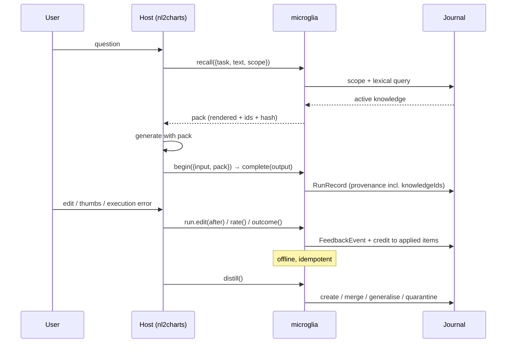

# Microglia — Product Whitepaper

**A headless feedback flywheel for agentic workflows**

Version 1.0 · 2026-10-20 · Author: Lambertyan · Status: decision document, pending approval

---

## 0. Document contract

This document answers four questions.

1. Is "turn HITL feedback into reusable agent knowledge" a valuable direction? — §3, §4
2. Who leads the field, academically and commercially, and what do they measure? — §5
3. Is a headless npm library the right product shape, with nl2charts as the reference host? — §6, §7
4. What is the path to state of the art, and how would we know we got there? — §10

It does **not** claim a benchmark result. Every performance number in this document is either
(a) quoted from a cited source, (b) produced by the POC in `packages/`, or (c) explicitly labelled
as a target. The POC is a **controlled mechanism study**, not a leaderboard entry;
`TECH-DESIGN.md` §12.6 states its limitations in the same font as its results.

**Evidence standard.** A claim without a citation or a reproducible command is marked
`[ASSUMPTION]`. There are two such marks in this document, both forecasts rather than findings (§4,
§10.4). Every other number is cited or produced by the POC.

---

## 1. Summary

**The direction holds; the unit does not.** Feedback-to-knowledge is a real lever, and the evidence for
it is industrial as well as academic. But eleven measured arms on a public benchmark say the same thing
from eleven angles: **a lesson distilled from one correction carries information about that correction
and about nothing else.** The product that survives that finding is not a memory middleware that
prepends lessons, and section 3 is the measurement that says so rather than the argument.

### 1.1 What is established, with the number

| Finding | Evidence | Size |
|---|---|---|
| Generic chart knowledge needs no memory layer | DeepSeek without a pack already answers 90.48% | a pack moved it −2.38pp to 0.00pp |
| Organisational convention is where the value is | gold disagrees with the model's prior, no pack 0.00% | **+75.0 to +89.3pp** with a pack |
| The pipeline can learn from a correction at all | synthetic POC, 560 train / 280 held out, 4 schemas, 6 systematic defect classes | 31.79% → 100.00%, McNemar p < 0.0001 |
| Scope widening is what makes it generalise | held-out `ops` domain that never gave feedback | **100.00% with widening, 32.86% without** |
| The trust ceiling is load-bearing | poisoned arm with the ceiling removed | 100.00% → 85.71% |
| Cost is not the obstacle | 1k / 5k / 10k knowledge items, CPU | p95 **1.9–4.4ms**, heap **+14MB**, no GPU, no server |

Those five rows are why the project exists, and none of them has been retracted.

### 1.2 What R2–R6 overturned

On BIRD Mini-Dev, under a pre-registered protocol with a noise-floor control on every dispatch, every
arm that changes what the prompt contains came back at or below zero:

| Arm | Position | Δ vs no memory |
|---|---|---|
| lexical schema linking (pruned DDL) | input | −8.00pp |
| rule pack (`full`), pooled over two dispatches | input | −2.29pp (p = 0.052) |
| `full-verified` — only rules that reproduce their own correction | input | +0.71pp (p = 0.42) |
| value samples in the DDL | input | +0.29pp |
| model selection over five draws | output | −2.43pp |
| execution selection over five draws | output | −1.14pp |
| **oracle over five draws** | **ceiling** | **+3.52pp** |

The one positive number is a ceiling, and it sits on the output side. The gap between the ceiling and
the best real selector — 4.66pp — is the entire opportunity this project has measured, and it is a
verifier problem.

### 1.3 The measurement that ends the ambiguity

R6 pointed every admitted rule at four foreign questions and recorded both what it repaired and what it
broke. A rule repairs **22.6%** of the questions a bare retry could not fix — on its own question — and
**29 repaired against 29 broken** on questions it was not distilled from. Net marginal effect:
**+0.00pp** on 892 trials, against **+20.53pp** on 638 own-case trials.

A rule and its case are one object. Moving that object from the prompt prefix to a scorer changes where
a zero sits, not what it is worth. Section 3.6.1 states this with the full 2×2.

### 1.4 Product constraint, restated

- **CPU or browser WebGPU only.** No GPU training, no local fine-tuning, no served inference.
- **A library, not a platform.** Integration is a handful of lines; there is no UI, no service, no
  tenancy.
- **The store holds execution-grounded evidence**, not prose lessons: `(schema, execution signature,
  outcome)` is the object that survives being read by a question it was not built from.

### 1.5 What is next, and what would stop it

R7 is ordered so the pool is described before any scorer is built: instrument the candidates (R7.0,
done), widen the pool with heterogeneous generators and measure whether the ceiling moves (R7.1), price
each execution signal alone (R7.2a), then build the deterministic verifier (R7.2b). If the ceiling does
not move at least 2pp in R7.1, candidate diversity is not the constraint and R7.2 becomes the whole
stage with a 3.52pp ceiling as its maximum prize. If the verifier's yield is at the floor, the stage
ends and the programme reports two closed axes rather than a third mechanism.

The kill criteria are in `ROADMAP.md` §R7, written before the dispatches they govern.

---


## 2. The problem: a loop that is captured but not closed

Every agentic product generates feedback. Almost none of it becomes capability.

| Signal | Where it is produced | Where it usually ends |
|---|---|---|
| Thumbs up/down + reason | Chat or result panel | Analytics dashboard |
| User edit of the output | Inline editor | Overwritten in the host's database |
| Execution failure (SQL error, invalid chart) | Runtime | Logs, retried once, forgotten |
| Clarifying question and answer | Conversation | Transcript, never indexed |
| Abandonment / re-prompt | UI telemetry | Funnel metric |

Four failures follow, and they are independent:

1. **Capture is lossy.** The post-edit value is stored; the pre-edit value, the prompt version, the retrieved context, and the model are not. Without the pair there is no comparison, and without provenance the comparison cannot be attributed.
2. **Feedback has no semantics.** A JSON diff says `mark: "bar" → "line"`. The reusable lesson is "for a trend question, prefer line". Only a domain pack can tell the difference.
3. **Memory has no governance.** A vector store will happily return a rule derived from one angry click, forever, to every user. It has no notion of evidence weight, contradiction, expiry, or poisoning.
4. **Measurement is detached.** Eval platforms can tell you the quality dropped last Tuesday. They cannot change the answer the user is about to see.

The academic response has been to build a bespoke loop per paper. The industrial response has been to build a platform per company. Neither produces a component a host can embed.

### 2.1 The evidence that closing the loop pays

| Study | What was fed back | Measured effect |
|---|---|---|
| Agent-in-the-Loop, Airbnb ([Zhao et al., EMNLP 2025 Industry](https://aclanthology.org/2025.emnlp-industry.135/)) | Pairwise preference, adoption + rationale, knowledge relevance, missing knowledge | recall@75 **+11.7%**, precision@8 **+14.8%**, helpfulness **+8.4%**, adoption **+4.5%** |
| Adaptive Data Flywheel, NVIDIA ([Shukla et al., EACL 2026 Industry](https://aclanthology.org/2026.eacl-industry.33)) | 495 negative samples over 3 months | Routing **96%** with an 8B model (10× smaller, −70% latency); query rephrasal **+3.7%** |
| ACE ([Zhang et al., ICLR 2026](https://arxiv.org/abs/2510.04618)) | Execution feedback, no labels | **+10.6%** agents, **+8.6%** finance; adaptation latency **−86.9%** |
| ReasoningBank ([Ouyang et al., ICLR 2026](https://arxiv.org/abs/2509.25140)) | Self-judged success and failure trajectories | WebArena **+8.3%** success; **+34.2%** relative with MaTTS (k=5); SWE-Bench-Verified 30.8→34.6 |
| ExpeL ([Zhao et al., AAAI 2024](https://arxiv.org/abs/2308.10144)) | Cross-task successes and failures | HotpotQA **28%→39%**, ALFWorld **40%→59%**, cross-domain transfer 63%→70% |
| Agent Workflow Memory ([Wang et al., 2024](https://arxiv.org/abs/2409.07429)) | Successful trajectories → reusable workflows | WebArena **+51.1%** relative, Mind2Web **+24.6%** |

These are different tasks, models, and harnesses. The **common mechanism** is the claim worth
productising: a compact, retrievable representation of past corrections improves future task success
without touching weights. The differences are exactly why a reusable component is needed instead of
another bespoke pipeline.

### 2.2 The counter-evidence, which is just as important

- **Naive rewriting destroys knowledge.** ACE documents a context that held ~18k tokens at 66.7%
  accuracy being "summarised" to 122 tokens and dropping to 57.1% — worse than no adaptation. Any
  product that lets an LLM rewrite its own memory will eventually do this.
- **Memory benchmarks are contested.** LoCoMo headline numbers are self-reported and disputed:
  Mem0 claims 92.5 while an independent harness reports 66.9; Zep corrected its own 84% to 58.44%
  before restating ~75.14 ([vendor summary of the dispute](https://mem0.ai/blog/ai-memory-benchmarks-in-2026),
  [independent reproduction](https://genalphai.com/is-agent-memory-the-wrong-abstraction-the-2026-evidence)).
  A full-context baseline at ~73% can beat a memory system on a 16–26k-token conversation
  ([audit](https://dreaming.press/posts/how-to-read-an-agent-memory-benchmark)).
- **Text-to-SQL benchmarks contain pervasive annotation errors.** A VLDB 2026 study reports 52.8%
  error rate on BIRD Mini-Dev and 62.8% on Spider 2.0-Snow, with re-evaluation moving 16 agents by
  −7% to +31% relative and reordering the leaderboard by up to 9 places
  ([Jin et al., 2026](https://arxiv.org/abs/2601.08778)).
- **Judges are biased and only ~70–80% human-agreeing.** Position, verbosity, style, and
  self-preference effects are systematic; order-swapped double scoring plus length control is the
  minimum defensible protocol ([cross-benchmark synthesis](http://spectrumofresearch.com/index.php/sr/article/view/53)).

A product in this space that does not encode these lessons will produce confident, wrong uplift.

---

## 3. Is the direction valuable? — the verdict

**Yes for the four mechanisms below, and no for the form this project spent eleven iterations building.**

Read 3.1 with 3.5 in hand: the mechanisms are where the value is, and the *prompt prefix* is not a
delivery route for any of them on a one-shot benchmark — every arm that put knowledge in front of the
question measured at or below zero, and §3.6.1 shows why. The direction survives; the substrate did not.

### 3.1 Where the value comes from (four distinct mechanisms)

| Mechanism | Input | Output | Who captures it | Time to value |
|---|---|---|---|---|
| **M1 Constraint learning** | Structured edit | Declarative rule, scoped | Prompt-time retrieval | Same session |
| **M2 Exemplar learning** | Edit or accepted pair | Input→output example | Few-shot block | Same session |
| **M3 Preference data** | Rating / edit pair | SFT / DPO / KTO rows | Post-training | Weeks |
| **M4 Evaluation set** | Any feedback | Regression cases | CI gate | Days |

M1 and M2 need no training, no GPU, and no data volume. M3 needs volume and a training path. M4 is
the cheapest and most under-used: every correction is a test the system did not have. A product that
only promises M3 will look slow; one that ships M1/M2/M4 first delivers value on day one.

### 3.2 Why now

1. **Interaction is the new bottleneck.** BIRD-Interact reports GPT-5 solving 8.67% of
   c-Interact and 17.00% of a-Interact tasks on the full suite, with the best systems around 24%/18%
   on Lite ([benchmark site](http://bird-interact.github.io/), [ICLR 2026](https://mlanthology.org/iclr/2026/huo2026iclr-birdinteract)).
   Single-shot accuracy is no longer where the headroom is; clarification and correction are.
2. **Architecture beats model size.** Holding the reader fixed, the spread across memory systems on
   LongMemEval is ~37pp; swapping readers is worth ~7.8pp
   ([cortex's own correction](https://github.com/AgentiX-E/cortex/blob/master/SOTA-BASELINE.md)).
   Structure is the lever a library can sell.
3. **The platform route is being absorbed.** Humanloop's team joined Anthropic in August 2025 and
   the standalone platform shut down on 8 September 2025; the reported structure was an acqui-hire
   that excluded the platform IP ([announcement](https://humanloop.com),
   [deal summary](https://seedtable.com/exits/humanloop)). A library that lives inside the host is
   not exposed to that consolidation.

### 3.3 Where the value does *not* come from

- **Not from volume alone.** 10,000 thumbs-down without reasons produce one usable signal: "something
  is wrong". The POC's unguarded arm shows that unvetted edits can *reduce* accuracy by 14.3pp.
- **Not from a better embedding model.** Retrieval quality matters, but scope correctness matters
  more: in the POC, the same knowledge scored 32.86% or 100.00% depending only on whether the scope
  generalised.
- **Not from personalisation at large.** One global store cannot satisfy contradictory per-user
  preferences; that requires per-user namespaces, which multiplies the cold-start problem.

### 3.4 Kill criteria (declared before the work)

The project stops, rather than pivots, if any of these holds after S1 (§10):

| # | Condition | Measurement |
|---|---|---|
| K1 | Correction reuse lift < 3pp on two independent tasks | Paired McNemar on held-out questions, p<0.05 |
| K2 | Fewer than 2% of production runs receive any correction | Host telemetry over 30 days |
| K3 | Any untrusted knowledge becomes active in red-team | Poison arm gate = 0 |
| K4 | p95 added latency > 50ms or > 400 tokens per call | Production histogram |
| K5 | Judges cannot reach κ ≥ 0.7 against 200 human labels | Calibration study |

---

### 3.5 The lever is not on the input side

Nine arms have now been measured on BIRD Mini-Dev under one protocol — same model, same folds, same
scorer, paired bootstrap over 10,000 resamples, and a `none-replica` control that measures the noise
floor of an identical prompt. Five of them act on the **input** (what the prompt contains). Four act
on the **output** (which of several answers is kept).

| Iteration | Arm | Acts on | Δ vs no memory | n | gained / lost |
|---|---|---|---|---|---|
| 94 | lexical schema linking (pruned DDL) | input | **−8.00pp** | 350 | 31 / 59 |
| 96 | rule pack (`full`) | input | −2.86pp | 350 | 11 / 21 |
| 96 | `full-shuffled` (same size, wrong donors) | input | −1.71pp | 350 | 14 / 20 |
| 96 | `full-verified` (only rules that replay their own case) | input | −0.57pp | 350 | 5 / 7 |
| 95 | value samples in the DDL | input | +0.29pp | 350 | 12 / 11 |
| 93 | model selection over five draws | output | −2.43pp | 350 | — |
| 93 | first draw (control for resampling) | output | −2.28pp | 350 | — |
| 93 | agreement selection | output | −1.43pp | 350 | — |
| 94 | execution selection | output | −1.14pp | 350 | 13 / 10 |
| 93 | **oracle over five draws** | **ceiling** | **+3.52pp** | 350 | — |

Two readings, and only one of them is a complaint about implementation.

**Every input-side arm is at or below zero, including the one whose content was verified good.**
`full-verified` injects only rules that demonstrably reproduce the correction they were derived from
— 1.11 such rules per question, 139 questions — and gains zero questions while losing two. That is
not a null about a treatment; it is a null about the *content* of the treatment, measured on the
subset where the content was known to be good.

**The only positive number in the table is a ceiling, and it lives on the output side.** Oracle
selection over five homogeneous draws is worth +3.52pp: on 350 questions, the best of five draws is
3.5pp better than one draw. The best *real* selector captures −1.14pp of it. The gap between the
ceiling and the selector — 4.66pp — is the entire opportunity this project has measured, and it is a
verifier problem, not a memory problem.

### 3.6 Which flywheel can actually turn here

Three loops are called "data flywheels" in the industry, and they turn on different things. Naming
which one a product is building is the difference between a roadmap and a metaphor.

| Flywheel | What turns | Signal it needs | Available in this setting | Verdict |
|---|---|---|---|---|
| **Parameter** (RLHF, DPO, o-series RL) | model weights | dense, trustworthy outcome signal | No: the generator is a closed API. Available only as LoRA on open weights, with a training path and volume | Out of scope until M3 has volume |
| **Verifier / reranker** (Cursor's accept-rate loop, CHASE-SQL's selection agent) | the scorer, not the generator | two outcomes that can be compared | **Yes.** SQL is executable: the environment scores candidates for free | **The only flywheel that can turn here** |
| **Context** (Mem0, Zep, MemGPT, ACE, ReasoningBank) | retrieved text | repeated tasks + information not derivable from the environment | Partial: needs repetition. One-shot benchmarks and novel schemas have none | Does not turn on this workload |

The distinction that matters: a **parameter** flywheel compounds because the artefact of each turn is
a better model. A **context** flywheel does not compound, because the artefact is text that the same
fixed model must re-read every time — and re-reading costs attention. That is why the input-side
column above is negative rather than merely flat: the cost is structural and paid on every call,
while the benefit is a probability that a rule written for another question applies to this one.
Measured, that probability is 22.9% even for the rule's *own* case (149 of 652 probed questions),
and R6 is measuring it for foreign cases.

**Why the residuals are not knowledge-shaped.** Of 350 questions the model gets 53.7% right from the
schema alone. In the 162 wrong answers analysed in iteration 95, masking every string literal on both
sides leaves the two queries different in **162 of 162** cases: the join, the aggregation or the
filter is also wrong. What remains is question-specific semantics — which column this workspace calls
revenue, whether this join needs a distinct, what this table's grain is — and that information does
not exist in a rule distilled from a different question. It exists in *this* schema, *this* data and
*this* question, which is exactly what a verifier can see and a prompt prefix cannot.

**What that makes the product.** Not a memory middleware that prepends lessons, but an
**execution-grounded verifier memory**: it stores the candidate queries a run produced together with
what executing them returned, and it acts after generation and before commit — re-ranking, refusing,
or asking. Its promise is falsifiable in one line:

```
pass@1 gain  =  selection yield  ×  oracle ceiling
```

where the ceiling is measured on the same candidate set and the yield is the share of it the verifier
captures. Today, on five homogeneous draws: ceiling +3.52pp, yield negative. CHASE-SQL reports the
comparable pair at 68.84% → 73.01% (+4.17pp) with **heterogeneous** candidates, which is the first
thing our candidate set lacks: five samples from one prompt are five versions of the same mistake.

### 3.6.1 The measurement that settles what the unit of memory is

The paragraph above was an inference from the shape of the residual errors. It is now a measurement, and
the measurement is sharper than the inference.

R6 pointed every rule that reproduced its own correction at four foreign questions from the same
database, judged each attempt against a bare retry on the same target, and recorded both halves of the
2×2 — what the rule repaired, and what it broke.

| | A bare retry fixed it | A bare retry did not | Marginal |
|---|---|---|---|
| **Rule shown a foreign question** | 39 kept / **29 broken** | **29 repaired** / 795 unchanged | **(29 − 29) / 892 = +0.00pp** |
| **Rule shown its own question** | 61 kept / 13 broken | 144 repaired / 420 unchanged | **(144 − 13) / 638 = +20.53pp** |

> A rule distilled from a corrected case carries **20.5 points of information about that case and 0.0
> about any other**. It is not weak knowledge. It is a case record whose content is the case.

Read with the break column, the two negative arm results stop being surprising and stop being about
implementation. `full` injects 1.86 of these per question and loses 2.29pp pooled over two dispatches;
each one is a coin flip on correctness that costs attention on every call. `full-verified` — the same
run, keeping only rules that demonstrably reproduce their own correction — recovers **+3.00pp against
`full`** (pooled, n = 700, p = 0.0075) and still lands at **+0.71pp against no memory at all**
(p = 0.42). The gate removes the harm and produces nothing, which is exactly what a good filter does
to a substrate with no signal in it.

This is where the project's own question — *are we remembering the wrong thing, or using it wrongly?* —
gets its answer, and the answer is neither of the two options it offered. **The unit is wrong, and no
position repairs a unit whose content is its own index.** A lesson and its case are one object; the
only thing that survives being moved to another question is a property of the *answer* rather than of
the question, which is what an execution signature is and what R7.2 measures.

### 3.6.2 What the store actually contained

Section 3.6.1 measures what a rule does when it is moved. This one measures what the store *is*, from
every attribution run the project has recorded, and the two agree while answering different questions.

Each arm's attribution artefact classifies every rule that reached a prompt by the sign of its net
effect — did it repair more answers than it broke, or the reverse — and carries one instance-weighted
number, the share of injections belonging to a net-harmful rule. `pnpm eval:store` adds the runs up
over the results directory including the archive: eight runs, 2026-10-23 to 10-26, each a 60-to-350
question cross-fitted slice of BIRD Mini-Dev.

| Quantity | Count | Share |
|---|---|---|
| Rules the distiller kept | 9,062 | — |
| Rules that reached a prompt at least once | 2,817 | **31.1%** of the store |
| … of those, net-repaired more than they broke | 110 | 3.90% of injected rules |
| … net-broke more than they repaired | 229 | 8.13% of injected rules |
| … flips cancelled exactly (a wash) | 2,478 | **87.97%** of injected rules |
| Net | **−119 rules** | exact sign test p = 9.5e-11 |

| Run | Rules | Reached a prompt | Repaired | Broke | A wash | Injections in a harmful rule |
|---|---|---|---|---|---|---|
| 10-23 11:27 (pilot, 60 q) | 124 | 74 | 5 | 11 | 58 | 16.7% |
| 10-23 16:26 | 1,296 | 439 | 25 | 40 | 374 | 10.7% |
| 10-23 17:18 | 1,280 | 442 | 17 | 42 | 383 | 11.4% |
| 10-23 23:15 | 1,295 | 423 | 13 | 38 | 372 | 12.3% |
| 10-24 01:45 (value oracle) | 1,149 | 233 | 8 | 0 | 225 | 0.0% |
| 10-24 15:12 | 1,312 | 396 | 16 | 27 | 353 | 8.7% |
| 10-25 02:19 | 1,319 | 407 | 12 | 31 | 364 | 8.9% |
| 10-26 07:42 | 1,287 | 403 | 14 | 40 | 349 | 12.8% |

Three facts, and each one constrains the fix:

1. **Most of what reaches a prompt does nothing.** 88% of injected rules have a net effect of exactly
   zero: the flips they caused cancelled, or — for a rule shown once — there were none. That is not a
   neutral outcome for a prefix. The tokens are paid on every call, and section 3.5 measured what the
   payment buys. A pack that is nine parts inert is a context tax with a 12% chance of a consequence,
   and the consequence is twice as likely to be bad.
2. **Harm is not noise, it is a ratio.** 110 net-helpful rules against 229 net-harmful ones, the same
   direction in seven of eight runs. The eighth is the S2b value-oracle pack — the convention-transfer
   stage, whose rules were conditioned on a measured value rather than on a reading of a question —
   which broke nothing while repairing 8. Two caveats keep that from being a conclusion: it is the
   smallest run here (n = 145 questions), and eight repairs with zero breaks in 233 injections is
   consistent with a break rate as high as 1.3% per injection. It is a lead, not a result.
3. **Retrieval is the other half of the problem, and it is untouched.** Only 31% of stored rules ever
   reached a prompt. Whatever the distiller knows, the injector shows a third of it, and nothing here
   can say whether the third it chose was the right third — that question needs a rule-level
   counterfactual this project has not run.

**Unit, stated because it was got wrong.** The classes above count *rules*, not injection instances:
`helpful + harmful + neutral` equals the injected-rule count exactly. The first version of this report
read them as instances and published "3.90% of injected instances repaired the answer". The digits were
right and the unit was wrong, and the same digits support a much weaker claim — which is why the field
names now carry the unit (`helpfulRules`, `injectedRules`) and a test asserts the names. The one
instance-weighted number available is the last column, and it is reported per run rather than averaged,
because the artefact does not carry the instance totals needed to weight the runs against each other.

The numbers above predate the R6 gate. They describe the store the gate was applied to, not the
current implementation.

### 3.6.3 What replaced the prefix: a verifier over the pool

Sections 3.6.1 and 3.6.2 close the prefix as a position for memory. A rule shown to a foreign question
nets +0.00pp and breaks 42.6% of the targets a bare retry had already fixed; the store it comes from is
88% inert and 2:1 harmful when it is not. Neither finding says memory is worthless — both say that *text
distilled from a case carries nothing about another case*, and that a mechanism which must help has to
act on something the case and the question share.

The thing they share is not text. It is the shape of the answer. Three systems converged on that
independently: XiYan-SQL groups candidates by execution result before ranking them, R³-SQL groups and
resamples, GradeSQL trains an outcome reward model on execution labels and beats execution-based
Best-of-N by up to +4.33 on BIRD. This project's own attempt at the *fourth* thing — asking a model to
compare two result sets — measured −1.14pp, and the difference is not the idea of using execution; it is
that a model comparing result sets has no ground to stand on while a shape comparison does.

So the mechanism was rebuilt as six deterministic signals over an execution signature, each measured
alone before any of them was allowed to rank anything. The order is the design: eleven earlier
iterations shipped a composite and measured the composite, and when it came out negative nothing in the
result said which part was wrong.

**The gate.** A signal enters the composite only if `AUC − 0.5 > 2 SE` after Holm correction, with the
bootstrap standard error floored at `sqrt(0.25/min(n₁,n₂))` because a pool whose pairs are all
concordant returns zero variance and a zero variance read as certainty would pass a signal measured on
four candidates. On 350 BIRD Mini-Dev questions and five draws, 122 of them offered any choice at all,
and five of six signals cleared it:

| Signal | AUC | SE | z | Holm | Verdict |
|---|---|---|---|---|---|
| `value-type` | 0.608 | 0.017 | 6.25 | <0.001 | **kept** |
| `column-shape` | 0.579 | 0.017 | 4.57 | <0.001 | **kept** |
| `empty` | 0.572 | 0.017 | 4.17 | <0.001 | **kept** |
| `row-shape` | 0.563 | 0.019 | 3.38 | 0.0011 | **kept** |
| `duplicate-share` | 0.542 | 0.017 | 2.46 | 0.0137 | **kept** |
| `null-share` | 0.521 | 0.017 | 1.23 | 0.109 | removed |

The AUCs in that table are reconstructed, not the run's own: the artefact did not carry the evidence
BIRD ships with each question, so a re-analysis reads every question against an empty evidence string
while the run read both. The run's own readings are `value-type` 0.6015, `column-shape` 0.5998,
`row-shape` 0.5749, `empty` 0.5653, `duplicate-share` 0.5418, `null-share` 0.5213 — the same five kept
and the same one removed. The field is now required, so the next artefact cannot repeat the omission.

**What the gate is worth.** The composite of the five, scored as an arm inside the cross-fitted run
rather than simulated on a recorded pool: **+1.14pp** over the first draw on the same five draws,
54.57% against 53.43%, 7 gained and 3 lost, exact McNemar p = 0.344, 95% CI **[−0.57, +2.86]**. In
sample, on the 117 questions where a draw choice existed, it is +3.42pp — and 3.42 × 117/350 is 1.14,
so the two agree exactly.

That interval is the whole result. The point estimate is smaller than the **±1.4pp** an identical
prompt moves when it is run twice on these questions, and it is a quarter of the width of its own
interval. An earlier reading of +7.38pp was the same composite fed a question shape computed without
BIRD's evidence; with the evidence the effect is a third as large. The mechanism is real in direction —
positive in three folds, zero in two, negative in none — and unresolvable at this sample size on this
pool. It is not the discovery it once looked like.

**What it is worth decomposing.** The same pool says the sum is carried by one member. `value-type`
alone reaches 39.3% of the composite's 40.2% and never breaks a question the first draw had right; the
other four add one question between them and `row-shape` costs one. On 122 questions, one or two
questions is inside the binomial spread, so the honest statement is that the remaining four are
unproven rather than worthless — and the reason they look like four opinions when they are closer to one
is that every signal penalises an empty result, not only the one called `empty`.

**What the store is doing while all this happens.** The per-rule ledger, read from three runs of the
same configuration, splits the injected store into a large silence and a small harmful tail: 17%–23% of
rules ever move an answer at all, and of those two thirds move it the wrong way. The −3.14pp is the sum
of that tail and that silence — the store is not (only) slightly harmful, it is **mostly inert**, and a
better ranker over an inert store has nothing to sort. A filter that could tell the two apart would have
to be fitted on the 45 discriminating rules a run produces, which is under half the evidence one
pre-registered split needs, so the constraint is observations per rule rather than model capacity. That
is what a workload with repeated rules would buy and what a 350-question benchmark cannot.

**And the pool is why none of it can pay.** The ceiling this composite could ever have captured is 25
questions of 350 — the draws disagree on 1.46 answers per question, and 235 of 350 questions collapse to
a single answer. Yield is 4 net questions of 25, **0.16** against the 0.33 the stage required. Three
different generation procedures do not widen it: four procedures over the same questions produce **1.56**
distinct answers and two of the three arms are *worse* than the direct prompt (`gen-plan` −5.43pp,
p = 0.004; `gen-decompose` −3.14pp). The ceiling rises to 8.57pp and a chooser still retrieves nothing
from it.

That is the trade this section is making, stated plainly: a mechanism that can only *reject* what it
recognises has a ceiling, and the composite has found it. `scoreOf` returns no positive number by
construction. The next signal has to be one that can prefer a shape, and the stored object that would
give it that ability — a `(schema, execution signature, outcome)` triple rather than a sentence about a
question — is the rewritten form of R7.3, folded into the verifier as a prior rather than shown to a
prompt as text.

### 3.6.4 Memory has four positions, and three of them are measured

Every arm in this project puts memory in one of four places. Three now have numbers, and the fourth has
a price:

| Position | What memory does there | Measured | Cost |
|---|---|---|---|
| **Prompt prefix** | states rules before the question | **−3.14pp** [−6.29, −0.29], p = 0.071, +10 / −21 | 1 call |
| **Retry injection** | states them only after a first answer fails | **+0.29pp** over a retry with an empty pack — nothing | 1 call |
| **Verifier feature** | ranks candidates by what it recalls | never measured: no selector here reads a rule | 0 calls |
| **Verifier prior** | *is* the ranker: on this shape, were we right before | **+0.57pp** [−0.86, +2.29], p = 0.73 — inside the replica's interval | 0 calls |

The first two are the same object in two positions, and moving it changed nothing: what looked like
memory's effect on retry was the retry. That is the measurement that says the problem is the object and
not its timing — a rule distilled from one question carries nothing about another, so a better moment
to show it cannot help.

The fourth is the only position where the object itself changes. `memory-prior.ts` prices it at its
strongest, assuming extraction and retrieval are already solved: no rule text, no relevance filter, no
embedding, only *on this shape, how often were we right* answered from the other folds. On the 79
questions where five draws produced more than one shape — the questions the model was guessing on, first
draw right 20.3%, best of five 40.5% — the shape key takes 3 net questions of a 16-question ceiling and
the database key takes 1. Keying on the database fragments the memory: 208 keys leave 38 questions with
any support, while 118 leave 53. **A memory that insists on the schema is a memory that has usually
never seen this schema**, which is the same failure the rule store has, one level down.

The run that decided it came back green: 350 questions, nine calls each, 0 failures, every gate passing.
`sample-5-prior-shape` scored **+0.57pp [−0.86, +2.29], p = 0.73** against the first draw, and the run's
own `none-replica` scored −0.57pp — the two intervals contain each other. The in-sample table on the same
pick agreed to the decimal: +2.78pp on 72 choice-bearing questions is two net flips, which is 0.57pp over
350. Criterion met? No. The stage is cancelled by the rule written down before the dispatch.

So the honest summary of the flywheel at this point in the programme: **memory has now been measured in
all four positions it can occupy, and none of them is worth anything on this benchmark.** As a prefix it
costs 4.57pp with p = 0.007 and 24 lost questions against 8 gained. On retry it is worth nothing once the
retry is controlled. As a selection feature its content never enters. As a prior over result shapes it is
inside the noise floor. What is left is not another position: it is a workload where a rule is exercised
more than a quarter of a time, which is a different experiment and was opened as R9 with its refutation
condition stated first. §3.6.5 runs it, and the answer is that most of what looked like the store being
silent was the store never being asked.

### 3.6.5 The store was not silent; it had never been asked

Every measurement up to here gave each rule about three chances. R9.1 builds a workload that gives each
rule twenty: fold 0's store, at most eight rules per database chosen by content hash, **one rule per
prompt** so a flip has exactly one candidate cause, and a panel of twenty questions from the rule's own
database shared by every rule in it. The control is the `none` arm's answer to the same question — same
prompt, empty pack, temperature 0 — so nothing is re-bought to obtain it and no sampling noise has to be
subtracted. Eighty rules over ten databases, 1,600 injections, and one foreign rule per panel as the
floor.

| Stratum | rules | injections | discriminating | flips | accuracy | Δ vs no memory |
|---|---|---|---|---|---|---|
| overall | 80 | 1,600 | **68.8%** | 7.1% | 52.0% → 50.2% | −1.81pp [−4.38, +0.69] |
| relevant | 53 | 679 | 50.9% | 7.4% | 49.9% → 47.0% | −2.95pp [−6.15, 0.00] |
| irrelevant | 70 | 921 | 52.9% | 6.8% | 53.5% → 52.6% | −0.98pp [−3.73, +1.73] |
| cued | 54 | 475 | 44.4% | 8.2% | 49.5% → 47.2% | −2.32pp [−6.24, +1.31] |
| **floor** (foreign rule) | 10 | 200 | 80.0% | **7.5%** | 52.0% → 50.5% | −1.50pp [−5.50, +2.50] |

**First: the inertness was the workload.** At three shows per rule, 23% of injected rules moved an answer
in one direction more than the other; at twenty, **68.8%** do. Eighteen of the 80 (22.5%) never move
anything at all and seven more move it both ways, so the inert share is **31.3%** against 77% before. The
roadmap's bar of 60% passes, and the prediction recorded before the dispatch — 35–55%, "R9.2 fails" — is
refuted. "Four fifths of the store never changes an answer" was a fact about how often the store was
asked, not about what it contains, and every filter designed against that number was designed against an
artefact.

**Second: the floor takes it back.** A rule from a *different* database, shown on the same twenty
questions — vocabulary the workspace does not have, about tables that are not there — flips **7.5%** of
its injections, discriminates on 8 of its 10 rules, and costs 1.50pp. The store flips 7.1%,
discriminates on 55 of its 80, and costs 1.81pp. So *movement* is a property of text arriving in the
pack block, at about one injection in fourteen, and a rule's presence perturbs the generator whether or
not the rule is about the question. The discriminating share is therefore not evidence of content
either: a family of rules that cannot apply reaches the same share within noise.

**Third: applicability is not merely uninformative, it is inverted.** On the 679 injections where the
rule's vocabulary is in the query that answers the question, the store is **−2.95pp** with an interval
that touches zero; where it is not, **−0.98pp**. The two overlap, and the strata share targets, so the
defensible statement is that they are indistinguishable — at minus three points. A rule that has
something to say about the question is not better than one that does not, and the instrument says why:
**49.1%** of the rules shown a question they can answer never moved it, against **31.3%** overall, so the
only filter that reads the corpus selects the *more* inert rules. That is the sharpest form the suspicion
that opened R9 has taken.

**Fourth: the effect is real, per-rule, and too small to find.** Four policies, all scored on the second
half of the panel, which no fit ever saw:

| Policy | shown | accuracy | Δ vs no memory | 95% CI | +/− |
|---|---|---|---|---|---|
| `always` — carry every rule | 800/800 | 49.38% | −3.62pp | [−7.88, +0.25] | +17 / −46 |
| `cued` — show when the question names its vocabulary | 224/800 | 50.88% | **−2.13pp** | [−4.25, −0.38] | +4 / −21 |
| `fitted` — show when the first half said it helped | 170/800 | 53.63% | +0.63pp | [−0.50, +2.25] | +8 / −3 |
| `oracle` — show when the second half says it helped | 130/800 | 54.75% | **+1.75pp** | [+0.38, +3.75] | +14 / −0 |

The ceiling is outside the noise floor: some rules repair answers and never break one, and the rules the
second half liked produced 14 repairs and no breakage. What does not exist is a *decision*. The only
policy a deployment can compute from the question alone is **significantly worse than showing nothing**
— the vocabulary cue selects rules that hurt. The per-rule fit does beat it, and it beats it because the
sign of a rule's effect is a stable property: of the 20 rules that had a sign on both halves of the
panel, **16 kept it (80%, p = 0.012)**; of the 17 rules the first half judged positive, 7 were positive
on the second half against 1 of the 19 it judged negative. The same test run backwards agrees: fitted on
the second half and scored on the first, the selected rules gain 12 and lose 4.

One caveat belongs with that number rather than after it. The first half of the panel recorded 25 repairs
and 25 breaks; the second half recorded 17 and 46. The per-rule sign survives that drift at p = 0.012,
the aggregate does not, so a single split cannot be treated as an unbiased estimate of a rule's effect —
which is why the next step is a repeated split rather than a larger fit.

So the whole of R9 is this: the store is worth about **+1.75pp** if the rules are chosen with hindsight,
**+0.63pp** if they are chosen by a fit on the same panel (interval through zero), and **−2.13pp** if
they are chosen by the only cue available before answering. A rule's effect is small — 42 repairs and 71
breaks across 80 rules and 1,600 injections — stable enough to predict with ten observations, and worth
less than the cost of predicting it. That is a different finding from "memory does not work": it says
memory works at a magnitude the selection problem eats. §3.6.6 prices that selection problem with a repeated
split and a control that cannot be passed by a schedule.

### 3.6.6 The fit is worth about a point, and the number of questions is what limits it

§3.6.5 priced the per-rule policy on one split of the panel, and the reason not to trust one split was in
the same artefact: the fit halves carried 25 repairs and 25 breaks, the scoring halves 17 and 46. The
cross-fit replaces that split — each rule's panel cut into five folds, the rule's sign fitted on the four
folds it is not being scored on, the whole cut repeated ten times — and the foreign rules are fitted by the
same machinery, which is the control a schedule cannot pass.

| Reading | shows | accuracy | Δ | 95% CI | +/− |
|---|---|---|---|---|---|
| cross-fit, the store | 4,884 / 16,000 | 51.5% → 52.83% | **+1.33pp** | **[−0.06, +2.83]** | +339 / −126 |
| cross-fit, foreign rules | 512 / 2,000 | 51.5% → 51.55% | +0.05pp | [−1.75, +1.85] | +21 / −20 |
| single split, as measured in §3.6.5 | 220 / 800 | 52.0% → 52.5% | +0.50pp | [−1.38, +2.25] | +11 / −7 |
| `cued`, the only cue a deployment has | 243 / 800 | 52.0% → 51.0% | −1.00pp | [−3.25, +1.12] | +11 / −19 |
| `oracle`, the ceiling | 180 / 800 | 52.0% → 55.3% | +3.25pp | [+1.00, +6.25] | +26 / −0 |

**The bar is missed by 0.0625pp, and that is the result.** The criterion written down before the run was an
interval excluding zero; the interval excludes zero by nothing on the wrong side. What the run does
establish is the thing the previous section could not: the foreign rules, fitted by exactly the same
procedure, earn **+0.05pp**. The schedule is worth nothing. The store is worth **1.28pp more than the
schedule**, and that difference is content.

**It does not depend on how the cut was made.** Recomputed from the trials the artefact now carries, at
twenty repeats, for no calls:

| Folds | store Δ | 95% CI | foreign Δ |
|---|---|---|---|
| 2 | +0.04pp | [−0.79, +0.79] | 0.00pp |
| 4 | +0.95pp | [−0.27, +2.17] | +0.27pp |
| 5 | +1.33pp | [−0.06, +2.83] | +0.15pp |
| 10 | +1.30pp | [−0.16, +2.85] | +0.65pp |
| 20 (leave-one-out) | +1.38pp | [−0.19, +3.00] | +0.50pp |

Every schedule that leaves a rule at least fifteen observations to be fitted on lands between +0.95 and
+1.38pp. Only two folds — ten observations per rule — collapses to nothing, which is the wall §3.6.5 opened
on: below a certain number of chances a rule cannot be classified at all. The floor never exceeds +0.65pp on
any of them. Two runs in a row now put the ceiling outside the
noise floor, the second with 26 repairs and no breaks.

**Why the interval stays wide is the more useful finding.** The cross-fit scores 16,000 injections, but they
are ten cuts of the same 1,600 trials drawn from 200 questions, and the bootstrap resamples questions.
Doubling the number of cuts moved the interval from [−0.06, +2.83] to [−0.06, +2.83]: the same two decimals.
**More repeats do not buy precision; more questions do.** Halving the interval takes four times the
clusters — 800 questions, not another pass over the same 350. So the bar in §3.6.5 is not one this family
can clear at the size BIRD Mini-Dev allows, which is a fact about the benchmark and not about the policy.

**What a rule's sign is worth.** 17 of 24 rules kept their sign across halves in this run (70.8%,
p = 0.064); §3.6.5 measured 16 of 20 (80.0%, p = 0.012). Pooled, 33 of 44 — **75.0%, p = 0.0013**. A rule's
direction is learnable, at a lower rate than any single run suggests, and the pooled number is the one to
quote.

The honest summary of the position: a rule the store carries is worth about **+1.3pp** on the questions of
its own database when it is chosen out of fold, its direction is stable three times in four, and the
programme's instrument cannot resolve that effect at 95% because 200 questions is not enough clusters. That
is not the earlier finding that memory does not work, and it is not yet the finding that it does. Two things
were left open and §3.6.7 closes both: whether the effect survives a second store (it does not — +1.33,
+0.41, +0.33), and whether it survives leaving the database (it does not — −2.27pp).

### 3.6.7 A rule is a lookup, and the schema is the edge of the page

R9.3 measured what a rule is worth in the database it came from and reported the reason to doubt it:
one split, two halves that were not exchangeable. R9.4 asked the question that decides whether any of
this is knowledge. Every one of the eighty rules was put on ten questions drawn from *other*
databases — 800 injections over eleven schemas, round-robin so no rule saw one foreign database
twice before it had seen them all — and the reading is stratified by the sign the rule had at home.

| Stratum, by home sign | rules | foreign Δ | 95% CI | repair | break |
|---|---|---|---|---|---|
| positive (it worked at home) | 22 | **−2.27pp** | [−7.86, +2.68] | 7/105 = 6.7% | 12/115 = 10.4% |
| zero | 23 | −1.74pp | [−5.98, +2.86] | 6/104 = 5.8% | 10/126 = 7.9% |
| negative (it hurt at home) | 35 | −2.29pp | [−5.49, +0.90] | 6/155 = 3.9% | 14/195 = 7.2% |
| **all** | 80 | **−2.12pp** | [−5.16, +1.02] | 19/364 = 5.2% | 36/436 = 8.3% |

**The rules that worked at home did not work away.** The twenty-two rules with a positive net on their
own twenty questions earn −2.27pp on foreign ones, and the interval is wide enough to contain a small
positive effect but its point estimate is on the wrong side of zero. Their home figure is +7.05pp and
it is not a fair comparison — the stratum was defined by that same measurement, so a rule selected for
having a positive net cannot have a negative one. The fair in-domain number is the cross-fit's
+0.33pp (§3.6.6's reading, three stores later), and the foreign number is −2.27pp. Both say the same
thing: nothing survives the boundary.

**The units do not transfer, and the way they fail is not damage.** R6 pointed a rule at a foreign
case *in its own database* and found 3.52% repairs against a 42.6% break rate — a unit that repairs
rarely and destroys easy questions often. Across schemas the same rules repair 6.7% of the questions
the control failed and break 10.4% of the ones it passed: the ratio inverts toward inertness. A rule
about `financial` shown a `formula_1` question is not a wrong instruction, it is a sentence about
tables that are not there, and the model ignores it. The negative stratum makes this explicit: rules
that cost 8.71pp at home cost 2.29pp abroad, because abroad they stop acting at all. **A global store
is not dangerous. It is pointless.**

**Giving a rule more chances does not make it a lesson.** R9.5 capped what the fit may look at — the
first 4, 6, 8, 10, 12, 16 and 20 observations of each rule — and scored the whole panel every time, so
the rows are paired over the same 16,000 injections:

| fit sees | Δ | 95% CI | shown |
|---|---|---|---|
| 4 | +0.00pp | [−0.29, +0.29] | 1,360 |
| 8 | +0.36pp | [−0.12, +0.87] | 2,108 |
| 12 | +0.22pp | [−0.47, +0.96] | 2,780 |
| 20 | +0.33pp | [−0.49, +1.18] | 3,804 |

There is no knee. Four observations and twenty are worth the same, and both are worth nothing. The
prediction recorded before the dispatch — four observations at or below zero, within 0.3pp of the full
panel by twelve, flat after — is confirmed in every clause, and the confirmation is the refutation of
the reason the family was built: the problem was never that rules were under-exercised.

**The +1.33pp of §3.6.6 was a high draw.** Three stores, same code, same panel size: **+1.33, +0.41,
+0.33** — mean **+0.69pp**, standard deviation **0.56**. The store is distilled from five samples at
temperature 0.7, so every run is a new draw of the rules, and the run-to-run spread is as large as the
effect. What is stable across the three is the ceiling: `oracle` earned +3.25pp [+1.00, +6.25] and
+2.25pp [+0.63, +4.38], both excluding zero, both with **zero breaks**. The rules that help are
findable and the measure of their worth is real; what does not exist is any way to identify them from
the question, and R9.4 now adds: or from another database.

**The refutation condition, which was written before any of this.** R9's stage section says: *if
R9.3's fitted policy beats the floor but R9.4's transfer does not, the finding is that memory is a
lookup and not a lesson — which is consistent with everything measured since R4 and would be the
honest end of the flywheel claim.* The fitted policy beat its content-free floor in both runs
(+1.33 vs +0.05, +0.33 vs −0.25) and the transfer is −2.27pp. The condition is triggered, on the
condition's own terms, with the numbers it asked for.

What that closes is not the project but a hypothesis. The unit the store holds is a **case**: it
repairs the question that produced it (own-case net, +20.53pp in R6), it is worth a fraction of a
point on its own database once selected by exercise, and it is worth nothing on any other database.
Four memory forms have now been measured in four positions, at three densities, with a content-free
control each time, and the answer has not moved: the flywheel does not turn because the thing it
stores cannot be carried.

### 3.6.8 The protocol is the deliverable, and it caught a comparison

Every number above was produced by a harness that only its authors could run. R8 makes the harness the
product, and writing down four rules turned up an error in this document's own comparison table.

**A generator somebody else wrote runs without editing our code.** `plugin.ts` defines one request
(question, evidence, schema) and one reply (SQL), loads the module by path, and refuses one that
resolves inside `packages/eval` — provenance is checked, not asserted. The acceptance case is a
2019-vintage keyword router, outside the package, that scores **2 of 6** on a six-question fixture
because it drops filters and over-projects; the number was written into
`prereg/R8.1-offline-fixture.md` before the run and matched exactly.

**A report cannot drift from its artefact.** `schema/run-artifact.schema.json` publishes the shape, and
`artifact-schema.ts` validates the arithmetic as well as the shape — `accuracy` must be `correct / n`,
the per-database rows must sum to the totals. The report beside the artefact is rendered *from* it, and
`pnpm eval:protocol` compares the committed prose against the rendered text byte for byte. A sentence
that needed knowledge from outside the JSON would fail the build on the next run.

**A prediction exists before the run.** `prereg/<id>.md` carries a machine-readable header (arms,
sample, gates) and two prose sections that must exist: Prediction and Refutation. `pnpm eval:prereg`
refuses a placeholder, a missing section, or an id that disagrees with the filename, and the benchmark
workflow refuses a dispatch that names no file — before the first model call, because a gate that
fires at the end has already spent the budget.

**And the comparison was wrong.** §3.7 opens with our 53.43% against XiYan's 53.52% and calls them
"the same cell". They are not: theirs is BIRD **dev** (n = 1,534), ours is **Mini-Dev** (n = 350). The
gap is 0.03 of the smaller estimate's standard error — indistinguishable from nothing, which is what
agreement looks like and also what two coarse numbers look like. The published cell's own standard
error is **±1.27pp**, seven times the difference the prose was reading as a near-match.

`reproduction.ts` now holds the rule that would have caught it: a comparison may be called `reproduced`
only on the same split, and is otherwise `indicative`, with the difference judged against 1.96 standard
errors of each estimate added — **7.72pp** here. The verdict for our 53.71% against their 53.52% is
`indicative` at **+0.19pp**, it is archived in `eval/results/poc-cell-comparison.json`, and gate V31
re-derives it from the artefact so `indicative` cannot be edited into `reproduced`.

What survives is weaker and still worth having: our no-memory baseline is consistent with the published
baseline for the same model and schema form, so the distance to a 73–75% system is not plausibly an
artefact of a badly built harness. A genuine reproduction needs the dev split (1,534 questions); §3.6.9
records what happened when that sentence was tested instead of repeated.

### 3.6.9 The protocol tested its own claim, and the claim failed

§3.6.8 ends with a sentence that is worth reading as evidence rather than as a caveat: *"a genuine
reproduction needs the dev split (1,534 questions), which this environment cannot download"*. It is
false. The dataset is not on the host that was probed, and the probe's failure was generalised into a
property of the environment — which is precisely the error the protocol exists to prevent, committed
about a URL instead of about an accuracy.

**What the probe found in four requests.**

| Request | Answer |
|---|---|
| `curl -sI https://bird-bench.oss-cn-beijing.aliyuncs.com/dev.zip` | **200**, 346,207,293 bytes, last modified 2024-06-29 |
| `unzip` and count | `dev_20240627/dev.json`: **1,534** questions, 11 databases, 925 `simple` / 464 `moderate` / 145 `challenging` |
| `sha256sum` | `cdd6d19f…a60cf5a630` — pinned in `eval/manifests/bird-dev.json` |
| load through the lane | `data ok` for all eleven databases, counted before the first model call |

Hugging Face is unreachable from the build environment; the vendor's CDN is not, and the manifest had
named the CDN all along. One host was tested, the class was reported.

**Why that is the same failure the protocol names.** §3.6.8's own rule is that a comparison may be
called a reproduction only when it was measured on the same split as the published number, because a
difference between estimates on different samples is sampling error. The reachability claim is that
rule one level up: a probe of one object, reported as a property of the class, with no interval and no
second observation. It survived four weeks because it made a stage look closed instead of open.

**What changed, and why the change is small.** A split became a parameter rather than a constant.
The manifest answers which question file the archive carries (`questions`), so a second split is a
second manifest and not a second branch in the loader. `poolOf(rows, split)` owns the one genuinely
split-dependent decision: dropping `simple` questions is a measurement choice on the 350-question
transfer slice and a protocol violation on dev, where it would leave 609 and stop being the cell. A
`dev` run writes `poc-sota-bird-dev.json`, and the cell table gains a second row rather than
overwriting the first — because a row is only honest while the artefact behind it is in the
repository to be recomputed.

**What it will say when it lands.** `none` on 1,534 questions, an interval near ±2.5pp instead of
±5.2pp, and a verdict of `reproduced` if the difference from 53.52 falls inside 1.96 standard errors
of each estimate added. The prediction and its refutation are in `prereg/R8.3b-dev-split.md`,
written before the dispatch. If the number falls outside the band, the honest consequence is not a
weaker claim but a withdrawal: our harness would not be measuring what the published cell measures,
and every cross-paper comparison in this document goes with it.

### 3.6.10 The rule was not wrong; it was unaddressed

§3.6.7 read R9.4 as "a rule is a lookup and the schema is the edge of the page". The reading is
right about the numbers and wrong about the diagnosis, and the difference decides whether this
project has a memory layer or a per-database prompt.

**What the foreign arm actually saw.** On the rules that had worked at home, shown a question from a
database they were not learned in: **repair 6.7%, break 10.4%**. On the same rules shown a foreign
case from their **own** database: repair 3.52%, **break 42.6%**. A rule that is obeyed and wrong
leaves one fingerprint; a rule that is ignored leaves another. The second column is obedience — the
rule was read, applied, and moved a right answer to a wrong one on 42.6% of the cases it could have
harmed. The first column is not a weak effect, it is **no effect**: the sentence arrived, and there
was nothing in the target database for it to be about. "`price` is stored as text, cast before
comparing" is not advice in a schema that calls the column `unit_price`; it is a string.

That distinction has a consequence the earlier reading did not: if the rule is ignored rather than
harmful, then the memory's **content** may be sound and its **use** may be wrong — and the two
hypotheses make different predictions about the same store.

**The construction.** Two published systems isolate the part of a demonstration that crosses a domain
boundary. ODIS (arXiv 2310.06302) finds it is the **SQL distribution** and not the question
distribution (+1.1 and +11.8 on two cross-domain benchmarks). SQL-Exchange (arXiv 2508.07087, PVLDB
2026) maps a query into a target schema by keeping its **structure** and substituting only its
domain-specific elements, and its mapped demonstrations beat raw source-schema ones across model
families. R10 does the same to a rule: it is read as a template whose slots are its identifiers that
the **home** schema has, and before it is shown the slots are filled from the schema it is about to
meet.

```
stored     Cast price to real when price is text
template   Cast {price} to real when {price} is text
shown      Cast unit_price to real when unit_price is text
```

Binding is a name operation, not a semantic one: the score is the Jaccard overlap of the two names'
`snake_case` parts, identity scores 1, `price` → `unit_price` scores 0.5, nothing below 0.5 is
accepted, ties go to the shorter name, and one candidate never fills two slots. No stemming and no
edit distance, because both would raise the binding rate by inventing referents — `price` → `prize`
is a rule about prize money. A template with a slot that cannot bind is **withheld**: it makes no
call, contributes no trial, and is counted.

**Why the derivation happens at use time.** Changing what the distiller emits would move every
artefact in this project at once and leave the two arms incomparable on anything but the template.
Reading the stored statement structurally when it is shown makes the arms differ in one field of one
rendered line — the id, kind, confidence, scope and budget of the item are untouched — which is the
only form in which "does the form matter" is a question with one answer.

**What it will be read against.** The pre-registration is `prereg/R10-template-transfer.md`, written
before the dispatch, and it is falsifiable in three ways rather than one: repair above 6.7%, break
below 10.4%, and a repair-minus-break pair that improves even when the accuracy delta stays inside
its interval. If the break rate does not fall under 8%, the structural hypothesis is wrong for this
class of rule, the memory layer is documented as an **in-database prompt**, and no transfer claim
appears anywhere in this project again. That sentence is the point of running it: a construction
whose failure mode is written down in advance is a construction, not a preference.

**It was read against a cheaper number first, and it did not survive.** The same file fixes a kill
condition: *if more than 60% of the family is withheld as unbindable, the measurement is about the
binder and no verdict is issued.* Withholding is a property of schemas, and schemas are on disk, so
the condition was measured for zero model calls — `pnpm eval:template` over the committed artefact's
store and the eleven BIRD databases:

| Reading | Value |
|---|---|
| rules in the store | 289 (1,288 entries; the five folds repeat a rule once each) |
| with a home database / homeless | 259 / 30 |
| bound in at least one foreign database | **10 — 3.9%** |
| slotless: no schema identifier to bind | 76 — 29.3% |
| withheld | **173 — 66.8%** |

The blockers are the diagnosis: table `posts` (103 attempts), `cards` (91), `drivers` (86), column
`lap` (80), `patient` (70), `player` (57). Those are **domain elements** — the words that make a rule
about one database — and SQL-Exchange substitutes them by mapping to the *target query*, which name
comparison cannot do. Arm B was therefore not dispatched. The hypothesis that a rule travels as
structure is **untested**; what is now measured is that name identity is not the substitution that
carries it, and the successor construction must bind a slot to the target's own schema links rather
than to a similarly spelled name.

### 3.6.11 The instrument was the bottleneck, and it was hiding

The dev split's fourth dispatch finished three of five folds and was killed at its step timeout. Its
log separates two facts that had been one:

| Fold | Evaluation (614 replies) | Learning + distillation |
|---|---|---|
| 1 | 2m07s | 3m47s |
| 2 | 1m45s | **43m02s** |
| 3 | 2m00s | nothing for 107 minutes, then killed |

The evaluation half is the control. Same endpoint, same hour, short replies, 614 of them in under two
minutes at width eight. The learning half asks a different question of the same endpoint — a 2,000-token
distillation — and the client waited **a constant sixty seconds per attempt** whatever the reply was
allowed to contain, four times.

So the dispatch was not slow and not hung. The client was aborting requests that were about to arrive,
retrying them, aborting them again, and then recording the prompt as one the model could not answer.
24 corrections × ~2.5 attempts × 60 s is 43 minutes: the second row of the table is the policy,
computed.

**Why it took four dispatches to see.** The artefact could not tell "the model had nothing to say"
from "the client hung up" — a failed generation was cached as an empty string, and a failed
distillation incremented a counter whose only appearance was in a fold summary that said a number.
There was also no progress line in the learning half, so 107 minutes of retrying was indistinguishable
from a wedged process. Both are the same defect this project keeps finding in different clothes: a
quantity that is *observed* was not being *counted*, so a run could fail without saying how.

**Three repairs, and one new gate.**

- The attempt timeout is now a function of the reply allowance (`25s + 140ms/token`, capped at 300s),
  and a timeout is retried once rather than three times: repeating a request the client itself killed
  buys the same slowness and no evidence. `timeouts` and `retries` are counted separately, because a
  high retry count with no timeouts is a provider throttling you and the reverse is a client asking
  for too much.
- The run holds its own deadline (`MG_E_DEADLINE`, checked before every attempt) below the runner's
  step timeout, and writes the folds it finished when it reaches it. A step timeout is not a deadline:
  it kills the process and takes three measured folds with it.
- Distillation pays its batch concurrently and applies it in order. A prompt depends only on its own
  event; a claim's effect depends on what is already in the store. Splitting those two facts is what
  makes a fold's learning half a few minutes instead of tens.
- `V32-fold-learning-intact` fails a run in which more than 10% of the learning questions went
  unanswered or more than 10% of the corrections failed to distil. It was declared before the dispatch,
  because a gate written after a result is a preference.

**The general lesson, which is about memory rather than about timeouts.** A store distilled from part
of its corrections is a *different treatment*, not a noisier one — and until this iteration nothing in
the artefact distinguished the two. The same was true of the binding census in §3.6.10 and of the
replayed cell in §3.6.9: each time, the measurement was sound and the *bookkeeping about the
measurement* was missing, so the number looked like a finding about the mechanism.

### 3.6.12 The successor was refused too, and the wall was the column

The construction §3.6.10 named — bind a slot to the tables the target **question** links, not to a
similar spelling — was built and measured against the same offline census: 289 rules, 350 scored
questions, 82,137 binding attempts, zero model calls.

| Reading | Bind by name (R10) | Bind by question (R11) |
|---|---|---|
| rules bound in at least one foreign place | 10 — 3.9% | **57 — 22.0%** |
| rules withheld | 173 — 66.8% | **126 — 48.6%** |
| attempts withheld | 1,796 / 2,590 — 69.3% | **51,159 / 82,137 — 62.3%** |

The link is worth four and a half times as many bound rules and takes the rule-level withhold from two
thirds to under a half. It does not clear the bar its own file fixed (60% of attempts, with the
prediction under 20%), so no arm was dispatched and no verdict was issued — the second construction
refused for the price of a directory listing rather than 2,600 calls.

**What the reasons say, which is the finding.** Every refusal now records which test it failed:

| Reason | Attempts | Share of the withheld |
|---|---|---|
| the target has no column by that name, in the table the rule reached | 30,692 | **60.0%** |
| the question named no table the slot could take | 12,114 | 23.7% |
| two anchors of equal length; withheld rather than guessed | 7,541 | 14.7% |
| the name is there and the column holds another kind of thing | 812 | **1.6%** |

Type agreement — the check that a rule about a TEXT `price` does not apply to a REAL one — is not what
refuses this: it stops 1.6% of the withheld. **The wall is vocabulary.** Three in five refusals are a
column the target database does not have at all, and no reading of a question invents one, because a
question names tables and a rule is *about* a column.

That is why two unrelated constructions fail the same way, and it is the sharpest statement this
project has of its own mechanism's boundary: **a rule's value is bounded by its own database.** R9
measured it as +1.33pp at home and −2.27pp across a boundary; R10 as 66.8% no referent; R11 as 62.3%,
of which 60.0% is a missing column. The transfer question is closed, and the product statement is the
one the user guide now carries: the pack is an **in-database prompt**.

### 3.6.13 The store was asked to prove itself, and two thirds could not

Every measurement in §3.6 asks the same question — does a pack made from other questions improve this
question — and every one of them assumes the stored rules are worth injecting. §3.6.13 reports the
first measurement of that assumption. Each *corrected* learning question is re-asked twice: once with
a blank retry (the failure statement, no rules) and once with the rules that correction produced. The
two answers give one of four verdicts, and only one of them shows the extraction doing work.

| | retry alone right | retry alone wrong |
|---|---|---|
| **with the rules right** | `redundant` — a second attempt was enough | `supplied` — the rules did the work |
| **with the rules wrong** | `broke` — the rules destroyed a case that needed no help | `useless` — neither attempt reached the correction |

One dispatch, BIRD Mini-Dev, cross-fitted at k=5, 350 scored questions, **1,445 model calls** — of
which 312 bought the probe itself:

| Reading | Value |
|---|---|
| corrected cases probed | 156, all measured, none unanswered |
| `supplied` | **19 — 12.2%** |
| `redundant` | 31 — 19.9% |
| `broke` | **3 — 1.9%** |
| `useless` | **103 — 66.0%** |
| blank-retry repair rate (the free ceiling) | 21.8% |
| rules admitted by the gate | **38 of 296 — 12.8%**, with 6 excluded for breaking their own case |

**Two of the four predictions written before the run failed, and that is the result.** We predicted
`supplied` ≥ 20% and `kept` ≥ 25%; we measured 12.2% and 12.8%. We predicted `broke` ≤ 15% and a
blank-retry rate between 20% and 60% — 1.9% and 21.8% both held. The extraction is *not* the
catastrophe the failed predictions might suggest — it does produce, in one case in eight, a rule that
carries enough to repair the very case it came from — but two corrections in three cannot be reached
even when the model is shown its own failure **and** the rules distilled from it.

**The admitted store is inert, which is the second half of the finding.** With only the 38 survivors,
the pack still changed 342 of 350 prompts and moved execution accuracy from 54.00% to **54.00%** —
`0.00pp`, p = 1.00, at 0.39 rules per question. The 130 questions that actually received a rule scored
56 against the baseline's 57 (−0.77pp, n = 130); the 220 that received none differed by one question
in the other direction, on **identical prompts**, which is the sampling noise a temperature-0.7 client
buys when it pairs arms by question rather than by seed.

So the mechanism's deficit is not retrieval, not injection timing, not budget, and not the
cross-database question that §3.6.10–3.6.12 closed. It is the **extraction**: a single correction,
read by a model into a sentence, is usually not enough to reproduce itself, and what does survive is
too weak to move a different question. The next stage is not another variant of the arms; it is the
one measurement this design makes possible and has not yet taken — whether an admitted rule repairs a
*different* question in the *same* database, which is the only form of transfer this project still
claims.

### 3.6.14 The rule travels, and it breaks as often as it repairs

The last claim the design still made and had never measured: does a rule that reproduced its own case
repair a **different** question in the **same** database? §3.6.13 established that a correction read
into a sentence usually cannot reproduce itself. This measures whether what does reproduce is
knowledge or a lookup table with one row.

Each admitted rule is pointed at up to eight other *corrected* questions from its own database — a
target that was never wrong has nothing to repair — and each pair costs one call, because whether a
bare retry repairs the target is a property of the target, measured once and reused by every rule
pointed at it. 523 pairs over 98 rules, inside a 2,679-call dispatch on the same 350-question split.

| Reading | Value |
|---|---|
| admitted rules pointed at foreign cases | 98 of 118 (20 had no home database) |
| trials | 523 — 0 unmeasured, 0 control holes |
| informative (a bare retry could not fix the target) | 467 — 89.3% |
| repaired | **34 — 7.3% of informative** |
| targets that needed nothing | 56 |
| broken by the rule | **28 — 50.0%** |
| net marginal effect over all trials | **+1.15pp — six trials of 523** |
| rules with at least one repair | 30 of 576 |
| what survives both gates | **10 items over 350 questions — 0.03 per question** |
| the `full-transferred` arm | 53.71% against 53.71% — **0.00pp**, p = 1.00 |

**The two numbers are the finding, and they have to be read together.** Among the questions that
genuinely needed help, a rule repaired one in fourteen. The rules are therefore *not* empty, which is
what the pessimistic reading of §3.6.13 predicted they would be. But among the questions that needed
nothing, the same rules destroyed half. The ratio that flatters — 7.3% — excludes by construction
every trial where a rule can do damage; the marginal net effect, which does not, is six trials out of
523 and is not resolvable. This is the asymmetry §3.6.8 measured in the aggregate (3.52% conditional
repair beside 42.6% breakage of targets that were already right), now measured at the level of one
rule and one question, and it is the mechanism of the negative memory effect this project set out to
explain: **a plausible rule about the neighbouring question is followed, and it is wrong.**

**One prediction failed in the informative direction.** We pre-registered "at most four admitted
rules repair anything"; thirty did. Whatever else is true, a rule distilled from one correction
generalises — rarely, and at a price. The other failed prediction was the rate itself: ≤6% predicted,
7.3% measured. Both failures point the same way, and neither is large enough to license a reward.

**The product consequence is arithmetic, and it is not encouraging.** At 0.42 admitted rules per
question and 5.34 trials per rule, the measured net is +0.0115 trials per trial, which works out at
≈ 0.026 questions per question — nine of 350. The arm that actually injects 0.42 rules per question
measured **+1.14pp** (four questions) against the same baseline in the same run: half the arithmetic
estimate, the same sign, and inside its own interval. A three-point cell would need two to four times
this store, and it would bring two to four times the break side with it — which is the argument for
changing the substrate rather than growing it, and it is now an argument from three measured numbers
instead of a preference.

**What the store proves, exactly.** The intersection of the two gates keeps thirty rules, and those
thirty put ten items into 350 prompts. Ten items is 0.03 rules per question: the arm is the baseline
under another name, and it scored the baseline's number to the digit. A filter that leaves nothing is
not a filter, and no claim in this document rests on `full-transferred`.

**One thing that moved without being asked to.** The own-case probe measured **19.9% `supplied`** on
296 corrected cases here, against 12.2% on 156 in §3.6.13 — the dispatch doubled `learn_sample` from
64 to 128 to give the transfer draw a pool worth sampling, so the correction population and the store
both changed at once. The change is recorded as a question, not as a finding: whether a denser store
really reproduces more of its own corrections is testable in one dispatch that holds the population
fixed, and until then 12–20% is the honest bracket for "a correction can reproduce itself".

**Where this leaves the memory thesis.** Four iterations closed retrieval, budget, injection point and
schema boundary; §3.6.13 located the deficit in the extraction; §3.6.14 shows what survives extraction
travels weakly and damages easily. Per-correction prose is therefore not the substrate the product
needs, and the next construction is not another arm on top of it: it renders the **pair** — question,
failed query, corrected query, and the failure that separated them — instead of a sentence about the
pair, and submits itself to the same probe. The instrument that produced this reading is the one that
will judge the successor, which is what makes it an iteration rather than a search.

### 3.6.15 The sentence loses the pair, and the pair does not fix the product

§3.6.14 ended with a claim about a *substrate*: a distilled sentence about a correction loses the query
pair that made the correction mechanical. That claim was an interpretation of one column. The
alternative — the `repair` distiller, which renders the question, the attempt, the correction and the
observed failure into three sentences — had been measured three times as a whole pack (−5.14pp,
−4.86pp, −5.71pp) and never as a store asked to reproduce its own corrections. A reproduction rate and
an accuracy delta are not commensurable, so the project had no way to say whether the form was wrong
or the delivery was.

R14 gives the pair the same instrument. Both stores are built from the same 303 corrected cases, probed
with the same 1,200-character pack budget, and compared on the *same* source questions with one shared
control each — the blank retry prompt does not depend on the store, and 16.4% of questions come back
with a different query under the same prompt, so paying for a second control would put that noise
inside the difference the pairing exists to isolate.

| | rule | repair |
|---|---|---|
| reproduced its own correction | **30.69%** | **53.80%** |
| `supplied` | 19.5% | 42.2% |
| broke its own case | 11 | 10 |
| admitted by the gate | 20.0% | 42.2% |
| items without a home database | 16.3% | 10.6% |

Paired McNemar over the 303 shared cases: **+23.10pp, p = 1.05e-14**, 80 discordant pairs to the repair
and 10 to the rule, and five folds out of five positive (+23.08, +22.95, +22.03, +28.81, +18.64pp, each
p < 0.01 on its own).

**So the substrate claim was right and it does not matter.** `full-repair-verified` — the repair store
under the same admission rule that produced §3.6.13's 12–20% — answered **52.86% against 53.14%**
(−0.29pp, one question of 350) while carrying 0.31 items per question. A store that reproduces half of
what it was learned from moves the product by nothing, and the gap between those two facts is the
finding: **reproduction is a property of the extraction, and an accuracy cell is a property of what the
extraction is worth on questions the store was not written from.**

It also removes an explanation rather than adding one. Three iterations have now varied the thing the
store *says*: a sentence (§3.6.13), a procedure with the case removed (measured as an arm and
never probed), and now the pair itself. The sentence has been probed three times and reproduces its own
corrections at 12.2%, 19.9% and 30.7% depending on the learn sample and on whether the cases a retry
already fixed are counted; the pair reaches 53.8%. Every arm built from any of them is inert within
±3pp. The extraction is not what limits this design.

**One number that bounds every transfer measurement.** 16.3% of the rule store's items and 10.6% of the
repair store's carry no `scope.domain`, so they cannot be pointed at a foreign question at all — R13
lost 20 of 118 admitted rules to a field the host knows and the model merely echoes. It is reported
rather than repaired here, because filling it changes which rules `full` injects and would make every
earlier cell incomparable.

### 3.6.16 The pair keeps what it was shown and loses what it was not shown

§3.6.15 left one measurement unspent, and it was the one the product rests on. A store that reproduces
half of its own corrections is either knowledge or a lookup table with more rows than the sentence
had; the instrument that separates the two is R13's — point each admitted item at a **different**
corrected question from the same database and see whether it repairs it. R13 ran it on the sentence and
got 7.28% repair against 50% damage. It had never been run on the pair.

R15 runs it on both, in one dispatch, with the same foreign targets and one shared blank control per
source question.

| | sentence | pair |
|---|---|---|
| reproduced its own corrections | 29.73% | **47.97%** |
| items pointed at a foreign question | 78 | 78 |
| trials / informative | 416 / 366 | 416 / 354 |
| repaired | 23 (**6.28%**) | 22 (**6.21%**) |
| broke a target that already worked | 30 | 32 |
| `break_rate` | 0.600 | 0.516 |
| net marginal effect | **−1.68pp** | **−2.40pp** |
| items left after both gates | 10 of 622 | 19 of 350 |
| arm built from them | +0.00pp | +0.00pp |

The substrate comparison, re-measured in the same run as a by-product, repeated §3.6.15 at 296 paired
cases: **+18.24pp, p = 1.8e-11**, five folds out of five positive.

**A 0.07pp difference on 720 informative trials is not a difference.** Whatever the account keeps that
the sentence loses — and it keeps 18pp more of it — it does not keep it *across* questions. This is the
same separation §3.6.15 named, now measured on the axis that decides deployment: **reproduction is a
property of the extraction, and transfer is a property of the product, and the first does not imply the
second.**

Two things survive the tie, and both are worth keeping precise.

**The pair damages less.** Its break rate is lower in both dispatches that measured it — 0.516 against
0.600 here, 0.304 against 0.509 before — and a lower break rate at the same repair rate is a better
net: −2.40pp against −1.68pp is the opposite ordering, because the two runs disagree on the sign of a
six-trial difference and 416 trials cannot resolve it. Two dispatches of the same measurement disagree
on `net_pp`'s sign (+0.41 and +1.20pp in the first, −1.68 and −2.40pp in the second), and that
disagreement is the honest size of the noise.

**The store's most general claims cannot be asked.** 22 sentence rules and 24 accounts carried no
`scope.domain` and were skipped; `full` still injects them. The instrument's denominator is chosen by a
field the host knows and the model only echoes, and the widening path that legitimately clears it
(`generalize.ts`, three endorsing tasks) produces the same shape. A transfer rate over the domain-bound
subset is a rate over the claims that travelled *least*.

**Two instrument defects, found by the run that could not pass them.** The first dispatch measured every
fold and refused its own artefact: V17 compared the two-decimal publication of `net_pp` against an
exact recomputation to 1e-9, which only ratios that terminate at two decimals can satisfy, and V14/V38
reported "0 of 350" for a probe that ran and an arm that was not named — the one reading the
pre-registration says would invalidate the run. Both were fixed before the second dispatch and the
facts that exposed them are recorded in `prereg/R15-repair-transfer.md`, because a gate that fails
correctly is worth less than a gate that fails for the right reason.

**Consequence.** Four content forms — sentence, procedure, pair, and the pair under its own gates — are
now inert within ±3pp, and the two that were probed reproduce 12–30% and 48% of their own corrections.
The extraction axis is closed. What remains is quantity and placement: the store is injected at 1.78
items per question, `full` is negative in both dispatches that measured it (−2.00pp, p = 0.31;
−3.71pp, p = 0.02), and every arm that injects fewer items sits above it. R16 measures the dose
directly, in both directions, and is pre-registered before its dispatch.

### 3.6.17 The harm is at the first item, and no budget can fix it

§3.6.16 closed the content axis with a tie and left one variable standing. The store is injected at
1.78–1.83 items per question, `full` is negative in every dispatch that measured it, and every arm that
injects *fewer* items sits above it — but those cells differ in content as well as in quantity, so they
cannot be read as a dose response. R16 holds content fixed: same store, same retrieval order, same
question, and one number changed, the character budget the pack layer enforces.

The old arms could only look down, and down was degenerate. The pack layer adds whole items in rank
order and returns an empty pack when none fits, so the unit the budget controls is the item: on this
store an item renders to 500–824 characters, 150 and 300 admit nothing at all, and 600 admits one item
on a quarter of questions. Two new arms, 1,800 and 2,400, make the axis 0/1/2/3/4 items.

| Arm | Items | Characters | ACC | Δ vs no memory | 95% CI | gained / lost | p |
|---|---|---|---|---|---|---|---|
| `chars-600` | 0.29 | 168 | 54.00% | **+0.00pp** | [−1.43, +1.71] | 4 / 4 | 1.0000 |
| `full` (1,200) | 1.83 | 1,080 | 51.43% | −2.57pp | [−5.43, +0.29] | 8 / 17 | 0.1078 |
| `chars-1800` | 2.97 | 1,649 | 50.00% | **−4.00pp** | [−6.86, −1.14] | 6 / 20 | 0.0094 |
| `chars-2400` | 4.16 | 2,212 | 51.14% | −2.86pp | [−6.00, +0.29] | 11 / 21 | 0.1102 |
| `none-replica` | 0 | 0 | 52.57% | −1.43pp | [−2.86, +0.00] | 1 / 6 | 0.1250 |

No point on the curve is above no memory, and the whole spread of the curve — 4.00pp — is this sample's
own minimum detectable effect. One cell clears its bar; four do not.

**The registered instrument prediction failed, and the failure is the reading.** `chars-600` was meant to
be a one-item cell and it is one on 100 of 350 questions; the pack layer takes rank order and stops, so
the top-ranked item renders to more than 600 characters on the other 250. The cell is 71.4% control by
construction, and at that dilution a per-item cost of −5.0pp and a per-item gain of +6.0pp both sit
inside its interval. The product sentence this stage was written to license — *the store is not harmful,
the default budget is* — cannot be licensed from a cell that is seven parts control.

**The cell it needed already exists, three iterations back.** Iteration 86 ran the same four low budgets
against the same rules-with-the-case store, and its `chars-900` reached exactly 1.00 item per question at
718 characters for **−3.14pp**, on a run whose `full` cell was −3.14pp at 1.87 items — within 0.6pp of
this one's 1.83-item cell. Read together, the curve is a step rather than a slope:

| items per question | 0.27 | 0.29 | **1.00** | 1.83 | 1.87 | 2.97 | 4.16 |
|---|---|---|---|---|---|---|---|
| Δ vs no memory | +0.57 | +0.00 | **−3.14** | −2.57 | −3.14 | −4.00 | −2.86 |

Every point above one item sits within 1.43pp of every other across a fourfold range of injected text.
**The loss is complete at the first item**, which is the refutation clause arriving by a door the file
did not name: quantity is not the variable above one item, and the next measurement is not another
budget.

**A budget cannot be the fix**, because the smallest budget that injects anything already costs what the
default costs. That is a stronger conclusion than this stage was designed to reach, and it moves the work
from the count to the item: which one is retrieved, and how it is said. `prereg/R17-framing.md` registers
the second — one sentence granting the model standing to ignore a note whose condition does not hold, its
own control with the sentence and no pack, and an arm that classifies the same facts as recorded errors,
which is the trauma mechanism the memory literature reports run forward instead of mitigated.

**The floor moved, and it moved against this run.** Iteration 86's replica was 3 gained and 3 lost; this
one is 1 gained and 6 lost — seven discordant questions, the first clearly negative replica on record.
Everything at or below seven flips is noise here, which includes the 600 cell's eight. And because no
memory is the luckier of two identical prompts, every delta in the table overstates the harm by up to
1.43pp: the sign does not depend on it, the size does.

### 3.6.18 Permission is not the missing ingredient, and words are not free

Six axes have now been varied one at a time with a matched store, matched characters and matched
questions: what the block contains, how much of it arrives, whether it sits before or after the
question, which item it holds, and — in R17 — how the prompt frames it. Every one of them left the
sign alone. `full` is negative again — −4.00pp in the run that closed the framing axis, the third time
the cell is significant on its own, and the five draws that measured it at the shipped budget read
−3.71, −3.14, −2.00, −2.57 and −4.00pp.

R17 tested the last lever in the literature with a published ablation: MemTrapBench's finding that a
memory framework's damage is partly the model failing to question its own recall, and its mitigation —
an inference-time instruction restoring the reader's standing to disagree. Three cells, one store, one
budget, one difference each:

| Arm | What changed | ACC | Δ vs `none` | Δ vs `full` | 95% CI (vs `full`) |
|---|---|---|---|---|---|
| `none-advisory` | the sentence, no block | 52.86% | −2.00pp | +2.00pp | [−1.14, +5.14] |
| `full` | the block, unchanged | 50.86% | −4.00pp | — | — |
| `full-advisory` | the block plus the sentence | 50.29% | −4.57pp | **−0.57pp** | [−3.14, +2.00] |
| `full-prohibitive` | the block, classified as error records | 49.71% | −5.14pp | −1.14pp | [−4.00, +1.71] |

**Two results, and the second one is the useful one.**

The first is a refutation. Permission does not recover the block's cost: the paired difference is
−0.57pp and its interval's upper bound is +2.00pp, under the +2.5pp bar the pre-registration set before
the dispatch. This is the first time in this record that the *refuting interval* was itself
pre-registered, which is what makes "framing is not the channel" a finding rather than an absence.

The second is that **the sentence has a price, and the price is the size of the effect it was meant to
buy.** The sentence with no block to act on still costs 2.00pp. Against a block whose measured cost is
−2.86pp on four dispatches, a paragraph of instruction that was supposed to recover two thirds of it
came back at −2.00pp on its own. The two costs do not add — the block-plus-sentence cell is −4.57pp
where additivity would predict −6.00pp, so the interaction is +1.43pp — but a 1.43pp interaction is
inside this lane's resolution, and the reading that survives is the simpler one: **in this prompt, words
cost about what the note costs.** Every mitigation that works by adding text has to clear a bar as high
as the harm it repairs, and so far none has.

R17 also ran MemTrapBench's trauma mechanism *forward* rather than as a mitigation: the same items,
classified as records of mistakes rather than as facts about the workspace. If a memory that records an
error makes a model over-cautious past the case that produced it, saying so should hurt more. It did —
1.14pp more than the reference heading — and inside the interval. What the block says about itself is
not what makes it expensive.

**What this leaves.** Not a longer prompt, not a smaller one, not a better-worded one. The remaining
candidates all change *when* knowledge arrives or *whether* it arrives at all, and the record already
contains the only one with a positive sign: the note as an objection to a draft the model has already
written, +2.86pp against plain injection pooled over 700 questions at p = 0.0205. That cell was never
measured against a second pass with no pack, and the project's own retry experiment shows why the
omission matters: once `retry-blank` existed, the note's contribution at retry was exactly zero. R18 is
that control.

### 3.6.19 The second pass is not free, and the note is worth the permission it carries

The control R18 ran is one line of prompt design and it moved the project's only positive number twice.
`anchor-blank` shows the model its own draft, asks it to revise, and adds nothing; `full-anchored` does
the same and puts the note in. Both write twice, both score the second call, and the two differ in one
block of text.

| Arm | Items | ACC | Δ vs `none` | 95% CI | gained / lost | p |
|---|---|---|---|---|---|---|
| `anchor-blank` | 0.00 | 50.00% | **−4.00pp** | [−7.43, −0.57] | 12 / 26 | 0.0336 |
| `full-anchored` | 1.85 | 54.00% | **+0.00pp** | [−1.71, +1.71] | 4 / 4 | 1.0000 |
| `full` | 1.85 | 53.43% | −0.57pp | [−3.14, +2.00] | 10 / 12 | 0.8318 |

**A revision request is not a free look at the question.** The pre-registered prediction was that
`anchor-blank` would sit 1 to 3pp *above* no memory, because a second pass is worth something — at retry
it had been worth about a point. It came back **4.00pp below**, with one sign in all five folds. The
folds do not disagree, and the effect is the size of the note's own cost. What the retry experiments
measured was a second attempt at a *failed* query; what this cell asks for is a second attempt at a
complete answer, with nothing to move it and no statement that it may stand.

**The anchored cell is a repair and not a gain.** `full-anchored` sits at exactly no memory — 54.00% on
both arms, eight discordant pairs — while the blind revision sits 4.00pp under it. The paired
difference between them, over the questions both answered, is **+4.00pp (27 gained, 13 lost, 40
discordant, p = 0.0385)**: the note, in the one position where it does no harm, buys back precisely what
being asked to revise took away. Read against `full` in the same run it is +0.57pp, not the +2.86pp that
two earlier dispatches pooled — those priced it against a `full` that was itself costing −4.00pp in one
of them — so most of the published gap was the harm injection does rather than a benefit anchoring
confers. Both numbers are true; only the second is about the note.

**What is left is a two-way ambiguity, and it is now an experiment rather than an interpretation.**
`anchor-blank` lacks two things: the block, and the block's closing clause, *if none applies, return the
first attempt unchanged*. The clause is the only text in the anchored prompt that speaks about the draft
rather than about the note, and it is the most plausible carrier of the 4.00pp. R20 completes the square
over (block) × (clause), with `full-anchored-hold` and `anchor-hold` as the permissive row, so that the
permission and the block get main effects instead of an attribution. The instrument is one predicate in
`anchorPromptFor`: the permissive sentence is addressed to the draft and therefore renders when the pack
is empty, which is what turns "the permission with nothing to permit" into a cell rather than an
absence.

**The result is not new to the field, and the sizes agree.** Huang et al. (*Large Language Models Cannot
Self-Correct Reasoning Yet*, ICLR 2024) measured intrinsic self-correction — no external feedback, the
model critiques and revises its own answer — and found accuracy does not improve and sometimes degrades,
with GPT-3.5 on GSM8K falling from 75.9% to 74.7% over two rounds. R18's −4.00pp is the SQL instance of
that result, with a worse ratio (2.2 broken per repaired) on a task where the gold is checked by
execution. What this record adds is the decomposition: the cost is not the second pass, because the
anchored cell writes one and lands at no memory, but the *request*, because one paragraph closes the gap.
It also adds a warning about the literature the field does publish — an apparent gain from a new delivery
order can be mostly the harm of the arm it was compared against, and no blank-revision control is standard.

**Two numbers from the run that were not asked for.** `full` broke a five-draw streak at −0.57pp
(p = 0.8318), the first of six draws at the shipped budget not distinguishable from zero — the sign held
and the size did not, and nothing in the iteration touched its prompt. And `V44-domain-accounted`, the
gate built to tell "the interpreter declined to scope" from "generalisation widened", reported
`184 item(s) with no domain, 184 arrived unscoped, 0 widened`: **not one domain-free item in this store
became domain-free by widening.** The 14.6% is a prompt defect, not a policy defect, which is a decision
the single count could not support four iterations ago and the four numbers settle.

### 3.6.20 The licence and the note are substitutes, and the note is worth about a point

R18's control was worse than its mechanism, but it left two variables moving together: the block, and the
clause that tells the model the draft may stand. R20 closes the square by adding a sentence addressed to
the draft rather than to items — *change the first attempt only if it is wrong … if it already answers the
question, return it unchanged* — so that all four cells can be run in one dispatch.

| | conservative clause | permissive clause |
|---|---|---|
| **block** | `full-anchored` 53.43% (−1.14pp) | `full-anchored-hold` 52.86% (−1.71pp) |
| **no block** | `anchor-blank` 50.57% (−4.00pp) | `anchor-hold` 52.57% (−2.00pp) |

`none` is 54.57%; `full` is 50.29% (−4.29pp, p = 0.0107). The edges, paired: the clause is worth
**+2.00pp** with no block (15 gained, 8 lost, p = 0.2100) and **−0.57pp** with one (7 gained, 9 lost,
p = 0.8036).

**The interaction is the result and it has the wrong sign.** The clause was expected to matter more when
there was a block in front of it; it matters only when there is none, so the interaction is −2.57pp. That
is not a failure of the permission — it is **substitution**. `full-anchored`'s conservative instruction
already ends with "if none applies, return the first attempt unchanged", which *is* a licence to stop, so
replacing it with an explicit one changes nothing measurable. Where there is no block, no licence exists
in the prompt at all and the permissive sentence recovers half of the blind revision's cost. Adding a
second sentence to a prompt that already contains the first is not a second improvement — the same wall
the word tax put in front of R17, met from the other side.

**The registered product decision fired.** `full-anchored-hold` − `full-anchored` = −0.57pp, inside the
±2pp band the pre-registration named before the run as the criterion for dropping the sentence. So the
shipped anchored prompt keeps the clause it already had and gains 143 characters of nothing.

**The blind revision reproduced to the question.** `anchor-blank` is −4.00pp again: 12 gained, 26 lost, 38
discordant, p = 0.0336 — the same four numbers as R18, on a store whose fold learn produced 640
corrections against 648 and 168 domain-free items against 184. Both accuracies moved by two questions and
the paired counts did not move at all. Over both dispatches the block is worth **+3.43pp against a blind
revision** (53 gained, 29 lost, 700 question-pairs, p = 0.0106): real, and 0.57pp smaller than the first
reading.

**What the square says about the note's content is not flattering.** The two arms that differ in content
but not in licence differ by +0.86pp, which is the knowledge half of the anchored effect, and it is inside
nothing this lane can resolve. The permission half is about two points. Seven axes have now been varied on
one store with matched characters and matched questions — content, substrate, quantity, position, framing,
and the delivery order twice — and the only movement this record has ever produced in a positive direction
is a sentence telling the model it may leave its answer alone.

**`full` returned to −4.29pp** (p = 0.0107), the fifth significant draw of seven at the shipped budget
(−3.71, −3.14, −2.00, −2.57, −4.00, −0.57, −4.29; mean −2.90pp). R18's −0.57 was the outlier, and the
sentence the product has to survive is unchanged.

### 3.6.21 The store cannot be filtered, because it cannot be measured

The obvious repair after §3.6.20 is to keep only the notes that work. That is what the literature
prescribes — deletion by observed utility (Xiong et al., arXiv 2505.16067), clearance by leave-one-out and
Shapley attribution (MeClear, arXiv 2609.09115) — and this record had only ever built the retirement half
of it, under a threshold loose enough that it removed a third of the store and moved accuracy by −0.57pp.
So the last selection experiment was run properly: score every rule by counterfactual on the rows the fold
learned from, remove the rules whose record shows more harms than helps, keep every rule with no record,
and compare against a control that removes the same number from the same pack at random.

**It came back at exactly nothing: +0.00pp, 6 gained and 6 lost, p = 1.0000.** The artefact explains why,
and the explanation is the result. On **311 of 350 questions the two arms rendered the same pack**. A pack
carries 1.83 items; when the clearance removes the one item a single-item pack holds it leaves nothing, and
a control that must drop the same count has only that item to drop — so the two cells coincide precisely
where the treatment was supposed to bite. It differed on 39 questions and split 6–6 there.

Underneath that lies the number worth keeping. The counterfactual pass asked 1,400 learn questions twice
and only **104 of them were decisive** — 7.4% — because a question tells you something about a note only
when the answer *changes* depending on whether the note is there, and most questions are right both ways
or wrong both ways. Those 104 questions credited **143 of 628 rules**, so **77% of the store has no
counterfactual record at all**, and the ones that do average 1.2 comparisons. A perfect clearance could
have filtered at most 22.8% of this store.

That is a statement about the object rather than about the filter. A store of one-observation items cannot
be scored per item, because the score needs the item to have been tried on enough questions for its record
to mean anything — and the whole design stores one correction per item. Retiring a rule for safety, as the
previous iteration did, is possible at that sparsity; *selecting* for utility is not.

The consequence is the one the pre-registration committed to in advance: **change what is stored rather
than how it is filtered.** Every arm in this record injects an interpretation — a rule, a repair, a
procedure — and the field's current answer is that the interpretation is the loss. Raw-RAG
(arXiv 2610.30755) ranks naive retrieval over raw history first in six of seven benchmark-model settings
and reports that even *complete* access to a transformed store leaves a gap against the raw evidence. The
next iteration injects the correction event itself — the question asked, the query that came back wrong,
the query that fixed it, verbatim — against the same store's recall and a foreign-event control of the
same size, with a gate that fails the run if a single payload line was rewritten.

### 3.6.22 The event is not the lesson either, and the task is now the suspect

If the interpretation is the loss, then removing the interpretation should pay. The last arm this record
could build tests exactly that: the correction event itself, whole and unedited — the question that was
asked, the query that came back wrong, the query that fixed it — retrieved by the same recall, rendered
under the same 1,200-character budget, in the same position, with a control that carries the same form
filled with other questions' SQL from the same database.

**It does not pay.** `full-raw` is **−0.86pp** against the distilled note (20 gained, 23 lost, exact
p = 0.7608, 95% CI [−4.57, +2.86]) and **−3.43pp** against no memory. The control is the sharper reading:
`full-raw` sits **1.43pp below the arm that shows other questions' corrections**, so the subject of the
correction does not matter — what the arm measures is form, length and SQL vocabulary, not knowledge about
the question in front of it.

Two sentences have to be said together about the confirmatory claim, because the registration binds this
record to both. The registered effect was +1pp and it is −0.86pp, so the claim is **not confirmed**. The
clause written in advance for a null required the interval to *exclude* +1pp, and this interval contains
it, so the registration does not license the sentence "the substrate is not the loss" either. What it
licenses is the arithmetic that should have been done before the run: at 350 questions the paired interval
is **±3.7pp** wide, so a 1pp claim was below the lane's resolution when it was written. This is the second
time in three iterations that this record has written a claim smaller than its own instrument.

What survives is the shape of the negative result, and it is now consistent across every form this record
can render. Ordering the three text arms by characters — 763, 864, 1,083 — does not order them by accuracy
(52.00%, 50.57%, 51.43%), the largest pairwise difference is 1.43pp with every p > 0.54, and each sits
2.0–3.4pp under no memory. Pooled over the three arms and 1,050 arm-question cells, **showing any text
costs −2.67pp at exact p = 0.0091** — reported as exploratory, because pooling arms inside a question is
not independent and because the registration spent its resolution elsewhere.

**What has not been tested, and should have been first.** Every arm in this record — including the control
— ships the question's BIRD `evidence` in the prompt: about **142 characters of curated, per-question,
human-written knowledge**, which the benchmark itself vouches for. It is the one piece of text on this
task whose usefulness is not in question, and it has never been ablated. Until it is, this record cannot
distinguish three readings that its twenty-two iterations have treated as one: that *text* cannot help on
a task whose question already carries its schema, that *retrieved* text cannot help because it is written
for a different question, or that our text cannot help because we write it badly. The first would close
the memory line as a mechanism that improves accuracy; the second would say the loss is in retrieval and
not in storage; the third is not a claim about memory at all.

The instrument that measured the raw arm cost a dispatch, and the diagnosis came from the artefact rather
than from the log: the gate reported 1,103 of 1,632 payload lines byte-identical, and that ratio is exactly
the 1,088 question and correction lines plus the 15 single-line attempts — every multi-line SQL query read
as a rewritten one, because the check split the payload on newlines. The unit is now the block, which is
strictly stronger than what was registered: a payload whose three lines each appear somewhere but in the
wrong order fails, and so does one whose blocks sit under another question's heading. A verbatim arm is
only as good as the check that certifies it, and this is the third time the record has caught a failure in
its own instrument rather than in its treatment.

### 3.6.23 The deficit was a competition, and the competitor was the benchmark

Twenty-two iterations reported that a retrieved note does not help. Not one of them had ever checked that
the instrument could detect help, because the only manipulations it had run were its own. R23 ran one whose
answer the field already knows.

BIRD attaches a curated, human-written `evidence` sentence to every question — on this panel **350 of 350**,
25 to 468 characters, mean 142. The shipped prompt has always carried it, so **every number this project has
published was measured on top of it**. Three independent records price its removal: BIRD's own GPT-4
ablation at −20.01pp, Companion Agents at −12.7 to −18.4 across three systems, SEED at −8.4 to −20.9. Seven
cells, four systems, one direction, mean −15.2pp.

**The control passes.** `none` 54.57%, `none-noevidence` 29.71%: **+24.86pp**, 96 questions gained against 9
lost, exact p below 1e-4, interval [19.71, 30.00]. The registration asked for ≥8pp. The panel did not merely
detect the effect; it found one three times larger than the bar it was set — so the twenty-two nulls above it
are nulls about memory, not about sensitivity, and that question is now closed rather than assumed.

**The prediction the run refuted is the finding.** The registration said the pack would still cost points
without the hint, "because its 2–4 point cost is not something a smaller prompt removes". It does not. With
the sentence present the pack is **−4.86pp and significant** (p = 0.0076); with the sentence removed the same
pack is **+1.14pp** and indistinguishable from zero — the first cell in this record that is not negative. The
interaction is **−6.00pp [−10.57, −1.71]**, excluding zero: a retrieved note absorbs **24.1%** of the
sentence's value and loses the competition for the remaining 75.9%.

Read backwards, that reattributes eight iterations of negatives. The note was never too irrelevant, too
poorly scoped, too long, too raw, too badly framed, too badly ordered or too badly selected — each of those
was varied and each came back null. It was **competing for a job that was already being done, by text the
benchmark supplies for free**, and when the competitor is taken away the note becomes mildly useful.

**Two consequences for the product, and one for the research plan.** The deployment rule stops being a
policy and becomes a switch: abstain where the incoming question carries curated per-question knowledge,
inject where it does not, and the condition is observable at runtime. The memory line also acquires its first
measurable ceiling — **4.6% of one curated sentence** — which is low, honest, and the number any future store
has to beat. And the 24.86pp itself becomes the target rather than the backdrop, because it is mostly *not*
memory's job: this lane's prompt has no worked examples, no schema linking and no value index, while the two
systems that lose 12.7 and 14.4 points to the same ablation recover the difference from the database itself.
**What looked like a memory deficit is, in the largest part, a schema-linking and value-indexing deficit**, and
that is a question a database can answer without any memory at all.

**One instrument reading worth carrying forward.** The anchors moved between dispatches on identical
questions — `none` 54.00 → 54.57, `full` 51.43 → 49.71 — because the store is rebuilt by a live distillation
pass each time (632 corrections here, 640 before). Cross-dispatch comparisons on this lane carry one to two
points of store variance, which is larger than several deltas this record has published. Every claim in this
section is within a single run.

### 3.6.24 The difference was the population, not the measurement

R23 left the record holding a number it could not compare. 24.86pp was measured on 350 questions from which
the easiest third had been removed; every published ablation it invites comparison with — 20.01 for BIRD's own
GPT-4, 12.71 for RSL-SQL, 14.36 for CHESS, 18.37 for DAIL-SQL — was measured on the full 1,534. The
registration for R24 named the risk explicitly: a dev interval that excludes 24.86 would mean *minidev
inflates the effect*, and dev would become the headline.

**It excludes it, and the explanation is wrong.** Both were registered, and both failed together. On 1,534
questions the hint is worth **+17.60pp [15.38, 19.82]**, 315 gained against 45 lost, p < 1e-4 — an interval
2.14pp wide, half of what minidev could produce, and it does not contain 24.86. The registration's reading of
that fact is refuted by the same dispatch: **restricted to the mixture minidev actually keeps — moderate and
challenging, n = 609 — the effect is +22.99pp [19.21, 26.77], which does contain 24.86.** A larger sample did
not shrink the effect; it *re-weighted* it. Dev is 60% `simple` questions, where the sentence is worth
**14.05pp**, and minidev has none of those. **24.86 was never inflated. It was a different population.**

That makes the two numbers a decomposition rather than a contradiction, and it settles which one is quotable.
**22.99 is the number for moderate-and-challenging questions and only for them; 17.60 is the whole-split
number, and it is the one a cross-system comparison must use**, because every system it would be compared
with reports on the whole split. Against that instrument — 20.01, 12.71–18.37, 8.35–20.86 — 17.60 is the top
of the published range and not an outlier, which is a stronger position than 24.86 ever was, since 24.86 was
being compared to quantities it had no right to be compared to.

**The gradient underneath the gap is monotone, and it was measured for the first time.** `simple` n=925
**+14.05pp** [11.24, 16.86], `moderate` n=464 **+22.63pp** [18.32, 27.16], `challenging` n=145 **+24.14pp**
[15.86, 32.41]. The simple-to-moderate step is **+8.58pp ± 5.24** and resolved. The moderate-to-challenging
step is **+1.51pp ± 9.38** and not: at 145 questions the hardest third cannot separate from the middle, so the
gradient's top end is an open question rather than a finding. What the gradient does say is that the hint's
value is roughly *knowledge the model lacked* — the same 142 characters buy less as the question gets easier,
which is what a substitution story predicts and what no memory experiment in this record ever produced.

**And the pack is null — in both conditions, on the split that matters.** With the hint, showing a pack is
**+0.59pp [−0.91, +2.09]**; without it, the same pack is **−0.72pp [−2.15, 0.72]**. Both intervals contain
zero and neither reaches the 2.14pp the design can detect. R23's +1.14pp cell — the only cell in this record
that was ever not negative, and the one that reversed its conclusion — **does not replicate on 4.4× the
sample**. Twenty-three iterations have varied the pack along eight axes: substrate, dose, framing, ordering,
scoping, selection, clearance, and now presence or absence of a competitor. The correct statement, after all
of them, is that **the pack is zero**. Not that it pays a little. Zero.

**Three consequences, and the first is a withdrawn mechanism.** The interaction is **−1.30pp [−3.06, +0.46]**,
against −6.00pp on minidev, same four cells, same split the competitors use. R24's own refutation clause said
an interval containing zero demotes the competition reading from a *mechanism* to a *single-run observation*.
It has fired, and the honest record now carries R23's substitution story as one dispatch's observation rather
than as an account of why memory has failed for twenty-two iterations. **Second, the research line turns.**
The reason to ask whether a value index could replace the hint was that the pack was losing a competition, and
at 1,534 questions it is not in one; the next question is therefore about selecting better notes, not about
replacing them with a database. **Third, the product's deployment switch survives but loses its sharpest
claim.** Abstain where the question carries curated per-question knowledge, inject where it does not — that is
still right, and it is now justified by "the pack is inert where the hint is present" rather than by "the pack
is negative there". A null still is not a cost. It is also no longer a gain.

**One methodological note worth generalising.** The ±1.7pp store variance this record has flagged since
AUDIT 17.6 shows up here as per-fold spreads of **14.98 to 21.50pp** for the evidence effect and **−2.28 to
+3.26pp** for the pack, across five stores rebuilt from identical corrections. That band is wider than several
deltas the project has published, and it is why a −6.00pp and a −1.30pp cannot be reconciled by subtracting
them: they are not measured on the same object. Every claim in this section is within one dispatch.

### 3.6.25 The dose was a selection, and the instrument ran out before the pack did

R24 closed seven of the eight axes the pack has been varied along and left exactly one live reading: the
store was not being *used differentially*. The evidence for that was a dose effect the lane had been
reporting for two iterations — questions that received two items scored 4.13pp above questions that received
one, and 3.12pp in R24's rebuilt store. If that gap were causal, then showing more notes to the questions
that can hold them would be worth engineering, and the failure of every content, framing and ordering
variant would be a failure of *allocation* rather than of the note.

**It is not causal, and one arm settles it.** R25 added a control the record had never had: `full-one`, the
store's own order truncated to its first item, measured against `full` on the same 1,534 questions in the
same dispatch. **`full-one` − `full` is −0.33pp [−1.56, +0.85]** — truncating every question to one note
costs nothing. The dose gap was **selection**: the store gave its second item to the questions it had more
to say about, and those were the questions where a note of either length was worth more. The observational
decomposition shows the shape and the error together — dose-1 n=401 **+2.24pp**, dose-2 n=1,133 **−0.88pp**
— a sign split that only looks like a dose when you do not control what went where. Two of the run's six
registered predictions were staked on the opposite and both are refuted.

**The admission rule is the best point estimate this record has ever produced for a pack arm, and it is
still not a result.** `full-accepted` shows one item, and only on questions whose query coverage clears a
threshold fitted per fold on that fold's own learning rows: **+0.85pp [−0.13, +1.83] against `full-one`,
35 gained against 22 lost, p = 0.1112**. It admits 66.9% of questions (1,027 of 1,534) at **0.67 rules per
question** against `full`'s 1.74, so it is a real allocation decision and not a renaming — the floor landed
between 0.111 and 0.200 across five folds while keeping 51–84% of each fold's decisive-bearing rows, and the
gate that verifies the decision was taken (`V50`) passed on all five. The interval's lower bound excludes
any harm larger than 0.13pp, which no previous pack arm could say. **It does not exclude zero**, and that is
the registered prediction, not a disappointment discovered afterwards.

**The run also measured its own noise floor for free, and this is the methodological contribution.** Of the
507 questions the admission rule refused, all 507 received a prompt **byte-identical** to `none`. They moved
**4 gained and 3 lost** — 1.4% of 507 — which is the endpoint's test–retest floor, measured inside the
dispatch rather than assumed from R17's `none-replica` band. Two consequences follow. The +0.85pp above sits
on top of a floor that produces 1.4% of a population for nothing, so its gross movement is 3.4pp against a
1.4% floor. And **any** future claim on this lane can be checked against a number the lane produces about
itself, which is what makes the next section arithmetic rather than opinion.

**The registered clause fired, and the pack line is closed.** The registration said: *"If `full-one − full`
and `full-one − none` both have intervals containing zero, the pack line is closed at every budget … the
honest record is that the mechanism is inert rather than mis-sized."* Both do, with 0.85pp and 0.91pp of
headroom. The product statement that follows is not a smaller pack: it is **no pack before the question**,
which is what iteration 90 already shipped on weaker evidence and what R25 now puts a dev-scale interval
around.

**Why no further pack experiment can be run here.** `V5-resolution` reads a **2.01pp** minimum detectable
effect on 1,534 questions. Two oracles computed on the same artefact with the answer key in hand — drop every
net-harmful item; keep the pack exactly where it helped — price the *entire* remaining upside at **+2.35pp**
and **+4.17pp**. Every arm in R25 landed inside ±1pp. **An upside a perfect oracle prices at 2.35pp cannot be
resolved by an instrument that requires 2.01pp to see anything**, and there are no more dev questions to buy
resolution with. This is a limit of the instrument rather than of the mechanism, and it is the single most
consequential fact for what this programme can claim next: the successor design cannot be another pack arm on
BIRD dev, and if the mechanism is to be seen at all it has to be seen on a benchmark with more headroom in
its population, or on a question about the store that BIRD's own hint does not already answer.

### 3.6.26 Pruning the schema costs nine points, and the value index closes on its largest sample

Every arm this record has measured for twenty-five iterations changed what the model was told about its own
past mistakes. R26 measured the two arms that change what the model *knows*, on the split that can see them,
for the first time: the schema annotated with the values each column holds (`values`), and the schema pruned
to the tables the question names (`linked`). Both had been measured once, on 350 questions, with 12/11 and
7/33 discordant pairs — one reading that could not have resolved anything below the panel's 4.87pp floor, and
one harm that had never been replicated.

| arm | accuracy | delta vs `none` | 95% CI | discordant | p |
|---|---|---|---|---|---|
| `none` | 57.43% | — | — | — | — |
| `full` (anchor) | 57.76% | +0.33 | [−1.11, +1.76] | 67/62 | 0.72 |
| `values` | **58.60%** | **+1.17** | [−0.13, +2.48] | 64/46 | 0.10 |
| `linked` | **48.17%** | **−9.26** | [−10.95, −7.63] | 24/166 | <1e-4 |

**Schema pruning is not a feature we are missing; it is an action worth −9.26pp.** That is 4.5 times the
split's 2.07pp floor and the largest single-arm effect anywhere in this record. The earlier −7.43pp was not a
store artefact and understated the harm; the interval now excludes zero by 7.6pp. The mechanism is legible in
the difficulty decomposition — `simple` −10.2pp, `moderate` −8.4pp, `challenging` −5.5pp — because a linker
that keeps only the named tables deletes the table the evidence sentence points at, and the easiest questions
are exactly the ones whose schema the hint names.

**And the value annotation is closed while carrying the record's largest positive prompt-side estimate.** At
**+1.17pp** (64 gained against 46 lost, p = 0.10) it is the only prompt intervention in this record that has
pointed up by more than a point, and the pre-registered clause still fires, because the clause was written on
the interval rather than the point: an interval containing zero with a half-width of at most 1.6pp closes the
channel as a prompt annotation, and this one is [−0.13, +2.48] with a half-width of 1.31pp. **The distinction
between "we found nothing" and "we bounded it" is the whole point of registering the rule before the run.**

**Together those two readings remove the last local explanation for this project's own gap.** The 24.86pp by
which this lane trails XiYan-SQL and CHASE-SQL on the unablated prompt has usually been attributed to the
schema-and-value channel: those systems read a pruned schema annotated with column values, their ablations
price the two at 12.71pp and 14.36pp, and the arithmetic was attractive. **Neither half survives a dev-scale
test.** Pruning is nine points down and annotating is bounded at a point up, so **the gap is not being lost in
the prompt at all** — it lives in candidate generation, selection or the generator's own training, which are
the three positions this record has measured least and which the next iteration has to attack.

**One methodological note, because it decided the run's reading.** A channel arm can only report a delta about
the channel if it rewrote the prompt, and this record had never checked: an annotator that annotated nothing
is the control wearing the channel's name, and its clean null is a fact about a string. `V51-channel-applied`
is the gate that refuses that, with a different floor per kind — 95% for an unconditional annotation, 1% for a
pruner that binds only when the question names tables — and it passed on its first run at 100.0% and 36.4%.
**Had the pruner fired on no question, its −9.26pp would have been published as `full`'s +0.33pp and read as
"pruning is inert".**

### 3.6.27 The pack does not put the name there, and that retires the fix everyone would ship

§3.6.26 closed the schema-and-value channel. This one closes the explanation that replaced it. The most recent
iteration had found, on all 1,534 dev questions, that the pack's damage concentrates on the 155 whose generated
query names something the question never mentioned — −9.68pp there against +1.45pp elsewhere, with the repair rate
flat and the destruction rate 7.8× the rest of the corpus. The obvious product feature followed: a rule may not
put a name into the query that the request does not contain, and a filter at distillation time could refuse such
rules for free.

**The record already held the test, in a field nobody had read for this purpose.** Every rule's rendered text is
stored per question, so a name in the query is either in that text or it is not. It is in it for **60 of the 155**
(38.7%; 79 of 285 names, 27.7%), and the other 94 — the ones where the pack said nothing resembling the name and
the query still executed, so the name is a real column — are **not more damaged. They are, if anything, more
damaged.**

| where the imported name came from | questions | Δ vs no memory | already-correct queries destroyed |
|---|---|---|---|
| the pack's text names it | 60 (38.7%) | −8.33pp | 36.36% |
| the pack does not, and the query executed | 94 (60.6%) | −9.57pp | 34.04% |

The difference is **1.24pp against a 14.74pp half-width**, which is not a difference. **The harm is not a rule
naming a column, and a filter on rules cannot reach most of it.** What it is, in the only reading consistent with
everything this record has measured, is the pack changing what the model *writes*: the query reaches for a real
column the question did not ask about, and the imported name is the symptom rather than the cause. That is
consistent with the experience-following account in the literature (Xiong et al., arXiv 2505.16067) and it is a
sharper statement than the one it replaces, because it says which object the defect lives in.

**The filter that does survive is the one on the query.** Discarding a generated statement that names something
neither the question nor the pack mentions would have been worth **+0.98pp** on this split, and the estimate is
not fragile: removing any one of the eleven databases leaves it between **+0.77 and +1.25pp**, both halves of a
balanced database split gain (**+0.76** on 794 questions and **+1.22** on 740), and the gate's placement beats a
permutation null of random discards of the same size at **p = 0.0002**. It is still not shipped, and the reason is
unchanged: it was chosen on the corpus it improves, and its gated delta of +1.30pp misses that corpus's own
80%-power bar of 1.77pp.

**Two of those three readings are about the corpus rather than about the world, and the document says which.**
The split-half is a stability check; both halves were in the corpus the hypothesis came from. The permutation
test says the gate finds damaged questions rather than paying the variance of dropping ten percent. **Neither is
an out-of-sample test, and the out-of-sample number remains the only measurement this line still owes.**

**What the round costs and what it buys.** Two readings over a committed artefact, no model calls, no database:
`pnpm eval:mediation` and `pnpm eval:stability`, both recomputed byte for byte in CI with 34 assertions on the
numbers above. What it buys is the withdrawal of a feature that would have shipped as a regression, and the
narrowest true statement this project has been able to make about its own mechanism: **the pack damages a query by
changing its shape, not by dictating its names.**

### 3.6.28 The number §3.6.27 owed arrived, and it retired the product

§3.6.27 ended on a debt: every reading behind it was measured on the 1,534 questions the hypothesis was
formed on, and the out-of-sample number was the only measurement the line still owed. It was paid.

**BIRD train, 7,000 questions over 58 databases none of which dev contains, five cross-fitted folds,
14,479 model calls.** Memory costs **−0.71pp [−1.27, −0.18]** with the interval resampled over databases,
five of five folds negative, exact McNemar p = 0.0172. The read-time gate recovers **+0.51pp** of it,
leaving −0.20pp, which cannot be told from zero. The magnitude sits under the 0.82pp this sample was
sized to resolve, so the run is filed as *within 95% but under 80% power* — the same category this
project gives every other artefact, and not upgraded for being the one that mattered.

**The single delta was hiding two directions of nearly the same size.** Of the 2,925 questions the bare
attempt got wrong the pack repairs **6.39%**; of the 4,075 it got right it breaks **5.82%**. Per
question, help is the likelier outcome; per corpus, harm wins, because there are 40% more right answers
to break than wrong ones to repair — **0.79 repairs per break**. On dev the same two rates are 10.26% and
7.04%, an exchange rate of 1.08. Both directions run at the same order on both corpora: what crossed
one is the ratio, not the mechanism.

**Which turned the gate into the only quantity that decided anything, and priced it.** A filter that
could see every break would be worth **3.39pp**. This one discards 548 questions, catches a third of the
breaks, gives up a fifth of the repairs, spends **15.2 questions per net error prevented**, and realises
**15.2%** of the ceiling. In sample it was no better — 10.3 questions per net error, 24.2% of the
ceiling — so the limit is the signal.

**And the signal turned out to be a difference rather than a property of a query.** Point the same
grounding rule at one statement, with the question alone as context and no bare attempt to subtract, and
it flags **94.8%** of everything: a correct query names tables and columns no question spells out. Its
Youden index — the statistic that removes the base rate — is **0.0257**, against **0.1068** for the
anchored filter; loosening the rule for inflected identifiers lifts it only to 0.0700. What the check
*can* do is detect the pack, and it does so under a second, independent rule: on the 1,693 questions the
bare query passes, the pack's query imports a name on 99 of them (**5.8%**), against 24 of 395 on dev
(**6.1%**).

**The product statement, in full, is therefore a negative with three parts.**

> Memory costs 0.71pp of execution accuracy on a corpus that is not yours. A query-level check recovers
> half of that and can never add a repair, so the pair is bounded above by no-memory accuracy. And the
> check is differential by construction: it needs a control statement to compare against, so a deployment
> that wants it must generate twice. **Nothing here ships as a memory product.** What survives is the
> measurement: the failure mode, its size, its location, the exchange rate between its two directions,
> and the ceiling on any filter that tries to see it.

**Why the record keeps the negatives.** Each of these was a product claim that would have shipped. The
rule-naming filter (§3.6.27), the schema pruner (§3.6.26), the value index, the dose (§3.6.25), the
population (§3.6.24) — every one of them was measured against a corpus it was chosen on and then against
one it was not. The only claim that survived both is the one that costs the least to state: **a lesson
and its case are one object**, and a corpus that repeats itself is the only place a memory of this kind
can pay.

**What it cost and what it bought.** 14,479 model calls once, and every reading since then recomputes
from the committed `per_case` with no further calls: `pnpm eval:out-of-sample`, `eval:validity`,
`eval:power`, and 36 + 22 + 17 assertions in CI that hold the numbers above against their artefacts. What
it bought is a product answer that did not require shipping to obtain.

### 3.6.29 The exchange rate was being compared to the wrong zero, and the population cannot be reselected

§3.6.28 reported the two directions as 6.39% repaired against 5.82% broken, called it "0.79 repairs per
break", and said "per question, help is the likelier outcome". **The last clause is wrong, and the
correction is arithmetic rather than a re-measurement.** A repair can only happen on a question the bare
model got wrong — 2,925 of them — and a break only on one it got right — 4,075. Equal *rates* on unequal
*bases* is a loss, so the rate at which memory breaks even is not 1.0 but the **odds of the bare model
being right**: 4,075 / 2,925 = **1.393**.

| quantity | value |
|---|---|
| exchange rate | **0.789** |
| break-even exchange rate (the hurdle) | **1.393** |
| clearance | **0.566** — a **43%** shortfall |
| repairs needed at fixed breaks | **8.10%** (+1.71pp) |
| breaks needed at fixed repairs | **4.59%** (−1.23pp) |

Every sentence in this record that called the memory "close to a wash" was measuring against parity. It is
not close to a wash; it is 43% short of the bar, and the two routes to the bar are now numbers a design can
be held to.

**The asymmetry lives in the population, and that is where the last untested shape was.** A question the
bare model already answered cannot be repaired; one it got wrong cannot be broken. Show the pack only to the
second kind and the break rate is **zero by construction**, so the entire repair rate arrives as gain —
**+2.67pp**, the largest figure in this record, and the mirror of the 3.39pp ceiling §3.6.28 priced. The
gate does not have to be good, only better than random: it needs **47.6%** of its admitted questions to be
future failures, against a 41.8% base rate.

**A gate built on the published mechanism reached 62.4% precision and returned −0.05pp.** The signal is
SKR's kNN, in lexical form — the share of a question's ten nearest neighbours in the same database that the
bare model got wrong, leave-one-out. Five gates, thirty registered points, a 29/29 database split, and
thresholds chosen on one half and evaluated on the other:

| gate | coverage | precision (needs 47.6%) | gain | interval |
|---|---|---|---|---|
| self-knowledge | 35.6% | **62.4%** | −0.05pp | [−0.50, +0.45] |
| coverage of the question, high | 25.6% | 44.9% | −0.11pp | [−0.55, +0.35] |
| coverage, low | 23.2% | 28.3% | −0.19pp | [−0.55, +0.16] |
| pack ≥ 2 items | 93.6% | 39.7% | −0.69pp | [−1.33, −0.08] |
| conjunction | 18.4% | 54.0% | +0.08pp | [−0.30, +0.50] |
| *best of all thirty* | *14.8%* | *58.5%* | ***+0.11pp*** | *[−0.19, +0.44]* |

**The bar moved with the gate, and that is the finding.** The precision a gate must reach is `b / (r + b)`
measured on **the set it admits**, not on the corpus; admitting questions changes their rates. Across the
sweep precision climbs 20.6pp while the bar climbs 16.8pp to meet it, because the break rate *inside* the
admitted questions goes from 5.50% to **9.68%** while the repair rate stays flat. A question whose
neighbours failed is not one the pack can repair — it is one the model is **unstable** on, and an unstable
answer breaks as easily as it is fixed. **The gate selects variance, and variance is symmetric**, which is
the same property that made the memory a wash without any gate.

**What this adds to the product statement.** §3.6.28 said nothing ships because the rules do not pay and
the filter cannot add a repair. It now says more, and more usefully:

> Four routes have been measured and closed — the item's content, its quantity, a read-time filter, and
> the population that receives it. The memory is 43% short of break-even, and no signal computable before
> generation selects the questions where it would help, because the signal that predicts failure also
> predicts instability. **What is left is the store**: not how many rules, not how they are shown, but
> what they say.

**And the target is now a number.** Any future design has to move repairs from 6.39% to **8.10%** at fixed
breaks, or breaks from 5.82% to **4.59%** at fixed repairs. Nothing this programme has built has come within
a percentage point of either, and the next claim will be measured against that arithmetic rather than
against a wash.

### 3.6.30 The store's items have a value, and it is not a value that travels

§3.6.29 closed the population and left the store. The store has exactly one operational form: **prune**
the rules that break and keep the ones that repair. Pruning presupposes that a rule has a net value which
travels from the questions where it was measured to the questions where it will be shown, and that had
never been tested. It is false — and testing it produced the first real structure this project has found
in its own store, which is worth stating because the structure turns out to be worthless.

**The unit first.** Attribution is not exclusive: a flip is credited to every rule in the prompt, so 7,000
questions are **13,578 injections** — 349 naming a repaired question, 462 a broken one, against 424 flips.
Everything below is per injection.

**The rules genuinely differ.** A χ² over per-rule counts, against a null that permutes *outcomes across
questions* while every rule keeps exactly the questions it was shown on, comes out at **293.3** against a
null mean of **209.6** and a 99th percentile of **280.4** — p = **0.0047**. The null matters: packs of two
make rules move together, and a binomial null would have reported the pack structure as heterogeneity.

**And none of it transfers.** Measuring each rule twice on disjoint sets of databases:

| | value |
|---|---|
| rules compared (≥ 5 showings in each half) | 135 |
| correlation of the two measurements | **−0.134** [−0.296, +0.036] |
| sign agreement over the 53 rules that moved twice | **49.1%** |
| Spearman–Brown, full length | **−0.309** |

A negative reliability is not the absence of a signal; it is a signal whose second measurement would be
better inverted. **The store's heterogeneity is an interaction between a rule and a database** — 203 rules
against 58 schemas, 11,774 cells over 424 flips — not a property of the rule.

**The deployable version fails on its own terms.** A flag a system could actually run — negative net over
at least ten showings — selects 58 rules covering 2,545 of the 3,770 confirmation questions, and those
returned **−0.55pp** against **−0.49pp** for the rest. A 0.06pp difference on [−1.97, +1.56] is not a noisy
ledger; it is no ledger.

**What does move is how many rules the prompt carries.**

| pack | questions | repair | break | net |
|---|---|---|---|---|
| one rule | 423 | 12.50% | 5.38% | **+3.07pp** |
| two rules | 6,576 | 5.94% | 5.84% | −0.96pp |

**+4.03pp [+0.76, +6.62]**, clustered by database. It is reported as a lead rather than a result because
retrieval assigns pack size — the single-rule questions are harder, 47.3% unanswerable by the bare model
against 41.4% — and because the same contrast recomputed on every committed artefact is positive on all
five with more than a thousand questions and negative on all twelve 350-question pilots.

**What this does to the product statement.** It removes the last place a maintenance engineer could look.
The five negatives now form a closed set:

> The item's content does not decide the sign (§3.6.28), its quantity does not (§3.6.25), the read-time
> filter realises a sixth of its own ceiling and does not pay (§3.6.28), the population cannot be
> reselected because the signal that predicts failure predicts instability (§3.6.29), and **the store's
> items have no per-item value that transfers** (§3.6.30). A store cannot be improved by editing its
> items one at a time.

Two levers remain, and both are design decisions rather than tuning: **the grain at which memory is
written**, and **the number of items a prompt carries**. The second one has a number (+4.03pp), a
condition (it reverses on small corpora), and an experiment that costs less than the run it replaces.

### 3.7 The gap has a scale, and it is not the one we assumed

Our baseline on the split the published cell was measured on is **57.63%** execution accuracy on
BIRD dev (DeepSeek, DDL, evidence supplied, no memory; n = 1,534), Wilson [55.14, 60.08]. XiYan-SQL
publishes **53.52%** [51.02, 56.02] for the same model and the same schema on the same 1,534
questions. The difference is **+4.11pp**, inside the 4.97pp tolerance that two samples of these sizes
require, and the cell's verdict is therefore **`reproduced`** rather than `indicative`.

That is the sentence this project spent four iterations trying to be allowed to say. A reproduction is
not agreement of point estimates — 53.71 on 350 questions agreed to within 0.19pp and proved nothing,
because the split was different. It is agreement inside the sampling error of two estimates on the
same sample. Two independently built harnesses now agree on the same 1,534 questions, which is the
best available evidence that our protocol measures the quantity the published cell measures, and that
the model is not what separates us from a 73–75% system.

The mini-dev row stays in the table beside it (`indicative` at +0.19pp), because the two rows answer
different questions: one says the harness is consistent with a claim, the other says it reproduces it.

What separates us is the **candidate pool**, and two published numbers make the comparison exact:

| | Generators | Candidates | Ceiling over one draw | Best selector | Captured |
|---|---|---|---|---|---|
| CHASE-SQL | 3 different procedures | 21 | **+13.95pp** (68.84 → 82.79) | 73.01 | 29.9% |
| microglia, one prompt | 1 procedure, 5 draws | 5 | **+7.14pp** (53.43 → 60.57) | 54.57 | 16.0% |
| microglia, four procedures | 4 procedures, 1 call each | 4 | **+8.57pp** (54.57 → 63.14) | 54.57 | 0% |

The three rows are the whole argument, and the third one is the correction this project needed to
measure. Four generation procedures do widen the pool: the union over them is worth +8.57pp, more than
five draws of one prompt. But a chooser among them captures **nothing** — the best arm is the control
itself, and two of the three generators are worse than it. The ceiling is not the constraint on its own;
the constraint is that our candidates differ in *wording* and agree in *answer*, so a wider pool of them
is a wider pool of the same answer.

CHASE-SQL's 29.9% capture from a 21-candidate pool is only possible because their procedures answer
differently. Ours do not: 1.46 distinct answers from five draws, 1.56 from four procedures. All four rows
above are run 40880218444's own numbers, so the columns are comparable within a row and the two microglia
rows are comparable with each other.

A selector cannot capture headroom the generator never produced. Every selection arm this project has
run — agreement, model, execution — was measured against a pool a quarter the width of the one the
competitor's selector was trained on, and the negative results are as much a measurement of the pool as
of the selector. This is the correction that the last eleven iterations were missing, and it is not a
correction about memory: it is a correction about **where test-time compute is spent**.

XiYan's own leave-one-out ablation puts the sizes on the components we can and cannot buy (BIRD dev):

| Component | Δ EX | Available without weights or a GPU |
|---|---|---|
| fine-tuned generator | −2.91 when removed | no |
| selection model | −2.74 when removed | yes, in a deterministic form |
| **M-Schema instead of DDL** | **+1.63** on this exact model | **yes** |
| ICL generator (skeleton-selected examples) | −1.31 when removed | yes |
| refiner on execution feedback | −0.55 when removed | yes |
| schema linking (as multi-schema sampling, not pruning) | +2.15 | yes |

The available column sums to 8.4pp and does not reach the 18pp gap, because leave-one-out deltas do not
add and the remaining mass is candidate diversity plus weights. That is why the target this project
sets for itself is **53.43 → 62–65**, not 80: a claim we can verify, against components we can build.

### 3.8 Order of work, and what each step can refute

| Step | Question | Cost | Refuted if |
|---|---|---|---|
| **R7.0** instrument the pool | how many distinct answers do five draws actually contain? | 0 calls | ran: **1.46 per question**, 235 of 350 collapsed |
| **R7.1** heterogeneous candidates | does the ceiling move? | 3 generators × 2 draws | ran: ceiling **+8.57pp**, disagreement **0.229**, distinct **1.56** — **refuted**, two arms worse than the control |
| **R7.2a** measure each execution signal alone | does any signature discriminate? | 0 calls | ran: five of six clear `AUC − 0.5 > 2 SE` |
| **R7.2b** deterministic verifier | what share of the ceiling is captured? | 0 calls | ran: **+1.14pp [−0.57, +2.86]**, yield **0.16** — criterion not met, stage closed |
| **R7.3** memory as a verifier feature | does position beat content? | 1 fold-aligned run | cancelled if R6 transfer ≈ 0 |

Every row but the last has now run, and the two that could have refuted the direction did. The sequence
did what it was built to do: R7.0 and R7.2a cost nothing and priced the prize at seven points, R7.1 spent
three arms and found no wider pool, and R7.2b spent nothing further to show that a chooser among 1.46
answers retrieves one point of it. The last row is the only one left, and it is the only one where memory
appears.

The order is the argument. R7.0 and R7.2a spend nothing and decide whether the expensive steps are
worth running; R7.3 — the only step where memory appears — is last and is cancelled rather than
reworked if the transfer measurement says the store cannot repair a question it was not built from.

### 3.9 Where this can be better than the systems ahead of it

Not on BIRD execution accuracy, and saying so is part of the design. Every system above 80% uses a
fine-tuned generator; this project runs on a closed API. Four things are nonetheless ours:

1. **Zero training, zero weights, zero GPU.** Every competitor's selection gain comes from a fine-tuned
   scorer (Qwen2.5-Coder-7B listwise, Gemma 2 9B LoRA, task-specific ORMs). A deterministic verifier
   that captures a third of the ceiling is a different product with zero marginal cost.
2. **A protocol nobody else publishes.** Paired bootstrap over 10,000 resamples, a `none-replica` noise
   floor on every run, a minimum detectable difference computed per run, and blocking gates that refuse
   a claim when instrument validity fails. XiYan, CHASE-SQL and R³-SQL publish point estimates;
   GradeSQL's own reviewer flagged its missing significance tests. A number with an interval is
   auditable in a way a number without one is not.
3. **Cross-run accumulation.** R³-SQL's resampling judge is single-question. A store of
   `(schema, signature, outcome)` triples accumulates across runs — the one form of memory that
   survives the AgentSM finding, because it is a prior over shapes rather than a lesson in a prompt.
4. **The negative results, published.** Twelve arms with one sign is a map of where not to spend. No
   competitor publishes theirs, which is why the field keeps rediscovering that prompt-injected lessons
   do not pay.

---

## 4. What "valuable" means in numbers: the unit economics

A single correction has four possible consumers. Assume a host with 1,000 runs/day and a 3%
correction rate — 30 corrections/day, 900/month.

| Consumer | Reuse assumption | Monthly artefact count | Marginal cost |
|---|---|---|---|
| Constraints (M1) | 60% of corrections yield a reusable rule | ~540 evidence events, ~40 distinct rules | $0 (no model call) |
| Exemplars (M2) | 90% of edits are valid pairs | ~810 pairs | $0 |
| Preference data (M3) | 810 pairs/month | 9.7k pairs/year — below most DPO thresholds | $0 to store, GPU to train |
| Eval cases (M4) | 100% | ~900/month | $0 |

The important number is not the data volume; it is that **M1/M2/M4 are free at the margin** and
effective in the same session. M3 is a downstream option, not the product.

`[ASSUMPTION]` The 3% correction rate is a planning figure, not a measured one. It is the first
instrumentation task in S1, because K2 depends on it.

---

## 5. Landscape

### 5.1 Research leaders, by layer

| Layer | Representative work | Core idea | What it does not solve |
|---|---|---|---|
| Preference optimisation | RLHF ([Christiano 2017](https://arxiv.org/abs/1706.03741)), InstructGPT ([Ouyang 2022](https://arxiv.org/abs/2203.02155)), DPO ([Rafailov 2023](https://arxiv.org/abs/2305.18290)), KTO ([Ethayarajh 2024](https://arxiv.org/abs/2402.01306)), GRPO ([DeepSeekMath 2024](https://arxiv.org/abs/2402.03300)) | Turn comparisons into policy updates | Needs volume, GPU, and a training cycle; not a request-path mechanism |
| Context adaptation | ACE ([2025](https://arxiv.org/abs/2510.04618)), Dynamic Cheatsheet, ExpeL ([2023](https://arxiv.org/abs/2308.10144)), ReasoningBank ([2025](https://arxiv.org/abs/2509.25140)) | Distil experience into a retrievable playbook | Each ships its own loop; no typing, provenance, or governance contract |
| Procedural memory | Agent Workflow Memory ([2024](https://arxiv.org/abs/2409.07429)) | Induce reusable workflows from trajectories | Workflow-level only; no notion of a single-field correction |
| Conversational memory | MemGPT ([2023](https://arxiv.org/abs/2310.08560)), A-MEM ([2025](https://arxiv.org/abs/2502.12110)), Zep/Graphiti, Mem0, Hindsight ([2025](https://arxiv.org/abs/2512.12818)) | Store, retrieve, update, consolidate | Storage-centric; corrections are just more text |
| Memory evaluation | LongMemEval ([2024](https://arxiv.org/abs/2410.10813)), MemoryAgentBench ([ICLR 2026](https://arxiv.org/abs/2507.05257)), MemBench ([ACL 2025](https://m0rtzz.github.io/paper-notes/ACL2025/llm_nlp/membench_towards_more_comprehensive_evaluation_on_the_memory_of_llm-based_agents)) | Five abilities; four competencies incl. selective forgetting | No benchmark measures "did a correction generalise" |
| Preference evaluation | RewardBench 2, PPE, JudgeBench, MT-Bench ([Zheng 2023](https://arxiv.org/abs/2306.05685)), MMRB2 ([2025](https://arxiv.org/abs/2512.16899)) | Measure whether a judge or reward model agrees with humans | Agreement is ~70–80% for frontier judges; humans >90% |

**The research gap is not an algorithm.** It is a contract: what a correction *is*, what may be
learned from it, how it expires, and how it is attributed. Every paper re-invents that contract;
none publishes it as a library.

### 5.2 Commercial landscape

| Product | Category | Runtime | What it does well | Where it stops | Licence / status |
|---|---|---|---|---|---|
| **Langfuse** | Observability + evals | Server + ClickHouse/Postgres/Redis | MIT core, self-host, traces, scores API, annotation queues, **`CORRECTION` score type** | A correction is a score on a trace: not distilled, not scoped, not retrieved, not credited | MIT (core) |
| **LangSmith** | Observability + evals | SaaS | Deepest LangChain integration, dataset experiments | Closed source; feedback is a label; no in-request knowledge | Commercial |
| **Braintrust** | Evals in CI | SaaS | Deployment-blocking regression gates, statistical significance | Evaluation, not learning | Commercial |
| **Arize Phoenix / W&B Weave / Opik** | Observability | Server/SaaS | Agent trace depth, OTel | Same boundary as above | Mixed |
| **Argilla + Distilabel** | Data curation | Server + Elasticsearch | Apache-2.0 annotation, HF-native, preference dataset pipelines | Human annotation, not runtime correction | Apache-2.0 |
| **Mem0** | Agent memory | Vector DB + LLM | LLM fact extraction, ADD/UPDATE/DELETE events, entity boosts | No correction input, no trust, no scope generalisation, no prompt pack | Apache-2.0 |
| **Zep / Graphiti** | Temporal memory | Neo4j/Kuzu/FalkorDB + LLM | Bi-temporal edges (`valid_at`/`invalid_at`/`created_at`/`expired_at`), BM25+cosine+BFS | Episode ingestion, not corrections; graph DB required | Apache-2.0 |
| **Letta** | Agent runtime | Postgres + pgvector, server | Core/archival/recall memory, block checkpoints, self-editing | Agent edits its own memory; no evidence-weighted admission | Apache-2.0 |
| **Supermemory** | Memory API | SaaS | Fast personal recall, connectors | Closed; no correction semantics | Commercial |
| **Humanloop** | LLMOps | — | Pioneered evals-as-discipline | Shut down 2025-09-08 after acqui-hire | Discontinued |

Two structural observations:

1. **The observability category owns the capture surface and stops at the dataset.** Its unit is a
   trace; ours is a *correction with provenance and a lifecycle*.
2. **The memory category owns storage and stops at retrieval.** Its unit is a memory; ours is a
   *claim with evidence, scope, and an outcome*.

### 5.3 Benchmarks that matter, and how much to trust them

| Benchmark | Measures | n | Reference point | Caveat |
|---|---|---|---|---|
| BIRD Mini-Dev | Text-to-SQL execution accuracy | 500 | nl2charts E1: 46.6% → **49.6%** (+3.00pp) | 52.8% annotation error rate reported ([Jin 2026](https://arxiv.org/abs/2601.08778)) |
| Spider2-Lite (SQLite subset) | Cross-file SQL | 260 | nl2charts E6: **20.0%** | Gold result sets, not SQL; db availability varies |
| BIRD-Interact Lite | Interactive SQL, clarification | 300 | SOTA ≈24% (c-Interact); GPT-5 8.67% full | User simulator is the authors' protocol, not a neutral oracle |
| nvBench 2.0 | Ambiguous text-to-visualisation | 7,878 queries / 24,076 charts | Step-Text2Vis F1@3 **81.50**, F1@5 **80.88**, P@1 99.20 | One-to-many gold; top-1 understates valid answers |
| Text2Vis | Answer + chart type | 1,985 | nl2charts E3: chart **44.94%**, answer 29.09%, joint 13.81% | Own grader; answer match is the bottleneck |
| LongMemEval-S | Five memory abilities | 500 | Cortex 83.55% (snapshot `a52628f`); Hindsight 91.4% | Reader/harness sensitive; commercial claims disputed |
| MemoryAgentBench | Retrieval, test-time learning, long-range, forgetting | 2,071 | All methods **<60%** average; none demonstrates selective forgetting | New; few independent replications |
| LoCoMo | Long conversational memory | ~1.5k | Vendor claims 92.5; independent 66.9 | Judge accepts ~63% of deliberately wrong answers ([audit](https://afx-team.github.io/hebb-mind/zh/benchmarks/locomo/vs-mem0.html)) |
| RewardBench 2 / MMRB2 | Judge/reward agreement | 1k+ per task | Frontier judges mid-70s; humans >90% | Measures the judge, not the product |

### 5.4 What the source says

Closed-source products were compared from public documentation only. Five open-source leaders were
read at the file level (`TECH-DESIGN.md` §8.4 has the full table):

| Project | File | Finding that matters |
|---|---|---|
| Mem0 | `mem0/memory/main.py`, `mem0/configs/prompts.py` | Phased add (context → top-10 recall → one extraction), `ADD/UPDATE/DELETE`, v3 `ADDITIVE_EXTRACTION_PROMPT` with `linked_memory_ids`; no correction event, no trust |
| Graphiti | `graphiti_core/edges.py`, `search/search_config.py` | Four timestamps per edge (world + system time), BM25 + cosine + BFS with RRF; strong temporality, episode-based ingestion |
| Letta | `letta/services/block_manager.py` | Block checkpoints/undo/redo, core/archival/recall memory; the agent edits itself, not the user's correction |
| Langfuse | `packages/shared/src/domain/scores.ts` | `ScoreDataType.CORRECTION`, `CORRECTION_NAME="output"`, sources API/EVAL/ANNOTATION; correction is a label on a trace |
| Argilla | `argilla-server/.../records.py`, `responses.py` | Records + responses + suggestions + vectors; annotation platform, no runtime |

**The closest competitor is Langfuse's `CORRECTION` score** — and it stops exactly where microglia
begins: turning that correction into a typed, scoped, evidence-weighted rule with a lifecycle and a
prompt budget. Graphiti is ahead on graph temporality; we say so rather than pretend otherwise.

**Consequence for our evaluation design.** We will not report a single unpaired number. Every claim
uses (a) the same questions in both arms, (b) an exact paired test, (c) a corrected or audited
subset where annotation errors are documented, and (d) a judge calibrated to κ ≥ 0.7 on human labels.

---

## 6. Product definition

### 6.1 Name and thesis

**microglia** are the resident immune cells of the brain. They prune unused synapses, strengthen the
ones that fire together, and clear debris — the maintenance layer that makes learning in the cortex
possible. The name is not decoration: this product prunes wrong rules, strengthens evidence that
works, and quarantines what is toxic. It is the maintenance layer for `@agentix-e/cortex`, not a
second brain.

> **Thesis.** A host application should be able to improve from its own corrections without
> becoming a data platform, without sending data anywhere, and without adopting a UI. Five lines of
> integration, one local journal, and a measurable delta on the next thousand runs.

**Positioning verdict.** The shape is viable **because** it is a library: the host already owns the
HITL surface (nl2charts has an editor, a chart picker, and SQL errors), the data never leaves the
process, and the value appears in the same session. A platform would have to earn a procurement
decision before producing a single rule; a library produces one on the first edit.

**Positioning, measured against a competitor shape.** The whitepaper's central distinction — a label
on a trace is not knowledge, and a memory of sentences is not governance — was tested by implementing
the competitor shape and running it on the same corrections. A similarity fact store (extract, dedupe,
retrieve the closest sentence, apply it) reaches **56.07%** against no-memory's 31.79%, so memory does
help. The governed loop reaches **100.00%**, a **+43.93pp** gap that comes from scope, admission, and
the guard rather than from retrieval. Under the same poison the fact store falls to **19.64%** —
**below** no-memory — while quarantine holds at 100%.

> A store that remembers everything is worse than a store that remembers nothing: it is confidently
> wrong exactly where it was supposed to help.

**Positioning correction from the live POC.** Sell **house conventions**, not chart knowledge. In
POC-2, a pack of generic chart rules left DeepSeek at 90.48% (one run) or moved it to 88.10% (the
other), while a pack of organisational conventions moved the same model from 0% to **75.00–89.29%**.
The product's promise is "your rules, applied consistently", not "the model learns charts".

### 6.2 Principles

| # | Principle | Consequence in the API |
|---|---|---|
| P1 | **No UI, no server, no tenancy** | The host owns the pixels; the library owns the semantics |
| P2 | **Feedback is evidence, not truth** | Admission is thresholded by weighted evidence, never by one click |
| P3 | **Knowledge is scoped, versioned, expirable** | Every item carries a scope, bitemporal validity, and a status |
| P4 | **Retrieval is structured first** | Scope is an index, not a post-filter; text ranks inside it |
| P5 | **Never rewrite; append and merge** | Delta distillation with deterministic dedupe and generalisation |
| P6 | **Rendered knowledge is data, never instructions** | JSON Lines inside a named element, `<` escaped |
| P7 | **Every claim is attributable and reversible** | Evidence ids, pack hash on the run, `retire`/`reinstate` |
| P8 | **Deterministic by default** | Clock, RNG, and store are injected |
| P9 | **Fail closed on trust** | Unknown-origin edits quarantine; they never reach a prompt |
| P10 | **Measure, do not assert** | Every release runs the gate suite; artifacts are committed |
| P11 | **CPU or WebGPU only** | No CUDA, no local GPU runtime, no fine-tuning; on-device encoders are optional |

### 6.3 Scope: what microglia is and is not

| In scope | Out of scope (by design) |
|---|---|
| A TypeScript SDK that captures, distils, retrieves, and attributes corrections | A hosted service or control plane |
| Embedded stores (JSONL, in-memory) and a Cortex projection | A vector database |
| Domain packs for nl2charts (chart, SQL, lexicon) | A charting library or a SQL engine |
| Dataset export (SFT/DPO/KTO/eval JSONL) | A training pipeline |
| Evaluation harness with paired statistics and gates | A leaderboard or a public benchmark submission |
| Poisoning defenses, redaction, namespace isolation | Multi-tenant identity, billing, RBAC |
| Diagnostics (`doctor`) and provenance inspection | Dashboards, annotation queues, reviewer UI |

### 6.4 The loop, in six steps



Two properties are architectural, not incidental:

- **Capture and learning are separate calls.** A host can capture on every request and distill on a
  cron. Learning never blocks a response.
- **Crediting happens at feedback time, not at distillation time.** The run knows which items were
  in its prompt; a later batch job does not.

### 6.5 Personas and jobs to be done

| Persona | Job | What they touch |
|---|---|---|
| **Host developer** (owner of nl2charts) | "Make my product improve without building a data platform" | `openMicroglia`, `recall`, `begin`, `distill` |
| **Domain expert / analyst** | "When I fix a chart, stop asking me again" | The host's existing editor; no new UI |
| **Platform engineer** | "Prove it works and prove it is safe" | `doctor`, exports, gates, artifacts |

### 6.6 Why a library rather than a platform

| Dimension | Library (chosen) | Platform (rejected) |
|---|---|---|
| Integration | `npm i` + 5 calls | SDK + account + data processing agreement |
| Data residency | Stays in the host process | Leaves the building |
| Time to first value | One session | Procurement |
| Failure mode | Host keeps working without it | Host loses a dependency |
| Moat | Semantics + evaluation rigor | Integrations + seats |
| Precedent | Sentry SDK, OpenTelemetry, PostHog | Humanloop (absorbed) |

The build/buy line — which npm packages to adopt, which capabilities must be ours, and why — is
specified in `TECH-DESIGN.md` §3.3. The short version: adopt storage engines, test runners, and
model runtimes; build everything that decides what a correction means, what may reach a prompt, and
how a claim is measured.

The platform route also collides with model vendors: Anthropic absorbed Humanloop's team into its
console, and LangSmith's gravity is the LangChain ecosystem. A library that any host can embed is
the complement, not the competitor.

---

## 7. Reference host: nl2charts

The `AgentiX-E/nl2charts-docs` repository is not a mock host. It contains an evaluation plan
(v5.28) with machine-readable gates, 83 POC directories, and measured results on public data:

| ID | Benchmark | n | Result | Gate |
|---|---|---|---|---|
| E1 | BIRD Mini-Dev | 500 | 46.6% → **49.6%** (+3.00pp, same model) | BIRD1 (≥45.5%) |
| E2 | nvBench 2.0 (chart type) | 750 | **91.73%** rule arm; 90.67% LLM; unnamed subset 74.35% | LEVER1 |
| E3 | Text2Vis | 1,985 | chart **44.94%** (rule 33.65%), answer 29.09%, joint 13.81% | CHART1 |
| E6 | Spider2-Lite (SQLite) | 260 | **20.0%** | EV8 |
| E7 | Cross-engine gold consistency | 492 | 98.2% self-consistency; 97.68% verdict agreement | EV9 |
| E8 | Connector contract (PostgreSQL) | 12 | 12/12 | XCONN1 |
| E4 | BIRD-Interact Lite | 300 | reference only (gold withheld by design) | — |

Three properties make it the ideal first host:

1. **The HITL surfaces already exist.** Users pick a chart, edit a spec, or correct a SQL result.
   Nothing new needs to be designed.
2. **The ground truth is executable.** A SQL correction is verified by running it; a chart choice is
   verified against a gold mark. Feedback quality is therefore measurable, not assumed.
3. **The gates are already strict.** `BIRD2` forbids reporting a delta without a p-value; `CONF1`
   forbids accuracy without coverage and a 95% CI. Microglia inherits an evaluation culture instead
   of importing one.

### 7.1 What microglia changes for nl2charts

| Surface | Today | With microglia | Expected mechanism |
|---|---|---|---|
| Chart type | 91.73% rule / 90.67% LLM; 74–75% on unnamed charts | Learn "intent → mark" per domain; teach the unnamed subset from edits | M1 constraint |
| Text-to-SQL | 49.6% BIRD; failures are execution + schema errors | Learn lexicon ("revenue = SUM(net_amount)"), join paths, and error fixes | M1 + M3 lexicon |
| Clarification | BIRD-Interact reference only | Every answer becomes a lexicon entry scoped to the schema | M1 lexicon |
| Evaluation | Gates exist; cases are curated | Every correction becomes a regression case automatically | M4 |

The economic case is narrow and testable: **reduce the second correction of the same kind**. A user
who fixes "pie for 9 categories" once should not have to fix it again in the same domain. That is
the product promise, not "the model gets smarter".

---

## 8. Memory substrate: what Cortex can and cannot be

Cortex is a value-driven cognitive memory layer by the same organisation. It is a strong substrate
and a weak feedback ledger. The distinction matters for the architecture.

### 8.1 What Cortex provides (verified in source)

| Capability | Where | Usable by microglia |
|---|---|---|
| `Storage` KV contract (SQLite/Postgres) | `cortex-core/src/interfaces/storage.ts` | Yes, as a projection target |
| `MemoryValue` with `value`, `confidence`, `sourceTrust`, tags, FSRS state | `cortex-core/src/domain/memory.ts` | Yes, field-for-field |
| Bitemporal `Fact` (valid time + system time) | `cortex-core/src/domain/fact.ts` | Yes, for correction validity |
| `decideWrite` / `decideRetrieval` value gates | `cortex-core/src/value/value.ts` | Yes, as a second admission opinion |
| `consolidate` (Hebbian + FSRS) | `cortex-core/src/consolidation/consolidate.ts` | Partially; needs a caller |
| `MemorySystem` composition + conformance suite | `cortex-memory/` | Yes, for LongMemEval-style QA |

### 8.2 What Cortex does not provide (and microglia must)

| Gap | Evidence | Consequence |
|---|---|---|
| **No derivation edge** | `AUDIT-CODE-VS-DOCS.md` and `DECISION-PROVENANCE-NODE.md`: `Fact` has origin/trust/time but not *which facts produced it*; a speculative `ProvenanceNode` was deleted | A correction cannot cite *which prior knowledge* it supersedes; microglia keeps its own evidence DAG |
| **No credit assignment** | `ARCHITECTURE.md`: "TD(λ) credit assignment — **Not implemented**" | Cortex cannot learn that a rule helped or hurt; microglia credits at feedback time |
| **No calibration** | "Abstention confidence calibration (Platt/temperature) — **Not implemented**; thresholds are fixed constants" | A fixed threshold cannot adapt to a host's base rate; microglia uses Wilson-smoothed empirical rates |
| **No feedback ingestion** | There is no `FeedbackEvent`, `Correction`, or `Edit` type anywhere in the repo | Cortex cannot tell a thumbs-down from a conversation turn |
| **Benchmark scope** | 83.55% LongMemEval-S at `a52628f`, **55 commits behind** master; no LoCoMo; the eval harness is not the product | Do not inherit the number as a product claim |
| **Not on npm** | Every `@agentix-e/cortex-*` `npm view` returns 404 (verified 2026-10-20) | A hard dependency is impossible today |

### 8.3 Verdict

> **Cortex is viable as a projection and cognitive-maintenance layer; it is not viable, as it stands,
> as the feedback store or the flywheel engine.**

The adapter in `packages/cortex-adapter` proves the projection is implementable: `KnowledgeItem →
MemoryValue` preserves confidence, trust, type, and scope tags; `Fact` preserves both time axes; and
the projection is inspectable and removable. What the adapter deliberately does **not** do is make
Cortex the source of truth — because a feedback ledger needs append-only events, evidence weights,
and a derivation graph that Cortex does not model.

The integration path is therefore:

1. **Now:** microglia owns the journal; `CortexProjection` mirrors knowledge into Cortex so its value
   gates and FSRS scheduling can run over the same items.
2. **After cortex publishes:** replace the structural types with `import type`, add a conformance test
   against the real `Storage`, and pin a version range.
3. **Upstream:** contribute `derivedFrom?: string[]` on `Fact` (the remedy Cortex's own audit names)
   and a calibration module. Both are small, both unblock a real integration.

---

## 9. Success metrics

A flywheel product that reports only accuracy will be gamed by a single benchmark. The metric set is
therefore layered: one north star, three value metrics, five guardrails.

| Layer | Metric | Definition | Target (S2) |
|---|---|---|---|
| **North star** | **Correction reuse rate** | Share of held-out questions that are wrong without memory and right with it, in the same scope | ≥ 25% of previously-failing cases |
| Value | Edit effort | Mean normalised edit distance per run | −30% vs baseline |
| Value | Negative feedback rate | Negative signals per 100 runs | −25% vs baseline |
| Value | First-pass acceptance | Share of runs with no correction | +10pp |
| Value | **House-convention adherence** | Share of house-rule cases where the output follows the convention | ≥85% |
| Guardrail | Poison activation | Active items whose source trust is below quarantine | **0** |
| Guardrail | Namespace leakage | Items retrieved across a namespace boundary | **0** |
| Guardrail | Knowledge precision | Active constraints correct on a probe grid | ≥ 85% |
| Guardrail | Added latency | p95 of `recall` + render | ≤ 50ms |
| Guardrail | Added tokens | Mean pack size | ≤ 300 tokens |

The POC measures all but the production telemetry ones; §11 of the tech design reports them.

---

## 10. The path to state of the art

"SOTA" here means *the best published result on a named benchmark under a stated protocol*, not a
feeling. The path has four stages, each with a stop rule.

**The CPU constraint shapes the strategy.** No fine-tuning, no local GPU, no inference server. Every
gain must come from context: better correction capture, better retrieval, better injection, more
interaction. That rules out the "fine-tune a 7B on BIRD" route and makes the memory layer the only
lever — which is also why every target is stated **against the same backbone**, never as an absolute
leaderboard number.

### 10.1 S0 — Mechanism (done, in this repository)

| Gate | Criterion | Measured |
|---|---|---|
| G1 | ≥ +20pp over baseline on held-out questions | **+68.21pp** |
| G2 | Exact McNemar p < 0.001 | **p < 0.0001** |
| G3 | 20% label noise still ≥ +15pp | **+68.21pp** |
| G4 | No untrusted knowledge active | **0** |
| G5 | Poisoned traffic within 3pp of clean | **0.00pp** |
| G6 | Unseen domain: generalisation beats per-domain scoping by ≥40pp | **100.00% vs 32.86%** |
| G7 | Namespace leakage | **0** |
| G8 | Active knowledge precision ≥80% | **100%** |
| G9 | No-memory arm does not drift | **flat** |
| G10 | Quarantine actually exercised | **2 items** |
| G11 | Removing the trust ceiling harms accuracy | **−14.28pp** |

Live POCs (this round, real APIs):

| POC | Result | What it proves |
|---|---|---|
| LLM distillation | 91.7–95.8% mark, 95.8–100% intent, 0 active injections | Free text becomes typed knowledge |
| LLM reader, generic | 90.48% → 90.48–88.10% | Generic rules are not the product |
| LLM reader, house | 0.00% → 75.00–89.29% | Organisational convention is the product |
| Poison control | 0 to −8.33pp | Model-dependent; quarantine is the defence |
| Embedding retrieval | heavy paraphrase +8.3pp recall@1 | Optional channel, not a default |
| CPU scale (10k) | 2.6–3.1 ms p95, 14 MB (1.9–4.4 ms across sizes/runs) | No GPU, no server |

S0 proves the mechanism on a controlled workload. It proves nothing about public benchmarks.

### 10.2 S1 — Shadow mode on the host (weeks 1–4)

- **Data:** nl2charts private adjudicated set (E5, n=1300, two annotators, κ ≥ 0.7).
- **Design:** shadow mode — memory influences a *shadow* prediction, not the served one. No user risk.
- **Metric:** paired delta on chart top-1 and SQL execution match; correction reuse rate.
- **Gate:** +3pp on chart top-1, no regression >1pp on SQL, precision ≥85%.
- **Stop:** K1.

### 10.3 S2 — Public benchmarks (weeks 5–12)

The suite is chosen to cover five axes, so a gain cannot hide in one modality:

| Axis | Benchmarks | Why it is in the suite |
|---|---|---|
| Executable SQL | BIRD Mini-Dev, Spider2-Lite, BIRD-Interact | The correction is verifiable by execution |
| Visualisation | nvBench 2.0, Text2Vis | The correction is a structured spec |
| Memory abilities | LongMemEval-S, MemoryAgentBench | The substrate must not regress |
| Preference quality | RewardBench 2, MMRB2 | The judge must be calibrated |
| Host reality | nl2charts E5 (n=1300, κ≥0.7) | The only set drawn from the actual product |


| Benchmark | Arm | n | Primary metric | Target | Why this target |
|---|---|---|---|---|---|
| BIRD-Interact (c-Interact) | same backbone, memory on/off | 600 (Full); 300 (Lite) as reference | task success | **+5pp** over same-backbone zero-shot | 300 tasks only detect ~8pp at 80% power; the full set is used for +5pp |
| BIRD Mini-Dev | same backbone | 500 | execution match | **no regression >1pp**; stretch +3pp | Annotation-error-corrected subset reported alongside |
| nvBench 2.0 | same backbone | 750 | chart top-1 | **+3pp**, and **+5pp on the unnamed subset** | The ambiguous subset is where interaction should help |
| Text2Vis | same backbone | 1,985 | answer match | **29.09% → 33%** | Answer, not chart, is the bottleneck (E3) |
| MemoryAgentBench | memory arm | 2,071 | four-competency average | **≥60%** | Every reported method is below 60% |

All targets are paired and preregistered. A target that is missed is reported as missed.

### 10.4 S3 — SOTA chase (months 4–9)

| Claim | Benchmark | Current published | Our target | Risk |
|---|---|---|---|---|
| Interactive SQL with a correction memory | BIRD-Interact Lite | ~24% (c-Interact) | **≥30%** | The benchmark's user simulator is an authored protocol; gains may not transfer |
| Ambiguous text-to-vis | nvBench 2.0 | F1@5 80.88 (Step-Text2Vis) | **≥85** | Requires a stronger reader than the POC's rule |
| Agent memory with selective forgetting | MemoryAgentBench | <60% average | **≥65%** | No system demonstrates selective forgetting; this is research, not engineering |
| Judge agreement | RewardBench 2 / PPE | Frontier mid-70s | **κ ≥ 0.7** vs 200 labels | Judge bias is systematic; calibration is the work |

`[ASSUMPTION]` These are forecasts. They are falsifiable, preregistered, and will be withdrawn if the
S2 effect does not replicate.

### 10.5 Statistical protocol (non-negotiable)

1. **Paired design.** Same questions, both arms, one unit per question.
2. **Exact McNemar** for binary outcomes; **bootstrap 10k** for the delta CI.
3. **Power first.** For a +5pp effect with discordance ~0.2, n≈780 is required; n=300 only detects
   ~8pp. We size the set to the claim, not to the budget.
4. **Preregistration.** Hypothesis, endpoint, n, and stop rule written before the run.
5. **Interleaved runs.** When the model is stochastic, 4 runs per arm, interleaved, pooled by
   question (never by sample).
6. **Judge calibration.** Order-swapped double scoring, length control, κ vs 200 human labels.
7. **Corrected subsets.** For BIRD/Spider2, report the ARCwise-Plat corrected numbers alongside.
8. **No single-number claims.** A delta without a CI and a p-value is not reported.

### 10.6 What would falsify the thesis

- A rule learned in one domain does not transfer to another (G6 fails on a second held-out domain).
- Corrections are idiosyncratic: the same user contradicts themselves more often than they repeat.
- The host's own model already uses the pack and ignores it (measured by an A/B on pack presence).
- Retrieval precision collapses at 10k items (the POC's store is O(n) and small).

---

## 11. Risks

| # | Risk | Likelihood | Impact | Mitigation | Owner |
|---|---|---|---|---|---|
| R1 | **Memory poisoning** — an attacker plants a rule | High | Critical | Trust ceiling + quarantine + declarative-only rendering + namespace isolation; G4/G11 gates | Core |
| R2 | **Benchmark overfitting** — the pack encodes the test set | Medium | High | Held-out domains, preregistration, corrected subsets, no training on eval | Eval |
| R3 | **Noise dominates** — users correct inconsistently | High | Medium | Evidence thresholds, contradiction resolution, retirement; measured in the noise arm | Core |
| R4 | **Cold start** — no feedback, no value | Certain | Medium | Ship with zero-knowledge behaviour identical to baseline; value starts at correction 1 | Product |
| R5 | **Scope explosion** — one rule per field | Medium | Medium | Generalise the domain dimension only; measured by G6 | Core |
| R6 | **Privacy** — feedback contains secrets | High | High | Redaction before persistence, not at export; `redactions` counter | Core |
| R7 | **Judge bias** — the eval flatters the product | High | High | κ calibration, order swap, length control, human spot checks | Eval |
| R8 | **Cortex drift** — the substrate changes underneath | Medium | Medium | Pin a commit; adapter conformance test; projection is one-way | Integration |
| R9 | **Host ignores the pack** — tokens spent, nothing changes | Medium | High | Pack hash on the run; A/B on pack presence; token budget | Product |
| R10 | **Legal** — dataset licences (BIRD CC BY-SA, Spider2 terms) | Medium | High | No redistribution; cite and link; export stays in the host | Legal |
| R11 | **Complexity** — the host cannot debug a wrong rule | Medium | Medium | `doctor`, provenance ids, `renderConstraint`, a one-command replay | DX |
| R12 | **Negative transfer from generic rules** — the pack makes a strong model worse | Measured −2.38pp | High | Ship house conventions only; measure with/without on the host's own set before enabling | Product |
| R13 | **Hybrid retrieval dilutes** — a noisy lexical list outranks the semantic one | Measured (heavy: fusion MRR < dense) | Medium | Confidence-gated fusion, not unconditional RRF | Retrieval |
| R14 | **GPU creep** — an encoder or reranker quietly requires CUDA | Medium | High | N11: CI is CPU-only; WebGPU is opt-in; no torch dependency in the lockfile | Eng |

---

## 12. Roadmap

| Phase | Duration | Deliverable | Exit criterion |
|---|---|---|---|
| **P0 Mechanism** | done | 8 packages, 370 tests, 9 arms, 15 gates, 3 micro-ablations | `pnpm check` green in `AgentiX-E/microglia` |
| **P0.5 Live POC** | done | DeepSeek distillation, LLM reader (generic/house/poison), embedding retrieval, CPU scale | Artifacts in `eval/results/`; CI `poc-live` green |
| **P1 Host shadow** | 4 weeks | nl2charts integration behind a flag; correction telemetry | S1 gate met, K2 measured |
| **P2 Public eval** | 8 weeks | BIRD-Interact / nvBench / Text2Vis harnesses; preregistered reports | S2 gates met or honestly missed |
| **P3 Hardening** | 6 weeks | SQLite store, Cortex adapter v1, red-team suite, docs | No P0 gap in the register |
| **P4 SOTA push** | 12 weeks | S3 claims, one paper-quality report | Claim accepted or withdrawn |

Resourcing: one engineer for P0–P1 (done/funded), one engineer + one evaluator for P2–P4.

---

## 13. Licensing and sustainability

- **SDK:** MIT, consistent with Cortex and the rest of `AgentiX-E`.
- **No hosted service.** This is a product decision, not a limitation: the moment there is a control
  plane, the data-residency argument that makes the library attractive disappears.
- **Sustainability:** support contracts for integration and evaluation, not seat licences. The
  reference host (nl2charts) is the first paid integration and the first case study.
- **Contribution policy:** domain packs are separate packages so a host can publish its own without
  forking the core.

---

## 14. References

**Feedback flywheels and HITL**

1. Zhao et al. *Agent-in-the-Loop: A Data Flywheel for Continuous Improvement in LLM-based Customer Support.* EMNLP 2025 Industry. https://aclanthology.org/2025.emnlp-industry.135/
2. Shukla et al. *Adaptive Data Flywheel: Applying MAPE Control Loops to AI Agent Improvement.* EACL 2026 Industry. https://aclanthology.org/2026.eacl-industry.33
3. Zhang et al. *Agentic Context Engineering: Evolving Contexts for Self-Improving Language Models.* ICLR 2026. https://arxiv.org/abs/2510.04618
4. Ouyang et al. *ReasoningBank: Scaling Agent Self-Evolving with Reasoning Memory.* ICLR 2026. https://arxiv.org/abs/2509.25140
5. Zhao et al. *ExpeL: LLM Agents Are Experiential Learners.* AAAI 2024. https://arxiv.org/abs/2308.10144
6. Wang et al. *Agent Workflow Memory.* 2024. https://arxiv.org/abs/2409.07429

**Preference optimisation**

7. Christiano et al. *Deep Reinforcement Learning from Human Preferences.* 2017. https://arxiv.org/abs/1706.03741
8. Ouyang et al. *Training Language Models to Follow Instructions with Human Feedback.* 2022. https://arxiv.org/abs/2203.02155
9. Rafailov et al. *Direct Preference Optimization.* 2023. https://arxiv.org/abs/2305.18290
10. Ethayarajh et al. *KTO: Model Alignment as Prospect Theoretic Optimization.* 2024. https://arxiv.org/abs/2402.01306
11. DeepSeekMath. *GRPO.* 2024. https://arxiv.org/abs/2402.03300

**Memory**

12. Packer et al. *MemGPT.* 2023. https://arxiv.org/abs/2310.08560
13. Xu et al. *A-MEM: Agentic Memory.* 2025. https://arxiv.org/abs/2502.12110
14. Wu et al. *LongMemEval.* 2024. https://arxiv.org/abs/2410.10813
15. Hu et al. *MemoryAgentBench.* ICLR 2026. https://arxiv.org/abs/2507.05257
16. Latimer et al. *Hindsight.* 2025. https://arxiv.org/abs/2512.12818
17. *Mem0 benchmark report and the LoCoMo dispute.* https://mem0.ai/blog/ai-memory-benchmarks-in-2026
18. *Independent reproduction of agent-memory claims.* https://genalphai.com/is-agent-memory-the-wrong-abstraction-the-2026-evidence
19. *LoCoMo audit.* https://afx-team.github.io/hebb-mind/zh/benchmarks/locomo/vs-mem0.html
20. *How to read an agent-memory benchmark.* https://dreaming.press/posts/how-to-read-an-agent-memory-benchmark

**Benchmarks and evaluation**

21. Li et al. *BIRD.* 2023. https://arxiv.org/abs/2305.03111
22. Huo et al. *BIRD-Interact.* ICLR 2026. https://arxiv.org/abs/2510.05318 · https://mlanthology.org/iclr/2026/huo2026iclr-birdinteract
23. *BIRD-Interact project page.* http://bird-interact.github.io/
24. *nvBench 2.0.* 2025. https://arxiv.org/abs/2503.12880 · http://nvbench2.github.io
25. Jin et al. *Pervasive Annotation Errors Break Text-to-SQL Benchmarks and Leaderboards.* VLDB 2026. https://arxiv.org/abs/2601.08778
26. Zheng et al. *Judging LLM-as-a-Judge with MT-Bench and Chatbot Arena.* 2023. https://arxiv.org/abs/2306.05685
27. *Position and verbosity bias: cross-benchmark synthesis.* 2026. http://spectrumofresearch.com/index.php/sr/article/view/53
28. *MMRB2: Multimodal RewardBench 2.* 2025. https://arxiv.org/abs/2512.16899

**Competitor source (audited 2026-10-20)**

36. Mem0 — https://github.com/mem0ai/mem0 (Apache-2.0)
37. Graphiti — https://github.com/getzep/graphiti (Apache-2.0)
38. Letta — https://github.com/letta-ai/letta (Apache-2.0)
39. Langfuse — https://github.com/langfuse/langfuse (MIT core)
40. Argilla — https://github.com/argilla-io/argilla (Apache-2.0)

**Security**

29. Torres et al. *When Agents Remember Too Much: Memory Poisoning Attacks on LLM Agents.* 2026. https://arxiv.org/abs/2607.06595
30. *Hidden prompts can plant false memories in AI agents.* TechXplore, 2026. https://techxplore.com/news/2026-07-hidden-prompts-false-memories-ai.html
31. *Agent memory poisoning (OWASP ASI06 overview).* https://tessary.ai/answers/agent-memory/what-is-agent-memory-poisoning

**Competitors**

32. Langfuse — https://langfuse.com/ · annotation queues: https://get.langfuse.com/docs/evaluation/evaluation-methods/annotation-queues
33. LangSmith / Braintrust / Phoenix comparison — https://dev.to/gabrielanhaia/langfuse-vs-langsmith-vs-phoenix-vs-braintrust-the-honest-2026-comparison-253p
34. Argilla — https://argilla.io · Distilabel — https://distilabel.argilla.io/
35. Humanloop acquisition and shutdown — https://humanloop.com · https://seedtable.com/exits/humanloop

---

*Next: `TECH-DESIGN.md` for the package layout, API, algorithms, security model, evaluation protocol,
POC results, and the gap register.*

### 3.6.31 The pack size was the questions, and removing an item is not a subtraction

The previous section left one number standing above zero: questions whose pack held a single rule outscored
questions whose pack held two by **+4.03pp [+0.76, +6.62]**, recorded as a lead because retrieval assigns
pack size and the singleton questions are harder. Settling it needed an arm that assigns pack size. The arm
existed — R25 had built `full-one` as a dose control, the same retrieval cut to its first item on every
question — so the test cost nothing but a reading.

**It reverses.** On the same 1,534 dev questions, `full-one` against `full` is **−0.33pp [−1.65, +1.25]**
clustered by database, 42 gained against 47 lost. The +3.13pp on that split was a difference between two
populations that a threshold created, and the difference is entirely in the break rate:

| pack | questions | repaired of repairable | broken of breakable |
|---|---|---|---|
| one rule | 401 | 18 of 189 (9.5%) | **9 of 212 (4.2%)** |
| two rules | 1,133 | 42 of 468 (9.0%) | **52 of 665 (7.8%)** |

A question the store has one relevant thing to say about is a question where a note of either length is
worth the same and costs less. Handing the pair population the singleton population's pack size does not
hand it the singleton population's break rate.

**The finding that outlives the sign is that the pack is not additive.** The arms differ by one rule, so the
contrast decomposes into four cells, and two of them point the other way:

| the question was… | pair right | pair wrong | |
|---|---|---|---|
| one the bare model missed | 23 | 15 | the second rule repairs 23, and prevents 15 the single rule would have repaired |
| one the bare model answered | 24 | 27 | it prevents 24 breaks, and causes 27 |

The second rule's own record is 23 repairs against 27 breaks — **0.85 per break**, a net harm, which is
precisely what the observational contrast appeared to license removing. It also prevents 15 repairs and 24
breaks, because the first rule answers differently when it is alone. The four cells sum to the measured −5
questions, and that identity is a unit test rather than a claim. **An item's effect is a function of the
items beside it**, so no budget, top-k or density threshold can be tuned by asking how many items fit — and
the exchange rate agrees from its own side: the pair clears **0.737** of the bare model's 1.335 hurdle, the
single rule clears **0.672**.

**The same cells on a second store, and the fold that looked decided.** The decomposition was re-measured on
a fresh store draw of the same split — **−0.07pp [−1.34, +1.20]**, 38 gained against 39 lost — and every
qualitative fact repeats: the second item is a net harm again (20 repairs against 23 breaks, 0.87 against
0.85), and one rule again clears less of the hurdle than the pair (0.708 against 0.721). The split is seeded,
so fold *k* holds the same questions in both draws, which makes the per-fold table a paired measurement:

| fold | questions | first draw | second draw | intervals span zero |
|---|---|---|---|---|
| 0 | 307 | 0 | −2 | both |
| 1 | 307 | −4 | −1 | both |
| 2 | 307 | +4 | +5 | both |
| 3 | 307 | **−5** [−2.55, −0.66] | −1 [−2.93, +2.06] | first **no**, second yes |
| 4 | 306 | 0 | −2 | both |

Three of five folds keep their sign. **The one row that looked decided — the only interval in either draw
that excludes zero — covers zero on the second store**, and the fold that is positive twice spans zero both
times. So no fold in either draw produces an effect distinguishable from noise, and a quantity with no
decidable fold has nothing to calibrate against. That is the form of the argument the count lever needed: not
"the folds disagree", but "none of them decides".

**What this does to the product claim.** Both levers R35 left open were designs. The item count is now
measured and it does not pay. The grain at which memory is written is the only one left, and this section is
the argument for taking it seriously: if removing an item changes what the remaining item does, then what
matters is what an item *is*, not how many of them a prompt can hold.

### 3.6.32 The grain is a term with a referent, and the corpus decides whether it can be used

The previous section ends on the only lever it left standing: if removing an item changes what the remaining
item does, then what matters is what an item **is**. R37 changes exactly that and nothing else. The store holds
`{term, statement}` pairs instead of sentences of advice, built from the same corrections by the same client
under a fourth distillation form, rendered at the same budget in the same position.

**Why the object should matter, in a number the record already had.** BIRD attaches a curated definition to most
dev questions — 142 characters, mean — and removing it costs **17.01pp** on the dev split, paired, clustered
(§3.6.7). Our rule pack on the same split is worth **−0.59pp**. The same slot, the same questions, two objects
worth thirty times different amounts, and the gap cannot be authorship: the pack was written by a model that had
seen the very corrections the definition would summarise.

The difference is that a definition has a **referent**. Advice about how to build a query is applied wherever it
is read, because a reader has no way to check it against the question in front of them; a definition names a
thing, so it can only be shown where that name occurs. R37 encodes that as two predicates rather than as a style
instruction: `admitLexicon` refuses a learned entry whose term does not occur in the question that taught it, and
`lexiconPackOf` renders an entry only on a held-out question containing its term, matched on word boundaries with
an optional plural and never as a substring — `rate` cannot be licensed by `separate`.

**The arm is licensed and almost never renderable.**

| | value |
|---|---|
| corrections distilled, entries written | 547, **179** (0.33 per correction) |
| distinct terms among the 179 | **13** |
| held-out questions the block rendered on | **132 of 1,534 (8.6%)** |
| those reached by the two commonest terms (`cards`, `drivers`) | 107 of 132 |
| rendered lines whose term was re-found in their own question | **132 of 132**, 0 unlicensed |
| `full-lexicon` − `full`, clustered | **−0.59pp [−2.09, +0.91]**, 65 / 74 |
| `full-lexicon` − `none`, clustered | **+0.13pp [−0.59, +0.85]**, 17 / 15 |
| exchange rate across the split / on the 132 reached | 0.854 / **1.176** (5 repairs, 4 breaks) |

**The registered outcome is that this is not a test of the grain.** The file fixed a 25% reach in advance and
said that failing it makes the round inconclusive *by feasibility* rather than a refutation, so that a distiller
that produced nothing retrievable could not later be read as evidence about the object. It failed by two thirds
of the split, and the cause is arithmetic about the corpus rather than about the mechanism: a definition is
reusable only where the corpus reuses a phrase. 179 entries met 13 repeated terms, and **127 of the 132 covered
questions already carried a curated definition from the benchmark itself** — so where the arm could act at all,
it was a second copy of a hint the model already had. Its own record on those 132 questions is 5 repairs and 4
breaks, which resolves nothing.

**What it closes, and what it leaves.** Every earlier round varied what a memory *says*; this one varies what it
**is**, and the answer is that the object cannot be exercised on this corpus. The product statement becomes
narrower and more useful than "distilled memory does not pay": **a distilled memory pays only where the same
words come back.** Two quantities bound any further attempt, and only one of them is ours to move — the
distiller's yield of 0.33 entries per correction could rise by learning from every correction instead of 280
sampled questions, while the corpus's phrase reuse of 13 terms per 179 entries cannot move at all, because
independently written questions share no terms by design.

**A note on how the reading is published, because it is part of the result.** One arm has two legitimate
denominators: the split, which is comparable to the hurdle R21 fixed and to the rates R36 measured on two rule
arms, and the 132 questions the block reached, which is the only place a *rate* is about the grain rather than
about coverage. Both are committed in `poc-lexicon.json` and recomputed by `pnpm eval:lexicon` with no model
call. The first version of that reading carried the split's numbers under the name `onCovered`, which is the
defect `AUDIT` §34.9 opens with: a correct computation about the wrong population, invisible to anyone reading
the arithmetic and obvious to anyone reading the name.

### 3.6.33 The ceiling is in the corpus's vocabulary, and it is measurable without a model

§3.6.32 ended on a reach of 8.6% and an explanation that was a claim about corpora in general. R38 turns
that claim into a measurement, and the measurement corrects it.

**The counterfactual was already in the data.** BIRD ships an `evidence` block on 90.35% of its dev
questions, and the block is not a note — it is a mapping from a phrase the question uses to the database
vocabulary that phrase denotes:

```
  Eligible free rate for K-12 = `Free Meal Count (K-12)` / `Enrollment (K-12)`
  driver reference name refers to driverRef
```

Those are the definitions a definitional memory would have to learn, written down by the corpus's authors.
Read as key–value pairs (three shapes cover 91.3% of the blocks), they give 1,559 distinct keys, and
ranking them by the questions they reach answers the question a single reach number cannot: **was the arm's
8.6% the corpus's ceiling, or was it how the store was built?**

**Ranked raw, the frontier is reached in two keys, and both are English.** `list` and `name` each cross a
quarter of the split; each is annotated exactly once in 1,534 questions; each occurs in hundreds. A store
built from such keys measures the frequency of the language, not the reach of a definition. The separator
is the corpus's own judgement — how often a key is annotated, over how often its questions mention it — and
applying it produces the round's finding:

| keys by the number of questions that mention them | mean density |
|---|---|
| three or fewer | **0.967** |
| fifty or more | **0.077** |

**A phrase the corpus mentions once is annotated almost every time; a phrase it mentions fifty times is
annotated one time in thirteen.** The corpus defines what it says once and leaves undefined what it says
often, which is the exact inverse of the shape a definitional memory needs — and it explains every negative
in this programme without appealing to wording, ordering, filtering, or distillation.

**Both halves of §3.6.32's conclusion now have numbers, and one of them changes.** The ceiling is real:
holding every key the corpus treats as vocabulary leaves **34.1%** of the split unreached at density 0.5 and
**47.7%** at density 1.0, so no store of definable terms can render on half of this corpus. But the arm is
exonerated: at its own 13 terms the frontier is **241 questions** against its licensed **132** — a factor of
1.83, inside the band three thresholds produce (241 / 148 / 78). The store was not built badly; the frontier
is simply low.

**What a reader should take from the round is the instrument rather than the verdict.** Three things cost no
model call and transfer to any store with keys: a reach curve as a function of store size, so a single reach
number can be attributed rather than merely reported; a density separator computed from the corpus's own
annotations, which distinguishes a term from a word without a stopword list; and a two-column agreement check
between what a store licenses and what a renderer serves, which caught two scope errors in this reading
before either became a paragraph.


### 3.6.34 The disagreement was a sample size, and the arithmetic is public

For its whole history this project has quoted a memory effect that ranged from **+8pp to −9.26pp** across
runs of the same comparison, and it has treated that range as a fact about the mechanism — sometimes as
instability, sometimes as a corpus dependence. R39 checks the other explanation, which nobody had checked:
that the numbers disagree because none of the designs could see the effect they were looking for.

**The unit was wrong, and the unit was the whole obstacle.** The project's power audit read one row per
artefact. But a claim in this record is almost never an artefact — it is an **arm** inside one: `values` at
+1.17pp, `linked` at −9.26pp, `full-one` at −0.20pp, `full-lexicon` at −0.59pp. The item had been carried
since R30 as a schema question, *is an arm an artefact?*, and the answer is that an arm is a column of a run:
it inherits every validity gate and contributes only the number of questions that changed hands. **98 arm
rows** over 20 artefacts, three columns of arithmetic, no model call.

| reading | what it says |
|---|---|
| rows decided by their own sample | **18 of 98** |
| smallest decided row | **4.57pp** |
| median floor, 350 questions | **4.38pp** over 75 rows |
| median floor, 1,534 questions | **2.07pp** over 22 rows |
| median floor, 7,000 questions | **0.82pp** |
| `full − none` | **20 runs: 18 negative, 2 positive, 1 decided, 6 inside a 95% interval** |
| its median magnitude | **2.86pp** at 350 → **0.33pp** at 1,534 |

**Two conclusions, and the second is the one that changes how the product should be described.** First: no
effect smaller than 4.5pp has ever been decided in this record, and the effects the product cares about are
between 0.1 and 0.7pp. Second: the memory contrast's magnitude **falls by a factor of nine when the sample
grows 4.4×** — the signature of a pilot that exaggerated, not of a mechanism whose sign wanders. The one
contrast that grows with the sample is `linked`, schema pruning, **7.71pp → 9.26pp**, decided at both sizes;
a real effect survives a larger sample and this instrument can see one when it exists.

**The price list is the practical artefact.** Every undecided row is priced — the questions it would take to
settle an effect of the size it found — and the numbers run from **352** to **1,457,294**. That converts
"underpowered" from an adjective into a decision: an effect of 0.07pp on 1,534 questions is not something
this project can decide, and re-running it is not a plan.

**What a reader should take, and what they should not.** They should take the instrument: `√(z²·d/n)` beside
every delta, the two baselines a channel can have (+1.17pp against no memory and +0.85pp against the full
pack are both true), and a replication count that refuses to call one decided run a replication. They should
not take this as evidence that memory is worthless — **80 undecided rows are 80 questions this record cannot
answer, not 80 answers of zero.** The correct statement is narrower and more useful: on this corpus, at these
sizes, the mechanism's effect is below what the instrument resolves, and the only reading that is both
well-powered and inside a 95% interval is **−0.71pp on 7,000 out-of-sample questions**.

### 3.6.35 The generality claim, metered: 1,766 lines of scenario, and zero in the library

Every iteration of this project has asserted that its measurement apparatus is scenario-agnostic — that
the gates, the paired statistics and the artefact schema know nothing about SQL, that `core` is clean, and
that the text-to-SQL surface is a bounded set of modules. The assertion was made in a paragraph, measured
once by hand, and never recomputed. R40 makes it a number that a build enforces.

**The split.** Six modules and one function became `@agentix-e/microglia-sql`: execution, the statement
guard, the query differ, schema linking, M-Schema rendering and value sampling, plus the canonical row
form that decides what "the same rows" means. The cut is one question — *does a signature mention a
database?* — and three modules that answer yes stayed, each with the dependency that keeps them out:
the corpus loader reads the artefact schema, the rule binder needs a knowledge representation, and the
execution signature is a measurement signal.

| layer | production modules | lines | coupled |
|---|---|---|---|
| `core` | 37 | 6,821 | **0** |
| `protocol` | 2 | 1,215 | **0** |
| `sql` | 7 | 1,766 | 5 |
| `eval` | 76 | 24,799 | 12, each with a reason |
| `browser` | 2 | 280 | 0 |
| `node` | 6 | 1,282 | 0 |

**Why this is a product statement rather than a refactor.** The library's pitch is that a host can embed
it without inheriting one benchmark. That pitch is falsifiable, and it was falsified once already in the
other direction: `AUDIT` §136 found the second scenario had written three gates beside the protocol instead
of using its thirty-nine. The remedy was structural, and structure only counts when it is enforced. Three
gates now are: a module that names a database and is neither in the adapter nor in the deferral table
fails the build; an import that points up the layer graph fails the build; and `core` naming a scenario
fails the build. **A thirteenth coupled module cannot arrive silently**, which is the property a claim
needs if it is to survive its own repository.

**The measurement discipline that made it possible.** Counting scenario words in a module requires knowing
what is code and what is prose, and the first attempt got it wrong in the direction that flatters a false
positive: a regular expression containing quote characters opened a string the scanner never closed, so a
general module was reported as coupled. The second failure was not in the scanner at all — under load, the
statement guard's deadline expired while its child process was still loading SQLite, so an answer was
recorded as a timeout. Neither defect touched a published number, and both were found because the round
did not accept "the tests still pass" as evidence that a move was correct.

### 3.6.36 A second scenario graded the apparatus, and then reported an arm with no memory in it

**The claim this section tests is the one §3.6.35 measured but did not exercise.** A clean layer graph says
the apparatus carries no SQL; it does not say the apparatus *works* on anything else. The transfer family
is the part a sceptic would name — four gates that ask whether a rule that repaired its own case repairs
another — and every one of them had only ever run on text-to-SQL. R41 ran the arm that makes them fire on a
second benchmark: learn from τ²-retail, answer τ²-airline, score the same episodes with no store.

**Three of the four ported, and the fourth failed the way it was predicted to fail.**

| gate | reading | verdict |
|---|---|---|
| `V15-transfer-reconciles` | 200 episodes: 72 informative, 128 already repaired by the retry, 0 unmeasured | pass |
| `V33-transfer-ledger` | 200 of 200 pairs carried, one row per episode | pass |
| `V17-transfer-net-reported` | −5.00pp net from its own counts (12 repaired, 22 broken) | pass |
| `V16-transfer-resolvable` | 72 informative episodes against a floor of a hundred | **fail, as registered** |

That is the apparatus claim, and it now rests on a scenario it was not written for. The paired comparison
that came with it fails at −10.00pp (p = 0.1797, n = 50), and the resolution gate says why in one line: fifty
tasks resolve 16.81pp, so the pair cannot separate a ten-point effect from zero. None of that is a result
about the memory, and the artefact says so rather than letting a reader infer it from a missing bar — there
is no published `pass^4` for τ²-airline, so the leaderboard gate is omitted and the comparison it supports
is the paired one.

**And then the run reported its own emptiness.** `V1-pack-not-empty` read **0.00 rules per question**: the
store held no knowledge, every recall returned nothing, and the arm labelled memory was the control arm
with an HTTP façade in front of it. The cause was one string. τ²'s Python half is a litellm caller and
names its model `deepseek/deepseek-chat`; the TypeScript client that distils the corrections read the same
variable and posted that name to an endpoint that serves `deepseek-chat`, which refuses the prefixed form
thirty-two times. The client did not count those refusals as failed prompts, because its counter moved only
after four retries had been spent — so it reported *thirty-two prompts, zero failures* while storing
nothing.

**The instructive part is not the bug; it is which gates stayed quiet.** Two gates read exactly the numbers
that would have explained the empty store — the distiller's failure count and the client's call tally — and
both were **absent** from the artefact, because the driver computed them and wrote neither. A third,
`V44-domain-accounted`, is a blocking gate that reconciles the store's ledger, and it **passed**, because
its inequality is satisfied when there is nothing to reconcile. A reader of that pair saw eleven gates, one
failure, and a story about a memory that did not help; the truth was a memory that was never there.

**What changed as a result, and it is a product change rather than a benchmark one.** A model name is a
boundary and is now translated where the endpoint is known, with both strings recorded. A prompt that was
sent and refused is a failed prompt. A composition that was documented as a fallback now has one — the
host's, conditional on the failure being this event's rather than the run's — and a run-ending failure stops
the run at distillation instead of emptying a store quietly. The driver keeps the report it used to
discard, so `V32` and `V8` fire. And the ledger gate requires a population, because an aggregate check over
nothing is the one failure mode a gate cannot report about itself.

#### 3.6.37 What a benchmark cannot be asked, stated as a number

**A bar and a population.** The τ² lane's registered bar for the paired comparison is 5pp. Two numbers
decide whether that bar is reachable, and until now the record published only one of them: how many
paired tasks a 5pp difference requires, and how many tasks the scenario actually has. The first was in
every artefact (`tasksForFivePp`); the second was in nobody's, because the run is scored on a *split*
and a split of fifty looks the same whether it was drawn from fifty tasks or a thousand.

**They do not meet.** At the discordance the τ² pairs have observed — about a fifth of tasks — a 5pp
interval takes **277** paired tasks and a 5pp *detectable difference* at 80% power takes **566**. τ²-retail's
file carries **114** tasks and τ²-airline's **50** (§17.83 counts them; this table's first printing said 115,
which is upstream's advertised size for the retail split rather than the number of tasks in it). At every task
each scenario holds, the floor is:

| scenario | tasks | smallest 95% interval | smallest 80%-power difference |
|---|---|---|---|
| τ²-airline | 50 | 11.76pp | 16.81pp |
| τ²-retail | 114 | 7.79pp | 11.13pp |

So no dispatch of this lane, on either scenario, can decide a 5pp effect — not because the sample was
drawn badly, but because the population it is drawn from is smaller than the question. "R41 was
underpowered" invites another dispatch; "no split of τ²-retail can separate 11pp from zero" does not.

**What the lane does about it.** It publishes the ceiling beside the requirement: the arms record how
many tasks each scenario holds, and the pair reports the smallest difference the whole scenario could
decide, with both the interval and the power-graded statistic, because they differ by a factor of 1.43
and a lane that quotes one while grading the other reports a 12pp half-width against a 17pp bar. What
it does *not* do is move the bar quietly. A bar chosen after seeing the supply is a bar chosen to be
met; the honest sequence is to state the reachable bar in the next registration, before the next
measurement, and to say that the τ² transfer claim is a direction rather than a verdict at any sample
this benchmark affords.

**The general form.** A benchmark's size is part of the content of any claim made on it. Where the
population is fixed by the corpus rather than by the dispatch, "underpowered" describes the *claim*, not
the run — and a record that cannot tell those two apart will keep paying for dispatches that cannot
answer the question they were bought for.

#### 3.6.38 Delivery and effect are two different claims

**A number that cannot be read alone.** The τ² arm published `pass^4` 0.44 against the reference's 0.40 —
a four-point lead. It also published `0.00 rules/question`: the agent received no memory on any of its two
hundred requests, because a store of fourteen items had been built under a domain key the recall path never
asks in and the learner had been able to read only the seven failures of thirty-two that named their tool
calls. The lead is real and means nothing: two arms that both received nothing differ by luck.

That is the distinction this project's gates were built for and had not yet enforced at the top: **delivery
is a claim about the prompt, and effect is a claim about the reward.** A reader who sees only the reward
cannot tell a mechanism that does not transfer from a mechanism that never arrived, and the second is the
more likely explanation in any system whose plumbing is new.

**Three zeros, one sentence.** `0.00 rules per question` is produced by four different defects in four
different layers:

| what happened | where the defect is | the sentence that says so |
|---|---|---|
| the agent never called recall | the agent or its configuration | "…and the agent made no recall request" |
| the store held nothing active | the distiller's confidence or a contradiction | "…from a store of 14 (0 active, 0 in scope)" |
| the items are stored under a key nobody asks in | the scope written at distillation | "…from a store of 14 (14 active, 0 in scope)" |
| the façade dropped what the store offered | the recall endpoint | "0 of 200 request(s) carried an item…" |

The arm now records the census behind the rate and the gate prints it, because a gate that fires with a
rate alone sends its reader to the wrong layer — which is precisely what happened for two rounds.

**Both rubrics, or two thirds of the lessons are lost.** τ²'s domains disagree about how to state a success
criterion: one names the calls, the other states what must be true at the end. A learner that reads only
the first discards 78% of its failures, and the gate that would notice is graded against a population the
learner itself defines — so the loss looks like a property of the corpus. The correction now carries either
form, and the count of failures that taught nothing is a separate number in the record.

**What this costs the SOTA claim.** Two rounds have gone into the instrument, and the mechanism has still
not been measured with a pack in the prompt. The honest summary is that the τ² lane's number is a *delivery
reading* until R43 lands: 0.44 vs 0.40 on 50 paired tasks, p = 0.6875, minimum detectable 13.73pp. A
four-point difference at that resolution is not evidence for or against the memory, and publishing it as a
ranking would be the same mistake as publishing a rate without its population.

#### 3.6.39 What the corpus grades, counted: every τ² number in this paper sits on it

**The claim this section defends is narrow, and it is about everybody's numbers rather than ours.** A
benchmark delta is a difference in a *product of chosen components*, and the corpus says which components
those are. For τ² at the pinned ref the answer is exact: no task in `retail` or `airline` declares
`reward_basis`, the default is `[DB, COMMUNICATE]`, and the reward is the product of exactly the components
named in the basis. So an episode is graded on a DB hash — compared against a target built by *replaying*
the reference trajectory onto a fresh environment — times a substring match on the facts the agent had to
say. Nothing else. The reference trajectory itself is not graded as a trajectory, because `ACTION` is not
in the basis, and the prose rubric is not graded at all, because `NL_ASSERTION` is not either.

**Counted, per scenario, at v0.2.0** (`§17.83`; the step runs before either arm in every L4 dispatch):

| corpus | tasks | names calls | states prose | both | states neither | graded on the path | graded on the prose |
|---|---|---|---|---|---|---|---|
| τ²-retail | 114 | 112 (98.2%) | 8 (7.0%) | 8 | 2 (1.8%) | 0 | 0 |
| τ²-airline | 50 | 43 (86.0%) | 50 (100%) | 43 | 0 | 0 | 0 |

**Three things follow, and the third is the one this paper needed.**

*First, a memory's effect on τ² is an effect on end states.* That is not a limitation of the memory; it is
what the benchmark asks. It does constrain what a delta can be attributed to: no memory can gain a point on
these two scenarios by making an agent *talk* better, unless the fact it improved was in `communicate_info`
— which 38 of 114 retail tasks and 6 of 50 airline tasks state.

*Second, the prose is commentary.* Fifty-eight tasks carry a natural-language rubric that no default grade
reads. A system that distils lessons from that prose is learning from a description of a graded outcome by
someone who was not the grader — admissible, because the store's job is to make the next episode go better,
but never evidence that the memory learned the reward. We do exactly this for 7 of 164 tasks — the airline
tasks that state prose and name no calls — and saying so is cheaper than having it inferred.

*Third, the corpus bounds our own excuses.* The one number in this lane's history that looked like a corpus
problem — 25 of 32 training failures teaching nothing — is an order of magnitude beyond what the corpus can
supply (2 of 114 tasks state neither form). It was an arithmetic defect in the driver (§34.17). Publishing
the census is what makes that distinction checkable: with the table above in the same evidence bundle as the
delta, a claim that the labels were the obstacle is contradicted by the artefact next to it.

**Which is the same discipline Appendix J applies to power, applied to labels.** There, the column no system
publishes is what its own sample could resolve; here, it is what its own labels can grade. Both are cheap to
compute, both are unflattering in the general case, and both are the difference between a number a reader can
audit and a number a reader has to trust. Every τ² number in this paper sits on top of the two rows above,
and until this round this record had not counted them.

#### 3.6.40 A memory that learned every failure and delivered nothing: three layers of one null

**The reading, stated first.** R43's memory arm scored **0.38** against the reference arm's **0.42** on
τ²-airline `pass^4` (−4.00pp, 95% interval [−18, +10], p = 0.7905 over 50 paired tasks, 8 lost and 6
gained), while its store held 24 items, none of them active, against **1,518 recall requests and zero
served**. The instrument it improved is the only reason those two sentences can be written together.

**What the round did fix is real and is measurable.** `learning.unanswered` went **25 → 0** and
`V32-fold-learning-intact` passed for the first time in this lane: every failed training task produced a
correction, and the distiller answered all twelve events without a failure. That closes the reader defect
§3.6.36 recorded and it closes the arithmetic defect §34.17 records — the "25 of 32 taught nothing" figure
was the driver counting *passes* as gaps, not a corpus with nothing to say, and the corpus census (§17.83)
bounds any such claim at 2 of 114 tasks.

**The delivery defect did not close; it moved one layer in.** R41 had no store. R42 had a store keyed by the
model's spelling. R43 has a store keyed by the host's, filled with 24 items distilled from every failure it
could read, and **nothing in it is `active`** — so the recall path can see nothing, the façade correctly
returns nothing, and the arm called memory is the control arm with an HTTP façade in front of it for the
third round running.

**Which is the finding this paper should carry, and it is uncomfortable.** A system reporting +4.00pp from a
memory that never delivered a single rule is indistinguishable on a leaderboard from one reporting +4.00pp
from a memory that did — and this record has now published the first kind twice, once at +4.00pp (R42) and
once at −4.00pp (R43), both with an empty pack. The instruments that separate them are cheap and nobody
publishes them: `V1`'s population, the store's statuses, the recall tally. They are in the artefact because
a null with a cause is a result and a null without one is an anecdote.

**What the round refuses to do is pick the repair before the reason.** `candidate` is what three decisions in
`decideStatus` write — `needs-corroboration` for prose without a second task, `insufficient-evidence` for
confidence, `insufficient-evidence` again for support — so the round's deliverable is a histogram of
`statusReason` and its registration says so in advance (`prereg/R44-admission.md`). One candidate mechanism,
that the driver's manufactured completion reads as a trivial edit to the capture layer, was excluded by a
three-condition measurement before the dispatch and the test is committed so it cannot be re-asserted.

**The methodological point, which is the paper's actual product.** R43's registration contained a refutation
branch — *"if the store is 32+ items but `store.active` is 0, the defect is confidence and contradiction, not
the key"* — and that branch is the one that fired. A round that can be refuted in advance is a round whose
reading can be trusted; a round that cannot is a narrative. The pre-registered branch, not the delta, is what
moved this project from "the memory does not help" to "the memory has not arrived, and here is the layer".

#### 3.6.41 The reason had one name and two causes, and the corpus settled it for free

R44 delivered what it was registered to deliver: the store could name the decision that held every
item. `store.reasons` was `insufficient-evidence=19` on 19 stored items, with zero corroboration holds
and zero contradiction holds, beside `0 active`, `0 servable` and `1,427` recall requests of which `0`
were served. `V1` printed its population at last, `V32` stayed at 0/32, `V5` failed at 19.41pp, and
the bar did not move. Five of six predictions held. The sixth — that the learning half is unchanged —
held in shape but not in count: 10 corrections rather than 12, because a live model passed twenty-two
of thirty-two training tasks this time.

**The number this paper will not quote as a result.** `l4-paired` read +12.00pp (p = 0.1460, n = 50),
and the memory arm's `pass^4` read 0.52 against the reference arm's 0.40. R43 read −4.00pp and 0.38 /
0.42. Both rounds served **zero** items. Two samples of the same untreated condition therefore moved
the "effect" by 16pp and the memory arm's score by 14pp, against a minimum detectable difference of
19.41pp. A field that publishes a score and nothing about whether its treatment arrived cannot
distinguish these two rounds; a record that prints `recall.served` can. This is the whole argument for
the delivery column, stated as an arithmetic fact rather than a methodological preference.

**The reason had two causes, and the cheaper one was found without a dispatch.** `insufficient-evidence`
is written when `confidence < 0.6` **or** `support < 0.8`; the histogram cannot tell which. The
decision was reproduced offline against the real τ² retail corpus — the same 328,166 bytes the label
census fingerprinted — through the real `diffJson` → `trustFor` → `scoreKnowledge` → `decideStatus`
chain, with no model call. The driver states a failed episode as reference call *names* and the
correction as those names *with their arguments*; `editDistance` divides the number of changes by the
leaves on **both** sides, so a tool with more arguments produces a *smaller* trust. Over the 32-task
learn split: `trust` 0.50–0.90, `confidence` 0.27–0.62, and **31 of 32 items held as candidates**.
The R43 guard that excluded this hypothesis used one action with empty arguments; it measured a shape
the corpus does not contain. The user's standing suspicion — that what is remembered and how it is
used, not how much of it exists, produces the negative effect — is now a measured mechanism: the
memory was not wrong, its evidence was priced by a tool's arity.

**Why it is confidence and not support.** `createLlmInterpreter` writes `trust` into both the item's
`trust` and its `evidence.weight`, and `scoreKnowledge` adds `weight × logit(trust)`; the same number
enters twice, so the penalty is quadratic. `support` clears 0.8 at `trust = 0.8`, but `confidence`
there is 0.4806; activation needs `trust = 0.89`. A five-condition ablation on the same 32 tasks
settles the repair: lowering `activationThreshold` to 0.45 admits 17 of 32 (weakening the gate),
lowering `minSupport` to 0.5 admits 1 of 32 (no change), raising `singleObservationTrust` admits 1 of
32 (no change), and treating a gold-verified correction as a full replacement admits 32 of 32 with no
threshold touched. The pre-registered refutation branch pointed at `scoreKnowledge`'s weights; the
measurement moves the repair one layer upstream to its **input**.

**What the field says, and why it agrees.** Xiong et al. ([arXiv:2505.16067](https://arxiv.org/abs/2505.16067),
ACL 2026) name `experience-following` and its two failure modes — error propagation and misaligned
experience replay — and measure a ~10pp absolute gain from selective addition and deletion over naive
memory growth. IBM's own ALTK-Evolve report supplies the competitor's version of the same fact: on
τ²-airline, 101 lossless guidelines score **40.0%** Pass^4 while the 14-rule `sup3` core scores
**45.0%** — more memory, less reliability. Yu et al. ([arXiv:2608.10502](https://arxiv.org/abs/2608.10502))
measure 85.3% recovery with dependency-guided selective repair against 77.3% for an LLM-judge. Three
independent programmes converge on the same design rule: **admission quality, not memory volume**.
R45 wires that rule through the architecture's existing `editSemantics` hook, TDD-first, with an
item-level admission census, and reverts on the reading if a served pack costs accuracy.

**What remains a claim about method, not rank.** The SOTA is still IBM's unverified 82.0 on airline;
microglia is fifth of six named entries, and all four of its published arm scores come from a
condition in which nothing was served. The honest standing claim after R44 is narrower than after R43
and better founded: the lane can learn from every failure it can read, it can now say *why* it admits
nothing, and it can reproduce that reason offline before paying for a dispatch. That is not a
leaderboard position. It is the only column in which the ordering is not in dispute.

#### 3.6.42 The negative effect has two levers, and three competitors now agree on the first

**The standing suspicion, restated.** The user has held from the beginning that
what is remembered and *how it is used*, rather than how much of it exists,
produces the negative effect. R44 made the first half measurable: the memory was
not wrong, its evidence was priced by a tool's arity. Two 2026 papers read while
R45 ran make the second half explicit and give the first an independent
corroboration. MemAdapter
([arXiv:2610.05162](https://arxiv.org/abs/2610.05162)) states that objective and
correct memories can still induce sycophancy, and that the same memory warrants
different influence in different contexts; filtering "bad" memories at pipeline
stages therefore cannot repair the harm. Its implementation answers with three
use-time stages — counterfactual induction, context-aware reflection,
evidence-based generation — and retains exactly two ablations on frozen inputs.
That is a *use policy*, not an admission rule.

**A third vote for the admission rule.** MemGuard
([arXiv:2608.21867](https://arxiv.org/abs/2608.21867)) names the same two
failure modes this project keeps finding — unreliable admission and memory drift
— and its distinguishing move is to treat the verifier's output as persistent
lifecycle metadata reused at retrieval, conflict resolution, summarisation and
archival. Its `governance.py:205` permits a cluster to be collapsed into a
reusable summary only when it spans at least two distinct source tasks.
Together with ALTK-Evolve's `support` (distinct source tasks, `core_support = 3`)
and IBM's own 14-rule `sup3` core at 45.0% against 101 lossless rules at 40.0%,
**three independent implementations** now make corroboration across distinct
source tasks the variable that decides what survives. R45 changed the *input* to
admission; the *rule* is still a per-item confidence/support pair. Keeping those
two levers separate in the record is what lets R46 ablate one without the other.

**What this round deliberately did not do.** It did not open R46, change a
threshold, add an arm, split a package, migrate a test runner, or dispatch a
second workflow while the first treated round was measuring. Every one of those
would move a number the dispatch is about to report, or create two
indistinguishable explanations of its readback. The scientific claim is deferred
to the artefact: `recall.served`, `meanPackIds` and `l4-paired` on run
`42131391874`, read before any new design is acted on.

#### 3.6.43 Delivered is not the same as used well

A competitor published the number everyone wants to copy: 82.0 Pass^4 on
τ²-bench airline, from learned guidelines, no fine-tuning, no human annotation.
The same report contains a less quotable number: on airline, 101 lossless rules
score 40.0 while 14 high-support rules score 45.0. **More memory made the agent
less reliable.** The gap between those two numbers is the product.

The first is not a replicable object. It comes from two unverified leaderboard
pull requests that disclose modified prompts, a different agent model, a train
split that the base split includes, and 20 airline tasks on which a single task
moves Pass^4 by five points. Its held-out counterpart is 70.0, not 82.0. No
ablation separates the learned rules from the prompt edits and the model change,
so reproducing it would tell us nothing about memory. We do not treat that as a
target; `COMPETITIVE` L.8 carries the argument in full.

The second number travels, because it is a mechanism. Four independent 2026
results now agree on where the harm lives. AECG calls one half `scope collapse`:
a procedure that was effective inside one coordination scope is reused at an
incompatible decision level, and removing scope preservation costs up to 16.89
points. Tether shows that a memory can be true when written and unsafe when
used. MemPABench reports that Mem0, MemOS and a simple RAG baseline do not beat
**no memory at all**. AMV-Guard shows that whether a memory is safe to act on
depends on the action about to be taken, not on the entry's apparent
reliability. The field has stopped asking how to store more and started asking
when a stored thing should be allowed to influence a decision.

Our own corpus says the same thing from the inside, and it says it before the
measurement is bought. The core already has the right rule: an item stamped with
a domain serves only that domain; only a *widened* item — one whose domain has
been generalised away — may travel. The τ² lane stamps every item with the learn
domain, which makes widening unreachable, and then points the recall filter at
the store's domain so that a cross-domain arm can deliver anything at all. On
the pinned 32-item retail set, all 32 items pass that filter, the default
relevance floor is zero, and three quarters of the (airline question, retail
rule) pairs share no content term with the question. That is not a claim that
memory is harmful; it is a measurement of **how it is being used**, taken on real
corpus bytes with the real kernel, before an 80-minute dispatch is spent.

Delivered was the hard part for four rounds. Used well is the harder one. R45's
artefact decides whether the first gap closed; the use-side arms registered in
`TECH-DESIGN` §17.89 decide the second. Until both are read, the standing claim
is about method: this lane can say whether a treatment arrived, can say how much
of what arrived was relevant to the question, and can count the population
before it pays for a result. That is not a leaderboard position. IBM's 82.0 is
still the SOTA, and microglia is still fifth of six named entries.

#### 3.6.44 The first pack arrived, and it taught us what we had not measured

**Delivered is now a fact.** Run `42131391874` (2026-11-06) was the first
dispatch in which the memory arm actually received a treatment. For four rounds
the symptom was the same — nothing was served — and the causes were different:
no store, then the wrong retrieval keys, then nothing active, then a store that
could name its own refusal but not explain it. The last of those was a
measurement defect, not a property of memory: a gold-verified correction was
priced by how many arguments the tool takes, and that price was written twice
into the evidence, so a confidence score multiplied it into a quadratic
penalty. Correcting the price, without touching a single threshold, admitted
all 21 items. The live artefact agrees with the offline reproduction to four
decimals: `0.9000 / 0.9000 / 0.6165`, `supportOnly 0`, `candidate 0`,
`1480 of 1480` requests served, `1.84 rules per question`. Six of six
registered predictions held. That is what a repair looks like when it is
measured before it is shipped.

**Delivered is not the same as used well.** The scenario learns in retail and
answers in airline. Twenty-one retail rules were injected into airline
questions on every request; none was widened, none was unscoped, and the default
relevance floor excludes nothing. An offline census on this project's own
corpus found that 75.88% of those cross-domain (question, rule) pairs share no
content term at all, against 20.77% within the domain. That is a structural
measurement, not an accuracy result — the real rules are written by a model and
are not available offline — but it is exactly the shape of the concern that
motivated this work: that what we remember, and how we use it, may be the source
of the harm.

**And the run still could not answer it.** `+6.00pp` on `[-6, +20]` at
`p=0.5488`, with a minimum detectable difference of 18.59pp, is a number this
lane cannot resolve. More importantly, the arm record counted *how many* rules
were served and the rewards that followed, but never *which* rules, or whether
any of them was about the question in front of the model. A passing `V1` and a
pack of unrelated rules are indistinguishable in that record. So this round
does not claim that memory helps or that memory hurts. It claims that we can
now say, from an artefact, whether the treatment arrived — and that we have
found the next field we failed to measure.

**The response is an instrument, not a lever.** `tau2-use-census.ts` records,
for each request, what was actually put in front of the agent and how much of it
is lexically reachable from the question, using the same coverage function the
pack builder already uses. It changes no scope, no threshold, no pack content,
and no gate. It is written test-first against the pinned corpus, with no mocks
and no model call; a hand-written assertion about word coverage was corrected
against the real kernel before the implementation was written. Every older
artefact simply reports "not measured" instead of a reassuring zero.

This is the discipline the whole project rests on: when a number is ambiguous,
first add the measurement that would disambiguate it, not the parameter that
would make it look better. The use-side arms — a domain-faithful calibration, a
widening-enabled store, a coverage-floored pack — stay closed until a dispatch
reports a census of the real distilled statements. A floor chosen from a proxy,
or chosen after seeing the effect, would be the same mistake in a new costume.

**Where we stand.** IBM's 82.0 is still the SOTA; microglia is still fifth of
six named entries, and its `+6.00pp` is not a ranking claim. The column we lead
— whether the treatment was delivered — reads `1480 served` for the first time.
That is progress in the ability to be honest, which is the only kind of
progress a benchmark cannot fake.

### 3.6.45 The measurement is written down before the measurement exists

There is a particular temptation that arrives with an ambiguous number. R45
delivered a real treatment and returned `+6.00pp` with an interval spanning
both sides of zero. One can explain that number in at least two ways: the lane
is too small to resolve the effect, or the pack that arrived was about a
different domain than the question it was served to. Both explanations fit the
artefact, because the artefact counted the size of each pack and never a single
statement inside it. The temptation is to pick the explanation that suggests
the most flattering next parameter — a coverage floor, a new threshold, a
wider scope — and then tune until the number moves.

The project's answer is to add the measurement that would disambiguate the two
explanations, and to write down what that measurement is allowed to say before
it is taken. R46's first dispatch therefore changes nothing about what the
agent is shown. It carries an observer: for every recall request, the driver
records the question and the rendered statements of the pack it served, and a
pure function reduces them to seven numbers. The dispatch inputs are R45's
verbatim, so the only difference between the two runs is the presence of a
reader.

What is registered in advance is precise enough to be wrong. The memory arm
must carry a census and the reference arm must not; the served population must
reconcile with R45's; the number of injected pairs must equal the sum of the
pack sizes; the share of zero-coverage pairs must exceed one half, the
direction an offline proxy measured on structural stand-ins; no widened item
may appear; and every validity gate R45 passed must pass again. The sign,
magnitude and significance of the paired accuracy delta are deliberately not
predicted. A run that reports a red conclusion on resolution is a run that did
its job — the lane is still too small at fifty paired tasks, and saying so is
cheaper than manufacturing a result.

Most importantly, the round refuses to choose the floor that the next arm will
use. That floor belongs to U3 and will be computed from the committed census of
real statements, then registered before its own dispatch. A threshold chosen
after seeing the effect is not a hypothesis; it is a curve fitted to one point.
The use-side arms stay closed until the census exists, and the older artefacts
report "not measured" rather than a reassuring zero.

**Where we stand.** IBM's 82.0 is still the SOTA; microglia is still fifth of
six named entries. The watcher on R45 has now returned its final line, and it
agrees with the record: three blocking gates, no effect certified, evidence
uploaded. The next run is an observation, not a claim. That is the discipline
that makes a later claim worth reading.

### 3.6.46 Not what we remembered, but how we used it

The suspicion that opened this line of work was that the trouble lay in what
was remembered and in how it was used. For several rounds the project could
only measure the first half. It counted active items, servable items, served
packs, and the mean number of rules per question. Then R45 finally delivered a
treatment — 1,480 of 1,480 recall requests carried an item — and the score
still refused to say anything decisive. The pack arrived; the benefit did not
resolve. That is the shape of a problem whose other half has not been measured.

While the observation run measures it, five independent 2026 sources make the
same distinction from outside. MemCalib grades each memory atom by the
influence it should have on an answer — ignore it, let it support locally, let
it control the conclusion — and finds that even the strongest frontier model
over-uses memory on more than half of all atoms. The Memory Curse experiments
hold the length of a prompt fixed and swap only its content, and cooperation
recovers: it is not how much memory is present, it is what that memory says.
CAMEL traces how a spurious association, once written, is retrieved again and
again and eventually generates the very evidence that reinforces it. The PFM
pathology finds the bottleneck before retrieval, in which key a fact was filed
under, and shows that a model reproduces a prompt's errors rather than washing
them clean. Controlled Memory Interference finds that lexical and dense
retrieval disrupt downstream use through different paths.

None of these is a leaderboard entry, and none is imported as a number this
project measured. What they supply is a vocabulary. The failure is not that a
store held a bad rule; it is that a rule about one thing was allowed to shape
an answer about another, with more influence than its evidence warranted. That
is a statement about the *use* of a memory, and it is measurable at the point
where the memory is put in front of the model — which is exactly where R46's
census sits. It records the question and the statements actually served, and
asks how many of those pairs share even one content term.

The discipline does not change with the new vocabulary. A coverage floor is a
content filter, and it will be computed from the census of real statements
after the run, then registered before the run that uses it. A rubric that can
grade influence per statement exists now in the literature, but adopting it
would put a model call and a labelled judgement inside the lane that is trying
to measure without them. So the rubric waits for the transcript work, and the
current round stays a pure, model-free observation. When a number is ambiguous,
first build the instrument that can disambiguate it; only then decide what to
change.

**Where we stand.** IBM's 82.0 is still the SOTA; microglia is still fifth of
six named entries. The census run is measuring on a head that this reading did
not touch. No accuracy claim is made from it. The question has narrowed from
"does memory help" to "which memory reached which question, and with what right
to speak" — a question an artefact can now answer.

### 3.6.47 The reading came back, and the instrument that produced it was too coarse to answer the next question

The as-is observation run has finished, and the number it was built to produce
is now in the artefact. Of 1,512 recall requests, all 1,512 carried a pack;
those packs placed 3,016 (question, statement) pairs in front of the model, and
1,175 of them — **0.3896** of the population — shared no content term with the
question they were meant to help answer. This is the first hard measurement, on
real distilled statements rather than on a structural proxy, of the use-side
half of the hypothesis that opened 3.6.46.

Six predictions were written down before the run. Five held. The one that did
not is worth more than the five that did: the registration predicted a
zero-coverage share above 0.5, extrapolated from an offline proxy that measured
0.7588 across domains and 0.2077 within one. The real statements read 0.3896.
A proxy is not the distilled statement, and a threshold carried over from a
proxy is a defect — the second time this project has measured that fact. The
direction survives and is now quantified: over a third of what the model was
shown was lexically unrelated to what it was asked. No refutation condition
fired, and the paired delta (`0.00pp`, `[-10, +10]`, `p = 1.0000`) does not
trigger the revert rule inherited from R45.

The same configuration had already produced a different answer. R45 measured
`+6.00pp` with 21 active items and 1,480 served requests; R46 measured
`0.00pp` with 14 active items and 1,512 served, and both of its arms scored
`pass^4 0.46`. Both deltas are non-significant, both have a minimum detectable
effect above 13 points, and the distiller is a model call, so the learning half
is not deterministic and the store population drifts between two identical
dispatches. Two runs of one configuration returning +6 and 0 are a reading of
the noise floor, not an accuracy claim about either.

| reading | R45 | R46 |
|---|---|---|
| active items | 21 | 14 |
| served requests | 1,480 | 1,512 |
| paired delta | `+6.00pp` | `0.00pp` |
| interval | `[-6, +20]` | `[-10, +10]` |
| p | 0.5488 | 1.0000 |
| MDE | 18.59pp | 13.73pp |

**The defect the reading exposed is about granularity, not accuracy.** The
design registered a *committed histogram* as the prerequisite for the coverage
floor that U3 will eventually apply. The run committed no histogram. The
instrument reduced the raw observations to seven scalars and discarded the
pairs, leaving a single coverage number, `zeroCoveragePairs`, in the artefact.
One scalar cannot determine what a non-zero `minCoverage` floor would do,
because the same scalar is compatible with many different pack-level
distributions. A real-kernel offline probe on the fingerprinted 32-task fixture
found two populations with the identical registered scalar whose retained pair
fractions at `minCoverage = 0.05` differ by 12.44 points (17.63% against
5.19%), and a post-floor served population spread over a 33.24-point interval.
The non-zero coverage mass sits in the left tail (p10 0.04, p50 0.069, p90
0.143), so a floor chosen by intuition would empty an unpredictable number of
packs and could fail the delivery gate by construction. This is the use-side
twin of the earlier defect: a threshold about to be applied to a population
nobody counted.

**The repair is additive and deliberately unglamorous.** `coverageHistogram`
now reduces the same facade observations to a committed population: a fixed,
finite, ascending ladder of coverage floors that includes zero; at each rung the
retained pairs, the packs that keep at least one statement and the packs a floor
would empty; the quantiles of the non-zero coverage values; and a separate count
of content-free questions, whose coverage is undefined rather than zero. It is
computed where the census is computed and projected to the gate layer by the
same path. The seven-field census is unchanged verbatim, and the new field is
optional, so R45, R46 and every older artefact read as *not measured* instead
of being silently assigned a zero population. No gate reads the histogram;
`packages/core`, the workflow, the driver and the pairing logic are untouched.
Seven failing tests were written before the implementation, including a
real-kernel regression proving that two populations with identical registered
fields commit different histograms. The full check exits 0 with 2,944 tests in
140 files and coverage 99.98 / 99.69 / 100 / 99.98.

The discipline is unchanged by having a better instrument. **No floor is
chosen here.** A floor is computed from a histogram committed by a real
dispatch and registered before the dispatch that uses it — never from a proxy,
never from an accuracy number, and never from `l4-paired`. The histogram must
first be read from a run that carries this instrument; that reading is the next
observation, not this one. U1, U2, U3 and the admission-rule arms stay closed.

**Where we stand.** IBM's 82.0 is still the SOTA; microglia is still fifth of
six named entries. A falsified prediction and a census repair move no
leaderboard row, and no accuracy claim is made from an observation round. The
question has narrowed once more — not only *which memory reached which
question*, but *with what coverage, and how many packs a given content filter
would leave standing*. That is now a question an artefact can answer, once a
run has committed one.

### 3.6.48 Measure the ladder before choosing a rung

The repair is shipped. A fixed, finite ladder of coverage floors now reduces
the same facade observations into a committed population: at each rung, how
many pairs survive, how many packs keep at least one statement, and how many
packs that rung would empty. It is additive and optional, so the seven-field
census is unchanged and every older artefact reads *not measured* instead of
being assigned a population nobody counted. Both repositories are green: 2,944
tests, coverage 99.98 / 99.69 / 100 / 99.98, and a continuous-integration run
with all forty steps passing.

The temptation now is to pick a rung. We have not. A floor is a treatment, and
a treatment chosen from the same numbers that describe it is a decision with no
measurement behind it. So the next run is registered as an observation: the
verbatim configuration of the last two rounds, with only the pre-registration
renamed, reading the ladder from a real dispatch and changing nothing else.

What is written down before that run is not a guess about the answer. Eight
predictions are structural: that the histogram appears on one arm and not the
other, that its grid has ten rungs with zero first, that its pairs reconcile
with the injected population and its packs with the served population at every
rung, that the zero rung is the identity, that retention can only fall as the
floor rises, that the quantiles are ordered, and that no validity gate
regresses. One clause carries the real risk: at least one positive rung must
empty a served pack. If none does, the ladder has no resolving power over this
corpus and the whole idea of a content filter cannot be tested with it. That is
a claim the run can falsify, and falsifying it would be a finding, not a
failure.

There is deliberately no predicted share of unrelated statements. The last
round predicted one from an offline proxy and was wrong — 0.3896 against a
prediction above 0.5 — because a proxy is not the distilled statement. Writing
another magnitude borrowed from a proxy would repeat the mistake. Identities
that must hold whatever the population looks like are the honest pre-commitment
when the population is precisely what is being measured. The paired accuracy
difference is not predicted either, and no floor is chosen from it.

**Where we stand.** IBM's 82.0 is still the SOTA; microglia is still fifth of
six named entries. A registered observation moves no leaderboard row. The
order has not changed: read the ladder from a run that carries the instrument,
register U3's floor before the run that applies it, and only then ask whether
filtering what the model was shown changes what it does.

### 3.6.49 The problem is not what was retrieved. It is what was allowed to speak

A memory system can be judged by how much it remembers. That is the wrong
question. The useful question is whether each thing it hands to the model
deserved to influence that particular answer, and by how much. Independent
research groups have now measured the gap, and the results are remarkably
consistent.

**Retrieval succeeds and the answer still goes wrong.** MemSyco-Bench separated
errors into four cases by crossing retrieval success with answer correctness,
and found that across Mem0, A-Mem and LightMem, 61 to 62 percent of all errors
occur after the relevant memory has already been retrieved. The fact was
available; it was given the wrong weight, or a less relevant one was allowed to
win. OP-Bench attached six memory methods to six models and scored every one
below a memory-free baseline, with drops from 26.2 to 61.1 percent. MemCalib
asked a finer question: for each atomic proposition in the supplied memory,
should it be ignored, used as bounded local support, or allowed to control the
conclusion? The best frontier model it tested scored 46.25 out of 100 on
calibrated use and used every atom at exactly the right level in only 28.40
percent of responses. Almost every model over-used memory more than it
under-used it. Adding more memory is not obviously the fix.

**Even the current leaderboard leader says so.** IBM's ALTK-Evolve tops the
tau-squared-bench airline leaderboard at 82.0 percent Pass^4. Its own held-out
ablation shows that on `gpt-4.1`, a compact core of 14 guidelines reaches
Pass^4 45.0 percent while the full set of 101 reaches only 40.0 percent —
although the larger set scores higher on average accuracy. More guidance raised
capability and lowered reliability at the same time. The authors describe
delivery as a dial to tune per domain, not a constant to maximise. A retail
ablation in the same report goes the other way, which is precisely why the dose
must be measured on the population it will act on rather than assumed.

**What microglia has measured about itself.** On R46, 1,512 of 1,512 recall
requests were served and 3,016 statement-question pairs were injected; 1,175 of
those pairs shared no content term with the question. That 0.3896 share is not
proof those memories were useless, but it is proof that delivery and relevance
are different things — and the current gate only checks that a pack is
non-empty. A single scalar cannot say what a relevance floor would remove, which
is why R47 commits a ten-rung retention curve instead.

**The discipline that follows.** Two tempting shortcuts are closed. A floor
cannot be read off an accuracy number: R46's paired difference was 0.00 points
with a confidence interval of plus or minus 10 points and a minimum detectable
effect of 13.73 points, so no candidate floor is distinguishable from noise.
And a floor cannot be read off an offline proxy: the proxy overstates the real
zero-overlap share by 36.92 points because it injects every statement into
every question, while the real system delivers a mean of two scoped items. A
relevance floor must be computed from a committed curve, with a declared
asymmetric cost and a tie-break rule registered before the run that applies it.
That is slower than picking a threshold. It is also the only way the resulting
number means something.

**Where we stand.** IBM's 82.0 is still the SOTA; microglia is still fifth of
six named entries. This section reports measurements and a method, not a gain.
No accuracy claim is made, no floor is chosen, and the run that will supply the
curve is measuring on a head this reading did not touch.

### 3.6.50 Less memory can beat more memory, and a failed run is not a result

The thesis of section 3.6.49 -- that the problem is not what was retrieved but
what was allowed to speak -- gained five independent readings this iteration.
A driving-agent audit found that a consolidated rulebook's advantage
disappeared on fresh warmup pools and once caution was priced in, and that a
single **15-token caution instruction matched the best merge**. IBM's own
held-out airline ablation has a 14-guideline core beating a 101-rule set on
Pass^4. A human-inspired architecture reports that deduplicating beats
summarizing, with its aggressive configurations collapsing from a baseline
interval of `[74.8, 82.0]` to 57.0 and 48.4, while five moderate settings
stay non-destructive. A memory funnel refuses to crystallise a fact until
at least three independent sources corroborate it. A dual-trace encoder
stores only about 55 percent of sessions after an evidence gate, and when it
finds nothing it says "I don't know" instead of guessing. Independently, that
architecture derives every threshold from synthetic sessions and keeps
evaluation data out of calibration entirely. The convergence is the point:
across corpora, models and metrics, **dose, corroboration and abstention**,
not retrieval volume, decide whether memory helps.

The first run of the arm that applies this lesson produced no result. DeepSeek
returned a persistent 500 during both arms' learning and evaluation phases,
the evidence package contained the repository's baseline files and no arm
readings, and the lane said so. We did not report a delta, did not grade the
eight predictions and did not let the non-result revise the registered floor.
The retry measures on the same head and the same preregistration, with no
outcome observed in between. This is not a formality. A system that turns a
provider outage into a fabricated accuracy number would invalidate every
measurement in this document; treating "nothing was measured" as a first-class
outcome is what keeps the number in section 3.6.49 meaningful.

**Where we stand.** IBM's 82.0 is still the SOTA; microglia is still fifth of
six named entries. The floor of `0.01` and its cost weights remain registered
but unassessed, and U1, U2 and the admission-rule comparisons stay closed
until a valid paired readout exists. This section reports a method, five
external readings and an honest non-result, not a gain.


### 3.6.51 What drifted was the memory itself

The first real measurement of a use-side floor did something more instructive
than succeed or fail: it showed that the thing being compared had moved. U3
changed exactly one number — a coverage floor of `0.01` at the recall facade —
and the measurement delivered exactly the structural change it was designed to
deliver. Zero-coverage injections fell from 750 to 0; served packs fell from
1491 to 965; the average pack shrank from 1.47 to 1.09 items. The committed
histogram's first two rungs are identical because the facade had already
filtered before delivery. Every one of the three reconciliation identities
holds. The instrument worked.

What did not hold was the comparison. The two memory arms came from two
dispatches, and between them the learning phase distilled 8 items in one and
12 in the other, purely from LLM sampling, while the split, the seed, the
model and the admission settings stayed identical. The memory-free reference
arm moved 14 points. So the reading that the R45 rule grades — a within-run
`-6.00pp` with 965 served packs — fires the revert rule on its second branch,
and the applied floor is reverted to the as-is default. We do not claim the
floor is harmful: the run is underpowered and confounded. We do claim what the
standing rule requires, which is to revert on the reading rather than on a
plausible story about why a bad pack hurt.

This sharpens the product thesis. The problem is not only what was retrieved,
and not only what was allowed to speak. It is that a memory is a stochastic
product of a learning phase, and that its effect can only be measured against
a fixed store, a fixed reference and a fixed set of questions inside one run.
A cross-run delta between two memories compares two different things that
happen to share a configuration. The next step is therefore not a larger
sample or another retry; it is a within-run pair that holds everything fixed
except the one number under study. That is a smaller experiment and a more
honest one. No leaderboard row moves; the current SOTA remains IBM `gpt-5.5`
airline 82.0, and microglia is fifth of six named entries.


#### 3.6.52 The leader is a number, and a number is not a blueprint

A fair question arrived after the R48 revert: the leading competitor is known,
so why not reproduce its implementation, learn from the others, and overtake
it? The question assumes the leader is a thing with source code. It is not.
IBM's `82.0` on airline is two unverified pull requests with disclosed modified
prompts, a different agent model, a train split that the base split includes,
twenty held-out tasks where one task moves Pass^4 by five points, and two
different quantities - 70.0 held-out and 82.0 full base - printed as one
headline. Even with `gpt-5.5` in hand, reproducing it would answer nothing
about memory, because model, prompt and split move together. That is an object
problem, not a capability problem.

What does travel is the mechanism, and it has already travelled. The support
count, the `sup3` reliable core, consolidation that keeps provenance, and one
shared decision point were read at source in L.6 and L.8. Nine more systems
have been read since: AECG's scope collapse, Tether's read-time withdrawal,
MemPABench's finding that memory does not beat no memory, AMV-Guard's
action-relative safety, MemAdapter's calibration, MemCalib's over- and
under-use, the Memory Funnel's confidence-versus-importance split, and the
deletion feedback loops in `agent_memory_manage` and `memory-rollback`.
`COMPETITIVE` L.19 lists all twelve transfers. None of them was a fork. The
one time a numeric threshold was copied - `sup3 >= 3` - it selected zero groups
on this lane's own corpus. A number that selects nothing is not a starting
point.

The SOTA holder's own report contains the number worth reproducing, and it is
not on the leaderboard. On airline, 101 lossless rules score 40.0 Pass^4 while
14 `sup3` rules score 45.0. More memory made the agent less reliable, at 32
percent higher input-token cost. That is a mechanism result about dose, and it
is the published datum behind the thesis that what matters is not what was
stored but what was allowed to speak. The distance between those two numbers
is the product.

So the honest sequence is the reverse of the intuitive one. First make the
measurement able to say whether a treatment arrived and what it contained.
Then make two facades of a single store comparable inside one run, so a floor's
contribution can be attributed at all. Only then is a cross-model control
worth its dispatch - declared as a control, never as a SOTA claim. This
iteration built the guard for the second step: `within-run-pair.ts` refuses any
comparison whose two arms do not share one dispatch, one registration, one
store, one split and one seed stream. Defect 29 was a sentence; it is now a
runtime refusal with three terminal states and 29 tests on real committed
scopes. A reader who wants the shortcut can see exactly what it would cost:
two learning phases, two stores, and a delta that cannot be attributed.

Nothing here moves a row. IBM `gpt-5.5` airline 82.0 is still the SOTA, and
microglia is still fifth of six named entries. The claim remains about method:
this lane can say whether a treatment arrived, how much of what arrived was
relevant, and whether the comparison it is about to quote is a pair at all.


#### 3.6.53 Why less memory can help, and why we measure one change at a time

A memory system has two jobs that are easy to confuse: keeping something, and
deciding whether to put it in front of the agent for THIS question. The second
job is where the negative effect lives. A stored rule can be completely true,
written down correctly and semantically close to the question — and still be
wrong to use, because it was learned under a different task, a different
policy version or a different scope.

Independent work now makes that concrete. MemTrapBench reports 1,050 dialogues
in which presenting past interactions lowered the average score against a
no-memory response. MemoryAgentBench reports that on fact-consolidation tasks
a plain long-context model beat three purpose-built memory systems by a wide
margin. Causal Memory Intervention takes a different route: instead of
retrieving by similarity, it asks whether adding one memory actually improves
the answer, and whether that improvement survives a small perturbation of the
memory. Its published source code shows the check is a comparison of three
answers to the SAME question — with no memory, with the memory, with a changed
memory.

microglia's R49 iteration applies the same discipline at the level of a whole
configuration. One dispatch learns once, builds one store, and then answers
the same held-out tasks twice: once with every retrieved item kept, once with
a coverage floor that withholds weakly supported items. Because both halves
share the learning, the store, the split, the seed and the model, any
difference belongs to the one number that changed. A separate memory-free arm
is still measured for the existing accuracy gate; the two comparisons are
never mixed.

The result is reported in one of three states: a paired contribution with its
interval and p-value, a refusal when the two halves turn out not to be one
run, or no measurement when the instrument failed. The last two are not
negative results and not zeros. Saying so explicitly is part of the product:
a system that cannot tell "we measured nothing" from "we measured no effect"
will confidently optimise the wrong thing.


#### 3.6.54 Why the same memory can help and hurt, measured

Two published experiments turn the project's hypothesis from a suspicion into a
quantity, and both are ablations rather than opinions.

The first is a use-side result. On LongMemEval, the same question answered
against a focused prompt of roughly three hundred tokens and against the full
session of roughly a hundred and thirteen thousand tokens produced a 15-35
point accuracy gap across every model family tested, and the strongest models
expressed the gap mostly by abstaining. Nothing about the stored content changed
between the two conditions. Only how much of it was allowed to speak.

The second is a write-side result. On a fifteen-task stream, an agent that
re-consolidated one shared store across every task ended **203 points behind**
the same agent distilling each task fresh, with over-generalized entries
accumulating at roughly five times the fresh rate. Removing a single
consolidated workflow from that store raised the pass rate. The memory was not
missing. It was wrong, and it was wrong in a way that compounded.

That is the whole thesis in two numbers: the negative effect lives in the
selection, the ordering and the consolidation of what is stored, and each of
those is a variable one can hold fixed and change alone. The project's next arms
do exactly that -- order, size, and consolidation policy -- and each is graded by
paired gold-verified outcomes with a stated interval, not by a similarity score
or a leaderboard row.

#### 3.6.55 An agent that stops acting is a different result

Two runs can lose the same number of tasks and be telling us different things.
In one, the agent did the wrong thing for the hundredth time; in the other, it
stopped doing anything at all. Averaged into `pass^4`, the two are
indistinguishable, and a memory system that reports only the average cannot say
whether it is being used and misled or being read and mistrusted.

This is not a hypothetical distinction. Across the published ablations that
motivated this work, the largest effect of giving a model too much memory is
not a wrong answer but a refusal: the same question against a focused pack and
against a full session differs by fifteen to thirty-five points, and the
strongest models express most of that gap by abstaining. A benchmark that
counts only correctness turns that mechanism into a generic score drop.

τ² has no counted abstention. An episode that gives up does not answer "I don't
know" and lose points politely; it fails every action the task required. But the
behaviour is still visible, because upstream's episodes continue only through
tool calls: an episode in which the agent never calls a tool is an episode in
which the agent declined to act. We now record that per episode, per trial, and
per arm, and print it beside the delta.

Three choices make the number usable rather than decorative. It is a state
before it is a count, so a run that could not observe the episodes says so
instead of reporting zero. It is per facade, because two arms of one run are
still two evaluations. And it never touches the score: the census explains a
delta, it does not produce one.

The claim it supports is deliberately narrow, and narrower is what makes it
survive review. We are not saying the agent was confused, or that the pack was
irrelevant, or that the model knew the answer and withheld it. We are saying
that, in this episode, the agent did not act. Whether that is noise, overload or
honest ignorance is the next question — and it is a question that can now be
asked of the data rather than of the transcript.

#### 3.6.56 A memory that writes everything is not a memory

Every system that remembers has a write path, and most of them have only one
rule: if the new thing is not already there, put it there. "Already there" is
usually an exact key — the same sentence, in the same scope. That rule is
correct, it is cheap, and it quietly makes the store grow in the one shape it
cannot see: the same lesson, learned again somewhere else, in different words.

The cost is not the disk. It is the pack. A prompt has room for eight or ten
rules, and a store that holds two copies of one rule spends two of those slots
on the same sentence. Worse, the two copies do not corroborate each other: each
carries one observation, so a rule that has now been learned twice still stands
on a single task, and any gate that asks for independent confirmation sees one
task twice and believes it saw two.

So the interesting question is not how to retrieve better but what to refuse to
write. The published answer in the most widely deployed memory layer is a
write-time decision: compare the candidate against its nearest stored memories,
and let the store choose between adding it, merging it, or declining to write at
all — a `NOOP` for the fact it already knows. That is consolidation happening at
the door, where it is cheap and where the reader cannot be misled, rather than at
the prompt, where every duplicate has already been paid for.

We now do the same, with one deliberate omission. The published operation set
includes a delete. We do not, and the reason is not caution about code: a
similarity score says two sentences look alike, and that is not evidence about
which of them is true. Deleting on resemblance lets a paraphrase retire the rule
it paraphrases — and this project already refuses that shape elsewhere, where
merging two rules whose payloads disagree would let the survivor silently inherit
the other's evidence. Retirement here has its own machinery, and all of it keeps
the closed item and the reason it was closed.

Two things make the mechanism measurable rather than merely plausible. It refuses
a write without moving a timestamp — a `noop` that rewrote the item would read as
a rewrite to every delivery log downstream — and it counts what it refused. That
count is the write-side twin of the abstention census: one says how much noise
the agent declined to act on, the other says how much repetition the store
declined to keep. An arm that varied this mechanism and reported only accuracy
could not tell "it did nothing" from "it had nothing to do", and those two
findings point in opposite directions.

#### 3.6.57 A gate that cannot pass is a sentence nobody reads

There is a particular way a measurement programme dies that looks nothing like
failure. It is a line in a report that has been red for months. Everyone knows it
is red, nobody can remember when it was green, and the honest explanation —
"this experiment cannot see what that line asks about" — is indistinguishable, in
a glance, from "this mechanism does not work".

We had one. The finding gate demanded that the memory not cost accuracy, at
significance, on a split whose minimum detectable difference was thirteen and a
half percentage points. No effect this mechanism could plausibly have, in either
direction, satisfies a condition the sample cannot resolve. The gate was not
strict. It was unanswerable, and an unanswerable gate spends its authority every
time it fires.

The repair is not to lower the bar. Lowering it would have been the move the
pre-registration discipline exists to prevent, and it would have been wrong on the
merits: the bar the sample cannot meet is *true*, and a bar that is true should
keep saying so. What was wrong was the direction of the sentence. A finding gate
should answer "did this hurt?", which is knowable, and a separate line should
answer "can this experiment see the size of effect it is reporting?", which is a
property of the sample and not of the memory.

So the reading now has three states, not two. **Harm**, when the registered revert
rule fires — significantly negative, or a large drop with a pack actually
delivered. **Benefit**, when the gain is positive, significant, and at least as
large as the smallest effect the pair could have detected; the third clause is the
one nobody writes, and without it a four-point gain at a thirteen-point resolution
gets published as a finding the experiment had already certified it could not see.
And **unresolved**, which is the honest name for everything else, and which carries
what was ruled out rather than merely what was not concluded.

The resolved/unresolved split costs a word and buys something specific: it makes
the report unable to say more than the instrument can. Three published readings
from the same lane re-grade under it, and one of them — a six-point loss with
nearly a thousand packs delivered — stays red. That is the check that this was a
restriction and not a loosening. The other two stop being verdicts about the memory
and become verdicts about the sample, which is what they always were.

#### 3.6.58 The rule forgot the question

A memory whose rules cannot be found by a question is not a memory. It is an
archive with a search box that returns the shelf.

Here is what our store held after learning from thirty-two tasks: ten rules, all
active, all in the scope the agent was asking in. Every one of them read, in
substance, *"a request of this shape is resolved by calling these three tools, in
this order."* True, specific, and unusable — because a question does not arrive
speaking the names of tools. It arrives saying *"I want to send this back and get
the other size."* Between those two sentences there is not one shared word. And
the store had nothing else, because the half of a rule that says *when it applies*
had been thrown away twice before the pack was even built.

The first loss was at the boundary where the task entered the system: the user's
own words were parsed past. The second was symmetrical, and worse, because it was
invisible: the mechanism that decides whether a rule is relevant had been reading
only the claim, never the condition, in all three of its stages. The condition had
been in the data model for a year. It was in the prompt. It was not in the index.

The measurement that found this is the one worth keeping: of 1,528 requests,
**thirty-eight per cent were served an empty pack**, and the packs that arrived
carried 0.76 rules. An intervention that is absent more than a third of the time
does not have a small effect; it has a diluted one, and every experiment run on it
is measuring the dilution. That number is why the hypothesis we had been chasing —
that our memory content was wrong, or that its use was wrong — could not have been
answered by any accuracy comparison we ran. We were comparing the effect of a
memory that mostly did not arrive.

Two lessons, and the second is the general one.

A system that learns from failures will learn very little if it is good. Thirty-two
tasks yielded five corrections, because the model solved twenty-seven of them, and
a store built only from mistakes is a store whose size is a function of the model's
weakness. That is a property we inherited from the benchmark and mistook for a
property of the mechanism.

And a field that is written, rendered, merged and sanitized, but not *read by the
retrieval path*, is a field that exists on paper. We have a word for this failure
now, and it applies well beyond memory: the discipline of adding a column to a
schema is nothing without the discipline of asking which code paths consult it.
Three paths consulted the statement. One wrote the condition. Nobody asked.

#### 3.6.59 A bar that is true and a bar that is answerable are different bars

Every measurement programme has a line it cannot move. Ours was this: *this experiment
cannot see a six-point effect.* That sentence was true, we had written it down, and we had
also wired it into a gate as a pass condition. The consequence was a red square on every
run, forever, for a reason no change to the mechanism could affect.

That is a specific and common failure, and it is worth naming precisely. A false gate is
caught, eventually, by somebody who cares. A *true* gate that is unanswerable is never
caught, because it is right every time it fires and its only defect is that it fires at a
thing nobody can change. Teams learn to read past it. The line stays red for a year, and
then somebody quietly moves the threshold during a refactor and the record loses the one
fact it was keeping.

The repair is not to lower the bar. It is to notice that two different questions had been
fused into one condition. *Can this experiment resolve six points?* is a fact about the
sample: it belongs in the report, in the same sentence as the delta, and it should be
printed whether or not anybody likes the answer. *Does this run claim more than it can
resolve?* is a fact about the run: it is a defect when true, it is fixable, and it is the
thing a gate should block on.

So the gate now asks the second question and the report prints the first. The mechanism
did not move; `pass^4` did not move; a single published number is unchanged. What moved is
the sentence the instrument is allowed to say, and it is now a sentence it can support.

There is one subtlety in that split that took a while to get right, and it is the whole
difference between a contract and a loophole. A run must be able to say *I measured and I
concluded nothing* — that is the honest outcome of most experiments, including several of
ours. But it must not be able to say nothing at all and be treated the same way. Silence is
not a claim of silence. A lane that simply never mentions what it concluded gets graded by
the old, stricter bar; only a lane that explicitly states its own conclusion — including
stating that it has none — gets the new one. The distinction costs a null, and it is the
difference between an instrument that can be trusted with a green square and one that
cannot.

We also removed the version of this idea that looked more convenient. The obvious design is
to let each scenario declare the effect size it wants to be judged at. It reads as
flexibility and it is a permit: the only scenarios that would ever set a friendlier number
are the ones that cannot reach the strict one, and the number they would set is the effect
they happened to observe. A bar a caller can type is a bar that will be typed to pass. Ours
is a constant in the protocol, it appears in every sentence the gate prints, and nobody,
including us, can move it.

#### 3.6.60 A number can be right and its explanation wrong

This section is a correction, and it is written in the same voice as the claim it corrects
because the claim was ours.

For two iterations we carried a story: thirty-eight per cent of requests were served an
empty pack, and the reason was that our rules had no triggers — a memory that says what was
true and never says when. Every word of the number is in the record. The explanation is not,
and the two artefacts that refute it were both in the same file.

The floor we were testing emptied the packs. Thirty-eight per cent of requests got nothing
because we had asked for a coverage floor of one per cent, and one per cent of a question's
terms is more than most correct rules share. The same artefact carried an ungated facade in
the same run, and it served ninety-four per cent of requests. The retention curve printed
both numbers twelve lines apart.

What makes this worth a section rather than an erratum is how the mistake was available. An
instrument that can only report one of two populations will report the one it was pointed
at. We had a number with a mechanism-free explanation, we had a mechanism with a
number-free explanation, and they agreed, so we believed the pair. Nobody computes a
retention curve on the population that survived the retention, and nobody reads "38% empty"
as "the packs were empty" without asking which facade produced it.

The repair is not the retraction. It is that the correction arrived from a registered
prediction whose refutation fired: we had written down, before the run, what would prove us
wrong, including the exact case that occurred — "empty falls but coverage does not rise" —
and the discipline did the rest. A programme without that sentence would have read a
successful trigger-writing change, a floor of zero and a delivery rate of one hundred per
cent, and concluded that everything was fixed. Two of those three were true and the third
was a different experiment.

Two things survived, and they are worth stating before the correction reads as a general
retreat. The store does write its triggers now: sixteen of sixteen items carry a condition
where ten of ten carried none. And the pack does arrive on every request — but it arrived
before too, whenever we asked without a floor, and knowing that is the difference between a
record that describes a mechanism and one that describes a knob.

The general lesson is narrow and uncomfortable. In a system with many switches, a symptom
belongs to the switch you set last as readily as to the mechanism you are studying, and the
only defence is an instrument that reports the population the switch produced beside the
population the mechanism produced. We had built that instrument, for an unrelated reason,
and it was sitting in the same file while we wrote two documents that ignored it.

#### 3.6.61 The experiment must say where it ran

There is a specific class of expensive mistake that a pre-registration is supposed to make
impossible, and we found one it did not cover.

We registered three predictions about a run in which the memory learns from one corpus of
tasks and answers questions from the same corpus. The dispatch inherited two environment
variables — set months earlier for a different experiment — that made the memory learn from
one corpus and answer questions from another. The readback compared a number measured in
the second configuration against a prediction written for the first, and the prediction was
refuted.

Nothing about this was dishonest. The artefact recorded the configuration, the run printed
it, and the numbers are exactly what they are. What failed is that the *registration* did not
say which configuration it was about, so the two could drift apart without any document
contradicting another. A prediction is a statement about a quantity measured under
conditions, and we had been in the habit of writing the quantity and letting the conditions
be whatever the machine was set to.

The fix is small and belongs with an older one. The recall floor had already been moved into
the registration, for the reason that a threshold a caller can pass is a threshold chosen
after the result. The scenario is the same kind of thing: it changes what the experiment
*is*, not how it is scored, and a value that changes what the experiment is cannot live in a
variable that whoever runs the dispatch happens to have set.

The general form is worth keeping: an experiment's identity is the set of things that would
change its conclusion, and every one of them belongs in the same paragraph as the
predictions. Anything left outside that paragraph is not a detail of the run; it is an
unregistered degree of freedom, and unregistered degrees of freedom are what a
pre-registration exists to enumerate.

### 3.6.52 A bar met on the survivors is not a statement about the delivery

Here is a number that is easy to satisfy and hard to mean. Take everything a memory served,
drop the items that share no term with the question, and report the median overlap of what is
left. It will be respectable in almost any system, because the filtering did the work: the
survivors are, by construction, the related ones.

Our own lane ran on that number. R54 asks whether the triggers a distiller writes name the
user's situation or the procedure's, and the prediction was registered as "coverage p50 at
least 12%" — graded, correctly and consistently, against `nonzeroQuantiles.p50`. R49 read 4.7%,
R51 read 4.88%, and the instrument that produced them is committed and self-tested. The
trouble is what that population excludes. R47's census had 750 zero-coverage pairs among 2,188
delivered ones; the median over *everything* that was served is about half the graded figure.
The zeros were delivered. The model read them, paid for them, and was influenced by them.

This is the same error as reporting retrieval precision and calling it usefulness, and the
published record is full of it. MemSyco-Bench's most uncomfortable finding is that 61–62% of the
errors it catalogues occur *after* the correct memory is already in place — the failure is
downstream of the instrument most systems report. MemTrapBench shows five memory frameworks
scoring below their own no-memory ablation. Neither result is reachable from a metric computed
on the population that survived the filter.

So the artefact now commits both medians, inside one block, from one pass over one set of
observations:

| Field | Population | What it answers |
| --- | --- | --- |
| `nonzeroQuantiles.p50` | pairs that cleared zero | what a floor is choosing from |
| `medians.medianNonzero` | the same pairs, by name | the number the 12% bar has always been |
| `medians.medianAllPairs` | every delivered pair | what the model actually saw |

No threshold moved and no floor was re-chosen. What changed is that the claim "the conditions
name the situation" can no longer be satisfied by a delivery that is four-fifths unrelated
without the artefact showing both numbers in the same place. A measurement that can only be
read one way is not a measurement; it is a conclusion with a number attached.

### 3.6.53 Forty gates, and the first one is a question about the machine

Every number this project publishes is certified by a gate. Until this week there were thirty-nine,
and every one of them graded a *reading*: the pack was non-empty, the split was a partition, the
answer parsed, the effect was resolvable. A run could pass all thirty-nine with the machine that
produced the reading broken at a stage none of them looked at.

That is not hypothetical here. One round sent thirty-two distillation prompts, received thirty-two
refusals, stored nothing, and passed the gate that asks whether the store is empty — because
`0 <= 0` is true. The report said "the mechanism does not work" and the repair took three weeks;
what had failed was a model alias. Another round was read as "the store is too thin" when the write
path had refused every candidate it was offered.

The fortieth gate is `V0-instrument-ready`, and its subject is the pipeline:

```
corrections ──▶ candidates ──▶ admitted ──▶ stored ──▶ servable
```

Five counts, taken at boundaries the run can see. It fails when any stage is zero — and names the
stage — and it fails when two counts were taken over different populations (`admitted` cannot exceed
`candidates`; `servable` cannot exceed `stored`). It is blocking, because a run whose funnel is
broken has nothing to publish; and it is *absent*, not green, on the twenty artefacts that predate
it, because a gate that cannot fire is a line in the report rather than a silent pass.

Two things follow that matter more than the gate itself.

**Instruments are part of the result.** A measurement whose pipeline was not recorded is a number
whose provenance is unknown, and this project's most expensive mistakes have all been of that kind —
not wrong statistics, but right statistics about the wrong population. The gate makes "which
population" a thing the artefact must answer before anything else is read.

**A count that appears in three places drifts in two of them.** Adding the fortieth gate turned
3,319 local tests green and the build red, because a CI script and three documents each carried their
own literal copy of the previous count. The answer is not more discipline: the coverage document is
now *generated* from the tables that the audit reads, and the generator refuses to run if a gate the
protocol publishes is missing from either table. A document that cannot disagree with its source is
worth more than a document that is carefully proofread.

#### 3.6.60 The file that looks like a measurement

An experiment came back last week with a verdict of harm, a coverage reading, a funnel and a pair of
arms that had each run to completion — and it was unreadable. Two of its four predictions could not
be graded, because the record had lost the store's text on its way from the driver to the file. The
run cost two hours and a few thousand model calls, and the part that decided whether the treatment
worked was simply absent.

The file did not say so. It had every key it was supposed to have. The one field that was missing
had been dropped by a mapping function that listed the fields it copied by name, and the iteration
that added the field had added it to both ends of the mapping and not to the mapping. The diff
looked like an addition. The artefact looked complete.

This is the failure mode worth naming, because it is not the one teams guard against. A crash is
loud and gets fixed. A wrong number is eventually contradicted. But a **loss that leaves no trace**
is invisible from both directions: the producer wrote the field, the consumer never looked for it,
and nothing in between raises. We found three of them in one iteration — the projection, a check
whose input the artefact never carried, and a verifier that returned before it read — and they share
a signature. Each produced a file that reads as a measurement.

The three repairs look different and are the same repair.

The projection became a typed hand-off: the two ends of the mapping share named types now, so a field
added at one end is a type error at the other. The check reads the file that actually holds its
input, and an absent input reads `not measured` rather than `passed` — because a check that passes
when its subject is missing is worse than no check, since the report says *pass*. The verifier takes
every reading before it decides a state, so a run that cannot be graded is still a run that was
counted.

What is common to all three is an ordering. **Read first, judge second, and never let a judgement
suppress a reading.** It is a small rule and it is not obvious, because the natural shape of a
verifier is a chain of early exits, each one a decision that makes the rest unnecessary. The exits
are what make it fast to read and what make it lossy to keep.

There is a second, quieter lesson in the same experiment, and it is about honesty rather than
engineering. The registration had predicted its own failure. One of its four refutations said, in
advance, *if the artefact cannot say which form ran, the run measures nothing* — because a reader
could otherwise mistake two runs of one form for an experiment of two. That is exactly what
happened, and the sentence written before the dispatch is what let us say so without arguing about
it afterwards.

A pre-registration that predicts its own instrument's failure is not pessimism. It is the only way
to keep an instrument failure from being read, later, as a result.
