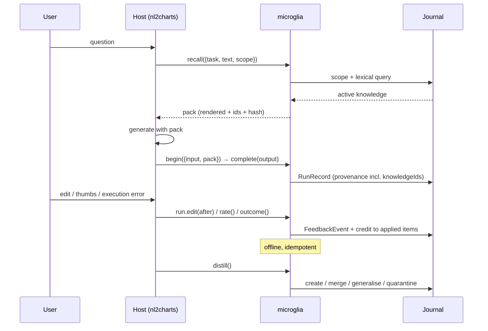

# Microglia — Product Whitepaper

**A headless feedback flywheel for agentic workflows**

Version 1.0 · 2026-10-20 · Author: Lambertyan · Status: decision document, pending approval

---

## 0. Document contract

This document answers four questions.

1. Is "turn HITL feedback into reusable agent knowledge" a valuable direction? — §3, §4
2. Who leads the field, academically and commercially, and what do they measure? — §5
3. Is a headless npm library the right product shape, with nl2charts as the reference host? — §6, §7
4. What is the path to state of the art, and how would we know we got there? — §10

It does **not** claim a benchmark result. Every performance number in this document is either
(a) quoted from a cited source, (b) produced by the POC in `packages/`, or (c) explicitly labelled
as a target. The POC is a **controlled mechanism study**, not a leaderboard entry;
`TECH-DESIGN.md` §12.6 states its limitations in the same font as its results.

**Evidence standard.** A claim without a citation or a reproducible command is marked
`[ASSUMPTION]`. There are two such marks in this document, both forecasts rather than findings (§4,
§10.4). Every other number is cited or produced by the POC.

---

## 1. 中文摘要

**结论：这个方向值得做，但必须做成"库"而不是"平台"，且成败取决于三个工程约束，而不是模型能力。**

反馈数据飞轮的价值已有可复现的工业证据：Airbnb 的 Agent-in-the-Loop 把四类人工反馈嵌入在线客服流程，检索 recall@75 +11.7%、precision@8 +14.8%、有用性 +8.4%、坐席采纳率 +4.5%；NVIDIA 的 MAPE 飞轮在 3 个月内收集 495 条负样本，定向微调后路由准确率 96%、模型小 10 倍、延迟降 70%。学术侧的 ACE（+10.6% agent / +8.6% finance）、ReasoningBank（WebArena +8.3%，MaTTS 下相对 +34.2%）、ExpeL（HotpotQA 28%→39%）、AWM（WebArena 相对 +51.1%）说明"从经验中提炼可复用知识"是真实杠杆。

但市场存在明确空位：Langfuse / LangSmith / Braintrust 等观测与评测平台**采集**反馈，止步于数据集和看板；Mem0 / Zep / Letta 等记忆系统**存储**记忆，却不理解"一次编辑"意味着什么；Humanloop 已被 Anthropic acqui-hire、平台于 2025-09-08 关停，说明"再做一层平台"正被模型厂商吸收。**没有一个可嵌入的 SDK 把"反馈 → 语义化纠错 → 受治理的知识 → 注入回请求路径 → 归因"闭成环。** 这正是 microglia 的位置。

定位判断：可行。理由有三。第一，宿主（nl2charts）已有成熟评测体系（BIRD Mini-Dev 49.6%、nvBench 2.0 91.73%、Text2Vis 44.94%，并以 gate 固化），反馈闭环可以直接挂在现成的 HITL 面上，不需要新造产品。第二，"无 UI、无服务、无多租户"意味着集成成本是五行代码，而不是一次采购。第三，cortex 已经提供了记忆的认知层（价值门、双时态事实、FSRS、矛盾消解），microglia 不需要重造，只需要补齐它缺的"反馈语义"和"归因"。

关于 cortex：**可作为投影层与认知维护引擎，不能原样作为反馈账本或知识反哺引擎。** 它没有 `derivedFrom` 溯源边、没有 TD(λ) 信用分配、没有概率校准，且其 83.55% 的 LongMemEval-S 数字出自 55 个 commit 之前的快照，未在 LoCoMo 上测量。本仓库的 `@agentix-e/microglia-cortex-adapter` 用结构化适配器验证了"知识项 → MemoryValue / Fact"的投影可行，但结论是**互补而非替代**。

POC 的受控实验（560 训练 / 280 留出，4 个 schema，6 类系统性缺陷，留出 `ops` 域完全不给反馈）测得：31.79% → 100.00%（+68.21pp，McNemar p<0.0001）；**在从未收到反馈的 `ops` 域上，允许作用域泛化的臂为 100.00%，禁止泛化的臂为 32.86%**——这是"越用越聪明"最干净的一次隔离验证。去掉信任上限后，投毒臂从 100.00% 掉到 85.71%，说明防护是承重的，不是装饰。

这一轮又用真实 API 补了四个 POC（三次运行，结论须在三次都成立）：**通用图表知识不需要 microglia**——DeepSeek 在无 pack 时已达 90.48%，加 pack 为 90.48% 至 88.10%（0 至 −2.38pp）；**组织惯例才是价值所在**——当 gold 与模型先验冲突时，无 pack 为 0.00%，加 pack 为 **75.00%–89.29%**。LLM 蒸馏把自由文本纠错转成带 scope 的规则，mark 准确率 **91.67%–95.83%**、intent **95.83%–100%**、注入文本 **0 条激活**；Embedding 在重度改写下比 BM25 的 recall@1 稳定高 **8.3pp**，但轻度改写时 BM25 更强，因此 embedding 只能作为按置信度启用的可选通道。CPU 规模测试在 1k/5k/10k 条知识上 p95 为 **1.9–4.4ms**（10k 为 2.6–3.1ms）、堆增量 **14MB**——**不需要 GPU，也不需要服务端**。

必须说清楚的三个前提：纠错必须是**系统性**的（同一类错误会重复出现）；每条知识需要有**重复证据**（本 POC 每条规则约 12 次观测，均匀噪声因此被多数票吸收）；宿主必须传入**结构化 scope**（intent/domain），否则检索退化为纯文本匹配。产品约束同样明确：**只支持 CPU 或浏览器 WebGPU，不做 GPU 训练/推理，不做本地微调**。

**下一步**：批准后按 §10 的 S1 阶段在 nl2charts 私有评测集（n=1300，κ≥0.7）上做 shadow 模式验证，再进入 BIRD-Interact / nvBench 2.0 的公开评测。若 S1 的 +3pp 不成立，按 §10.5 的 kill criteria 停止，不做"再调一版"。

---

## 2. The problem: a loop that is captured but not closed

Every agentic product generates feedback. Almost none of it becomes capability.

| Signal | Where it is produced | Where it usually ends |
|---|---|---|
| Thumbs up/down + reason | Chat or result panel | Analytics dashboard |
| User edit of the output | Inline editor | Overwritten in the host's database |
| Execution failure (SQL error, invalid chart) | Runtime | Logs, retried once, forgotten |
| Clarifying question and answer | Conversation | Transcript, never indexed |
| Abandonment / re-prompt | UI telemetry | Funnel metric |

Four failures follow, and they are independent:

1. **Capture is lossy.** The post-edit value is stored; the pre-edit value, the prompt version, the retrieved context, and the model are not. Without the pair there is no comparison, and without provenance the comparison cannot be attributed.
2. **Feedback has no semantics.** A JSON diff says `mark: "bar" → "line"`. The reusable lesson is "for a trend question, prefer line". Only a domain pack can tell the difference.
3. **Memory has no governance.** A vector store will happily return a rule derived from one angry click, forever, to every user. It has no notion of evidence weight, contradiction, expiry, or poisoning.
4. **Measurement is detached.** Eval platforms can tell you the quality dropped last Tuesday. They cannot change the answer the user is about to see.

The academic response has been to build a bespoke loop per paper. The industrial response has been to build a platform per company. Neither produces a component a host can embed.

### 2.1 The evidence that closing the loop pays

| Study | What was fed back | Measured effect |
|---|---|---|
| Agent-in-the-Loop, Airbnb ([Zhao et al., EMNLP 2025 Industry](https://aclanthology.org/2025.emnlp-industry.135/)) | Pairwise preference, adoption + rationale, knowledge relevance, missing knowledge | recall@75 **+11.7%**, precision@8 **+14.8%**, helpfulness **+8.4%**, adoption **+4.5%** |
| Adaptive Data Flywheel, NVIDIA ([Shukla et al., EACL 2026 Industry](https://aclanthology.org/2026.eacl-industry.33)) | 495 negative samples over 3 months | Routing **96%** with an 8B model (10× smaller, −70% latency); query rephrasal **+3.7%** |
| ACE ([Zhang et al., ICLR 2026](https://arxiv.org/abs/2510.04618)) | Execution feedback, no labels | **+10.6%** agents, **+8.6%** finance; adaptation latency **−86.9%** |
| ReasoningBank ([Ouyang et al., ICLR 2026](https://arxiv.org/abs/2509.25140)) | Self-judged success and failure trajectories | WebArena **+8.3%** success; **+34.2%** relative with MaTTS (k=5); SWE-Bench-Verified 30.8→34.6 |
| ExpeL ([Zhao et al., AAAI 2024](https://arxiv.org/abs/2308.10144)) | Cross-task successes and failures | HotpotQA **28%→39%**, ALFWorld **40%→59%**, cross-domain transfer 63%→70% |
| Agent Workflow Memory ([Wang et al., 2024](https://arxiv.org/abs/2409.07429)) | Successful trajectories → reusable workflows | WebArena **+51.1%** relative, Mind2Web **+24.6%** |

These are different tasks, models, and harnesses. The **common mechanism** is the claim worth
productising: a compact, retrievable representation of past corrections improves future task success
without touching weights. The differences are exactly why a reusable component is needed instead of
another bespoke pipeline.

### 2.2 The counter-evidence, which is just as important

- **Naive rewriting destroys knowledge.** ACE documents a context that held ~18k tokens at 66.7%
  accuracy being "summarised" to 122 tokens and dropping to 57.1% — worse than no adaptation. Any
  product that lets an LLM rewrite its own memory will eventually do this.
- **Memory benchmarks are contested.** LoCoMo headline numbers are self-reported and disputed:
  Mem0 claims 92.5 while an independent harness reports 66.9; Zep corrected its own 84% to 58.44%
  before restating ~75.14 ([vendor summary of the dispute](https://mem0.ai/blog/ai-memory-benchmarks-in-2026),
  [independent reproduction](https://genalphai.com/is-agent-memory-the-wrong-abstraction-the-2026-evidence)).
  A full-context baseline at ~73% can beat a memory system on a 16–26k-token conversation
  ([audit](https://dreaming.press/posts/how-to-read-an-agent-memory-benchmark)).
- **Text-to-SQL benchmarks contain pervasive annotation errors.** A VLDB 2026 study reports 52.8%
  error rate on BIRD Mini-Dev and 62.8% on Spider 2.0-Snow, with re-evaluation moving 16 agents by
  −7% to +31% relative and reordering the leaderboard by up to 9 places
  ([Jin et al., 2026](https://arxiv.org/abs/2601.08778)).
- **Judges are biased and only ~70–80% human-agreeing.** Position, verbosity, style, and
  self-preference effects are systematic; order-swapped double scoring plus length control is the
  minimum defensible protocol ([cross-benchmark synthesis](http://spectrumofresearch.com/index.php/sr/article/view/53)).

A product in this space that does not encode these lessons will produce confident, wrong uplift.

---

## 3. Is the direction valuable? — the verdict

**Yes, with four conditions. It is a real lever, not a universal one.**

### 3.1 Where the value comes from (four distinct mechanisms)

| Mechanism | Input | Output | Who captures it | Time to value |
|---|---|---|---|---|
| **M1 Constraint learning** | Structured edit | Declarative rule, scoped | Prompt-time retrieval | Same session |
| **M2 Exemplar learning** | Edit or accepted pair | Input→output example | Few-shot block | Same session |
| **M3 Preference data** | Rating / edit pair | SFT / DPO / KTO rows | Post-training | Weeks |
| **M4 Evaluation set** | Any feedback | Regression cases | CI gate | Days |

M1 and M2 need no training, no GPU, and no data volume. M3 needs volume and a training path. M4 is
the cheapest and most under-used: every correction is a test the system did not have. A product that
only promises M3 will look slow; one that ships M1/M2/M4 first delivers value on day one.

### 3.2 Why now

1. **Interaction is the new bottleneck.** BIRD-Interact reports GPT-5 solving 8.67% of
   c-Interact and 17.00% of a-Interact tasks on the full suite, with the best systems around 24%/18%
   on Lite ([benchmark site](http://bird-interact.github.io/), [ICLR 2026](https://mlanthology.org/iclr/2026/huo2026iclr-birdinteract)).
   Single-shot accuracy is no longer where the headroom is; clarification and correction are.
2. **Architecture beats model size.** Holding the reader fixed, the spread across memory systems on
   LongMemEval is ~37pp; swapping readers is worth ~7.8pp
   ([cortex's own correction](https://github.com/AgentiX-E/cortex/blob/master/SOTA-BASELINE.md)).
   Structure is the lever a library can sell.
3. **The platform route is being absorbed.** Humanloop's team joined Anthropic in August 2025 and
   the standalone platform shut down on 8 September 2025; the reported structure was an acqui-hire
   that excluded the platform IP ([announcement](https://humanloop.com),
   [deal summary](https://seedtable.com/exits/humanloop)). A library that lives inside the host is
   not exposed to that consolidation.

### 3.3 Where the value does *not* come from

- **Not from volume alone.** 10,000 thumbs-down without reasons produce one usable signal: "something
  is wrong". The POC's unguarded arm shows that unvetted edits can *reduce* accuracy by 14.3pp.
- **Not from a better embedding model.** Retrieval quality matters, but scope correctness matters
  more: in the POC, the same knowledge scored 32.86% or 100.00% depending only on whether the scope
  generalised.
- **Not from personalisation at large.** One global store cannot satisfy contradictory per-user
  preferences; that requires per-user namespaces, which multiplies the cold-start problem.

### 3.4 Kill criteria (declared before the work)

The project stops, rather than pivots, if any of these holds after S1 (§10):

| # | Condition | Measurement |
|---|---|---|
| K1 | Correction reuse lift < 3pp on two independent tasks | Paired McNemar on held-out questions, p<0.05 |
| K2 | Fewer than 2% of production runs receive any correction | Host telemetry over 30 days |
| K3 | Any untrusted knowledge becomes active in red-team | Poison arm gate = 0 |
| K4 | p95 added latency > 50ms or > 400 tokens per call | Production histogram |
| K5 | Judges cannot reach κ ≥ 0.7 against 200 human labels | Calibration study |

---

## 4. What "valuable" means in numbers: the unit economics

A single correction has four possible consumers. Assume a host with 1,000 runs/day and a 3%
correction rate — 30 corrections/day, 900/month.

| Consumer | Reuse assumption | Monthly artefact count | Marginal cost |
|---|---|---|---|
| Constraints (M1) | 60% of corrections yield a reusable rule | ~540 evidence events, ~40 distinct rules | $0 (no model call) |
| Exemplars (M2) | 90% of edits are valid pairs | ~810 pairs | $0 |
| Preference data (M3) | 810 pairs/month | 9.7k pairs/year — below most DPO thresholds | $0 to store, GPU to train |
| Eval cases (M4) | 100% | ~900/month | $0 |

The important number is not the data volume; it is that **M1/M2/M4 are free at the margin** and
effective in the same session. M3 is a downstream option, not the product.

`[ASSUMPTION]` The 3% correction rate is a planning figure, not a measured one. It is the first
instrumentation task in S1, because K2 depends on it.

---

## 5. Landscape

### 5.1 Research leaders, by layer

| Layer | Representative work | Core idea | What it does not solve |
|---|---|---|---|
| Preference optimisation | RLHF ([Christiano 2017](https://arxiv.org/abs/1706.03741)), InstructGPT ([Ouyang 2022](https://arxiv.org/abs/2203.02155)), DPO ([Rafailov 2023](https://arxiv.org/abs/2305.18290)), KTO ([Ethayarajh 2024](https://arxiv.org/abs/2402.01306)), GRPO ([DeepSeekMath 2024](https://arxiv.org/abs/2402.03300)) | Turn comparisons into policy updates | Needs volume, GPU, and a training cycle; not a request-path mechanism |
| Context adaptation | ACE ([2025](https://arxiv.org/abs/2510.04618)), Dynamic Cheatsheet, ExpeL ([2023](https://arxiv.org/abs/2308.10144)), ReasoningBank ([2025](https://arxiv.org/abs/2509.25140)) | Distil experience into a retrievable playbook | Each ships its own loop; no typing, provenance, or governance contract |
| Procedural memory | Agent Workflow Memory ([2024](https://arxiv.org/abs/2409.07429)) | Induce reusable workflows from trajectories | Workflow-level only; no notion of a single-field correction |
| Conversational memory | MemGPT ([2023](https://arxiv.org/abs/2310.08560)), A-MEM ([2025](https://arxiv.org/abs/2502.12110)), Zep/Graphiti, Mem0, Hindsight ([2025](https://arxiv.org/abs/2512.12818)) | Store, retrieve, update, consolidate | Storage-centric; corrections are just more text |
| Memory evaluation | LongMemEval ([2024](https://arxiv.org/abs/2410.10813)), MemoryAgentBench ([ICLR 2026](https://arxiv.org/abs/2507.05257)), MemBench ([ACL 2025](https://m0rtzz.github.io/paper-notes/ACL2025/llm_nlp/membench_towards_more_comprehensive_evaluation_on_the_memory_of_llm-based_agents)) | Five abilities; four competencies incl. selective forgetting | No benchmark measures "did a correction generalise" |
| Preference evaluation | RewardBench 2, PPE, JudgeBench, MT-Bench ([Zheng 2023](https://arxiv.org/abs/2306.05685)), MMRB2 ([2025](https://arxiv.org/abs/2512.16899)) | Measure whether a judge or reward model agrees with humans | Agreement is ~70–80% for frontier judges; humans >90% |

**The research gap is not an algorithm.** It is a contract: what a correction *is*, what may be
learned from it, how it expires, and how it is attributed. Every paper re-invents that contract;
none publishes it as a library.

### 5.2 Commercial landscape

| Product | Category | Runtime | What it does well | Where it stops | Licence / status |
|---|---|---|---|---|---|
| **Langfuse** | Observability + evals | Server + ClickHouse/Postgres/Redis | MIT core, self-host, traces, scores API, annotation queues, **`CORRECTION` score type** | A correction is a score on a trace: not distilled, not scoped, not retrieved, not credited | MIT (core) |
| **LangSmith** | Observability + evals | SaaS | Deepest LangChain integration, dataset experiments | Closed source; feedback is a label; no in-request knowledge | Commercial |
| **Braintrust** | Evals in CI | SaaS | Deployment-blocking regression gates, statistical significance | Evaluation, not learning | Commercial |
| **Arize Phoenix / W&B Weave / Opik** | Observability | Server/SaaS | Agent trace depth, OTel | Same boundary as above | Mixed |
| **Argilla + Distilabel** | Data curation | Server + Elasticsearch | Apache-2.0 annotation, HF-native, preference dataset pipelines | Human annotation, not runtime correction | Apache-2.0 |
| **Mem0** | Agent memory | Vector DB + LLM | LLM fact extraction, ADD/UPDATE/DELETE events, entity boosts | No correction input, no trust, no scope generalisation, no prompt pack | Apache-2.0 |
| **Zep / Graphiti** | Temporal memory | Neo4j/Kuzu/FalkorDB + LLM | Bi-temporal edges (`valid_at`/`invalid_at`/`created_at`/`expired_at`), BM25+cosine+BFS | Episode ingestion, not corrections; graph DB required | Apache-2.0 |
| **Letta** | Agent runtime | Postgres + pgvector, server | Core/archival/recall memory, block checkpoints, self-editing | Agent edits its own memory; no evidence-weighted admission | Apache-2.0 |
| **Supermemory** | Memory API | SaaS | Fast personal recall, connectors | Closed; no correction semantics | Commercial |
| **Humanloop** | LLMOps | — | Pioneered evals-as-discipline | Shut down 2025-09-08 after acqui-hire | Discontinued |

Two structural observations:

1. **The observability category owns the capture surface and stops at the dataset.** Its unit is a
   trace; ours is a *correction with provenance and a lifecycle*.
2. **The memory category owns storage and stops at retrieval.** Its unit is a memory; ours is a
   *claim with evidence, scope, and an outcome*.

### 5.3 Benchmarks that matter, and how much to trust them

| Benchmark | Measures | n | Reference point | Caveat |
|---|---|---|---|---|
| BIRD Mini-Dev | Text-to-SQL execution accuracy | 500 | nl2charts E1: 46.6% → **49.6%** (+3.00pp) | 52.8% annotation error rate reported ([Jin 2026](https://arxiv.org/abs/2601.08778)) |
| Spider2-Lite (SQLite subset) | Cross-file SQL | 260 | nl2charts E6: **20.0%** | Gold result sets, not SQL; db availability varies |
| BIRD-Interact Lite | Interactive SQL, clarification | 300 | SOTA ≈24% (c-Interact); GPT-5 8.67% full | User simulator is the authors' protocol, not a neutral oracle |
| nvBench 2.0 | Ambiguous text-to-visualisation | 7,878 queries / 24,076 charts | Step-Text2Vis F1@3 **81.50**, F1@5 **80.88**, P@1 99.20 | One-to-many gold; top-1 understates valid answers |
| Text2Vis | Answer + chart type | 1,985 | nl2charts E3: chart **44.94%**, answer 29.09%, joint 13.81% | Own grader; answer match is the bottleneck |
| LongMemEval-S | Five memory abilities | 500 | Cortex 83.55% (snapshot `a52628f`); Hindsight 91.4% | Reader/harness sensitive; commercial claims disputed |
| MemoryAgentBench | Retrieval, test-time learning, long-range, forgetting | 2,071 | All methods **<60%** average; none demonstrates selective forgetting | New; few independent replications |
| LoCoMo | Long conversational memory | ~1.5k | Vendor claims 92.5; independent 66.9 | Judge accepts ~63% of deliberately wrong answers ([audit](https://afx-team.github.io/hebb-mind/zh/benchmarks/locomo/vs-mem0.html)) |
| RewardBench 2 / MMRB2 | Judge/reward agreement | 1k+ per task | Frontier judges mid-70s; humans >90% | Measures the judge, not the product |

### 5.4 What the source says

Closed-source products were compared from public documentation only. Five open-source leaders were
read at the file level (`TECH-DESIGN.md` §8.4 has the full table):

| Project | File | Finding that matters |
|---|---|---|
| Mem0 | `mem0/memory/main.py`, `mem0/configs/prompts.py` | Phased add (context → top-10 recall → one extraction), `ADD/UPDATE/DELETE`, v3 `ADDITIVE_EXTRACTION_PROMPT` with `linked_memory_ids`; no correction event, no trust |
| Graphiti | `graphiti_core/edges.py`, `search/search_config.py` | Four timestamps per edge (world + system time), BM25 + cosine + BFS with RRF; strong temporality, episode-based ingestion |
| Letta | `letta/services/block_manager.py` | Block checkpoints/undo/redo, core/archival/recall memory; the agent edits itself, not the user's correction |
| Langfuse | `packages/shared/src/domain/scores.ts` | `ScoreDataType.CORRECTION`, `CORRECTION_NAME="output"`, sources API/EVAL/ANNOTATION; correction is a label on a trace |
| Argilla | `argilla-server/.../records.py`, `responses.py` | Records + responses + suggestions + vectors; annotation platform, no runtime |

**The closest competitor is Langfuse's `CORRECTION` score** — and it stops exactly where microglia
begins: turning that correction into a typed, scoped, evidence-weighted rule with a lifecycle and a
prompt budget. Graphiti is ahead on graph temporality; we say so rather than pretend otherwise.

**Consequence for our evaluation design.** We will not report a single unpaired number. Every claim
uses (a) the same questions in both arms, (b) an exact paired test, (c) a corrected or audited
subset where annotation errors are documented, and (d) a judge calibrated to κ ≥ 0.7 on human labels.

---

## 6. Product definition

### 6.1 Name and thesis

**microglia** are the resident immune cells of the brain. They prune unused synapses, strengthen the
ones that fire together, and clear debris — the maintenance layer that makes learning in the cortex
possible. The name is not decoration: this product prunes wrong rules, strengthens evidence that
works, and quarantines what is toxic. It is the maintenance layer for `@agentix-e/cortex`, not a
second brain.

> **Thesis.** A host application should be able to improve from its own corrections without
> becoming a data platform, without sending data anywhere, and without adopting a UI. Five lines of
> integration, one local journal, and a measurable delta on the next thousand runs.

**Positioning verdict.** The shape is viable **because** it is a library: the host already owns the
HITL surface (nl2charts has an editor, a chart picker, and SQL errors), the data never leaves the
process, and the value appears in the same session. A platform would have to earn a procurement
decision before producing a single rule; a library produces one on the first edit.

**Positioning correction from the live POC.** Sell **house conventions**, not chart knowledge. In
POC-2, a pack of generic chart rules left DeepSeek at 90.48% (one run) or moved it to 88.10% (the
other), while a pack of organisational conventions moved the same model from 0% to **75.00–89.29%**.
The product's promise is "your rules, applied consistently", not "the model learns charts".

### 6.2 Principles

| # | Principle | Consequence in the API |
|---|---|---|
| P1 | **No UI, no server, no tenancy** | The host owns the pixels; the library owns the semantics |
| P2 | **Feedback is evidence, not truth** | Admission is thresholded by weighted evidence, never by one click |
| P3 | **Knowledge is scoped, versioned, expirable** | Every item carries a scope, bitemporal validity, and a status |
| P4 | **Retrieval is structured first** | Scope is an index, not a post-filter; text ranks inside it |
| P5 | **Never rewrite; append and merge** | Delta distillation with deterministic dedupe and generalisation |
| P6 | **Rendered knowledge is data, never instructions** | JSON Lines inside a named element, `<` escaped |
| P7 | **Every claim is attributable and reversible** | Evidence ids, pack hash on the run, `retire`/`reinstate` |
| P8 | **Deterministic by default** | Clock, RNG, and store are injected |
| P9 | **Fail closed on trust** | Unknown-origin edits quarantine; they never reach a prompt |
| P10 | **Measure, do not assert** | Every release runs the gate suite; artifacts are committed |
| P11 | **CPU or WebGPU only** | No CUDA, no local GPU runtime, no fine-tuning; on-device encoders are optional |

### 6.3 Scope: what microglia is and is not

| In scope | Out of scope (by design) |
|---|---|
| A TypeScript SDK that captures, distils, retrieves, and attributes corrections | A hosted service or control plane |
| Embedded stores (JSONL, in-memory) and a Cortex projection | A vector database |
| Domain packs for nl2charts (chart, SQL, lexicon) | A charting library or a SQL engine |
| Dataset export (SFT/DPO/KTO/eval JSONL) | A training pipeline |
| Evaluation harness with paired statistics and gates | A leaderboard or a public benchmark submission |
| Poisoning defenses, redaction, namespace isolation | Multi-tenant identity, billing, RBAC |
| Diagnostics (`doctor`) and provenance inspection | Dashboards, annotation queues, reviewer UI |

### 6.4 The loop, in six steps

Two properties are architectural, not incidental:

- **Capture and learning are separate calls.** A host can capture on every request and distill on a
  cron. Learning never blocks a response.
- **Crediting happens at feedback time, not at distillation time.** The run knows which items were
  in its prompt; a later batch job does not.

### 6.5 Personas and jobs to be done

| Persona | Job | What they touch |
|---|---|---|
| **Host developer** (owner of nl2charts) | "Make my product improve without building a data platform" | `openMicroglia`, `recall`, `begin`, `distill` |
| **Domain expert / analyst** | "When I fix a chart, stop asking me again" | The host's existing editor; no new UI |
| **Platform engineer** | "Prove it works and prove it is safe" | `doctor`, exports, gates, artifacts |

### 6.6 Why a library rather than a platform

| Dimension | Library (chosen) | Platform (rejected) |
|---|---|---|
| Integration | `npm i` + 5 calls | SDK + account + data processing agreement |
| Data residency | Stays in the host process | Leaves the building |
| Time to first value | One session | Procurement |
| Failure mode | Host keeps working without it | Host loses a dependency |
| Moat | Semantics + evaluation rigor | Integrations + seats |
| Precedent | Sentry SDK, OpenTelemetry, PostHog | Humanloop (absorbed) |

The build/buy line — which npm packages to adopt, which capabilities must be ours, and why — is
specified in `TECH-DESIGN.md` §3.3. The short version: adopt storage engines, test runners, and
model runtimes; build everything that decides what a correction means, what may reach a prompt, and
how a claim is measured.

The platform route also collides with model vendors: Anthropic absorbed Humanloop's team into its
console, and LangSmith's gravity is the LangChain ecosystem. A library that any host can embed is
the complement, not the competitor.

---

## 7. Reference host: nl2charts

The `AgentiX-E/nl2charts-docs` repository is not a mock host. It contains an evaluation plan
(v5.28) with machine-readable gates, 83 POC directories, and measured results on public data:

| ID | Benchmark | n | Result | Gate |
|---|---|---|---|---|
| E1 | BIRD Mini-Dev | 500 | 46.6% → **49.6%** (+3.00pp, same model) | BIRD1 (≥45.5%) |
| E2 | nvBench 2.0 (chart type) | 750 | **91.73%** rule arm; 90.67% LLM; unnamed subset 74.35% | LEVER1 |
| E3 | Text2Vis | 1,985 | chart **44.94%** (rule 33.65%), answer 29.09%, joint 13.81% | CHART1 |
| E6 | Spider2-Lite (SQLite) | 260 | **20.0%** | EV8 |
| E7 | Cross-engine gold consistency | 492 | 98.2% self-consistency; 97.68% verdict agreement | EV9 |
| E8 | Connector contract (PostgreSQL) | 12 | 12/12 | XCONN1 |
| E4 | BIRD-Interact Lite | 300 | reference only (gold withheld by design) | — |

Three properties make it the ideal first host:

1. **The HITL surfaces already exist.** Users pick a chart, edit a spec, or correct a SQL result.
   Nothing new needs to be designed.
2. **The ground truth is executable.** A SQL correction is verified by running it; a chart choice is
   verified against a gold mark. Feedback quality is therefore measurable, not assumed.
3. **The gates are already strict.** `BIRD2` forbids reporting a delta without a p-value; `CONF1`
   forbids accuracy without coverage and a 95% CI. Microglia inherits an evaluation culture instead
   of importing one.

### 7.1 What microglia changes for nl2charts

| Surface | Today | With microglia | Expected mechanism |
|---|---|---|---|
| Chart type | 91.73% rule / 90.67% LLM; 74–75% on unnamed charts | Learn "intent → mark" per domain; teach the unnamed subset from edits | M1 constraint |
| Text-to-SQL | 49.6% BIRD; failures are execution + schema errors | Learn lexicon ("revenue = SUM(net_amount)"), join paths, and error fixes | M1 + M3 lexicon |
| Clarification | BIRD-Interact reference only | Every answer becomes a lexicon entry scoped to the schema | M1 lexicon |
| Evaluation | Gates exist; cases are curated | Every correction becomes a regression case automatically | M4 |

The economic case is narrow and testable: **reduce the second correction of the same kind**. A user
who fixes "pie for 9 categories" once should not have to fix it again in the same domain. That is
the product promise, not "the model gets smarter".

---

## 8. Memory substrate: what Cortex can and cannot be

Cortex is a value-driven cognitive memory layer by the same organisation. It is a strong substrate
and a weak feedback ledger. The distinction matters for the architecture.

### 8.1 What Cortex provides (verified in source)

| Capability | Where | Usable by microglia |
|---|---|---|
| `Storage` KV contract (SQLite/Postgres) | `cortex-core/src/interfaces/storage.ts` | Yes, as a projection target |
| `MemoryValue` with `value`, `confidence`, `sourceTrust`, tags, FSRS state | `cortex-core/src/domain/memory.ts` | Yes, field-for-field |
| Bitemporal `Fact` (valid time + system time) | `cortex-core/src/domain/fact.ts` | Yes, for correction validity |
| `decideWrite` / `decideRetrieval` value gates | `cortex-core/src/value/value.ts` | Yes, as a second admission opinion |
| `consolidate` (Hebbian + FSRS) | `cortex-core/src/consolidation/consolidate.ts` | Partially; needs a caller |
| `MemorySystem` composition + conformance suite | `cortex-memory/` | Yes, for LongMemEval-style QA |

### 8.2 What Cortex does not provide (and microglia must)

| Gap | Evidence | Consequence |
|---|---|---|
| **No derivation edge** | `AUDIT-CODE-VS-DOCS.md` and `DECISION-PROVENANCE-NODE.md`: `Fact` has origin/trust/time but not *which facts produced it*; a speculative `ProvenanceNode` was deleted | A correction cannot cite *which prior knowledge* it supersedes; microglia keeps its own evidence DAG |
| **No credit assignment** | `ARCHITECTURE.md`: "TD(λ) credit assignment — **Not implemented**" | Cortex cannot learn that a rule helped or hurt; microglia credits at feedback time |
| **No calibration** | "Abstention confidence calibration (Platt/temperature) — **Not implemented**; thresholds are fixed constants" | A fixed threshold cannot adapt to a host's base rate; microglia uses Wilson-smoothed empirical rates |
| **No feedback ingestion** | There is no `FeedbackEvent`, `Correction`, or `Edit` type anywhere in the repo | Cortex cannot tell a thumbs-down from a conversation turn |
| **Benchmark scope** | 83.55% LongMemEval-S at `a52628f`, **55 commits behind** master; no LoCoMo; the eval harness is not the product | Do not inherit the number as a product claim |
| **Not on npm** | Every `@agentix-e/cortex-*` `npm view` returns 404 (verified 2026-10-20) | A hard dependency is impossible today |

### 8.3 Verdict

> **Cortex is viable as a projection and cognitive-maintenance layer; it is not viable, as it stands,
> as the feedback store or the flywheel engine.**

The adapter in `packages/cortex-adapter` proves the projection is implementable: `KnowledgeItem →
MemoryValue` preserves confidence, trust, type, and scope tags; `Fact` preserves both time axes; and
the projection is inspectable and removable. What the adapter deliberately does **not** do is make
Cortex the source of truth — because a feedback ledger needs append-only events, evidence weights,
and a derivation graph that Cortex does not model.

The integration path is therefore:

1. **Now:** microglia owns the journal; `CortexProjection` mirrors knowledge into Cortex so its value
   gates and FSRS scheduling can run over the same items.
2. **After cortex publishes:** replace the structural types with `import type`, add a conformance test
   against the real `Storage`, and pin a version range.
3. **Upstream:** contribute `derivedFrom?: string[]` on `Fact` (the remedy Cortex's own audit names)
   and a calibration module. Both are small, both unblock a real integration.

---

## 9. Success metrics

A flywheel product that reports only accuracy will be gamed by a single benchmark. The metric set is
therefore layered: one north star, three value metrics, five guardrails.

| Layer | Metric | Definition | Target (S2) |
|---|---|---|---|
| **North star** | **Correction reuse rate** | Share of held-out questions that are wrong without memory and right with it, in the same scope | ≥ 25% of previously-failing cases |
| Value | Edit effort | Mean normalised edit distance per run | −30% vs baseline |
| Value | Negative feedback rate | Negative signals per 100 runs | −25% vs baseline |
| Value | First-pass acceptance | Share of runs with no correction | +10pp |
| Value | **House-convention adherence** | Share of house-rule cases where the output follows the convention | ≥85% |
| Guardrail | Poison activation | Active items whose source trust is below quarantine | **0** |
| Guardrail | Namespace leakage | Items retrieved across a namespace boundary | **0** |
| Guardrail | Knowledge precision | Active constraints correct on a probe grid | ≥ 85% |
| Guardrail | Added latency | p95 of `recall` + render | ≤ 50ms |
| Guardrail | Added tokens | Mean pack size | ≤ 300 tokens |

The POC measures all but the production telemetry ones; §11 of the tech design reports them.

---

## 10. The path to state of the art

"SOTA" here means *the best published result on a named benchmark under a stated protocol*, not a
feeling. The path has four stages, each with a stop rule.

**The CPU constraint shapes the strategy.** No fine-tuning, no local GPU, no inference server. Every
gain must come from context: better correction capture, better retrieval, better injection, more
interaction. That rules out the "fine-tune a 7B on BIRD" route and makes the memory layer the only
lever — which is also why every target is stated **against the same backbone**, never as an absolute
leaderboard number.

### 10.1 S0 — Mechanism (done, in this repository)

| Gate | Criterion | Measured |
|---|---|---|
| G1 | ≥ +20pp over baseline on held-out questions | **+68.21pp** |
| G2 | Exact McNemar p < 0.001 | **p < 0.0001** |
| G3 | 20% label noise still ≥ +15pp | **+68.21pp** |
| G4 | No untrusted knowledge active | **0** |
| G5 | Poisoned traffic within 3pp of clean | **0.00pp** |
| G6 | Unseen domain: generalisation beats per-domain scoping by ≥40pp | **100.00% vs 32.86%** |
| G7 | Namespace leakage | **0** |
| G8 | Active knowledge precision ≥80% | **100%** |
| G9 | No-memory arm does not drift | **flat** |
| G10 | Quarantine actually exercised | **2 items** |
| G11 | Removing the trust ceiling harms accuracy | **−14.28pp** |

Live POCs (this round, real APIs):

| POC | Result | What it proves |
|---|---|---|
| LLM distillation | 91.7–95.8% mark, 95.8–100% intent, 0 active injections | Free text becomes typed knowledge |
| LLM reader, generic | 90.48% → 90.48–88.10% | Generic rules are not the product |
| LLM reader, house | 0.00% → 75.00–89.29% | Organisational convention is the product |
| Poison control | 0 to −8.33pp | Model-dependent; quarantine is the defence |
| Embedding retrieval | heavy paraphrase +8.3pp recall@1 | Optional channel, not a default |
| CPU scale (10k) | 2.6–3.1 ms p95, 14 MB (1.9–4.4 ms across sizes/runs) | No GPU, no server |

S0 proves the mechanism on a controlled workload. It proves nothing about public benchmarks.

### 10.2 S1 — Shadow mode on the host (weeks 1–4)

- **Data:** nl2charts private adjudicated set (E5, n=1300, two annotators, κ ≥ 0.7).
- **Design:** shadow mode — memory influences a *shadow* prediction, not the served one. No user risk.
- **Metric:** paired delta on chart top-1 and SQL execution match; correction reuse rate.
- **Gate:** +3pp on chart top-1, no regression >1pp on SQL, precision ≥85%.
- **Stop:** K1.

### 10.3 S2 — Public benchmarks (weeks 5–12)

The suite is chosen to cover five axes, so a gain cannot hide in one modality:

| Axis | Benchmarks | Why it is in the suite |
|---|---|---|
| Executable SQL | BIRD Mini-Dev, Spider2-Lite, BIRD-Interact | The correction is verifiable by execution |
| Visualisation | nvBench 2.0, Text2Vis | The correction is a structured spec |
| Memory abilities | LongMemEval-S, MemoryAgentBench | The substrate must not regress |
| Preference quality | RewardBench 2, MMRB2 | The judge must be calibrated |
| Host reality | nl2charts E5 (n=1300, κ≥0.7) | The only set drawn from the actual product |

| Benchmark | Arm | n | Primary metric | Target | Why this target |
|---|---|---|---|---|---|
| BIRD-Interact (c-Interact) | same backbone, memory on/off | 600 (Full); 300 (Lite) as reference | task success | **+5pp** over same-backbone zero-shot | 300 tasks only detect ~8pp at 80% power; the full set is used for +5pp |
| BIRD Mini-Dev | same backbone | 500 | execution match | **no regression >1pp**; stretch +3pp | Annotation-error-corrected subset reported alongside |
| nvBench 2.0 | same backbone | 750 | chart top-1 | **+3pp**, and **+5pp on the unnamed subset** | The ambiguous subset is where interaction should help |
| Text2Vis | same backbone | 1,985 | answer match | **29.09% → 33%** | Answer, not chart, is the bottleneck (E3) |
| MemoryAgentBench | memory arm | 2,071 | four-competency average | **≥60%** | Every reported method is below 60% |

All targets are paired and preregistered. A target that is missed is reported as missed.

### 10.4 S3 — SOTA chase (months 4–9)

| Claim | Benchmark | Current published | Our target | Risk |
|---|---|---|---|---|
| Interactive SQL with a correction memory | BIRD-Interact Lite | ~24% (c-Interact) | **≥30%** | The benchmark's user simulator is an authored protocol; gains may not transfer |
| Ambiguous text-to-vis | nvBench 2.0 | F1@5 80.88 (Step-Text2Vis) | **≥85** | Requires a stronger reader than the POC's rule |
| Agent memory with selective forgetting | MemoryAgentBench | <60% average | **≥65%** | No system demonstrates selective forgetting; this is research, not engineering |
| Judge agreement | RewardBench 2 / PPE | Frontier mid-70s | **κ ≥ 0.7** vs 200 labels | Judge bias is systematic; calibration is the work |

`[ASSUMPTION]` These are forecasts. They are falsifiable, preregistered, and will be withdrawn if the
S2 effect does not replicate.

### 10.5 Statistical protocol (non-negotiable)

1. **Paired design.** Same questions, both arms, one unit per question.
2. **Exact McNemar** for binary outcomes; **bootstrap 10k** for the delta CI.
3. **Power first.** For a +5pp effect with discordance ~0.2, n≈780 is required; n=300 only detects
   ~8pp. We size the set to the claim, not to the budget.
4. **Preregistration.** Hypothesis, endpoint, n, and stop rule written before the run.
5. **Interleaved runs.** When the model is stochastic, 4 runs per arm, interleaved, pooled by
   question (never by sample).
6. **Judge calibration.** Order-swapped double scoring, length control, κ vs 200 human labels.
7. **Corrected subsets.** For BIRD/Spider2, report the ARCwise-Plat corrected numbers alongside.
8. **No single-number claims.** A delta without a CI and a p-value is not reported.

### 10.6 What would falsify the thesis

- A rule learned in one domain does not transfer to another (G6 fails on a second held-out domain).
- Corrections are idiosyncratic: the same user contradicts themselves more often than they repeat.
- The host's own model already uses the pack and ignores it (measured by an A/B on pack presence).
- Retrieval precision collapses at 10k items (the POC's store is O(n) and small).

---

## 11. Risks

| # | Risk | Likelihood | Impact | Mitigation | Owner |
|---|---|---|---|---|---|
| R1 | **Memory poisoning** — an attacker plants a rule | High | Critical | Trust ceiling + quarantine + declarative-only rendering + namespace isolation; G4/G11 gates | Core |
| R2 | **Benchmark overfitting** — the pack encodes the test set | Medium | High | Held-out domains, preregistration, corrected subsets, no training on eval | Eval |
| R3 | **Noise dominates** — users correct inconsistently | High | Medium | Evidence thresholds, contradiction resolution, retirement; measured in the noise arm | Core |
| R4 | **Cold start** — no feedback, no value | Certain | Medium | Ship with zero-knowledge behaviour identical to baseline; value starts at correction 1 | Product |
| R5 | **Scope explosion** — one rule per field | Medium | Medium | Generalise the domain dimension only; measured by G6 | Core |
| R6 | **Privacy** — feedback contains secrets | High | High | Redaction before persistence, not at export; `redactions` counter | Core |
| R7 | **Judge bias** — the eval flatters the product | High | High | κ calibration, order swap, length control, human spot checks | Eval |
| R8 | **Cortex drift** — the substrate changes underneath | Medium | Medium | Pin a commit; adapter conformance test; projection is one-way | Integration |
| R9 | **Host ignores the pack** — tokens spent, nothing changes | Medium | High | Pack hash on the run; A/B on pack presence; token budget | Product |
| R10 | **Legal** — dataset licences (BIRD CC BY-SA, Spider2 terms) | Medium | High | No redistribution; cite and link; export stays in the host | Legal |
| R11 | **Complexity** — the host cannot debug a wrong rule | Medium | Medium | `doctor`, provenance ids, `renderConstraint`, a one-command replay | DX |
| R12 | **Negative transfer from generic rules** — the pack makes a strong model worse | Measured −2.38pp | High | Ship house conventions only; measure with/without on the host's own set before enabling | Product |
| R13 | **Hybrid retrieval dilutes** — a noisy lexical list outranks the semantic one | Measured (heavy: fusion MRR < dense) | Medium | Confidence-gated fusion, not unconditional RRF | Retrieval |
| R14 | **GPU creep** — an encoder or reranker quietly requires CUDA | Medium | High | N11: CI is CPU-only; WebGPU is opt-in; no torch dependency in the lockfile | Eng |

---

## 12. Roadmap

| Phase | Duration | Deliverable | Exit criterion |
|---|---|---|---|
| **P0 Mechanism** | done | 8 packages, 285 tests, 11 gates | `pnpm check` green |
| **P0.5 Live POC** | done | DeepSeek distillation, LLM reader (generic/house/poison), embedding retrieval, CPU scale | Artifacts in `poc/results/`; CI `poc-live` green |
| **P1 Host shadow** | 4 weeks | nl2charts integration behind a flag; correction telemetry | S1 gate met, K2 measured |
| **P2 Public eval** | 8 weeks | BIRD-Interact / nvBench / Text2Vis harnesses; preregistered reports | S2 gates met or honestly missed |
| **P3 Hardening** | 6 weeks | SQLite store, Cortex adapter v1, red-team suite, docs | No P0 gap in the register |
| **P4 SOTA push** | 12 weeks | S3 claims, one paper-quality report | Claim accepted or withdrawn |

Resourcing: one engineer for P0–P1 (done/funded), one engineer + one evaluator for P2–P4.

---

## 13. Licensing and sustainability

- **SDK:** MIT, consistent with Cortex and the rest of `AgentiX-E`.
- **No hosted service.** This is a product decision, not a limitation: the moment there is a control
  plane, the data-residency argument that makes the library attractive disappears.
- **Sustainability:** support contracts for integration and evaluation, not seat licences. The
  reference host (nl2charts) is the first paid integration and the first case study.
- **Contribution policy:** domain packs are separate packages so a host can publish its own without
  forking the core.

---

## 14. References

**Feedback flywheels and HITL**

1. Zhao et al. *Agent-in-the-Loop: A Data Flywheel for Continuous Improvement in LLM-based Customer Support.* EMNLP 2025 Industry. https://aclanthology.org/2025.emnlp-industry.135/
2. Shukla et al. *Adaptive Data Flywheel: Applying MAPE Control Loops to AI Agent Improvement.* EACL 2026 Industry. https://aclanthology.org/2026.eacl-industry.33
3. Zhang et al. *Agentic Context Engineering: Evolving Contexts for Self-Improving Language Models.* ICLR 2026. https://arxiv.org/abs/2510.04618
4. Ouyang et al. *ReasoningBank: Scaling Agent Self-Evolving with Reasoning Memory.* ICLR 2026. https://arxiv.org/abs/2509.25140
5. Zhao et al. *ExpeL: LLM Agents Are Experiential Learners.* AAAI 2024. https://arxiv.org/abs/2308.10144
6. Wang et al. *Agent Workflow Memory.* 2024. https://arxiv.org/abs/2409.07429

**Preference optimisation**

7. Christiano et al. *Deep Reinforcement Learning from Human Preferences.* 2017. https://arxiv.org/abs/1706.03741
8. Ouyang et al. *Training Language Models to Follow Instructions with Human Feedback.* 2022. https://arxiv.org/abs/2203.02155
9. Rafailov et al. *Direct Preference Optimization.* 2023. https://arxiv.org/abs/2305.18290
10. Ethayarajh et al. *KTO: Model Alignment as Prospect Theoretic Optimization.* 2024. https://arxiv.org/abs/2402.01306
11. DeepSeekMath. *GRPO.* 2024. https://arxiv.org/abs/2402.03300

**Memory**

12. Packer et al. *MemGPT.* 2023. https://arxiv.org/abs/2310.08560
13. Xu et al. *A-MEM: Agentic Memory.* 2025. https://arxiv.org/abs/2502.12110
14. Wu et al. *LongMemEval.* 2024. https://arxiv.org/abs/2410.10813
15. Hu et al. *MemoryAgentBench.* ICLR 2026. https://arxiv.org/abs/2507.05257
16. Latimer et al. *Hindsight.* 2025. https://arxiv.org/abs/2512.12818
17. *Mem0 benchmark report and the LoCoMo dispute.* https://mem0.ai/blog/ai-memory-benchmarks-in-2026
18. *Independent reproduction of agent-memory claims.* https://genalphai.com/is-agent-memory-the-wrong-abstraction-the-2026-evidence
19. *LoCoMo audit.* https://afx-team.github.io/hebb-mind/zh/benchmarks/locomo/vs-mem0.html
20. *How to read an agent-memory benchmark.* https://dreaming.press/posts/how-to-read-an-agent-memory-benchmark

**Benchmarks and evaluation**

21. Li et al. *BIRD.* 2023. https://arxiv.org/abs/2305.03111
22. Huo et al. *BIRD-Interact.* ICLR 2026. https://arxiv.org/abs/2510.05318 · https://mlanthology.org/iclr/2026/huo2026iclr-birdinteract
23. *BIRD-Interact project page.* http://bird-interact.github.io/
24. *nvBench 2.0.* 2025. https://arxiv.org/abs/2503.12880 · http://nvbench2.github.io
25. Jin et al. *Pervasive Annotation Errors Break Text-to-SQL Benchmarks and Leaderboards.* VLDB 2026. https://arxiv.org/abs/2601.08778
26. Zheng et al. *Judging LLM-as-a-Judge with MT-Bench and Chatbot Arena.* 2023. https://arxiv.org/abs/2306.05685
27. *Position and verbosity bias: cross-benchmark synthesis.* 2026. http://spectrumofresearch.com/index.php/sr/article/view/53
28. *MMRB2: Multimodal RewardBench 2.* 2025. https://arxiv.org/abs/2512.16899

**Competitor source (audited 2026-10-20)**

36. Mem0 — https://github.com/mem0ai/mem0 (Apache-2.0)
37. Graphiti — https://github.com/getzep/graphiti (Apache-2.0)
38. Letta — https://github.com/letta-ai/letta (Apache-2.0)
39. Langfuse — https://github.com/langfuse/langfuse (MIT core)
40. Argilla — https://github.com/argilla-io/argilla (Apache-2.0)

**Security**

29. Torres et al. *When Agents Remember Too Much: Memory Poisoning Attacks on LLM Agents.* 2026. https://arxiv.org/abs/2607.06595
30. *Hidden prompts can plant false memories in AI agents.* TechXplore, 2026. https://techxplore.com/news/2026-07-hidden-prompts-false-memories-ai.html
31. *Agent memory poisoning (OWASP ASI06 overview).* https://tessary.ai/answers/agent-memory/what-is-agent-memory-poisoning

**Competitors**

32. Langfuse — https://langfuse.com/ · annotation queues: https://get.langfuse.com/docs/evaluation/evaluation-methods/annotation-queues
33. LangSmith / Braintrust / Phoenix comparison — https://dev.to/gabrielanhaia/langfuse-vs-langsmith-vs-phoenix-vs-braintrust-the-honest-2026-comparison-253p
34. Argilla — https://argilla.io · Distilabel — https://distilabel.argilla.io/
35. Humanloop acquisition and shutdown — https://humanloop.com · https://seedtable.com/exits/humanloop

---

*Next: `TECH-DESIGN.md` for the package layout, API, algorithms, security model, evaluation protocol,
POC results, and the gap register.*
