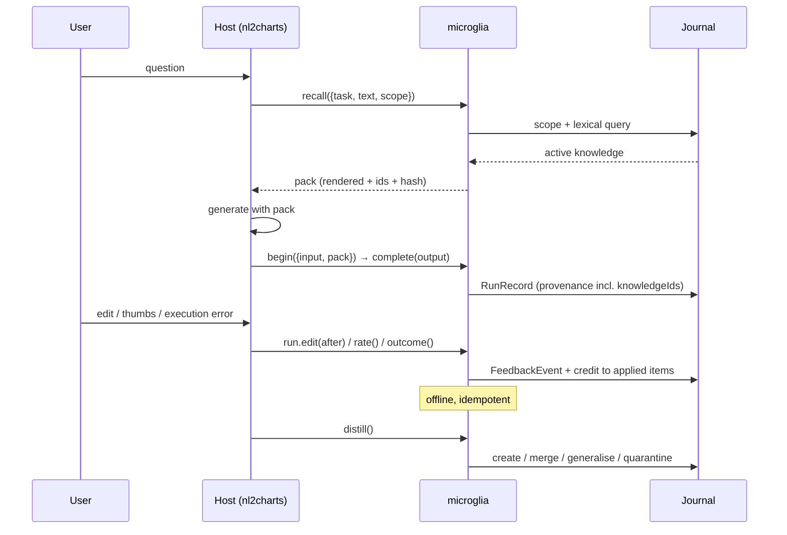

# Microglia — Product Whitepaper

**A headless feedback flywheel for agentic workflows**

Version 1.0 · 2026-10-20 · Author: Lambertyan · Status: decision document, pending approval

---

## 0. Document contract

This document answers four questions.

1. Is "turn HITL feedback into reusable agent knowledge" a valuable direction? — §3, §4
2. Who leads the field, academically and commercially, and what do they measure? — §5
3. Is a headless npm library the right product shape, with nl2charts as the reference host? — §6, §7
4. What is the path to state of the art, and how would we know we got there? — §10

It does **not** claim a benchmark result. Every performance number in this document is either
(a) quoted from a cited source, (b) produced by the POC in `packages/`, or (c) explicitly labelled
as a target. The POC is a **controlled mechanism study**, not a leaderboard entry;
`TECH-DESIGN.md` §12.6 states its limitations in the same font as its results.

**Evidence standard.** A claim without a citation or a reproducible command is marked
`[ASSUMPTION]`. There are two such marks in this document, both forecasts rather than findings (§4,
§10.4). Every other number is cited or produced by the POC.

---

## 1. Summary

**The direction holds; the unit does not.** Feedback-to-knowledge is a real lever, and the evidence for
it is industrial as well as academic. But eleven measured arms on a public benchmark say the same thing
from eleven angles: **a lesson distilled from one correction carries information about that correction
and about nothing else.** The product that survives that finding is not a memory middleware that
prepends lessons, and section 3 is the measurement that says so rather than the argument.

### 1.1 What is established, with the number

| Finding | Evidence | Size |
|---|---|---|
| Generic chart knowledge needs no memory layer | DeepSeek without a pack already answers 90.48% | a pack moved it −2.38pp to 0.00pp |
| Organisational convention is where the value is | gold disagrees with the model's prior, no pack 0.00% | **+75.0 to +89.3pp** with a pack |
| The pipeline can learn from a correction at all | synthetic POC, 560 train / 280 held out, 4 schemas, 6 systematic defect classes | 31.79% → 100.00%, McNemar p < 0.0001 |
| Scope widening is what makes it generalise | held-out `ops` domain that never gave feedback | **100.00% with widening, 32.86% without** |
| The trust ceiling is load-bearing | poisoned arm with the ceiling removed | 100.00% → 85.71% |
| Cost is not the obstacle | 1k / 5k / 10k knowledge items, CPU | p95 **1.9–4.4ms**, heap **+14MB**, no GPU, no server |

Those five rows are why the project exists, and none of them has been retracted.

### 1.2 What R2–R6 overturned

On BIRD Mini-Dev, under a pre-registered protocol with a noise-floor control on every dispatch, every
arm that changes what the prompt contains came back at or below zero:

| Arm | Position | Δ vs no memory |
|---|---|---|
| lexical schema linking (pruned DDL) | input | −8.00pp |
| rule pack (`full`), pooled over two dispatches | input | −2.29pp (p = 0.052) |
| `full-verified` — only rules that reproduce their own correction | input | +0.71pp (p = 0.42) |
| value samples in the DDL | input | +0.29pp |
| model selection over five draws | output | −2.43pp |
| execution selection over five draws | output | −1.14pp |
| **oracle over five draws** | **ceiling** | **+3.52pp** |

The one positive number is a ceiling, and it sits on the output side. The gap between the ceiling and
the best real selector — 4.66pp — is the entire opportunity this project has measured, and it is a
verifier problem.

### 1.3 The measurement that ends the ambiguity

R6 pointed every admitted rule at four foreign questions and recorded both what it repaired and what it
broke. A rule repairs **22.6%** of the questions a bare retry could not fix — on its own question — and
**29 repaired against 29 broken** on questions it was not distilled from. Net marginal effect:
**+0.00pp** on 892 trials, against **+20.53pp** on 638 own-case trials.

A rule and its case are one object. Moving that object from the prompt prefix to a scorer changes where
a zero sits, not what it is worth. Section 3.6.1 states this with the full 2×2.

### 1.4 Product constraint, restated

- **CPU or browser WebGPU only.** No GPU training, no local fine-tuning, no served inference.
- **A library, not a platform.** Integration is a handful of lines; there is no UI, no service, no
  tenancy.
- **The store holds execution-grounded evidence**, not prose lessons: `(schema, execution signature,
  outcome)` is the object that survives being read by a question it was not built from.

### 1.5 What is next, and what would stop it

R7 is ordered so the pool is described before any scorer is built: instrument the candidates (R7.0,
done), widen the pool with heterogeneous generators and measure whether the ceiling moves (R7.1), price
each execution signal alone (R7.2a), then build the deterministic verifier (R7.2b). If the ceiling does
not move at least 2pp in R7.1, candidate diversity is not the constraint and R7.2 becomes the whole
stage with a 3.52pp ceiling as its maximum prize. If the verifier's yield is at the floor, the stage
ends and the programme reports two closed axes rather than a third mechanism.

The kill criteria are in `ROADMAP.md` §R7, written before the dispatches they govern.

---


## 2. The problem: a loop that is captured but not closed

Every agentic product generates feedback. Almost none of it becomes capability.

| Signal | Where it is produced | Where it usually ends |
|---|---|---|
| Thumbs up/down + reason | Chat or result panel | Analytics dashboard |
| User edit of the output | Inline editor | Overwritten in the host's database |
| Execution failure (SQL error, invalid chart) | Runtime | Logs, retried once, forgotten |
| Clarifying question and answer | Conversation | Transcript, never indexed |
| Abandonment / re-prompt | UI telemetry | Funnel metric |

Four failures follow, and they are independent:

1. **Capture is lossy.** The post-edit value is stored; the pre-edit value, the prompt version, the retrieved context, and the model are not. Without the pair there is no comparison, and without provenance the comparison cannot be attributed.
2. **Feedback has no semantics.** A JSON diff says `mark: "bar" → "line"`. The reusable lesson is "for a trend question, prefer line". Only a domain pack can tell the difference.
3. **Memory has no governance.** A vector store will happily return a rule derived from one angry click, forever, to every user. It has no notion of evidence weight, contradiction, expiry, or poisoning.
4. **Measurement is detached.** Eval platforms can tell you the quality dropped last Tuesday. They cannot change the answer the user is about to see.

The academic response has been to build a bespoke loop per paper. The industrial response has been to build a platform per company. Neither produces a component a host can embed.

### 2.1 The evidence that closing the loop pays

| Study | What was fed back | Measured effect |
|---|---|---|
| Agent-in-the-Loop, Airbnb ([Zhao et al., EMNLP 2025 Industry](https://aclanthology.org/2025.emnlp-industry.135/)) | Pairwise preference, adoption + rationale, knowledge relevance, missing knowledge | recall@75 **+11.7%**, precision@8 **+14.8%**, helpfulness **+8.4%**, adoption **+4.5%** |
| Adaptive Data Flywheel, NVIDIA ([Shukla et al., EACL 2026 Industry](https://aclanthology.org/2026.eacl-industry.33)) | 495 negative samples over 3 months | Routing **96%** with an 8B model (10× smaller, −70% latency); query rephrasal **+3.7%** |
| ACE ([Zhang et al., ICLR 2026](https://arxiv.org/abs/2510.04618)) | Execution feedback, no labels | **+10.6%** agents, **+8.6%** finance; adaptation latency **−86.9%** |
| ReasoningBank ([Ouyang et al., ICLR 2026](https://arxiv.org/abs/2509.25140)) | Self-judged success and failure trajectories | WebArena **+8.3%** success; **+34.2%** relative with MaTTS (k=5); SWE-Bench-Verified 30.8→34.6 |
| ExpeL ([Zhao et al., AAAI 2024](https://arxiv.org/abs/2308.10144)) | Cross-task successes and failures | HotpotQA **28%→39%**, ALFWorld **40%→59%**, cross-domain transfer 63%→70% |
| Agent Workflow Memory ([Wang et al., 2024](https://arxiv.org/abs/2409.07429)) | Successful trajectories → reusable workflows | WebArena **+51.1%** relative, Mind2Web **+24.6%** |

These are different tasks, models, and harnesses. The **common mechanism** is the claim worth
productising: a compact, retrievable representation of past corrections improves future task success
without touching weights. The differences are exactly why a reusable component is needed instead of
another bespoke pipeline.

### 2.2 The counter-evidence, which is just as important

- **Naive rewriting destroys knowledge.** ACE documents a context that held ~18k tokens at 66.7%
  accuracy being "summarised" to 122 tokens and dropping to 57.1% — worse than no adaptation. Any
  product that lets an LLM rewrite its own memory will eventually do this.
- **Memory benchmarks are contested.** LoCoMo headline numbers are self-reported and disputed:
  Mem0 claims 92.5 while an independent harness reports 66.9; Zep corrected its own 84% to 58.44%
  before restating ~75.14 ([vendor summary of the dispute](https://mem0.ai/blog/ai-memory-benchmarks-in-2026),
  [independent reproduction](https://genalphai.com/is-agent-memory-the-wrong-abstraction-the-2026-evidence)).
  A full-context baseline at ~73% can beat a memory system on a 16–26k-token conversation
  ([audit](https://dreaming.press/posts/how-to-read-an-agent-memory-benchmark)).
- **Text-to-SQL benchmarks contain pervasive annotation errors.** A VLDB 2026 study reports 52.8%
  error rate on BIRD Mini-Dev and 62.8% on Spider 2.0-Snow, with re-evaluation moving 16 agents by
  −7% to +31% relative and reordering the leaderboard by up to 9 places
  ([Jin et al., 2026](https://arxiv.org/abs/2601.08778)).
- **Judges are biased and only ~70–80% human-agreeing.** Position, verbosity, style, and
  self-preference effects are systematic; order-swapped double scoring plus length control is the
  minimum defensible protocol ([cross-benchmark synthesis](http://spectrumofresearch.com/index.php/sr/article/view/53)).

A product in this space that does not encode these lessons will produce confident, wrong uplift.

---

## 3. Is the direction valuable? — the verdict

**Yes for the four mechanisms below, and no for the form this project spent eleven iterations building.**

Read 3.1 with 3.5 in hand: the mechanisms are where the value is, and the *prompt prefix* is not a
delivery route for any of them on a one-shot benchmark — every arm that put knowledge in front of the
question measured at or below zero, and §3.6.1 shows why. The direction survives; the substrate did not.

### 3.1 Where the value comes from (four distinct mechanisms)

| Mechanism | Input | Output | Who captures it | Time to value |
|---|---|---|---|---|
| **M1 Constraint learning** | Structured edit | Declarative rule, scoped | Prompt-time retrieval | Same session |
| **M2 Exemplar learning** | Edit or accepted pair | Input→output example | Few-shot block | Same session |
| **M3 Preference data** | Rating / edit pair | SFT / DPO / KTO rows | Post-training | Weeks |
| **M4 Evaluation set** | Any feedback | Regression cases | CI gate | Days |

M1 and M2 need no training, no GPU, and no data volume. M3 needs volume and a training path. M4 is
the cheapest and most under-used: every correction is a test the system did not have. A product that
only promises M3 will look slow; one that ships M1/M2/M4 first delivers value on day one.

### 3.2 Why now

1. **Interaction is the new bottleneck.** BIRD-Interact reports GPT-5 solving 8.67% of
   c-Interact and 17.00% of a-Interact tasks on the full suite, with the best systems around 24%/18%
   on Lite ([benchmark site](http://bird-interact.github.io/), [ICLR 2026](https://mlanthology.org/iclr/2026/huo2026iclr-birdinteract)).
   Single-shot accuracy is no longer where the headroom is; clarification and correction are.
2. **Architecture beats model size.** Holding the reader fixed, the spread across memory systems on
   LongMemEval is ~37pp; swapping readers is worth ~7.8pp
   ([cortex's own correction](https://github.com/AgentiX-E/cortex/blob/master/SOTA-BASELINE.md)).
   Structure is the lever a library can sell.
3. **The platform route is being absorbed.** Humanloop's team joined Anthropic in August 2025 and
   the standalone platform shut down on 8 September 2025; the reported structure was an acqui-hire
   that excluded the platform IP ([announcement](https://humanloop.com),
   [deal summary](https://seedtable.com/exits/humanloop)). A library that lives inside the host is
   not exposed to that consolidation.

### 3.3 Where the value does *not* come from

- **Not from volume alone.** 10,000 thumbs-down without reasons produce one usable signal: "something
  is wrong". The POC's unguarded arm shows that unvetted edits can *reduce* accuracy by 14.3pp.
- **Not from a better embedding model.** Retrieval quality matters, but scope correctness matters
  more: in the POC, the same knowledge scored 32.86% or 100.00% depending only on whether the scope
  generalised.
- **Not from personalisation at large.** One global store cannot satisfy contradictory per-user
  preferences; that requires per-user namespaces, which multiplies the cold-start problem.

### 3.4 Kill criteria (declared before the work)

The project stops, rather than pivots, if any of these holds after S1 (§10):

| # | Condition | Measurement |
|---|---|---|
| K1 | Correction reuse lift < 3pp on two independent tasks | Paired McNemar on held-out questions, p<0.05 |
| K2 | Fewer than 2% of production runs receive any correction | Host telemetry over 30 days |
| K3 | Any untrusted knowledge becomes active in red-team | Poison arm gate = 0 |
| K4 | p95 added latency > 50ms or > 400 tokens per call | Production histogram |
| K5 | Judges cannot reach κ ≥ 0.7 against 200 human labels | Calibration study |

---

### 3.5 The lever is not on the input side

Nine arms have now been measured on BIRD Mini-Dev under one protocol — same model, same folds, same
scorer, paired bootstrap over 10,000 resamples, and a `none-replica` control that measures the noise
floor of an identical prompt. Five of them act on the **input** (what the prompt contains). Four act
on the **output** (which of several answers is kept).

| Iteration | Arm | Acts on | Δ vs no memory | n | gained / lost |
|---|---|---|---|---|---|
| 94 | lexical schema linking (pruned DDL) | input | **−8.00pp** | 350 | 31 / 59 |
| 96 | rule pack (`full`) | input | −2.86pp | 350 | 11 / 21 |
| 96 | `full-shuffled` (same size, wrong donors) | input | −1.71pp | 350 | 14 / 20 |
| 96 | `full-verified` (only rules that replay their own case) | input | −0.57pp | 350 | 5 / 7 |
| 95 | value samples in the DDL | input | +0.29pp | 350 | 12 / 11 |
| 93 | model selection over five draws | output | −2.43pp | 350 | — |
| 93 | first draw (control for resampling) | output | −2.28pp | 350 | — |
| 93 | agreement selection | output | −1.43pp | 350 | — |
| 94 | execution selection | output | −1.14pp | 350 | 13 / 10 |
| 93 | **oracle over five draws** | **ceiling** | **+3.52pp** | 350 | — |

Two readings, and only one of them is a complaint about implementation.

**Every input-side arm is at or below zero, including the one whose content was verified good.**
`full-verified` injects only rules that demonstrably reproduce the correction they were derived from
— 1.11 such rules per question, 139 questions — and gains zero questions while losing two. That is
not a null about a treatment; it is a null about the *content* of the treatment, measured on the
subset where the content was known to be good.

**The only positive number in the table is a ceiling, and it lives on the output side.** Oracle
selection over five homogeneous draws is worth +3.52pp: on 350 questions, the best of five draws is
3.5pp better than one draw. The best *real* selector captures −1.14pp of it. The gap between the
ceiling and the selector — 4.66pp — is the entire opportunity this project has measured, and it is a
verifier problem, not a memory problem.

### 3.6 Which flywheel can actually turn here

Three loops are called "data flywheels" in the industry, and they turn on different things. Naming
which one a product is building is the difference between a roadmap and a metaphor.

| Flywheel | What turns | Signal it needs | Available in this setting | Verdict |
|---|---|---|---|---|
| **Parameter** (RLHF, DPO, o-series RL) | model weights | dense, trustworthy outcome signal | No: the generator is a closed API. Available only as LoRA on open weights, with a training path and volume | Out of scope until M3 has volume |
| **Verifier / reranker** (Cursor's accept-rate loop, CHASE-SQL's selection agent) | the scorer, not the generator | two outcomes that can be compared | **Yes.** SQL is executable: the environment scores candidates for free | **The only flywheel that can turn here** |
| **Context** (Mem0, Zep, MemGPT, ACE, ReasoningBank) | retrieved text | repeated tasks + information not derivable from the environment | Partial: needs repetition. One-shot benchmarks and novel schemas have none | Does not turn on this workload |

The distinction that matters: a **parameter** flywheel compounds because the artefact of each turn is
a better model. A **context** flywheel does not compound, because the artefact is text that the same
fixed model must re-read every time — and re-reading costs attention. That is why the input-side
column above is negative rather than merely flat: the cost is structural and paid on every call,
while the benefit is a probability that a rule written for another question applies to this one.
Measured, that probability is 22.9% even for the rule's *own* case (149 of 652 probed questions),
and R6 is measuring it for foreign cases.

**Why the residuals are not knowledge-shaped.** Of 350 questions the model gets 53.7% right from the
schema alone. In the 162 wrong answers analysed in iteration 95, masking every string literal on both
sides leaves the two queries different in **162 of 162** cases: the join, the aggregation or the
filter is also wrong. What remains is question-specific semantics — which column this workspace calls
revenue, whether this join needs a distinct, what this table's grain is — and that information does
not exist in a rule distilled from a different question. It exists in *this* schema, *this* data and
*this* question, which is exactly what a verifier can see and a prompt prefix cannot.

**What that makes the product.** Not a memory middleware that prepends lessons, but an
**execution-grounded verifier memory**: it stores the candidate queries a run produced together with
what executing them returned, and it acts after generation and before commit — re-ranking, refusing,
or asking. Its promise is falsifiable in one line:

```
pass@1 gain  =  selection yield  ×  oracle ceiling
```

where the ceiling is measured on the same candidate set and the yield is the share of it the verifier
captures. Today, on five homogeneous draws: ceiling +3.52pp, yield negative. CHASE-SQL reports the
comparable pair at 68.84% → 73.01% (+4.17pp) with **heterogeneous** candidates, which is the first
thing our candidate set lacks: five samples from one prompt are five versions of the same mistake.

### 3.6.1 The measurement that settles what the unit of memory is

The paragraph above was an inference from the shape of the residual errors. It is now a measurement, and
the measurement is sharper than the inference.

R6 pointed every rule that reproduced its own correction at four foreign questions from the same
database, judged each attempt against a bare retry on the same target, and recorded both halves of the
2×2 — what the rule repaired, and what it broke.

| | A bare retry fixed it | A bare retry did not | Marginal |
|---|---|---|---|
| **Rule shown a foreign question** | 39 kept / **29 broken** | **29 repaired** / 795 unchanged | **(29 − 29) / 892 = +0.00pp** |
| **Rule shown its own question** | 61 kept / 13 broken | 144 repaired / 420 unchanged | **(144 − 13) / 638 = +20.53pp** |

> A rule distilled from a corrected case carries **20.5 points of information about that case and 0.0
> about any other**. It is not weak knowledge. It is a case record whose content is the case.

Read with the break column, the two negative arm results stop being surprising and stop being about
implementation. `full` injects 1.86 of these per question and loses 2.29pp pooled over two dispatches;
each one is a coin flip on correctness that costs attention on every call. `full-verified` — the same
run, keeping only rules that demonstrably reproduce their own correction — recovers **+3.00pp against
`full`** (pooled, n = 700, p = 0.0075) and still lands at **+0.71pp against no memory at all**
(p = 0.42). The gate removes the harm and produces nothing, which is exactly what a good filter does
to a substrate with no signal in it.

This is where the project's own question — *are we remembering the wrong thing, or using it wrongly?* —
gets its answer, and the answer is neither of the two options it offered. **The unit is wrong, and no
position repairs a unit whose content is its own index.** A lesson and its case are one object; the
only thing that survives being moved to another question is a property of the *answer* rather than of
the question, which is what an execution signature is and what R7.2 measures.

### 3.6.2 What the store actually contained

Section 3.6.1 measures what a rule does when it is moved. This one measures what the store *is*, from
every attribution run the project has recorded, and the two agree while answering different questions.

Each arm's attribution artefact classifies every rule that reached a prompt by the sign of its net
effect — did it repair more answers than it broke, or the reverse — and carries one instance-weighted
number, the share of injections belonging to a net-harmful rule. `pnpm eval:store` adds the runs up
over the results directory including the archive: eight runs, 2026-10-23 to 10-26, each a 60-to-350
question cross-fitted slice of BIRD Mini-Dev.

| Quantity | Count | Share |
|---|---|---|
| Rules the distiller kept | 9,062 | — |
| Rules that reached a prompt at least once | 2,817 | **31.1%** of the store |
| … of those, net-repaired more than they broke | 110 | 3.90% of injected rules |
| … net-broke more than they repaired | 229 | 8.13% of injected rules |
| … flips cancelled exactly (a wash) | 2,478 | **87.97%** of injected rules |
| Net | **−119 rules** | exact sign test p = 9.5e-11 |

| Run | Rules | Reached a prompt | Repaired | Broke | A wash | Injections in a harmful rule |
|---|---|---|---|---|---|---|
| 10-23 11:27 (pilot, 60 q) | 124 | 74 | 5 | 11 | 58 | 16.7% |
| 10-23 16:26 | 1,296 | 439 | 25 | 40 | 374 | 10.7% |
| 10-23 17:18 | 1,280 | 442 | 17 | 42 | 383 | 11.4% |
| 10-23 23:15 | 1,295 | 423 | 13 | 38 | 372 | 12.3% |
| 10-24 01:45 (value oracle) | 1,149 | 233 | 8 | 0 | 225 | 0.0% |
| 10-24 15:12 | 1,312 | 396 | 16 | 27 | 353 | 8.7% |
| 10-25 02:19 | 1,319 | 407 | 12 | 31 | 364 | 8.9% |
| 10-26 07:42 | 1,287 | 403 | 14 | 40 | 349 | 12.8% |

Three facts, and each one constrains the fix:

1. **Most of what reaches a prompt does nothing.** 88% of injected rules have a net effect of exactly
   zero: the flips they caused cancelled, or — for a rule shown once — there were none. That is not a
   neutral outcome for a prefix. The tokens are paid on every call, and section 3.5 measured what the
   payment buys. A pack that is nine parts inert is a context tax with a 12% chance of a consequence,
   and the consequence is twice as likely to be bad.
2. **Harm is not noise, it is a ratio.** 110 net-helpful rules against 229 net-harmful ones, the same
   direction in seven of eight runs. The eighth is the S2b value-oracle pack — the convention-transfer
   stage, whose rules were conditioned on a measured value rather than on a reading of a question —
   which broke nothing while repairing 8. Two caveats keep that from being a conclusion: it is the
   smallest run here (n = 145 questions), and eight repairs with zero breaks in 233 injections is
   consistent with a break rate as high as 1.3% per injection. It is a lead, not a result.
3. **Retrieval is the other half of the problem, and it is untouched.** Only 31% of stored rules ever
   reached a prompt. Whatever the distiller knows, the injector shows a third of it, and nothing here
   can say whether the third it chose was the right third — that question needs a rule-level
   counterfactual this project has not run.

**Unit, stated because it was got wrong.** The classes above count *rules*, not injection instances:
`helpful + harmful + neutral` equals the injected-rule count exactly. The first version of this report
read them as instances and published "3.90% of injected instances repaired the answer". The digits were
right and the unit was wrong, and the same digits support a much weaker claim — which is why the field
names now carry the unit (`helpfulRules`, `injectedRules`) and a test asserts the names. The one
instance-weighted number available is the last column, and it is reported per run rather than averaged,
because the artefact does not carry the instance totals needed to weight the runs against each other.

The numbers above predate the R6 gate. They describe the store the gate was applied to, not the
current implementation.

### 3.6.3 What replaced the prefix: a verifier over the pool

Sections 3.6.1 and 3.6.2 close the prefix as a position for memory. A rule shown to a foreign question
nets +0.00pp and breaks 42.6% of the targets a bare retry had already fixed; the store it comes from is
88% inert and 2:1 harmful when it is not. Neither finding says memory is worthless — both say that *text
distilled from a case carries nothing about another case*, and that a mechanism which must help has to
act on something the case and the question share.

The thing they share is not text. It is the shape of the answer. Three systems converged on that
independently: XiYan-SQL groups candidates by execution result before ranking them, R³-SQL groups and
resamples, GradeSQL trains an outcome reward model on execution labels and beats execution-based
Best-of-N by up to +4.33 on BIRD. This project's own attempt at the *fourth* thing — asking a model to
compare two result sets — measured −1.14pp, and the difference is not the idea of using execution; it is
that a model comparing result sets has no ground to stand on while a shape comparison does.

So the mechanism was rebuilt as six deterministic signals over an execution signature, each measured
alone before any of them was allowed to rank anything. The order is the design: eleven earlier
iterations shipped a composite and measured the composite, and when it came out negative nothing in the
result said which part was wrong.

**The gate.** A signal enters the composite only if `AUC − 0.5 > 2 SE` after Holm correction, with the
bootstrap standard error floored at `sqrt(0.25/min(n₁,n₂))` because a pool whose pairs are all
concordant returns zero variance and a zero variance read as certainty would pass a signal measured on
four candidates. On 350 BIRD Mini-Dev questions and five draws, 122 of them offered any choice at all,
and five of six signals cleared it:

| Signal | AUC | SE | z | Holm | Verdict |
|---|---|---|---|---|---|
| `value-type` | 0.608 | 0.017 | 6.25 | <0.001 | **kept** |
| `column-shape` | 0.579 | 0.017 | 4.57 | <0.001 | **kept** |
| `empty` | 0.572 | 0.017 | 4.17 | <0.001 | **kept** |
| `row-shape` | 0.563 | 0.019 | 3.38 | 0.0011 | **kept** |
| `duplicate-share` | 0.542 | 0.017 | 2.46 | 0.0137 | **kept** |
| `null-share` | 0.521 | 0.017 | 1.23 | 0.109 | removed |

The AUCs in that table are reconstructed, not the run's own: the artefact did not carry the evidence
BIRD ships with each question, so a re-analysis reads every question against an empty evidence string
while the run read both. The run's own readings are `value-type` 0.6015, `column-shape` 0.5998,
`row-shape` 0.5749, `empty` 0.5653, `duplicate-share` 0.5418, `null-share` 0.5213 — the same five kept
and the same one removed. The field is now required, so the next artefact cannot repeat the omission.

**What the gate is worth.** The composite of the five, scored as an arm inside the cross-fitted run
rather than simulated on a recorded pool: **+1.14pp** over the first draw on the same five draws,
54.57% against 53.43%, 7 gained and 3 lost, exact McNemar p = 0.344, 95% CI **[−0.57, +2.86]**. In
sample, on the 117 questions where a draw choice existed, it is +3.42pp — and 3.42 × 117/350 is 1.14,
so the two agree exactly.

That interval is the whole result. The point estimate is smaller than the **±1.4pp** an identical
prompt moves when it is run twice on these questions, and it is a quarter of the width of its own
interval. An earlier reading of +7.38pp was the same composite fed a question shape computed without
BIRD's evidence; with the evidence the effect is a third as large. The mechanism is real in direction —
positive in three folds, zero in two, negative in none — and unresolvable at this sample size on this
pool. It is not the discovery it once looked like.

**What it is worth decomposing.** The same pool says the sum is carried by one member. `value-type`
alone reaches 39.3% of the composite's 40.2% and never breaks a question the first draw had right; the
other four add one question between them and `row-shape` costs one. On 122 questions, one or two
questions is inside the binomial spread, so the honest statement is that the remaining four are
unproven rather than worthless — and the reason they look like four opinions when they are closer to one
is that every signal penalises an empty result, not only the one called `empty`.

**What the store is doing while all this happens.** The per-rule ledger, read from three runs of the
same configuration, splits the injected store into a large silence and a small harmful tail: 17%–23% of
rules ever move an answer at all, and of those two thirds move it the wrong way. The −3.14pp is the sum
of that tail and that silence — the store is not (only) slightly harmful, it is **mostly inert**, and a
better ranker over an inert store has nothing to sort. A filter that could tell the two apart would have
to be fitted on the 45 discriminating rules a run produces, which is under half the evidence one
pre-registered split needs, so the constraint is observations per rule rather than model capacity. That
is what a workload with repeated rules would buy and what a 350-question benchmark cannot.

**And the pool is why none of it can pay.** The ceiling this composite could ever have captured is 25
questions of 350 — the draws disagree on 1.46 answers per question, and 235 of 350 questions collapse to
a single answer. Yield is 4 net questions of 25, **0.16** against the 0.33 the stage required. Three
different generation procedures do not widen it: four procedures over the same questions produce **1.56**
distinct answers and two of the three arms are *worse* than the direct prompt (`gen-plan` −5.43pp,
p = 0.004; `gen-decompose` −3.14pp). The ceiling rises to 8.57pp and a chooser still retrieves nothing
from it.

That is the trade this section is making, stated plainly: a mechanism that can only *reject* what it
recognises has a ceiling, and the composite has found it. `scoreOf` returns no positive number by
construction. The next signal has to be one that can prefer a shape, and the stored object that would
give it that ability — a `(schema, execution signature, outcome)` triple rather than a sentence about a
question — is the rewritten form of R7.3, folded into the verifier as a prior rather than shown to a
prompt as text.

### 3.6.4 Memory has four positions, and three of them are measured

Every arm in this project puts memory in one of four places. Three now have numbers, and the fourth has
a price:

| Position | What memory does there | Measured | Cost |
|---|---|---|---|
| **Prompt prefix** | states rules before the question | **−3.14pp** [−6.29, −0.29], p = 0.071, +10 / −21 | 1 call |
| **Retry injection** | states them only after a first answer fails | **+0.29pp** over a retry with an empty pack — nothing | 1 call |
| **Verifier feature** | ranks candidates by what it recalls | never measured: no selector here reads a rule | 0 calls |
| **Verifier prior** | *is* the ranker: on this shape, were we right before | **+0.57pp** [−0.86, +2.29], p = 0.73 — inside the replica's interval | 0 calls |

The first two are the same object in two positions, and moving it changed nothing: what looked like
memory's effect on retry was the retry. That is the measurement that says the problem is the object and
not its timing — a rule distilled from one question carries nothing about another, so a better moment
to show it cannot help.

The fourth is the only position where the object itself changes. `memory-prior.ts` prices it at its
strongest, assuming extraction and retrieval are already solved: no rule text, no relevance filter, no
embedding, only *on this shape, how often were we right* answered from the other folds. On the 79
questions where five draws produced more than one shape — the questions the model was guessing on, first
draw right 20.3%, best of five 40.5% — the shape key takes 3 net questions of a 16-question ceiling and
the database key takes 1. Keying on the database fragments the memory: 208 keys leave 38 questions with
any support, while 118 leave 53. **A memory that insists on the schema is a memory that has usually
never seen this schema**, which is the same failure the rule store has, one level down.

The run that decided it came back green: 350 questions, nine calls each, 0 failures, every gate passing.
`sample-5-prior-shape` scored **+0.57pp [−0.86, +2.29], p = 0.73** against the first draw, and the run's
own `none-replica` scored −0.57pp — the two intervals contain each other. The in-sample table on the same
pick agreed to the decimal: +2.78pp on 72 choice-bearing questions is two net flips, which is 0.57pp over
350. Criterion met? No. The stage is cancelled by the rule written down before the dispatch.

So the honest summary of the flywheel at this point in the programme: **memory has now been measured in
all four positions it can occupy, and none of them is worth anything on this benchmark.** As a prefix it
costs 4.57pp with p = 0.007 and 24 lost questions against 8 gained. On retry it is worth nothing once the
retry is controlled. As a selection feature its content never enters. As a prior over result shapes it is
inside the noise floor. What is left is not another position: it is a workload where a rule is exercised
more than a quarter of a time, which is a different experiment and was opened as R9 with its refutation
condition stated first. §3.6.5 runs it, and the answer is that most of what looked like the store being
silent was the store never being asked.

### 3.6.5 The store was not silent; it had never been asked

Every measurement up to here gave each rule about three chances. R9.1 builds a workload that gives each
rule twenty: fold 0's store, at most eight rules per database chosen by content hash, **one rule per
prompt** so a flip has exactly one candidate cause, and a panel of twenty questions from the rule's own
database shared by every rule in it. The control is the `none` arm's answer to the same question — same
prompt, empty pack, temperature 0 — so nothing is re-bought to obtain it and no sampling noise has to be
subtracted. Eighty rules over ten databases, 1,600 injections, and one foreign rule per panel as the
floor.

| Stratum | rules | injections | discriminating | flips | accuracy | Δ vs no memory |
|---|---|---|---|---|---|---|
| overall | 80 | 1,600 | **68.8%** | 7.1% | 52.0% → 50.2% | −1.81pp [−4.38, +0.69] |
| relevant | 53 | 679 | 50.9% | 7.4% | 49.9% → 47.0% | −2.95pp [−6.15, 0.00] |
| irrelevant | 70 | 921 | 52.9% | 6.8% | 53.5% → 52.6% | −0.98pp [−3.73, +1.73] |
| cued | 54 | 475 | 44.4% | 8.2% | 49.5% → 47.2% | −2.32pp [−6.24, +1.31] |
| **floor** (foreign rule) | 10 | 200 | 80.0% | **7.5%** | 52.0% → 50.5% | −1.50pp [−5.50, +2.50] |

**First: the inertness was the workload.** At three shows per rule, 23% of injected rules moved an answer
in one direction more than the other; at twenty, **68.8%** do. Eighteen of the 80 (22.5%) never move
anything at all and seven more move it both ways, so the inert share is **31.3%** against 77% before. The
roadmap's bar of 60% passes, and the prediction recorded before the dispatch — 35–55%, "R9.2 fails" — is
refuted. "Four fifths of the store never changes an answer" was a fact about how often the store was
asked, not about what it contains, and every filter designed against that number was designed against an
artefact.

**Second: the floor takes it back.** A rule from a *different* database, shown on the same twenty
questions — vocabulary the workspace does not have, about tables that are not there — flips **7.5%** of
its injections, discriminates on 8 of its 10 rules, and costs 1.50pp. The store flips 7.1%,
discriminates on 55 of its 80, and costs 1.81pp. So *movement* is a property of text arriving in the
pack block, at about one injection in fourteen, and a rule's presence perturbs the generator whether or
not the rule is about the question. The discriminating share is therefore not evidence of content
either: a family of rules that cannot apply reaches the same share within noise.

**Third: applicability is not merely uninformative, it is inverted.** On the 679 injections where the
rule's vocabulary is in the query that answers the question, the store is **−2.95pp** with an interval
that touches zero; where it is not, **−0.98pp**. The two overlap, and the strata share targets, so the
defensible statement is that they are indistinguishable — at minus three points. A rule that has
something to say about the question is not better than one that does not, and the instrument says why:
**49.1%** of the rules shown a question they can answer never moved it, against **31.3%** overall, so the
only filter that reads the corpus selects the *more* inert rules. That is the sharpest form the suspicion
that opened R9 has taken.

**Fourth: the effect is real, per-rule, and too small to find.** Four policies, all scored on the second
half of the panel, which no fit ever saw:

| Policy | shown | accuracy | Δ vs no memory | 95% CI | +/− |
|---|---|---|---|---|---|
| `always` — carry every rule | 800/800 | 49.38% | −3.62pp | [−7.88, +0.25] | +17 / −46 |
| `cued` — show when the question names its vocabulary | 224/800 | 50.88% | **−2.13pp** | [−4.25, −0.38] | +4 / −21 |
| `fitted` — show when the first half said it helped | 170/800 | 53.63% | +0.63pp | [−0.50, +2.25] | +8 / −3 |
| `oracle` — show when the second half says it helped | 130/800 | 54.75% | **+1.75pp** | [+0.38, +3.75] | +14 / −0 |

The ceiling is outside the noise floor: some rules repair answers and never break one, and the rules the
second half liked produced 14 repairs and no breakage. What does not exist is a *decision*. The only
policy a deployment can compute from the question alone is **significantly worse than showing nothing**
— the vocabulary cue selects rules that hurt. The per-rule fit does beat it, and it beats it because the
sign of a rule's effect is a stable property: of the 20 rules that had a sign on both halves of the
panel, **16 kept it (80%, p = 0.012)**; of the 17 rules the first half judged positive, 7 were positive
on the second half against 1 of the 19 it judged negative. The same test run backwards agrees: fitted on
the second half and scored on the first, the selected rules gain 12 and lose 4.

One caveat belongs with that number rather than after it. The first half of the panel recorded 25 repairs
and 25 breaks; the second half recorded 17 and 46. The per-rule sign survives that drift at p = 0.012,
the aggregate does not, so a single split cannot be treated as an unbiased estimate of a rule's effect —
which is why the next step is a repeated split rather than a larger fit.

So the whole of R9 is this: the store is worth about **+1.75pp** if the rules are chosen with hindsight,
**+0.63pp** if they are chosen by a fit on the same panel (interval through zero), and **−2.13pp** if
they are chosen by the only cue available before answering. A rule's effect is small — 42 repairs and 71
breaks across 80 rules and 1,600 injections — stable enough to predict with ten observations, and worth
less than the cost of predicting it. That is a different finding from "memory does not work": it says
memory works at a magnitude the selection problem eats. §3.6.6 prices that selection problem with a repeated
split and a control that cannot be passed by a schedule.

### 3.6.6 The fit is worth about a point, and the number of questions is what limits it

§3.6.5 priced the per-rule policy on one split of the panel, and the reason not to trust one split was in
the same artefact: the fit halves carried 25 repairs and 25 breaks, the scoring halves 17 and 46. The
cross-fit replaces that split — each rule's panel cut into five folds, the rule's sign fitted on the four
folds it is not being scored on, the whole cut repeated ten times — and the foreign rules are fitted by the
same machinery, which is the control a schedule cannot pass.

| Reading | shows | accuracy | Δ | 95% CI | +/− |
|---|---|---|---|---|---|
| cross-fit, the store | 4,884 / 16,000 | 51.5% → 52.83% | **+1.33pp** | **[−0.06, +2.83]** | +339 / −126 |
| cross-fit, foreign rules | 512 / 2,000 | 51.5% → 51.55% | +0.05pp | [−1.75, +1.85] | +21 / −20 |
| single split, as measured in §3.6.5 | 220 / 800 | 52.0% → 52.5% | +0.50pp | [−1.38, +2.25] | +11 / −7 |
| `cued`, the only cue a deployment has | 243 / 800 | 52.0% → 51.0% | −1.00pp | [−3.25, +1.12] | +11 / −19 |
| `oracle`, the ceiling | 180 / 800 | 52.0% → 55.3% | +3.25pp | [+1.00, +6.25] | +26 / −0 |

**The bar is missed by 0.0625pp, and that is the result.** The criterion written down before the run was an
interval excluding zero; the interval excludes zero by nothing on the wrong side. What the run does
establish is the thing the previous section could not: the foreign rules, fitted by exactly the same
procedure, earn **+0.05pp**. The schedule is worth nothing. The store is worth **1.28pp more than the
schedule**, and that difference is content.

**It does not depend on how the cut was made.** Recomputed from the trials the artefact now carries, at
twenty repeats, for no calls:

| Folds | store Δ | 95% CI | foreign Δ |
|---|---|---|---|
| 2 | +0.04pp | [−0.79, +0.79] | 0.00pp |
| 4 | +0.95pp | [−0.27, +2.17] | +0.27pp |
| 5 | +1.33pp | [−0.06, +2.83] | +0.15pp |
| 10 | +1.30pp | [−0.16, +2.85] | +0.65pp |
| 20 (leave-one-out) | +1.38pp | [−0.19, +3.00] | +0.50pp |

Every schedule that leaves a rule at least fifteen observations to be fitted on lands between +0.95 and
+1.38pp. Only two folds — ten observations per rule — collapses to nothing, which is the wall §3.6.5 opened
on: below a certain number of chances a rule cannot be classified at all. The floor never exceeds +0.65pp on
any of them. Two runs in a row now put the ceiling outside the
noise floor, the second with 26 repairs and no breaks.

**Why the interval stays wide is the more useful finding.** The cross-fit scores 16,000 injections, but they
are ten cuts of the same 1,600 trials drawn from 200 questions, and the bootstrap resamples questions.
Doubling the number of cuts moved the interval from [−0.06, +2.83] to [−0.06, +2.83]: the same two decimals.
**More repeats do not buy precision; more questions do.** Halving the interval takes four times the
clusters — 800 questions, not another pass over the same 350. So the bar in §3.6.5 is not one this family
can clear at the size BIRD Mini-Dev allows, which is a fact about the benchmark and not about the policy.

**What a rule's sign is worth.** 17 of 24 rules kept their sign across halves in this run (70.8%,
p = 0.064); §3.6.5 measured 16 of 20 (80.0%, p = 0.012). Pooled, 33 of 44 — **75.0%, p = 0.0013**. A rule's
direction is learnable, at a lower rate than any single run suggests, and the pooled number is the one to
quote.

The honest summary of the position: a rule the store carries is worth about **+1.3pp** on the questions of
its own database when it is chosen out of fold, its direction is stable three times in four, and the
programme's instrument cannot resolve that effect at 95% because 200 questions is not enough clusters. That
is not the earlier finding that memory does not work, and it is not yet the finding that it does. Two things
were left open and §3.6.7 closes both: whether the effect survives a second store (it does not — +1.33,
+0.41, +0.33), and whether it survives leaving the database (it does not — −2.27pp).

### 3.6.7 A rule is a lookup, and the schema is the edge of the page

R9.3 measured what a rule is worth in the database it came from and reported the reason to doubt it:
one split, two halves that were not exchangeable. R9.4 asked the question that decides whether any of
this is knowledge. Every one of the eighty rules was put on ten questions drawn from *other*
databases — 800 injections over eleven schemas, round-robin so no rule saw one foreign database
twice before it had seen them all — and the reading is stratified by the sign the rule had at home.

| Stratum, by home sign | rules | foreign Δ | 95% CI | repair | break |
|---|---|---|---|---|---|
| positive (it worked at home) | 22 | **−2.27pp** | [−7.86, +2.68] | 7/105 = 6.7% | 12/115 = 10.4% |
| zero | 23 | −1.74pp | [−5.98, +2.86] | 6/104 = 5.8% | 10/126 = 7.9% |
| negative (it hurt at home) | 35 | −2.29pp | [−5.49, +0.90] | 6/155 = 3.9% | 14/195 = 7.2% |
| **all** | 80 | **−2.12pp** | [−5.16, +1.02] | 19/364 = 5.2% | 36/436 = 8.3% |

**The rules that worked at home did not work away.** The twenty-two rules with a positive net on their
own twenty questions earn −2.27pp on foreign ones, and the interval is wide enough to contain a small
positive effect but its point estimate is on the wrong side of zero. Their home figure is +7.05pp and
it is not a fair comparison — the stratum was defined by that same measurement, so a rule selected for
having a positive net cannot have a negative one. The fair in-domain number is the cross-fit's
+0.33pp (§3.6.6's reading, three stores later), and the foreign number is −2.27pp. Both say the same
thing: nothing survives the boundary.

**The units do not transfer, and the way they fail is not damage.** R6 pointed a rule at a foreign
case *in its own database* and found 3.52% repairs against a 42.6% break rate — a unit that repairs
rarely and destroys easy questions often. Across schemas the same rules repair 6.7% of the questions
the control failed and break 10.4% of the ones it passed: the ratio inverts toward inertness. A rule
about `financial` shown a `formula_1` question is not a wrong instruction, it is a sentence about
tables that are not there, and the model ignores it. The negative stratum makes this explicit: rules
that cost 8.71pp at home cost 2.29pp abroad, because abroad they stop acting at all. **A global store
is not dangerous. It is pointless.**

**Giving a rule more chances does not make it a lesson.** R9.5 capped what the fit may look at — the
first 4, 6, 8, 10, 12, 16 and 20 observations of each rule — and scored the whole panel every time, so
the rows are paired over the same 16,000 injections:

| fit sees | Δ | 95% CI | shown |
|---|---|---|---|
| 4 | +0.00pp | [−0.29, +0.29] | 1,360 |
| 8 | +0.36pp | [−0.12, +0.87] | 2,108 |
| 12 | +0.22pp | [−0.47, +0.96] | 2,780 |
| 20 | +0.33pp | [−0.49, +1.18] | 3,804 |

There is no knee. Four observations and twenty are worth the same, and both are worth nothing. The
prediction recorded before the dispatch — four observations at or below zero, within 0.3pp of the full
panel by twelve, flat after — is confirmed in every clause, and the confirmation is the refutation of
the reason the family was built: the problem was never that rules were under-exercised.

**The +1.33pp of §3.6.6 was a high draw.** Three stores, same code, same panel size: **+1.33, +0.41,
+0.33** — mean **+0.69pp**, standard deviation **0.56**. The store is distilled from five samples at
temperature 0.7, so every run is a new draw of the rules, and the run-to-run spread is as large as the
effect. What is stable across the three is the ceiling: `oracle` earned +3.25pp [+1.00, +6.25] and
+2.25pp [+0.63, +4.38], both excluding zero, both with **zero breaks**. The rules that help are
findable and the measure of their worth is real; what does not exist is any way to identify them from
the question, and R9.4 now adds: or from another database.

**The refutation condition, which was written before any of this.** R9's stage section says: *if
R9.3's fitted policy beats the floor but R9.4's transfer does not, the finding is that memory is a
lookup and not a lesson — which is consistent with everything measured since R4 and would be the
honest end of the flywheel claim.* The fitted policy beat its content-free floor in both runs
(+1.33 vs +0.05, +0.33 vs −0.25) and the transfer is −2.27pp. The condition is triggered, on the
condition's own terms, with the numbers it asked for.

What that closes is not the project but a hypothesis. The unit the store holds is a **case**: it
repairs the question that produced it (own-case net, +20.53pp in R6), it is worth a fraction of a
point on its own database once selected by exercise, and it is worth nothing on any other database.
Four memory forms have now been measured in four positions, at three densities, with a content-free
control each time, and the answer has not moved: the flywheel does not turn because the thing it
stores cannot be carried.

### 3.6.8 The protocol is the deliverable, and it caught a comparison

Every number above was produced by a harness that only its authors could run. R8 makes the harness the
product, and writing down four rules turned up an error in this document's own comparison table.

**A generator somebody else wrote runs without editing our code.** `plugin.ts` defines one request
(question, evidence, schema) and one reply (SQL), loads the module by path, and refuses one that
resolves inside `packages/eval` — provenance is checked, not asserted. The acceptance case is a
2019-vintage keyword router, outside the package, that scores **2 of 6** on a six-question fixture
because it drops filters and over-projects; the number was written into
`prereg/R8.1-offline-fixture.md` before the run and matched exactly.

**A report cannot drift from its artefact.** `schema/run-artifact.schema.json` publishes the shape, and
`artifact-schema.ts` validates the arithmetic as well as the shape — `accuracy` must be `correct / n`,
the per-database rows must sum to the totals. The report beside the artefact is rendered *from* it, and
`pnpm eval:protocol` compares the committed prose against the rendered text byte for byte. A sentence
that needed knowledge from outside the JSON would fail the build on the next run.

**A prediction exists before the run.** `prereg/<id>.md` carries a machine-readable header (arms,
sample, gates) and two prose sections that must exist: Prediction and Refutation. `pnpm eval:prereg`
refuses a placeholder, a missing section, or an id that disagrees with the filename, and the benchmark
workflow refuses a dispatch that names no file — before the first model call, because a gate that
fires at the end has already spent the budget.

**And the comparison was wrong.** §3.7 opens with our 53.43% against XiYan's 53.52% and calls them
"the same cell". They are not: theirs is BIRD **dev** (n = 1,534), ours is **Mini-Dev** (n = 350). The
gap is 0.03 of the smaller estimate's standard error — indistinguishable from nothing, which is what
agreement looks like and also what two coarse numbers look like. The published cell's own standard
error is **±1.27pp**, seven times the difference the prose was reading as a near-match.

`reproduction.ts` now holds the rule that would have caught it: a comparison may be called `reproduced`
only on the same split, and is otherwise `indicative`, with the difference judged against 1.96 standard
errors of each estimate added — **7.72pp** here. The verdict for our 53.71% against their 53.52% is
`indicative` at **+0.19pp**, it is archived in `eval/results/poc-cell-comparison.json`, and gate V31
re-derives it from the artefact so `indicative` cannot be edited into `reproduced`.

What survives is weaker and still worth having: our no-memory baseline is consistent with the published
baseline for the same model and schema form, so the distance to a 73–75% system is not plausibly an
artefact of a badly built harness. A genuine reproduction needs the dev split (1,534 questions); §3.6.9
records what happened when that sentence was tested instead of repeated.

### 3.6.9 The protocol tested its own claim, and the claim failed

§3.6.8 ends with a sentence that is worth reading as evidence rather than as a caveat: *"a genuine
reproduction needs the dev split (1,534 questions), which this environment cannot download"*. It is
false. The dataset is not on the host that was probed, and the probe's failure was generalised into a
property of the environment — which is precisely the error the protocol exists to prevent, committed
about a URL instead of about an accuracy.

**What the probe found in four requests.**

| Request | Answer |
|---|---|
| `curl -sI https://bird-bench.oss-cn-beijing.aliyuncs.com/dev.zip` | **200**, 346,207,293 bytes, last modified 2024-06-29 |
| `unzip` and count | `dev_20240627/dev.json`: **1,534** questions, 11 databases, 925 `simple` / 464 `moderate` / 145 `challenging` |
| `sha256sum` | `cdd6d19f…a60cf5a630` — pinned in `eval/manifests/bird-dev.json` |
| load through the lane | `data ok` for all eleven databases, counted before the first model call |

Hugging Face is unreachable from the build environment; the vendor's CDN is not, and the manifest had
named the CDN all along. One host was tested, the class was reported.

**Why that is the same failure the protocol names.** §3.6.8's own rule is that a comparison may be
called a reproduction only when it was measured on the same split as the published number, because a
difference between estimates on different samples is sampling error. The reachability claim is that
rule one level up: a probe of one object, reported as a property of the class, with no interval and no
second observation. It survived four weeks because it made a stage look closed instead of open.

**What changed, and why the change is small.** A split became a parameter rather than a constant.
The manifest answers which question file the archive carries (`questions`), so a second split is a
second manifest and not a second branch in the loader. `poolOf(rows, split)` owns the one genuinely
split-dependent decision: dropping `simple` questions is a measurement choice on the 350-question
transfer slice and a protocol violation on dev, where it would leave 609 and stop being the cell. A
`dev` run writes `poc-sota-bird-dev.json`, and the cell table gains a second row rather than
overwriting the first — because a row is only honest while the artefact behind it is in the
repository to be recomputed.

**What it will say when it lands.** `none` on 1,534 questions, an interval near ±2.5pp instead of
±5.2pp, and a verdict of `reproduced` if the difference from 53.52 falls inside 1.96 standard errors
of each estimate added. The prediction and its refutation are in `prereg/R8.3b-dev-split.md`,
written before the dispatch. If the number falls outside the band, the honest consequence is not a
weaker claim but a withdrawal: our harness would not be measuring what the published cell measures,
and every cross-paper comparison in this document goes with it.

### 3.6.10 The rule was not wrong; it was unaddressed

§3.6.7 read R9.4 as "a rule is a lookup and the schema is the edge of the page". The reading is
right about the numbers and wrong about the diagnosis, and the difference decides whether this
project has a memory layer or a per-database prompt.

**What the foreign arm actually saw.** On the rules that had worked at home, shown a question from a
database they were not learned in: **repair 6.7%, break 10.4%**. On the same rules shown a foreign
case from their **own** database: repair 3.52%, **break 42.6%**. A rule that is obeyed and wrong
leaves one fingerprint; a rule that is ignored leaves another. The second column is obedience — the
rule was read, applied, and moved a right answer to a wrong one on 42.6% of the cases it could have
harmed. The first column is not a weak effect, it is **no effect**: the sentence arrived, and there
was nothing in the target database for it to be about. "`price` is stored as text, cast before
comparing" is not advice in a schema that calls the column `unit_price`; it is a string.

That distinction has a consequence the earlier reading did not: if the rule is ignored rather than
harmful, then the memory's **content** may be sound and its **use** may be wrong — and the two
hypotheses make different predictions about the same store.

**The construction.** Two published systems isolate the part of a demonstration that crosses a domain
boundary. ODIS (arXiv 2310.06302) finds it is the **SQL distribution** and not the question
distribution (+1.1 and +11.8 on two cross-domain benchmarks). SQL-Exchange (arXiv 2508.07087, PVLDB
2026) maps a query into a target schema by keeping its **structure** and substituting only its
domain-specific elements, and its mapped demonstrations beat raw source-schema ones across model
families. R10 does the same to a rule: it is read as a template whose slots are its identifiers that
the **home** schema has, and before it is shown the slots are filled from the schema it is about to
meet.

```
stored     Cast price to real when price is text
template   Cast {price} to real when {price} is text
shown      Cast unit_price to real when unit_price is text
```

Binding is a name operation, not a semantic one: the score is the Jaccard overlap of the two names'
`snake_case` parts, identity scores 1, `price` → `unit_price` scores 0.5, nothing below 0.5 is
accepted, ties go to the shorter name, and one candidate never fills two slots. No stemming and no
edit distance, because both would raise the binding rate by inventing referents — `price` → `prize`
is a rule about prize money. A template with a slot that cannot bind is **withheld**: it makes no
call, contributes no trial, and is counted.

**Why the derivation happens at use time.** Changing what the distiller emits would move every
artefact in this project at once and leave the two arms incomparable on anything but the template.
Reading the stored statement structurally when it is shown makes the arms differ in one field of one
rendered line — the id, kind, confidence, scope and budget of the item are untouched — which is the
only form in which "does the form matter" is a question with one answer.

**What it will be read against.** The pre-registration is `prereg/R10-template-transfer.md`, written
before the dispatch, and it is falsifiable in three ways rather than one: repair above 6.7%, break
below 10.4%, and a repair-minus-break pair that improves even when the accuracy delta stays inside
its interval. If the break rate does not fall under 8%, the structural hypothesis is wrong for this
class of rule, the memory layer is documented as an **in-database prompt**, and no transfer claim
appears anywhere in this project again. That sentence is the point of running it: a construction
whose failure mode is written down in advance is a construction, not a preference.

**It was read against a cheaper number first, and it did not survive.** The same file fixes a kill
condition: *if more than 60% of the family is withheld as unbindable, the measurement is about the
binder and no verdict is issued.* Withholding is a property of schemas, and schemas are on disk, so
the condition was measured for zero model calls — `pnpm eval:template` over the committed artefact's
store and the eleven BIRD databases:

| Reading | Value |
|---|---|
| rules in the store | 289 (1,288 entries; the five folds repeat a rule once each) |
| with a home database / homeless | 259 / 30 |
| bound in at least one foreign database | **10 — 3.9%** |
| slotless: no schema identifier to bind | 76 — 29.3% |
| withheld | **173 — 66.8%** |

The blockers are the diagnosis: table `posts` (103 attempts), `cards` (91), `drivers` (86), column
`lap` (80), `patient` (70), `player` (57). Those are **domain elements** — the words that make a rule
about one database — and SQL-Exchange substitutes them by mapping to the *target query*, which name
comparison cannot do. Arm B was therefore not dispatched. The hypothesis that a rule travels as
structure is **untested**; what is now measured is that name identity is not the substitution that
carries it, and the successor construction must bind a slot to the target's own schema links rather
than to a similarly spelled name.

### 3.6.11 The instrument was the bottleneck, and it was hiding

The dev split's fourth dispatch finished three of five folds and was killed at its step timeout. Its
log separates two facts that had been one:

| Fold | Evaluation (614 replies) | Learning + distillation |
|---|---|---|
| 1 | 2m07s | 3m47s |
| 2 | 1m45s | **43m02s** |
| 3 | 2m00s | nothing for 107 minutes, then killed |

The evaluation half is the control. Same endpoint, same hour, short replies, 614 of them in under two
minutes at width eight. The learning half asks a different question of the same endpoint — a 2,000-token
distillation — and the client waited **a constant sixty seconds per attempt** whatever the reply was
allowed to contain, four times.

So the dispatch was not slow and not hung. The client was aborting requests that were about to arrive,
retrying them, aborting them again, and then recording the prompt as one the model could not answer.
24 corrections × ~2.5 attempts × 60 s is 43 minutes: the second row of the table is the policy,
computed.

**Why it took four dispatches to see.** The artefact could not tell "the model had nothing to say"
from "the client hung up" — a failed generation was cached as an empty string, and a failed
distillation incremented a counter whose only appearance was in a fold summary that said a number.
There was also no progress line in the learning half, so 107 minutes of retrying was indistinguishable
from a wedged process. Both are the same defect this project keeps finding in different clothes: a
quantity that is *observed* was not being *counted*, so a run could fail without saying how.

**Three repairs, and one new gate.**

- The attempt timeout is now a function of the reply allowance (`25s + 140ms/token`, capped at 300s),
  and a timeout is retried once rather than three times: repeating a request the client itself killed
  buys the same slowness and no evidence. `timeouts` and `retries` are counted separately, because a
  high retry count with no timeouts is a provider throttling you and the reverse is a client asking
  for too much.
- The run holds its own deadline (`MG_E_DEADLINE`, checked before every attempt) below the runner's
  step timeout, and writes the folds it finished when it reaches it. A step timeout is not a deadline:
  it kills the process and takes three measured folds with it.
- Distillation pays its batch concurrently and applies it in order. A prompt depends only on its own
  event; a claim's effect depends on what is already in the store. Splitting those two facts is what
  makes a fold's learning half a few minutes instead of tens.
- `V32-fold-learning-intact` fails a run in which more than 10% of the learning questions went
  unanswered or more than 10% of the corrections failed to distil. It was declared before the dispatch,
  because a gate written after a result is a preference.

**The general lesson, which is about memory rather than about timeouts.** A store distilled from part
of its corrections is a *different treatment*, not a noisier one — and until this iteration nothing in
the artefact distinguished the two. The same was true of the binding census in §3.6.10 and of the
replayed cell in §3.6.9: each time, the measurement was sound and the *bookkeeping about the
measurement* was missing, so the number looked like a finding about the mechanism.

### 3.6.12 The successor was refused too, and the wall was the column

The construction §3.6.10 named — bind a slot to the tables the target **question** links, not to a
similar spelling — was built and measured against the same offline census: 289 rules, 350 scored
questions, 82,137 binding attempts, zero model calls.

| Reading | Bind by name (R10) | Bind by question (R11) |
|---|---|---|
| rules bound in at least one foreign place | 10 — 3.9% | **57 — 22.0%** |
| rules withheld | 173 — 66.8% | **126 — 48.6%** |
| attempts withheld | 1,796 / 2,590 — 69.3% | **51,159 / 82,137 — 62.3%** |

The link is worth four and a half times as many bound rules and takes the rule-level withhold from two
thirds to under a half. It does not clear the bar its own file fixed (60% of attempts, with the
prediction under 20%), so no arm was dispatched and no verdict was issued — the second construction
refused for the price of a directory listing rather than 2,600 calls.

**What the reasons say, which is the finding.** Every refusal now records which test it failed:

| Reason | Attempts | Share of the withheld |
|---|---|---|
| the target has no column by that name, in the table the rule reached | 30,692 | **60.0%** |
| the question named no table the slot could take | 12,114 | 23.7% |
| two anchors of equal length; withheld rather than guessed | 7,541 | 14.7% |
| the name is there and the column holds another kind of thing | 812 | **1.6%** |

Type agreement — the check that a rule about a TEXT `price` does not apply to a REAL one — is not what
refuses this: it stops 1.6% of the withheld. **The wall is vocabulary.** Three in five refusals are a
column the target database does not have at all, and no reading of a question invents one, because a
question names tables and a rule is *about* a column.

That is why two unrelated constructions fail the same way, and it is the sharpest statement this
project has of its own mechanism's boundary: **a rule's value is bounded by its own database.** R9
measured it as +1.33pp at home and −2.27pp across a boundary; R10 as 66.8% no referent; R11 as 62.3%,
of which 60.0% is a missing column. The transfer question is closed, and the product statement is the
one the user guide now carries: the pack is an **in-database prompt**.

### 3.6.13 The store was asked to prove itself, and two thirds could not

Every measurement in §3.6 asks the same question — does a pack made from other questions improve this
question — and every one of them assumes the stored rules are worth injecting. §3.6.13 reports the
first measurement of that assumption. Each *corrected* learning question is re-asked twice: once with
a blank retry (the failure statement, no rules) and once with the rules that correction produced. The
two answers give one of four verdicts, and only one of them shows the extraction doing work.

| | retry alone right | retry alone wrong |
|---|---|---|
| **with the rules right** | `redundant` — a second attempt was enough | `supplied` — the rules did the work |
| **with the rules wrong** | `broke` — the rules destroyed a case that needed no help | `useless` — neither attempt reached the correction |

One dispatch, BIRD Mini-Dev, cross-fitted at k=5, 350 scored questions, **1,445 model calls** — of
which 312 bought the probe itself:

| Reading | Value |
|---|---|
| corrected cases probed | 156, all measured, none unanswered |
| `supplied` | **19 — 12.2%** |
| `redundant` | 31 — 19.9% |
| `broke` | **3 — 1.9%** |
| `useless` | **103 — 66.0%** |
| blank-retry repair rate (the free ceiling) | 21.8% |
| rules admitted by the gate | **38 of 296 — 12.8%**, with 6 excluded for breaking their own case |

**Two of the four predictions written before the run failed, and that is the result.** We predicted
`supplied` ≥ 20% and `kept` ≥ 25%; we measured 12.2% and 12.8%. We predicted `broke` ≤ 15% and a
blank-retry rate between 20% and 60% — 1.9% and 21.8% both held. The extraction is *not* the
catastrophe the failed predictions might suggest — it does produce, in one case in eight, a rule that
carries enough to repair the very case it came from — but two corrections in three cannot be reached
even when the model is shown its own failure **and** the rules distilled from it.

**The admitted store is inert, which is the second half of the finding.** With only the 38 survivors,
the pack still changed 342 of 350 prompts and moved execution accuracy from 54.00% to **54.00%** —
`0.00pp`, p = 1.00, at 0.39 rules per question. The 130 questions that actually received a rule scored
56 against the baseline's 57 (−0.77pp, n = 130); the 220 that received none differed by one question
in the other direction, on **identical prompts**, which is the sampling noise a temperature-0.7 client
buys when it pairs arms by question rather than by seed.

So the mechanism's deficit is not retrieval, not injection timing, not budget, and not the
cross-database question that §3.6.10–3.6.12 closed. It is the **extraction**: a single correction,
read by a model into a sentence, is usually not enough to reproduce itself, and what does survive is
too weak to move a different question. The next stage is not another variant of the arms; it is the
one measurement this design makes possible and has not yet taken — whether an admitted rule repairs a
*different* question in the *same* database, which is the only form of transfer this project still
claims.

### 3.6.14 The rule travels, and it breaks as often as it repairs

The last claim the design still made and had never measured: does a rule that reproduced its own case
repair a **different** question in the **same** database? §3.6.13 established that a correction read
into a sentence usually cannot reproduce itself. This measures whether what does reproduce is
knowledge or a lookup table with one row.

Each admitted rule is pointed at up to eight other *corrected* questions from its own database — a
target that was never wrong has nothing to repair — and each pair costs one call, because whether a
bare retry repairs the target is a property of the target, measured once and reused by every rule
pointed at it. 523 pairs over 98 rules, inside a 2,679-call dispatch on the same 350-question split.

| Reading | Value |
|---|---|
| admitted rules pointed at foreign cases | 98 of 118 (20 had no home database) |
| trials | 523 — 0 unmeasured, 0 control holes |
| informative (a bare retry could not fix the target) | 467 — 89.3% |
| repaired | **34 — 7.3% of informative** |
| targets that needed nothing | 56 |
| broken by the rule | **28 — 50.0%** |
| net marginal effect over all trials | **+1.15pp — six trials of 523** |
| rules with at least one repair | 30 of 576 |
| what survives both gates | **10 items over 350 questions — 0.03 per question** |
| the `full-transferred` arm | 53.71% against 53.71% — **0.00pp**, p = 1.00 |

**The two numbers are the finding, and they have to be read together.** Among the questions that
genuinely needed help, a rule repaired one in fourteen. The rules are therefore *not* empty, which is
what the pessimistic reading of §3.6.13 predicted they would be. But among the questions that needed
nothing, the same rules destroyed half. The ratio that flatters — 7.3% — excludes by construction
every trial where a rule can do damage; the marginal net effect, which does not, is six trials out of
523 and is not resolvable. This is the asymmetry §3.6.8 measured in the aggregate (3.52% conditional
repair beside 42.6% breakage of targets that were already right), now measured at the level of one
rule and one question, and it is the mechanism of the negative memory effect this project set out to
explain: **a plausible rule about the neighbouring question is followed, and it is wrong.**

**One prediction failed in the informative direction.** We pre-registered "at most four admitted
rules repair anything"; thirty did. Whatever else is true, a rule distilled from one correction
generalises — rarely, and at a price. The other failed prediction was the rate itself: ≤6% predicted,
7.3% measured. Both failures point the same way, and neither is large enough to license a reward.

**The product consequence is arithmetic, and it is not encouraging.** At 0.42 admitted rules per
question and 5.34 trials per rule, the measured net is +0.0115 trials per trial, which works out at
≈ 0.026 questions per question — nine of 350. The arm that actually injects 0.42 rules per question
measured **+1.14pp** (four questions) against the same baseline in the same run: half the arithmetic
estimate, the same sign, and inside its own interval. A three-point cell would need two to four times
this store, and it would bring two to four times the break side with it — which is the argument for
changing the substrate rather than growing it, and it is now an argument from three measured numbers
instead of a preference.

**What the store proves, exactly.** The intersection of the two gates keeps thirty rules, and those
thirty put ten items into 350 prompts. Ten items is 0.03 rules per question: the arm is the baseline
under another name, and it scored the baseline's number to the digit. A filter that leaves nothing is
not a filter, and no claim in this document rests on `full-transferred`.

**One thing that moved without being asked to.** The own-case probe measured **19.9% `supplied`** on
296 corrected cases here, against 12.2% on 156 in §3.6.13 — the dispatch doubled `learn_sample` from
64 to 128 to give the transfer draw a pool worth sampling, so the correction population and the store
both changed at once. The change is recorded as a question, not as a finding: whether a denser store
really reproduces more of its own corrections is testable in one dispatch that holds the population
fixed, and until then 12–20% is the honest bracket for "a correction can reproduce itself".

**Where this leaves the memory thesis.** Four iterations closed retrieval, budget, injection point and
schema boundary; §3.6.13 located the deficit in the extraction; §3.6.14 shows what survives extraction
travels weakly and damages easily. Per-correction prose is therefore not the substrate the product
needs, and the next construction is not another arm on top of it: it renders the **pair** — question,
failed query, corrected query, and the failure that separated them — instead of a sentence about the
pair, and submits itself to the same probe. The instrument that produced this reading is the one that
will judge the successor, which is what makes it an iteration rather than a search.

### 3.6.15 The sentence loses the pair, and the pair does not fix the product

§3.6.14 ended with a claim about a *substrate*: a distilled sentence about a correction loses the query
pair that made the correction mechanical. That claim was an interpretation of one column. The
alternative — the `repair` distiller, which renders the question, the attempt, the correction and the
observed failure into three sentences — had been measured three times as a whole pack (−5.14pp,
−4.86pp, −5.71pp) and never as a store asked to reproduce its own corrections. A reproduction rate and
an accuracy delta are not commensurable, so the project had no way to say whether the form was wrong
or the delivery was.

R14 gives the pair the same instrument. Both stores are built from the same 303 corrected cases, probed
with the same 1,200-character pack budget, and compared on the *same* source questions with one shared
control each — the blank retry prompt does not depend on the store, and 16.4% of questions come back
with a different query under the same prompt, so paying for a second control would put that noise
inside the difference the pairing exists to isolate.

| | rule | repair |
|---|---|---|
| reproduced its own correction | **30.69%** | **53.80%** |
| `supplied` | 19.5% | 42.2% |
| broke its own case | 11 | 10 |
| admitted by the gate | 20.0% | 42.2% |
| items without a home database | 16.3% | 10.6% |

Paired McNemar over the 303 shared cases: **+23.10pp, p = 1.05e-14**, 80 discordant pairs to the repair
and 10 to the rule, and five folds out of five positive (+23.08, +22.95, +22.03, +28.81, +18.64pp, each
p < 0.01 on its own).

**So the substrate claim was right and it does not matter.** `full-repair-verified` — the repair store
under the same admission rule that produced §3.6.13's 12–20% — answered **52.86% against 53.14%**
(−0.29pp, one question of 350) while carrying 0.31 items per question. A store that reproduces half of
what it was learned from moves the product by nothing, and the gap between those two facts is the
finding: **reproduction is a property of the extraction, and an accuracy cell is a property of what the
extraction is worth on questions the store was not written from.**

It also removes an explanation rather than adding one. Three iterations have now varied the thing the
store *says*: a sentence (§3.6.13), a procedure with the case removed (measured as an arm and
never probed), and now the pair itself. The sentence has been probed three times and reproduces its own
corrections at 12.2%, 19.9% and 30.7% depending on the learn sample and on whether the cases a retry
already fixed are counted; the pair reaches 53.8%. Every arm built from any of them is inert within
±3pp. The extraction is not what limits this design.

**One number that bounds every transfer measurement.** 16.3% of the rule store's items and 10.6% of the
repair store's carry no `scope.domain`, so they cannot be pointed at a foreign question at all — R13
lost 20 of 118 admitted rules to a field the host knows and the model merely echoes. It is reported
rather than repaired here, because filling it changes which rules `full` injects and would make every
earlier cell incomparable.

### 3.6.16 The pair keeps what it was shown and loses what it was not shown

§3.6.15 left one measurement unspent, and it was the one the product rests on. A store that reproduces
half of its own corrections is either knowledge or a lookup table with more rows than the sentence
had; the instrument that separates the two is R13's — point each admitted item at a **different**
corrected question from the same database and see whether it repairs it. R13 ran it on the sentence and
got 7.28% repair against 50% damage. It had never been run on the pair.

R15 runs it on both, in one dispatch, with the same foreign targets and one shared blank control per
source question.

| | sentence | pair |
|---|---|---|
| reproduced its own corrections | 29.73% | **47.97%** |
| items pointed at a foreign question | 78 | 78 |
| trials / informative | 416 / 366 | 416 / 354 |
| repaired | 23 (**6.28%**) | 22 (**6.21%**) |
| broke a target that already worked | 30 | 32 |
| `break_rate` | 0.600 | 0.516 |
| net marginal effect | **−1.68pp** | **−2.40pp** |
| items left after both gates | 10 of 622 | 19 of 350 |
| arm built from them | +0.00pp | +0.00pp |

The substrate comparison, re-measured in the same run as a by-product, repeated §3.6.15 at 296 paired
cases: **+18.24pp, p = 1.8e-11**, five folds out of five positive.

**A 0.07pp difference on 720 informative trials is not a difference.** Whatever the account keeps that
the sentence loses — and it keeps 18pp more of it — it does not keep it *across* questions. This is the
same separation §3.6.15 named, now measured on the axis that decides deployment: **reproduction is a
property of the extraction, and transfer is a property of the product, and the first does not imply the
second.**

Two things survive the tie, and both are worth keeping precise.

**The pair damages less.** Its break rate is lower in both dispatches that measured it — 0.516 against
0.600 here, 0.304 against 0.509 before — and a lower break rate at the same repair rate is a better
net: −2.40pp against −1.68pp is the opposite ordering, because the two runs disagree on the sign of a
six-trial difference and 416 trials cannot resolve it. Two dispatches of the same measurement disagree
on `net_pp`'s sign (+0.41 and +1.20pp in the first, −1.68 and −2.40pp in the second), and that
disagreement is the honest size of the noise.

**The store's most general claims cannot be asked.** 22 sentence rules and 24 accounts carried no
`scope.domain` and were skipped; `full` still injects them. The instrument's denominator is chosen by a
field the host knows and the model only echoes, and the widening path that legitimately clears it
(`generalize.ts`, three endorsing tasks) produces the same shape. A transfer rate over the domain-bound
subset is a rate over the claims that travelled *least*.

**Two instrument defects, found by the run that could not pass them.** The first dispatch measured every
fold and refused its own artefact: V17 compared the two-decimal publication of `net_pp` against an
exact recomputation to 1e-9, which only ratios that terminate at two decimals can satisfy, and V14/V38
reported "0 of 350" for a probe that ran and an arm that was not named — the one reading the
pre-registration says would invalidate the run. Both were fixed before the second dispatch and the
facts that exposed them are recorded in `prereg/R15-repair-transfer.md`, because a gate that fails
correctly is worth less than a gate that fails for the right reason.

**Consequence.** Four content forms — sentence, procedure, pair, and the pair under its own gates — are
now inert within ±3pp, and the two that were probed reproduce 12–30% and 48% of their own corrections.
The extraction axis is closed. What remains is quantity and placement: the store is injected at 1.78
items per question, `full` is negative in both dispatches that measured it (−2.00pp, p = 0.31;
−3.71pp, p = 0.02), and every arm that injects fewer items sits above it. R16 measures the dose
directly, in both directions, and is pre-registered before its dispatch.

### 3.6.17 The harm is at the first item, and no budget can fix it

§3.6.16 closed the content axis with a tie and left one variable standing. The store is injected at
1.78–1.83 items per question, `full` is negative in every dispatch that measured it, and every arm that
injects *fewer* items sits above it — but those cells differ in content as well as in quantity, so they
cannot be read as a dose response. R16 holds content fixed: same store, same retrieval order, same
question, and one number changed, the character budget the pack layer enforces.

The old arms could only look down, and down was degenerate. The pack layer adds whole items in rank
order and returns an empty pack when none fits, so the unit the budget controls is the item: on this
store an item renders to 500–824 characters, 150 and 300 admit nothing at all, and 600 admits one item
on a quarter of questions. Two new arms, 1,800 and 2,400, make the axis 0/1/2/3/4 items.

| Arm | Items | Characters | ACC | Δ vs no memory | 95% CI | gained / lost | p |
|---|---|---|---|---|---|---|---|
| `chars-600` | 0.29 | 168 | 54.00% | **+0.00pp** | [−1.43, +1.71] | 4 / 4 | 1.0000 |
| `full` (1,200) | 1.83 | 1,080 | 51.43% | −2.57pp | [−5.43, +0.29] | 8 / 17 | 0.1078 |
| `chars-1800` | 2.97 | 1,649 | 50.00% | **−4.00pp** | [−6.86, −1.14] | 6 / 20 | 0.0094 |
| `chars-2400` | 4.16 | 2,212 | 51.14% | −2.86pp | [−6.00, +0.29] | 11 / 21 | 0.1102 |
| `none-replica` | 0 | 0 | 52.57% | −1.43pp | [−2.86, +0.00] | 1 / 6 | 0.1250 |

No point on the curve is above no memory, and the whole spread of the curve — 4.00pp — is this sample's
own minimum detectable effect. One cell clears its bar; four do not.

**The registered instrument prediction failed, and the failure is the reading.** `chars-600` was meant to
be a one-item cell and it is one on 100 of 350 questions; the pack layer takes rank order and stops, so
the top-ranked item renders to more than 600 characters on the other 250. The cell is 71.4% control by
construction, and at that dilution a per-item cost of −5.0pp and a per-item gain of +6.0pp both sit
inside its interval. The product sentence this stage was written to license — *the store is not harmful,
the default budget is* — cannot be licensed from a cell that is seven parts control.

**The cell it needed already exists, three iterations back.** Iteration 86 ran the same four low budgets
against the same rules-with-the-case store, and its `chars-900` reached exactly 1.00 item per question at
718 characters for **−3.14pp**, on a run whose `full` cell was −3.14pp at 1.87 items — within 0.6pp of
this one's 1.83-item cell. Read together, the curve is a step rather than a slope:

| items per question | 0.27 | 0.29 | **1.00** | 1.83 | 1.87 | 2.97 | 4.16 |
|---|---|---|---|---|---|---|---|
| Δ vs no memory | +0.57 | +0.00 | **−3.14** | −2.57 | −3.14 | −4.00 | −2.86 |

Every point above one item sits within 1.43pp of every other across a fourfold range of injected text.
**The loss is complete at the first item**, which is the refutation clause arriving by a door the file
did not name: quantity is not the variable above one item, and the next measurement is not another
budget.

**A budget cannot be the fix**, because the smallest budget that injects anything already costs what the
default costs. That is a stronger conclusion than this stage was designed to reach, and it moves the work
from the count to the item: which one is retrieved, and how it is said. `prereg/R17-framing.md` registers
the second — one sentence granting the model standing to ignore a note whose condition does not hold, its
own control with the sentence and no pack, and an arm that classifies the same facts as recorded errors,
which is the trauma mechanism the memory literature reports run forward instead of mitigated.

**The floor moved, and it moved against this run.** Iteration 86's replica was 3 gained and 3 lost; this
one is 1 gained and 6 lost — seven discordant questions, the first clearly negative replica on record.
Everything at or below seven flips is noise here, which includes the 600 cell's eight. And because no
memory is the luckier of two identical prompts, every delta in the table overstates the harm by up to
1.43pp: the sign does not depend on it, the size does.

### 3.7 The gap has a scale, and it is not the one we assumed

Our baseline on the split the published cell was measured on is **57.63%** execution accuracy on
BIRD dev (DeepSeek, DDL, evidence supplied, no memory; n = 1,534), Wilson [55.14, 60.08]. XiYan-SQL
publishes **53.52%** [51.02, 56.02] for the same model and the same schema on the same 1,534
questions. The difference is **+4.11pp**, inside the 4.97pp tolerance that two samples of these sizes
require, and the cell's verdict is therefore **`reproduced`** rather than `indicative`.

That is the sentence this project spent four iterations trying to be allowed to say. A reproduction is
not agreement of point estimates — 53.71 on 350 questions agreed to within 0.19pp and proved nothing,
because the split was different. It is agreement inside the sampling error of two estimates on the
same sample. Two independently built harnesses now agree on the same 1,534 questions, which is the
best available evidence that our protocol measures the quantity the published cell measures, and that
the model is not what separates us from a 73–75% system.

The mini-dev row stays in the table beside it (`indicative` at +0.19pp), because the two rows answer
different questions: one says the harness is consistent with a claim, the other says it reproduces it.

What separates us is the **candidate pool**, and two published numbers make the comparison exact:

| | Generators | Candidates | Ceiling over one draw | Best selector | Captured |
|---|---|---|---|---|---|
| CHASE-SQL | 3 different procedures | 21 | **+13.95pp** (68.84 → 82.79) | 73.01 | 29.9% |
| microglia, one prompt | 1 procedure, 5 draws | 5 | **+7.14pp** (53.43 → 60.57) | 54.57 | 16.0% |
| microglia, four procedures | 4 procedures, 1 call each | 4 | **+8.57pp** (54.57 → 63.14) | 54.57 | 0% |

The three rows are the whole argument, and the third one is the correction this project needed to
measure. Four generation procedures do widen the pool: the union over them is worth +8.57pp, more than
five draws of one prompt. But a chooser among them captures **nothing** — the best arm is the control
itself, and two of the three generators are worse than it. The ceiling is not the constraint on its own;
the constraint is that our candidates differ in *wording* and agree in *answer*, so a wider pool of them
is a wider pool of the same answer.

CHASE-SQL's 29.9% capture from a 21-candidate pool is only possible because their procedures answer
differently. Ours do not: 1.46 distinct answers from five draws, 1.56 from four procedures. All four rows
above are run 40880218444's own numbers, so the columns are comparable within a row and the two microglia
rows are comparable with each other.

A selector cannot capture headroom the generator never produced. Every selection arm this project has
run — agreement, model, execution — was measured against a pool a quarter the width of the one the
competitor's selector was trained on, and the negative results are as much a measurement of the pool as
of the selector. This is the correction that the last eleven iterations were missing, and it is not a
correction about memory: it is a correction about **where test-time compute is spent**.

XiYan's own leave-one-out ablation puts the sizes on the components we can and cannot buy (BIRD dev):

| Component | Δ EX | Available without weights or a GPU |
|---|---|---|
| fine-tuned generator | −2.91 when removed | no |
| selection model | −2.74 when removed | yes, in a deterministic form |
| **M-Schema instead of DDL** | **+1.63** on this exact model | **yes** |
| ICL generator (skeleton-selected examples) | −1.31 when removed | yes |
| refiner on execution feedback | −0.55 when removed | yes |
| schema linking (as multi-schema sampling, not pruning) | +2.15 | yes |

The available column sums to 8.4pp and does not reach the 18pp gap, because leave-one-out deltas do not
add and the remaining mass is candidate diversity plus weights. That is why the target this project
sets for itself is **53.43 → 62–65**, not 80: a claim we can verify, against components we can build.

### 3.8 Order of work, and what each step can refute

| Step | Question | Cost | Refuted if |
|---|---|---|---|
| **R7.0** instrument the pool | how many distinct answers do five draws actually contain? | 0 calls | ran: **1.46 per question**, 235 of 350 collapsed |
| **R7.1** heterogeneous candidates | does the ceiling move? | 3 generators × 2 draws | ran: ceiling **+8.57pp**, disagreement **0.229**, distinct **1.56** — **refuted**, two arms worse than the control |
| **R7.2a** measure each execution signal alone | does any signature discriminate? | 0 calls | ran: five of six clear `AUC − 0.5 > 2 SE` |
| **R7.2b** deterministic verifier | what share of the ceiling is captured? | 0 calls | ran: **+1.14pp [−0.57, +2.86]**, yield **0.16** — criterion not met, stage closed |
| **R7.3** memory as a verifier feature | does position beat content? | 1 fold-aligned run | cancelled if R6 transfer ≈ 0 |

Every row but the last has now run, and the two that could have refuted the direction did. The sequence
did what it was built to do: R7.0 and R7.2a cost nothing and priced the prize at seven points, R7.1 spent
three arms and found no wider pool, and R7.2b spent nothing further to show that a chooser among 1.46
answers retrieves one point of it. The last row is the only one left, and it is the only one where memory
appears.

The order is the argument. R7.0 and R7.2a spend nothing and decide whether the expensive steps are
worth running; R7.3 — the only step where memory appears — is last and is cancelled rather than
reworked if the transfer measurement says the store cannot repair a question it was not built from.

### 3.9 Where this can be better than the systems ahead of it

Not on BIRD execution accuracy, and saying so is part of the design. Every system above 80% uses a
fine-tuned generator; this project runs on a closed API. Four things are nonetheless ours:

1. **Zero training, zero weights, zero GPU.** Every competitor's selection gain comes from a fine-tuned
   scorer (Qwen2.5-Coder-7B listwise, Gemma 2 9B LoRA, task-specific ORMs). A deterministic verifier
   that captures a third of the ceiling is a different product with zero marginal cost.
2. **A protocol nobody else publishes.** Paired bootstrap over 10,000 resamples, a `none-replica` noise
   floor on every run, a minimum detectable difference computed per run, and blocking gates that refuse
   a claim when instrument validity fails. XiYan, CHASE-SQL and R³-SQL publish point estimates;
   GradeSQL's own reviewer flagged its missing significance tests. A number with an interval is
   auditable in a way a number without one is not.
3. **Cross-run accumulation.** R³-SQL's resampling judge is single-question. A store of
   `(schema, signature, outcome)` triples accumulates across runs — the one form of memory that
   survives the AgentSM finding, because it is a prior over shapes rather than a lesson in a prompt.
4. **The negative results, published.** Twelve arms with one sign is a map of where not to spend. No
   competitor publishes theirs, which is why the field keeps rediscovering that prompt-injected lessons
   do not pay.

---

## 4. What "valuable" means in numbers: the unit economics

A single correction has four possible consumers. Assume a host with 1,000 runs/day and a 3%
correction rate — 30 corrections/day, 900/month.

| Consumer | Reuse assumption | Monthly artefact count | Marginal cost |
|---|---|---|---|
| Constraints (M1) | 60% of corrections yield a reusable rule | ~540 evidence events, ~40 distinct rules | $0 (no model call) |
| Exemplars (M2) | 90% of edits are valid pairs | ~810 pairs | $0 |
| Preference data (M3) | 810 pairs/month | 9.7k pairs/year — below most DPO thresholds | $0 to store, GPU to train |
| Eval cases (M4) | 100% | ~900/month | $0 |

The important number is not the data volume; it is that **M1/M2/M4 are free at the margin** and
effective in the same session. M3 is a downstream option, not the product.

`[ASSUMPTION]` The 3% correction rate is a planning figure, not a measured one. It is the first
instrumentation task in S1, because K2 depends on it.

---

## 5. Landscape

### 5.1 Research leaders, by layer

| Layer | Representative work | Core idea | What it does not solve |
|---|---|---|---|
| Preference optimisation | RLHF ([Christiano 2017](https://arxiv.org/abs/1706.03741)), InstructGPT ([Ouyang 2022](https://arxiv.org/abs/2203.02155)), DPO ([Rafailov 2023](https://arxiv.org/abs/2305.18290)), KTO ([Ethayarajh 2024](https://arxiv.org/abs/2402.01306)), GRPO ([DeepSeekMath 2024](https://arxiv.org/abs/2402.03300)) | Turn comparisons into policy updates | Needs volume, GPU, and a training cycle; not a request-path mechanism |
| Context adaptation | ACE ([2025](https://arxiv.org/abs/2510.04618)), Dynamic Cheatsheet, ExpeL ([2023](https://arxiv.org/abs/2308.10144)), ReasoningBank ([2025](https://arxiv.org/abs/2509.25140)) | Distil experience into a retrievable playbook | Each ships its own loop; no typing, provenance, or governance contract |
| Procedural memory | Agent Workflow Memory ([2024](https://arxiv.org/abs/2409.07429)) | Induce reusable workflows from trajectories | Workflow-level only; no notion of a single-field correction |
| Conversational memory | MemGPT ([2023](https://arxiv.org/abs/2310.08560)), A-MEM ([2025](https://arxiv.org/abs/2502.12110)), Zep/Graphiti, Mem0, Hindsight ([2025](https://arxiv.org/abs/2512.12818)) | Store, retrieve, update, consolidate | Storage-centric; corrections are just more text |
| Memory evaluation | LongMemEval ([2024](https://arxiv.org/abs/2410.10813)), MemoryAgentBench ([ICLR 2026](https://arxiv.org/abs/2507.05257)), MemBench ([ACL 2025](https://m0rtzz.github.io/paper-notes/ACL2025/llm_nlp/membench_towards_more_comprehensive_evaluation_on_the_memory_of_llm-based_agents)) | Five abilities; four competencies incl. selective forgetting | No benchmark measures "did a correction generalise" |
| Preference evaluation | RewardBench 2, PPE, JudgeBench, MT-Bench ([Zheng 2023](https://arxiv.org/abs/2306.05685)), MMRB2 ([2025](https://arxiv.org/abs/2512.16899)) | Measure whether a judge or reward model agrees with humans | Agreement is ~70–80% for frontier judges; humans >90% |

**The research gap is not an algorithm.** It is a contract: what a correction *is*, what may be
learned from it, how it expires, and how it is attributed. Every paper re-invents that contract;
none publishes it as a library.

### 5.2 Commercial landscape

| Product | Category | Runtime | What it does well | Where it stops | Licence / status |
|---|---|---|---|---|---|
| **Langfuse** | Observability + evals | Server + ClickHouse/Postgres/Redis | MIT core, self-host, traces, scores API, annotation queues, **`CORRECTION` score type** | A correction is a score on a trace: not distilled, not scoped, not retrieved, not credited | MIT (core) |
| **LangSmith** | Observability + evals | SaaS | Deepest LangChain integration, dataset experiments | Closed source; feedback is a label; no in-request knowledge | Commercial |
| **Braintrust** | Evals in CI | SaaS | Deployment-blocking regression gates, statistical significance | Evaluation, not learning | Commercial |
| **Arize Phoenix / W&B Weave / Opik** | Observability | Server/SaaS | Agent trace depth, OTel | Same boundary as above | Mixed |
| **Argilla + Distilabel** | Data curation | Server + Elasticsearch | Apache-2.0 annotation, HF-native, preference dataset pipelines | Human annotation, not runtime correction | Apache-2.0 |
| **Mem0** | Agent memory | Vector DB + LLM | LLM fact extraction, ADD/UPDATE/DELETE events, entity boosts | No correction input, no trust, no scope generalisation, no prompt pack | Apache-2.0 |
| **Zep / Graphiti** | Temporal memory | Neo4j/Kuzu/FalkorDB + LLM | Bi-temporal edges (`valid_at`/`invalid_at`/`created_at`/`expired_at`), BM25+cosine+BFS | Episode ingestion, not corrections; graph DB required | Apache-2.0 |
| **Letta** | Agent runtime | Postgres + pgvector, server | Core/archival/recall memory, block checkpoints, self-editing | Agent edits its own memory; no evidence-weighted admission | Apache-2.0 |
| **Supermemory** | Memory API | SaaS | Fast personal recall, connectors | Closed; no correction semantics | Commercial |
| **Humanloop** | LLMOps | — | Pioneered evals-as-discipline | Shut down 2025-09-08 after acqui-hire | Discontinued |

Two structural observations:

1. **The observability category owns the capture surface and stops at the dataset.** Its unit is a
   trace; ours is a *correction with provenance and a lifecycle*.
2. **The memory category owns storage and stops at retrieval.** Its unit is a memory; ours is a
   *claim with evidence, scope, and an outcome*.

### 5.3 Benchmarks that matter, and how much to trust them

| Benchmark | Measures | n | Reference point | Caveat |
|---|---|---|---|---|
| BIRD Mini-Dev | Text-to-SQL execution accuracy | 500 | nl2charts E1: 46.6% → **49.6%** (+3.00pp) | 52.8% annotation error rate reported ([Jin 2026](https://arxiv.org/abs/2601.08778)) |
| Spider2-Lite (SQLite subset) | Cross-file SQL | 260 | nl2charts E6: **20.0%** | Gold result sets, not SQL; db availability varies |
| BIRD-Interact Lite | Interactive SQL, clarification | 300 | SOTA ≈24% (c-Interact); GPT-5 8.67% full | User simulator is the authors' protocol, not a neutral oracle |
| nvBench 2.0 | Ambiguous text-to-visualisation | 7,878 queries / 24,076 charts | Step-Text2Vis F1@3 **81.50**, F1@5 **80.88**, P@1 99.20 | One-to-many gold; top-1 understates valid answers |
| Text2Vis | Answer + chart type | 1,985 | nl2charts E3: chart **44.94%**, answer 29.09%, joint 13.81% | Own grader; answer match is the bottleneck |
| LongMemEval-S | Five memory abilities | 500 | Cortex 83.55% (snapshot `a52628f`); Hindsight 91.4% | Reader/harness sensitive; commercial claims disputed |
| MemoryAgentBench | Retrieval, test-time learning, long-range, forgetting | 2,071 | All methods **<60%** average; none demonstrates selective forgetting | New; few independent replications |
| LoCoMo | Long conversational memory | ~1.5k | Vendor claims 92.5; independent 66.9 | Judge accepts ~63% of deliberately wrong answers ([audit](https://afx-team.github.io/hebb-mind/zh/benchmarks/locomo/vs-mem0.html)) |
| RewardBench 2 / MMRB2 | Judge/reward agreement | 1k+ per task | Frontier judges mid-70s; humans >90% | Measures the judge, not the product |

### 5.4 What the source says

Closed-source products were compared from public documentation only. Five open-source leaders were
read at the file level (`TECH-DESIGN.md` §8.4 has the full table):

| Project | File | Finding that matters |
|---|---|---|
| Mem0 | `mem0/memory/main.py`, `mem0/configs/prompts.py` | Phased add (context → top-10 recall → one extraction), `ADD/UPDATE/DELETE`, v3 `ADDITIVE_EXTRACTION_PROMPT` with `linked_memory_ids`; no correction event, no trust |
| Graphiti | `graphiti_core/edges.py`, `search/search_config.py` | Four timestamps per edge (world + system time), BM25 + cosine + BFS with RRF; strong temporality, episode-based ingestion |
| Letta | `letta/services/block_manager.py` | Block checkpoints/undo/redo, core/archival/recall memory; the agent edits itself, not the user's correction |
| Langfuse | `packages/shared/src/domain/scores.ts` | `ScoreDataType.CORRECTION`, `CORRECTION_NAME="output"`, sources API/EVAL/ANNOTATION; correction is a label on a trace |
| Argilla | `argilla-server/.../records.py`, `responses.py` | Records + responses + suggestions + vectors; annotation platform, no runtime |

**The closest competitor is Langfuse's `CORRECTION` score** — and it stops exactly where microglia
begins: turning that correction into a typed, scoped, evidence-weighted rule with a lifecycle and a
prompt budget. Graphiti is ahead on graph temporality; we say so rather than pretend otherwise.

**Consequence for our evaluation design.** We will not report a single unpaired number. Every claim
uses (a) the same questions in both arms, (b) an exact paired test, (c) a corrected or audited
subset where annotation errors are documented, and (d) a judge calibrated to κ ≥ 0.7 on human labels.

---

## 6. Product definition

### 6.1 Name and thesis

**microglia** are the resident immune cells of the brain. They prune unused synapses, strengthen the
ones that fire together, and clear debris — the maintenance layer that makes learning in the cortex
possible. The name is not decoration: this product prunes wrong rules, strengthens evidence that
works, and quarantines what is toxic. It is the maintenance layer for `@agentix-e/cortex`, not a
second brain.

> **Thesis.** A host application should be able to improve from its own corrections without
> becoming a data platform, without sending data anywhere, and without adopting a UI. Five lines of
> integration, one local journal, and a measurable delta on the next thousand runs.

**Positioning verdict.** The shape is viable **because** it is a library: the host already owns the
HITL surface (nl2charts has an editor, a chart picker, and SQL errors), the data never leaves the
process, and the value appears in the same session. A platform would have to earn a procurement
decision before producing a single rule; a library produces one on the first edit.

**Positioning, measured against a competitor shape.** The whitepaper's central distinction — a label
on a trace is not knowledge, and a memory of sentences is not governance — was tested by implementing
the competitor shape and running it on the same corrections. A similarity fact store (extract, dedupe,
retrieve the closest sentence, apply it) reaches **56.07%** against no-memory's 31.79%, so memory does
help. The governed loop reaches **100.00%**, a **+43.93pp** gap that comes from scope, admission, and
the guard rather than from retrieval. Under the same poison the fact store falls to **19.64%** —
**below** no-memory — while quarantine holds at 100%.

> A store that remembers everything is worse than a store that remembers nothing: it is confidently
> wrong exactly where it was supposed to help.

**Positioning correction from the live POC.** Sell **house conventions**, not chart knowledge. In
POC-2, a pack of generic chart rules left DeepSeek at 90.48% (one run) or moved it to 88.10% (the
other), while a pack of organisational conventions moved the same model from 0% to **75.00–89.29%**.
The product's promise is "your rules, applied consistently", not "the model learns charts".

### 6.2 Principles

| # | Principle | Consequence in the API |
|---|---|---|
| P1 | **No UI, no server, no tenancy** | The host owns the pixels; the library owns the semantics |
| P2 | **Feedback is evidence, not truth** | Admission is thresholded by weighted evidence, never by one click |
| P3 | **Knowledge is scoped, versioned, expirable** | Every item carries a scope, bitemporal validity, and a status |
| P4 | **Retrieval is structured first** | Scope is an index, not a post-filter; text ranks inside it |
| P5 | **Never rewrite; append and merge** | Delta distillation with deterministic dedupe and generalisation |
| P6 | **Rendered knowledge is data, never instructions** | JSON Lines inside a named element, `<` escaped |
| P7 | **Every claim is attributable and reversible** | Evidence ids, pack hash on the run, `retire`/`reinstate` |
| P8 | **Deterministic by default** | Clock, RNG, and store are injected |
| P9 | **Fail closed on trust** | Unknown-origin edits quarantine; they never reach a prompt |
| P10 | **Measure, do not assert** | Every release runs the gate suite; artifacts are committed |
| P11 | **CPU or WebGPU only** | No CUDA, no local GPU runtime, no fine-tuning; on-device encoders are optional |

### 6.3 Scope: what microglia is and is not

| In scope | Out of scope (by design) |
|---|---|
| A TypeScript SDK that captures, distils, retrieves, and attributes corrections | A hosted service or control plane |
| Embedded stores (JSONL, in-memory) and a Cortex projection | A vector database |
| Domain packs for nl2charts (chart, SQL, lexicon) | A charting library or a SQL engine |
| Dataset export (SFT/DPO/KTO/eval JSONL) | A training pipeline |
| Evaluation harness with paired statistics and gates | A leaderboard or a public benchmark submission |
| Poisoning defenses, redaction, namespace isolation | Multi-tenant identity, billing, RBAC |
| Diagnostics (`doctor`) and provenance inspection | Dashboards, annotation queues, reviewer UI |

### 6.4 The loop, in six steps



Two properties are architectural, not incidental:

- **Capture and learning are separate calls.** A host can capture on every request and distill on a
  cron. Learning never blocks a response.
- **Crediting happens at feedback time, not at distillation time.** The run knows which items were
  in its prompt; a later batch job does not.

### 6.5 Personas and jobs to be done

| Persona | Job | What they touch |
|---|---|---|
| **Host developer** (owner of nl2charts) | "Make my product improve without building a data platform" | `openMicroglia`, `recall`, `begin`, `distill` |
| **Domain expert / analyst** | "When I fix a chart, stop asking me again" | The host's existing editor; no new UI |
| **Platform engineer** | "Prove it works and prove it is safe" | `doctor`, exports, gates, artifacts |

### 6.6 Why a library rather than a platform

| Dimension | Library (chosen) | Platform (rejected) |
|---|---|---|
| Integration | `npm i` + 5 calls | SDK + account + data processing agreement |
| Data residency | Stays in the host process | Leaves the building |
| Time to first value | One session | Procurement |
| Failure mode | Host keeps working without it | Host loses a dependency |
| Moat | Semantics + evaluation rigor | Integrations + seats |
| Precedent | Sentry SDK, OpenTelemetry, PostHog | Humanloop (absorbed) |

The build/buy line — which npm packages to adopt, which capabilities must be ours, and why — is
specified in `TECH-DESIGN.md` §3.3. The short version: adopt storage engines, test runners, and
model runtimes; build everything that decides what a correction means, what may reach a prompt, and
how a claim is measured.

The platform route also collides with model vendors: Anthropic absorbed Humanloop's team into its
console, and LangSmith's gravity is the LangChain ecosystem. A library that any host can embed is
the complement, not the competitor.

---

## 7. Reference host: nl2charts

The `AgentiX-E/nl2charts-docs` repository is not a mock host. It contains an evaluation plan
(v5.28) with machine-readable gates, 83 POC directories, and measured results on public data:

| ID | Benchmark | n | Result | Gate |
|---|---|---|---|---|
| E1 | BIRD Mini-Dev | 500 | 46.6% → **49.6%** (+3.00pp, same model) | BIRD1 (≥45.5%) |
| E2 | nvBench 2.0 (chart type) | 750 | **91.73%** rule arm; 90.67% LLM; unnamed subset 74.35% | LEVER1 |
| E3 | Text2Vis | 1,985 | chart **44.94%** (rule 33.65%), answer 29.09%, joint 13.81% | CHART1 |
| E6 | Spider2-Lite (SQLite) | 260 | **20.0%** | EV8 |
| E7 | Cross-engine gold consistency | 492 | 98.2% self-consistency; 97.68% verdict agreement | EV9 |
| E8 | Connector contract (PostgreSQL) | 12 | 12/12 | XCONN1 |
| E4 | BIRD-Interact Lite | 300 | reference only (gold withheld by design) | — |

Three properties make it the ideal first host:

1. **The HITL surfaces already exist.** Users pick a chart, edit a spec, or correct a SQL result.
   Nothing new needs to be designed.
2. **The ground truth is executable.** A SQL correction is verified by running it; a chart choice is
   verified against a gold mark. Feedback quality is therefore measurable, not assumed.
3. **The gates are already strict.** `BIRD2` forbids reporting a delta without a p-value; `CONF1`
   forbids accuracy without coverage and a 95% CI. Microglia inherits an evaluation culture instead
   of importing one.

### 7.1 What microglia changes for nl2charts

| Surface | Today | With microglia | Expected mechanism |
|---|---|---|---|
| Chart type | 91.73% rule / 90.67% LLM; 74–75% on unnamed charts | Learn "intent → mark" per domain; teach the unnamed subset from edits | M1 constraint |
| Text-to-SQL | 49.6% BIRD; failures are execution + schema errors | Learn lexicon ("revenue = SUM(net_amount)"), join paths, and error fixes | M1 + M3 lexicon |
| Clarification | BIRD-Interact reference only | Every answer becomes a lexicon entry scoped to the schema | M1 lexicon |
| Evaluation | Gates exist; cases are curated | Every correction becomes a regression case automatically | M4 |

The economic case is narrow and testable: **reduce the second correction of the same kind**. A user
who fixes "pie for 9 categories" once should not have to fix it again in the same domain. That is
the product promise, not "the model gets smarter".

---

## 8. Memory substrate: what Cortex can and cannot be

Cortex is a value-driven cognitive memory layer by the same organisation. It is a strong substrate
and a weak feedback ledger. The distinction matters for the architecture.

### 8.1 What Cortex provides (verified in source)

| Capability | Where | Usable by microglia |
|---|---|---|
| `Storage` KV contract (SQLite/Postgres) | `cortex-core/src/interfaces/storage.ts` | Yes, as a projection target |
| `MemoryValue` with `value`, `confidence`, `sourceTrust`, tags, FSRS state | `cortex-core/src/domain/memory.ts` | Yes, field-for-field |
| Bitemporal `Fact` (valid time + system time) | `cortex-core/src/domain/fact.ts` | Yes, for correction validity |
| `decideWrite` / `decideRetrieval` value gates | `cortex-core/src/value/value.ts` | Yes, as a second admission opinion |
| `consolidate` (Hebbian + FSRS) | `cortex-core/src/consolidation/consolidate.ts` | Partially; needs a caller |
| `MemorySystem` composition + conformance suite | `cortex-memory/` | Yes, for LongMemEval-style QA |

### 8.2 What Cortex does not provide (and microglia must)

| Gap | Evidence | Consequence |
|---|---|---|
| **No derivation edge** | `AUDIT-CODE-VS-DOCS.md` and `DECISION-PROVENANCE-NODE.md`: `Fact` has origin/trust/time but not *which facts produced it*; a speculative `ProvenanceNode` was deleted | A correction cannot cite *which prior knowledge* it supersedes; microglia keeps its own evidence DAG |
| **No credit assignment** | `ARCHITECTURE.md`: "TD(λ) credit assignment — **Not implemented**" | Cortex cannot learn that a rule helped or hurt; microglia credits at feedback time |
| **No calibration** | "Abstention confidence calibration (Platt/temperature) — **Not implemented**; thresholds are fixed constants" | A fixed threshold cannot adapt to a host's base rate; microglia uses Wilson-smoothed empirical rates |
| **No feedback ingestion** | There is no `FeedbackEvent`, `Correction`, or `Edit` type anywhere in the repo | Cortex cannot tell a thumbs-down from a conversation turn |
| **Benchmark scope** | 83.55% LongMemEval-S at `a52628f`, **55 commits behind** master; no LoCoMo; the eval harness is not the product | Do not inherit the number as a product claim |
| **Not on npm** | Every `@agentix-e/cortex-*` `npm view` returns 404 (verified 2026-10-20) | A hard dependency is impossible today |

### 8.3 Verdict

> **Cortex is viable as a projection and cognitive-maintenance layer; it is not viable, as it stands,
> as the feedback store or the flywheel engine.**

The adapter in `packages/cortex-adapter` proves the projection is implementable: `KnowledgeItem →
MemoryValue` preserves confidence, trust, type, and scope tags; `Fact` preserves both time axes; and
the projection is inspectable and removable. What the adapter deliberately does **not** do is make
Cortex the source of truth — because a feedback ledger needs append-only events, evidence weights,
and a derivation graph that Cortex does not model.

The integration path is therefore:

1. **Now:** microglia owns the journal; `CortexProjection` mirrors knowledge into Cortex so its value
   gates and FSRS scheduling can run over the same items.
2. **After cortex publishes:** replace the structural types with `import type`, add a conformance test
   against the real `Storage`, and pin a version range.
3. **Upstream:** contribute `derivedFrom?: string[]` on `Fact` (the remedy Cortex's own audit names)
   and a calibration module. Both are small, both unblock a real integration.

---

## 9. Success metrics

A flywheel product that reports only accuracy will be gamed by a single benchmark. The metric set is
therefore layered: one north star, three value metrics, five guardrails.

| Layer | Metric | Definition | Target (S2) |
|---|---|---|---|
| **North star** | **Correction reuse rate** | Share of held-out questions that are wrong without memory and right with it, in the same scope | ≥ 25% of previously-failing cases |
| Value | Edit effort | Mean normalised edit distance per run | −30% vs baseline |
| Value | Negative feedback rate | Negative signals per 100 runs | −25% vs baseline |
| Value | First-pass acceptance | Share of runs with no correction | +10pp |
| Value | **House-convention adherence** | Share of house-rule cases where the output follows the convention | ≥85% |
| Guardrail | Poison activation | Active items whose source trust is below quarantine | **0** |
| Guardrail | Namespace leakage | Items retrieved across a namespace boundary | **0** |
| Guardrail | Knowledge precision | Active constraints correct on a probe grid | ≥ 85% |
| Guardrail | Added latency | p95 of `recall` + render | ≤ 50ms |
| Guardrail | Added tokens | Mean pack size | ≤ 300 tokens |

The POC measures all but the production telemetry ones; §11 of the tech design reports them.

---

## 10. The path to state of the art

"SOTA" here means *the best published result on a named benchmark under a stated protocol*, not a
feeling. The path has four stages, each with a stop rule.

**The CPU constraint shapes the strategy.** No fine-tuning, no local GPU, no inference server. Every
gain must come from context: better correction capture, better retrieval, better injection, more
interaction. That rules out the "fine-tune a 7B on BIRD" route and makes the memory layer the only
lever — which is also why every target is stated **against the same backbone**, never as an absolute
leaderboard number.

### 10.1 S0 — Mechanism (done, in this repository)

| Gate | Criterion | Measured |
|---|---|---|
| G1 | ≥ +20pp over baseline on held-out questions | **+68.21pp** |
| G2 | Exact McNemar p < 0.001 | **p < 0.0001** |
| G3 | 20% label noise still ≥ +15pp | **+68.21pp** |
| G4 | No untrusted knowledge active | **0** |
| G5 | Poisoned traffic within 3pp of clean | **0.00pp** |
| G6 | Unseen domain: generalisation beats per-domain scoping by ≥40pp | **100.00% vs 32.86%** |
| G7 | Namespace leakage | **0** |
| G8 | Active knowledge precision ≥80% | **100%** |
| G9 | No-memory arm does not drift | **flat** |
| G10 | Quarantine actually exercised | **2 items** |
| G11 | Removing the trust ceiling harms accuracy | **−14.28pp** |

Live POCs (this round, real APIs):

| POC | Result | What it proves |
|---|---|---|
| LLM distillation | 91.7–95.8% mark, 95.8–100% intent, 0 active injections | Free text becomes typed knowledge |
| LLM reader, generic | 90.48% → 90.48–88.10% | Generic rules are not the product |
| LLM reader, house | 0.00% → 75.00–89.29% | Organisational convention is the product |
| Poison control | 0 to −8.33pp | Model-dependent; quarantine is the defence |
| Embedding retrieval | heavy paraphrase +8.3pp recall@1 | Optional channel, not a default |
| CPU scale (10k) | 2.6–3.1 ms p95, 14 MB (1.9–4.4 ms across sizes/runs) | No GPU, no server |

S0 proves the mechanism on a controlled workload. It proves nothing about public benchmarks.

### 10.2 S1 — Shadow mode on the host (weeks 1–4)

- **Data:** nl2charts private adjudicated set (E5, n=1300, two annotators, κ ≥ 0.7).
- **Design:** shadow mode — memory influences a *shadow* prediction, not the served one. No user risk.
- **Metric:** paired delta on chart top-1 and SQL execution match; correction reuse rate.
- **Gate:** +3pp on chart top-1, no regression >1pp on SQL, precision ≥85%.
- **Stop:** K1.

### 10.3 S2 — Public benchmarks (weeks 5–12)

The suite is chosen to cover five axes, so a gain cannot hide in one modality:

| Axis | Benchmarks | Why it is in the suite |
|---|---|---|
| Executable SQL | BIRD Mini-Dev, Spider2-Lite, BIRD-Interact | The correction is verifiable by execution |
| Visualisation | nvBench 2.0, Text2Vis | The correction is a structured spec |
| Memory abilities | LongMemEval-S, MemoryAgentBench | The substrate must not regress |
| Preference quality | RewardBench 2, MMRB2 | The judge must be calibrated |
| Host reality | nl2charts E5 (n=1300, κ≥0.7) | The only set drawn from the actual product |


| Benchmark | Arm | n | Primary metric | Target | Why this target |
|---|---|---|---|---|---|
| BIRD-Interact (c-Interact) | same backbone, memory on/off | 600 (Full); 300 (Lite) as reference | task success | **+5pp** over same-backbone zero-shot | 300 tasks only detect ~8pp at 80% power; the full set is used for +5pp |
| BIRD Mini-Dev | same backbone | 500 | execution match | **no regression >1pp**; stretch +3pp | Annotation-error-corrected subset reported alongside |
| nvBench 2.0 | same backbone | 750 | chart top-1 | **+3pp**, and **+5pp on the unnamed subset** | The ambiguous subset is where interaction should help |
| Text2Vis | same backbone | 1,985 | answer match | **29.09% → 33%** | Answer, not chart, is the bottleneck (E3) |
| MemoryAgentBench | memory arm | 2,071 | four-competency average | **≥60%** | Every reported method is below 60% |

All targets are paired and preregistered. A target that is missed is reported as missed.

### 10.4 S3 — SOTA chase (months 4–9)

| Claim | Benchmark | Current published | Our target | Risk |
|---|---|---|---|---|
| Interactive SQL with a correction memory | BIRD-Interact Lite | ~24% (c-Interact) | **≥30%** | The benchmark's user simulator is an authored protocol; gains may not transfer |
| Ambiguous text-to-vis | nvBench 2.0 | F1@5 80.88 (Step-Text2Vis) | **≥85** | Requires a stronger reader than the POC's rule |
| Agent memory with selective forgetting | MemoryAgentBench | <60% average | **≥65%** | No system demonstrates selective forgetting; this is research, not engineering |
| Judge agreement | RewardBench 2 / PPE | Frontier mid-70s | **κ ≥ 0.7** vs 200 labels | Judge bias is systematic; calibration is the work |

`[ASSUMPTION]` These are forecasts. They are falsifiable, preregistered, and will be withdrawn if the
S2 effect does not replicate.

### 10.5 Statistical protocol (non-negotiable)

1. **Paired design.** Same questions, both arms, one unit per question.
2. **Exact McNemar** for binary outcomes; **bootstrap 10k** for the delta CI.
3. **Power first.** For a +5pp effect with discordance ~0.2, n≈780 is required; n=300 only detects
   ~8pp. We size the set to the claim, not to the budget.
4. **Preregistration.** Hypothesis, endpoint, n, and stop rule written before the run.
5. **Interleaved runs.** When the model is stochastic, 4 runs per arm, interleaved, pooled by
   question (never by sample).
6. **Judge calibration.** Order-swapped double scoring, length control, κ vs 200 human labels.
7. **Corrected subsets.** For BIRD/Spider2, report the ARCwise-Plat corrected numbers alongside.
8. **No single-number claims.** A delta without a CI and a p-value is not reported.

### 10.6 What would falsify the thesis

- A rule learned in one domain does not transfer to another (G6 fails on a second held-out domain).
- Corrections are idiosyncratic: the same user contradicts themselves more often than they repeat.
- The host's own model already uses the pack and ignores it (measured by an A/B on pack presence).
- Retrieval precision collapses at 10k items (the POC's store is O(n) and small).

---

## 11. Risks

| # | Risk | Likelihood | Impact | Mitigation | Owner |
|---|---|---|---|---|---|
| R1 | **Memory poisoning** — an attacker plants a rule | High | Critical | Trust ceiling + quarantine + declarative-only rendering + namespace isolation; G4/G11 gates | Core |
| R2 | **Benchmark overfitting** — the pack encodes the test set | Medium | High | Held-out domains, preregistration, corrected subsets, no training on eval | Eval |
| R3 | **Noise dominates** — users correct inconsistently | High | Medium | Evidence thresholds, contradiction resolution, retirement; measured in the noise arm | Core |
| R4 | **Cold start** — no feedback, no value | Certain | Medium | Ship with zero-knowledge behaviour identical to baseline; value starts at correction 1 | Product |
| R5 | **Scope explosion** — one rule per field | Medium | Medium | Generalise the domain dimension only; measured by G6 | Core |
| R6 | **Privacy** — feedback contains secrets | High | High | Redaction before persistence, not at export; `redactions` counter | Core |
| R7 | **Judge bias** — the eval flatters the product | High | High | κ calibration, order swap, length control, human spot checks | Eval |
| R8 | **Cortex drift** — the substrate changes underneath | Medium | Medium | Pin a commit; adapter conformance test; projection is one-way | Integration |
| R9 | **Host ignores the pack** — tokens spent, nothing changes | Medium | High | Pack hash on the run; A/B on pack presence; token budget | Product |
| R10 | **Legal** — dataset licences (BIRD CC BY-SA, Spider2 terms) | Medium | High | No redistribution; cite and link; export stays in the host | Legal |
| R11 | **Complexity** — the host cannot debug a wrong rule | Medium | Medium | `doctor`, provenance ids, `renderConstraint`, a one-command replay | DX |
| R12 | **Negative transfer from generic rules** — the pack makes a strong model worse | Measured −2.38pp | High | Ship house conventions only; measure with/without on the host's own set before enabling | Product |
| R13 | **Hybrid retrieval dilutes** — a noisy lexical list outranks the semantic one | Measured (heavy: fusion MRR < dense) | Medium | Confidence-gated fusion, not unconditional RRF | Retrieval |
| R14 | **GPU creep** — an encoder or reranker quietly requires CUDA | Medium | High | N11: CI is CPU-only; WebGPU is opt-in; no torch dependency in the lockfile | Eng |

---

## 12. Roadmap

| Phase | Duration | Deliverable | Exit criterion |
|---|---|---|---|
| **P0 Mechanism** | done | 8 packages, 370 tests, 9 arms, 15 gates, 3 micro-ablations | `pnpm check` green in `AgentiX-E/microglia` |
| **P0.5 Live POC** | done | DeepSeek distillation, LLM reader (generic/house/poison), embedding retrieval, CPU scale | Artifacts in `eval/results/`; CI `poc-live` green |
| **P1 Host shadow** | 4 weeks | nl2charts integration behind a flag; correction telemetry | S1 gate met, K2 measured |
| **P2 Public eval** | 8 weeks | BIRD-Interact / nvBench / Text2Vis harnesses; preregistered reports | S2 gates met or honestly missed |
| **P3 Hardening** | 6 weeks | SQLite store, Cortex adapter v1, red-team suite, docs | No P0 gap in the register |
| **P4 SOTA push** | 12 weeks | S3 claims, one paper-quality report | Claim accepted or withdrawn |

Resourcing: one engineer for P0–P1 (done/funded), one engineer + one evaluator for P2–P4.

---

## 13. Licensing and sustainability

- **SDK:** MIT, consistent with Cortex and the rest of `AgentiX-E`.
- **No hosted service.** This is a product decision, not a limitation: the moment there is a control
  plane, the data-residency argument that makes the library attractive disappears.
- **Sustainability:** support contracts for integration and evaluation, not seat licences. The
  reference host (nl2charts) is the first paid integration and the first case study.
- **Contribution policy:** domain packs are separate packages so a host can publish its own without
  forking the core.

---

## 14. References

**Feedback flywheels and HITL**

1. Zhao et al. *Agent-in-the-Loop: A Data Flywheel for Continuous Improvement in LLM-based Customer Support.* EMNLP 2025 Industry. https://aclanthology.org/2025.emnlp-industry.135/
2. Shukla et al. *Adaptive Data Flywheel: Applying MAPE Control Loops to AI Agent Improvement.* EACL 2026 Industry. https://aclanthology.org/2026.eacl-industry.33
3. Zhang et al. *Agentic Context Engineering: Evolving Contexts for Self-Improving Language Models.* ICLR 2026. https://arxiv.org/abs/2510.04618
4. Ouyang et al. *ReasoningBank: Scaling Agent Self-Evolving with Reasoning Memory.* ICLR 2026. https://arxiv.org/abs/2509.25140
5. Zhao et al. *ExpeL: LLM Agents Are Experiential Learners.* AAAI 2024. https://arxiv.org/abs/2308.10144
6. Wang et al. *Agent Workflow Memory.* 2024. https://arxiv.org/abs/2409.07429

**Preference optimisation**

7. Christiano et al. *Deep Reinforcement Learning from Human Preferences.* 2017. https://arxiv.org/abs/1706.03741
8. Ouyang et al. *Training Language Models to Follow Instructions with Human Feedback.* 2022. https://arxiv.org/abs/2203.02155
9. Rafailov et al. *Direct Preference Optimization.* 2023. https://arxiv.org/abs/2305.18290
10. Ethayarajh et al. *KTO: Model Alignment as Prospect Theoretic Optimization.* 2024. https://arxiv.org/abs/2402.01306
11. DeepSeekMath. *GRPO.* 2024. https://arxiv.org/abs/2402.03300

**Memory**

12. Packer et al. *MemGPT.* 2023. https://arxiv.org/abs/2310.08560
13. Xu et al. *A-MEM: Agentic Memory.* 2025. https://arxiv.org/abs/2502.12110
14. Wu et al. *LongMemEval.* 2024. https://arxiv.org/abs/2410.10813
15. Hu et al. *MemoryAgentBench.* ICLR 2026. https://arxiv.org/abs/2507.05257
16. Latimer et al. *Hindsight.* 2025. https://arxiv.org/abs/2512.12818
17. *Mem0 benchmark report and the LoCoMo dispute.* https://mem0.ai/blog/ai-memory-benchmarks-in-2026
18. *Independent reproduction of agent-memory claims.* https://genalphai.com/is-agent-memory-the-wrong-abstraction-the-2026-evidence
19. *LoCoMo audit.* https://afx-team.github.io/hebb-mind/zh/benchmarks/locomo/vs-mem0.html
20. *How to read an agent-memory benchmark.* https://dreaming.press/posts/how-to-read-an-agent-memory-benchmark

**Benchmarks and evaluation**

21. Li et al. *BIRD.* 2023. https://arxiv.org/abs/2305.03111
22. Huo et al. *BIRD-Interact.* ICLR 2026. https://arxiv.org/abs/2510.05318 · https://mlanthology.org/iclr/2026/huo2026iclr-birdinteract
23. *BIRD-Interact project page.* http://bird-interact.github.io/
24. *nvBench 2.0.* 2025. https://arxiv.org/abs/2503.12880 · http://nvbench2.github.io
25. Jin et al. *Pervasive Annotation Errors Break Text-to-SQL Benchmarks and Leaderboards.* VLDB 2026. https://arxiv.org/abs/2601.08778
26. Zheng et al. *Judging LLM-as-a-Judge with MT-Bench and Chatbot Arena.* 2023. https://arxiv.org/abs/2306.05685
27. *Position and verbosity bias: cross-benchmark synthesis.* 2026. http://spectrumofresearch.com/index.php/sr/article/view/53
28. *MMRB2: Multimodal RewardBench 2.* 2025. https://arxiv.org/abs/2512.16899

**Competitor source (audited 2026-10-20)**

36. Mem0 — https://github.com/mem0ai/mem0 (Apache-2.0)
37. Graphiti — https://github.com/getzep/graphiti (Apache-2.0)
38. Letta — https://github.com/letta-ai/letta (Apache-2.0)
39. Langfuse — https://github.com/langfuse/langfuse (MIT core)
40. Argilla — https://github.com/argilla-io/argilla (Apache-2.0)

**Security**

29. Torres et al. *When Agents Remember Too Much: Memory Poisoning Attacks on LLM Agents.* 2026. https://arxiv.org/abs/2607.06595
30. *Hidden prompts can plant false memories in AI agents.* TechXplore, 2026. https://techxplore.com/news/2026-07-hidden-prompts-false-memories-ai.html
31. *Agent memory poisoning (OWASP ASI06 overview).* https://tessary.ai/answers/agent-memory/what-is-agent-memory-poisoning

**Competitors**

32. Langfuse — https://langfuse.com/ · annotation queues: https://get.langfuse.com/docs/evaluation/evaluation-methods/annotation-queues
33. LangSmith / Braintrust / Phoenix comparison — https://dev.to/gabrielanhaia/langfuse-vs-langsmith-vs-phoenix-vs-braintrust-the-honest-2026-comparison-253p
34. Argilla — https://argilla.io · Distilabel — https://distilabel.argilla.io/
35. Humanloop acquisition and shutdown — https://humanloop.com · https://seedtable.com/exits/humanloop

---

*Next: `TECH-DESIGN.md` for the package layout, API, algorithms, security model, evaluation protocol,
POC results, and the gap register.*
